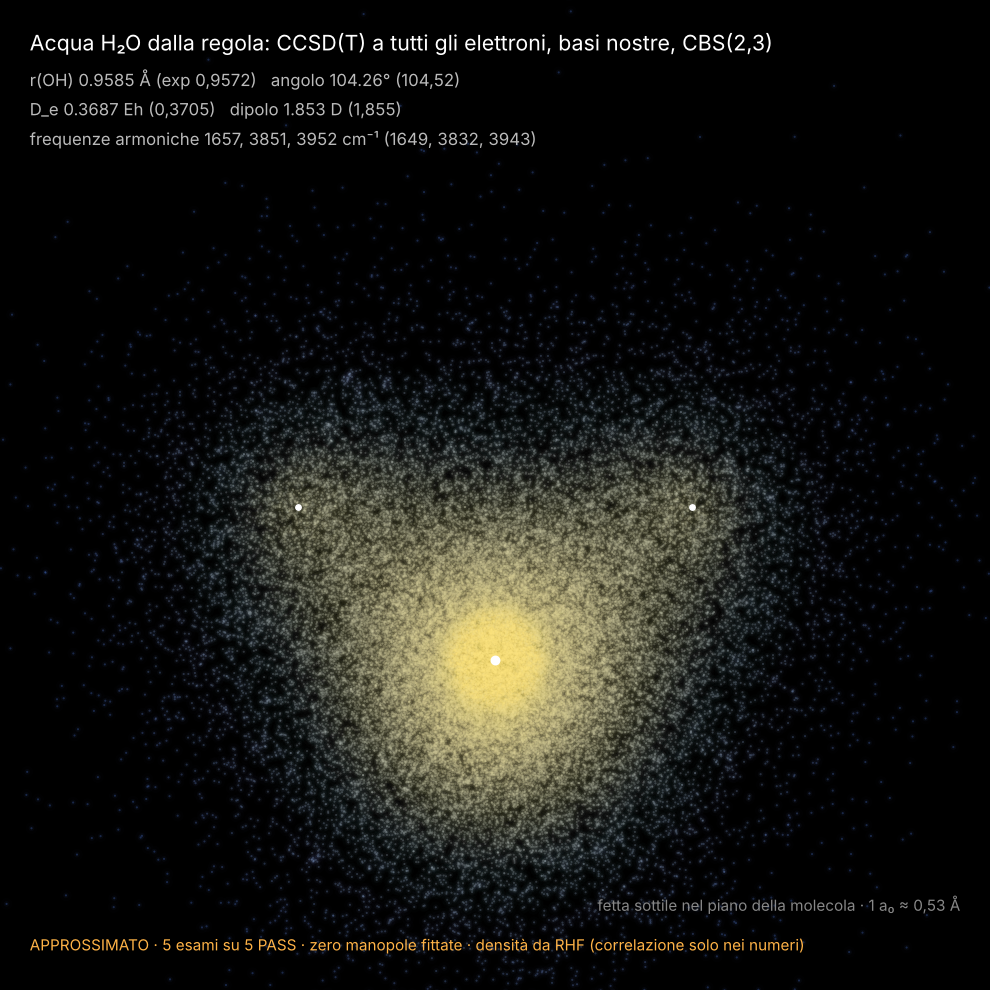

# ACQUA: la molecola H₂O (tier "approssimato")

**In breve:** abbiamo costruito da zero un motore molecolare a più centri (integrali gaussiani, Hartree–Fock,
CCSD(T)) e con questo abbiamo calcolato l'acqua partendo solo da Z = 8, 1 e dalle costanti fisiche.
I 5 esami pre-registrati sono **tutti PASS**, con **zero manopole fittate** sugli esperimenti.
È una **validazione** (ritroviamo numeri noti con un metodo noto, CCSD(T)), non una scoperta: la novità è che ora il
progetto ha un motore suo che sa fare molecole.

## Risultati (pre-registrazione: `lab/out/acqua_prereg.json`, verdetti: `lab/out/acqua_verdetti.json`)

| esame | nostro | riferimento | scarto | soglia | esito |
|---|---|---|---|---|---|
| A1 distanza O–H | 0,9585 Å | 0,9572 Å | +0,14 % | 0,5 % | PASS |
| A2 angolo H–O–H | 104,26° | 104,52° | −0,26° | 1° | PASS |
| A3 energia di atomizzazione D_e | 0,3687 Eh (10,03 eV) | 0,3705 Eh | −0,49 % | 3 % | PASS |
| A4 dipolo | 1,853 D | 1,855 D | −0,12 % | 5 % | PASS |
| A5 frequenze armoniche | 1657, 3851, 3952 cm⁻¹ | 1649, 3832, 3943 | +0,5 %, +0,5 %, +0,2 % | 3 % | PASS |

Convergenza con la base (si vede che il CBS aiuta):

| | X=2 | X=3 | CBS(2,3) |
|---|---|---|---|
| r(OH) Å | 0,9680 | 0,9599 | 0,9585 |
| angolo | 104,14° | 104,32° | 104,26° |
| D_e Eh | — | 0,3647 | 0,3687 |
| dipolo D | — | 1,853 | 1,852 |

Solo Hartree–Fock (senza correlazione) D_e = 0,258 Eh e dipolo 1,99 D: la correlazione vale il 30 % del legame.

## Come funziona (spiegato semplice)

1. **Palline gaussiane.** Ogni elettrone vive in una combinazione di "nuvolette" gaussiane centrate sui nuclei
   (s, p, d, f, g). Gli integrali fra nuvolette (sovrapposizione, energia cinetica, attrazione dei nuclei,
   repulsione fra elettroni) si fanno con formule esatte (McMurchie–Davidson), compilate con numba
   (`lab/acqua_int.py`).
2. **Le basi sono nostre.** Niente tabelle pubblicate: gli esponenti sono serie geometriche (even-tempered)
   ottimizzate sulle energie dei nostri atomi (HF di O e H; CCSD di O e di H₂ per le funzioni di polarizzazione),
   più una diffusa per ogni l (la serie s continua di un passo). Due taglie, X = 2 (56 funzioni per l'acqua) e
   X = 3 (112 funzioni), poi estrapolazione X⁻³ della correlazione ("CBS").
   Parametri: `lab/out/acqua_basi.json`.
3. **HF + CCSD(T).** Hartree–Fock dà gli orbitali; il coupled cluster CCSD(T) (a guscio chiuso, scritto qui e
   controllato contro quello a spin-orbitali di `tavg_cc`) aggiunge la correlazione di **tutti** i 10 elettroni.
   Per l'atomo O (³P) si usa il ROHF sferico + il CCSD(T) a spin-orbitali di `tavg_cc`.
4. **Geometria.** Griglia 3×3 di punti (r, angolo), superficie interpolata, minimo; ricentrata automaticamente
   (partenza dal minimo HF, nessun dato esterno). Frequenze: costanti di forza dalla superficie + due punti
   asimmetrici, masse dei nuclei. Dipolo: campo elettrico finito (±0,002 e ±0,004 au).
   Tutto in `lab/acqua_plan.py`, `lab/acqua_judge.py`. 79 punti di calcolo, ~3 min l'uno a X = 3.

## Controlli di macchina (`lab/out/acqua_checks.json`)

- **C-INT** integrali contro quadratura a forza bruta (senza Boys e senza ricorrenze): errore massimo 3·10⁻¹²
  (soglia 10⁻⁸), fino a funzioni g. PASS
- **C-CC** CCSD e (T) a guscio chiuso contro il codice a spin-orbitali: 1,3·10⁻¹⁰ Eh. PASS
- **C-H** atomo H (X=4): E_HF = −0,49984 (esatto −0,5). PASS
- **C-H2** H₂ CBS(3,4): R_e = 1,4015 bohr (nostro esatto 1,4009), D_e = 4,7476 eV (4,7477). PASS
- **C-O** atomo O, CCSD(T) CBS(3,4): vedi sotto.

C-O (atomo O a X=4, controllo di macchina più costoso): in corso, il risultato viene aggiunto qui.

## Debiti (cose messe a mano o approssimate)

- Base finita + estrapolazione a due punti X⁻³ (X = 2, 3 per la molecola): l'errore residuo stimato su D_e è
  ~0,5 %, è proprio quello che vediamo.
- Triple perturbative (T), non CCSDT completo.
- Nuclei fermi (Born–Oppenheimer), niente relativistica, niente moto di punto zero: per questo i riferimenti sono
  D_e "senza ZPE" e frequenze **armoniche**.
- Densità della figura e dei campioni presa da HF (la correlazione entra solo nei numeri).
- L'atomo O usa un ROHF **sferico** (stessa funzione radiale per px, py, pz). Senza questo vincolo il determinante
  scende di ~2 mEh rompendo la simmetria: scelta dichiarata, uguale a quella del livello fine.
- L'ottimizzazione Nelder–Mead degli esponenti di polarizzazione di O a X=3 si è fermata al tetto di 60
  valutazioni (variazioni residue < 10⁻⁵ Eh).

## Manopole

- **Fittate sugli esperimenti: 0.**
- Scelte dichiarate (non fittate sull'acqua): numero di funzioni per X, regola delle diffuse, energie usate per
  ottimizzare gli esponenti (per X: O 4 + 3–4, H 2 + 1–4 parametri, tutti variazionali sui nostri atomi),
  estrapolazione X⁻³, passi di griglia e di campo.

## Export

`lab/out/acqua_dati/` (manifest, geometria, livelli). I campioni (`acqua_campioni.npy`, 10 elettroni × 20 000
configurazioni dalla densità RHF) non sono tracciati: `python lab/acqua_figure.py export`.

## Il dimero (H₂O)₂: NON fatto, cosa costerebbe

Con questo codice gli integrali stanno tutti in memoria (M⁴ numeri). Il dimero a X = 3 ha M = 224 funzioni:
224⁴ × 8 byte = **20 GB**, oltre i 2,5 GB per processo. A X = 2 (M = 112) entrerebbe, ma X = 2 da sola sbaglia il
legame idrogeno di ben più del 10 % (errore di sovrapposizione delle basi), quindi non è un esame onesto.
Serve:
- una **decomposizione di Cholesky** degli integrali costruita da noi (nessuna base ausiliaria esterna):
  ~224² × 1100 vettori × 8 byte ≈ 0,45 GB;
- un CCSD che faccia il termine vvvv dai vettori di Cholesky (~1–2 min per iterazione, ~30 iterazioni) e le (T)
  (~1–2 h per punto);
- geometria a monomeri quasi rigidi + 3–4 coordinate intermolecolari: ~15–20 punti, più la correzione
  counterpoise. Stima: **~200 righe nuove e ~40–60 ore di CPU**.
