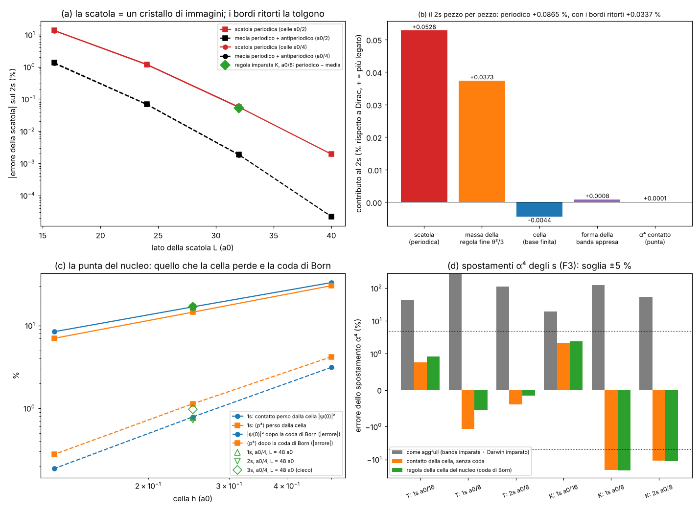

# 2s all'agglomeratore: lo specchio della scatola e la punta del nucleo

Studio `agg2s_`. Continua `docs/AGGLOMERATO_COMPLETO.md` (studio `aggfull_`, letto e importato senza toccarlo) sui due
FAIL rimasti: **E2** (il 2s a celle a₀/8 a +0,110 % da Dirac contro la soglia 0,1 %; +0,087 % col cinetico ri-imparato K) e
**F3/F3K** (gli spostamenti α⁴ degli stati s sbagliati di +15 … +125 %, attribuiti al cuspide del nucleo).

File: motore `lab/agg2s_core.py` (atomo con **bordi ritorti**, campo di Galerkin compatto per parità, LOBPCG snello,
costanti geometriche del cubo di Brillouin), `lab/agg2s_run.py` (corse a a₀/8), `lab/agg2s_contact.py` (corse di
contatto a a₀/4, 3s cieco), `lab/agg2s_post.py` (osservabili sui vettori: banda, coda), `lab/agg2s_analyze.py` (esami),
`lab/agg2s_figure.py` (figura), `lab/agg2s_drive.sh` (driver). Sviluppo (dichiarato): `lab/agg2s_dev_box.py`,
`lab/agg2s_dev_box2p.py`, `lab/agg2s_dev_contact.py`. Prove dopo (dichiarate): `lab/agg2s_posthoc_3s.py`,
`lab/agg2s_idea_twist.py`, `lab/agg2s_idea_zones.py`.

Pre-registrazione: `lab/agg2s_prereg.py` → `lab/out/agg2s_prereg.json`, **commit 03dab0d, prima delle corse di
produzione**. Risultati: `lab/out/agg2s_atom.json`, `agg2s_contact.json`, `agg2s_post.json`, `agg2s_verdict.json`.
Figura: `lab/out/agg2s_figure.png`.



---

## 0. In breve

**Il 2s: era la scatola, quasi tutta.** Messo pezzo per pezzo, il +0,087 % del 2s (cinetico K, celle a₀/8, scatola
±16 a₀) è:

| pezzo | contributo (rispetto a Dirac, + = più legato) |
|---|---|
| **scatola periodica** (le immagini dell'atomo nelle scatole vicine) | **+0,0528 %** |
| massa della regola fine (θ²/3: la pallina fine pesa 1,000373 m_e) | +0,0373 % |
| cella (la base di onde piane non tiene il cuspide; campo di Galerkin esatto) | −0,0044 % |
| forma della banda appresa ad alto k | +0,0008 % |
| α⁴ di contatto (Darwin + massa-velocità vicino al nucleo) | +0,0001 % |
| **somma** | **+0,0867 %** (misurato +0,0865 %: il bilancio chiude a 2·10⁻⁶) |

Il campo di Galerkin non sbaglia niente di suo (è la proiezione esatta di −α/r sulla base); la "media di cella" del
vecchio studio non c'è più; la coda ad alto k del solutore, con un solutore che non riparte ogni 5 passi, è quella giusta
(il peso del guscio esterno del cubo è quello previsto dalla coda di Born entro 0,1–4 %).

**La cura della scatola: i bordi ritorti.** La scatola periodica trasforma l'atomo in un **cristallo delle sue immagini**.
Lo stato calcolato è l'onda di Bloch di quel cristallo con fase zero, cioè il fondo della banda: il 2s "si lega" alle sue
6 immagini e scende. Rifacendo lo stesso calcolo con lo stato **antiperiodico** (cambia segno passando da una faccia
all'altra: il cima della banda) e facendo la media, i contributi delle 6 facce e degli 8 spigoli-vertice si cancellano
esattamente. Nessun parametro, nessun ingresso. Risultato a a₀/8 con la regola imparata:

**2s1/2 = −3,402628 eV, +0,0337 % da Dirac** (prima +0,087 %); i quattro livelli 1s / 2s / 2p½ / 2p3/2 a **+0,026 /
+0,034 / +0,038 / +0,038 %** (E2X PASS, anche col cinetico T: +0,028 / +0,035 / +0,038 / +0,038 %). Quello che resta è
quasi tutto la massa della regola fine (+0,0373 %), che non è un errore del livello grosso ma della finezza θ della regola
fine.

**La punta del nucleo: la coda di Born.** Per gli s la cella grossa perde una parte del contatto: |ψ(0)|² −8,4 %,
⟨p⁴⟩ −7 % a a₀/8. Ma **il pezzo perso ha una forma che la regola grossa conosce già**: oltre il cubo di Brillouin
l'equazione della cella dà ψ(k) → 8π m Zα ψ(0)/k⁴ (massa imparata, −Zα/r in ingresso). Integrata sulla geometria del cubo
(un numero puro: la media di max(|nₓ|,|n_y|,|n_z|) sulla sfera, **0,83119**), dà **la regola della cella che contiene il
nucleo**, senza parametri: contatto e ⟨p⁴⟩ tornano entro **0,2–0,3 %** a a₀/8, l'errore d'energia della cella del 1s
scende da −0,0124 % a −0,0006 % (20 volte), il 3s **cieco** ha il contatto giusto entro l'1 %.

**F3 degli s: non era il cuspide.** Calcolo e numeri dicono una cosa diversa da quella scritta in AGGLOMERATO_COMPLETO §4.3:
il cuspide tagliato dalla cella pesa **allo stesso modo e con segno opposto** nella massa-velocità e nel Darwin (tutte e
due le code valgono 8π²α²ρ I, I = integrale fuori dal cubo), quindi **si cancella al primo ordine**. Il +125 % del vecchio F3K
viene dalla **banda appresa e dall'accoppiamento appreso usati ad alto k** (dove non sono Dirac): banda +112 … +256 %,
accoppiamento a q alto +16 %, contatto vero solo −1 … −3 %. Usando della regola grossa solo quello che è giusto (i
coefficienti di Taylor, c₄ e Darwin d) e la coda di Born, gli spostamenti α⁴ degli s escono **entro lo 0,93 %** (1s a₀/16
+0,93 %, 1s a₀/8 −0,54 %, 2s a₀/8 −0,14 %; cinetico T, F3S PASS anche la soglia forte 1,5 %). Col cinetico K FAIL
(−22 %): il suo c₄ a a₀/8 è sbagliato del 4 % (K non ha Taylor fissato). **Per l'α⁴ degli s non serve lo zoom fine.**

**Esami: 10 PASS / 3 FAIL** (BORN_3s: il contatto del 3s cieco passa, l'energia no per la scatola; F3S_K e F3Sstrong_K).

---

## 1. Il problema, detto semplice

Nell'agglomeratore l'atomo di idrogeno è fatto di celle grosse (a₀/8 = 17 lunghezze Compton) che hanno imparato dalla
regola fine come muoversi (la "banda") e come sentire il nucleo (l'"accoppiamento"). Lo studio precedente aveva messo il
2s a +0,110 % (soglia 0,1 %) e +0,087 % col cinetico ri-imparato, e diceva: "il vecchio +1 % era la scatola più la media di
cella; ora scatola ±16 a₀ e campo senza media". Restava da capire **di chi fosse il +0,09 %**. E gli spostamenti α⁴ degli s
(la parte relativistica: massa-velocità e Darwin) sbagliavano di decine di punti percentuali.

## 2. Cosa ho fatto

### 2.1 Il 2s termine per termine

Ho separato i pezzi con calcoli che ne cambiano uno solo alla volta:

- **scatola**: lo stesso atomo con i bordi ritorti (§2.2); in sviluppo, con il cinetico esatto k²/2 su celle a₀/4 e a₀/2,
  scatole da 16 a 48 a₀;
- **cella**: lo stesso campo e la stessa griglia ma il cinetico esatto di Schrödinger (corse "S"): dice quanto perde la
  base finita, da sola;
- **massa**: la massa cinetica della regola imparata (1,0003734, cioè tan θ/θ della regola fine);
- **banda e accoppiamento ad alto k**: sul vettore convergiuto, ⟨T_imparato − T_Dirac⟩ (forma della banda) e il resto
  relativistico con la banda di Dirac esatta;
- **solutore**: il peso del guscio esterno del cubo (|kᵢ| h > 0,8π) contro quello previsto dalla coda di Born.

### 2.2 I bordi ritorti (idea geometrica, la cura)

Una scatola periodica di lato L è un **cristallo**: l'atomo vede le sue copie a distanza L. Lo stato che calcoliamo è
un'onda di Bloch del cristallo, ψ(x + L eₐ) = e^{iθₐ} ψ(x). Con θ = 0 (scatola periodica) il 2s è in fondo alla banda: si
lega alle 6 copie vicine e scende di 6t (t = salto tra copie). Con θ = π su tutti e tre gli assi (antiperiodico) è in cima:
sale di 6t. **La media delle due cancella le 6 facce e gli 8 vertici esattamente**; restano gli spigoli (distanza √2 L,
molto più deboli) e un piccolo "campo cristallino" (il potenziale tagliato a metà scatola). L'atomo isolato è la media della
banda su tutte le fasi (l'energia in sito del suo stato di Wannier).

La verifica che il quadro è giusto: le energie del 2s con 0, 1, 2, 3 assi antiperiodici (regola imparata K, a₀/8) sono
**equidistanti** (passi 1,2170 / 1,1961 / 1,1776 meV: una banda a coseno con i soli primi vicini), e lo spostamento della
scatola previsto **prima** con il cinetico esatto su celle a₀/4 (+5,321·10⁻⁴) è uscito +5,278·10⁻⁴ con la regola imparata
a a₀/8 (−0,8 %). Per il 2p è al contrario: il 2p_z è dispari attraverso le facce z, la scatola periodica lo **slega**
(−1,694·10⁻⁴ previsto, −1,685·10⁻⁴ misurato). Il vecchio "+1,003 %" e il "−0,30 %" del 2p a ±12 a₀ erano lo stesso
fenomeno con la scatola più piccola.

Costo: due calcoli (periodico e antiperiodico) invece di uno, entrambi in aritmetica reale. L'idea di usare **una** sola
torsione θ = (π/2, π/2, π/2) è stata provata ed è **negativa** per l'idrogeno: rompe l'inversione e mescola 2s e 2p
degeneri (§9.1). Per stati con molti vicini degeneri (3s ↔ 3d) anche le torsioni 100/110 rompono la simmetria cubica
(§5.1): si usano solo 000 e 111.

Tecnica: l'antiperiodico vive sulla griglia di Fourier spostata di π/L; il campo di Galerkin a 8 sotto-punti si applica con
le fasi d'interpolazione spostate allo stesso modo; il settore di parità tiene conto che sul piano di bordo ψ(+L/2) =
−ψ(−L/2).

### 2.3 La coda di Born della cella che contiene il nucleo

Per uno stato s, vicino al nucleo ψ ha una punta (il cuspide) e nello spazio dei momenti una coda lunga. La cella grossa
tiene solo i k dentro il suo cubo di Brillouin |kᵢ| < π/h. Ma per k grande la regola grossa stessa dice come continua la
coda: nell'equazione (k²/2m) ψ(k) ≈ −Ṽ(k) ψ(0) con Ṽ(k) = −4πZα/k² (l'ingresso), quindi **ψ(k) → 8π m Zα ψ(0)/k⁴**. Il
pezzo di coda fuori dal cubo dipende solo da:

- I = ∫_fuori d³k/((2π)³k⁴) = **0,0134036 · h** (= h ⟨max|nᵢ|⟩ 4π/(π(2π)³), ⟨max|nᵢ|⟩ = 0,831190 sulla sfera),
- J = ∫_fuori d³k/((2π)³k⁶) = **3,2627·10⁻⁴ · h³** (⟨max|nᵢ|³⟩ = 0,599071).

Allora, senza parametri:

- contatto: ψ(0) = ψ_c(0) + 8π m Zα ψ(0) I → **ρ_B = ρ_c / (1 − 8π m Zα I)²**;
- ⟨p⁴⟩_B = ⟨k⁴⟩_c + (8π m Zα)² ρ_B I;
- energia della cella (secondo ordine della coda): **ΔE_B = −2m (4πZα)² ρ_c J**.

È la "regola della cella che contiene il nucleo": un'informazione **sotto la cella** ricostruita dalla regola della cella
(come una *normal map* in grafica: il poligono grosso porta il dettaglio fine sotto forma di un numero).

### 2.4 Perché F3 degli s non è il cuspide (calcolo)

Spostamento α⁴ di uno stato s (forma di Pauli): A = −⟨p⁴⟩/8m³ + (πZα/2m²)|ψ(0)|². La cella perde la coda fuori dal cubo
in **tutti e due** i termini:

- massa-velocità: −(1/8)·(8πZα)²ρ I = **−8π²(Zα)² ρ I**;
- Darwin: (πZα/2)·(ρ_B − ρ_c) ≈ (πZα/2)·2·8πZα I ρ = **+8π²(Zα)² ρ I**.

**Si cancellano esattamente al primo ordine nella cella**, per qualunque forma della zona (I è lo stesso integrale). Quindi
l'errore di contatto di A va come h², non come h. Numeri (1s, cinetico esatto): massa-velocità ×0,697 / 0,855 / 0,930 e
Darwin ×0,670 / 0,832 / 0,916 a a₀/2, a₀/4, a₀/8, ma la somma sbaglia solo di −19,5 / −5,3 / **−1,36 %** (ordine h²).

Allora da dove veniva il +125 %? Dal fatto che lo studio precedente valutava A con **la banda imparata intera** e
**l'accoppiamento imparato intero**, anche dove la coda del vettore li usa ad alto k (k ≈ π/h), dove la banda imparata non
è Dirac. Separando (1s a₀/8, rispetto allo spostamento esatto −1,81·10⁻⁴ eV):

| pezzo | cinetico T | cinetico K |
|---|---|---|
| forma della banda ad alto k (⟨T_imparato − T_Dirac⟩) | **+256 %** | **+112 %** |
| accoppiamento imparato a q alto (Darwin dello stencil − Darwin di contatto) | +16 % | +16 % |
| contatto vero (banda di Dirac, Darwin di contatto) | −2,6 % | −2,8 % |

Il cinetico T (Taylor fissato) ha la banda **peggiore** ad alto k (l'errore della banda vale 4,6·10⁻⁴ eV sul 1s), ma i
coefficienti di Taylor **esatti**. La regola della cella del nucleo usa della regola grossa solo quello che è giusto: c₄
(il k⁴ della banda, lettura esatta dello stencil) e d (il Darwin dell'accoppiamento a q piccolo), più la coda di Born.

## 3. Numeri contro la pre-registrazione (`agg2s_prereg.json`, commit 03dab0d)

| esame | cosa | risultato | esito |
|---|---|---|---|
| BOX | spostamento della scatola del 2s (K, a₀/8, L = 32 a₀) entro ±15 % del previsto +5,321·10⁻⁴ | **+5,278·10⁻⁴** (−0,8 %) | **PASS** |
| BOX2p | lo stesso per il 2p, ±20 % di −1,694·10⁻⁴ | −1,685·10⁻⁴ (−0,5 %) | **PASS** |
| E2X | 4 livelli a a₀/8 (K), media dei bordi ritorti + dV, entro 0,1 % da Dirac | 1s **+0,0264**, 2s **+0,0337**, 2p½ **+0,0378**, 2p3/2 **+0,0378 %** | **PASS** |
| E2Xs | 2s entro 0,05 % | −3,4026278 eV contro −3,4014799: **+0,0337 %** | **PASS** |
| E2XT | come E2X col cinetico T | +0,0283 / +0,0347 / +0,0377 / +0,0377 % | **PASS** |
| BUD | bilancio del 2s chiuso entro 3·10⁻⁵ | periodico: misurato +8,653·10⁻⁴, somma +8,665·10⁻⁴; ritorto: +3,375·10⁻⁴ contro +3,387·10⁻⁴ (scarti 1,2·10⁻⁶) | **PASS** |
| E2B | con l'energia della coda di Born, 1s e 2s (K e T) entro 0,005 % di m_kin × Dirac | K1s **+0,0008 %**, K2s +0,0023 %, T1s +0,0027 %, T2s +0,0033 % (senza Born: −0,011 / −0,004 / −0,009 / −0,003 %) | **PASS** |
| BORN_S | Schrödinger esatto a a₀/8: ρ_B e ⟨k⁴⟩_B entro 0,5 %, E + ΔE_B entro 2·10⁻⁵ | 1s: ρ 0,9159 → **0,9982**, ⟨k⁴⟩ 0,9300 → **0,9972**, E −0,0124 % → **−0,0006 %**; 2s: 0,9165 → 0,9989, 0,9468 → 0,9985, −0,0044 % → +0,0015 % | **PASS** |
| BORN_3s | **3s cieco** (a₀/4, L = 48 a₀): ρ_B, ⟨k⁴⟩_B entro 2 %; E + ΔE_B entro 2·10⁻⁴; universalità entro 5 % | ρ 0,8305 → **0,9903**, ⟨k⁴⟩ 0,8936 → **0,9889**; contatto perso per unità di ρ_c 1s/2s/3s **0,2016 / 0,2011 / 0,2041** (1,5 %); **energia +0,0111 % → +0,0395 %** | **FAIL** (solo l'energia: §5) |
| F3S_T | spostamenti α⁴ degli s con la regola della cella del nucleo, entro 5 % (cinetico T) | 1s a₀/16 **+0,93 %**, 1s a₀/8 **−0,54 %**, 2s a₀/8 **−0,14 %** (stile aggfull: +43 / +270 / +113 %) | **PASS** |
| F3Sstrong_T | lo stesso entro 1,5 % | peggiore 0,93 % | **PASS** |
| F3S_K | come F3S col cinetico K | +2,4 / **−21,9** / −11,2 % | **FAIL** |
| F3Sstrong_K | entro 1,5 % | 21,9 % | **FAIL** |

**10 PASS / 3 FAIL.**

## 4. Le cose che si capiscono dai numeri

### 4.1 Il 2s non aveva un problema di agglomeratore
Tolta la scatola, il livello grosso a a₀/8 riproduce la fisica della sua stessa massa (Dirac con m = 1,000373) entro
−0,0036 % per il 2s (cella −0,006 %, residuo dei bordi ritorti +0,002 %, α⁴ +0,001 %), e con l'energia della coda di Born
entro +0,0023 %. Il +0,0337 % da Dirac rimasto è la massa della regola fine (θ = a₀/4096): è un debito della regola fine
(la sua finezza), non dell'agglomeratore. Per scendere sotto si stringe θ, non si cambiano le celle.

### 4.2 La media di cella del vecchio studio era anche lei contatto
Con i numeri di AGGLOMERATO_COMPLETO (corse con la media di cella a ±16 a₀): 1s −1,60 %, 2s −0,82 % (con +0,05 % di
scatola dentro). Tolta la scatola: 0,218 eV contro 0,030 eV, rapporto 7,4 ≈ 8 = rapporto delle densità al nucleo. Anche
quell'errore era tutto **contatto** (∝ |ψ(0)|²). Il campo di Galerkin lo toglie perché è la proiezione esatta; quello che
resta è la base finita (−0,012 % sul 1s), che la coda di Born toglie quasi tutto.

### 4.3 Quanto dello spostamento α⁴ degli s si recupera al livello grosso
**Tutto, all'ordine α⁴**, purché si usino i coefficienti giusti: la cancellazione al primo ordine (§2.4) e la coda di
Born per il secondo. Gli errori rimasti (0,1–0,9 %) sono i coefficienti della regola fine stessa: c₄ = Dirac × 1,0015 e
d = 0,12517 / 0,12539 (+0,13 / +0,31 %), amplificati circa ×5 nel 1s perché A è una differenza (−9,06 + 7,25 = −1,81 in
unità 10⁻⁴ eV). Quello che **richiede lo zoom fine** (studio `nucleo1s_`): l'errore di contatto della regola fine stessa
(K a^{2γ}, il vecchio θ² ln θ), la struttura di Dirac sotto λ_C (ψ ∝ r^{γ−1}: ordini α⁶ e oltre) e, se un giorno ci sarà,
la QED. Il cinetico K non basta: senza Taylor fissato il suo c₄ a a₀/8 è −4 % (F3S_K FAIL).

### 4.4 La coda del solutore
Con il LOBPCG snello (un vettore, nessuna ripartenza) il peso del guscio esterno del cubo (|kᵢ|h > 0,8π) del 1s e del 2s
è quello previsto dalla coda di Born entro 0,1–4 % (K1s 1,882·10⁻⁷ contro 1,882·10⁻⁷; K2s 2,350·10⁻⁸ contro 2,341·10⁻⁸;
S1s 1,81 contro 1,88·10⁻⁷). Il 2p converge a residuo 2·10⁻¹⁰ (lo studio precedente si fermava a 1,3·10⁻⁸) e il suo resto
cinetico, **senza nessun filtro**, è a +2,9 % (K) / +2,1 % (T) della massa-velocità esatta; 2p½ +1,2 / +0,9 %, 2p3/2 +6,5 /
+4,7 %. (La coda del 2p è del cantiere `aggfull_`, che nel frattempo l'ha diagnosticata come parità sbagliata del
solutore: qui lo segnalo soltanto, è coerente.)

### 4.5 Il contatto è universale
Il contatto perso dalla cella per unità di contatto grosso, (ρ − ρ_c)/ρ_c, a a₀/4 vale 0,2016 / 0,2011 / 0,2041 per
1s / 2s / 3s (3s mai visto prima): la forma della punta vicino al nucleo è la stessa per tutti gli s, dettata solo da
−Zα/r. È per questo che una regola della cella sola funziona per tutti.

## 5. Fallimenti (dichiarati)

- **BORN_3s (energia)**: il 3s a L = 48 a₀ è ancora troppo grande per la scatola. Con i due bordi (0 e π) l'energia è
  +0,84 % e −0,82 %: due numeri grandi di segno opposto, la cui media (+0,011 %) **non** è affidabile al livello della
  correzione di cella che volevo misurare (+0,028 %): la prova a 8 torsioni (§5.1) mostra che il resto della scatola del 3s
  è dell'ordine di 0,4 %, cioè 10 volte la correzione. La parte di contatto del 3s cieco passa (ρ 0,99, ⟨k⁴⟩ 0,99,
  universalità 1,5 %): fallisce solo l'energia, e per colpa della scatola, non della cella.
- **F3S_K / F3Sstrong_K**: col cinetico K il coefficiente k⁴ della banda a a₀/8 è 0,959 × Dirac; A (differenza di due
  numeri grandi) amplifica: −22 %. Non è la regola della cella, è K. Cura: il cinetico T (fatto).
- **Pre-registrazione, correzioni di implementazione dopo il commit** (nessuna soglia cambiata): (1) la quadratura
  delle costanti del cubo aveva un limite d'integrazione sbagliato (dava ⟨max|nᵢ|⟩ = 1,29): corretta e controllata col
  Monte Carlo (0,83119 contro 0,83120) **prima** di ogni analisi; (2) ⟨k⁴⟩ e resto cinetico degli stati ritorti erano
  calcolati con la FFT di ψ invece che di u = ψ e^{−iθx/L} (griglia di Fourier sbagliata: +2 % sul ⟨k⁴⟩ del 1s): rifatti
  dai vettori salvati (`agg2s_post.py`, e `agg2s_contact.py` per le corse a a₀/4); le energie non c'entrano; (3) una
  prima versione usava un temporaneo complex64 nel campo (−40 % di memoria) e spostava il 1s di +3·10⁻⁶ eV: scartata prima
  delle corse.
- **Memoria**: la prima versione a N = 256 arrivava a 3,5 GB (oltre il limite 2,5): il campo è stato compattato per parità
  (8 N³ → (N+1)³ numeri, controllo di parità esatto) e il solutore riscritto in place: picco 2,0 GB.

### 5.1 Prova dopo sul 3s (dichiarata)
Dopo il verdetto ho rifatto 1s, 2s, 3s (Schrödinger esatto, celle a₀/4, L = 48 a₀) anche con le torsioni 100 e 110
(1 e 2 assi antiperiodici), per avere tutti e 8 gli angoli della cella di Brillouin (`agg2s_posthoc_3s.py`,
`agg2s_posthoc_3s.json`). Errori rispetto a −RY/n²:

| torsione | 000 | 100 | 110 | 111 | media 8 | media 000+111 |
|---|---|---|---|---|---|---|
| 3s | +0,84 % | +0,60 % | +0,42 % | −0,82 % | **+0,38 %** | +0,011 % |

- 1s e 2s: i 4 gradini sono **equidistanti** (1s −5,65·10⁻⁸ ciascuno, 2s +4,13·10⁻⁷ ciascuno, uguali entro 0,3 %): banda
  da sole facce, e la media a due punti coincide con quella a 8 entro 4·10⁻⁹. Il trucco della §2.1 è confermato.
- 3s: i gradini **non** sono equidistanti (0,245 / 0,180 / 1,236 %). Motivo probabile (non verificato stato per stato): le torsioni 100 e 110 rompono la simmetria
  cubica e il 3s (degenere con 3p e 3d) probabilmente si **mescola** con i 3d di tipo e_g (d_{z²}, d_{x²−y²}), che hanno la
  stessa parità. Con 000 e 111 la simmetria cubica resta e il mescolamento è proibito. Quindi a L = 48 a₀ il 3s non è nel
  regime "atomo quasi solo" (code delle immagini piccole): il suo raggio (~13 a₀ per ⟨r⟩, coda fino a ~40 a₀) sente
  le copie a più del primo ordine.
- Conclusione: per il 3s serve **L ≳ 64 a₀** (stima dal decadimento e^{−L/3a₀}: ×0,005 rispetto a 48), a a₀/4 sono
  N = 256, fattibile in cloud ma oltre il budget di questo studio. Il FAIL resta: dichiarato, non riaggiustato.

## 6. Debiti: chiusi, aperti, nuovi

| debito | prima | ora |
|---|---|---|
| E2 di AGGLOMERATO_COMPLETO (2s a a₀/8 entro 0,1 %) | FAIL +0,110 % (+0,087 % con K) | **chiuso**: +0,0337 % (bordi ritorti); quattro livelli entro 0,038 % (K e T) |
| scatola ±16 a₀ (una scelta) | messa a mano | **chiuso come errore**: misurata e tolta senza parametri; resta +0,002 % (spigoli e campo cristallino) |
| F3/F3K degli s | FAIL (+15 … +125 %), "serve lo zoom" | **chiuso all'ordine α⁴ col cinetico T**: −0,14 … +0,93 %; diagnosi corretta: banda/accoppiamento ad alto k, non cuspide |
| errore di cella degli s (base finita) | −0,012 % (1s a₀/8) | coda di Born: −0,0006 % |
| contatto |ψ(0)|² al livello grosso (serve per Darwin, iperfine, 21 cm) | −8,4 % a a₀/8 | 0,2 % |
| massa della regola fine θ²/3 (+0,037 %) | aperto | aperto (della regola fine; non del livello grosso) |

**Debiti nuovi (dichiarati):**
- la regola della cella del nucleo usa la forma asintotica k⁻⁴ (correzioni (Z/a₀)²/k² al bordo del cubo: < 10⁻³ a a₀/8) e
  il secondo ordine per l'energia (residuo 4–10 %: a a₀/4 l'1s va da −0,095 % a −0,010 %);
- la media sulle torsioni è a due punti (0, π): per 1s e 2s gli spigoli sono già trascurabili (media a 8 = media a 2 entro
  4·10⁻⁹); la torsione unica (π/2)³ è negativa (§9.1);
- dV (Darwin + spin-orbita al primo ordine) preso dalle corse periodiche di aggfull_ (effetto della scatola < 10⁻⁷);
- per il 3s la scatola L = 48 a₀ non basta (§5).

## 7. Quante manopole

| pezzo | parametri liberi |
|---|---|
| bordi ritorti | 0 (θ = 0 e π fissati dalla geometria del cristallo di immagini) |
| coda di Born | 0 (costanti del cubo calcolate; m e c₄, d letti dalla regola imparata; −Zα/r ingresso) |
| scelte dichiarate | scatola L = 32 a₀ (quella di aggfull), media a 2 punti, criterio di residuo 2·10⁻⁸ (quello di aggfull) |

Nessun fit. Nessun numero di Dirac o sperimentale usato se non come esame.

## 8. Patch proposte per altri file (non toccati)

- `docs/AGGLOMERATO_COMPLETO.md` §4.3: "Per gli s il limite è il cuspide" → "il cuspide si cancella al primo ordine
  tra massa-velocità e Darwin (AGGLOMERATO_2S §2.4); il FAIL viene dalla banda e dall'accoppiamento imparati usati ad alto k;
  con la regola della cella del nucleo F3 degli s passa entro 0,93 % (cinetico T)". Tabella §5: E2 → "chiuso con i bordi
  ritorti (+0,034 %)".
- `docs/CONTESTO_CLOUD.md` §4 voce 9: "2s +0,034 % (bordi ritorti, AGGLOMERATO_2S); contatto e α⁴ degli s al livello
  grosso con la coda di Born". Indice studi: riga AGGLOMERATO_2S.
- `docs/PIANO.md`: cantiere agglomeratore → "idrogeno al livello grosso fino ad α⁴ compreso per s e p (con cinetico T);
  limite rimasto: θ della regola fine".
- **Per `aggfull_`**: (1) per F3 non serve la banda ad alto k: bastano c₄ e d (fissati alla regola fine) + coda di Born
  (`agg2s_analyze.f3s`); (2) il 2p con un LOBPCG che non riparte converge a 2·10⁻¹⁰ e dà F3 del 2p½ / 2p3/2 a +0,9 / +4,7 %
  (T) senza filtro; (3) la banda T ad alto k sbaglia di 4,6·10⁻⁴ eV sul 1s a₀/8 (+0,0034 % d'energia): se il k⁸ della fase 5
  la migliora, si vedrà in `band_err_eV` di `agg2s_post.py`.
- **Laboratorio Atomo (Rust, `src/atomo/**`, non toccato)**: bordi ritorti nel solutore della scatola (una fase per asse nel
  passo di Fourier), solo θ ∈ {0, π} per gli atomi (la (π/2)³ è negativa, §9.1); il contatto ρ_B per la luminosità della cella del nucleo (§9, V3).
- **Ponte (proposta, non creata)**: `ponte/richieste/agg2s_specchi.json` con azione `foto`: l'atomo 2s con i bordi
  periodici e antiperiodici affiancati (la nuvola tirata/spinta verso le facce), per la grafica V1.

## 9. Idee geometriche e visive

**V1 — La scatola di specchi (fatta, funziona).** *A schermo:* l'atomo dentro un cubo di specchi; fuori, le sue immagini
come atomi fantasma trasparenti. Con i bordi periodici i fantasmi hanno lo stesso colore e la nuvola del 2s si allunga
verso le facce (si "lega" alle copie); con i bordi antiperiodici i fantasmi sono a scacchiera di colori opposti e la nuvola
si ritira. Un cursore "torsione" fa respirare il 2s; la media è l'atomo solo al mondo. *Perché funziona:* la scatola è un
cristallo; la banda E(θ) = E_a + Σ t cos(θ·R) è stata misurata (4 torsioni equidistanti), la media a due punti cancella
facce e vertici. 2s: errore di scatola +0,053 % → +0,002 %. *Costo:* 2 calcoli. *Regole:* sì (condizione al bordo, niente
ingressi).

**V2 — Una torsione sola: il punto (π/2, π/2, π/2) (provata dopo: NEGATIVA per l'idrogeno, §9.1).** *A schermo:* la stessa scatola con i fantasmi
colorati da una fase che gira di un quarto di giro a ogni copia (arcobaleno a scacchi). *Perché:* cos(π/2) = 0 cancella
facce e vertici, e gli spigoli si annullano a coppie; nel motore dinamico ψ è già complessa: costo zero, e la scatola può
essere più piccola (meno celle: utile per la Intel UHD). *Regole:* sì. *Esito:* a L = 32 a₀ +0,017 % contro +0,007 % del
periodico: 2s e 2p si mescolano. Resta utile solo per stati non degeneri.

**V3 — La punta del nucleo come "normal map" (fatta: coda di Born).** *A schermo:* nella cella del nucleo gli s hanno una
**punta luminosa** (densità ρ_B, giusta entro 0,2 % anche a celle grosse), i p un buco nero: a bassa risoluzione (480p, Intel)
la differenza tra s e p al centro resta vera. Un alone di palline piccolissime e velocissime attorno al nucleo mostra la
coda ad alto k (il peso che la cella non tiene, 1,9·10⁻⁷ del 1s nel guscio esterno). *Perché:* la coda è fissata da −Zα/r
e dalla massa: la cella grossa porta l'informazione della sotto-cella in un numero, come una normal map porta i dettagli in
un poligono grosso. *Costo:* nullo. *Regole:* sì.

**V4 — Quanto è rotondo il cubo visto dal centro (fatta).** Il cubo di Brillouin, per la coda del nucleo, vale una sfera
di raggio π/(0,8312 h). A parità di numero di celle (stesso volume della zona) la coda persa cambia poco con la forma:
ottaedro troncato (reticolo bcc) ×0,978, dodecaedro rombico (fcc) ×0,978, sfera ×0,970; l'energia di cella ×0,909 / ×0,906 /
×0,874 (`agg2s_idea_zones.json`). Conferma l'idea G2 negativa di AGGLOMERATO_COMPLETO con un argomento diverso: cambiare
reticolo fa risparmiare al massimo ~13 % di celle. *A schermo:* il cubo con dentro la sfera equivalente. *Regole:* sì.

**V5 — L'accordo delle immagini.** Le 4 energie del 2s con 0, 1, 2, 3 assi antiperiodici sono equidistanti (passo 1,2 meV a
L = 32 a₀): come 4 note di un accordo. *A schermo:* 4 copie dell'atomo una sopra l'altra, colori delle immagini diversi,
altezza = energia. Visualizza che la scatola è un cristallo. *Costo:* 4 calcoli (fatti).

**V6 — Il Darwin e la massa-velocità che si annullano.** *A schermo:* due palline al nucleo, una che spinge su (Darwin, il
tremolio della Zitterbewegung che "sfoca" il nucleo) e una che tira giù (massa-velocità); abbassando la risoluzione tutte e
due si affievoliscono **insieme** e la somma resta ferma. *Perché:* le due code valgono ±8π²(Zα)²ρI (§2.4). *Regole:* sì.

### 9.1 Prova della torsione unica (dopo, dichiarata)
Script `agg2s_idea_twist.py` → `agg2s_idea_twist.json` (Schrödinger esatto, celle a₀/4, ψ complessa). Il 2s con la sola
torsione (π/2, π/2, π/2), rispetto al valore a scatola infinita (−0,0476 % sul −RY/4, dovuto alla cella):

| L (a₀) | 20 | 24 | 28 | 32 |
|---|---|---|---|---|
| (π/2)³ | +2,82 % | +0,705 % | +0,140 % | +0,0174 % |
| periodico (stessa griglia, per confronto a L = 32) | | | | +0,0074 % |

**Negativa.** La torsione unica è **peggio** anche della scatola periodica semplice. Controllo del codice complesso: con θ = 0
e θ = π lo stesso programma ridà i numeri reali (+1,13 % / −1,09 % a L = 24, e +0,705 % a π/2). **Spiegazione probabile,
non dimostrata**: θ = π/2 rompe la simmetria per inversione (r → −r). I salti tra immagini hanno una parte in cos θ (che si
annulla) e una in sin θ (che a π/2 è massima) che accoppia il 2s al 2p, degenere nell'idrogeno: un effetto al primo ordine
invece che al secondo. Con θ ∈ {0, π} sin θ = 0 e il mescolamento è proibito. Il dipolo misurato dello stato più basso
(−0,8 λ_C, cioè 0,006 a₀) non lo mostra in modo netto: la conferma resta aperta. Regola imparata: per gusci
degeneri si usano solo torsioni che rispettano l'inversione (0 e π) e si fa la media; la torsione unica va bene solo per
stati non degeneri (es. un solido senza gusci degeneri).

## 10. Dove l'intuizione di Valerio può aiutare

1. **La scatola come cristallo.** Il trucco funziona perché le copie dell'atomo si "parlano" solo attraverso le facce. Per
   le molecole e i gas (livelli più grossi) la scatola conterrà tante molecole: i bordi ritorti diventano la media su un
   cristallo di molecole. Ti torna l'idea che "l'atomo solo" sia la media di tutti i cristalli possibili delle sue copie?
2. **La punta del nucleo e la luce dei 21 cm.** Il contatto |ψ(0)|² ora è giusto allo 0,2 % anche a celle grosse: è proprio
   quello che serve per la riga dell'idrogeno a 21 cm (spin dell'elettrone contro spin del protone). Vuoi che il prossimo passo
   sia l'iperfine dalla regola (serve lo spin del protone come pallina, già c'è come pallina pesante)?
3. **Massa della regola fine.** Il +0,034 % rimasto è la pallina fine che pesa θ²/3 in più. Per toglierlo bisogna stringere
   θ (più tick) o imparare la massa a θ → 0 (estrapolazione nella regola fine). Quale preferisci: più potenza o più furbizia?
4. **Torsione e moto.** La torsione unica (π/2)³ sembrava gratis nel motore in tempo reale ma per l'idrogeno è peggio della
   scatola semplice (2s e 2p si parlano). Hai un'immagine di "bordo" che non rompa lo specchio r → −r ma costi un calcolo solo?

## 11. Come rieseguire

```
cd lab
python agg2s_dev_box.py 2 32 48 64 80 96; python agg2s_dev_box.py 4 64 96 128   # sviluppo (dichiarato)
python agg2s_dev_box2p.py; python agg2s_dev_contact.py ...                        # sviluppo
python agg2s_prereg.py                                                            # (committato 03dab0d)
./agg2s_drive.sh K1s_000 K2s_000 K2p_000 K1s_111 K2s_111 K2p_111 S1s_000 S2s_000 S1s_111 S2s_111 contact \
    T1s_000 T2s_000 T2p_000 T1s_111 T2s_111 T2p_111 T1s_000_a16 K1s_000_a16 K1s_100 K2s_100 K1s_110 K2s_110
python agg2s_post.py; python agg2s_contact.py; python agg2s_analyze.py; python agg2s_figure.py
python agg2s_posthoc_3s.py; python agg2s_idea_twist.py; python agg2s_idea_zones.py                  # prove dopo
```
Usa i campi di Galerkin e i vettori di aggfull_ in cache (`lab/out/aggfull_field_N256_h17.129500.npz`, `aggfull_vec_eK8_*`
per partire caldi; se mancano si rifanno). Vettori `.npy` e campi `.npz` non sono nel repo.
