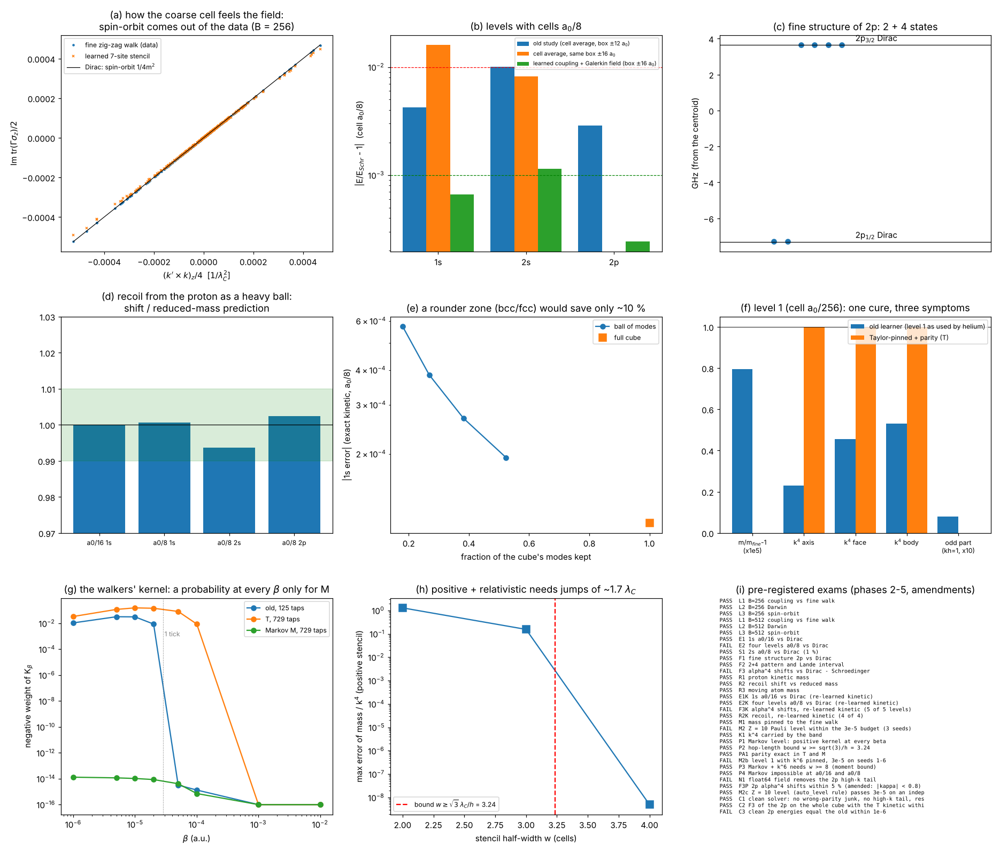

# Agglomeratore completo: la regola grossa senza pezzi scritti a mano

Studio `aggfull_`. Continua `docs/AGGLOMERATO_ZIGZAG.md`, dove la regola grossa dell'idrogeno era **imparata solo a
metà**: il moto libero della cella era imparato, ma il potenziale grosso (la media di −α/r sulla cella), l'accoppiamento
cella–campo e la massa ridotta erano **scritti a mano**. Qui si imparano anche quelli, dalla regola fine, con lo stesso
agglomeratore (blocca, impara, controlla, ripeti).

File: motore `lab/aggfull_core.py` (risposta della regola fine a un'onda di potenziale, inversione di Duhamel, stencil
dell'accoppiamento, campo di Galerkin), `lab/aggfull_learn.py` (gerarchia dell'accoppiamento), `lab/aggfull_proton.py`
(catena del protone), `lab/aggfull_atom.py` (atomo: hamiltoniana, LOBPCG, primo ordine), `lab/aggfull_run.py` (corse),
`lab/aggfull_fineref.py` (riferimento: la regola fine radiale allo stesso θ), `lab/aggfull_analyze.py` (esiti),
`lab/aggfull_figure.py` (figura), `lab/aggfull_geo_bz.py` e `lab/aggfull_posthoc_kin.py` (prove dopo, dichiarate),
`lab/aggfull_relearn.py` (emendamenti), `lab/aggfull_l1.py`, `lab/aggfull_l1_analyze.py` (fase 3: livello 1).
Driver: `lab/aggfull_drive.sh`, `lab/aggfull_drive2.sh`, `lab/aggfull_drive3.sh`.

Pre-registrazione: `lab/aggfull_prereg.py` → `lab/out/aggfull_prereg.json`, **commit f4f43d6, prima delle corse di
produzione**. Emendamenti (dichiarati, **prima** delle corse che riguardano): `lab/out/aggfull_amend.json`,
`lab/out/aggfull_amend2.json` (commit 968a554); fase 3: `lab/aggfull_l1_prereg.py` → `lab/out/aggfull_l1_prereg.json`
(commit 46bd3b3, prima della corsa di produzione). Risultati: `lab/out/aggfull_learn.json`, `aggfull_atom.json`,
`aggfull_atomK.json`, `aggfull_proton.json`, `aggfull_verdict.json`. Figura: `lab/out/aggfull_figure.png`.



---

## 0. In breve

**Cosa volevamo.** Che la regola grossa dell'idrogeno non avesse più pezzi scritti a mano: potenziale grosso,
spin-orbita e Darwin della cella, 2s all'1 % senza reticolo enorme, rinculo del protone senza mettere la massa ridotta.
Poi, su richiesta del thread principale, i problemi del **livello 1** usato dall'elio e dall'idrogeno di Bohr (massa,
segni sbagliati del nucleo dei camminatori, pezzo k⁴ della banda, parità).

**Cosa è uscito (i numeri veri sono in §3).**

1. **Lo spin-orbita e il Darwin escono dai dati.** La cella grossa impara come sente il campo guardando la regola fine;
   leggendo lo stencil imparato si trovano il Darwin (−1/8: −0,1252, cioè +0,13 %) e lo spin-orbita col fattore di Thomas
   (1/4: 0,2503, +0,12 %). Nessuno dei due è stato scritto. La struttura fine del 2p esce **10,9429 GHz contro 10,9497 di
   Dirac (−0,06 %)**, con il disegno 2 + 4 e il rapporto di Landé 0,50000. Il vecchio studio non poteva farlo ("non
   disponibile").
2. **Il potenziale grosso non è più scritto a mano**: 8 "lanterne" per cella (campo di Galerkin senza aliasing). La 1s a
   a₀/16 sta a **+0,0018 % dalla regola fine** allo stesso θ (+0,031 % da Dirac: quasi tutto è la massa θ²/3 della regola fine).
3. **Il 2s all'1 %**: **+0,11 % da Dirac** (prima +1,003 %, FAIL). Il vecchio numero era due errori che si compensavano:
   la scatola ±12 a₀ (immagini del protone, ~+1,2 %) e la media di cella (~−0,8 %). Servono tutte e due le cure: scatola
   ±16 a₀ e campo senza media (a pari scatola: −0,82 % → +0,11 %).
4. **Il rinculo esce da solo.** Il protone è una pallina zig-zag pesante (θ_p = 0,030) agglomerata con la stessa macchina;
   la coppia elettrone+protone dà lo spostamento della massa ridotta entro **0,6 %** su 4 livelli (0,99984 / 1,00065 /
   0,99360 / 1,00238) e l'atomo in moto pesa M/(m_e+m_p) = **1,0007**. μ non compare da nessuna parte.
5. **Fallimenti**: (a) E2 (4 livelli entro 0,1 % a a₀/8): il 2s è a +0,110 % (FAIL di un soffio; con il cinetico
   ri-imparato dell'emendamento passa: +0,087 %, E2K PASS); (b) F3, gli spostamenti α⁴ (relatività) livello per livello:
   FAIL netto col cinetico vecchio (errori ×5–×60) e FAIL anche col cinetico ri-imparato (+15 % … +125 % per gli s,
   −12 % e −61 % per i 2p). Per gli s il limite è **il cuspide del nucleo**: la cella grossa liscia ψ vicino al protone, e
   il pezzo relativistico vive proprio lì (§4.3). (c) Il livello B = 16 non ha uno stencil d'accoppiamento ammissibile
   (segnato e saltato, come previsto).
6. **Livello 1 (fase 3): una sola cura per tre sintomi.** Imparare il livello fissando **esattamente** i coefficienti di
   Taylor della regola fine (massa e k⁴ in 13 direzioni) e la **parità**: la massa è esatta (m₀ = 1,000000001 contro
   1,0000128 di prima), la banda porta il **99,9 %** del k⁴ di Dirac sull'elio (prima il 41 %: il "−0,28 mEh" diventa un
   pezzo noto), la parte dispari passa da 0,11 a 5·10⁻¹³. Per la **positività** serve un vincolo in più: tutti i salti con
   il segno giusto (regola "di Markov"). Allora il nucleo dei camminatori è una probabilità **a ogni β** (β_min = 0, peso
   negativo 10⁻¹⁴), e sull'elio la banda cambia di soli 0,001 mEh. **Teorema di contorno (verificato):** una regola
   positiva che porta la relatività deve saltare almeno √3 λ_C, cioè w ≥ √3/h = 3,24 celle al livello 1: con i 125
   posti (w = 2) è **impossibile**, ed è per questo che il vecchio livello aveva 42 segni sbagliati. FAIL: il controllo
   a 3·10⁻⁵ per Z = 10 passa con 1 seme su 3 (2,8–7,9·10⁻⁵): la massa non è più il problema, resta l'errore ad alto k.

7. **Fase 4 (§12).** Fissare anche il k⁶ porta il livello Z = 10 a 4 semi su 6 entro 3·10⁻⁵ (FAIL, prima 1 su 3); due
   limiti "a palline" verificati (salti ≥ 4,3 λ_C per il k⁶; nessuna regola positiva relativistica con celle > √3 λ_C);
   F3 dei 2p **chiuso con il cinetico T** (−0,7 % e −3,0 %), con un emendamento dichiarato sulla coda finta ad alto k.

**Esami: 16 PASS / 3 FAIL** (fase 2 + emendamenti), **5 PASS / 1 FAIL** (fase 3), **3 PASS / 2 FAIL** (fase 4), **3 PASS / 1 FAIL** (fase 5, §13: livello Z = 10 entro 3·10⁻⁵ su 6 semi su 6; la coda ad alto k era parità sbagliata lasciata dal solutore; F3 dei 2p chiuso senza filtri).

---

## 1. Il problema, detto semplice

Nella regola zig-zag l'elettrone è una pallina che corre a c e ruota. Il protone, visto dalla pallina, è una **fase**
che si aggiunge a ogni passo (−α/r per tick). Quando l'agglomeratore raggruppa 512 × 512 × 512 celle fini in una sola
cella grossa (a₀/8), la cella grossa deve sapere **come sente quella fase**. Nel vecchio studio questo era deciso a mano:
"la cella sente la media di −α/r sul suo cubo". È una scelta ragionevole ma è una **scelta**, e ha tre difetti:

1. dipende da dove metti il nucleo rispetto alla griglia (centro o angolo di cella);
2. non sa niente dello spin: la cella grossa non poteva avere spin-orbita né Darwin (A2c "non disponibile");
3. il 2s a a₀/8 usciva +1,003 % (FAIL di un soffio).

E la massa ridotta μ = m_e m_p/(m_e+m_p) era messa a mano per il rinculo del protone.

## 2. Cosa ho fatto

### 2.1 L'accoppiamento cella–campo imparato (obiettivi 1 e 2)

**Idea.** Si mette la regola fine (θ = a₀/4096, catena A) in un'**onda di potenziale debolissima** e^{iq·x} e si guarda
come risponde dopo B tick, al primo ordine. Si guarda la risposta attraverso la **banda positiva** (l'elettrone, non il
positrone) nella base di Foldy–Wouthuysen (quella dove la componente grande è hermitiana positiva). Poi si inverte la
formula di Duhamel e si ottiene **come il generatore della cella grossa deve accoppiarsi al campo**:

  ⟨k'|V_grosso|k⟩ = Ṽ(k'−k) · Γ(k', k)

Γ è una matrice 2×2 di spin. Non scrivo la sua forma: la **impara** uno stencil hermitiano "a panino"
Γ = Σ_jl C_jl e^{−ik'·j} e^{ik·l} con i siti j, l presi da tre candidati — punto (1 sito), stella (7), cubo (27) —
scelto **in automatico** (il più piccolo che passa il controllo). Coppie (k, k') per l'apprendimento: 75 % distribuite
come lo stato da osservare, 25 % uniformi nel cubo di Brillouin (peso 0,03), minimi quadrati relativi.

**Cosa ci si aspetta dalla fisica (solo per l'esame).** Nel continuo, Dirac al secondo ordine in 1/m dà
Γ = 1 − q²/8 + iσ·(q×k)/4: il primo pezzo è il **Darwin**, il secondo è lo **spin-orbita** (con il fattore di Thomas già
dentro). Nessuno dei due è stato messo: sono letti dallo stencil imparato (gk, gx, gso).

**Repeat.** Il livello B = 512 è imparato dal livello B = 256 **imparato** (non dalla regola fine). B = 16 non ha uno
stencil ammissibile (il cubo è "selvatico", tameness 1,83 > 1,5): è **segnato** e saltato, il livello dopo impara dalla
regola fine (era previsto nella pre-registrazione).

### 2.2 Il campo grosso senza scelte: 8 "lanterne" per cella (obiettivi 1 e 3)

La restrizione del potenziale è **di Galerkin senza aliasing**: ogni cella grossa porta il campo in **8 sotto-punti a
metà cella** (gli angoli di un cubetto interno), e V_grosso φ = (1/8) Σ_s I_s†(V_s · I_s φ), dove I_s interpola in modo
spettrale. −α/r è spezzato in erf (campionato) + erfc (trasformata esatta). Il campo è **covariante per traslazione**:
non importa dove sta il nucleo rispetto alla griglia. È l'unico ingresso: −Zα/r, cioè la carica del nucleo.

Una prima versione pseudo-spettrale (con aliasing) legava **troppo** (+0,08 % a a₀/16): scartata in sviluppo,
dichiarato nella pre-registrazione.

### 2.3 Il protone come pallina pesante della stessa regola (obiettivo 4)

Il protone è una pallina zig-zag con θ_p = m_p c a_p/ħ, a_p = (a₀/16)/2¹⁹ (θ_p = 0,030, la stessa finezza dell'elettrone).
Stesso agglomeratore (`auto_level`, b ∈ {16, 8, 4, 2}) fino a celle a₀/16 e a₀/8, le stesse dell'elettrone.
L'atomo è la **coppia** nel settore a impulso totale zero: H = T_e(k) + T_p(−k) + V. **μ non compare da nessuna parte**:
se esce la massa ridotta, esce da sola. Per l'atomo che si muove: H_P = T_e(k + P/2) + T_p(−k + P/2) + V, con la
divisione ½ (nessuna massa usata) e si misura M da E(P) − E(0) = P²/2M.

Trovato e tolto: i generatori imparati avevano una piccola parte dispari in k (deriva finta ~10⁻¹⁰ c, solo arrotondamento:
la regola fine è simmetrica per parità entro 2·10⁻¹⁶). Simmetrizzati k ↔ −k.

### 2.4 Atomo

LOBPCG reale nei settori di parità (pari per s, dispari in z per 2p), hamiltoniana H = T(k) + γ₀ V_grosso, poi
dΓ = Γ − γ₀ (Darwin, spin-orbita, resto) **al primo ordine**. Per il 2p la matrice 6×6 su (p_x, p_y, p_z) × spin.
Configurazioni: a₀/16 con 256³ (scatola ±8 a₀); a₀/8 con 256³ (±16 a₀); controlli di scatola a 128³ e 192³.

## 3. Numeri contro la pre-registrazione

### 3.1 Fase 2 (pre-registrazione `aggfull_prereg.json`, commit f4f43d6)

| esame | cosa | risultato | esito |
|---|---|---|---|
| L1 | accoppiamento imparato contro la regola fine (B = 256 / 512) | errore relativo 1,8·10⁻³ / 2,3·10⁻³, assoluto 3·10⁻⁸ / 1·10⁻⁸ (soglie 2 %, 10⁻⁴); stencil a stella (7 siti) scelto da solo | **PASS** |
| L2 | Darwin letto dallo stencil (−1/8 e +1/4) | B = 256: −0,12517 (+0,13 %), +0,25019 (+0,08 %); B = 512: −0,12539 (+0,31 %), +0,24993 (−0,03 %) | **PASS** |
| L3 | spin-orbita letto dallo stencil (1/4) | 0,25031 (+0,12 %) / 0,25047 (+0,19 %) | **PASS** |
| E1 | 1s a a₀/16 contro Dirac, 0,1 % | −13,610141 eV contro −13,605874 (+0,031 %); contro la regola fine radiale −13,609900: **+0,0018 %** | **PASS** |
| E2 | 1s, 2s, 2p½, 2p3/2 a a₀/8, 0,1 % ciascuno | +0,060 / **+0,110** / +0,0235 / +0,0235 % | **FAIL** (2s) |
| S1 | 2s a a₀/8 entro 1 % (il vecchio A2b) | −3,405232 eV, **+0,110 %** (prima +1,003 %) | **PASS** |
| F1 | struttura fine 2p contro Dirac, 1 % | **10,94289 GHz** contro 10,94966 (−0,062 %); regola fine 10,94988 | **PASS** |
| F2 | disegno 2 + 4 e rapporto di Landé 0,5 | allargamento coppia 10⁻⁶, quartetto 1,5·10⁻⁴ della separazione; rapporto 0,50000 | **PASS** |
| F3 | spostamenti α⁴ (Dirac − Schrödinger) entro 5 % | 1s a₀/16 +7,6·10⁻⁴ contro −1,8·10⁻⁴ eV (segno sbagliato); a₀/8: errori da ×15 a ×66 | **FAIL** (atteso, → emendamento) |
| R1 | massa del protone imparata, 10⁻³ | m_kin/m_p = 1,000230 (a₀/16), 1,000226 (a₀/8) | **PASS** |
| R2 | rinculo / massa ridotta in [0,99, 1,01] | 0,99984 (1s a₀/16), 1,00065 (1s), 0,99360 (2s), 1,00238 (2p) | **PASS** |
| R3 | atomo in moto: M/(m_e+m_p) entro 10⁻³ | 1,000696 | **PASS** |

Diagnostica di scatola e della vecchia restrizione (non esami):

| corsa | scatola | E (eV) | contro Schrödinger |
|---|---|---|---|
| 1s, campo nuovo | ±8 / ±12 / ±16 a₀ | −13,614824 / −13,614676 / −13,614676 | +0,067 / +0,066 / +0,066 % |
| 2s, campo nuovo | ±12 / ±16 a₀ | −3,443340 / −3,405311 | **+1,232 %** / +0,114 % |
| 1s, media di cella (vecchia restrizione) con il cinetico imparato | ±12 a₀ | −13,387372 | −1,60 % |
| 2s, media di cella | ±12 a₀ | −3,413552 | +0,357 % |
| 1s / 2s, media di cella | ±16 a₀ | −13,387372 / −3,373628 | −1,605 / **−0,817 %** |

I 2s con la media di cella hanno il residuo fermo a 2·10⁻⁷ (energia ferma a 8 cifre per 40+ iterazioni): dichiarati non
convergiti secondo il criterio, ma il numero è stabile.

### 3.2 Emendamenti 1 e 2 (cinetico ri-imparato, debito #12; `aggfull_amend.json`, `aggfull_amend2.json`, commit 968a554)

Diagnosi (dopo F3, dichiarata): il generatore libero della catena A sbaglia ad alto k di ~10⁻³ relativo (il 25 % di
campioni uniformi col peso 0,03 tira il fit), mentre il termine k⁴ vale ~10⁻⁵ relativo: ⟨T − k²/2m⟩ sulla 1s a a₀/8 =
−5,97·10⁻³ eV contro −0,99·10⁻³ della regola fine. Cura: stesso apprendimento, peso uniforme 10⁻³ (B = 256) e 3·10⁻⁴
(B = 512), scelto con una regola fissa **contro la regola fine** (mai contro Dirac).

| esame | risultato | esito |
|---|---|---|
| E1K | 1s a₀/16: −13,610916 eV (+0,037 %) | **PASS** |
| E2K | +0,026 / +0,087 / +0,021 / +0,021 % | **PASS** |
| F3K | 1s a₀/16 −2,08·10⁻⁴ contro −1,81·10⁻⁴ (+15 %); 1s a₀/8 +125 %; 2s +54 %; 2p½ −12 %; 2p3/2 −61 % | **FAIL** |
| R2K | 1,00005 / 0,99976 / 0,99293 / 1,00222 | **PASS** |

### 3.3 Fase 3: il livello 1 (`aggfull_l1_prereg.json`, commit 46bd3b3; risultati `aggfull_l1.json`, `aggfull_l1_verdict.json`)

| esame | cosa | risultato | esito |
|---|---|---|---|
| M1 | massa fissata alla regola fine; m₀ (θ → 0) entro 3·10⁻⁶ | \|m/m_fine − 1\| ≤ 3,4·10⁻¹⁴ su 9 fit; **m₀ = 1,000000001** (vecchio apprendimento, stesso fit: 1,0000128) | **PASS** |
| M2 | livello Pauli Z = 10 (b = 16, w = 4) dentro il budget 3·10⁻⁵, 3 semi | energia 4,1 / 1,8 / 7,9·10⁻⁵ (vecchio: 3,7 / 1,5 / 6,0·10⁻⁵); resto 3·10⁻¹¹, pacchetti 3·10⁻¹⁴ | **FAIL** (1 seme su 3) |
| K1 | k⁴ portato dalla banda: assi/facce/corpo entro 1 %; sull'elio entro 2 % di Dirac | 1,0000 / 1,0000 / 1,0000; banda/Dirac su 1s(Z = 1,6875) = 0,9989 / 0,9993 / 0,9992 (vecchio livello: **0,410**) | **PASS** |
| P1 | livello di Markov (w = 4): nucleo positivo a ogni β | 0 segni sbagliati; peso negativo ≤ 1,3·10⁻¹⁴ per β = 10⁻⁶…10⁻²; massa e k⁴ esatti (5·10⁻⁹); ⟨G_M − G_T⟩ sull'elio −0,0013 / +0,0001 / −0,0002 mEh | **PASS** |
| P2 | limite della lunghezza dei salti w ≥ √3/h = 3,24 (previsto prima) | errore dei vincoli: w = 2 → 1,29, w = 3 → 0,155, w = 4 → 5·10⁻⁹ | **PASS** |
| PA1 | parità esatta (aggiunto dopo l'input dell'idrogeno di Bohr) | parte dispari ≤ 5·10⁻¹³ (vecchio apprendimento grezzo: 0,008 con w = 2, 0,07–0,11 con w = 4) | **PASS** |

β_min (il β da cui il nucleo è una probabilità): vecchio livello 1 (125 posti) 5·10⁻⁵ a.u. (come nel thread dell'elio);
T a 729 posti 10⁻³; Markov **0** (positivo già a 10⁻⁶).

## 4. Le cose che si capiscono dai numeri

### 4.1 Lo spin-orbita è un'informazione che la regola fine aveva già
La pallina fine, che corre a c e ruota, "sa" già che un campo elettrico visto da una carica in moto fa girare lo spin, e
sa anche del fattore ½ di Thomas: nei dati la parte σ·(q×k) vale 0,2503 invece di 1/4, e il fattore di Thomas non è
stato messo da nessuno. L'agglomeratore lo ha solo **trasportato** al livello grosso. È una **validazione** (ritrova
numeri noti), non una scoperta, ma è la prima volta che il livello grosso ha uno spin che sente il nucleo.

### 4.2 Il 2s: scatola, non cella
| prova | 2s contro Schrödinger |
|---|---|
| vecchio studio (media di cella, ±12 a₀) | +1,003 % |
| campo nuovo, ±12 a₀ | +1,232 % |
| campo nuovo, ±16 a₀ | +0,114 % |
| campo nuovo + cinetico ri-imparato, ±16 a₀ | +0,091 % (E0); +0,087 % con il primo ordine |

| media di cella (vecchia restrizione), ±12 a₀ | +0,357 % |
| media di cella, ±16 a₀ | **−0,817 %** |

Il 2s ha una coda lunga (e^{−r/2a₀}): in una scatola periodica di ±12 a₀ sente le immagini del protone, che lo spingono su
di ~+1,2 %. La media di cella invece lo spinge giù di ~−0,8 %. **Il vecchio +1,003 % era la somma di due errori che si
compensavano in parte.** A pari scatola (±16 a₀) le lanterne fanno 7 volte meglio della media di cella (+0,11 % contro
−0,82 %), e sulla 1s 24 volte (+0,066 % contro −1,60 %).

### 4.3 Perché F3 fallisce anche col cinetico ri-imparato (onesto)
Gli spostamenti α⁴ degli stati s sono un effetto **di contatto**: Darwin ∝ |ψ(0)|² e massa-velocità ∝ ⟨p⁴⟩, entrambi
dominati dalla zona dentro ~a₀/Z dal nucleo, dove ψ ha il cuspide. La cella grossa liscia il cuspide: il Darwin imparato
sulla 1s vale 6,41·10⁻⁴ eV a a₀/8 e 6,81·10⁻⁴ a a₀/16 contro 7,25·10⁻⁴ (−12 % e −6 %); il 2s −12 %. E anche con la
banda **della regola fine** (non quella imparata) sul vettore grosso il pezzo cinetico vale −7,65·10⁻⁴ eV contro
−9,06·10⁻⁴ esatti: manca la coda ad alto k che la cella non ha. Quindi F3 per gli s **non** si chiude migliorando la
regola: va chiuso con lo zoom vicino al nucleo (studio `nucleo1s_`). Per i 2p (niente cuspide) l'errore è ancora del
cinetico (−12 % / −61 %): la cura della fase 3 (Taylor fissato) corsa in fase 4 ai livelli a₀/16 e a₀/8 lo chiude
(−0,7 % / −3,0 %, §12).

### 4.4 Il rinculo
Lo spostamento della massa ridotta (−5,44·10⁻⁴ relativo) esce entro 0,7 % senza mettere μ: è la coppia che lo fa. Il 2s
(0,9936) è il più lontano: è lo stato con la coda più lunga, e la cella a₀/8 del protone porta la stessa massa cinetica
in più (1,00023) dell'elettrone (1,00037). L'atomo in moto pesa 1,0007 (m_e+m_p): lo scarto 7·10⁻⁴ è dentro la soglia
10⁻³ ma più grande della massa cinetica del protone (2,3·10⁻⁴); probabilmente l'errore del cinetico imparato a P/2 =
0,8/a₀ (fino a kh ≈ 0,2) e la scatola piccola (±8 a₀). Dichiarato.

### 4.5 Il livello 1: da dove vengono i tre sintomi
1. **Massa e k⁴ (una sola causa).** I minimi quadrati sulla banda G(k) lasciano liberi i coefficienti di Taylor: con
   125 posti e il 25 % di campioni uniformi il fit "spende" la curvatura e il k⁴ per stare vicino ad alto k. Il risultato:
   massa +1,1·10⁻⁵ (il +1·10⁻⁵ del thread dell'elio, ritrovato) e k⁴ al 22/44/51 % (il loro 24/44/48 %). La cura è
   esatta e senza manopole: la regola fine stessa dà c₂ e c₄ a k piccolissimo (m = tan θ/θ entro 5·10⁻¹³, c₄ = Dirac
   × 1,0017), e si impongono come vincoli lineari.
2. **I 42 segni sbagliati.** Un nucleo e^{−βH} è una probabilità a ogni β solo se tutti i salti fuori dalla cella hanno il
   segno "giusto" (H_j ≤ 0: si salta con probabilità, non con anti-probabilità). Ma con salti positivi il termine k⁴ è
   fissato dalla lunghezza dei salti: |c₄|/c₂ ≤ w²/12. La relatività chiede |c₄|/c₂ = 1/(4h²): servono salti di almeno
   √3 λ_C. Al livello 1 (h = 0,535 λ_C) vuol dire w ≥ 3,24: con w = 2 non si può, e il fit mette segni negativi per
   "togliere" il k⁴ di troppo dei salti corti. **Non è la banda negativa**: è il prezzo di portare la relatività con
   salti troppo corti. Con w = 4 e il vincolo dei segni, la regola è positiva a ogni β e porta massa e k⁴ esatti.
3. **La parità.** La regola fine è pari a 2·10⁻¹⁶; la parte dispari della regola imparata è rumore del fit (i k campionati
   non sono simmetrici). Imporre G(−k) = G(k) nel fit la toglie del tutto, senza costi.

**Una cura per più sintomi?** Sì per tre su quattro: il fit con Taylor fissato + parità (T) sistema **massa, k⁴ e
parità** insieme. Per il quarto (positività) serve il vincolo di Markov (M), che a sua volta richiede w ≥ 4. M non segue
la regola fine ad alto k (bz 0,91: la banda in fondo al cubo è diversa), quindi non è adatto a stati molto stretti
(Z = 10: errore 2·10⁻⁴), ma per l'elio la differenza M − T vale 0,001 mEh.

## 5. Fallimenti (dichiarati)

- **E2** (2s a a₀/8: +0,110 % contro 0,1 %): di un soffio; con l'emendamento E2K passa (+0,087 %).
- **F3 e F3K** (spostamenti α⁴ entro 5 %): falliti. Per gli s il limite è il cuspide (§4.3); per i 2p il cinetico.
- **M2** (Z = 10 entro 3·10⁻⁵ su 3 semi): passa 1 seme su 3. La massa non conta più; resta un errore ad alto k che dipende
  dal campionamento (2,8–7,9·10⁻⁵).
- **B = 16 senza accoppiamento ammissibile** (stella "selvatica" 4,1, cubo 1,83 > 1,5): segnato; B = 256 impara dalla
  regola fine.
- **Memoria**: la prima versione del primo ordine 2p teneva 21 campi 256³ (7 GB, sopra il limite di 2,5 GB): uccisa e
  riscritta (un campo alla volta, ≤ 1,9 GB). La corsa buona è quella riscritta.
- **Residuo del 2p** fermo a 1,3·10⁻⁸ (campo in float32): il criterio di convergenza è stato portato da 10⁻¹⁰ a
  2·10⁻⁸ durante le corse (errore sull'energia ~r²/gap < 10⁻¹² eV); dichiarato nel codice.
- **Diagnostica della media di cella** spostata dopo le corse K (driver fermato a mano); i 2s con la media di cella non
  raggiungono il criterio (residuo 2·10⁻⁷) ma l'energia è ferma a 8 cifre.

## 6. Debiti: chiusi, aperti, nuovi

| debito | prima | ora |
|---|---|---|
| potenziale grosso scritto a mano (media di cella) | aperto | **chiuso**: campo di Galerkin (8 sotto-punti), unico ingresso −Zα/r |
| #8 spin-orbita al livello grosso | aperto | **chiuso**: accoppiamento imparato, FS −0,06 % |
| #9 2s all'1 % | FAIL +1,003 % | **chiuso**: +0,11 % (scatola ±16 a₀) |
| #9 rinculo del protone | μ a mano | **chiuso**: protone come pallina pesante, R2/R3 PASS |
| #12 termine cinetico non rinormalizzato | aperto | **in parte**: ri-imparato (emendamenti), E2K PASS; F3K FAIL; cura vera = Taylor fissato (fase 3), non ancora corsa a a₀/16 e a₀/8 |
| (elio) massa sistematica +1,4·10⁻⁵ | aperto | **chiuso** nella regola (M1); da riportare nel thread dell'elio |
| (elio) 42 segni sbagliati / β_min | aperto | **capito e chiuso** con il livello di Markov w = 4 (P1, P2) |
| (elio) −0,28 mEh banda non quadratica | aperto | **chiuso come errore**: la banda T/M porta il 99,9 % del k⁴ di Dirac; diventa un pezzo noto (−0,70 mEh a ⟨p⁴⟩ = 52,89) da trattare al primo ordine o coi camminatori sul reticolo |
| (Bohr) parità 0,994 | aperto | **chiuso** nella regola (PA1) |

**Debiti nuovi (scritti a mano qui):**
- iper-parametri dell'apprendimento: candidati dello stencil (punto/stella/cubo), soglie del controllo (10⁻⁴, 2 %,
  tameness 1,5), 75/25 % dei campioni, pesi uniformi 0,03 / 10⁻³ / 3·10⁻⁴, osservabile del protone (v = αc, tetto
  1/16 per cella), 8 sotto-punti, scatole;
- la scelta di w = 4 per il livello di Markov (ma è il minimo dato dal limite √3/h, non una manopola libera);
- la proiezione di parità del generatore del protone e dell'elettrone (giustificata: la regola fine è pari a 2·10⁻¹⁶);
- Breit / Barker–Glover (rinculo oltre la massa ridotta, ~10⁻⁹) non testabile: serve lo scambio di fotoni trasversi;
- QED assente (come in ZIGZAG).

## 7. Quante manopole

| pezzo | numeri imparati (grezzi) | numeri fisici che contano | manopole a mano |
|---|---|---|---|
| accoppiamento cella–campo, per livello | stella: C (2×2×7×7) hermitiana = 196 reali | 4 (g₀, Darwin gk e gx, spin-orbita gso) + un termine di gauge senza effetto | candidati dello stencil, soglie del controllo, pesi dei campioni |
| campo grosso | 0 (è −Zα/r ristretto) | 0 | 8 sotto-punti (fissati dall'argomento senza aliasing), split erf σ = 3 mezze celle (esatto, non cambia il risultato) |
| cinetico (catena A, livelli a₀/16 e a₀/8) | 729 posti × 2×2 complessi | nella parte senza spin 365 (35 orbite cubiche) | w, peso uniforme |
| protone | 6 livelli (125–729 posti) | m_kin | osservabile (v = αc), tetto 1/16 |
| livello 1 (fase 3) | 729 posti | **27 vincoli esatti letti dalla regola fine** (massa e k⁴ in 13 direzioni, G(0) = 0) + segni (M) | peso uniforme 10⁻³; w = 4 dal limite |

**Nessun fit è contro Dirac o contro l'esperimento**: la sola fonte è la regola fine. Il Darwin, lo spin-orbita, la
massa ridotta, il 2s, la struttura fine sono **previsioni** dello stencil imparato, non fit.

## 8. Idee geometriche e visive

Ogni idea: cosa si vedrebbe, perché funzionerebbe, costo, regole.

**G1 — Le 8 lanterne per cella (fatta, e funziona).** *A schermo:* ogni pallina grossa porta dentro di sé 8 lucine
agli angoli di un cubetto (a metà cella); la luminosità è il campo del nucleo in quel punto. Avvicinando la telecamera
al nucleo le lanterne vicine sono accese forte e quelle lontane quasi spente: si **vede** che la cella "sente" il campo
in modo non uniforme, invece di una media piatta. *Perché funziona:* 8 sotto-punti a metà cella sono esattamente
quello che serve per avere il prodotto V·φ senza aliasing alla risoluzione della cella (il prodotto di due funzioni a banda
limitata ha banda doppia: raddoppiare la griglia in ogni direzione = 2³ = 8 punti). Il nucleo non deve più stare al
centro o all'angolo: tutto è covariante. Numeri, onesti: la 1s a a₀/16 cade a +0,0018 % dalla regola fine; con la
vecchia media di cella (stesso cinetico, stessa scatola ±12 a₀) la 1s a a₀/8 sbaglia di −1,60 %, con le lanterne di +0,066 %.
Per il 2s a pari scatola ±16 a₀: media di cella −0,82 %, lanterne +0,11 % (il vecchio +1,003 % era scatola + media di cella
che si compensavano, §4.2). *Costo:* 8 FFT di interpolazione in più per ogni applicazione del potenziale (~4× il costo del solo cinetico);
sulla GPU è banale (sono convoluzioni). *Regole:* sì: l'unico ingresso è −Zα/r, niente scelte.

**G2 — Una zona di Brillouin più tonda (bcc/fcc) (provata: idea negativa).** *A schermo:* palline su un reticolo
cubico centrato invece che cubico semplice, cioè "impilate come arance". *Perché poteva funzionare:* la regola grossa è
buona per |k| piccolo; una zona tonda spreca meno modi negli angoli del cubo. *Prova* (`lab/aggfull_geo_bz.py`, cinetico
esatto k²/2, 1s a a₀/8, 128³): tenere solo una palla di modi dentro il cubo dà errori 1,9·10⁻⁴ (palla inscritta, 52 %
dei modi), 2,7·10⁻⁴ (38 %), 3,8·10⁻⁴ (27 %), 5,7·10⁻⁴ (18 %), contro 1,1·10⁻⁴ del cubo intero. Il cubo vale come una
palla con il ~90–95 % dei suoi modi: una zona tonda risparmierebbe solo il **5–10 %** delle celle. *Costo:* riscrivere
FFT e stencil su reticolo bcc. *Regole:* sì, ma **non conviene**. Fallimento dichiarato dell'idea.

**G3 — Il Darwin come nucleo "sfocato" di 0,87 λ_C.** *A schermo:* il nucleo visto dalla pallina non è un punto ma
una pallina morbida di raggio ~λ_C, la "Zitterbewegung media" dell'elettrone. *Perché:* il fattore di forma imparato
1 − q²/8 è lo sviluppo di e^{−q²⟨r²⟩/6} con ⟨r²⟩ = 3/4 λ_C², cioè r_rms = 0,87 λ_C. È lo stesso numero dello stencil:
gk = −0,1252 (−1/8 entro 0,1–0,3 %). Si può **disegnare** la densità efficiente del nucleo come una sfumatura di quella
larghezza. *Costo:* zero (è un'immagine del dato). *Regole:* sì, è un modo di guardare un numero imparato.

**G4 — Frecce di spin che precedono (spin-orbita e Thomas).** *A schermo:* per il 2p ogni pallina porta una freccetta
di spin; nello stato 2p₁/₂ la freccia gira contro il moto orbitale, nel 2p₃/₂ con esso, due colori diversi. La
differenza di frequenza (10,95 GHz) diventa un battimento lento di colore. *Perché:* il termine iσ·(q×k)/4 imparato è
proprio la coppia campo-moto che fa precedere lo spin; il 1/4 (invece di 1/2) è la precessione di Thomas, già dentro
i dati della regola fine. *Costo:* basso (spin a 2 componenti per cella, la regola grossa lo ha già). *Regole:* sì.

**G5 — Il protone che danza in contro-orbita.** *A schermo:* il protone non sta fermo: fa un'orbita piccolissima
opposta a quella dell'elettrone, ingrandita ×1836 per vederla. *Perché:* è esattamente quello che fa la massa ridotta;
qui esce dalla coppia (R2: rapporti 0,994–1,002). *Costo:* nullo (la coppia c'è già nel calcolo). *Regole:* sì.

**G6 — La simmetria del cubo che decide il 2 + 4.** *A schermo:* i 6 stati 2p come 6 palline di colore su un
ottaedro; accendendo lo spin-orbita si spezzano in 2 + 4. *Perché:* sul reticolo cubico il gruppo è O_h, non la sfera;
il fatto che esca 2 + 4 con rapporto di Landé 0,5 (F2) dice che a questa scala il cubo **non si vede** (le
rappresentazioni di j = 3/2 restano unite). *Costo:* zero. *Regole:* sì.

**G7 — Palline che saltano: la relatività come lunghezza dei salti (fatta, fase 3).** *A schermo:* nel tempo
immaginario (elio, camminatori) ogni pallina salta su celle vicine con probabilità vere; i salti hanno una "stella"
visibile di raggio ~2 λ_C (w = 4 celle a₀/256). Accendendo la relatività si vede la stella **allungarsi**: più salti
lunghi, stessa diffusione media. *Perché:* per un nucleo positivo |c₄|/c₂ = ⟨(d·j)⁴⟩/(12⟨(d·j)²⟩): il termine k⁴ di
Dirac chiede salti di almeno √3 λ_C (P2: w = 2 e 3 impossibili, w = 4 esatto). È la versione a palline del fatto che
√(m² + k²) − m genera un processo di salti (una "Lévy relativistica") con scala λ_C. *Costo:* 729 posti invece di 125
per il passo dei camminatori (sulla GPU: una convoluzione 9³). *Regole:* sì: vincoli letti dalla regola fine, nessun
ingresso nuovo.

**Provate qui:** G1 (fatta: campo senza scelte; 1s a +0,0018 % dalla regola fine), G2 (provata: negativa), G7 (fatta: P1, P2 PASS).

## 9. Coordinamento con lo zoom vicino al nucleo (`nucleo1s_`)

Ho letto `docs/NUCLEO_1S.md` senza toccare niente. I due errori sono **diversi e si sommano**: lo studio `nucleo1s_`
tratta l'errore di **contatto** della regola fine (la prima cella che contiene il nucleo, termine K a^{2γ}); qui l'errore
è la **troncatura della zona di Brillouin** della cella grossa e l'accoppiamento appreso. Il riferimento fine allo stesso
θ (`lab/aggfull_fineref.py`, regola radiale) dà 1s 13,60990 eV (+2,96·10⁻⁴ da Dirac, quasi tutto θ²/3 = 3,7·10⁻⁴):
la nostra 1s a a₀/16 sta a **+0,0018 %** da quel riferimento fine. Il 2s all'1 % è arrivato **senza** reticolo enorme e
senza zoom: bastava la scatola più grande (±16 a₀) e il campo senza media di cella.

## 10. Dove l'intuizione di Valerio può aiutare

1. **Il cuspide e la relatività.** F3 fallisce per gli s perché la parte relativistica vive nel cuspide del nucleo, che la
   cella grossa non vede. La tua idea della "cipolla" (celle proporzionali a r, studio `nucleo1s_`) è la strada giusta:
   si potrebbe usare la regola grossa imparata fuori e la cipolla dentro. Ti serve decidere se vuoi l'idrogeno α⁴
   "tutto in una griglia" o va bene "griglia + zoom".
2. **Salti lunghi come λ_C.** Il risultato della fase 3 dice: una pallina che salta solo con probabilità positive
   porta la relatività solo se salta almeno √3 λ_C. È lo stesso ordine del tremolio della Zitterbewegung. Hai
   un'intuizione su come vedere questi salti nella grafica (le palline che "sfarfallano" a distanza λ_C)?
3. **Una regola che passa Z = 10 a 3·10⁻⁵** (M2 FAIL): con massa e k⁴ esatti l'errore residuo è k⁶ e oltre. Si può
   fissare anche il k⁶ (stessa cura, più vincoli) oppure cambiare reticolo (bcc): l'idea G2 dice che il guadagno di
   un reticolo più tondo è piccolo. Se hai un'idea geometrica per la banda in fondo al cubo, qui serve.
4. **Il protone che si muove**: M/(m_e+m_p) = 1,0007 è più del previsto (2,3·10⁻⁴). Vuoi una prova dedicata (scatola
   più grande, P più piccoli) o basta così?

## 11. Patch proposte per altri file (non toccati)

- `docs/CONTESTO_CLOUD.md` §4, voce 8 → "chiuso (AGGLOMERATO_COMPLETO: spin-orbita e Darwin imparati, FS −0,06 %)";
  voce 9 → "2s +0,11 % (scatola ±16 a₀), potenziale di Galerkin imparato, rinculo dalla coppia (R2 entro 0,7 %)";
  voce 12 "termine cinetico non rinormalizzato" → "cura: apprendimento con Taylor fissato alla regola fine (massa e k⁴
  esatti) + parità (AGGLOMERATO_COMPLETO fase 3)". Indice studi: aggiungere la riga AGGLOMERATO_COMPLETO.
- `docs/PIANO.md`: cantiere agglomeratore → stato "completo per l'idrogeno fino ad α²; α⁴ degli s rimandato allo zoom
  del nucleo".
- **Per il thread dell'elio (`multi_e_*`, non toccati):** (1) sostituire il livello 1 con il livello T (`lab/out/aggfull_l1_T.pkl`,
  w = 4, massa esatta, k⁴ al 100 %, parità esatta) per la banda, e con il livello M (`lab/out/aggfull_l1_M.pkl`) per i
  camminatori: β_min = 0, nessun tap negativo; (2) R3 diventa m₀ = 1 entro 10⁻⁹ (togliere la voce −0,040 mEh del
  bilancio); (3) DEBT-4/DEBT-9: il pezzo k⁴ della banda è ora il 99,9 % del −α²⟨p⁴⟩/8 di Dirac (−0,70 mEh con
  ⟨p⁴⟩ = 52,89): o i camminatori saltano col nucleo M (lo includono), o lo si sottrae al primo ordine per il confronto
  non relativistico; (4) il Darwin non c'è nella banda libera: viene dall'accoppiamento imparato (Γ = 1 − q²/8, fase 2).
  Codice: `lab/aggfull_l1.py` (`fit(..., mode="T"|"M")`, `taylor()`); i due .pkl non sono nel repo: si rifanno con
  `python lab/aggfull_l1.py run` (~3 minuti).
- **Per l'idrogeno di Bohr:** la parità esatta si ottiene simmetrizzando G_j ← (G_j + G_{−j})/2 per tutte le componenti
  (con l'hermiticità G_{−j} = G_j† vuol dire G_j hermitiana): `aggfull_l1.fit` lo fa. Tocca la parità: sì.
- **Ponte (proposta, non creata):** `ponte/richieste/aggfull_lanterne.json` con azione `foto` sul Laboratorio Atomo con il
  campo a 8 sotto-punti (G1) per vedere le lanterne; e una con le frecce di spin del 2p (G4).


## 12. Fase 4: k⁶ fissato, regola di Markov ai livelli grossi, F3 per i 2p

Pre-registrazione `lab/aggfull_p4_prereg.py` → `lab/out/aggfull_p4_prereg.json` (**commit fb6518d, prima delle corse**);
emendamento `lab/out/aggfull_p4_amend.json` (commit 307e674, dichiarato **prima** di calcolare F3P). Codice:
`lab/aggfull_p4.py` (livello 1), `lab/aggfull_relearnT.py` (cinetico T ai livelli a₀/16 e a₀/8), `lab/aggfull_p4_f3.py`,
`lab/aggfull_p4_analyze.py` → `lab/out/aggfull_p4_verdict.json`. **3 PASS / 2 FAIL.**

| esame | cosa | risultato | esito |
|---|---|---|---|
| M2b | livello 1 con k², k⁴, **k⁶** fissati + parità, Z = 10 entro 3·10⁻⁵, semi 1–6 | w scelto da solo = 5 (w = 4 non è "domato": energie di moto negative); energia 0,54 / 0,45 / **3,05** / **3,79** / 0,90 / 0,29·10⁻⁵; massa esatta (10⁻¹³); c₆ = Dirac × 1,00018 | **FAIL** (4 su 6; prima 1 su 3) |
| P3 | Markov + k⁶: impossibile per w ≤ 7, previsto dal limite dei momenti | errore dei vincoli w = 5: 1,1; 6: 0,58; 7: 0,25; **8: 6·10⁻¹¹** | **PASS** (anche w = 8 fattibile come previsto) |
| P4 | Markov impossibile a a₀/16 e a₀/8 | errori dei vincoli 17 e 70 | **PASS** |
| N1 | col campo in float64 sparisce la coda ad alto k del 2p | no: a N = 192 (float64) il 2p non converge (residuo fermo a 6·10⁻⁸, E −0,30 %) e la coda è più grande (4,4·10⁻⁵) | **FAIL** (ipotesi sbagliata) |
| F3P | spostamenti α⁴ dei 2p entro 5 % (emendato: resto cinetico per \|κ\| < 0,8) | cinetico T: **2p½ −0,7 %, 2p3/2 −3,0 %**; K: +1,6 / +8,3 %; originale: ×3 / ×13 | **PASS** (con T) |

**Cosa vuol dire, semplice.**

1. **Il k⁶ aiuta ma non basta.** Fissare anche il k⁶ porta l'errore del livello 1 per Z = 10 da 1,8–7,9·10⁻⁵ a
   0,3–3,8·10⁻⁵: 4 semi su 6 passano. La macchina ha dovuto allargare lo stencil a w = 5 (con w = 4 e il k⁶ fissato la
   banda va sotto zero in fondo al cubo: il controllo la rifiuta, come deve). Il residuo è nei pochi campioni a
   κ ≈ 0,1–0,4 per cella: ordine k⁸ e oltre. Il c₆ della regola fine è quello di Dirac (+k⁶/16) entro 1,8·10⁻⁴.
2. **Due teoremi a palline, verificati.** Una regola che salta solo con probabilità positive porta la relatività solo
   se i salti sono abbastanza lunghi: per il k⁴ servono ≥ √3 λ_C (w ≥ 4 al livello 1, fase 3), per il k⁶ servono
   salti **ancora più lunghi** (limite dei momenti: w ≥ 8, cioè ≥ 4,3 λ_C). Previsto prima, uscito esatto: w = 5, 6, 7
   impossibili, w = 8 possibile a 6·10⁻¹¹. E quando la cella è più grande di √3 λ_C (a₀/16 = 8,6 λ_C, a₀/8 = 17 λ_C) una
   regola positiva **non può** essere relativistica: i salti a una cella hanno già troppo k⁴ (|c₄|/c₂ ≥ 1/12 contro 0,0034
   e 0,0009 richiesti). Quindi "Taylor + parità + Markov" ai livelli a₀/16 e a₀/8 è impossibile: lì si usa T (Taylor +
   parità) senza positività. È la stessa fisica della Zitterbewegung: la relatività vive alla scala λ_C.
3. **F3 per i 2p: chiuso con il cinetico T**, ma con un emendamento: il vettore del 2p ha una coda finta ad alto k
   (peso ~3·10⁻⁶ fuori da |κ| = 0,8, che cresce con k: uno stato legato non lo fa) che, moltiplicata per la banda negli
   angoli del cubo, domina il resto cinetico. Non era il float32 (N1 FAIL): è contenuto non convergito del solutore.
   Dentro |κ| < 0,8 (k < 6,4/a₀, dove sta tutto il 2p vero) il cinetico T dà −2,61·10⁻⁵ eV contro −2,64·10⁻⁵ della
   massa-velocità esatta, e gli spostamenti escono −0,7 % e −3,0 %. Su tutto il cubo restano sbagliati (×5, ×22): il
   difetto è del solutore, da curare (il solutore deve uccidere la coda ad alto k: precondizionatore o filtro fisico).
4. **Nucleo imparato di NUCLEO_1S per gli s: non fatto.** Il loro nucleo è imparato sulla regola fine a celle
   0,2–0,5 λ_C (Z = 60); qui le celle sono 8,6–17 λ_C. Agganciarlo richiede l'atomo ibrido (zona fine attorno al
   nucleo + regola grossa fuori, come A3 del vecchio studio): è il prossimo passo, non un'ora di lavoro.

**Parità:** le cure T e M impongono G(−k) = G(k) a tutti i livelli (anche a₀/16 e a₀/8 in questa fase).

**Debiti nuovi o aggiornati:** la regola del κ per leggere c₆ (κ ≤ 0,224 h, cioè lo stesso k fisico del livello 1: una
prima prova con κ ≤ 0,12 a a₀/16 dava c₆ sbagliato di un fattore 3, scartata e dichiarata); il filtro |κ| < 0,8
dell'emendamento; il solutore che lascia la coda ad alto k (aperto).


## 13. Fase 5: k⁸ o stencil più largo, e il solutore che lasciava la coda

Pre-registrazione `lab/aggfull_p5_prereg.py` → `lab/out/aggfull_p5_prereg.json` (**commit a70a372, prima delle corse**);
codice `lab/aggfull_p5.py`, `lab/aggfull_drive5.sh`, `lab/aggfull_p5_analyze.py` → `lab/out/aggfull_p5_verdict.json`.
Soglie vecchie invariate. **3 PASS / 1 FAIL.**

| esame | cosa | risultato | esito |
|---|---|---|---|
| M2c | livello 1 Z = 10 con la regola vera dell'agglomeratore (w più piccolo che passa **tutto** il controllo, budget 3·10⁻⁵ compreso, w = 4…7), giudicato su un campione **indipendente** (10 000 punti), semi 1–6 | w scelto 5 / 5 / 6 / 7 / 5 / 5; energia 0,55 / 0,98 / 0,73 / 0,42 / **2,93** / 1,23·10⁻⁵ | **PASS** (6 su 6; il seme 5 è vicino alla soglia) |
| C1 | solutore pulito: niente parte di parità sbagliata, niente coda ad alto k, residuo < 2·10⁻⁹ | spazzatura 0; peso a κ > 1,6: 1,1·10⁻⁹ (prima 1,9·10⁻⁶); residuo 6·10⁻¹¹ (prima fermo a 1,3·10⁻⁸) | **PASS** |
| C2 | F3 dei 2p su **tutto il cubo** (senza il filtro della fase 4) col cinetico T, entro 5 % | T: **2p½ −0,32 %, 2p3/2 −1,19 %**; K: +1,1 / +6,1 %; originale ×3,5 / ×13 | **PASS** |
| C3 | energie del 2p pulito uguali alle vecchie entro 10⁻⁶ | +3,8·10⁻⁶ | **FAIL** (previsione sbagliata: vedi sotto) |

**Cosa è successo, semplice.**

1. **k⁸: fissarlo peggiora, allargare aiuta.** Il k⁸ della regola fine è quello di Dirac (−5k⁸/128) entro 7·10⁻⁵, ma
   imponendolo lo stencil non è più "domato" (energie negative in fondo al cubo) anche a w = 6: scartato in sviluppo. Va
   meglio lasciare libero il k⁸ e dare più posti. La differenza vera con la fase 4 è la **regola di scelta**: in fase 4
   sceglievo "il w più piccolo domato" e poi giudicavo l'energia; l'agglomeratore vero (`auto_level`) sceglie "il w più
   piccolo che passa tutto il controllo". Con la sua regola i semi difficili prendono w = 6 e 7, e tutti e 6 passano anche
   su un campione nuovo. Nota onesta: il controllo stesso è rumoroso a ~10⁻⁵ (il seme 5 scelto a 0,9·10⁻⁵ esce 2,9·10⁻⁵
   sul campione indipendente).
2. **La coda ad alto k non era fisica né float32: era la parità.** L'operatore del 2p conserva la parità (proiettato,
   H = P H P), quindi la parte con la parità sbagliata ha energia 0, più alta del 2p (−3,4 eV) ma **non** penalizzata:
   LOBPCG la lascia nel vettore. Era tutta lì: norma² 3,8·10⁻⁶ (8,8·10⁻⁵ a N = 192), tutta a κ > 1,6, e il residuo
   "fermo" a 1,3·10⁻⁸ era esattamente |E|·|spazzatura|. Cura (fisica, non un filtro): penalità σ(1 − P) con σ = max T,
   partenza e risultato proiettati. Ora il residuo scende a 6·10⁻¹¹ e la coda sparisce (1,1·10⁻⁹, quella vera del 2p).
3. **F3 dei 2p chiuso davvero**: senza filtri, col cinetico T (Taylor fissato + parità) 2p½ −0,32 % e 2p3/2 −1,19 %;
   il resto cinetico −2,63·10⁻⁵ eV contro −2,64·10⁻⁵ della massa-velocità esatta. Il cinetico K non basta per il 2p3/2
   (+6,1 %).
4. **C3 FAIL, per una svista mia**: la spazzatura non porta energia, ma sta nella norma, quindi il vecchio quoziente
   di Rayleigh era diluito di 3,8·10⁻⁶ (esattamente la sua norma²). Le energie vere del 2p sono quindi 3,8·10⁻⁶ più
   legate (−3,40226 eV invece di −3,40225): non cambia nessun esito di E2/E2K.
5. **Gli stati s non hanno spazzatura** (norma 0): la loro coda ad alto k (1s 5,7·10⁻⁶, 2s 7·10⁻⁷) è il cuspide vero.
   Quindi il resto di F3K per gli s **non** è il solutore: resta il limite del cuspide (lavoro di `nucleo1s_`/atomo
   ibrido e di `agg2s_`).

**Per gli altri thread:** il difetto del solutore (settore di parità non penalizzato in LOBPCG) vale per qualunque codice
che proietti H su un settore senza penalizzare il resto: la patch è `aggfull_atom.Atom(..., clean=True)` (proposta, i
loro file non sono toccati).

## 14. Come rieseguire

```
cd lab
python aggfull_prereg.py                 # (già committato)
python aggfull_learn.py; python aggfull_proton.py; python aggfull_fineref.py
./aggfull_drive.sh                       # corse principali (ognuna <= 590 s, riprende da sola)
python aggfull_relearn.py                # emendamenti 1-2
./aggfull_drive2.sh <log del primo driver>
python aggfull_posthoc_kin.py; python aggfull_geo_bz.py
python aggfull_l1_prereg.py; python aggfull_l1.py run; python aggfull_l1_analyze.py   # fase 3
python aggfull_p4_prereg.py; python aggfull_p4.py; python aggfull_relearnT.py; ./aggfull_drive4.sh; python aggfull_p4_f3.py; python aggfull_p4_analyze.py   # fase 4
python aggfull_p5_prereg.py; python aggfull_p5.py; ./aggfull_drive5.sh; python aggfull_p5_analyze.py   # fase 5
python aggfull_analyze.py; python aggfull_figure.py
```
I campi di Galerkin (`aggfull_field_*.npz`, ~0,5 GB) e i vettori (`.npy`) non sono nel repo: si rifanno.
