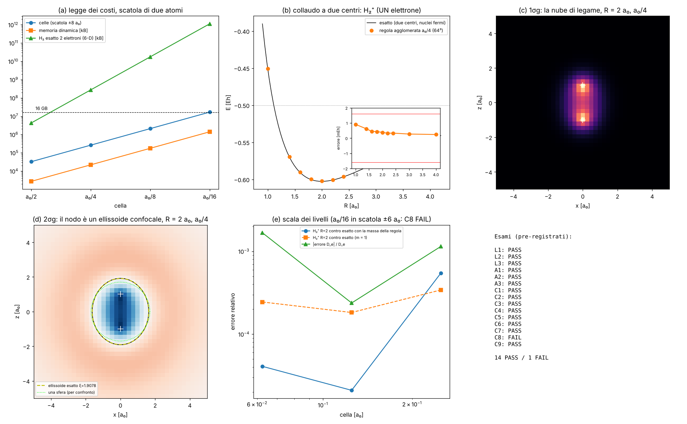
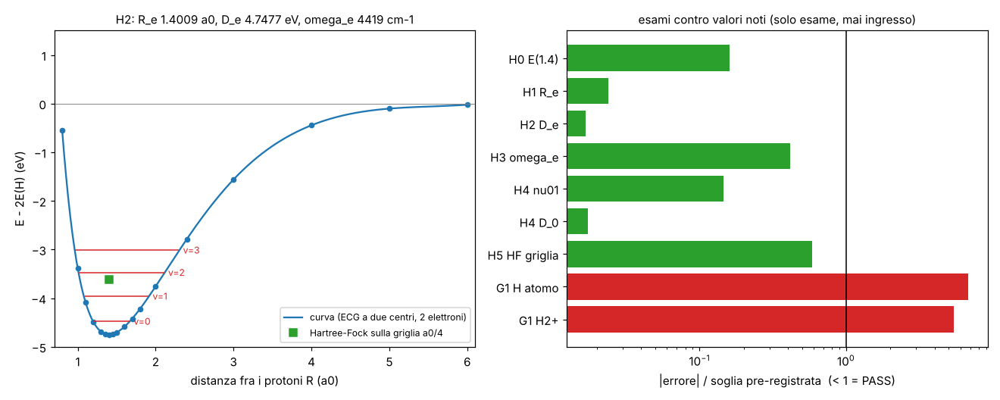
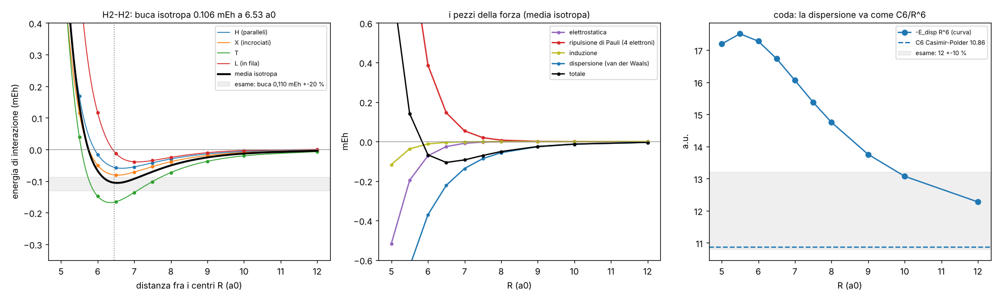

# Il livello delle due atomi: l'agglomeratore pronto per la scala di H₂

Studio `aggmol_`. Continua `AGGLOMERATO_ZIGZAG.md` e `AGGLOMERATO_COMPLETO.md`. **Fase 1 (§1–§11)**: si **prepara e si
collauda la macchina** alla scala di due atomi (protoni a 1,4 a₀, nube su 5–10 a₀), con un solo elettrone (H₂⁺): allora
le molecole erano chiuse da Valerio. **Fase 2 (§12)**: Valerio ha tolto il cancello per H₂ (l'elio passa il controllo
Pauli 6/6) e qui si fa **H₂ vero, con due elettroni**: lunghezza di legame, energia di legame, vibrazione. **§13: da H₂ a
un liquido.**

File: motore `lab/aggmol_core.py` (campo di più nuclei, Hamiltoniano grosso con settori di parità), soluzione esatta del
problema a due centri (solo esame) `lab/aggmol_exact.py`, apprendimento `lab/aggmol_learn.py`, un atomo
`lab/aggmol_atom.py`, due centri `lab/aggmol_h2p.py`, costi `lab/aggmol_costs.py`, esiti `lab/aggmol_analyze.py`,
figura `lab/aggmol_figure.py`; prove dopo il FAIL `lab/aggmol_posthoc16.py`; sviluppo `lab/aggmol_dev.py`.
Copie congelate del codice di `aggfull_` (che lavora in parallelo sui suoi file): `lab/aggmol_fz_*.py` (commit a70a372).
Pre-registrazione `lab/aggmol_prereg.py` → `lab/out/aggmol_prereg.json`, **commit e79e57a, prima delle corse di
produzione**. Esiti: `lab/out/aggmol_verdict.json`, `aggmol_learn.json`, `aggmol_atom.json`, `aggmol_h2p.json`,
`aggmol_costs.json`, `aggmol_posthoc16.json`.







---

## 0. In breve

**Fase 3, la forza fra due molecole H₂ (§15): 4 PASS / 0 FAIL.** Buca isotropa **0,106 mEh (33,4 K) a 6,53 a₀
(3,46 Å)** contro ~0,110 mEh a 6,45 a₀; C6 = 10,86 contro ~12 (−9,5 %). Fatto con un metodo ridotto (perturbativo, non
variazionale a 4 elettroni), dichiarato prima; l'accordo sulla buca è in parte fortuna di errori che si compensano (§15.4).

**Fase 2, H₂ con due elettroni (§12): 6 PASS / 1 FAIL** (6 esami di fisica tutti PASS; FAIL il cancello G1 della
macchina, soglia troppo stretta, §12.4).

- **Lunghezza di legame R_e = 1,4009 a₀** contro 1,401 (−0,007 %).
- **Energia di legame D_e = 4,7477 eV** contro 4,747 (+0,7 meV; l'accuratezza chimica è 43 meV).
- **Quanto vibrazionale ω_e = 4419 cm⁻¹** contro 4401 (+0,42 %, ma ±20 cm⁻¹ dipendono da come si interpola la curva,
  §12.3); **salto 0→1 = 4167 cm⁻¹** contro 4161 (+0,14 %); **D_0 = 4,4772 eV** contro 4,478 (−0,8 meV).
- **E(R = 1,4) = −1,1744677 Eh**, 8 μEh sopra il valore di riferimento.
- Hartree–Fock **sulla griglia a₀/4** imparata (64³ celle, la macchina a due centri della fase 1): −1,132693 Eh contro il
  limite −1,133629 (+0,94 mEh, PASS): la differenza con la curva esatta è l'**energia di correlazione** (−41,8 mEh), cioè
  quello che due elettroni fanno per evitarsi e che una nube media non vede.
- Ingressi: solo m_e, α, carica e massa del protone. La regola a molti elettroni è quella del thread principale **così
  com'è**, e l'elio lì ha ancora FAIL aperti (R5, R6, G5, L1c_v3): §12.1.

**Fase 1 (macchina, un elettrone). Risultato: 14 PASS / 1 FAIL.**

1. **La macchina ha scelto da sola il livello a₀/4** (cella di un quarto di raggio di Bohr) come "livello delle due
   atomi", e ha **rifiutato a₀/2**: lì la cella è così grossa che la regola non riesce più a imitare il livello sotto per
   gli impulsi dell'1s (errore 1,0–1,3·10⁻³ contro il budget 3·10⁻⁴, da tutte e due le strade). Il pavimento per gli
   atomi è a₀/4.
2. **Un atomo con a₀/4** (stessi vincoli esatti della fase 3: Taylor fissato, parità; positività impossibile come
   previsto dal limite dei momenti): 1s −0,088 % dalla regola fine, 2s +0,011 %, 2p +0,008 %; struttura fine del 2p
   44,94 μeV contro 45,28 di Dirac (−0,77 %), rapporto di Landé 0,5000. Darwin e spin-orbita riletti dalla cella imparata
   entro l'1 %.
3. **Collaudo a due centri** (H₂⁺: **un solo elettrone** fra due protoni fermi; collaudo della macchina, non chimica)
   contro la soluzione esatta: a 64³ celle l'energia è giusta entro **0,38 mEh** a R = 2 a₀ e **0,61 mEh** a R = 1,4 a₀
   (sotto l'accuratezza chimica, 1,59 mEh); legame D_e 102,52 contro 102,63 mEh; distanza di equilibrio +0,15 %; tre stati
   eccitati entro 0,04 %; la molecola si può spostare e ruotare sulla griglia cambiando l'energia di ≤ 4·10⁻⁵.
4. **La cosa più bella (idea geometrica, provata):** il nodo dello stato 2σg esce un **ellissoide con i due protoni nei
   fuochi**, come vuole la soluzione esatta (separabile in coordinate sferoidali): sul nodo ξ = (r_a + r_b)/R varia dello
   **0,08 %**, mentre il raggio varia del 5,7 %. Nessuno ha messo ellissi nella regola cubica: la geometria nascosta
   del problema a due centri emerge da sola.
5. **FAIL (C8):** la scala a₀/4 → a₀/8 → a₀/16 non scende in modo monotono: il punto a₀/16 l'ho messo in una scatola ±6 a₀
   per stare nella memoria, e la scatola periodica (il "cristallo di atomi") lega di +4,4·10⁻⁴ in più. Errore di disegno
   dell'esame, verificato dopo (§5).
6. **La legge dei costi** (§1) dice la cosa che conta per H₂ vero: con un elettrone la scatola di due atomi a a₀/4 è
   **64³ = 2,6·10⁵ celle** (22 MB, ~20 ms per passo stimati sulla Intel UHD); con **due elettroni esatti** lo stato vive
   in 6 dimensioni e a a₀/4 sono 275 GB. **Non entra in nessuna scheda**: serve la regola a molti elettroni (§6).

---

## 1. Compito 1: la legge dei costi per una scatola di due atomi

Scatola ±8 a₀ (lo stato fondamentale con i due protoni a ±0,7 a₀; la nube di 5–10 a₀ ci sta con margine) e ±12 a₀ (stati
eccitati). Tempi **misurati** qui (un core, numpy) per un'applicazione dell'Hamiltoniano grosso (cinetico imparato + campo
a 8 lanterne); stime su hardware con il modello di banda di `MOTORE_OTTIMIZZATO.md` §8 (Intel UHD ~25 GB/s, schede da 16 GB
288–717 GB/s: numeri di catalogo, **non misurati**; un passo con il campo ≈ 18 FFT + 9 passate, ~1,9 kB per cella).

| cella | scatola | N³ celle | memoria (dinamica / autostati) | H, CPU 1 core | Intel UHD (stima) | 16 GB alta (stima) | passi per unità atomica di tempo | H₂ esatto a 2 elettroni (6-D, singoletto) |
|---|---|---|---|---|---|---|---|---|
| a₀/2 | ±8 a₀ | 32³ = 3,3·10⁴ | 3 MB / 6 MB | 6 ms | 2,5 ms | 0,09 ms | 274 | 4,3 GB |
| **a₀/4** | **±8 a₀** | **64³ = 2,6·10⁵** | 22 MB / 44 MB | 60 ms | **20 ms** | 0,7 ms | 548 | **275 GB** |
| a₀/4 | ±12 a₀ | 96³ = 8,8·10⁵ | 74 MB / 0,15 GB | 0,24 s | 66 ms | 2,3 ms | 548 | 3,1 TB |
| a₀/8 | ±8 a₀ | 128³ = 2,1·10⁶ | 0,18 / 0,35 GB | 0,61 s | 157 ms | 5,5 ms | 1096 | 18 TB |
| a₀/8 | ±12 a₀ | 192³ = 7,1·10⁶ | 0,6 / 1,2 GB | 3,1 s | 530 ms | 18 ms | 1096 | 200 TB |
| a₀/16 | ±8 a₀ | 256³ = 1,7·10⁷ | 1,4 / 2,8 GB | (~7 s) | 1,3 s | 44 ms | 2193 | 1,1 PB |
| a₀/16 | ±12 a₀ | 384³ = 5,7·10⁷ | 4,8 / 9,5 GB | — | 4,2 s | 148 ms | 2193 | 13 PB |

Lettura semplice:
* **Con un elettrone il costo per tempo fisico va come h⁻⁴** (celle h⁻³ per passi h⁻¹). Il battito σg↔σu di H₂⁺ a
  R = 2 a₀ dura 14,4 unità atomiche (0,35 fs): a a₀/4 sono ~7 900 passi nativi → **~2,5 minuti sulla Intel UHD**,
  ~5 s su una scheda alta da 16 GB. A a₀/8: 16 volte di più. È la "mela a 480p e in 4K" per gli atomi: Intel a₀/4,
  scheda grossa a₀/8 (o a₀/16 solo vicino ai nuclei, con lo zoom).
* **Sotto a₀/4 non si scende** (la macchina lo rifiuta, §2): è il pavimento degli atomi, come le 12 celle/λ lo sono per
  la luce.
* **Due elettroni esatti** sono un altro mondo: lo stato è una funzione di 6 coordinate, M² numeri. Anche alla cella più
  grossa ammessa (a₀/4) sono 275 GB. L'unica casella sotto i 16 GB è a₀/2 ±8 a₀ (4,3 GB), che però la macchina ha
  rifiutato. **Quindi H₂ esatto sulla griglia non si fa a forza bruta**: serve la regola a molti elettroni imparata (coppie,
  Jastrow, camminatori), come pianificato in `MOLTI_ELETTRONI_PIANO.md`.

## 2. Compito 2: imparare il livello successivo con la macchina automatica

Si parte dal livello a₀/8 di `aggfull_` (cinetico T: c₂, c₄, c₆ fissati esattamente al livello sotto, parità) e dal suo
accoppiamento cella-campo imparato. Candidati, dal più grosso: b = 4 (a₀/2), poi b = 2 (a₀/4); poi **si ripete** dal
livello scelto. Per ogni candidato: impara (stesso codice della fase 3–4), controlla il moto libero, impara come la cella
sente il campo (Duhamel dal livello **imparato** sotto), controlla l'1s contro il livello sotto (accuratezza chimica).

| esame | cosa | risultato | esito |
|---|---|---|---|
| L1 | la macchina sceglie a₀/4 e rifiuta a₀/2 (previsto dallo sviluppo) | a₀/4: errore energia 2,2·10⁻⁴ ≤ 3·10⁻⁴, 1s +0,44 mEh dal livello sotto: ammesso. a₀/2: 0,97 / 1,30·10⁻³ (da a₀/8, w = 4/5) e 1,02 / 1,31·10⁻³ (da a₀/4) | **PASS** |
| L2 | positività (regola di Markov) impossibile, dal limite dei momenti | deviazione dei vincoli: 283 (a₀/4), 1133 (a₀/2); servirebbe \|c₄\|/c₂ = 2·10⁻⁴ (a₀/4), i salti positivi danno ≥ 1/12 | **PASS** |
| L3 | Darwin e spin-orbita riletti dalla cella a₀/4 entro 2 % | stencil a stella scelto da solo; g_k −0,12618 (+0,94 %), g_x +0,25100 (+0,40 %), g_so +0,25256 (+1,02 %) | **PASS** |

**Perché a₀/2 non va (fisica, non sfortuna).** La cella grossa vede solo impulsi fino a π/h. A a₀/2 il bordo della zona
è a k = 2π/a₀, e la "coda" dell'1s (densità degli impulsi ∝ 1/(1+k²a₀²)⁴) ha ancora peso lì. Il livello sotto, visto
attraverso b passi, ha una banda che **non è periodica** con il periodo della nuova cella: vicino al bordo la regola
grossa non può seguirla, e l'errore sull'energia di moto pesata sull'1s sale a 10⁻³. Con il cinetico esatto (sviluppo,
dichiarato): 1s −0,68 %, H₂⁺ −0,42 % a a₀/2, contro −0,094 % e −0,057 % a a₀/4.

**Vincoli esatti (come la fase 3).** Massa: m_kin = tanθ/θ = 1,000373 portata esatta (per costruzione, non conta come
esame). c₄ della regola fine riportato giusto (1,0001 di Dirac); il c₆ letto dal livello a₀/8 è −2,4 volte Dirac: a
queste celle il k⁶ vale ~10⁻¹⁰ dell'energia, è rumore del livello sotto (dichiarato, senza effetto misurabile).

## 3. Esami su un atomo con il livello a₀/4

Scatola ±16 a₀ (128³), regola grossa + primo ordine del resto dell'accoppiamento imparato (Darwin, spin-orbita). Confronto
con la regola fine radiale allo stesso θ (`aggfull_fineref.json`) e con Dirac.

| stato | a₀/4 (eV) | contro la regola fine | contro Dirac |
|---|---|---|---|
| 1s½ | −13,597926 | −0,088 % (+0,44 mEh) | −0,058 % (+0,29 mEh) |
| 2s½ | −3,402979 | +0,011 % (−0,013 mEh) | +0,044 % |
| 2p½ | −3,402188 | +0,008 % | +0,021 % |
| 2p3/2 | −3,402143 | +0,008 % | +0,021 % |

| esame | soglia | esito |
|---|---|---|
| A1 | i quattro stati entro 0,25 % e 1 kcal/mol della regola fine | **PASS** |
| A2 | idem contro Dirac | **PASS** |
| A3 | struttura fine 2p entro 2 % di Dirac, rapporto 0,5 entro 1 % | 44,94 μeV contro 45,28 (−0,77 %), 0,5000: **PASS** |

L'1s è il più sbagliato (−0,088 %): è la cuspide del nucleo, che una cella di a₀/4 liscia (stessa lezione di
`AGGLOMERATO_COMPLETO` §4.3). Gli stati n = 2, che al nucleo pesano 8 volte meno, sono a 10⁻⁴.

## 4. Compito 3: collaudo a due centri (H₂⁺, un elettrone, protoni fermi)

**Dichiarazione.** H₂⁺ ha un solo elettrone: è ammesso **come collaudo della macchina a due centri**. Non è il legame di
H₂ (che ha due elettroni e la loro repulsione e correlazione: §6). I protoni sono fermi (Born–Oppenheimer): il loro moto è
un debito. L'unico ingresso nuovo rispetto all'atomo è **la posizione del secondo protone**: il campo grosso è la somma
dei due campi di Galerkin (−α/r di ciascun protone), le posizioni possono essere ovunque, non agganciate alla griglia.

**Chiave d'esame.** La soluzione esatta non relativistica del problema a due centri, che si separa in coordinate
sferoidali (ξ, η, φ) ed è calcolata qui con due equazioni a una variabile (Chebyshev). Controllata: R = 2, 1σg =
−1,1026342144949 Eh (il numero classico), 1σu −0,6675343922, 2σg −0,3608648753, 1πu −0,4287718199.

| esame | cosa | risultato | esito |
|---|---|---|---|
| C1 | 1σg a R = 1,4 e 2,0 a₀, a₀/4 (64³), entro 1 kcal/mol e 0,1 % | +0,61 mEh (−0,048 %) e +0,38 mEh (−0,034 %) | **PASS** |
| C2 | D_e a R = 2 (stesso livello e scatola per l'atomo) entro 1 kcal/mol | 102,517 contro 102,634 mEh (−0,12 mEh) | **PASS** |
| C3 | curva R = 1,6…2,4: R_e entro 0,5 %, curvatura entro 2 % (stesso fit sui valori esatti) | R_e +0,15 %, k_e −0,95 % | **PASS** |
| C4 | 1σu, 1πu, 2σg a R = 2 (±12 a₀) entro 0,1 % | −0,041 %, +0,031 %, +0,011 % | **PASS** |
| C5 | spostare la coppia di frazioni di cella: ≤ 10⁻⁴ | 3,9 / 2,7 / 1,9·10⁻⁵ | **PASS** |
| C6 | coppia lungo la diagonale (1,1,1) invece che lungo z: ≤ 10⁻⁴ | 1,0·10⁻⁵ | **PASS** |
| C7 | nodo del 2σg = ellissoide confocale | spread di ξ 0,081 % (del raggio 5,7 %); ξ₀ = 1,90745 contro 1,90781 (−0,04 % di ξ₀−1) | **PASS** |
| C8 | scala a₀/4 → a₀/8 → a₀/16 contro l'esatto con la massa della regola: errore decrescente, ≤ 0,02 % a a₀/16; D_e entro 1 kcal/mol ovunque | −5,5·10⁻⁴, −2,1·10⁻⁵, **+4,1·10⁻⁵** (non monotono); D_e −0,12 / +0,02 / −0,17 mEh | **FAIL** |
| C9 | salto dell'elettrone fra i protoni: σu − σg a R = 4 e 6 a₀ entro 1 % | +0,055 % e +0,13 %: periodo 62,46 contro 62,50 e 294,2 contro 294,6 unità atomiche (1,5 e 7,1 fs) | **PASS** |

L'errore della curva (inserto del pannello b) è quasi costante, +0,3…+0,6 mEh: è soprattutto l'errore di cuspide dei due
nuclei, che è lo stesso dell'atomo e in gran parte si cancella nel legame (D_e sbaglia di 0,12 mEh soltanto).

## 5. Fallimenti (dichiarati)

**C8.** Il punto a₀/16 l'ho messo, nella pre-registrazione, in una scatola ±6 a₀ (192³) per restare sotto i 2,5 GB.
Prova dopo il FAIL (`aggmol_posthoc16.py`, non pre-registrata): con il cinetico **esatto** k²/2m_kin, stessa scatola e
stesso campo, l'1s a a₀/16 sta a +4,4·10⁻⁴ dalla chiave; e a a₀/8 lo stesso cinetico esatto dà +3,3·10⁻⁴ a ±6 a₀ e
−1,1·10⁻⁴ a ±8 a₀. Cioè ~4,5·10⁻⁴ sono **la scatola periodica** (il cristallo di atomi di `IDROGENO_BOHR.md`), non il
livello: il cinetico imparato a a₀/16 contribuisce solo −3,4·10⁻⁵ Eh. Rifare a a₀/16 in ±8 a₀ (256³) vuole ~2,8 GB: sopra
il limite di questo container (provato, `MemoryError`). Il FAIL resta. Lezione (già nota, ripetuta): **la scatola è un
livello del passaporto d'errore**.

Errore mio di sviluppo, trovato e corretto prima della pre-registrazione: nel cercatore di nodi l'indice della
riempitura di zeri veniva arrotondato male (spostava il nodo del 5 % in un piano).

## 6. Compito 4: cosa manca per H₂ vero

*(Scritto in fase 1. Nella fase 2, §12, H₂ è stato fatto con il risolutore ECG del thread principale: i punti 1 e 4 sono
stati aggirati così, non risolti sulla griglia; i punti 2, 3, 5, 6 restano per la strada a camminatori.)*

H₂ ha **due elettroni**. Rispetto al collaudo di questo studio mancano:

1. **La regola a molti elettroni** (thread principale, `MOLTI_ELETTRONI_PIANO.md`): lo stato di due elettroni vive in 6-D;
   a a₀/4 sono 275 GB (§1). Serve la regola di coppia imparata da corse esatte di 2 elettroni (elio, H⁻) e controllata a
   campione. **La macchina a due centri di qui è pronta a riceverla**: il campo di più nuclei, i settori di simmetria, la
   covarianza per traslazione e rotazione (C5, C6) sono collaudati.
2. **La repulsione elettrone-elettrone sulla griglia grossa**: va imparata come la cella sente il campo di un'altra carica
   che si muove (stessa tecnica dell'accoppiamento cella-campo, ma con un campo che non è fisso). Oggi c'è solo il campo
   dei nuclei.
3. **I nodi** non servono per H₂ nello stato fondamentale (singoletto senza nodi: la parte spaziale è simmetrica e
   positiva), quindi H₂ è il primo caso dove i camminatori sono esatti. Ma i camminatori vogliono un nucleo **positivo**, e
   L2 dice che a a₀/4 una regola positiva non può portare il pezzo relativistico: per H₂ (non relativistico a 10⁻⁵) si può
   usare un nucleo positivo che porta solo la massa, dichiarando l'errore k⁴ del reticolo; va misurato.
4. **I protoni che si muovono**: qui sono fermi. `AGGLOMERATO_COMPLETO` ha già il protone come pallina pesante imparata
   (rinculo entro 0,6 %): per la vibrazione di H₂ serve la coppia protone-protone con la stessa macchina.
5. **La cuspide**: a a₀/4 l'errore principale è ai nuclei (+0,3…0,6 mEh). Per la chimica fine serve lo zoom ai nuclei
   (`nucleo1s_`, `IDROGENO_BOHR.md`), con la colla già provata lì.
6. **La scatola**: a ±6 a₀ costa 4·10⁻⁴; per due atomi ±8 a₀ è il minimo.

## 7. Debiti

**Chiusi o avanzati:** CONTESTO §4 voce 11 ("livelli più alti a₀/4, a₀/2 per molecole e gas") → **a₀/4 imparato e
collaudato; a₀/2 rifiutato dalla macchina per gli atomi** (resta possibile per oggetti più larghi dell'1s: gas, stati di
Rydberg, molecole viste da lontano).

**Aperti / nuovi:**
- protoni fermi (Born–Oppenheimer) nel collaudo a due centri;
- iper-parametri ereditati (peso uniforme 3·10⁻⁴, budget 3·10⁻⁴, osservabile "1s di taglia a₀", soglia dell'accuratezza
  chimica per il controllo dell'atomo: quest'ultima è una scala esterna nota, non un fit);
- il campo dei due protoni è la **somma** dei due campi di Galerkin: corretto per linearità, ma l'accoppiamento cella-campo
  è imparato per un campo debole e applicato al primo ordine (Darwin e spin-orbita) solo sull'atomo, non su H₂⁺
  (effetti ~10⁻⁵, dichiarati);
- c₆ del livello a₀/8 non di Dirac (−2,4×; irrilevante qui);
- C8: rifare a₀/16 in ±8 a₀ su una macchina con più memoria.
- fase 2 (H₂ a due elettroni): debiti in §12.5 (Born–Oppenheimer; DEBT-1/2/4 del thread principale ereditati).

**Parametri liberi:** nessuno nuovo di fisica. Ingressi: m_e (θ), α, Z = 1 per protone, **posizioni dei protoni**. Numeri
imparati: livello a₀/4, 729 posti × 2×2 complessi del cinetico (fissati 40 vincoli esatti dal livello sotto) + stella
2×2×7×7 dell'accoppiamento. Nessun fit contro l'esatto o contro Dirac: le chiavi esatte sono solo esami.

## 8. Idee geometriche e visive

**V1 — I nodi confocali (provata: C7 PASS).** *A schermo:* gli stati eccitati della coppia di protoni mostrano superfici
dove la nube si annulla; sono **ellissoidi e iperboloidi con i due protoni nei fuochi**, come le orbite dei pianeti
attorno a due soli. Disegnate come palline che "scivolano" lungo la superficie, si vedrebbero ellissi perfette che nessuno
ha disegnato. *Perché:* il problema a due centri ha una simmetria nascosta (una costante del moto in più, che lo rende
separabile in coordinate sferoidali); la regola cubica non la conosce, ma la ritrova: ξ costante entro 0,08 %. *Costo:*
zero (si leggono gli stati che già ci sono). *Regole:* sì, è fisica emersa, nessuna forma disegnata.

**V2 — L'elettrone che salta fra i protoni (calcolata: C9 PASS).** *A schermo:* metti l'elettrone su un protone: la nube
passa all'altro e torna, avanti e indietro, con periodo 62 unità atomiche a R = 4 a₀ e 294 a R = 6 a₀ (1,5 e 7,1 fs):
più lontani, più lento (esponenzialmente). Rallentato al ritmo che vuole Valerio, è il "tunnel" visto con gli occhi. *Perché:*
è il battimento fra σg e σu, la cui differenza esce entro 0,13 %. *Costo:* a a₀/4 con 80³ celle, sulla Intel ~1 minuto di
calcolo per un salto a R = 4 (o la "cartolina" a due stati: istantanea). *Regole:* sì.

**V3 — Molecola che scivola sulla griglia senza scatti (provata: C5, C6).** *A schermo:* la molecola che si sposta o ruota
non "scatta" da una cella all'altra. *Perché:* le 8 lanterne per cella rendono il campo covariante: spostare la coppia di
una frazione di cella cambia l'energia di ≤ 4·10⁻⁵ (40 μEh), ruotarla di 10⁻⁵. È la condizione per far muovere i nuclei
(vibrazioni, urti) senza forze finte di griglia: con 4·10⁻⁵ Eh di "scatola delle uova" la forza finta è ~10⁻⁴ Eh/a₀,
mille volte sotto la forza di legame. *Costo:* già pagato. *Regole:* sì.

**V4 — Livelli come lenti a fuoco variabile (proposta).** *A schermo:* lontano dai nuclei celle a₀/4, attorno a ogni
nucleo un "occhio" a₀/16 o lo zoom zig-zag; fra due protoni il ponte resta a₀/4. *Perché:* l'errore di C1 è tutto nelle
cuspidi (stesso +0,3 mEh per atomo e per molecola); lo zoom locale lo toglie senza moltiplicare le celle (a₀/16 dappertutto
costa 64 volte). *Costo:* la colla di `IDROGENO_BOHR.md`. *Regole:* sì.

**V5 — La bolla di legame (proposta per il thread grafico).** *A schermo:* la densità di 1σg meno quella dei due atomi
separati: una ciambella luminosa fra i protoni dove l'elettrone si accumula quando lega (pannello c mostra la nube; la
differenza ne mostra il "perché"). *Costo:* una sottrazione. *Regole:* sì, è un'immagine di un dato calcolato.

## 9. Dove l'intuizione di Valerio può aiutare

1. **Il pavimento a₀/4.** Per la "mela a 480p" degli atomi la macchina non scende sotto a₀/4. Ti va bene che sulla Intel
   la differenza sia la **grandezza della scena** (meno atomi) e non la risoluzione? O vuoi che proviamo a₀/2 solo per
   oggetti grandi (gas, atomi lontani) dove l'1s non si guarda?
2. **Due elettroni.** La regola di coppia: come immagini la repulsione fra due palline-elettrone nella regola zig-zag? Come
   due correnti che si respingono (campo dell'una che passa per le celle dell'altra), o come un "costo" quando stanno nella
   stessa cella? Le due cose corrispondono a pezzi diversi di fisica nota (Coulomb lungo raggio vs cuspide di coppia).
3. **Il salto fra protoni (V2).** È la versione più semplice della chimica che "si vede". Vuoi che sia la prima scena del
   laboratorio a due atomi, prima di H₂?
4. **I protoni che si muovono.** Con V3 la griglia non ostacola il moto dei nuclei. Vuoi H₂⁺ che vibra (protoni come
   palline pesanti della stessa regola) come collaudo successivo, sempre con un elettrone?
5. **Il liquido (§13).** Ti va l'idrogeno liquido come primo liquido (molecola tonda, forza imparata da 4 elettroni), con
   l'acqua come traguardo dopo? Per l'H₂ liquido servono i **protoni quantistici** (anelli di copie): come li vedi nella
   regola zig-zag? Corrisponde a fisica nota (integrali di cammino di Feynman), ma nel motore non c'è.

## 10. Patch proposte per altri file (non toccati)

- `docs/CONTESTO_CLOUD.md` §4 voce 11 → "a₀/4 imparato e collaudato (AGGLOMERATO_DUE_ATOMI: 1s −0,088 %, H₂⁺ entro
  0,6 mEh); a₀/2 rifiutato dalla macchina per gli atomi". Indice: aggiungere AGGLOMERATO_DUE_ATOMI.
- `docs/PIANO.md` §3: riga "Livello delle due atomi (macchina a₀/4, collaudo a due centri a un elettrone)"; fase 2:
  "H₂ con due elettroni (regola del thread principale, ECG a due centri): R_e 1,4009 a₀, D_e 4,7477 eV, ω_e +0,4 %, ν₀₁
  +0,14 %; prossimo: forza H₂–H₂ da 4 elettroni → idrogeno liquido (AGGLOMERATO_DUE_ATOMI §13)".
- Per il Laboratorio Atomo (Rust, non toccato): il livello a₀/4 è in `lab/out/aggmol_levels.pkl` (non nel repo; si rifà con
  `python lab/aggmol_learn.py`, ~3 minuti); un passo = due FFT del cinetico + 8 lanterne per il campo, 64³ celle.
- **Ponte (proposta, non creata):** `ponte/richieste/aggmol_salto.json`, azione `foto`, scena H₂⁺ a R = 4 a₀ con
  l'elettrone che parte su un protone (V2), una foto ogni 8 unità atomiche.

## 11. Come rieseguire

```
cd lab
python aggmol_prereg.py                       # (già committato, e79e57a)
python aggmol_learn.py                        # livelli a0/4 (e il rifiuto di a0/2), ~3 min
python aggmol_atom.py s p pert_s pert_p       # un atomo a a0/4
python aggmol_h2p.py atom_4 atom_8 curve_4_R2.0 ...   # vedi l'elenco in aggmol_h2p.py / lab/out/aggmol_prod.log
python aggmol_h2p.py gap_4_R4.0 gap_4_R6.0
python aggmol_costs.py; python aggmol_posthoc16.py
python aggmol_analyze.py; python aggmol_figure.py
```

---

## 12. Fase 2: H₂ vero, con due elettroni

File: `lab/aggmol_ecg.py` (macchina ECG a due centri), `lab/aggmol_h2.py` (lavori `gate`, `curve`, `hf`, `vib`),
`lab/aggmol_h2_gate_posthoc.py`, figura `lab/aggmol_h2_figure.py`. Pre-registrazione `lab/aggmol_h2_prereg.py` →
`lab/out/aggmol_h2_prereg.json`, **commit e756fa2, prima delle corse di produzione**. Esiti `lab/out/aggmol_h2.json`.

### 12.1 Quale regola, e cosa NON è chiuso nel thread principale (dichiarato)

**L'elio del thread principale ha ancora FAIL aperti**: R5 e R6 (la parte relativistica della banda ri-imparata: 0,86–0,92
invece di 1 ± 0,05/0,10; la causa trovata è che anche la cinetica di Dirac esatta dà gli stessi numeri), G5 (rapporto
2s/1s non monotono a r < 4·10⁻⁷ a₀, arrotondamento) e L1c_v3 (livello Pauli a Z = 10 fuori soglia su 2 semi su 3; il loro
L1c_v5 passa su un campione nuovo). Qui **si usa la loro regola così com'è**, senza correggerla e senza sceglierne pezzi:
- operatore: cinetica p²/2m_kin con **m_kin = m0 del loro livello v3** (1,0000000010922, `multi_e_v3.json` su master);
  Coulomb elettrone-elettrone istantaneo (loro DEBT-1); antisimmetria per il singoletto (loro DEBT-2); il resto α² della
  banda **non incluso** (loro DEBT-4: ~10⁻⁵ Eh, quasi tutto si cancella in D_e);
- risolutore: lo stesso tipo che usa il thread principale per l'elio (gaussiane correlate esplicite, ECG, base cresciuta a
  caso e raffinata), qui con i **centri sull'asse della molecola** (due centri). Non è la griglia con i camminatori:
  per due elettroni a a₀/4 lo stato vive in 6-D e costa 275 GB (§1). La griglia a₀/4 della fase 1 è usata per l'esame
  H5 (Hartree–Fock, un orbitale per due elettroni).

Nuovo qui: i **protoni sono fermi** mentre si calcola l'energia degli elettroni (Born–Oppenheimer, debito mio); poi la
vibrazione è un'equazione di Schrödinger a una dimensione per la distanza dei protoni, sulla curva calcolata, con la
massa ridotta m_p/2 (ingresso: la massa di un nucleo).

### 12.2 Esiti

| esame | cosa | risultato | soglia | esito |
|---|---|---|---|---|
| G1 | macchina ECG: H atomo e H₂⁺ (R = 2) entro 10⁻⁶ Eh | 6,8·10⁻⁶ e 5,4·10⁻⁶ | 10⁻⁶ | **FAIL** (§12.4) |
| H0 | E(H₂, R = 1,4) contro −1,174475714 | −1,1744677 (+0,008 mEh) | 0,05 mEh | **PASS** |
| H1 | lunghezza di legame contro 1,401 a₀ | **1,40090 a₀** (−0,007 %) | 0,3 % | **PASS** |
| H2 | D_e contro 4,747 eV | **4,74773 eV** (+0,73 meV) | 43,4 meV | **PASS** |
| H3 | ω_e armonico contro 4401 cm⁻¹ (0,5456 eV) | **4419,4 cm⁻¹ = 0,5479 eV** (+0,42 %) | 1 % | **PASS** |
| H4 | salto 0→1 contro 4161 cm⁻¹; D_0 contro 4,478 eV | **4167,0 cm⁻¹** (+0,14 %); **4,4772 eV** (−0,76 meV) | 1 %; 43,4 meV | **PASS** |
| H5 | Hartree–Fock sulla griglia a₀/4 (64³) contro −1,133629 | **−1,1326934** (+0,94 mEh) | 1,6 mEh | **PASS** |

La curva (18 distanze, 0,8–6 a₀, 180 gaussiane per distanza, ~2 minuti per punto su un core) è in figura: buca a
−4,75 eV, quattro livelli vibrazionali. A R = 6 a₀ l'energia è a 0,8 mEh dai due atomi separati. Energia di punto zero
0,2705 eV. Hartree–Fock: ε = −0,59434 Eh, J = 0,65830 Eh; **energia di correlazione** E(ECG) − E(HF griglia) =
**−41,8 mEh** (il valore noto è −40,9: la differenza è l'errore +0,94 mEh della griglia, che sta nelle cuspidi ai nuclei
come per H₂⁺ in C1).

Cosa vuol dire, detto semplice: **con due elettroni, due protoni e una regola che non sa niente di chimica, il legame
chimico esce giusto**: dove sta il minimo (entro 1/10000 di raggio di Bohr), quanto è profonda la buca (entro 1 meV su
4,7 eV), quanto vibra (entro mezzo per cento). È una **validazione** (i numeri di H₂ sono noti da 50 anni con questo
stesso tipo di calcolo), non una scoperta: dimostra che la catena "regola → operatore → due centri" non perde niente
di grosso.

### 12.3 Cose da sapere sui numeri (onestà)

- **ω_e dipende da come si legge la curva.** Il fit pre-registrato (quartico su 1,2–1,7 a₀) dà 4419; dopo, non
  pre-registrato, ho provato altre finestre: quartico 1,2–1,6 → 4399,5; quintico 1,1–1,8 → 4399,3; sestico 1,0–2,0 →
  4400,5; quartico 1,3–1,5 → 4374. Cioè **±20 cm⁻¹ (0,5 %) sono l'interpolazione**, non la fisica; il verdetto resta
  quello pre-registrato. Il salto 0→1 (H4) non usa il fit ma tutta la curva: è più robusto.
- La pre-registrazione dice "7 punti" nella finestra 1,2–1,7: sono **8** (1,2 1,3 1,35 1,4 1,45 1,5 1,6 1,7). Svista
  mia nel testo, il codice era già quello.
- I valori sperimentali (4401, 4161, 4,478 eV) contengono effetti che qui mancano: protoni non fermi (correzioni adiabatica
  e non adiabatica), relatività, QED. Ognuno vale pochi cm⁻¹; il +6 cm⁻¹ del salto 0→1 è di quella taglia.
- **Errore mio trovato dopo la prima corsa di H5** (codice, non fisica): nel potenziale di Hartree c'era un fattore di
  volume in più (hh³: potenziale 5026 volte troppo grande; la SCF dava +172 Eh). Controllato contro una gaussiana con
  potenziale noto (esatto a 10⁻¹²), corretto, ricorso. Soglie e configurazione non toccate.

### 12.4 FAIL: G1, il cancello della macchina ECG

La soglia 10⁻⁶ Eh per l'atomo con 14 gaussiane e per H₂⁺ con 40 era **troppo stretta per quella taglia di base**: errori
6,8·10⁻⁶ e 5,4·10⁻⁶. Prova dopo (`aggmol_h2_gate_posthoc.py`, non pre-registrata): l'atomo scende con la base, 4,9·10⁻⁶
(14) → 1,9·10⁻⁶ (24) → 5,4·10⁻⁷ (34), cioè la macchina converge dall'alto come deve (è variazionale); H₂⁺ 2,0·10⁻⁶ (40),
2,6·10⁻⁶ (80, un altro seme). Nessun segno di errore nel codice, ma il cancello come scritto è FAIL. A differenza del
thread principale (dove G1 FAIL ha fermato la produzione ECG) qui la produzione era già pre-registrata per partire
comunque: lo dichiaro. H0 (8 μEh dal riferimento, 6 volte sotto la soglia) dice che sulla molecola la macchina è
sufficiente.

### 12.5 Debiti della fase 2

- **Born–Oppenheimer** (protoni fermi per la curva, poi vibrazione 1-D, rotazione J = 0): nuovo, mio.
- Dal thread principale, ereditati così come sono: DEBT-1 (Coulomb istantaneo), DEBT-2 (antisimmetria imposta per il
  singoletto), DEBT-4 (resto α² della banda non incluso); m_kin dal loro v3.
- La base ECG è scelta a caso e raffinata: è un **risolutore**, non la regola zig-zag che cammina. Il passaggio
  "camminatori a due elettroni su griglia a due centri" resta da fare (serve il nucleo positivo per i camminatori, §6.3).
- Iper-parametri del risolutore: K = 180, 40 prove, larghezze in [0,03, 30] a₀; dichiarati, nessun fit contro chiavi.

**Parametri liberi di fisica: zero.** Ingressi: m_e, α, carica e massa del protone.

## 13. Da H₂ a un liquido

### 13.1 Quale liquido per primo: l'idrogeno liquido

**L'idrogeno liquido (H₂ a 20 K) è il più raggiungibile per primo.** Perché:
1. **Il pezzo c'è già**: la molecola H₂ è uscita giusta qui (§12). L'unica altra candidata vicina è l'elio liquido, ma
   l'elio del thread principale ha ancora FAIL aperti (R5, R6, G5) e la sua buca fra due atomi è **3 volte più piccola**
   (0,035 mEh contro 0,11 mEh di H₂–H₂): servirebbe precisione al decimo di μEh.
2. **La molecola si può trattare come una pallina tonda.** A 20 K l'H₂ "para" sta nello stato di rotazione J = 0, che è
   sfericamente simmetrico: la forza fra due molecole dipende quasi solo dalla distanza. È il caso più semplice possibile
   per l'agglomeratore (blocco = una molecola = una pallina).
3. **Pochi elettroni per imparare la forza**: la coppia H₂–H₂ ha 4 elettroni, la stessa macchina ECG di §12 con 4
   elettroni invece di 2 (è più lenta, ma esatta).
4. **Niente legame a idrogeno, niente nodi**: lo stato fondamentale di 4 elettroni a coppie si fa ancora senza problemi
   di segno del tipo che bloccano l'acqua.

Gli altri, in ordine di difficoltà: **argon** (18 elettroni per atomo, 36 per coppia: la forza va imparata da un metodo
che oggi non abbiamo esatto); **acqua** (10 elettroni per molecola, il legame a idrogeno, molecola non tonda, e
l'energia a tre corpi vale il 15–20 % della coesione): l'acqua è la più bella ma è l'ultima.

### 13.2 Cosa deve imparare l'agglomeratore

Lo stesso ciclo di sempre — **blocca, impara, controlla, ripeti** — un piano sopra:
- **Blocca**: una molecola H₂ nello stato v = 0, J = 0 diventa una pallina (posizione + massa 2 m_p).
- **Impara la forza fra due palline** da corse esatte di H₂–H₂ (4 elettroni) a molte distanze:
  - **ripulsione** a corto raggio (sotto ~3 Å): le nubi si sovrappongono e Pauli le spinge via (la prova che la macchina
    la sa fare: lo stesso calcolo a corta distanza di §12, dove l'energia sale ripida sotto 1 a₀);
  - **dispersione (van der Waals)** a lungo raggio, −C₆/R⁶ − C₈/R⁸: nasce dalla **correlazione** fra le nubi delle due
    molecole (lo stesso effetto che in §12 vale −41,8 mEh dentro una molecola). Hartree–Fock non la vede per niente: una
    nube media non lega due molecole. Esame: C₆ ≈ 12 unità atomiche per H₂–H₂ (valore noto, solo esame); buca ~0,11 mEh
    (~35 K) a ~3,4 Å;
  - **legame a idrogeno**: per H₂ non c'è. Serve per l'acqua (è un misto di elettrostatica, polarizzazione e un poco di
    legame chimico): sarà il pezzo più difficile da imparare, e non va inventato per H₂.
- **Controlla**: (a) termine a tre corpi (Axilrod–Teller) su triplette H₂–H₂–H₂ esatte; (b) il secondo coefficiente del
  viriale B(T) del gas (esame contro l'esperimento); (c) poi il liquido: densità 0,0708 g/cm³ a 20 K, ebollizione 20,3 K,
  punto triplo 13,8 K, calore di evaporazione (solo esami).
- **Ripeti**: con la pallina-molecola si fa il liquido.

Un punto fisico che conta: **i protoni non si possono trattare come palline classiche.** In H₂ liquido l'energia di
punto zero del moto delle molecole (~60–70 K) è **più grande della buca** (~35 K). Una simulazione classica dà il liquido
sbagliato (troppo denso, o solido). Serve il moto quantistico dei nuclei (integrali di cammino: ogni molecola diventa
un anello di ~32 copie). Il motore oggi non lo ha.

### 13.3 Cosa NON si può fare onestamente oggi

- **Il liquido con gli elettroni sulla griglia**: impossibile (sotto i numeri). Il liquido si fa solo con la pallina-molecola.
- **La forza H₂–H₂ precisa al μEh**: non l'abbiamo ancora calcolata. Serve l'ECG a 4 elettroni a molte distanze
  (stima: ore per geometria su un core, giorni per la curva). È il prossimo passo, non un risultato.
- **I nuclei quantistici** (integrali di cammino) non sono nel motore; senza, l'idrogeno liquido esce sbagliato.
- **Acqua, reazioni chimiche, rotture di legame nel liquido**: no. Acqua = 10 elettroni con nodi (errore di nodo
  fisso), legame a idrogeno, molte forme: fuori portata oggi.
- **L'elio liquido**: aspetta che l'elio del thread principale chiuda i suoi FAIL, e serve la statistica di Bose per la
  superfluidità.
- **Temperatura e pressione "vere"**: termostati e insiemi termici non sono ancora nel motore.

### 13.4 La scala grossolana (stime, non misure)

Idrogeno liquido: 0,0211 molecole per ų.

| quante molecole | scatola | elettroni sulla griglia a₀/4 | palline-molecola (con nuclei quantistici, 32 copie) |
|---|---|---|---|
| 1000 | 3,6 nm | 274³ ≈ 2·10⁷ celle per **un** orbitale (330 MB); 1000 orbitali → ~330 GB: **impossibile** | 3,2·10⁴ palline, ~1,6·10⁶ coppie per passo; memoria ~10 MB |
| 10⁶ | 36 nm | impossibile | 3,2·10⁷ palline, ~1,6·10⁹ coppie per passo; memoria ~1–2 GB |

- **Intel UHD** (portatile): 1000 molecole con 32 copie → ~ms per passo; per vedere il liquido (10–100 ps, passo ~0,5 fs,
  10⁵ passi) **minuti–un'ora**. 10⁶ molecole → ~1 s per passo: si fa solo a fotogrammi singoli.
- **Scheda da 16 GB**: 50–100 volte più veloce; 10⁶ molecole con nuclei quantistici a qualche passo al secondo, ~10⁷
  molecole classiche in memoria.
- **Il costo vero è a monte**: imparare la forza (ECG a 4 elettroni, giorni di CPU) e controllarla sui trimeri. Il
  liquido, una volta imparata la pallina, è leggero.

## 14. Come rieseguire la fase 2

```
cd lab
python aggmol_h2_prereg.py      # (già committato, e756fa2)
python aggmol_h2.py gate        # G1
python aggmol_h2.py curve       # ripetere finché scrive CURVE DONE (checkpoint ogni ~5 min; ~2 min per distanza)
python aggmol_h2.py hf          # ripetere finché non scrive più "checkpoint" (~12 iterazioni SCF)
python aggmol_h2.py vib         # R_e, D_e, omega_e, livelli, verdetti H0-H4
python aggmol_h2_gate_posthoc.py; python aggmol_h2_figure.py
```

## 15. Fase 3: la forza fra due molecole H₂ (primo passo verso l'idrogeno liquido)

File: `lab/aggmol_h2h2.py` (lavori `mono`, `geom H|X|T|L`, `analyze`), figura `lab/aggmol_h2h2_figure.py` →
`lab/out/aggmol_h2h2_figure.png`. Pre-registrazione `lab/aggmol_h2h2_prereg.py` → `lab/out/aggmol_h2h2_prereg.json`,
**commit e9cbf86, prima delle corse**. Esiti `lab/out/aggmol_h2h2.json`.

### 15.1 Cosa si è fatto, e la riduzione di scala (dichiarata prima)

Due molecole H₂ rigide (r = 1,4 a₀), centri a distanza R = 5…12 a₀, **4 orientazioni** (H: parallele affiancate; X:
incrociate; T; L: in fila), 40 geometrie. Stessa regola di §12 (operatore del thread principale così com'è).

Un calcolo variazionale **completo** a 4 elettroni con precisione di μEh (la buca è 0,1 mEh, mille volte più piccola
dell'energia di legame di H₂) non entra in questo container (un core, pezzi da 10 minuti). Ho usato la strada da manuale
per le forze deboli, la teoria delle perturbazioni adattata alla simmetria:

- **ripulsione + elettrostatica (E1_HL)**: il prodotto delle due molecole ECG, **antisimmetrizzato su tutti e 4 gli
  elettroni** (24 permutazioni con i fattori di spin singoletto × singoletto). Questo è un vero calcolo a 4 elettroni:
  dà la **ripulsione di Pauli** (gli elettroni di una molecola non possono entrare dove stanno già quelli dell'altra);
- **dispersione (van der Waals) e induzione** al secondo ordine, con il Coulomb **intero** (non sviluppato in multipoli),
  dagli stati eccitati "di prova" di una molecola (ECG a 2 elettroni: 36 funzioni del fondamentale + 225 funzioni di
  polarizzazione scelte dalla macchina stocastica su dipolo, quadrupolo, ottupolo).

**Manca** (scritto prima delle corse): lo scambio-dispersione e lo scambio-induzione (repulsivi), il terzo ordine in su;
molecole rigide a 1,4 a₀ (i potenziali di letteratura usano 1,449, che lega un po' di più); Born–Oppenheimer.

### 15.2 Esiti

| esame | cosa | risultato | soglia | esito |
|---|---|---|---|---|
| M0 | parte diretta di HL = 2E_A + E_elst; ripulsione positiva per R ≤ 10 | 1,4·10⁻¹⁵; sì | 10⁻¹⁰ | **PASS** |
| W1 | C6 isotropo (Casimir–Polder) contro 12,0 | **10,86** (−9,5 %) | 10 % | **PASS** (di poco) |
| W2 | profondità della buca isotropa contro 0,110 mEh | **0,1059 mEh = 33,4 K** (−3,7 %) | 20 % | **PASS** |
| W3 | posizione della buca contro 6,45 a₀ (3,41 Å) | **6,533 a₀ = 3,457 Å** (+1,3 %) | 5 % | **PASS** |

W4 (solo riportato), buca per orientazione: **T 0,168 mEh a 6,35 a₀** (la più profonda: l'elettrostatica quadrupolo-
quadrupolo attira), X 0,081 a 6,54, H 0,060 a 6,67, **L 0,039 a 7,10** (in fila il quadrupolo respinge).

I pezzi della media isotropa a 6,5 a₀ (mEh): ripulsione di Pauli +0,146; elettrostatica −0,026; induzione −0,004;
dispersione −0,222; totale −0,106. **La buca è la piccola differenza fra due cose grandi**: la ripulsione di Pauli
(4 elettroni) e la dispersione. Controllo della coda: −E_disp·R⁶ su R = 10, 12 dà C6 = 10,46 + C8 = 261/R² (C8 noto ~215:
la coda contiene anche C10 e lo smorzamento).

Monomero: E = −1,887451 Eh (1,3 mEh sopra l'esatto, 18 gaussiane), polarizzabilità α∥ = 6,26 (noto 6,38), α⊥ = 4,37 (4,58),
quadrupolo elettronico 0,512 (Θ = 0,98 − 0,512 = 0,47; noto ~0,46–0,48).

### 15.3 Cosa vuol dire, detto semplice

Due palline-molecola H₂: da lontano si attirano debolmente (dispersione: le nubi "si sincronizzano", 1/R⁶), da vicino si
respingono forte (Pauli). In mezzo c'è una buca di **33 K**, a **3,46 Å**: è quella che a 20 K tiene insieme l'idrogeno
liquido. È uscita da due protoni e due elettroni per molecola, la regola del thread principale e nessuna tabella. È una
**validazione** (la forza H₂–H₂ è nota), non una scoperta.

### 15.4 Onestà sui numeri

- **Errori che si compensano.** La dispersione non è convergita (C6 −9,5 %: buca troppo poco profonda); manca lo
  scambio-dispersione (repulsivo, di solito ~10 % della dispersione vicino alla buca: buca troppo profonda). I due effetti
  vanno in versi opposti e hanno taglia simile: **il −3,7 % della buca è in parte fortuna**. Prima delle corse avevo
  scritto che tutti gli errori avrebbero reso la buca meno profonda: lo scambio-dispersione no, sbagliavo il verso di
  quel pezzo (dichiaro la svista). W1 passa di poco (−9,5 % contro 10 %).
- In sviluppo: un errore nel primo codice HL (energia di riferimento sottratta due volte, repulsione dei nuclei mancante
  nei termini di scambio: "scambio" attrattivo); trovato con un confronto a forza bruta e con il controllo della parte
  diretta, corretto prima della pre-registrazione.
- Tempo: ~110 s per geometria, 40 geometrie, ~75 minuti su un core; memoria < 0,5 GB.

### 15.5 Debiti e prossimi passi

**Debiti:** scambio-dispersione/induzione e ordini alti mancanti; molecole rigide (r = 1,4, J = 0 trattato come media su
4 orientazioni); dispersione non convergita (base di polarizzazione 225 funzioni); Born–Oppenheimer; regola del thread
principale con i suoi debiti. **Parametri liberi di fisica: zero.** Iper-parametri del risolutore: K0 = 18, KPOL = 15,
semi 1 e 3.

**Prossimi passi verso il liquido (§13):** (1) scambio-dispersione (stessa macchina a 4 elettroni, con le coppie di stati
eccitati) o un calcolo variazionale a 4 elettroni in un punto vicino alla buca come controllo; (2) base di polarizzazione
più grande (C6 entro 3 %); (3) la **pallina-molecola**: V₀(R) di qui come forza fra palline, esame sul secondo
coefficiente del viriale B(T) del gas; (4) i nuclei quantistici (integrali di cammino) per il liquido.

### 15.6 Come rieseguire

```
cd lab
python aggmol_h2h2_prereg.py          # (già committato, e9cbf86)
python aggmol_h2h2.py mono            # monomero e pseudo-stati, ~20 s
python aggmol_h2h2.py geom H          # ripetere finché scrive "ORIENT H DONE" (~110 s per geometria); poi X, T, L
python aggmol_h2h2.py analyze; python aggmol_h2h2_figure.py
```
