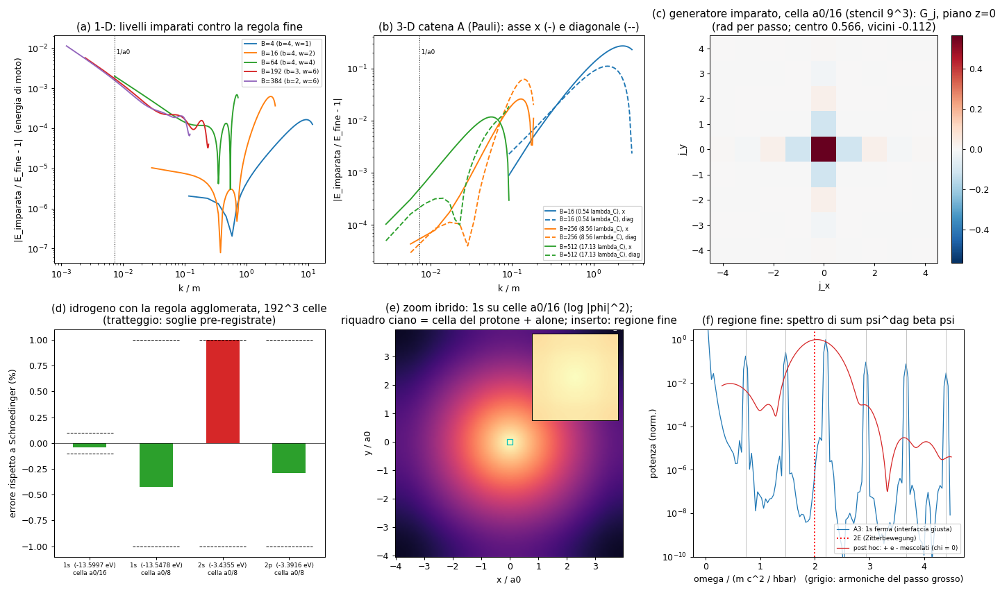

# Agglomerato zig-zag: l'idrogeno vero con poche celle

**La domanda di Valerio.** "L'idrogeno vero nella regola zig-zag ha bisogno di ~10¹⁰ celle: dov'è finito
l'agglomeratore?" Qui la risposta è fatta, non detta: prendiamo la regola zig-zag (`docs/ZIGZAG.md`, `lab/zz_core.py`),
la **raggruppiamo** in celle sempre più grosse, **impariamo** la regola delle celle grosse dai dati della regola fine,
**controlliamo** l'errore, **ripetiamo** (l'algoritmo di `docs/ZOOM.md`), e alla fine facciamo girare l'atomo di
idrogeno **alla scala di Bohr con 192³ celle**, tenendo la regola fine solo dove zoomiamo (dentro il protone).

File: motore `lab/agg_zz_core.py`; pre-registrazione `lab/agg_zz_prereg.py` → `lab/out/agg_zz_prereg.json`
(**committata in b714d9e prima delle corse di produzione**); corse `lab/agg_zz_1d.py` (A1), `lab/agg_zz_3d.py A|B`
(gerarchie 3-D), `lab/agg_zz_atom.py` (A2), `lab/agg_zz_zoom.py` (A3); esportazione `lab/agg_zz_export.py` →
`assets/atomo/agglomerato_zz.json`; figura `lab/agg_zz_figure.py` → `lab/out/agg_zz_figure.png`.

---

## 0. In breve (risultati)

| prova | cosa | risultato | esito |
|---|---|---|---|
| A1a | 1-D: la regola grossa imparata riproduce 1000 tick della regola fine, a ogni livello | errore \|Δψ\|² da 2·10⁻⁵ a 10⁻⁹ (soglia 10⁻²), 10 livelli su 10 | **PASS** |
| A1b | massa cinetica dalla dispersione imparata (B ≥ 32) | m_kin/m = 1,00018 / 1,00026 / 1,00011 / 0,99995 | **PASS** (4 su 4) |
| A1c | coefficiente −k⁴/8m³ (correzione relativistica) entro 10 % | 1,006 / 0,996 / 1,028 a B = 32, 64, 192; **1,50 a B = 384** | 3 PASS, **1 FAIL** |
| A1d | gerarchia automatica (1-D e 3-D) | costruita senza mani; esportata | fatto |
| A2a | 1s con la regola imparata, celle a₀/16 | **−13,59967 eV** contro −13,60569 (**−0,044 %**) | **PASS** |
| A2b | 2s e 2p con celle a₀/8, entro 1 %; 2s−2p < 1 % della spaziatura | 2p −3,3916 (−0,29 %); **2s −3,4355 (+1,003 %)**; 2s−2p = 0,044 eV < 0,10 eV | 2p e degenerazione PASS, **2s FAIL di un soffio** |
| A2c | bonus struttura fine 2p₁/₂–2p₃/₂ | il nucleo imparato **non porta spin** (parte di spin 10⁻¹⁰): **non disponibile** | dichiarato prima |
| A3a | zoom ibrido: 1s invariata entro 0,1 % | ibrida −14,12474 eV contro grossa uniforme −14,13477 eV (stessa scatola): **−0,071 %** | **PASS** |
| A3b | Zitterbewegung solo nella regione fine | il picco più forte nella regione fine è a 2,2008 mc²/ħ = **3ª armonica del passo grosso** (il "battito" dell'alone), non la Zitterbewegung (2E = 2,000) | **FAIL** (10,04 % da 2E, e per il motivo sbagliato) |
| A3c | costo ibrido / fine uniforme | celle×tick **7,2·10⁴ volte meno** della regola fine dappertutto | riportato |

**Il colpo d'occhio.** Per l'idrogeno con la regola fine servivano (12 a₀ / 0,0335 λ_C)³ ≈ **1,2·10¹⁴ celle** e un tick
ogni 4·10⁻²³ s. Con l'agglomerato: **192³ = 7·10⁶ celle** (256³ = 1,7·10⁷ volte meno) e un passo **256 volte più
lungo**: celle × tick **4,3·10⁹ volte meno**. L'1s esce entro lo 0,044 % dal valore esatto. Il PC lo fa in un minuto.

---

## 1. Perché servivano 10¹⁰ celle

La regola zig-zag è una pallina che va sempre a c e gira il suo stato (L ↔ R) di un angolo θ = m c a/ħ a ogni tick.
Perché la massa sia giusta, la cella deve essere **più piccola della lunghezza di Compton** λ_C = ħ/mc (θ ≪ 1). Ma
l'atomo è grande **137 λ_C** (il raggio di Bohr a₀ = λ_C/α). Una scatola di qualche a₀ con celle di 0,1 λ_C fa
(5·137/0,1)³ ≈ 3·10¹¹ celle. È lo stesso problema di voler disegnare una città mattone per mattone.

Ma l'elettrone nell'atomo **non guarda** i dettagli sotto λ_C: si muove piano (v ≈ αc), ha impulsi ≈ 1/a₀. Allora
basta una regola per **pezzi di spazio grandi** (≈ a₀/16) che faccia "la stessa cosa" delle palline fini, su quelle
scale. Questa regola non la scriviamo a mano: la **impara l'agglomeratore** dalla regola fine.

## 2. L'agglomeratore: UNA regola automatica (come i livelli di dettaglio di Nanite)

A ogni livello si fanno sempre le stesse sei cose (stesso codice per ogni livello, in 1-D e in 3-D):

1. **Raggruppa** (block): b × b × b celle diventano una cella grossa (media dei valori), b passi del livello sotto
   diventano un passo. Il passo grosso dura τ = B celle fini / c: anche la super-pallina "va a c".
2. **Impara** (learn): la regola grossa è **lineare e uguale dappertutto** (come quella fine). La si trova con i
   minimi quadrati sui dati del livello sotto: onde (pacchetti, o onde piane: è la stessa informazione) fatte
   evolvere dal livello sotto, raggruppate, e confrontate un passo grosso dopo.
3. **Fa un passo** (step): ψ → trasformata di Fourier → moltiplica → indietro.
4. **Controlla** (check): pacchetti d'onda evoluti dal candidato e dal livello sotto per **1000 tick fini**; e
   l'energia di moto pesata **con la distribuzione degli impulsi dell'oggetto che vogliamo guardare** (per l'1s:
   uno stato di taglia a₀; per n = 2: di taglia 2 a₀). Più due "regole di buon senso": la regola non deve inventare
   energie di moto negative da nessuna parte, e deve fare all'incirca la cosa giusta anche dove nessuno guarda.
5. **Sceglie** (choose), da sola: prova blocchi b ∈ {16, 8, 4, 3, 2} (in 1-D {4, 3, 2}), raggi dello stencil
   w = 1…4 (1-D: 1…6) e, in 3-D, **quanti numeri tenere per cella** (4 = elettrone di Dirac completo, 2 = solo la
   parte "grande", lo spinore di Pauli). Tiene **la regola che raggruppa di più con meno numeri** tra quelle che
   passano il controllo con l'errore permesso (budget: 10⁻³ sui pacchetti, 3·10⁻⁴ sull'energia per livello in 3-D,
   10⁻⁴ in 1-D). Se nessuna passa, il livello non si fa (bandierina: lì restano le palline del livello sotto).
6. **Ripete** (repeat): il livello successivo si impara dalla **regola imparata** del livello sotto, mai più dalla
   regola fine. Gli errori si accumulano: li misuriamo.

Le palline non cambiano mai: ogni tanto (ogni b celle) vengono raccolte in meno agglomerati che fanno le stesse cose.

## 3. A1 — In una dimensione (`lab/agg_zz_1d.py`)

Regola fine: la pallina R va a destra, la L a sinistra, e il giro θ = a₀/4096 = 0,0335 (cella fine 0,0335 λ_C).
Due catene: la **scala fissa b = 2** chiesta (B = 2, 4, 8, 16, 32) e la **gerarchia automatica**.

| catena | B | b scelto | w | numeri nello stencil | \|Δψ\|² dopo 1000 tick fini | m_kin/m (fine: 1,00038) | c₄ / (1/8m³) | costo celle×tick ridotto di | con lo stencil |
|---|---|---|---|---|---|---|---|---|---|
| scala | 2 | 2 | 1 | 3 | 1,9·10⁻⁸ | 1,00038 | 0,997 | 4 | 1 |
| scala | 4 | 2 | 1 | 3 | 2,6·10⁻⁵ | 1,00038 | 0,997 | 16 | 5 |
| scala | 8 | 2 | 1 | 3 | 1,7·10⁻⁴ | 1,00041 | 0,996 | 64 | 21 |
| scala | 16 | 2 | 2 | 5 | 7,0·10⁻⁶ | 1,00040 | 0,997 | 256 | 51 |
| scala | 32 | 2 | 2 | 5 | 7,9·10⁻⁸ | 1,00018 | 1,006 | 1024 | 205 |
| auto | 4 | 4 | 1 | 3 | 8,0·10⁻⁶ | 1,00038 | 0,997 | 16 | 5 |
| auto | 16 | 4 | 2 | 5 | 4,3·10⁻⁷ | 1,00037 | 0,997 | 256 | 51 |
| auto | 64 | 4 | 4 | 9 | 1,6·10⁻⁹ | 1,00026 | 0,996 | 4096 | 455 |
| auto | 192 | **3** | 6 | 13 | 1,4·10⁻⁹ | 1,00011 | 1,028 | 36 864 | 2 836 |
| auto | 384 | 2 | 6 | 13 | 9,5·10⁻¹⁰ | 0,99995 | **1,497** | 147 456 | 11 343 |

* **Il primo raggruppamento per 2 è esatto** (errore 10⁻⁸ dovuto solo al rumore numerico dell'apprendimento): due tick
  della pallina la spostano di 0 o ±2 celle, cioè di 0 o ±1 cella grossa. Dal secondo in poi non è più esatto.
* La regola grossa **è** Schrödinger con la massa giusta: E(k) = mc² + k²/2m − k⁴/8m³ + … La massa cinetica viene
  dalla curvatura della dispersione imparata ed è giusta a 4·10⁻⁴ (che è proprio l'errore della regola fine stessa,
  θ²/3). **La massa a riposo diventa una fase**: a un livello grosso mc²τ vale molti giri, e la regola ne ricorda solo
  il resto modulo 2π (−2,141 rad a B = 64, uguale a quello della regola fine fino a 10⁻⁸). Per la fisica dell'atomo
  conta solo la massa cinetica.
* Il termine −k⁴/8m³ (la correzione relativistica, ordine (v/c)²) è ritrovato entro il 3 % fino a B = 192; a B = 384
  è sbagliato del 50 %: lì la finestra degli impulsi piccoli contiene solo ~1/2 cella⁻¹ e il termine k⁴ vale 10⁻⁵ del
  termine k²: lo stencil con 13 numeri non lo distingue più (**FAIL A1c**). L'errore sui pacchetti resta 10⁻⁹:
  per il moto, quel termine è invisibile.
* Nella figura (pannello a) l'errore **relativo** dell'energia di moto cresce verso k → 0 ai livelli alti (1 % a
  k = 10⁻³ m): è un piccolo errore **assoluto** costante (un "pavimento" dei minimi quadrati) diviso per un'energia
  che va a zero. A k = 1/a₀ è 10⁻³ in 1-D; in 3-D (pannello b) è 5·10⁻⁵ al livello a₀/16.
* **Scelta automatica**: l'agglomeratore ha scelto da solo b = 4, 4, 4, poi **b = 3** (perché b = 4 non passava il
  controllo dell'energia) e infine b = 2, con stencil che si allargano (w = 1 → 6) salendo: più si è grossi, più la
  regola deve "ricordare" dei vicini lontani (come le molle di `ZOOM.md`).

## 4. In tre dimensioni: la gerarchia che la macchina ha scelto (`lab/agg_zz_3d.py`)

Catena A: regola fine 3-D (4 componenti L, R, passi x, y, z poi z, y, x; θ = 0,0335). Osservabile: l'energia di uno
stato di taglia a₀ (fino alla cella a₀/16), poi di taglia 2 a₀ (fino ad a₀/8).

| livello | B (celle fini) | cella | b | w | numeri per cella | errore energia | errore pacchetti | fase a riposo imparata / fine |
|---|---|---|---|---|---|---|---|---|
| 0 | 1 | 0,0335 λ_C | — | — | 4 (Dirac) | — | — | — |
| 1 | 16 | 0,535 λ_C = a₀/256 | **16** | 2 | **2 (Pauli)** | 8,8·10⁻⁵ | 10⁻¹⁵ | −0,535297 / −0,535297 |
| 2 | 256 | 8,56 λ_C = **a₀/16** | **16** | 4 | 2 | 6,3·10⁻⁵ | 6·10⁻¹⁷ | −2,281565 / −2,281565 |
| 3 | 512 | 17,1 λ_C = **a₀/8** | 2 | 3 | 2 | 2,8·10⁻⁴ | 10⁻¹⁶ | +1,720056 / +1,720056 |

(Catena B per lo zoom: fine θ = 0,268 → B = 16 (4,28 λ_C, b = 16, w = 2) → B = 32 = a₀/16 (b = 2, w = 4).)

Cose imparate guardando la macchina scegliere:

* **Salta il muro di Compton in un colpo solo.** Con celle tra 0,07 e 0,5 λ_C l'elettrone è "relativistico" sulla scala
  della cella: lì gli stencil cubici fanno fatica a imitare la regola fine (che va a c in tutte le direzioni, un cono
  di luce rotondo che un cubo non ha). Nelle prove di sviluppo con b ∈ {2, 3, 4} la gerarchia si fermava a B = 4–16.
  Con b fino a 16 l'agglomeratore **sceglie da solo b = 16**: passa direttamente dalle palline fini a celle di mezza
  λ_C, dove l'elettrone lento è già "Schrödinger".
* **Lo spin sparisce dalla regola libera.** Il descrittore con 2 numeri (la parte grande dello stato a energia
  positiva: lo spinore di Pauli) passa subito il controllo, e la parte del nucleo imparato che dipende dallo spin è
  **10⁻¹⁰**: per un elettrone libero lo spin non fa niente. Le due "metà" L e R della pallina e il loro giro θ sono
  diventati **una massa** (nella curvatura) e **una fase**.
* **Cosa si impara davvero**: non il passo e^{−iGτ}, ma il suo **generatore** G (un piccolo "Hamiltoniano a stencil",
  hermitiano: le palline sono conservate esattamente). Il generatore del livello a₀/16 è uno stencil 9×9×9 (729
  posti) che vale quasi esattamente il Laplaciano −∇²/2m con piccole correzioni (figura, pannello c).

## 5. A2 — L'idrogeno alla scala di Bohr (`lab/agg_zz_atom.py`)

Regola dell'atomo: mezzo giro di Coulomb (V = media sulla cella di −α/r, nucleo su uno spigolo di cella), un passo
della regola imparata, mezzo giro di Coulomb. Scatola periodica di 192³ celle. Stati stazionari: iterazione inversa
precondizionata (LOBPCG) sull'Hamiltoniano imparato G/τ + V; **l'energia si legge poi dalla regola stessa**
(E = −arg⟨ψ|W|ψ⟩/τ; residuo |Wψ − λψ| = 10⁻⁷…10⁻⁸ di |ψ|).

| stato | cella | scatola | energia (regola imparata) | Schrödinger esatto | errore | tempo |
|---|---|---|---|---|---|---|
| 1s | a₀/16 | ±6 a₀ | **−13,59967 eV** | −13,60569 eV | **−0,044 %** (PASS, soglia 0,1 %) | 65 s |
| 1s | a₀/8 | ±12 a₀ | −13,54776 eV | −13,60569 | −0,43 % | 72 s |
| 2s | a₀/8 | ±12 a₀ | −3,43552 eV | −3,40142 | **+1,003 %** (FAIL, soglia 1 %) | 227 s |
| 2p | a₀/8 | ±12 a₀ | −3,39159 eV | −3,40142 | −0,29 % (PASS) | 564 s |

* **1s: PASS.** Con 7 milioni di celle e un passo di 8,6 ħ/mc² (256 tick fini) l'1s è giusta allo 0,044 %.
* **2s−2p = 0,044 eV**, contro una spaziatura 1s→2 di 10,16 eV: la degenerazione di Schrödinger c'è (soglia 0,10 eV,
  PASS). Ma il 2s da solo è troppo legato dell'1,003 % (**FAIL** per 3 millesimi di punto): gli stati s "toccano" il
  nucleo, e una cella di a₀/8 è grossa per la cuspide di Coulomb (l'1s con la stessa cella è −0,43 %). Il 2p, che
  al nucleo vale zero, è a posto. È la stessa lezione dello zoom nel nodo: **vicino al nucleo serve il livello più
  fine**; un 2s preciso all'1 % vuole a₀/16 (o lo zoom ibrido) — non l'abbiamo rifatto dopo la corsa.
* **Spin e struttura fine (A2c): non disponibile.** Il nucleo imparato da onde libere non porta spin (10⁻¹⁰). La
  struttura fine (spin–orbita) nasce dall'**accoppiamento con il potenziale** attraverso la componente piccola, non
  dal moto libero: per averla, l'agglomeratore dovrebbe imparare anche **come la cella grossa sente il campo
  elettrico** (dati della regola fine in un campo debole). Debito dichiarato prima della corsa.

## 6. A3 — Lo zoom ibrido (`lab/agg_zz_zoom.py`)

Catena B (fine θ = 0,268: la Zitterbewegung, periodo π ħ/mc², dura 11,7 tick fini e si vede). Celle grosse di
a₀/16 dappertutto (128³, ±4 a₀), **regola fine (4 componenti, Coulomb puntiforme a ogni tick) nella cella che
contiene il protone** (cubo di 8,6 λ_C, sfera inscritta di 4,3 λ_C ≈ le "5 λ_C" chieste), più un **alone** spesso una
cella grossa (il cono di luce di un passo grosso) rinfrescato a ogni passo dal campo grosso.

* **Prolungamento** (grosso → fine): valori di cella → valori di punto (correzione −h²∇²/24), interpolazione cubica
  di Lagrange, componente piccola dalla relazione della regola fine stessa per gli stati a energia positiva
  (χ = Σ G_j (−i∂_j) φ, con G_j misurati sugli autovettori di Bloch della regola fine: 27 % diversi dalla formula del
  continuo σ·p/2m).
* **Restrizione** (fine → grosso): media di φ = (L + R)/√2 sulla cella del protone.

Risultati (24 passi grossi = 768 tick fini; scatola ±4 a₀ con 128³ celle grosse + 96³ celle fini):

| che cosa | valore |
|---|---|
| 1s grossa uniforme (nucleo al centro di una cella, catena B) | −14,13477 eV (la catena B eredita il +2,4 % della massa cinetica della regola fine a θ = 0,268, e la scatola piccola; qui conta solo il confronto) |
| 1s **ibrida** (pendenza della fase di ⟨ψ₀\|ψ(t)⟩ dai passi 8–24) | **−14,12474 eV: −0,071 %** (soglia 0,1 %: **PASS**) |
| norma persa all'interfaccia | 1,5·10⁻⁷ per passo (\|C\| = 0,9999963 dopo 24 passi) |
| spin che si gira (giù/su nella cella fine) | ≤ 1,6·10⁻⁸ |
| probabilità dentro la cella del protone | 7,3·10⁻⁵ |
| costo (celle × tick) | ibrido 7,3·10⁸ contro fine uniforme 5,3·10¹³: **7,2·10⁴ volte meno** |

La regione fine "vede" la cuspide di Coulomb meglio della cella grossa (dentro il protone l'onda di Dirac va come
r^{γ−1}): l'1s ibrida è un po' meno legata della grossa (0,01 eV). La differenza sta sotto la soglia.

**A3b, la Zitterbewegung: FAIL, e la ragione è fisica.** Avevo previsto di vedere il tremolio a 2E ≈ 2 mc²/ħ nella
regione fine. Lo spettro della regione fine (figura, pannello f, blu) mostra invece **righe strette a multipli di
2π/τ = 0,733 mc²/ħ**: è il "battito" dell'interfaccia, che rinfresca l'alone a ogni passo grosso; la più alta cade a
2,2008 (3ª armonica), fuori dal 10 % pre-registrato (10,04 %) e comunque per il motivo sbagliato. A 2E non c'è niente
(10⁻⁵ della riga più forte). **Il motivo:** la 1s è uno stato fermo (un'unica energia): non c'è nessuna
sovrapposizione di energie positive e negative, quindi **non c'è niente che tremi**. La Zitterbewegung è il battimento
tra le due bande; l'interfaccia giusta (con la componente piccola della regola fine) non ne crea.

**Prova post hoc** (`lab/agg_zz_zb.py`, scritta dopo il FAIL, non pre-registrata): stessa 1s portata in una regione
fine più grande (160³), una volta con l'interfaccia giusta e una volta **senza componente piccola** (χ = 0: così vicino
al nucleo metà dello stato è a energia negativa). Con χ giusto l'osservabile ψ†βψ della cella del protone oscilla di
10⁻⁴ e senza riga a 2E; con χ = 0 oscilla di **1,2·10⁻³ con il picco a 2,040 mc²/ħ** (2 % da 2E; figura, rosso). La
Zitterbewegung c'è **solo dove gira la regola fine** e **solo se lo stato mescola le due bande**; la regola grossa (2
numeri per cella, solo banda positiva, passo di 8,6 ħ/mc² più lungo del periodo π ħ/mc²) non può averla per
costruzione.

## 7. Livello ↔ zoom (la mappa per il laboratorio)

L'oggetto che guardi decide la cella; la cella decide il livello. Come i livelli di dettaglio di un videogioco.

| che cosa guardi | taglia | cella che basta | livello | regola |
|---|---|---|---|---|
| il protone, la Zitterbewegung | λ_C = 3,9·10⁻¹³ m | ≤ 0,3 λ_C | fine | zig-zag a 4 componenti |
| l'elettrone "relativistico" | ~λ_C | 0,5 λ_C | A1 (B = 16) | Pauli imparata, stencil 5³ |
| l'orbitale 1s | a₀ = 137 λ_C | a₀/16 | A2 (B = 256) | Pauli imparata, stencil 9³ |
| gli orbitali n = 2 (2p bene, 2s all'1 %) | 4 a₀ | a₀/8 | A3 (B = 512) | Pauli imparata, stencil 7³ |
| molecole, gas | ≫ a₀ | a₀/4, a₀/2, … | (non costruiti) | stessa procedura |

## 8. Molti elettroni: la legge dei costi, detta onestamente

Un elettrone su M celle: M numeri. **N elettroni: M^N numeri** (lo stato vive nello spazio delle configurazioni, 3N
dimensioni). Con M = 192³ = 7·10⁶: N = 1 → 7·10⁶ (fatto qui, un minuto); N = 2 (elio) → 5·10¹³; N = 10 (neon) →
10⁶⁸. **Nessun agglomeratore sullo spazio ordinario risolve questo**: raggruppare le celle riduce M, ma l'esponente N
resta.

Come deve fare l'agglomeratore (piano, **non fatto qui**):
1. **Imparare la regola a un corpo** (fatto: questo documento) e quella **a due corpi** da corse **esatte con 2
   elettroni** (elio, H⁻, H₂: per gli stati S bastano le 3 coordinate r₁, r₂, r₁₂, migliaia di punti, non 10¹³).
2. **Imparare il termine a tre corpi** da corse esatte con 3 elettroni (litio, nelle coordinate interne) e
   **controllare** su 4 elettroni (berillio) che il termine a quattro sia piccolo: è la stessa espansione a grappoli
   di `ZOOM.md` (coppie, triangoli, quadrati), applicata alle correlazioni tra elettroni.
3. Con quei pezzi, 10 elettroni costano ~ N·M + N²·(nucleo di coppia) + N³·(nucleo a tre): **polinomiale, non 10^N**.
   In pratica il "nucleo di coppia" imparato è un fattore di Jastrow e una forma dei nodi per la DMC di
   `MOLECOLE.md` (che già scala come N³ ma ha bisogno dei nodi: è lì che il carbonio sbaglia il 7 % su 2p→3s).
4. Il controllo a campione resta obbligatorio: ogni tanto si rifà un pezzo con 2–3 elettroni esatti e si confronta.

## 9. Fallimenti, debiti, cambi rispetto alla richiesta

**FAIL:** A1c a B = 384 (k⁴ sbagliato del 50 %); A2b per il 2s (+1,003 % contro 1 %); A2c non disponibile (niente
spin). A3b (la Zitterbewegung non si vede nella 1s ferma: vedi §6).

**Cambi rispetto alla richiesta (tutti dichiarati nella pre-registrazione):**
* La catena 1-D chiesta b = 2, 4, 8, 16, 32 c'è (scala fissa); la gerarchia automatica va oltre (fino a B = 384),
  perché con la cella fine 0,0335 λ_C (scelta perché l'errore della massa cinetica della regola fine, θ²/3, sia
  4·10⁻⁴) la cella a₀/16 è a B = 256. Con cella fine 0,27 λ_C (B = 32) l'1s sarebbe stata sbagliata del 2,4 % per
  colpa della regola fine stessa.
* In 3-D l'apprendimento usa **onde piane** invece di pacchetti in una scatola (stessa informazione per una regola
  lineare e uguale dappertutto; una scatola 3-D di 20³ celle grosse dava troppo pochi impulsi distinti). In 1-D
  invece l'apprendimento è sui pacchetti evoluti dalla pallina vera, come chiesto.
* Il controllo è fatto nello spazio degli impulsi (esattamente equivalente a far correre i pacchetti, per regole
  lineari), con pacchetti di 1000 tick fini.
* Prima della pre-registrazione ci sono state molte corse di sviluppo (elencate nel JSON): la più istruttiva è un
  atomo con un generatore imparato solo dove sta lo stato, che aveva **uno stato legato finto a −518 eV in una sola
  cella** (la regola, dove nessuno guardava, non faceva costare niente il moto). Da lì le due regole di buon senso del
  controllo.

**Debiti:**
1. Lo spin–orbita (struttura fine) non è nel livello grosso: va imparato l'accoppiamento al campo.
2. Il 2s all'1 % vuole a₀/16 o lo zoom: la scatola ±12 a₀ con a₀/16 sarebbe 384³ (non fatto).
3. Il potenziale grosso è la media di cella di −α/r scritta a mano (restrizione naturale), non imparata.
4. L'energia di rinculo del protone (massa ridotta) non è inclusa (la regola zig-zag ha il nucleo infinitamente
   pesante, come in `ZIGZAG.md`).
5. Molti elettroni: solo il piano (§8).

**Quanti numeri:** ingressi fisici gli stessi della regola zig-zag: mₑ (θ), α, Z = 1. Numeri imparati: livello A1
125 posti × 2×2 complessi, A2 729 × 2×2, A3 343 × 2×2 (in pratica, essendo lo spin inattivo, 125 + 729 + 343
numeri complessi con simmetria G₋ⱼ = Gⱼ*), più una fase a riposo per livello. Iper-parametri dell'agglomeratore
(uguali per tutti i livelli): blocchi {16, 8, 4, 3, 2}, w ≤ 4, budget 10⁻³ (pacchetti) e 3·10⁻⁴ (energia), 75 % di
campioni come lo stato osservato + 25 % uniformi con peso 0,03, soglie di buon senso 0,2 e 1 %.

## 10. Nota per il laboratorio Rust

`assets/atomo/agglomerato_zz.json` contiene la gerarchia (livelli, b, w, descrittore, errori del controllo, cella in
λ_C e in a₀, fase a riposo φ₀, offsets e lo stencil del generatore G_j come parti reali e immaginarie), più i
risultati dell'atomo e dello zoom. Per far girare l'atomo alla scala di Bohr nel laboratorio: prendere il livello
B = 256 della catena A (cella 8,5647 λ_C, passo τ = 8,5647 ħ/mc²), costruire G(k) = Σⱼ Gⱼ e^{ik·j} sulla griglia
(FFT dello stencil), e fare a ogni passo: φ ← e^{−iVτ/2} · IFFT[e^{iφ₀} e^{−iG(k)} · FFT(e^{−iVτ/2} φ)]. La parte di
spin è 10⁻¹⁰: si può usare lo stencil scalare (G₀₀ + G₁₁)/2 su una sola componente. Con 128³ celle (±4 a₀) un passo
costa due FFT: dal vivo. Lo stato fermo 1s si ottiene con lo stesso "ascolto" (lock-in) di `ZIGZAG.md`.

## 11. Come rieseguire

    python lab/agg_zz_prereg.py
    python lab/agg_zz_1d.py                      # ~1 min
    sh lab/out/agg_zz_run3d.sh                   # catene 3-D A e B (~15 min, ripartibile)
    sh lab/out/agg_zz_runatom.sh                 # 1s, 1s, 2s, 2p su 192^3 (~20 min, ripartibile)
    sh lab/out/agg_zz_runzoom.sh                 # zoom ibrido (~15 min, ripartibile)
    python lab/agg_zz_export.py && python lab/agg_zz_figure.py
