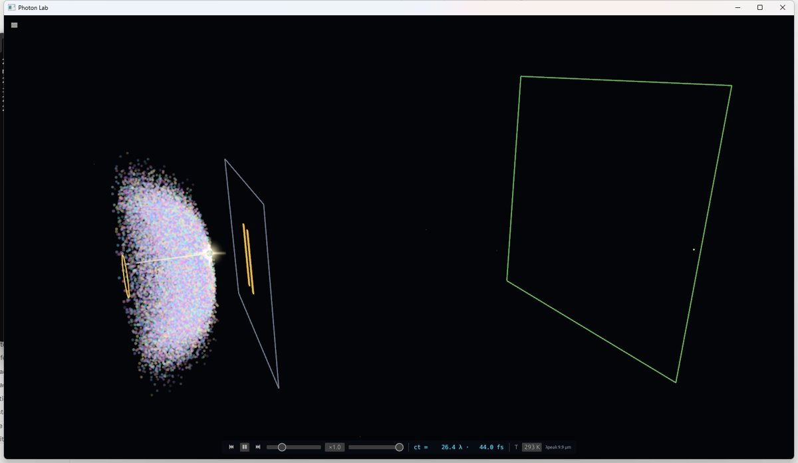
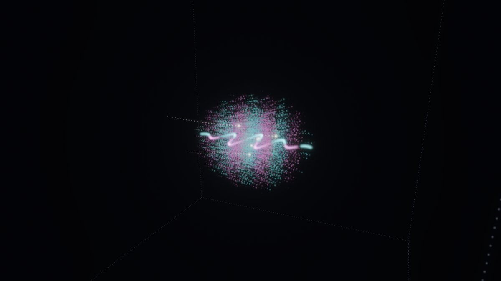
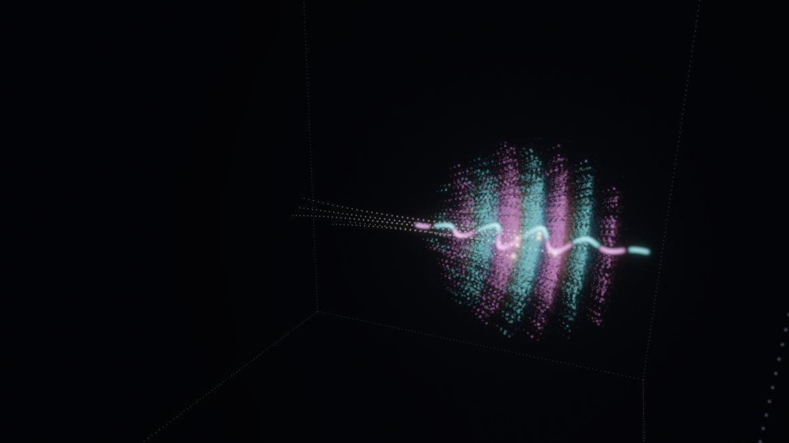
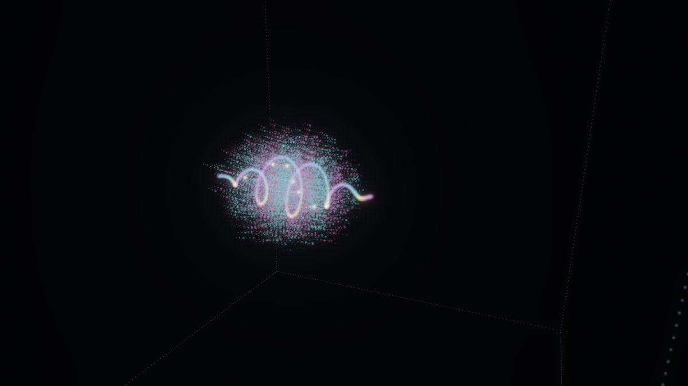
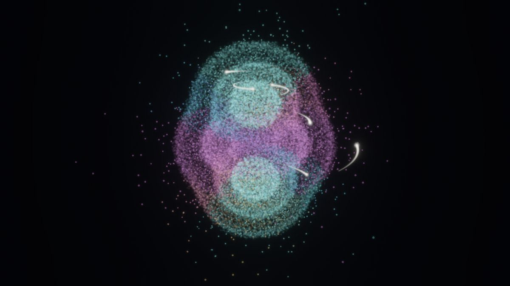
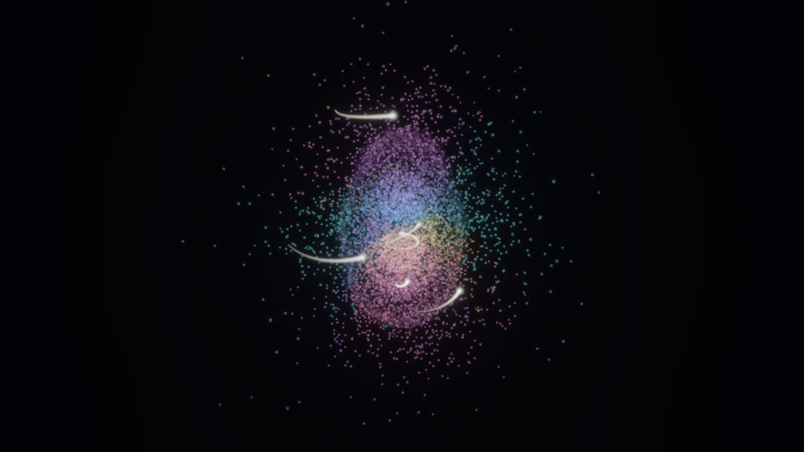
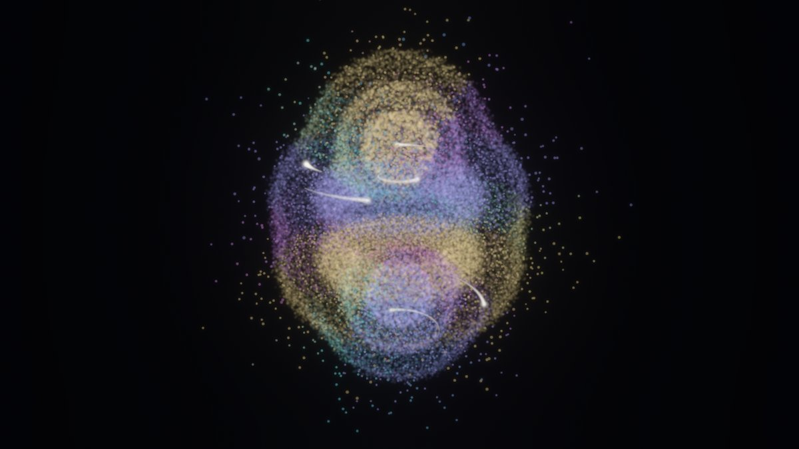

# Laboratorio Atomo: luce e materia con una sola regola di palline (la regola zig-zag)

Binario: `atomo` (`src/atomo/`). Eseguibile: `Laboratorio Atomo.exe` sul Desktop (nella cartella
"Programma di simulazione").

## 0. In una frase

Si apre su **un fotone solo**, fatto di palline a spin 1, che vola in una scatola vuota in 3-D: si vede il campo
elettrico e magnetico, l'elica della luce circolare, i fronti d'onda e il fascio che si allarga. La seconda scena è
**un atomo con un elettrone** (Nd⁵⁹⁺) dove le palline si muovono tutte, a ogni tick, con la stessa regola più la
massa; zoomando nel nucleo c'è il **protone come nodo** che gira e respira. La terza scena mostra gli
**orbitali** di quell'elettrone (n = 1..4, s p d f, e sovrapposizioni che battono), dalla stessa regola.

## 1. Una sola regola

Decisione di Valerio: **la regola zig-zag è l'unica strada** (`src/zigzag/walk.rs`, `docs/ZIGZAG.md`). Ogni
pallina avanza a c e gira il suo stato. Un tick: per x, y, z a turno (x,y,z nei tick pari, z,y,x nei dispari) lo
stato si divide secondo lo spin lungo quell'asse; la parte +1 avanza di una cella, la parte −1 torna indietro di
una, la parte 0 resta. Senza massa (spin 1, F = E + icB) è la luce; con la massa (il giro L ↔ R di θ = m c a/ħ) è
l'elettrone di Dirac; la fase di Coulomb lega l'elettrone al nucleo. Ogni passo è unitario: **il tempo torna
indietro esatto**.

Tolto dal laboratorio in questa versione (resta nella storia di git, commit `a84692d`):
* **il carbonio con la regola DMC** (palline in tempo immaginario: non è la regola zig-zag). I suoi numeri
  (V1 PASS −37,8259 Eₕ, V2 PASS ionizzazione 11,33 eV, V3 FAIL 2p→3s +7,4 %) restano in
  `assets/atomo/risultati.txt` come archivio; il binario non li legge più. I binari vecchi (`molecole`, `fotone`,
  `scontro`, `compton`, `zigzag`) non sono toccati.
* **la doppia fenditura**: Valerio l'ha scartata ("mezza 2-D", una lastra di 2 celle, sembra piatta). La fenditura
  tornerà fatta di atomi (agglomerati). Diagnosi dell'errore delle frange (−12,7 %) fatta prima di toglierla, §5.

## 2. La scena "fotone libero" (`fotone3d.rs`, `fotscena.rs`)

* **La scatola**: un cubo periodico vuoto, tutto in 3-D (nessuna lastra). La grandezza dipende dalla **qualità**
  (celle per lunghezza d'onda): 8 celle per λ su 96³, 12 su 128³, 16 su 144³, 24 su 192³. Il lato è 8–12 λ.
* **Il lancio**: un impulso gaussiano (larghezza al fuoco w0, scelta da 0,7 a 3 λ; lunghezza σ = 1 λ) nella
  direzione scelta (x, y, z, obliqua (1,1,0), diagonale (1,1,1)) e con la polarizzazione scelta (orizzontale,
  verticale, circolare +, circolare −). È costruito onda per onda dalle onde piane di Maxwell: per ogni vettore
  d'onda q, E ⊥ q e cB = q̂ × E. Così non ha una parte ferma e non ha onde che vanno all'indietro. Il fuoco è al
  centro: il fotone parte lontano dalle facce, si stringe, poi si allarga (diffrazione). Quando ha attraversato
  ne parte un altro uguale.
* **Da qui in poi è solo la regola**: tick dopo tick, nessuna equazione di Maxwell nel moto.
* **La scala (dalle onde radio ai raggi gamma)**. La regola senza massa non ha una lunghezza sua: un fotone
  radio di 1 m e un fotone gamma di 1 pm sono **lo stesso disegno di palline**; cambia solo quanto è grande una
  cella e quanto dura un tick. Per questo il cursore "λ vera" (da 1 km a 1 pm) non rilancia nulla: cambia la scala
  in basso a sinistra, l'orologio, e nel cruscotto λ, frequenza ν = c/λ ed energia hc/λ (con il nome della banda).
  **La forma è autosimile; l'unica cosa che cambia davvero con λ è come la luce parla con la materia** (qui non
  c'è materia). Un reticolo che coprisse 10¹² volte di scala non serve e non esiste.
* **Come si vede** (`fotdisegno.rs`; il disegno legge il campo, non lo cambia). Lo stile è quello del vecchio
  Laboratorio Fotone (`src/photon/render3d.rs`): palline d'onda con il loro colore di fase, sfumate (fuse "alpha",
  non sommate in bianco), più poche palline-surfista luminose con la scia.
  * **palline che corrono col campo** (32 000): nascono dove il fotone ha energia (più energia, più palline) e a
    ogni tick si muovono con la velocità dell'energia del campo nel loro punto, v = 2 E × cB / (E² + c²B²) (c in
    un'onda piana), letta dal reticolo per interpolazione. Ognuna ha una piccola scia. Colore = **fase dell'onda**
    nel punto (da E lungo la polarizzazione ora e un tick prima: tutti i colori una volta per λ, come nel vecchio
    laboratorio). Sono ben visibili solo vicino a una cresta o a una valle: il pacchetto si vede come **una pila di
    creste colorate che avanza** (dischi che si curvano vicino al fuoco). Quando la luce se ne va, rinascono dove
    la luce è.
  * **surfisti**: 6 palline bianche portate dallo stesso flusso di energia, con una scia lunga.
  * **elica di E**: la punta di E lungo l'asse del fascio, un tubo continuo (curva liscia tra i campioni delle
    celle). Luce circolare: **una vite che gira mentre vola**; lineare: un'onda piatta in un piano.
  * spenti all'inizio: **fronti d'onda** (fogli sottili dove E lungo la polarizzazione ha una cresta, oro, o una
    valle, azzurro; la posizione dentro la cella da una parabola su tre celle), **tratti E e B** (pochi tratti
    lisci dall'asse), **Poynting S = E × B** (oro), **spin** E(t−1) × E(t) (verde lungo il volo, magenta contro),
    **sezione** di traverso.
  * Vista di partenza di tre quarti; "segui il fotone" tiene la camera sul pacchetto. Da molto di sbieco le creste
    si sovrappongono (è una proiezione di dischi uno dietro l'altro): di lato si vedono meglio.
  * Confronto (stesse dimensioni della finestra): il vecchio Laboratorio Fotone (doppia fenditura) e il fotone
    zig-zag lineare a due istanti e circolare:

    
    
    
    
* **Misurato dal vivo dal campo** (cruscotto e pannello): la velocità del centro dell'energia |F|², l'elicità
  (quanto gira E in un tick: Σ (E(t−1) × E(t))·d / (sin ω Σ|E⊥|²)), la larghezza del fascio e, dopo 20 tick di
  volo, l'angolo di apertura θ (da ⟨δ⊥²⟩(t) = a + b t + c t², θ = 2√c: per la luce libera la formula è esatta).
* **Velocità**: un impulso stretto contiene onde un po' oblique, quindi il suo centro dell'energia va un po' meno di
  c **anche nelle onde continue** (c⟨cos θ⟩). Il confronto giusto è con il valore delle onde continue per lo
  stesso impulso, che il pannello mostra accanto.
* **Costo** (i5 a 4 core condiviso, build di sviluppo, misurato da `bench_fotone`): un tick costa ~9–14 ms a
  96³, ~31 ms a 128³, ~41 ms a 144³, ~105 ms a 192³; più misure e palline. Dal vivo: ~25–30 tick/s alla qualità
  "veloce", ~15 alla "media", ~10 alla "alta", ~5 alla "massima". **Il traguardo "≥ 24 celle per λ a ≥ 30 tick/s"
  questo PC non lo regge** (servono ~7 milioni di celle per tick): la qualità massima c'è ma è lenta.

## 3. L'atomo zig-zag (dal vivo) e il nucleo

### 3.1 L'atomo

* **Perché non l'idrogeno.** Il raggio dell'idrogeno è 137 ħ/mc e le celle devono essere ≲ 0,5 ħ/mc: servirebbero
  ~10¹⁰ celle. Il problema di Dirac–Coulomb dipende solo da Zα: prendiamo lo **ione idrogenoide di neodimio,
  Nd⁵⁹⁺ (Z = 60, un solo elettrone)**, raggio di Bohr 2,28 ħ/mc ≈ 880 fm. 48³ celle da 0,5 ħ/mc, ~35 ms per tick,
  su un thread a parte.
* **Partenza**: l'1s della forma radiale della stessa regola messo sul reticolo cubico (solo ~60 % l'1s della
  regola 3-D: il resto si vede come tremolio in più). Legame 1s della regola radiale con a = 0,5: 0,141 mc²
  (Dirac esatto 0,101: +40 %, celle grosse).
* **Ogni pallina si muove a ogni tick**: 20 000 surfisti trasportati dalla corrente dell'onda (v = j/ρ ≤ c).
  Colore = fase dell'onda (tolta la rotazione della massa a riposo).
* **Il fotone**: un impulso con l'energia scelta (keV), che entra nella fase come e E·r (dipolo: λ ≈ 55 ħ/mc è
  25 volte l'atomo). **La risonanza esce dalla regola**: a 58,5 keV (1s → 2p della regola) la nuvola resta in una
  sovrapposizione 1s + 2p che oscilla; fuori risonanza (×1,3) il dipolo si muove 4 volte meno (test
  `zigzag_risonanza`, lungo).
* **La luce che esce**: gusci di palline con la direzione sin²θ e la luminosità del dipolo dell'onda stessa al
  tempo ritardato.
* **Indietro nel tempo esatto**: 60 tick avanti con l'impulso e 60 indietro: |Δψ|² = 1,5·10⁻²⁷.

### 3.2 Il nucleo: il protone come nodo che gira e respira

* Il nodo B = 1 del campo dei pioni (Skyrme), calcolato qui: B = 1,00000, E/12π² = 1,23150, raggio rms 0,59 fm,
  massa 863 MeV; 40 000 palline estratte dalla densità barionica.
* **Gira** (M_Δ − M_N = 319 MeV, misura 293, +9 %) e **respira** (ħω = 216 MeV, stima grezza). Orologio rallentato.

### 3.3 Gli orbitali: n = 1..4, s p d f, e sovrapposizioni (scena "orbitali", `orbitali.rs`)

* **Da dove vengono.** Sono gli stati di UN elettrone che dà la regola zig-zag nella sua **forma radiale** (la
  stessa regola scritta per un'onda parziale κ: stessa cella a = 0,5 ħ/mc, stessa fase di Coulomb,
  `src/zigzag/walk.rs` `Radial`). La regola viene "ascoltata" a 48 frequenze; ogni stato trovato viene ripreso
  alla sua frequenza; gli stati distinti, dal più legato, sono n = l+1, l+2, ... Poi in 3-D:
  ψ = (g/r Ω_{κm}, i f/r Ω_{−κm}) con le funzioni d'angolo di Dirac (armoniche sferiche). Una sovrapposizione
  evolve con le frequenze della regola, ψ(t) = Σ c_k ψ_k e^{−i(ω_k − 1)t}: la nuvola **batte** a ω₁ − ω₂.
* **Perché non sul reticolo dal vivo.** La scatola dal vivo (48³ celle da 0,5 ħ/mc, 24 ħ/mc di lato) tiene l'1s;
  il 3d di Nd⁵⁹⁺ arriva a ~52 ħ/mc e il 4f a ~82 (99,5 % della probabilità): servirebbero ~350³ celle. Per un
  elettrone in un campo centrale la forma radiale è la stessa regola, senza approssimazioni in più.
* **Livelli della regola contro Dirac esatto** (test `orbitali_livelli`; tutti trovati, nell'ordine giusto):

| stato | legame, regola (mc²) | Dirac esatto | scarto |
|---|---|---|---|
| 1s½ | 0,14124 | 0,10095 | +39,9 % |
| 2s½ | 0,03298 | 0,02556 | +29,0 % |
| 2p3/2 | 0,02510 | 0,02426 | +3,5 % |
| 3s½ | 0,01374 | 0,01121 | +22,5 % |
| 3p3/2 | 0,01142 | 0,01082 | +5,5 % |
| 3d5/2 | 0,01090 | 0,01071 | +1,8 % |
| 4s½ | 0,00744 | 0,00625 | +19,1 % |
| 4p3/2 | 0,00648 | 0,00608 | +6,5 % |
| 4d5/2 | 0,00625 | 0,00603 | +3,7 % |
| 4f7/2 | 0,00609 | 0,00601 | +1,3 % |

  Le celle grosse legano troppo gli stati che vanno vicino al nucleo (s); quelli lontani (d, f) sono quasi giusti.
* **Come si vede.** Da lontano: **gusci morbidi** a tre livelli di densità |ψ|² (50 %, 18 %, 5 % del massimo),
  colore = **fase dell'onda** (gira nel tempo; attorno all'asse z si avvolge come e^{imφ}). Da vicino: 5 000
  **palline-surfista** portate dalla corrente dell'onda, v = j/ρ (≤ c), con il colore della fase dove sono; sei con
  la scia bianca. Il protone (nodo B = 1) al centro, zoom con 2.
* Scelte rapide: 1s, 2s, 2p, 3d, 4f, 1s+2p, 2p+3d, 3d+4f, 2s+2p; oppure su misura: n, l, j = l ± ½, m_j e un
  secondo stato con il suo peso.
* **Atomi con più elettroni: non qui.** Aspettano la regola a molti elettroni degli agglomerati (`lab/agg_zz_*`).
  Non li fingiamo con orbitali di tabella.
* Niente tremolio di Zitterbewegung in questa vista: gli stati sono di sola energia positiva. Il tremolio si vede
  nella scena "atomo zig-zag" dal vivo (lì la partenza è solo ~60 % l'1s della regola 3-D).

  
  
  

### 3.4 Misura e surfisti (in tutte e tre le scene, `misura.rs`)

* **Le palline dell'onda sono l'elettrone** (o la luce): la regola muove l'onda, nient'altro.
* **I surfisti sono un'interpretazione** (de Broglie–Bohm): palline portate dalla corrente dell'onda, v = j/ρ, con
  la scia. La regola non ne ha bisogno. Sono spenti all'inizio; si accendono nel pannello ("surfisti (traiettorie di
  Bohm, interpretazione)"). Senza surfisti le palline dell'atomo e degli orbitali stanno ferme e una parte rinasce
  da |ψ|² a ogni passo.
* **MISURA** (bottone o tasto M): una misura di posizione dà **un clic**, in un punto scelto con probabilità |ψ|² in
  quell'istante (per il fotone: l'energia |F|²). Il clic lampeggia (una pallina e un guscio che si allarga),
  la posizione va nel cruscotto, i clic passati restano come puntini verdi: tanti clic rifanno la forma dell'onda.
* **Dopo la misura**: con "collassa" l'onda diventa un pacchetto stretto (2 celle) nel punto del clic e la regola
  riparte da lì (si vede riallargarsi); per il fotone il rivelatore lo assorbe e ne parte un altro. Senza collasso
  il clic è solo registrato: una vista non distruttiva, **non una misura vera**. Nella vista "orbitali" il collasso
  non c'è (non ha il reticolo dal vivo): si usa la scena "atomo zig-zag".

## 4. Il fotone libero: pre-registrazione (scritta prima delle corse) e risultati

Corse di sviluppo già viste (dichiarate): nel visore, qualità 8 celle per λ, w0 = λ, circolare +: velocità del
centro dell'energia 0,970 c sugli ultimi 16 tick, elicità +1,009–1,010, θ ≈ 0,243 a metà volo; lineare: elicità
~10⁻¹¹. Nessun test F1–F4 eseguito prima di scrivere questa tabella.

Soglie (test `cargo test --bin atomo fotone`, `src/atomo/tests.rs`; volo lungo un asse del reticolo, σ = 1 λ):

| prova | che cosa | soglia |
|---|---|---|
| F1a | velocità del centro dell'energia, fascio largo (w0 = 3 λ, 8 celle per λ), retta su tutto il volo | entro **0,5 %** da c |
| F1b | stessa misura, fascio della scena (w0 = λ), a 8 e a 16 celle per λ | entro **0,5 %** dal valore delle onde continue per lo stesso impulso, c⟨q̂·d⟩ pesato con |A(q)|² |
| F2 | elicità al fuoco: circolare ±, lineare orizzontale e verticale (w0 = λ; 8 e 16 celle per λ) | ±1 e 0 entro **0,02** |
| F3 | apertura del fascio θ (w0 = 1,5 λ; 8 e 16 celle per λ) | entro **5 %** da λ/(π w0) |
| F4 | 31 tick avanti e 31 indietro (48³, circolare) | Σ|ΔF|² < 10⁻⁸ (Σ|F|² = 1) |

Le soglie non si cambiano dopo la corsa; un fallimento si scrive qui.

### 4.1 Risultati (corsa del 12 ottobre 2026, `cargo test --bin atomo fotone -- --include-ignored`)

| prova | misurato | esito |
|---|---|---|
| F1a | **0,99647 c** (−0,35 %); onde continue per lo stesso impulso 0,99713 c | **PASS** |
| F1b, 8 celle per λ | **0,96996 c** contro 0,97558 c delle onde continue (**−0,58 %**) | **FAIL** (di poco) |
| F1b, 16 celle per λ | **0,97475 c** contro 0,97558 c (−0,085 %) | **PASS** |
| F2, 8 celle per λ | circolare ±: **±1,0091**; lineare h e v: 0,0000 | **PASS** |
| F2, 16 celle per λ | circolare ±: **±1,0193**; lineare: 0,0000 | **PASS** (di poco) |
| F3, 8 celle per λ | θ = **0,1678** contro λ/(π w0) = 0,2122 (**−20,9 %**) | **FAIL** |
| F3, 16 celle per λ | θ = **0,1995** (**−6,0 %**) | **FAIL** |
| F4 | Σ|ΔF|² = **1,9·10⁻¹³** | **PASS** |

Nota onesta su F1b: nella prima corsa il valore di riferimento delle onde continue usciva NaN (0/0 nel modo
q = 0 della somma); corretto il calcolo del riferimento, la misura del reticolo è rimasta la stessa (0,96996 c).

**Perché F3 fallisce (diagnosi, dopo la corsa).** La regola allarga il fascio di traverso più piano delle onde
continue. Dalla matrice di due tick della regola, per un'onda che va lungo x con k a = 2π/(celle per λ) e una
piccola componente di traverso q⊥, la velocità di traverso è **v⊥ = q⊥ / tan(k a)** invece di q⊥ / (k a): il
fattore è **k a / tan(k a)** = 0,785 con 8 celle per λ, 0,907 con 12, 0,948 con 16, 0,977 con 24, 0,987 con 32.
L'apertura misurata segue questa previsione della regola stessa entro 0,5–0,8 % a tutte le qualità (test
`fotone_divergenza_qualita`, dopo la corsa): 8 celle −20,9 % (previsione −21,5 %), 12 celle −9,8 %, 16 celle
−6,0 %, **24 celle −3,1 %** (entro il 5 %, ma la soglia era scritta per 8 e 16 celle: non conta come PASS).
È lo stesso difetto che stringeva le frange della doppia fenditura (§5). Lungo un asse la luce va a c esatto;
quello che il reticolo sbaglia è **quanto si apre di lato** (e quanto va piano in obliquo).

Elicità: l'eccesso (+0,9 % e +1,9 %) è dello stimatore, non della luce: divide per sin ω della frequenza
centrale, mentre un impulso stretto contiene onde oblique con |q| un po' più grande. La luce lineare dà 0 a 10⁻¹⁰.

Altre direzioni (informativo, 8 celle per λ, w0 = 1,5 λ, circolare +): lungo x, y, z velocità 0,986 c (onde
continue 0,989), elicità +1,003, θ 0,167; **in obliquo (1,1,0) 0,900 c, in diagonale (1,1,1) 0,876 c**: il
reticolo rallenta molto la luce che non va lungo un asse (con 8 celle per λ).

## 5. La doppia fenditura tolta: diagnosi dell'errore delle frange

La v1 misurava la prima frangia a 33,5 celle contro 38,3 della geometria esatta (−12,7 %) e lo attribuiva
all'anisotropia del reticolo. Corse di sviluppo in Python con la stessa regola (prima che la scena fosse tolta) e il
fotone libero 3-D (§4.1) dicono come stanno le cose:
* **la velocità di fase** della luce del reticolo (dalla matrice di due tick) è quasi giusta: con 12 celle per λ
  0,9986 c a 10°, 0,9952 a 20°, 0,9883 a 45° (lungo gli assi 1 esatto). Questa da sola sposterebbe la frangia di
  ~0,5 %.
* **la direzione in cui va l'energia invece no**: di lato la regola trasporta la luce con v⊥ = q⊥ / tan(k a)
  invece di q⊥ / (k a) (§4.1), cioè il 9,3 % più piano con 12 celle per λ. Le frange stanno dove arriva l'energia:
  si stringono di ~9 %. Questo è il difetto del reticolo.
* **la formula "geometria esatta" non è il riferimento giusto** per quella scena: lo stesso schermo vicino (106
  celle), le stesse fenditure larghe λ/2, lo stesso impulso corto (largo in frequenza), calcolati con le onde
  continue (integrale di Rayleigh–Sommerfeld) mettono la prima frangia già a **−5,3 %** dalla formula (−3,3 % con
  luce di una sola frequenza): inviluppo di intensità, obliquità e distanza finita la spingono verso l'asse.
* **il reticolo aggiunge il resto** (~−7/−9 punti a 12 celle per λ, il punto sopra): in più il muro duro eccita le onde "doppie" del reticolo
  (con k = π lungo un asse la regola trasporta la luce come con k = 0: T(π) cambia solo il segno delle parti ±1),
  che arrivano allo schermo come fondo e abbassano il contrasto delle frange (minimo/massimo 0,22 invece di ~0).
  Con 24 celle per λ (stessa geometria in λ) la frangia scende a −5,5/−8,4 % secondo la distanza dello schermo:
  si avvicina al riferimento continuo ma dipende dalla geometria.
* Prove fatte: ordine degli assi non alternato −10,8 % (peggio della forma simmetrica, come atteso); più celle per
  λ: migliora piano. Il bersaglio del 3 % non è stato pre-registrato né corso perché la scena è stata tolta.
  Quando la fenditura tornerà fatta di atomi, il confronto va fatto con il riferimento continuo della stessa
  geometria, non con la formula a due punti.

## 6. Che cosa è vero, che cosa è disegnato, che cosa è un debito

**Dinamica vera (la regola, tick dopo tick)**: il fotone libero e tutti i suoi strati; l'onda dell'elettrone
dell'atomo (e i surfisti); la risonanza e la sovrapposizione; il ritorno indietro (esatto in entrambe le scene).
**Precalcolato**: la forma di partenza del fotone (onde piane di Maxwell sommate); il profilo del nodo; lo stato
1s di partenza.
**Disegnato**: il pacchetto del fotone che arriva all'atomo (la sua forza nel calcolo è il campo E(t)); i gusci
della luce uscente dall'atomo (la luminosità è il dipolo calcolato).

Debiti:
1. **Un fotone solo, ma classico**: la regola è lineare, quindi l'ampiezza è quella di un'onda normalizzata; il
   "clic" di un singolo fotone (la rivelazione) non c'è ancora.
2. **Reticolo cubico**: lungo gli assi la regola porta la luce a c esatto, ma **di lato la allarga più piano**
   (fattore k a / tan(k a): −21 % con 8 celle per λ, −6 % con 16, −2,3 % con 24) e in obliquo la rallenta (0,90 c
   in (1,1,0), 0,88 c in diagonale con 8 celle per λ). F3 fallisce per questo; serve ≥ 24 celle per λ, o una
   regola corretta (non ancora trovata dentro la regola zig-zag).
3. **Risoluzione**: ≥ 24 celle per λ a ≥ 30 tick/s non ci stanno su questo PC (qualità massima ~5 tick/s).
4. Atomo: impulso forte (come un laser), niente emissione spontanea, celle grosse (legame 1s +40 %), Nd⁵⁹⁺
   invece dell'idrogeno; il nucleo di Nd ha 144 barioni, si vede un protone; i due numeri di Skyrme da
   Adkins–Nappi–Witten.
5. La doppia fenditura è tolta (§5): tornerà con le fenditure fatte di atomi.
6. **Scena futura: il geone** (luce tenuta insieme dalla sua gravità). Fuori portata ora: abbiamo già visto che
   senza gravità la luce non si intrappola da sola.
7. **Orbitali** (§3.3): dalla forma radiale della regola, non dal reticolo 3-D dal vivo (troppo piccolo per
   n ≥ 3); celle grosse (1s +40 %, 4f +1,3 %); niente fotone e niente Zitterbewegung in quella vista; atomi con
   più elettroni rimandati alla regola degli agglomerati.

## 7. Come si usa

* Doppio clic su `Laboratorio Atomo.exe`: si apre sul fotone libero. Schermo pulito: barra del tempo in basso
  (⏮ indietro esatto, ▶/⏸, ⏭, ritmo, Lancia), scala in basso a sinistra, scene in alto a sinistra ("fotone
  libero", "atomo zig-zag"), "segui il fotone", pannello con Tab o ☰ (λ vera, qualità, larghezza, polarizzazione,
  direzione, strati, numeri misurati).
* Rotella = zoom, trascinare = girare attorno. Tasti: Spazio pausa, F lancia un fotone (o spara all'atomo), M misura (un clic),
  1 vista intera; nell'atomo 2 nucleo, 3 elettrone.
* Riga di comando: `"Laboratorio Atomo.exe" --scena fotone|atomo|orbitali [--zoom nucleo]`; orbitali
  `--stati 3d` o `--stati 2p+3d` (m = +½, j = l + ½);; per il fotone
  `--qual 0..3 --w0 <λ> --dir 0..4 --polar h|v|c+|c- --lambda-m <metri> --strati tflEBsox`
  (t palline che corrono, f fronti d'onda, l elica di E, E e B tratti, s Poynting, o spin, x sezione).
* Prove senza mani: `--foto file.png --frames N [--spara-al F] [--yaw a --pitch b] [--ritmo r]` salva
  un'immagine ed esce.
* Test: `cargo test --bin atomo` (7 veloci: F1a, F2, F4, la regressione dell'apertura, i livelli degli orbitali, l'atomo, il nodo; F1b e F3 sono
  segnati "ignored" perché registrati come FAIL) e `cargo test --bin atomo -- --ignored` (lunghi e i FAIL registrati:
  risonanza dell'atomo, direzioni oblique del fotone, `bench_fotone`).
