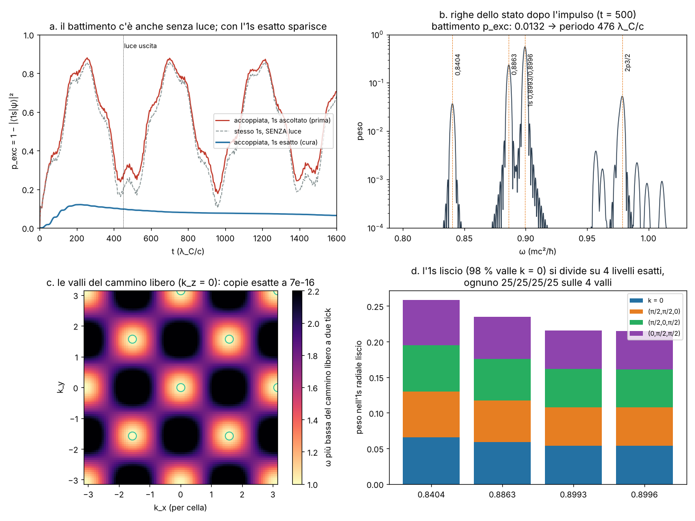

# Il battimento dell'1s nell'atomo 3-D dal vivo

Studio `battimento_`. File: `src/atomo/test_battimento.rs` (test di diagnosi, tutti `--ignored`, e l'esame),
`src/atomo/zz.rs` (`Atomo::livelli_esatti`, `Atomo::uno_s_esatto`: la cura), `src/atomo/accoppiato.rs`
(`Esperimento::new` la usa), `lab/battimento_figura.py` (figura e numeri).
Pre-registrazione: `lab/out/battimento_prereg.json` (**commit b8519fb, prima dell'esame**).
Risultati: `lab/out/battimento_results.json`. Figura: `lab/out/battimento_figure.png`.

---

## 0. In breve

**La domanda.** Nella corsa accoppiata luce + atomo del Laboratorio (Nd⁵⁹⁺, Z = 60, 48³ celle da 0,5 λ_C,
`Esperimento::new(600)`, impulso a ω₂₁ = 0,07583) la popolazione "eccitata" p_exc = 1 − |⟨1s|ψ⟩|² continua a
oscillare tra ~0,2 e ~0,88 con periodo ~470 λ_C/c anche **dopo** che la luce è uscita dalla scatola. Da dove viene?

**La risposta, in quattro righe.**

1. **La luce non c'entra.** Lo stesso "1s" lasciato andare **senza nessuna luce** fa la stessa curva:
   p_exc arriva a **0,889**; la corsa con la luce e quella senza differiscono al massimo di **0,080**
   (pannello a). L'eccitazione vera dalla luce è piccola: nello stato dopo l'impulso il 2p3/2 pesa **5,3 %**.
2. **Che cosa batte.** L'"1s ascoltato" del Laboratorio non è un livello: è un miscuglio di livelli esatti della
   regola 3-D a **0,8993 + 0,8996** (66 %), **0,8863** (25 %), **0,8404** (4 %). Il battimento è
   0,8994 − 0,8862 = **0,0132**, cioè periodo **476** λ_C/c (pannello b): è il "~470" osservato. Le righe secondarie
   0,0592 e 0,0460 sono le differenze con 0,8404.
3. **Perché ci sono quattro "1s".** Il cammino zig-zag 3-D libero, guardato ogni due tick (la regola si ripete ogni
   due tick perché l'ordine degli assi si alterna), ha **4 valli** equivalenti: k = 0 e k = (π/2, π/2, 0) per cella
   con le sue permutazioni. Sono **copie esatte** dell'elettrone (stesso spettro a 7·10⁻¹⁶, pannello c): è il
   "raddoppio dei fermioni" sul reticolo, cosa nota in fisica dei reticoli, qui in una forma nuova (4 copie, a
   momento π/2). Un potenziale liscio non le mescola; il **nucleo puntiforme sullo spigolo di 8 celle** sì. Così
   l'1s si apre in un **multipletto di 4 livelli** (0,8404 – 0,8996, largo 0,06 mc²), e **ogni** livello esatto è
   25/25/25/25 % sulle 4 valli (pannello d). L'1s radiale liscio messo sul reticolo sta al 98 % nella valle k = 0,
   quindi pesa ~1/4 su ognuno dei 4 livelli e **non può stare fermo**.
4. **La cura (PASS).** Si prende come 1s **un livello esatto** della regola, trovato con la "diagonalizzazione del
   filtro" (ascolto fatto bene, sotto) e scelto con una regola fissata prima: il meno toccato dalle prime celle.
   Senza luce resta fermo a **4·10⁻¹⁶**; nella corsa accoppiata dopo l'impulso p_exc va da 0,097 a 0,064
   (**escursione 0,033**, era 0,2–0,88) e scende piano (la luce che l'atomo rimanda). **B1–B4 tutti PASS.**
   `Esperimento::new` ora usa questo 1s.

---

## 1. Che cosa si vedeva (come a un ventenne)

Nel video al rallentatore (§3.6 di `docs/ATOMO.md`) l'atomo, dopo il lampo di luce, sembrava passare
continuamente dall'1s allo stato eccitato e ritorno, come se la luce fosse ancora lì. Ma la luce era uscita
(energia nella scatola < 10⁻³ di quella iniziale da t = 448). Un atomo da solo non può cambiare la popolazione
dei suoi livelli: se cambia, vuol dire che **il "livello" con cui misuriamo non è un livello**. È come misurare
quanta gente è in una stanza con una porta che si apre e chiude da sola: il numero oscilla anche se nessuno si
muove.

## 2. Diagnosi, passo per passo (numeri)

### 2.1 Senza luce (test `battimento_libero`)

L'1s del Laboratorio (`ascolta(0,885; 0,915; 600)` dallo stato radiale) lasciato evolvere da solo, 6 000 tick:

| t (λ_C/c) | 0 | 250 | 500 | 750 | 1000 | 1250 |
|---|---|---|---|---|---|---|
| p_exc senza luce | 0,000 | 0,848 | 0,218 | 0,766 | 0,295 | 0,744 |
| p_exc con la luce | 0,000 | 0,879 (t = 256) | 0,296 | — | 0,359 | — |

Massimo senza luce **0,889**. Con la luce (`battimento_accoppiato`, identica all'esportazione) la curva è la
stessa più qualche punto (differenza massima 0,080, media quadratica 0,038).

### 2.2 Le righe dello stato dopo l'impulso

Lo stato a t = 500 (luce uscita) evolve senza luce per 8 000 tick; lo spettro di ⟨ψ(500)|ψ(t)⟩ (solo tick pari)
dà i pesi dei livelli (pannello b):

| ω (mc²/ħ) | peso | che cos'è |
|---|---|---|
| 0,8994 | 0,558 | i due livelli 1s del multipletto (0,8993, 0,8996) |
| 0,8862 | 0,235 | livello del multipletto (più legato, ⟨r⟩ = 2,77 λ_C) |
| 0,9786 | 0,053 | 2p3/2: **l'eccitazione vera** |
| 0,8404 | 0,037 | livello del multipletto (il più legato, ⟨r⟩ = 1,86 λ_C) |

Lo spettro di p_exc ha la riga più forte a **0,0132** (= 0,8994 − 0,8862) → periodo **476**; poi 0,0592 e 0,0460.
Il dipolo ha righe a 0,0792 (2p3/2 − 1s) e **0,0922** (2p3/2 − 0,8862): anche il livello del reticolo a 0,886
"parla" con il 2p e manda luce a un'altra frequenza (tocca anche E1v2 di §3.5 di ATOMO.md).

### 2.3 I livelli esatti (test `battimento_ritz`, `battimento_carattere`)

L'ascolto del Laboratorio ha due difetti: (1) la finestra è corta (600 tick = 300 λ_C/c; la sua risoluzione
4π/T = 0,042 non separa 0,8995 da 0,8863); (2) somma anche i tick dispari, ma la regola si ripete ogni due tick
(gli assi vanno x, y, z e poi z, y, x), quindi mescola stati "a mezzo periodo". Per trovare i livelli esatti si fa
la **diagonalizzazione del filtro** (Rayleigh–Ritz):

* si fa correre lo stato senza luce per 1 200 tick e sui tick **pari** si tengono 25 onde filtrate
  Σ h(t) e^{iωt} ψ(t), ω = 0,82 … 0,94 ogni 0,005 (h = finestra di Hann);
* si ortonormalizzano e si calcola la regola di due tick U₂ ristretta a quelle 25 onde (una matrice 25 × 25);
* i suoi autovettori sono i livelli; ognuno con il suo **residuo** ‖U₂v − e^{−iω}v‖ (0 = livello esatto).

Risultato dallo stato radiale (residui 10⁻⁹ – 10⁻¹⁴):

| livello ω | peso nell'1s radiale | peso nell'1s ascoltato (Lab) | ⟨r⟩ (λ_C) | peso in r < 1 |
|---|---|---|---|---|
| 0,84037 | 0,259 | 0,037 | 1,86 | 0,312 |
| 0,88627 | 0,235 | 0,248 | 2,77 | 0,120 |
| 0,89930 | 0,215 | 0,329 | 3,22 | 0,069 |
| 0,89960 | 0,215 | 0,332 | 3,24 | 0,064 |

Dirac esatto: ω₁ₛ = 0,89907, ⟨r⟩ = 3,20 λ_C. I due livelli 0,8993/0,8996 hanno la forma dell'1s di Dirac; 0,886 e
0,840 sono più stretti e più legati: livelli del reticolo che il continuo non ha.

### 2.4 Il perché: le 4 valli (test `battimento_classi`, figura c e d, `lab/battimento_figura.py`)

* Le 8 classi di parità delle celle (i, j, k pari/dispari) hanno tutte 1/8 del peso in ogni livello: **non** è un
  problema di sotto-reticoli.
* Il cammino libero a due tick: le frequenze più basse (ω = m = 1) stanno a k = 0 **e** a k = (±π/2, ±π/2, 0),
  (±π/2, 0, ±π/2), (0, ±π/2, ±π/2) per cella (più le copie a +π, che sui tick pari sono la stessa cosa).
  Per qualunque piccolo spostamento δ, U₂(q + δ) ha **lo stesso spettro** di U₂(δ) entro 7·10⁻¹⁶: 4 valli,
  4 copie identiche dell'elettrone.
* Trasformata di Fourier di ogni livello esatto: **25,0 / 25,0 / 25,0 / 25,0 %** sulle 4 valli (0,8404: 25,3 /
  25,0 / 24,9 / 24,7). L'1s radiale: 98,4 % in k = 0. L'1s ascoltato del Lab: 49,6 / 17,8 / 14,9 / 17,8 %.
* Lettura: le 4 copie hanno lo stesso 1s; il nucleo, che sta sullo spigolo comune di 8 celle e ha una forma
  appuntita (r^{γ−1}), contiene momenti grandi e **mescola le valli**. Il mescolamento è forte rispetto alla
  differenza di energia (che senza nucleo è zero), quindi i livelli veri sono combinazioni a pesi uguali delle 4
  valli, separate da quanto ognuna sente la "prima cella". È lo stesso colpevole di `docs/NUCLEO_1S.md` (la prima
  cella attorno al nucleo come specchio sbagliato), visto in 3-D: oltre a sbagliare l'energia, **apre l'1s in 4**.
* La trama del reticolo che si vedeva nelle densità esportate (§3.6 di ATOMO.md: "celle quasi vuote ripetute ogni
  4 celle = 2 λ_C") è proprio la valle a momento π/2 per cella: periodo 4 celle.

## 3. La cura e l'esame pre-registrato

**Che cosa cambia** (solo la preparazione, niente fisica): `Esperimento::new(ascolto)` prende come 1s
`Atomo::uno_s_esatto(2 × ascolto)`: diagonalizzazione del filtro come in §2.3 e, fra i livelli esatti con peso
> 1 % nello stato radiale, quello con **meno peso dentro r < 1 λ_C** (il meno toccato dalle prime celle). La regola
di scelta è stata scritta prima dell'esame e non guarda il numero di Dirac. Esce **0,89960**. Il 2p½ resta
ascoltato come prima; ω₂₁ diventa 0,97480 − 0,89960 = **0,07519** (prima 0,07583).

| esame | che cosa | soglia | misurato | esito |
|---|---|---|---|---|
| B1 | 1s nuovo senza luce, 3 200 tick: max p_exc (tick della luce) | < 10⁻³ | **4,4·10⁻¹⁶** | PASS (debole: visto in sviluppo, 1,2·10⁻¹¹) |
| B2 | corsa accoppiata con l'1s nuovo: max − min di p_exc per t ∈ [450, 1600] | < 0,05 | **0,033** (0,097 → 0,064) | **PASS** |
| B3 | peso sugli altri 3 livelli del multipletto a t = 1600 | < 0,01 | **1,1·10⁻¹²** | **PASS** |
| B4 | p_exc medio per t ∈ [450, 1600] (la luce eccita davvero) | > 0,01 | **0,077** | **PASS** |

Informativo (senza soglia): ω₁ₛ nuovo = 0,89960, **+0,059 %** da Dirac (0,89907; la scelta era cieca a questo
numero, ma non è una previsione: l'altro livello del paio, 0,89930, sta a +0,026 %). Dopo l'impulso p_exc non
batte più: sale a 0,12 a t ≈ 200 e poi **scende piano** (0,097 a t = 450, 0,064 a t = 1600): è l'atomo che si
svuota mandando luce (semiclassico, K = 10). Il dipolo dopo l'impulso ha più righe: **0,0810** (la più forte),
0,0698, 0,1108, 0,0920; con gli zeri del segnale si legge 0,0918 (media sbagliata di righe diverse): anche i 2p
sono multipletti di valli (lo guarda l'altro thread, `docs/EMISSIONE.md`, in corso; qui non è toccato).

Dopo il cambio: `cargo test --bin atomo` (non ignorati) **10 passati, 0 falliti**.

**Cambi dopo la pre-registrazione (dichiarati).** Nessuna soglia cambiata. Dopo l'esame il codice di Ritz è stato
spostato dal modulo di test a `zz.rs` (stesso codice), e `Esperimento::new` usa 2 × `ascolto` tick (600 → 1 200,
quelli dell'esame).

## 4. Debiti

1. **L'1s del reticolo cubico 3-D non è uno.** È un multipletto di 4 livelli larghi 0,06 mc² (le 4 valli mescolate
   dal nucleo). Lo stato scelto è **un** livello esatto, ma è un ibrido delle 4 valli: non è "l'1s del continuo".
   Per avere un solo 1s serve togliere il mescolamento (nucleo non sullo spigolo, zoom/cipolla di
   `docs/NUCLEO_1S.md` §7.3, lavoro dell'altro thread) o togliere le valli (§5).
2. **Trama nella densità.** Ogni livello esatto, perché mescola valli a momento π/2, ha densità con buchi ogni
   4 celle (lungo una riga: 5·10⁻³ e 3·10⁻⁶ alternati a coppie). Lo stato radiale di prima era liscio ma non stava
   fermo; quello di ora sta fermo ma è "a scacchiera". Per le palline: nascere con jitter e smussare su ~2 λ_C,
   dichiarandolo (come già scritto in ATOMO.md §3.6).
3. **Regola di scelta** (meno peso in r < 1) e impostazioni (finestra 0,82–0,94, passo 0,005, 1 200 tick, residuo
   10⁻⁶): sono scelte di risoluzione, non fisica, ma sono scelte. L'altro livello del paio (0,89930) sarebbe stato
   altrettanto fermo.
4. **2p**: ascoltato come prima (finestra corta); anche lì è probabile un multipletto di valli (righe del dipolo
   0,0810 / 0,0698 / 0,1108): non toccato qui, vedi `docs/EMISSIONE.md`.
5. **La scena atomo senza accoppiamento**: chiuso il 14/10. `zzscena` riparte dall'1s esatto appena
   l'esperimento accoppiato è pronto (prima, per ~60 s, mostra ancora lo stato radiale che batte). Controllo come B1
   (test `battimento_scena_libera`, stessa soglia 10⁻³): max p_exc **0** su 3 200 tick.
6. **Esportazione**: rigenerata il 14/10 con l'1s esatto (`manifest.json` → `stato_1s`); p_exc picco **0,120 a
   t = 220**, poi 0,097 (t = 450) → 0,064 (t = 1590). La preparazione costa ~2 volte di più (~60 s su 2 thread).
7. Costo di memoria della preparazione: 25 onde da 7 MB (~175 MB).

**Parametri.** Fisici nuovi: 0. Impostazioni: 5 (sopra). Esami: 4 PASS (B1 debole), 0 FAIL.

## 5. Dove l'intuizione di Valerio può aiutare

1. **Quattro colori per un elettrone.** Le 4 valli sono 4 "copie" dell'elettrone che la regola cubica porta con sé.
   *Cosa si vede*: colorare le palline secondo la valle (filtro di Fourier: k vicino a 0 blu, vicino a
   (π/2, π/2, 0) arancio, …). L'1s radiale è tutto blu; dopo pochi tick diventa 4 colori che si scambiano: il
   battimento si vede come **colori che respirano**. L'1s esatto è 4 colori fermi intrecciati. *Costo*: una FFT 48³
   per fotogramma (niente). *Regole*: è solo un modo di guardare.
2. **Spostare il nucleo al centro di una cella.** Oggi il nucleo è sullo spigolo di 8 cubi: tocca 8 celle, una per
   classe di parità, ed è lì che le valli si mescolano. *Idea geometrica*: nucleo al centro di un cubo (N dispari) o
   al centro di una faccia. Cambia quanto le valli si mescolano (forse le separa per simmetria, forse le mescola di
   più). *Costo*: una riga (`x_of` con N dispari) e la stessa diagnosi. *Regole*: sì; non provato.
3. **Una regola senza valli.** Le copie vengono dal fatto che ogni tick sposta di ±1 cella **lungo tutti e tre gli
   assi**. Con 6 tick (tutte le permutazioni x, y, z) o con un reticolo diverso (cubico a corpo centrato, dove lo
   spostamento (±1, ±1, ±1) è il passo naturale) le valli a π/2 potrebbero sparire o separarsi in energia. Questo è
   il "teorema del raddoppio" (Nielsen–Ninomiya) della fisica dei reticoli: non si toglie gratis, ma si sposta;
   la tua intuizione su quale forma di reticolo "veda" un solo elettrone è il punto. *Costo*: la stessa analisi della
   figura c in 20 righe di Python per ogni proposta, prima di toccare il Laboratorio.
4. **Il nucleo morbido = la cipolla.** Se vicino al nucleo le celle diventano piccole (`docs/NUCLEO_1S.md` §7.1/7.3)
   la forma r^{γ−1} non ha più momenti grandi "sul reticolo grosso" e le valli si mescolano molto meno: il
   multipletto dovrebbe stringersi verso un solo livello. Domanda per te: le 4 valli sono un errore da cancellare,
   o "sapori" che una regola più furba potrebbe usare (per esempio come i 4 stati di spin + antiparticella)?

## 6. Come rieseguire

    D=<cartella>
    BATT_DIR=$D cargo test --bin atomo battimento_libero -- --ignored --nocapture     # ~4 min
    BATT_DIR=$D cargo test --bin atomo battimento_accoppiato -- --ignored --nocapture # ~4 min
    BATT_DIR=$D cargo test --bin atomo battimento_salva_livelli -- --ignored --nocapture
    BATT_DIR=$D cargo test --bin atomo battimento_carattere -- --ignored --nocapture  # ~4 min
    BATT_DIR=$D cargo test --bin atomo battimento_esame -- --ignored --nocapture      # ~5 min, l'esame B1-B4
    python3 lab/battimento_figura.py $D

(I test di diagnosi rifanno l'1s di prima con `Atomo::ascolta(0.885, 0.915, 600)`; l'esame usa quello nuovo.)
