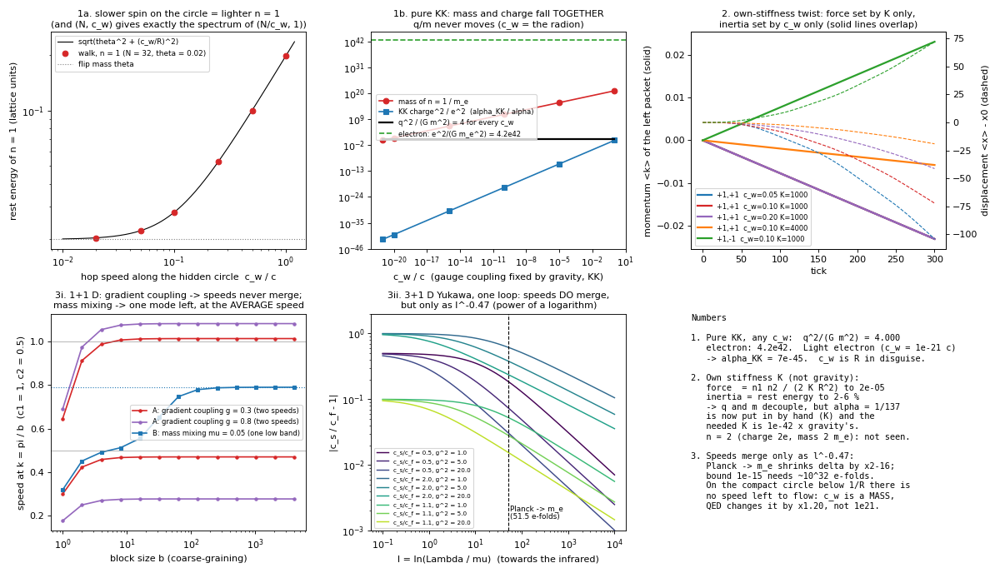

# La carica come giro attorno a una dimensione nascosta

Laboratorio: `lab/kk_*.py` (Python 3.14 + numpy), costruito sulla regola zig-zag di `lab/zz_core.py`
(`docs/ZIGZAG.md`). Registri `lab/out/kk_*.log`, numeri `lab/out/kk_*.json`, figura `lab/out/kk_force.png`.
Prototipo veloce (circa un'ora): tutti i numeri qui sotto vengono da esecuzioni reali, deterministiche
(seed 20261009). Unità del reticolo: passo a = tick = 1, c = ħ = 1.

## 1. L'idea (di Valerio)

> "La carica non è una cosa dentro la particella: è una **circolazione attorno a una dimensione
> nascosta** di cui vediamo solo metà. Tre circolazioni a 120° si bilanciano e danno il neutro; se ne
> manca una, la circolazione che resta la vediamo come carica, e il suo verso distingue elettrone e
> protone."

Chi ci ha già pensato: **Kaluza (1921) e Klein (1926)**: con una quinta dimensione arrotolata su un
cerchio piccolissimo, la carica è la quantità di moto attorno al cerchio e il campo elettromagnetico è la
"torsione" del cerchio (un pezzo della geometria). **Wheeler (1955-57)**: "carica senza carica", linee di
campo intrappolate in un buco della geometria. **La tripla del colore (trialità Z₃)**: i quark hanno tre
"colori", e solo le combinazioni con colore totale nullo (tre quark, o quark + antiquark) esistono libere.

## 2. Che cosa abbiamo fatto

La regola zig-zag di sempre (ogni pallina va a c e gira il suo stato; la massa è l'angolo di flip θ),
con **una sola aggiunta**: oltre a x (e y) c'è un terzo asse **w**, un cerchio chiuso di N siti, raggio
R = N/2π. La pallina salta anche lungo w **con la stessa regola** (traslazione + rotazione). Niente forza
messa a mano: l'unica cosa in più, per il test della forza, è che il cerchio nascosto può essere
**storto**: quando la pallina fa un passo lungo y, scivola anche di un tratto D attorno al cerchio
(un termine fuori diagonale della metrica, g_yw: è il potenziale vettore A = D/R scritto come geometria).

## 3. Che cosa è emerso (numeri)

**Test 1 - la carica è intera da sola, e si conserva** (`kk_charge_mass.py`)
* Uno stato **a caso** sul cerchio (N = 32, θ = 0,1), lasciato andare per 4096 tick: lo spettro in
  frequenza ha **17 righe**, una per ogni |n| = 0…16, tutte sulle energie dei modi interi
  (distanza massima 7·10⁻⁴, risoluzione 1,5·10⁻³); la riga più vicina a un "n semintero" è a 4·10⁻²,
  cioè 26 volte la risoluzione. Il cerchio chiuso permette solo giri interi: k_w = n/R.
* Un pacchetto con n = +1, −1, +2 in un potenziale casuale e con il cerchio storto a caso (2+1 D,
  300 tick): la carica ⟨n⟩ resta **+1, −1, +2 esatti** (deriva 0 in doppia precisione).
* Controprova: se il cerchio è **bitorzoluto** (potenziale che dipende da w) la carica **non** si
  conserva più (deriva 1,35 / 0,85 / 2,25). La conservazione della carica = il cerchio è liscio
  (simmetria per rotazione, teorema di Noether).

**Test 2 - quanto costa girare (il problema di Kaluza-Klein)**
Energia a riposo misurata sulla regola, θ = m = 0,1 (λ_C = 10 celle):

| R / λ_C | E(n=1)/m | E(n=2)/m | errore rispetto a √(m² + (n/R)²) |
|---|---|---|---|
| 0,25 | 4,046 | 7,904 | −1,6·10⁻³ |
| 0,51 | 2,201 | 4,046 | −1,3·10⁻³ |
| 1,00 | 1,411 | 2,228 | −8·10⁻⁴ |
| 2,01 | 1,117 | 1,411 | −3·10⁻⁴ |
| 4,01 | 1,031 | 1,117 | −1·10⁻⁴ |

E = √(m²c⁴ + (nħc/R)²): girare costa. Perché il giro dell'elettrone non costi più della sua massa
serve **R ≳ ħ/(mₑc) = 3,86·10⁻¹³ m**. Ma Kaluza-Klein lega R alla forza della carica:
α = 4Għ/(c³R²) ⇒ per α = 1/137 serve **R = 2 l_P/√α = 3,8·10⁻³⁴ m**, e allora il primo modo carico
pesa **5·10¹⁷ GeV ≈ 10²¹ mₑ**. Al contrario, con R = 3,86·10⁻¹³ m la carica sarebbe α ≈ **7·10⁻⁴⁵**
(forte come la gravità). **La tensione è netta: in questa forma semplice l'elettrone non può essere
un "giro" attorno al cerchio di Kaluza-Klein.** (È il problema storico; in più Witten, 1981: KK non dà
facilmente particelle sinistrorse/destrorse diverse.)

**Test 3 - la forza viene dalla geometria** (`kk_cyclotron.py`, `kk_ab.py`, figura)
* Cerchio storto in modo uniforme (2+1 D, 128×128 × N = 24, p = 0,3, b = 0,015): **n = +1 gira in
  senso antiorario, n = −1 in senso orario, n = 0 va dritto** (deviazione laterale 0,65 celle su 96).
  Raggio del picco di densità 18,7 e 18,0 celle contro p/(|n|b) = 20; periodo 197 e 184 tick contro
  204. Accordo al 10 %, non di più: il pacchetto si allarga e si sfasa lungo l'orbita; non l'ho fatto
  convergere (prototipo).
* **Aharonov-Bohm** su un anello (400 siti × N = 32): i due mezzi pacchetti fanno i due lati dell'anello
  e si incontrano dall'altra parte. Sull'anello il cerchio nascosto **non ha curvatura** (nessun
  "campo"): la torsione totale Φ è tutta nel buco. Eppure la fase dell'interferenza si sposta di
  **n·Φ** (errore massimo 1,5·10⁻¹¹ su 24 casi, n = −1, 0, +1, +2); con Φ = 2π (una scivolata di un
  giro intero) non cambia niente. Torsione su un solo legame o spalmata su tutti: densità uguali a
  3·10⁻¹⁴ (conta solo il totale nel buco). Le frange misurate direttamente con un fit: stesso spostamento
  a 0,6 % (n = 1).

**Test 4 - il "tre" di Valerio** (`kk_z3.py`): cerchio di **N = 3 siti** (120°), giri n ∈ {0, +1, −1}.
Fase AB misurata con una torsione di **un sito** (una rotazione di 120°): n = ±1 → ∓2,0944 rad
(= 2π/3, esatto), n = 0 → 0. Neutri (fase 0 mod 2π):
* 1 pallina: solo (0);
* 2 palline: (0,0) e **(+1,−1)**;
* 3 palline: (0,0,0), **(0,+1,−1)**, **(+1,+1,+1)**, **(−1,−1,−1)** (4 su 10 combinazioni).
* Togliendone una da (0,+1,−1): resta (+1,−1) neutro, oppure (0,−1) con fase +2π/3 o (0,+1) con
  −2π/3: **la carica che resta ha verso opposto a seconda di quale manca**, come diceva Valerio.
* Con una torsione **non** di un sito intero (0,37 siti) (+1,+1,+1) **non** è più neutro (fase 3·0,775):
  la neutralità dei tre è una proprietà Z₃ (rotazioni a scatti di 120°), non della carica elettrica U(1).

## 4. Che cosa NON funziona (onestamente)

* **Massa** (test 2): con la carica osservata il giro costa ~10¹⁷ GeV. Non è un dettaglio.
* **Il "tre" è il colore, non la carica elettrica.** I neutri Z₃ sono quelli della trialità dei quark
  (barioni qqq, mesoni q q̄). Ma: (a) qui un cerchio di 3 siti conosce solo n mod 3 (n = +1 e n = −2 sono
  la stessa cosa), quindi **nessuna carica frazionaria** 2/3, −1/3; nel Modello Standard i terzi vengono
  dall'ipercarica (Q = T₃ + Y), e il legame con il colore è il quoziente Z₆ del gruppo, che qui **non**
  si ricava; (b) **l'atomo di idrogeno è neutro con due costituenti** (e⁻, p⁺): per la carica elettrica
  basta la coppia (+1, −1), il "tre" non serve.
* Il cerchio di 3 siti è lontanissimo dal continuo: energia del giro 1,059 invece di 2,104, velocità di
  gruppo negativa (artefatto del reticolo). Robusta è solo la fase a 120°.
* Artefatto trovato: con k_w·a = π/4 (N = 8, n = 1) la regola a passi divisi ha banda **piatta** nel
  piano (il pacchetto non si muove). Servono cerchi di molti siti (qui 24-32) per avere fisica pulita.
* I campi sono **di sfondo**: il cerchio storto lo metto io. Due palline cariche non si attraggono né si
  respingono ancora.

## 5. Il prossimo passo (lungo)

Rendere **dinamica** la geometria nascosta: la torsione D (cioè A) deve avere una sua regola (la luce
di `zz_core.py`, spin 1, F = E + icB) e deve essere **sorgente** delle palline cariche (la corrente
di n). Allora due pacchetti con n = +1 e n = −1 dovrebbero attirarsi da soli (e due +1 respingersi),
con la legge 1/r² in 3+1 D, e la costante α sarebbe fissata da R. È Kaluza-Klein completo sul reticolo
(con la gravità di sfondo congelata): difficile, e porta dritto al problema del test 2.

## 6. File

`lab/kk_core.py` (regola con il cerchio nascosto), `lab/kk_charge_mass.py` (test 1-2, 21 s),
`lab/kk_cyclotron.py` (test 3a, 123 s), `lab/kk_ab.py` (test 3b, 72 s), `lab/kk_z3.py` (test 4, 15 s),
`lab/kk_figure.py` → `lab/out/kk_force.png`.

## 7. E se il giro attorno al cerchio avesse una sua velocità? (domanda di Valerio)

> "E se la velocità di rotazione attorno al cerchio nascosto fosse diversa, adattata alla misura del
> cerchio, così che le cariche funzionino, e poi un algoritmo riportasse tutto alla velocità normale
> alla nostra scala? Le cose che non sappiamo non devono per forza essere come pensiamo."

L'abbiamo provata sul serio. Script `lab/kk_speed_*.py`, registri `lab/out/kk_speed_*.log`, numeri
`lab/out/kk_speed_*.json`, figura `lab/out/kk_speed.png`. Unica modifica alla regola: lungo w la
pallina salta con velocità **c_w** invece di c (in un tick scivola di c_w celle attorno al cerchio,
traslazione esatta). Con c_w = 1 è la regola di prima, identica.

### 7.1 Kaluza-Klein puro: la velocità sul cerchio è il raggio travestito (`kk_speed_kk.py`, 86 s)

* **Il reticolo non sa distinguere c_w da R.** Un cerchio di N siti percorso a velocità c_w ha **lo stesso
  identico spettro** di un cerchio di N/c_w siti percorso a velocità c: (32, ½) contro (64, 1),
  (16, ¼) contro (64, 1), (32, ¼) contro (128, 1), modi n = 0…3: differenze ≤ 6·10⁻¹⁷ (cioè zero).
  Anche un pacchetto carico in una geometria storta a caso evolve uguale: (N, c_w, scivolata D) =
  (N/c_w, 1, D/c_w), densità uguali a 10⁻¹³ (n = +1, −1, +2). Andare piano sul cerchio = avere un
  cerchio più grande. In relatività generale questo ha un nome: è il **radione** (la componente g_ww
  della metrica, che misura quanto è lungo davvero il cerchio).
* **La massa del giro scende davvero.** Energia a riposo di n = 1 (N = 32, flip θ = 0,02) misurata sul
  walk: c_w = 1 → 0,1974; 0,5 → 0,1002; 0,25 → 0,0530; 0,1 → 0,0280; 0,02 → 0,0204 (quasi solo la flip
  mass), sempre √(θ² + (c_w/R)²) a meno di 7·10⁻⁵.
* **Ma la carica scende insieme.** In Kaluza-Klein la forza della carica non è libera: viene dalla
  gravità e dipende dal raggio **vero** (proprio), R_vero = R·c/c_w. Massa del primo modo:
  ħ/(R_vero c); carica: √(16πG)·ħ/(R_vero c). Si dividono e **R_vero sparisce**: q²/(G m²) = **4,000**
  (unità gaussiane; 16π ≈ 50 in Heaviside-Lorentz) **per qualunque c_w**. Per l'elettrone vale
  **4,2·10⁴²**. Esempio: per avere n = 1 leggero come l'elettrone servirebbe c_w = 9,8·10⁻²² c, e allora
  la carica sarebbe α = 7·10⁻⁴⁵ invece di 1/137. È esattamente il problema del test 2, solo spostato.
  **Conclusione 1: con la gravità a fare da colla, cambiare la velocità sul cerchio non aiuta. Mai.**
  (La parte "carica fissata dalla gravità" è la riduzione di Kaluza-Klein fatta su carta: sul reticolo la
  gravità non è dinamica. Quello che il reticolo dimostra è che c_w e R sono la stessa manopola.)

### 7.2 Torsione con una sua rigidità (non quella della gravità) (`kk_speed_twist.py`, 127 s)

Allora stacchiamo la colla. La torsione "nel tempo" del cerchio (ogni tick la pallina scivola di φ(x)
attorno al cerchio; per il modo n è un'energia potenziale n φ/R, cioè il potenziale elettrico) ora è
**dinamica**: ogni tick si ricalcola da sola a partire dalla carica dell'altra pallina, con la legge
di Gauss e una rigidità **K tutta sua**: K φ'' = −ρ. In 1+1 D questa è la dinamica completa del campo
(in una dimensione il "fotone" non ha onde libere: c'è solo Gauss). Due pacchetti carichi fermi a 700
celle, 300 tick, N = 16, θ = 0,02. Misuriamo separatamente **la forza** (quanto cresce la quantità di
moto per tick) e **l'inerzia** (da come si muovono, con la formula relativistica del moto a forza
costante):

| cariche | c_w | K | forza misurata | prevista n₁n₂/(2KR²) | inerzia misurata | energia del pacchetto |
|---|---|---|---|---|---|---|
| +1, +1 | 0,10 | 1000 | −7,711·10⁻⁵ (si respingono) | −7,711·10⁻⁵ | 0,0453 | 0,0444 |
| +1, −1 | 0,10 | 1000 | +7,711·10⁻⁵ (si attirano) | +7,711·10⁻⁵ | 0,0453 | 0,0444 |
| +2, +1 | 0,10 | 1000 | −1,542·10⁻⁴ (doppia) | −1,542·10⁻⁴ | 0,0827 | 0,0812 |
| +1, +1 | **0,05** | 1000 | −7,711·10⁻⁵ | −7,711·10⁻⁵ | **0,0297** | 0,0285 |
| +1, +1 | **0,20** | 1000 | −7,711·10⁻⁵ | −7,711·10⁻⁵ | **0,0827** | 0,0812 |
| +1, +1 | 0,10 | **4000** | **−1,928·10⁻⁵** | −1,928·10⁻⁵ | 0,0454 | 0,0444 |
| +1, +1 | 0,10 | **250** | **−3,084·10⁻⁴** | −3,084·10⁻⁴ | 0,0457 | 0,0444 |

* La forza dipende **solo da K** (e da R e dalle cariche), mai da c_w: accordo a 1,5·10⁻⁵ (questo è quasi
  un controllo del codice: in 1+1 D la forza di Gauss è costante e il conto è esatto).
* L'inerzia dipende **solo da c_w** (e dal flip), mai da K: 0,030 / 0,045 / 0,083 per c_w = 0,05 / 0,1 /
  0,2. Accordo con l'energia del pacchetto al 2-4 % (fino a 6 % rispetto all'energia a riposo: il
  pacchetto ha un po' di moto proprio e il reticolo disperde un poco; non l'ho spinto oltre).
* **Quindi sì: con una rigidità propria, carica e massa si staccano.** α_eff = 1/(4πKR²) è una manopola,
  m = ħc_w/R combinata col flip è un'altra.

**Il prezzo (debiti, onestamente):**
1. **K lo metto io.** Per avere α = 1/137 bisogna scegliere K a mano. Confrontata con la rigidità che
   darebbe la gravità, la K giusta è **10⁻⁴² volte più morbida** (4 l_P²/(α R²) con R = ħ/(m_e c)). Il
   numero 10⁴² non è sparito: è finito dentro K. Kaluza-Klein *prevedeva* α da G e R (sbagliando);
   questa versione **non prevede niente**: è l'elettromagnetismo normale più un cerchio che rende la
   carica intera. (Che la carica sia intera resta comunque un risultato carino.)
2. **"Massa dell'elettrone = velocità di giro attorno al cerchio"** si può leggere così: m_e c² = ħ c_w/R.
   Ma un cerchio ha **una sola** velocità di giro, quindi dà **una massa per ogni carica**: tutti gli
   n = 1 pesano uguale. Elettrone, muone e tau hanno la stessa carica e masse 1 : 207 : 3477. Per
   distinguerli servono tre flip mass diverse messe a mano (m_μ = √(θ_μ² + m_e²)): esattamente i tre
   numeri liberi che ha già il Modello Standard. Nessun guadagno.
3. **La torre.** Lo stesso cerchio dà n = 2: carica 2e e massa 2 m_e ≈ 1 MeV. Una particella così
   leggera e doppiamente carica si vedrebbe ovunque (decadimenti nucleari, collisori e⁺e⁻): **non
   esiste**. E n = 0 dello stesso campo sarebbe un fermione neutro con la sola flip mass (curiosità: se
   l'elettrone è tutto "giro", questo è senza massa, un po' come un neutrino; ma non ne ha le
   proprietà, quindi non lo prendo come indizio).
4. Niente auto-interazione: ogni pacchetto sente solo il campo dell'altro (scelta mia, standard).
5. **Koide** (Q = (m_e+m_μ+m_τ)/(√m_e+√m_μ+√m_τ)² = 2/3, la pagina dei tre punti su un cerchio): resta
   una **domanda aperta**. Qui non c'è nessun meccanismo che dia tre masse diverse, tanto meno quella
   relazione.

### 7.3 "L'algoritmo che riporta alla velocità normale" (`kk_speed_flow.py`, 4 s)

L'idea esiste davvero: **Chadha e Nielsen (1983)** hanno mostrato che particelle con velocità limite
diverse, se interagiscono, tendono ad avere la stessa velocità alle energie basse (il "gruppo di
rinormalizzazione": guardare il mondo da sempre più lontano, sfocando i dettagli). La domanda è
**quanto in fretta**. Due prove:

* **1+1 D, due catene con velocità 1 e 0,5, sfocatura a blocchi esatta** (blocchi da 1 a 4096 celle).
  - (A) accoppiamento "di gradiente" (è quello che fanno due specie di fermioni in una dimensione che si
    toccano per densità, dopo la bosonizzazione di Luttinger): le velocità **non si avvicinano mai**:
    con g = 0,3 restano 0,470 e 1,014 a ogni scala; con g = 0,8 si **allontanano** (0,277 e 1,083).
    Non è solo teoria: nei fili quantistici unidimensionali si misura (separazione spin-carica,
    Auslaender et al., Science 308, 88, 2005).
  - (B) accoppiamento "di massa" μ²(u − v)²: sotto la scala μ resta **un solo** modo, che va alla
    velocità **media** √((c₁²+c₂²)/2) = 0,791 (misurata 0,7906 a b = 4096); l'altro sparisce (gap). Si
    "uniformano" perché una delle due cose smette di esistere, e la velocità che resta è un compromesso,
    non quella di prima.
* **3+1 D, Yukawa (un fermione e uno scalare con velocità c_f e c_s), un loop.** Il pezzo dello scalare
  è esatto per simmetria; quello del fermione l'ho integrato numericamente sulla sfera (controllo: a
  velocità uguali dà π² esatto, cioè il valore da manuale). Risultato: **sì, le velocità convergono**, ma
  la differenza cala come **l⁻⁰·⁴⁷**, dove l = ln(Λ/μ) è il *logaritmo* della scala: una potenza di un
  logaritmo. Dalla scala di Planck alla massa dell'elettrone (l = 51,5) la differenza si riduce solo di un
  fattore **1,6-16** (es. c_s/c_f = 2 → 1,24…1,62; 1,1 → 1,016…1,053, a seconda dell'accoppiamento). I
  limiti sperimentali chiedono differenze sotto 10⁻¹⁵…10⁻²⁰: partendo da una differenza di ordine 1
  servirebbero ~10³² "e-fold", non 51. Debito: l'accoppiamento g lo faccio correre con la formula
  Lorentz-invariante (approssimazione).

**E il cerchio nascosto?** Qui la risposta è no, per due motivi semplici:
1. Il cerchio è **chiuso e piccolo**: sotto l'energia ħc_w/R non ci sono più onde che corrono lungo w
   (solo giri interi). Lì c_w non è più una velocità: è **una massa** (quella di n = 1). E le masse dei
   fermioni corrono in modo moltiplicativo e lento: in QED da Planck a m_e cambiano di un fattore
   **1,20**, non 10²¹.
2. Sopra quell'energia il flusso di Chadha-Nielsen spinge c_w **verso c**: cioè **rende il giro di nuovo
   pesante**. Va nella direzione opposta a quella che servirebbe.

Quello che in fisica fissa davvero "quanto è grande il cerchio" (cioè c_w/R) non è il gruppo di
rinormalizzazione ma il **potenziale del radione** (la stabilizzazione dei moduli): un'altra cosa da
mettere, o da trovare.

**Letteratura (breve).** Chadha & Nielsen, Nucl. Phys. B217, 125 (1983) (l'idea, in teorie di gauge,
convergenza logaritmica). Anber & Donoghue, Phys. Rev. D 83, 105027 (2011), arXiv:1102.0789: rifanno
il conto e concludono che la convergenza è logaritmica e servirebbe un intervallo di energie
esponenzialmente grande (propongono un modello a legge di potenza, più utile). Collins, Perez,
Sudarsky, Urrutia, Vucetich, PRL 93, 191301 (2004): una violazione di Lorentz alla scala di Planck,
attraverso i loop, ricompare alle basse energie **al livello percentuale** se non si sintonizza a
mano: il contrario di un ritorno spontaneo. Hořava, PRD 79, 084008 (2009) e Iengo, Russo, Serone,
JHEP 0911:020 (2009): teorie con scaling anisotropo (Lifshitz), dove Lorentz dovrebbe emergere in IR;
stesso problema di lentezza/sintonia. Limiti: Coleman & Glashow, PRD 59, 116008 (1999); Jacobson,
Liberati, Mattingly, Nature 424, 1019 (2003) (elettroni e fotoni dalla nebulosa del Granchio); tabelle
di Kostelecký & Russell, RMP 83, 11 (2011). Differenze di velocità ammesse: da ~10⁻¹⁵ in giù, a seconda
delle particelle.

### 7.4 In una riga

**La velocità di giro sul cerchio è il raggio travestito: in Kaluza-Klein puro non cambia q/m (4 contro
4·10⁴²). Staccando la rigidità della torsione da quella della gravità carica e massa si separano davvero
(misurato), ma α e le tre masse dei leptoni diventano numeri messi a mano, e il cerchio prevede una
particella di carica 2e a 1 MeV che non c'è. L'"algoritmo che riporta tutto alla velocità normale"
esiste (Chadha-Nielsen) ma è logaritmico: 51 e-fold da Planck a noi bastano per un fattore 2-16, non per
10⁻¹⁵; e sul cerchio chiuso spinge nella direzione sbagliata.**

File: `lab/kk_speed_core.py` (regola con c_w e torsione dinamica), `lab/kk_speed_kk.py` (7.1),
`lab/kk_speed_twist.py` (7.2), `lab/kk_speed_flow.py` (7.3), `lab/kk_speed_figure.py` →
`lab/out/kk_speed.png`.

