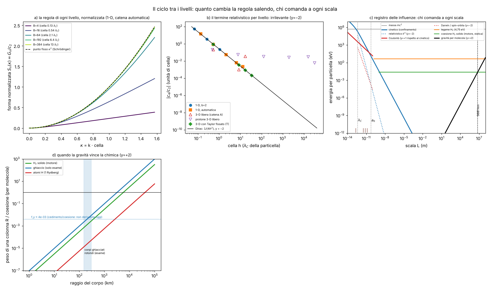

# Il ciclo tra i livelli: una sola regola per salire di scala

Studio `ciclo_`. Domanda di Valerio: il passaggio dal fine al grosso deve essere **quasi frattale e automatico**, un
solo algoritmo, senza barare livello per livello; magari la regola cambia poco da un livello all'altro, o segue uno
schema tipo Fibonacci. E bisogna tenere il conto di **quanto pesa ogni forza a ogni scala** (la gravità quasi nulla nel
piccolo, padrona nel grande). Nome in fisica: **punto fisso del gruppo di rinormalizzazione**. Metodi noti: entropia
relativa / force matching, Mori–Zwanzig con rumore che rispetta fluttuazione–dissipazione, metodi multiscala
eterogenei / "equation-free".

File: pre-registrazione `lab/ciclo_prereg.py` → `lab/out/ciclo_prereg.json` (fase 1: commit c19ca9f, **prima** delle
analisi); fase 1 `lab/ciclo_p1_map.py` → `lab/out/ciclo_p1_map.json`, `lab/ciclo_p1_ledger.py` →
`lab/out/ciclo_p1_ledger.json`; figura `lab/ciclo_figure.py` → `lab/out/ciclo_figure.png`.

---

## 0. Il ciclo (uguale a ogni livello)

1. Il livello fine gira solo su **piccoli pezzi** di prova.
2. Le variabili grosse si scelgono **da sole**: quantità conservate + le più lente, trovate dai dati dei pezzi.
3. La regola grossa si **impara**: la più locale che rispetta simmetrie e conservazioni e rifà la statistica fine; il
   dettaglio buttato diventa rumore che rispetta fluttuazione–dissipazione.
4. **Controllo in corsa**: ogni tanto si confronta la previsione grossa con un pezzo fine nuovo; sopra una soglia
   pre-registrata si raffina **solo lì**.
5. Si ripete, col grosso come nuovo fine.

Le sole cose scelte a mano sono le soglie, dichiarate prima.

---

## 1. Fase 1: misurare la mappa sui livelli che esistono già

### 1.1 Cosa ho fatto (come a un ventenne)

Ogni livello dell'agglomeratore ha una regola imparata: uno "stencil" (quanto ogni cella parla con le vicine). Ho preso
**tutti** i livelli già imparati (sola lettura): catene 1-D (scala b = 2 e catena automatica), catena 3-D A (elettrone),
catena 3-D B (zoom), catena del protone (6 livelli), livelli T (con Taylor fissato), livello a₀/4 delle molecole, e gli
accoppiamenti cella–campo a tre livelli. Per ogni livello ho misurato:

* la **massa** che la regola porta (dal pezzo k²);
* il **termine relativistico** (il pezzo k⁴) e quanto pesa rispetto al k²;
* la **forma normalizzata** S(κ) = G(κ)/c₂ (la regola divisa per il suo pezzo principale): se la mappa va verso una
  forma fissa, S deve smettere di cambiare.

Unità: ħ = c = m = 1, cella h in lunghezze Compton della particella, passo τ = h. Nel continuo
E = k²/2m − k⁴/8m³ + …, quindi c₂ = 1/(2h) e c₄/c₂ = −1/(4h²).

### 1.2 La risposta alla domanda di Valerio: sì, la regola converge, e si sa a cosa

**La forma fissa si scrive in una riga.** Dividendo la regola di ogni livello per il suo pezzo k², tutti i livelli
vanno verso **S\* = κ²**: è la regola di Schrödinger libera, il punto fisso "gaussiano" del gruppo di rinormalizzazione.
Sul reticolo grosso, scritta come stencil, è g\*₀ = π²/3, g\*ⱼ = 2(−1)ʲ/j² lungo ogni asse (separabile in 3-D): una
coda lunga ~1/j², che spiega perché le regole grosse "vogliono" vicini lontani (la lezione 10 di CONTESTO_CLOUD).
Gli stencil imparati ci vanno incontro livello dopo livello: g₀ = 0,39 → 1,24 → 2,42 → 2,96 → 3,05 (punto fisso 3,29),
g₁ = −0,17 → −0,60 → −1,30 → −1,70 → −1,78 (punto fisso −2).

**Quanto cambia per livello: una legge di potenza, non Fibonacci.** La distanza della forma dal punto fisso (pannello a)
segue la formula del continuo entro l'1,5 % (10 % all'ultimo livello): D = 0,84 / 0,51 / 0,107 / 0,0147 / 0,0041 per
celle 0,13 / 0,54 / 2,1 / 6,4 / 13 λ_C. Nel regime di Schrödinger il cambio per livello è il pezzo k⁴ che si spegne
come **1/b²** a ogni salto di un fattore b: quello che resta di diverso da un livello al successivo si riduce di 4 volte
(b = 2) o 9 volte (b = 3) ogni volta. Cioè: "la regola cambia poco livello per livello" è vero, e il "poco" ha una
legge precisa: l'esponente y = −2 del primo termine irrilevante.

**Due punti fissi e un incrocio.** Sotto λ_C la regola è quella "a c" (Dirac, z = 1: lo spazio e il tempo scalano
insieme); sopra λ_C è Schrödinger (z = 2). La massa è il termine **rilevante** (cresce come h) che porta da uno all'altro.
Per questo la macchina, in AGGLOMERATO_ZIGZAG, ha scelto da sola b = 16 per "saltare il muro di Compton": è il punto
dove la regola cambia di natura. Il prossimo incrocio è a a₀: lì il Coulomb (rilevante rispetto al cinetico, y = +1)
prende il comando e nasce l'atomo.

### 1.3 Numeri contro la pre-registrazione (fase 1)

| esame | cosa | risultato | esito |
|---|---|---|---|
| P1a | il cinetico è marginale: m_kin/m a ogni livello libero di ogni catena entro 10⁻³ di quello della regola fine | peggiore 4,3·10⁻⁴ (su 19 livelli: 1-D, 3-D A, protone fino a B = 1 048 576) | **PASS** |
| P1b | il k⁴ è irrilevante con y = −2: pendenza di log\|c₄/c₂\| contro log h entro ±0,1, per catena | 1-D b = 2: **−1,997**; 1-D auto: **−1,936**; 3-D A libera: **−0,91**; protone libero: **−0,23** | **FAIL** (2 catene su 4) |
| P1c | il k⁴ esce isotropo in 3-D: c_xxyy/c_xxxx in [1,8; 2,2] sui livelli liberi | 5,6 / −9,6 / −1,85 | **FAIL** |
| P1d | Darwin, campo–moto, spin-orbita: stesso coefficiente a B = 256, 512, 1024 entro 2 % ⇒ peso rispetto al Coulomb ∝ h⁻² | spread 0,8 / 0,4 / 0,9 %; y = **−1,994 / −1,998 / −1,994** | **PASS** |
| P1e | la mappa va verso una forma fissa: D_n scende a ogni livello (1-D) e per h ≥ 2 λ_C sta entro 25 % del continuo | scende sempre; −0,4 %, +1,5 %, +9,5 % | **PASS** |

**3 PASS / 2 FAIL.**

### 1.4 Il fallimento insegna la regola giusta (onesto)

P1b e P1c falliscono per la **stessa** ragione, ed è la lezione più importante della fase. I livelli 3-D liberi sono
stati imparati da dati che vivono dove sta l'oggetto osservato (impulsi ~1/a₀, cioè κ ≈ 1/16 di cella a a₀/16): lì il
termine k⁴ vale 10⁻⁵ del k² e **non si vede**. Il fit allora lo sceglie a caso (lo decide il 25 % di campioni uniformi
lontani): c₄ esce 0,23, −0,28, +42 volte quello giusto. Nel protone, con celle fino a 3·10⁴ λ_C, ancora peggio.

È esattamente la definizione di "irrilevante" in rinormalizzazione: **un termine irrilevante non cambia le osservabili
grosse, quindi i dati grossi non lo possono determinare**. Il cinetico (marginale) invece è sempre giusto (P1a, 4·10⁻⁴).
Le catene 1-D lo vedono perché i loro dati arrivano fino a k = 0,3 m (dove il k⁴ pesa), e allora la pendenza è −2 esatta.
I livelli T (Taylor fissato dal livello sotto) lo portano esatto (1,0000 a ogni livello, pannello b, verde).

**Regola per il ciclo automatico (da qui in poi):** al passo 3 i termini di ordine basso (conservazioni, massa, k⁴…)
si **trasportano** dal livello sotto come vincoli esatti, il fit sceglie solo il resto. È quello che fa il livello T:
non è un trucco, è il modo di non perdere i termini irrilevanti quando poi, a un livello più fine o in un'altra
situazione (un elettrone veloce, un nucleo vicino), tornano a contare.

### 1.5 Il registro delle influenze

Ogni termine, il suo peso rispetto a chi comanda in quel regime, e il suo esponente y con la taglia del livello
(y > 0 cresce salendo: rilevante; y < 0 si spegne: irrilevante; y = 0 marginale). "Misurato" = dai livelli imparati.

| termine | regime | chi comanda | peso | y | come lo sappiamo |
|---|---|---|---|---|---|
| massa mc² | L < λ_C | moto a c | L/λ_C | **+1** | misurato: fase a riposo θB esatta a 10⁻¹² a ogni livello |
| cinetico ħ²k²/2m | L > λ_C | se stesso | 1 | **0** | misurato: P1a (4·10⁻⁴) |
| relativistico −k⁴/8m³ | Schrödinger | cinetico | (λ_C/L)²/4 | **−2** | misurato 1-D −1,997 / −1,936; 3-D libero non determinato; T esatto |
| Coulomb −Zα/r | Schrödinger | cinetico | 2L/a₀ | **+1** | analitico (il campo di Galerkin è −Zα/r ristretto); incrocio a a₀/2 ⇒ l'atomo |
| Darwin ¼∇²V/2m² | atomo | Coulomb | (λ_C/L)²/8 | **−2** | misurato −1,994 (g_k −0,1252 / −0,1254 / −0,1262) |
| campo–moto ¼∇V·∇ | atomo | Coulomb | (λ_C/L)²/4 | **−2** | misurato −1,998 |
| spin-orbita | atomo | Coulomb | (λ_C/L)²/4 | **−2** | misurato −1,994 (g_so 0,2503 / 0,2505 / 0,2526) |
| contatto (cuspide degli s) | atomo | Coulomb | ~θ² ln θ | ~ −2 (log) | NUCLEO_1S; il più lento a spegnersi |
| QED (Lamb, g−2) | atomo | Coulomb | α³ ln(1/α) | — | **assente** (debito #2) |
| legame chimico | molecola | se stesso | 1 (H₂: 4,75 eV) | 0 per molecola | AGGLOMERATO_DUE_ATOMI §12 |
| dispersione C₆/R⁶ | fra molecole | repulsione di scambio | buca 0,106 mEh; coesione statica H₂ fcc **23 meV**/molecola | −6 per coppia, 0 per molecola | aggmol fase 3 + somma fcc (qui) |
| legame a idrogeno | acqua | — | — | 0 per molecola | **non ancora nel motore** |
| gravità Gm²/r | tutti | Coulomb / coesione | **8,1·10⁻³⁷** (p–p), 4,4·10⁻⁴⁰ (e–p) | 0 fra due particelle; **+2** per particella in un corpo | analitico; incrocio derivato sotto |

**Gravità, derivata e non messa.** In un corpo neutro l'energia di gravità per molecola è G M m / R ∝ R² (y = +2),
mentre la coesione per molecola è costante: prima o poi vince. L'argomento della montagna (la colonna alta R pesa più
di quanto i legami reggono) dà R_× = √(3 ε v / (4π G m²)), con ε la coesione per molecola e v il volume per molecola.

* **H₂ solido del motore** (curva H₂–H₂ di aggmol, reticolo fcc statico, senza moto di punto zero): d = 6,36 a₀,
  ε = 23 meV, ρ = 124 kg/m³ ⇒ **R_× ≈ 5700 km**.
* **Atomi schiacciati** (ε = 1 Rydberg, il nostro 1s): **R_× ≈ 42 000 km** — la scala di Giove (raggio 70 000 km), che
  è il limite noto oltre il quale un pianeta più pesante non diventa più grande. Validazione d'ordine di grandezza.
* **Ghiaccio** (solo esame, coesione 0,49 eV non nostra): R_× ≈ 3200 km.

Il dato noto è che i corpi ghiacciati diventano **rotondi verso 200 km** (Mimas sì, Proteo no). Il fattore 16 fra
3200 e 200 km è la **debolezza del materiale**: un solido cede molto prima di rompere tutti i legami (dislocazioni,
grani). Servirebbe f_y = (cedimento)/(coesione) ≈ 4·10⁻³ (cioè ~9 MPa per il ghiaccio, giusto come ordine). Il motore
**non** sa ancora calcolarlo: **debito** dichiarato. Quindi: l'esponente (+2) e la scala R_× escono dalle costanti;
il "200 km" no, non ancora.

### 1.6 Debiti e manopole della fase 1

* Manopole: nessuna nuova (solo letture). Scelte di misura dichiarate prima: finestra κ ≤ π/2, finestra del fit 1-D
  (la stessa di A1), formula della montagna con il fattore 3/(4π).
* Debiti nuovi: (c1) i livelli 3-D liberi non portano il k⁴ (va usato T o un vincolo di trasporto); (c2) solido H₂
  statico (niente punto zero: la densità esce 124 contro 86 kg/m³ veri, la coesione 23 meV contro ~10 veri, perché il
  punto zero dell'H₂ è grande); reticolo fcc scelto, non emerso; (c3) frazione di cedimento f_y non derivabile.
