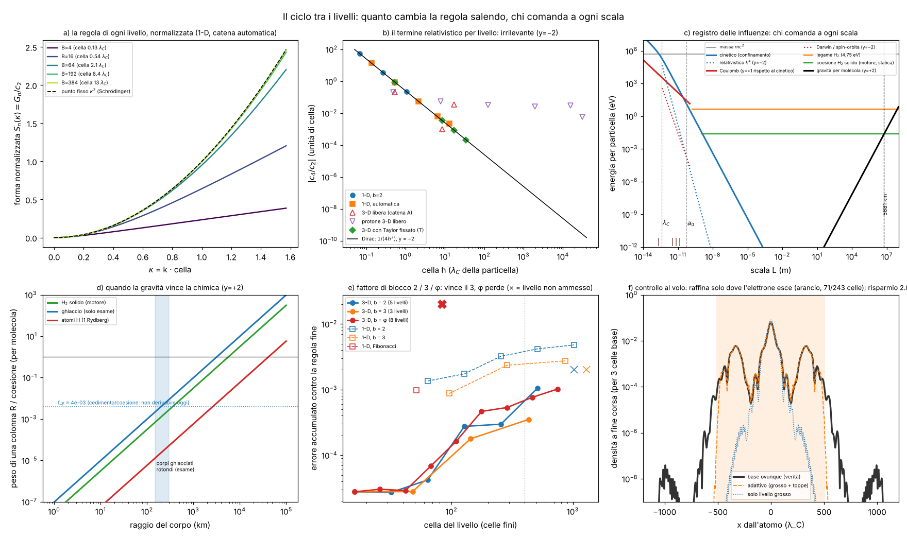

# Il ciclo tra i livelli: una sola regola per salire di scala

Studio `ciclo_`. Domanda di Valerio: il passaggio dal fine al grosso deve essere **quasi frattale e automatico**, un
solo algoritmo, senza barare livello per livello; magari la regola cambia poco da un livello all'altro, o segue uno
schema tipo Fibonacci. E bisogna tenere il conto di **quanto pesa ogni forza a ogni scala** (la gravità quasi nulla nel
piccolo, padrona nel grande). Nome in fisica: **punto fisso del gruppo di rinormalizzazione**. Metodi noti: entropia
relativa / force matching, Mori–Zwanzig con rumore che rispetta fluttuazione–dissipazione, metodi multiscala
eterogenei / "equation-free".

File: pre-registrazione `lab/ciclo_prereg.py` → `lab/out/ciclo_prereg.json` (fase 1: commit c19ca9f, **prima** delle
analisi); fase 1 `lab/ciclo_p1_map.py` → `lab/out/ciclo_p1_map.json`, `lab/ciclo_p1_ledger.py` →
`lab/out/ciclo_p1_ledger.json`; figura `lab/ciclo_figure.py` → `lab/out/ciclo_figure.png`.



---

## 0. Il ciclo (uguale a ogni livello)

1. Il livello fine gira solo su **piccoli pezzi** di prova.
2. Le variabili grosse si scelgono **da sole**: quantità conservate + le più lente, trovate dai dati dei pezzi.
3. La regola grossa si **impara**: la più locale che rispetta simmetrie e conservazioni e rifà la statistica fine; il
   dettaglio buttato diventa rumore che rispetta fluttuazione–dissipazione.
4. **Controllo in corsa**: ogni tanto si confronta la previsione grossa con un pezzo fine nuovo; sopra una soglia
   pre-registrata si raffina **solo lì**.
5. Si ripete, col grosso come nuovo fine.

Le sole cose scelte a mano sono le soglie, dichiarate prima.

---

## 1. Fase 1: misurare la mappa sui livelli che esistono già

### 1.1 Cosa ho fatto (come a un ventenne)

Ogni livello dell'agglomeratore ha una regola imparata: uno "stencil" (quanto ogni cella parla con le vicine). Ho preso
**tutti** i livelli già imparati (sola lettura): catene 1-D (scala b = 2 e catena automatica), catena 3-D A (elettrone),
catena 3-D B (zoom), catena del protone (6 livelli), livelli T (con Taylor fissato), livello a₀/4 delle molecole, e gli
accoppiamenti cella–campo a tre livelli. Per ogni livello ho misurato:

* la **massa** che la regola porta (dal pezzo k²);
* il **termine relativistico** (il pezzo k⁴) e quanto pesa rispetto al k²;
* la **forma normalizzata** S(κ) = G(κ)/c₂ (la regola divisa per il suo pezzo principale): se la mappa va verso una
  forma fissa, S deve smettere di cambiare.

Unità: ħ = c = m = 1, cella h in lunghezze Compton della particella, passo τ = h. Nel continuo
E = k²/2m − k⁴/8m³ + …, quindi c₂ = 1/(2h) e c₄/c₂ = −1/(4h²).

### 1.2 La risposta alla domanda di Valerio: sì, la regola converge, e si sa a cosa

**La forma fissa si scrive in una riga.** Dividendo la regola di ogni livello per il suo pezzo k², tutti i livelli
vanno verso **S\* = κ²**: è la regola di Schrödinger libera, il punto fisso "gaussiano" del gruppo di rinormalizzazione.
Sul reticolo grosso, scritta come stencil, è g\*₀ = π²/3, g\*ⱼ = 2(−1)ʲ/j² lungo ogni asse (separabile in 3-D): una
coda lunga ~1/j², che spiega perché le regole grosse "vogliono" vicini lontani (la lezione 10 di CONTESTO_CLOUD).
Gli stencil imparati ci vanno incontro livello dopo livello: g₀ = 0,39 → 1,24 → 2,42 → 2,96 → 3,05 (punto fisso 3,29),
g₁ = −0,17 → −0,60 → −1,30 → −1,70 → −1,78 (punto fisso −2).

**Quanto cambia per livello: una legge di potenza, non Fibonacci.** La distanza della forma dal punto fisso (pannello a)
segue la formula del continuo entro l'1,5 % (10 % all'ultimo livello): D = 0,84 / 0,51 / 0,107 / 0,0147 / 0,0041 per
celle 0,13 / 0,54 / 2,1 / 6,4 / 13 λ_C. Nel regime di Schrödinger il cambio per livello è il pezzo k⁴ che si spegne
come **1/b²** a ogni salto di un fattore b: quello che resta di diverso da un livello al successivo si riduce di 4 volte
(b = 2) o 9 volte (b = 3) ogni volta. Cioè: "la regola cambia poco livello per livello" è vero, e il "poco" ha una
legge precisa: l'esponente y = −2 del primo termine irrilevante.

**Due punti fissi e un incrocio.** Sotto λ_C la regola è quella "a c" (Dirac, z = 1: lo spazio e il tempo scalano
insieme); sopra λ_C è Schrödinger (z = 2). La massa è il termine **rilevante** (cresce come h) che porta da uno all'altro.
Per questo la macchina, in AGGLOMERATO_ZIGZAG, ha scelto da sola b = 16 per "saltare il muro di Compton": è il punto
dove la regola cambia di natura. Il prossimo incrocio è a a₀: lì il Coulomb (rilevante rispetto al cinetico, y = +1)
prende il comando e nasce l'atomo.

### 1.3 Numeri contro la pre-registrazione (fase 1)

| esame | cosa | risultato | esito |
|---|---|---|---|
| P1a | il cinetico è marginale: m_kin/m a ogni livello libero di ogni catena entro 10⁻³ di quello della regola fine | peggiore 4,3·10⁻⁴ (su 19 livelli: 1-D, 3-D A, protone fino a B = 1 048 576) | **PASS** |
| P1b | il k⁴ è irrilevante con y = −2: pendenza di log\|c₄/c₂\| contro log h entro ±0,1, per catena | 1-D b = 2: **−1,997**; 1-D auto: **−1,936**; 3-D A libera: **−0,91**; protone libero: **−0,23** | **FAIL** (2 catene su 4) |
| P1c | il k⁴ esce isotropo in 3-D: c_xxyy/c_xxxx in [1,8; 2,2] sui livelli liberi | 5,6 / −9,6 / −1,85 | **FAIL** |
| P1d | Darwin, campo–moto, spin-orbita: stesso coefficiente a B = 256, 512, 1024 entro 2 % ⇒ peso rispetto al Coulomb ∝ h⁻² | spread 0,8 / 0,4 / 0,9 %; y = **−1,994 / −1,998 / −1,994** | **PASS** |
| P1e | la mappa va verso una forma fissa: D_n scende a ogni livello (1-D) e per h ≥ 2 λ_C sta entro 25 % del continuo | scende sempre; −0,4 %, +1,5 %, +9,5 % | **PASS** |

**3 PASS / 2 FAIL.**

### 1.4 Il fallimento insegna la regola giusta (onesto)

P1b e P1c falliscono per la **stessa** ragione, ed è la lezione più importante della fase. I livelli 3-D liberi sono
stati imparati da dati che vivono dove sta l'oggetto osservato (impulsi ~1/a₀, cioè κ ≈ 1/16 di cella a a₀/16): lì il
termine k⁴ vale 10⁻⁵ del k² e **non si vede**. Il fit allora lo sceglie a caso (lo decide il 25 % di campioni uniformi
lontani): c₄ esce 0,23, −0,28, +42 volte quello giusto. Nel protone, con celle fino a 3·10⁴ λ_C, ancora peggio.

È esattamente la definizione di "irrilevante" in rinormalizzazione: **un termine irrilevante non cambia le osservabili
grosse, quindi i dati grossi non lo possono determinare**. Il cinetico (marginale) invece è sempre giusto (P1a, 4·10⁻⁴).
Le catene 1-D lo vedono perché i loro dati arrivano fino a k = 0,3 m (dove il k⁴ pesa), e allora la pendenza è −2 esatta.
I livelli T (Taylor fissato dal livello sotto) lo portano esatto (1,0000 a ogni livello, pannello b, verde).

**Regola per il ciclo automatico (da qui in poi):** al passo 3 i termini di ordine basso (conservazioni, massa, k⁴…)
si **trasportano** dal livello sotto come vincoli esatti, il fit sceglie solo il resto. È quello che fa il livello T:
non è un trucco, è il modo di non perdere i termini irrilevanti quando poi, a un livello più fine o in un'altra
situazione (un elettrone veloce, un nucleo vicino), tornano a contare.

### 1.5 Il registro delle influenze

Ogni termine, il suo peso rispetto a chi comanda in quel regime, e il suo esponente y con la taglia del livello
(y > 0 cresce salendo: rilevante; y < 0 si spegne: irrilevante; y = 0 marginale). "Misurato" = dai livelli imparati.

| termine | regime | chi comanda | peso | y | come lo sappiamo |
|---|---|---|---|---|---|
| massa mc² | L < λ_C | moto a c | L/λ_C | **+1** | misurato: fase a riposo θB esatta a 10⁻¹² a ogni livello |
| cinetico ħ²k²/2m | L > λ_C | se stesso | 1 | **0** | misurato: P1a (4·10⁻⁴) |
| relativistico −k⁴/8m³ | Schrödinger | cinetico | (λ_C/L)²/4 | **−2** | misurato 1-D −1,997 / −1,936; 3-D libero non determinato; T esatto |
| Coulomb −Zα/r | Schrödinger | cinetico | 2L/a₀ | **+1** | analitico (il campo di Galerkin è −Zα/r ristretto); incrocio a a₀/2 ⇒ l'atomo |
| Darwin ¼∇²V/2m² | atomo | Coulomb | (λ_C/L)²/8 | **−2** | misurato −1,994 (g_k −0,1252 / −0,1254 / −0,1262) |
| campo–moto ¼∇V·∇ | atomo | Coulomb | (λ_C/L)²/4 | **−2** | misurato −1,998 |
| spin-orbita | atomo | Coulomb | (λ_C/L)²/4 | **−2** | misurato −1,994 (g_so 0,2503 / 0,2505 / 0,2526) |
| contatto (cuspide degli s) | atomo | Coulomb | ~θ² ln θ | ~ −2 (log) | NUCLEO_1S; il più lento a spegnersi |
| QED (Lamb, g−2) | atomo | Coulomb | α³ ln(1/α) | — | **assente** (debito #2) |
| legame chimico | molecola | se stesso | 1 (H₂: 4,75 eV) | 0 per molecola | AGGLOMERATO_DUE_ATOMI §12 |
| dispersione C₆/R⁶ | fra molecole | repulsione di scambio | buca 0,106 mEh; coesione statica H₂ fcc **23 meV**/molecola | −6 per coppia, 0 per molecola | aggmol fase 3 + somma fcc (qui) |
| legame a idrogeno | acqua | — | — | 0 per molecola | **non ancora nel motore** |
| gravità Gm²/r | tutti | Coulomb / coesione | **8,1·10⁻³⁷** (p–p), 4,4·10⁻⁴⁰ (e–p) | 0 fra due particelle; **+2** per particella in un corpo | analitico; incrocio derivato sotto |

**Gravità, derivata e non messa.** In un corpo neutro l'energia di gravità per molecola è G M m / R ∝ R² (y = +2),
mentre la coesione per molecola è costante: prima o poi vince. L'argomento della montagna (la colonna alta R pesa più
di quanto i legami reggono) dà R_× = √(3 ε v / (4π G m²)), con ε la coesione per molecola e v il volume per molecola.

* **H₂ solido del motore** (curva H₂–H₂ di aggmol, reticolo fcc statico, senza moto di punto zero): d = 6,36 a₀,
  ε = 23 meV, ρ = 124 kg/m³ ⇒ **R_× ≈ 5700 km**.
* **Atomi schiacciati** (ε = 1 Rydberg, il nostro 1s): **R_× ≈ 42 000 km** — la scala di Giove (raggio 70 000 km), che
  è il limite noto oltre il quale un pianeta più pesante non diventa più grande. Validazione d'ordine di grandezza.
* **Ghiaccio** (solo esame, coesione 0,49 eV non nostra): R_× ≈ 3200 km.

Il dato noto è che i corpi ghiacciati diventano **rotondi verso 200 km** (Mimas sì, Proteo no). Il fattore 16 fra
3200 e 200 km è la **debolezza del materiale**: un solido cede molto prima di rompere tutti i legami (dislocazioni,
grani). Servirebbe f_y = (cedimento)/(coesione) ≈ 4·10⁻³ (cioè ~9 MPa per il ghiaccio, giusto come ordine). Il motore
**non** sa ancora calcolarlo: **debito** dichiarato. Quindi: l'esponente (+2) e la scala R_× escono dalle costanti;
il "200 km" no, non ancora.

### 1.6 Debiti e manopole della fase 1

* Manopole: nessuna nuova (solo letture). Scelte di misura dichiarate prima: finestra κ ≤ π/2, finestra del fit 1-D
  (la stessa di A1), formula della montagna con il fattore 3/(4π).
* Debiti nuovi: (c1) i livelli 3-D liberi non portano il k⁴ (va usato T o un vincolo di trasporto); (c2) solido H₂
  statico (niente punto zero: la densità esce 124 contro 86 kg/m³ veri, la coesione 23 meV contro ~10 veri, perché il
  punto zero dell'H₂ è grande); reticolo fcc scelto, non emerso; (c3) frazione di cedimento f_y non derivabile.

---

## 2. Fase 2: variabili grosse scelte dalla macchina, e il fattore di blocco (2, 3 o φ)

Pre-registrazione: `lab/ciclo_prereg_p2.py` (dentro `lab/out/ciclo_prereg.json`, commit 7a115a5, **prima** delle
corse; le corse di sviluppo e i cambi di disegno che hanno prodotto sono elencati lì). Codice: `lab/ciclo_p2_core.py`
(il ciclo in 1-D), `lab/ciclo_p2_1d.py`, `lab/ciclo_p2_3d.py`, `lab/ciclo_p2_analyze.py` → `lab/out/ciclo_p2.json`.

### 2.1 Cosa ho fatto (come a un ventenne)

**Le variabili grosse le sceglie la macchina.** Prendo i modi lenti del livello sotto (quelli con almeno 12 celle
grosse per lunghezza d'onda) e guardo, dentro ogni blocco, che forma hanno. La "matrice densità del blocco" dice quali
combinazioni di numeri del blocco portano quasi tutto il peso dei modi lenti: si tengono quelle, partendo da **una** e
aggiungendone solo se il controllo non passa. Nessuno dice "prendi la media" o "prendi la componente grande".

**La regola grossa** è la più locale (raggio w più piccolo) che rifà gli autovalori lenti del livello sotto; nel caso
quasi-periodico i suoi numeri dipendono dal disegno locale dei blocchi. **Controllo**: i modi con almeno 24 celle per
lunghezza d'onda (la regola HD del progetto) entro 10⁻³. **Ripeti** dalla regola imparata.

**Tre modi di raggruppare**: per 2, per 3, e alla **Fibonacci** (blocchi lunghi e corti che si alternano come nella
successione di Fibonacci: A ← AB, B ← A; il fattore medio per livello è φ = 1,618, la "sezione aurea" che Valerio
chiedeva). In 1-D il Fibonacci è vero (reticolo quasi-periodico); in 3-D ho provato φ come semplice riscalamento nello
spazio degli impulsi (lì niente quasi-periodicità: dichiarato).

Sistemi: 1-D zig-zag libera e con un Coulomb morbido (3 stati legati), sopra un livello base comune di 1,6 λ_C
(cella 32 volte la fine, nel regime di Pauli); 3-D zig-zag libera dalla catena A (B = 16) fino a celle ~a₀/8, con lo
spostamento dell'1s al primo ordine come esame "Coulomb".

### 2.2 Numeri contro la pre-registrazione

| esame | cosa | risultato | esito |
|---|---|---|---|
| A1 | 1-D: le variabili scelte dalla macchina coincidono con quelle fatte a mano (media del blocco della componente grande), C = 1 | sovrapposizione minima **0,999994**, C = 1 a ogni livello ammesso | **PASS** |
| A2 | 3-D: la macchina ritrova da sola la "componente grande" (Pauli, 2 numeri) | autovalori 0,99999 / 0,99999 / 1,4·10⁻⁵ / 1,4·10⁻⁵; sovrapposizione **1 − 5·10⁻¹⁰** | **PASS** |
| A3 | 1-D libero, blocchi per 2 e per 3: tutti i livelli ammessi fino a B ≥ 27, errore accumulato ≤ 10⁻² | b = 2: 5 livelli fino a B = 32, **4,8·10⁻³**; b = 3: 3 livelli fino a B = 27, **2,7·10⁻³** | **PASS** |
| A4 | 1-D libero, Fibonacci: lo stesso | livello 1 ammesso (B = 1,62, w = 4, 9,8·10⁻⁴); **livello 2 non ammesso** a nessun w ≤ 8 (errore 0,58–0,67) | **FAIL** (previsto) |
| A5 | punteggio errore × costo a B = 8 e 16: φ vince / perde / pari | b = 2: 0,023 / 0,029; **b = 3: 0,015 / 0,023**; φ non ci arriva | **φ perde** (come previsto) |
| A6 | Coulomb 1-D: 3 energie di legame vicino a B = 4 entro 1 % | b = 2 (B = 4): 0,26 / 0,04 / 0,17 %; b = 3 (B = 3): 0,14 / 0,03 / 0,10 %; Fibonacci non ci arriva | **PASS** |
| A7 | 3-D: ogni schema arriva a B ≥ 400, spostamento 1s al primo ordine a B = 400 entro 10⁻³ | b = 2: −3,2·10⁻⁴ (4 livelli); **b = 3: +1,5·10⁻⁵** (3 livelli); φ: +1,0·10⁻⁴ (7 livelli) | **PASS**; punteggio: b = 3 0,005, φ 0,034, b = 2 0,11 → **φ perde** contro il 3 |
| A8 | ancora: il livello base contro la zig-zag fine (65 536 celle) sugli stati legati | 2,9 / 6,6 / 4,3·10⁻⁵ | **PASS** |

**6 PASS / 1 FAIL**, più due confronti: in tutti e due **φ perde** e **vince il blocco per 3**.

### 2.3 Cosa vuol dire

1. **La scelta delle variabili è automatica e giusta.** Senza dirle niente, la macchina sceglie un numero per blocco
   in 1-D e due in 3-D, e sono esattamente la "componente grande" (lo spinore di Pauli) che prima veniva scelta a mano
   fra due opzioni date. La ragione fisica: i modi lenti dell'elettrone fermo non contengono il positrone (lontano
   2mc² in frequenza), quindi la macchina lo butta. È una **validazione**: ritrova una scelta nota.
2. **Fibonacci non funziona come regola dei livelli, e si capisce perché.** Con blocchi di taglia diversa il reticolo
   grosso non è più uguale a se stesso traslato: ogni cella ha un vicinato diverso, e la regola grossa esatta ha **code
   irregolari** che non si spengono (~4 % a 6–8 celle, misurato nello sviluppo). La regola locale non riesce a starci
   dentro dal secondo livello. È un prezzo strutturale: la simmetria di traslazione è proprio quello che rende locale la
   regola grossa. Con φ come semplice riscalamento (3-D, senza quasi-periodicità) la catena funziona, ma servono più
   livelli per lo stesso salto (4,8 livelli per decade contro 2,1 per il 3) e ogni livello aggiunge errore: perde.
3. **Vince il fattore più grande che il controllo accetta.** L'errore accumulato cresce come B^1,15–1,34 qualunque sia
   lo schema (stessa pendenza: è la fisica, il k⁴ e la coda del pacchetto), ma con b = 3 si fanno meno passi. È lo
   stesso motivo per cui la macchina dell'AGGLOMERATO_ZIGZAG sceglieva da sola b = 16 dove poteva. La fisica nota non
   prevedeva φ e i dati non lo premiano: **nessuna scoperta**, ma ora è misurato e non è un'opinione.
4. **Dove si ferma.** Tutte le catene 3-D si fermano verso a₀/4 (b = 2 a B = 1024, b = 3 a 1296): l'1s ha ancora peso
   agli impulsi del bordo della cella. È lo stesso muro trovato da AGGLOMERATO_DUE_ATOMI (a₀/2 rifiutato). Lì il ciclo
   deve **cambiare variabili** (non più celle d'onda ma atomi interi): è il prossimo salto del ciclo, non un difetto
   del fattore di blocco.
5. **Rumore di fluttuazione–dissipazione.** Per un'onda sola (niente temperatura) il dettaglio buttato non è rumore ma
   memoria deterministica; qui l'ho solo misurato come "perdita" (1 − peso catturato: 4·10⁻³ in 1-D). Il rumore vero
   serve con molte particelle calde (la goccia): fase 4.

### 2.4 Debiti e manopole della fase 2

* Manopole del ciclo (uguali per tutti gli schemi, dichiarate prima): finestra di controllo 24 celle/λ e almeno 9 modi;
  finestra lenta 12 celle/λ; budget 10⁻³ (1-D) e 3·10⁻⁴ (3-D); peso dei modi veloci 0,03; minimi quadrati relativi
  (pavimento 10⁻²); w ≤ 8 (1-D), ≤ 5 (3-D); peso catturato ≥ 0,98. Nessuna è stata cambiata dopo le corse.
* Correzione di codice dichiarata (non di soglia): in 3-D la prima versione risolveva il fit vincolato con le equazioni
  normali (pesi relativi su 10⁶: numeri spazzatura, nessun livello ammesso); rifatta col metodo dello spazio nullo
  prima di leggere qualunque esito.
* Debiti: (c4) il livello base comune (1,6 λ_C) è imparato con G(0) e massa trasportati esatti: parte dal regime di
  Pauli perché sotto λ_C una regola a un numero per blocco è non locale (sviluppo); (c5) la regola 1-D è imparata dagli
  autovettori di tutta la catena (2000–2600 celle), non da piccoli pezzi: la parte "pezzi" è della fase 3; (c6) φ in
  3-D senza quasi-periodicità; (c7) il potenziale grosso 1-D è la restrizione di Galerkin, non imparato (in 3-D il campo
  imparato esiste già, AGGLOMERATO_COMPLETO).

## 3. Fase 3: controllo al volo e raffinamento locale — 6 PASS / 0 FAIL

### 3.1 Cosa ho fatto (come a un ventenne)
Prendiamo un atomo in 1-D. La base sono 2187 celle da 1,6 λ_C. Quasi tutto lo spazio gira col livello grosso: 243
celle, una ogni 9 celle base. Ogni 400 tick la macchina prende i pezzetti dove c'è elettrone, li rifà girare con la
regola base e confronta. Dove la differenza supera 0,01, cioè 1,5 volte il "rumore di fondo" misurato in quiete
(0,0064), raffina lì: quelle celle passano alle celle base. Poi rifà l'intervallo da capo, così l'errore non resta
mai dentro.

Il disturbo è un campo locale che oscilla sopra l'atomo. Ha una forma più fine della cella grossa, e strappa
l'elettrone con un impulso che il livello grosso non sa rappresentare.

**Le due scoperte dello sviluppo** (dichiarate prima delle corse):
* **Blocchi netti: FALLISCE.** Le variabili a blocchi netti non si cuciono alla base. Il gradino al bordo le rende
  6 volte troppo rigide e fa comparire stati finti 20 volte più legati del vero atomo.
* **Variabili lisciate: funziona.** Se si lisciano da sole (3 passate della regola del livello: aggregazione
  liscia), la regola grossa coincide con quella imparata entro l'1 % e la cucitura è pulita.
* **La perdita di norma.** Nella prima versione raffinare perdeva norma (7·10⁻³), perché le code delle funzioni lisce
  restavano fuori. Ora ogni cella raffinata si tiene la sua coda: lo spazio vecchio sta dentro il nuovo, e la perdita
  scende a 10⁻⁹.

| s | regola di Galerkin / regola imparata | stati legati vs base |
|---|---|---|
| 1 | 1,37–1,41 | 10–25 % |
| 2 | 1,03–1,06 | 1,8–3,7 % |
| 3 | **1,003–1,013** | **0,48–0,73 %** |

### 3.2 Numeri contro la pre-registrazione (commit 4d988f5, prima delle corse)
P e Q erano già stati girati in sviluppo (dichiarato). P2 (impulso spostato, più forte, k più alto) e F sono **ciechi**.

| esame | cosa | risultato | |
|---|---|---|---|
| B1 | quiete: niente raffinamenti, fedeltà ≥ 0,999 | 0 celle, 0,99982 | PASS |
| B2 | raffina solo nel cono del disturbo; frazione ≤ 0,5 | P: 29 %, margine 99 celle; P2: 35 %, margine 52 | PASS |
| B3 | ionizzazione entro 5 %, fedeltà ≥ 0,99; il grosso da solo sbaglia > 30 % | P: 0,2252 vs 0,2273 (0,9 %), fedeltà 0,9954; P2: 0,0934 vs 0,0925 (1,0 %), 0,9969; solo grosso: −99,9 % (non ionizza) | PASS |
| B4 | norma ≤ 10⁻⁸, energia dopo l'impulso ≤ 10⁻⁶ | norma ≤ 6·10⁻¹⁰; energia ≤ 4·10⁻⁸ (salti ai raffinamenti compresi) | PASS |
| B5 | impulso dove l'elettrone non c'è: nessun raffinamento | 0 celle, 0,99982 | PASS |
| B6 | **costo a pari errore** ≥ 1,5× | P: **2,05×**, P2: **1,76×** (controlli compresi) | PASS |

Due cose da notare.
* **Nessun livello uniforme fa lo stesso lavoro.** Il B = 3 uniforme (729 celle) azzecca la ionizzazione entro
  2–4 %, ma sbaglia la fase dell'onda che esce: fedeltà 0,72–0,73. Quindi il livello uniforme più economico con la
  stessa precisione è la base ovunque.
* **Dove va il costo.** Il controllo pesa quasi metà del costo dell'adattivo (5,8·10⁵ su 1,28·10⁶). In 1-D l'atomo
  occupa una fetta grande della scatola. In 3-D lo spazio vuoto cresce col volume: il risparmio sale, e il controllo
  si può fare più di rado dove l'errore è lontano dalla soglia (prossimo passo per "stringere le regole").

### 3.3 Debiti e manopole della fase 3
* (c8) Lisciamento: s = 3, scelto dal controllo e non fittato, col passo standard 4/(3ρ).
* (c9) Il disturbo di prova è messo a mano: è un esame, non materiale fisico.
* (c10) Manopole del controllo:
  * EPS_REF = 0,01, preso da una misura del fondo;
  * intervallo di 400 tick;
  * toppa di 3 celle con cuscinetto di 27 siti, scelti perché la velocità massima della banda per l'intervallo resti
    sotto il cuscinetto;
  * margine di 1 cella.
* (c11) Si raffina e basta: tornare grossi quando l'errore rientra è lavoro della fase 4.
* (c12) Il costo è contato come gradi di libertà × passi (stencil locale), non come tempo di questo codice, che usa
  matrici dense.
* Manopole nuove: 5 (s, EPS_REF, DT, toppa/cuscinetto, margine).

## 3bis. Dove sono rimasto (PARZIALE) e come riprendere
Fatto: fase 3 completa (esami, figura pannello f). Mancano tre sezioni del documento:
* "Idee geometriche e visive";
* "Dove l'intuizione di Valerio può aiutare";
* il totale delle manopole.

Per rifare tutto (dalla cartella `lab/`, single thread, ogni comando sotto i 10 min):
```
python ciclo_prereg.py                       # pre-registrazione -> out/ciclo_prereg.json
python ciclo_p3_dev.py                       # sviluppo dichiarato (costruisce le cache .pkl, ~5 min la prima volta)
for s in Q P P2 F; do python ciclo_p3_run.py $s truth; done
for j in "P mix" "Q mix" "F mix" "P2 mix" "P coarse" "P2 coarse" "P b3" "P2 b3"; do python ciclo_p3_run.py $j; done
python ciclo_p3_analyze.py && python ciclo_figure.py
```
Fasi 1–2: `python ciclo_p1_map.py; python ciclo_p1_ledger.py`; `python ciclo_p2_1d.py <free|coulomb> <2|3|fib>`,
`python ciclo_p2_1d.py anchor`, `python ciclo_p2_3d.py <2|3|phi|A2>`, `python ciclo_p2_analyze.py`.

## 4. Fase 4: piano pre-registrato (goccia d'acqua) — solo piano
L'acqua non esiste ancora nel motore: `docs/MOLECOLE.md` §8.2 la esclude per il problema del segno a 5 elettroni per
spin. Quindi la fase 4 è solo un piano, scritto nella pre-registrazione (`fase4`).
* L'impianto: una goccia al livello "molecola", con una regione irraggiata e una congelata.
* Il controllo al volo deve raffinare solo lì e poi **tornare grosso** quando l'errore rientra. Questo de-raffinamento
  è nuovo rispetto alla fase 3.
* Il rumore di fluttuazione-dissipazione del livello grosso si misura dalle toppe fini.

Esami:
* C1: l'energia più il lavoro dell'impulso si conserva entro 10⁻³, e il numero di molecole è esatto.
* C2: varianza del rumore = 2Tγ entro il 10 %.
* C3: stessa temperatura finale fra livello grosso e toppe fini entro il 5 %, e la frazione raffinata torna sotto il
  10 %.
* C4: solo esame, densità e calore latente contro l'acqua vera.

Si esegue solo quando la regola a molti elettroni avrà dato H₂O e il suo dimero.
