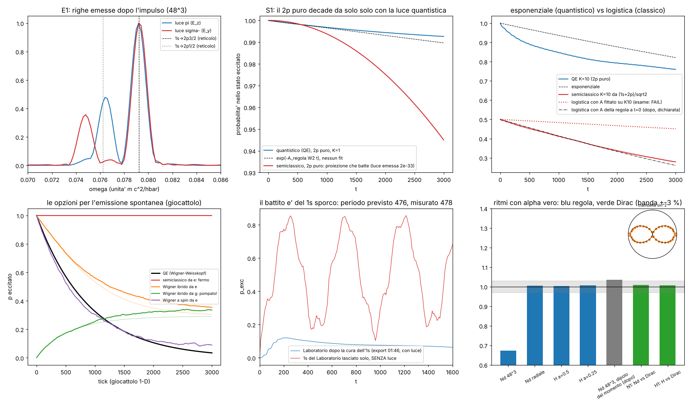
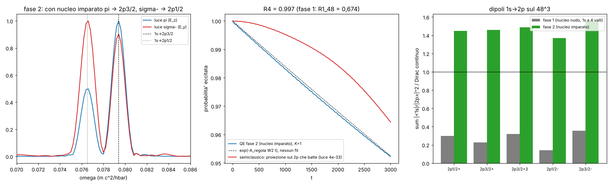

# Emissione vera: l'atomo che manda luce con la carica vera, e il 2p che parte da solo

Studio `emiss_`. Debiti affrontati: **#17** (emissione spontanea), **#18** (accoppiamento K = 10), **#19** (Nd⁵⁹⁺ invece
di H), **#21** (rifare il confronto E1 con la riga giusta); tocca anche **#20** (1s 3-D sporco).

File: `lab/emiss_core.py` (regola zig-zag 3-D dell'elettrone e della luce, accoppiamento), `lab/emiss_radial.py`
(la stessa regola in forma radiale, per celle piccole e per l'idrogeno), `lab/emiss_exact.py` (numeri d'esame di Dirac),
`lab/emiss_levels.py` (ascolto dei livelli), `lab/emiss_run.py` + `lab/emiss_configs.py` + `lab/emiss_drive.sh` (corse),
`lab/emiss_twa.py` (giocattolo per le opzioni dell'emissione spontanea), `lab/emiss_lab1s.py` (l'1s del Laboratorio),
`lab/emiss_judge.py` (giudice), `lab/emiss_posthoc.py` (analisi dopo, dichiarate), `lab/emiss_ideas.py` (prova della
"ciambella"), `lab/emiss_figure.py`.
Pre-registrazione v3: `lab/emiss_prereg.py` → `lab/out/emiss_prereg.json`, **commit 907d12c, prima delle corse di
produzione** (la v2 di `docs/ATOMO.md` non è stata toccata). Cambi dopo: `lab/out/emiss_amend.json`.
Risultati: `lab/out/emiss_results.json`, `lab/out/emiss_posthoc.json`, `lab/out/emiss_twa.json`,
`lab/out/emiss_lab1s.json`, `lab/out/emiss_ideas.json`. Figura: `lab/out/emiss_figure.png`.



---

## 0. In breve

**Le domande.** (1) Perché nel Laboratorio la luce rimandata dall'atomo esce alla riga 1s→2p3/2 e non alla 1s→2p½
pre-registrata? (2) Si può togliere il trucco K = 10 (carica 10 volte più grande) e misurare il ritmo di emissione con
la carica vera, contro la formula esatta? (3) Si può far partire **da solo** un 2p puro (emissione spontanea), cosa che
la luce classica non fa?

**Le risposte, in breve.**

1. **La riga.** Con luce polarizzata lungo z un 1s con spin su va per **2/3 nel 2p3/2 e per 1/3 nel 2p½** (conto degli
   angoli, §1). Quindi la riga forte **doveva** essere 1s→2p3/2. Rifatto con la pre-registrazione v3: la riga più forte
   cade a **0,07918 contro 0,07923** della regola (−0,06 %, **PASS**), la seconda a 0,07647 contro 0,07623 di 1s→2p½
   (+0,31 %, **PASS**). Il +7,1 % della v2 si spiega quasi tutto: ~4,0 punti perché si guardava la riga sbagliata, ~2,4
   punti dall'1s ascoltato male, ~0,6 punti dal metodo (gli zeri del segnale seguono un battimento). Il rapporto tra le
   due righe (E1v3c) e la prova con luce circolare (E1v3s) **falliscono**: i livelli 2p del reticolo 48³ non sono livelli
   puliti (§2).
2. **Il Laboratorio che "respira".** Il p_exc che oscilla dopo l'impulso (periodo ~478) **non è luce**: è l'1s di partenza
   che è un miscuglio di livelli del reticolo. Previsione senza parametri 476,5 contro 477,8 misurato (**L1 PASS**,
   −0,27 %). È lo stesso risultato trovato in parallelo dal thread principale (`docs/BATTIMENTO_1S.md`, commit 83485bc):
   sono le **4 valli** del cammino 3-D mescolate dal nucleo puntiforme. Con un 1s pulito il battito sparisce (loro: 4·10⁻¹⁶).
3. **Carica vera, ritmo giusto.** Con la carica vera (K = 1) e un difetto di tempo dell'accoppiamento corretto (§3.2), la
   regola fa uscire la luce **al ritmo che lei stessa prevede**: Nd⁵⁹⁺ radiale **1,005** (N1), idrogeno **1,004** (H1a)
   **1,006** (H1b). Contro Dirac: **Nd⁵⁹⁺ +0,87 %** dalla formula di dipolo (PASS entro 3 %), **8,52·10¹⁵ s⁻¹**;
   idrogeno **6,317·10⁸ s⁻¹ contro 6,268·10⁸ (+0,78 %, PASS)**. Senza nessun K. Nel 3-D 48³ invece **R1_48 FAIL (0,674)**: il ritmo segue fedelmente il dipolo del
   momento (rapporto **1,035** costante finestra per finestra, analisi dopo), ma il dipolo tra i "livelli" 48³ cala nel
   tempo perché non sono livelli singoli.
4. **Il 2p puro parte da solo.** Con la luce quantizzata a un fotone (schema di Wigner–Weisskopf sul reticolo, §4) il 2p
   puro si svuota e manda fuori **2,85·10⁻⁴** di energia; la stessa partenza con la luce classica manda fuori **2·10⁻³³**
   (cioè niente). La parte quantistica di S1 passa; la parte di controllo **fallisce** per un motivo che non è luce
   (la proiezione sul 2p del reticolo batte da sola, §4.3). Sul giocattolo 1-D (2000 traiettorie) le altre opzioni fanno
   quello che il calcolo prevede: il Wigner troncato "ibrido" parte a **0,48 A** (previsto 0,5) e **pompa lo stato
   fondamentale a 0,34** (previsto 0,29): non va bene per noi. **T1–T4 PASS.**

**Conteggio (21 prove pre-registrate):** **11 PASS, 6 FAIL, 2 informative, 2 non eseguite** (tabella §5). Parametri fisici nuovi: **0**.

---

## 1. Perché la riga è 1s→2p3/2 (debito #21)

### 1.1 Il conto degli angoli (come a un ventenne)

La luce del Laboratorio ha il campo elettrico lungo z. Un campo lungo z sposta l'elettrone su e giù: in meccanica
quantistica "spinge" l'1s verso gli stati con **lo stesso m** (Δm = 0). Partendo da 1s con spin su (m = +½) ci sono due
porte d'uscita: il **2p½ con m = +½** e il **2p3/2 con m = +½**. Quanto è larga ogni porta lo dice il quadrato
dell'elemento di matrice di z. Con le regole di somma degli angoli (Clebsch–Gordan; R è la parte radiale, uguale per
entrambi a meno di pochi %):

    |⟨2p3/2, +½ | z | 1s, +½⟩|² = 2 R²/9        |⟨2p½, +½ | z | 1s, +½⟩|² = 1 R²/9

**Il 2p3/2 pesa il doppio.** È un conto di libro (è anche il motivo per cui la riga D2 del sodio è due volte più forte
della D1). Con luce circolare σ⁻ (Δm = −1) succede il contrario: 2p½ prende 2/9, 2p3/2 1/9.

Due conseguenze:
- un metodo che conta gli **zeri** del segnale segue la riga più forte: con luce lungo z legge la 1s→2p3/2;
- quando ci sono due righe vicine il segnale batte e gli zeri hanno un errore che dipende dalla finestra (fino a ~1,6 %
  con le finestre usate).

### 1.2 Quale riga si doveva pre-registrare

**La 1s→2p3/2** (con luce lungo z), oppure la 1s→2p½ **con luce σ⁻**. La v2 aveva la combinazione sbagliata. Non la
rigiudichiamo: la v2 resta FAIL; la v3 è un esame nuovo, scritto prima delle corse.

### 1.3 Il +7,1 % della v2, pezzo per pezzo

v2: misurato 0,07970, atteso (1s→2p½ con l'1s del Laboratorio) 0,07444.

| pezzo | spostamento | punti su 0,07444 |
|---|---|---|
| riga sbagliata: 2p3/2 − 2p½ sul reticolo 48³ (0,97880 − 0,97580) | +0,0030 | **+4,0** |
| 1s ascoltato male (0,9011–0,9014 invece di 0,89957) | +0,0018 | **+2,4** |
| metodo degli zeri sulla riga che batte (0,07970 contro 0,07923) | +0,0005 | **+0,6** |
| totale | | **+7,0** (misurato +7,1) |

### 1.4 Il nuovo esame (E1v3, pre-registrato)

Stessa scatola del Laboratorio (48³, celle da 0,5 λ_C, luce 128³ a 20 celle per λ), carica vera, 1s e 2p ascoltati con
finestra lunga, impulso a ω(1s→2p½), 10 000 unità di tempo, spettro di Hann della sonda.

| prova | misurato | soglia | esito |
|---|---|---|---|
| E1v3a riga più forte = 1s→2p3/2 | 0,07918 contro 0,07923 (−0,06 %) | 0,5 % | **PASS** |
| E1v3b seconda riga = 1s→2p½ | 0,07647 contro 0,07623 (+0,31 %) | 0,5 % | **PASS** |
| E1v3c rapporto delle due righe | 2,08 contro 1,61 previsto dai dipoli del reticolo | 20 % | **FAIL** (+29 %) |
| E1v3s luce σ⁻: riga più forte = 1s→2p½ | 0,07927 (è la 2p3/2!), seconda 0,07478 | 0,5 % | **FAIL** |
| E1v3zc (informativo) metodo v2 sulla nuova corsa | 0,08021: +1,24 % dalla 2p3/2, +5,2 % dalla 2p½ | — | info |

Nello spettro ci sono altre righe: **0,0897** e **0,0924** (con σ⁻ 0,0941). Sono 2p − 0,8863: il livello del reticolo
a 0,886 (una delle "valli", §2) che parla con i 2p. Anche il thread principale le vede (0,0920).

**Perché E1v3c ed E1v3s falliscono.** I dipoli 1s→2p misurati sui livelli 48³ sono **3–7 volte più piccoli** di quelli
di Dirac e con angoli storti (tabella; analisi dopo, `emiss_posthoc.py`):

| transizione (dall'1s m = +½) | Σ\|d\|² reticolo 48³ | Dirac continuo | rapporto |
|---|---|---|---|
| 2p½ m = +½ (z) | 0,247 | 0,827 | 0,30 |
| 2p3/2 m = +½ (z) | 0,374 | 1,654 | 0,23 |
| 2p3/2 m = +3/2 (x, y) | 0,793 (\|x\| 0,53 ≠ \|y\| 0,72) | 2,481 | 0,32 |
| 2p½ m = −½ (x, y) | 0,236 | 1,654 | 0,14 |
| 2p3/2 m = −½ (x, y) | 0,294 | 0,827 | 0,36 |

Un livello pulito con m = 3/2 avrebbe |x| = |y|: qui no. Con σ⁻ la previsione del reticolo è che la porta del 2p½ sia
quasi chiusa (0,236 contro 1,654), e infatti la riga forte resta quella del 2p3/2. Il conto degli angoli di §1.1 vale per
livelli puliti; quelli del 48³ sono **multipletti di valle** (§2): non hanno angoli puliti. Curiosità (non è un esame):
con i dipoli di Dirac il rapporto E1v3c previsto sarebbe 2,13, e il misurato è 2,08.

---

## 2. Il Laboratorio che continua a oscillare (dati del thread principale, debito #20)

Dati: `/mnt/project-files/ripresa/dati/atomo_accoppiato/serie.csv` (corsa `accoppiato.rs`, vecchio 1s).
Osservazione: dopo l'impulso p_exc oscilla tra 0,2 e 0,7 con periodo ~800 tick (≈ 400–480 unità di tempo) anche quando la
luce è uscita.

**Il conto.** Un atomo lasciato solo non può cambiare la popolazione dei suoi livelli. Se p_exc = 1 − |⟨1s|ψ⟩|²
oscilla, il "1s" con cui misuriamo **non è un livello**: è un miscuglio di livelli con frequenze ω_a, ω_b, …, e la sua
proiezione batte a ω_a − ω_b. Ho rifatto esattamente l'ascolto del Laboratorio (`Atomo::ascolta(0,885; 0,915; 600)`)
e ho scomposto quello stato sui livelli della regola:

| livello | ω | peso nell'1s del Laboratorio | peso nello stato radiale di partenza |
|---|---|---|---|
| a | 0,89946 | 0,392 | 0,279 |
| b | 0,88627 | 0,117 | 0,235 |
| c | 0,84037 | 0,024 | 0,258 |

Battimento previsto **2π/(ω_a − ω_b) = 476,5**, senza parametri; nella serie del Laboratorio (t > 400) **477,8**:
**L1 PASS (−0,27 %)**. Lo stesso 1s lasciato andare **senza luce** fa p_exc 0 → 0,856: la luce non c'entra.

Il thread principale ha fatto la stessa diagnosi in Rust con una scomposizione migliore (Rayleigh–Ritz):
`docs/BATTIMENTO_1S.md`. Il mio "a" è in realtà una coppia (0,8993 e 0,8996); i pesi giusti sono 66/25/4 %. **La causa**:
il cammino zig-zag 3-D, guardato ogni due tick, ha **4 valli** (k = 0 e k = (π/2, π/2, 0) e permutazioni): 4 copie
esatte dell'elettrone. Il nucleo puntiforme sullo spigolo di 8 celle le mescola e l'1s si apre in un multipletto di 4
livelli (0,840 – 0,900). La mia analisi in "angoli dello spazio k" (in `emiss_lab1s.json`) tagliava proprio a π/2 e quindi
non poteva separarle bene: la lettura giusta è la loro.

**Cosa cambia con un 1s pulito.** (i) Niente battito: p_exc dopo l'impulso diventa la vera popolazione eccitata
(il thread principale, con un livello esatto come 1s: 0,097 → 0,064, cioè l'atomo che si svuota); (ii) la riga E1 si
legge senza l'errore di 2,4 punti di §1.3; (iii) restano però i **2p**: anche loro sono multipletti di valle (§1.4), e
finché le valli si mescolano gli angoli non sono puliti. **La cura di fondo** è la stessa di `docs/NUCLEO_1S.md`:
l'errore nasce nella **prima cella** attorno al nucleo; con la "cipolla" (celle proporzionali a r) o lo zoom automatico la
forma appuntita r^{γ−1} viene risolta, i momenti grandi che mescolano le valli spariscono, e il multipletto dovrebbe
stringersi verso un livello solo. Non provato qui in 3-D.

**Che cosa partiva dall'1s misto, nei miei numeri (dichiarato).** I livelli 48³ di produzione sono ascoltati con finestra
gaussiana lunga (S_T = 1500) dallo stato radiale: tolgono 0,886 e 0,840 ma **non separano la coppia 0,8993/0,8996**
(residuo 1·10⁻⁴, stima ~90/10). Lo stesso per i 2p (residui 0,8–3·10⁻⁴): sono pezzi di multipletto. Questo tocca E1v3c,
E1v3s, R1_48, S1, K10, SC10. Le prove radiali (N1, H1) non hanno valli e non sono toccate.

**Un colore solo? No (avviso di `docs/SOTTORETICOLO.md`, master 178743d, non presente nel mio ramo).** In questo studio
dipoli, correnti, posizioni e accoppiamento alla luce sono sempre somme su **tutto** il reticolo 48³ (tutti e 4 i
colori/sottoreticoli: `Dirac3D.position`, `dip_matrix`, `add_rphi` in `lab/emiss_core.py`). Non c'è nessuna scorciatoia a
un colore. L'unica restrizione è sul tempo: proiezioni e ascolto solo sui tick **pari** (la regola si ripete ogni due tick).
L'anisotropia dei dipoli 48³ di §1.4 (|x| 0,53 ≠ |y| 0,72) quindi **non** viene da un colore solo: viene dai livelli,
che sono pezzi di multipletto di valle.

**Il decadimento del Laboratorio dopo la cura (0,097 → 0,064, t = 450 → 1600).** Se è una logistica
(semiclassico: dp/dt = −A p (1−p)) il ritmo è **A = 3,9·10⁻⁴**. Con K = 10 (K² = 100), media gaussiana σ = 2 celle
(W² = 0,672) e ω = 0,0792, la regola prevede A = (4/3) α ω³ |D|² K² W² = **6,5·10⁻⁴ × |D|²**: con il dipolo dei livelli
48³ (|D|² = 0,374) 1,2·10⁻⁴; con il dipolo "liscio" (1,65–1,70) 5,4–5,5·10⁻⁴. Il misurato sta in mezzo: **stesso ordine
di grandezza, nessun confronto pulito** (stati diversi, il dipolo dei loro livelli non lo conosco, e l'accoppiamento del
Laboratorio ha ancora il difetto di tempo di §3.2). Non è un esame.

---

## 3. Carica vera: il ritmo di emissione (debiti #18, #19)

### 3.1 Come si misura

Si prepara il 2p, si accende la luce **con la carica vera** e si guarda quanto in fretta l'atomo si svuota. Il ritmo
"della regola" è A = (4/3) α ω³ |⟨1s|r|2p⟩|², con ω e dipolo **degli stessi stati del reticolo**: se la luce del reticolo
porta via energia come la luce vera, il ritmo misurato deve essere questo (per il fattore W² della media gaussiana, che
si calcola e non si aggiusta). Poi si confronta con Dirac esatto (`emiss_exact.py`: funzioni radiali di Dirac analitiche,
regola d'oro completa).

Esame preliminare **R0**: un dipolo imposto nella luce sola. Potenza / (Larmor × W²) = **1,016** (soglia 3 %,
**PASS**); la previsione dalla regola della luce (matrice di Bloch) è 1,006.

### 3.2 Un difetto trovato nell'accoppiamento del Laboratorio

Nelle corse di sviluppo (dichiarate nella pre-registrazione) con l'accoppiamento **come `accoppiato.rs`** l'atomo si
svuotava **2,2 volte più in fretta** di quanto la luce portasse via: dove va l'energia in più? Diagnosi: l'atomo legge il
campo **prima** del tick della luce e deposita la sua corrente **dopo**, nella stessa cella. Il campo che l'elettrone
ha appena fatto (il suo campo vicino, enorme e quasi tutto non radiativo) gli torna indietro con mezzo tick di ritardo, e
un ritardo su una forza di richiamo è un attrito finto. Cura in due pezzi:
1. **campo centrato**: l'atomo vede ½(U F_n + F_{n+1}), la media tra prima e dopo il tick (predittore + correttore);
2. **deposito trasverso** (gauge di Coulomb): la parte longitudinale del deposito non è luce, è il campo di Coulomb della
   carica che si sposta. La regola della luce sa da sola qual è: la matrice di due tick è una rotazione reale e il suo
   **asse n(k) è esattamente il modo longitudinale del reticolo**; si proietta il deposito con 1 − n nᵀ (una FFT, una volta).

Sviluppo: norma / (A_regola W²) da **2,29** (come Rust) a **0,994** (centrato) e **1,057** (centrato + trasverso, T = 600).
Patch proposta in §7.

### 3.3 Risultati

| prova | che cosa | misurato | soglia | esito |
|---|---|---|---|---|
| N1 regola | Nd⁵⁹⁺ radiale, a = 0,025, 30 celle/λ | A / (A_regola W²) = **1,005**; fotoni/norma 1,001 | 3 % | **PASS** |
| N1 Dirac | A/W² contro Dirac A_LW(2p3/2) 1,0886·10⁻⁵ | **1,0981·10⁻⁵ (+0,87 %)** = 8,52·10¹⁵ s⁻¹ | 3 % | **PASS** |
| N1x (info) | contro Dirac con ritardo A_EX 9,979·10⁻⁶ | +10,0 % (previsto ≈ +8 %: l'accoppiamento è di dipolo) | — | info |
| H1a regola | idrogeno, a = 0,5 | **1,004**; fotoni/norma 1,002 | 3 % | **PASS** |
| H1b regola | idrogeno, a = 0,25 | **1,006**; fotoni/norma 0,999 | 3 % | **PASS** |
| H1 Dirac | Richardson in a² contro 6,2683·10⁸ s⁻¹ | a = 0,5: 6,560·10⁸; a = 0,25: 6,378·10⁸; **estrapolato 6,317·10⁸ (+0,78 %)** | 3 % | **PASS** |
| R1_48 | 3-D 48³, 2p3/2 m = 3/2 puro, K = 1 | **0,674** | 3 % | **FAIL** |
| R1b_48 | fotoni / norma | 0,972 | 3 % | **PASS** |
| K10 | 48³ con K = 10: esponenziale e A(K=10)/100 = A(K=1) | 0,094 e 0,28 (§4.4) | 0,02 e 5 % | **FAIL** |
| R1_96, R2_96 | 96³ | **non eseguite** (§5) | | — |

Per l'idrogeno il confronto con NIST (6,2649·10⁸ s⁻¹) va moltiplicato per μ/m (la massa finita del protone): **6,314·10⁸ contro 6,2649·10⁸ (+0,78 %)**. Le celle grandi spostano ω e il dipolo (la massa cinetica della regola, tanθ/θ): il ritmo è +4,7 % a a = 0,5 e +1,7 % a a = 0,25; l'estrapolazione a due punti (Richardson in a²) lascia +0,78 %, probabilmente perché a = 0,5 non è ancora nel regime a² puro.

**R1_48 spiegato (analisi dopo, dichiarata).** Il dipolo di accoppiamento D(t) = ⟨1s(t)|r|ψ(t)⟩ della corsa **cala**
da |D| = (0,53; 0,72) a (0,28; 0,52) in 3000 unità di tempo: 1s e 2p del 48³ non sono livelli singoli e le loro parti si
sfasano. Il ritmo misurato, finestra per finestra, contro il ritmo della regola **con il dipolo di quel momento**:

| finestra t | ritmo misurato | ritmo regola × W² (dipolo del momento) | rapporto |
|---|---|---|---|
| 100–600 | 3,28·10⁻⁶ | 3,17·10⁻⁶ | 1,035 |
| 600–1200 | 2,82·10⁻⁶ | 2,73·10⁻⁶ | 1,036 |
| 1200–2000 | 2,32·10⁻⁶ | 2,24·10⁻⁶ | 1,034 |
| 2000–3000 | 1,81·10⁻⁶ | 1,75·10⁻⁶ | 1,034 |

L'accoppiamento fa quello che deve (entro il 3,5 %, costante); il FAIL è degli stati. Il 3,5 % in più nella norma
rispetto ai fotoni (0,972) è un residuo del campo vicino che non ho chiuso (nelle prove radiali è 0,1–0,2 %).

**Il fattore Z⁴ (#19).** Nd⁵⁹⁺ è stato scelto perché a Z = 60 il ritmo è Z⁴ ≈ 1,3·10⁷ volte quello dell'idrogeno, e
si vede in poche migliaia di tick. Con la forma radiale della regola si fa anche l'idrogeno vero (celle fino a 0,25 λ_C,
scatola fino a 4000 λ_C, la luce a 30 celle per λ = 9 434 λ_C): non serve più Nd per misurare il ritmo, serve solo per il
3-D. La legge Z⁴ non relativistica sbaglia del 4,9 % a Z = 60 (relatività); la regola segue Dirac (+0,87 %), non Z⁴.

---

## 4. Il 2p puro che parte da solo (debito #17)

### 4.1 Il problema

Con la luce classica (semiclassico) un atomo **puro** nel 2p non ha dipolo oscillante (⟨r⟩ = 0 in un livello) e quindi
non manda luce: resta lì per sempre. Una sovrapposizione (1s + 2p) invece oscilla e si svuota con
dp/dt = −A p (1−p) (una logistica, non un esponenziale). La natura fa partire anche il 2p puro: è l'emissione spontanea,
ed è un effetto delle **fluttuazioni del vuoto** della luce, cioè della luce quantizzata.

### 4.2 Le opzioni (provate sul giocattolo 1-D, 2000 traiettorie)

Giocattolo: atomo a due livelli al centro di una riga di luce zig-zag 1-D (`emiss_twa.py`), A_QE = 1,12·10⁻³ per tick.

| opzione | che cosa è | 2p puro | dal fondamentale | emerge / debito |
|---|---|---|---|---|
| semiclassico | luce classica, atomo onda | **fermo** (\|p−1\| = 0, T4 PASS) | fermo | emerge tutto, ma non c'è emissione spontanea |
| Wigner troncato ibrido | luce con rumore ħω/2 per modo, atomo onda pura | parte a **0,48 A** (previsto 0,5, T1 PASS) | **pompato a 0,34** (previsto 0,29, T2 PASS) | il vuoto "scalda" l'atomo: sbagliato |
| Wigner troncato a spin (dTWA) | anche l'atomo campionato come spin classici | **0,99 A** (T3 PASS) | pompato a 0,07 | l'atomo non è più un'onda della regola |
| pochi modi quantizzati | | oscilla, torna (niente irreversibilità) | | non è emissione |
| **un'eccitazione (QE)** | ψ "atomo eccitato, niente fotoni" + "1s × un fotone" | **A esatto** (Wigner–Weisskopf) | fermo | scelto |

Perché l'ibrido sbaglia (conto): il rumore di vuoto agisce sia sull'atomo eccitato sia su quello fondamentale con la stessa
forza: dp/dt = (A/2)(1 − 2p) − A p(1 − p). Parte a A/2 e ha un punto fermo a p* = 1 − 1/√2 = 0,293: un atomo nello stato
fondamentale verrebbe eccitato dal vuoto. Il giocattolo lo conferma.

**Lo schema scelto (QE).** Due "mondi": nel primo l'elettrone è nel 2p e non ci sono fotoni (funzione d'onda ψ, evoluta con
la regola zig-zag); nel secondo l'elettrone è nell'1s (evoluto con la stessa regola) e c'è **un fotone**, un campo di luce
complesso evoluto con la regola della luce (due copie reali). I due mondi parlano con lo stesso accoppiamento del
semiclassico: ψ += −i a e (𝓔·r) φ_1s, e la corrente di transizione −e Δ⟨φ_1s|r|ψ⟩/Δt fa nascere il fotone. Sono le
equazioni del semiclassico **linearizzate attorno al fondamentale**, quindi niente di nuovo come regola; la novità è
tenere i due mondi separati invece di sommarli.

**Debiti dello schema (dichiarati):** (i) **un fotone al massimo** (niente cascate a due fotoni); (ii) approssimazione di
onda rotante implicita (manca il termine che crea fotone ed eccita insieme); (iii) accoppiamento di dipolo con media
gaussiana (fattore W², calcolato); (iv) proiezione trasversa (gauge di Coulomb); (v) nel mondo del fotone l'elettrone è
solo l'1s. In cambio: la luce è la regola zig-zag della luce, l'irreversibilità viene dalla spugna lontana (il fotone se
ne va e non torna), e il ritmo esce.

### 4.3 S1 (pre-registrato)

| parte | misurato | soglia | |
|---|---|---|---|
| QE: 1 − norma(T) del 2p puro | **7,40·10⁻³** | ≥ 0,5 A_regola W² T = 5,21·10⁻³ | ok |
| controllo semiclassico: 1 − p_2p(T) | **5,5·10⁻²** | < 1 % del QE (7,4·10⁻⁵) | **no** |

**S1 FAIL.** Ma la luce emessa dal semiclassico è **2,2·10⁻³³** (zero), contro **2,85·10⁻⁴** del QE: il 2p classico
non manda niente. Il 5,5 % è la proiezione sul "2p" 48³ che batte da sola (multipletto di valle, §2), lo stesso fenomeno
dell'1s del Laboratorio. Il mio controllo era scritto con la proiezione e non con l'energia: errore di progetto
dell'esame, non della fisica. Resta FAIL.

### 4.4 Esponenziale contro logistica (K = 10, controllo)

Controllo con K = 10 (carica 10 volte, ritmo 100 volte), pre-registrato:

| prova | misurato | soglia | esito |
|---|---|---|---|
| K10: il QE dal 2p puro è un esponenziale | max \|norma − e^{−At}\| = **0,094** | 0,02 | **FAIL** |
| K10: A(K=10)/100 = A(K=1) | **0,28** | 5 % | **FAIL** |
| SC10: semiclassico da (1s+2p)/√2 segue la logistica con l'A di K10 | scarto max **0,171** | 0,05 | **FAIL** |

Stessa malattia di R1_48, più forte: la norma si ferma a **0,76** e il dipolo |D|² scende al **10 %** del valore iniziale.
Lettura (stima, non provata): il "2p" 48³ ha una parte **chiara** (che parla con l'1s) di circa 1/4 e una parte **scura**
(le altre valli, che con l'1s scelto non parlano); con K = 10 la parte chiara si svuota in fretta e resta la scura. 1/4 è
proprio quello che ci si aspetta da 4 valli. Il ritmo locale contro il dipolo del momento, invece, torna: **0,96 / 1,02 /
1,00 / 1,01** nelle 4 finestre (analisi dopo). E il semiclassico SC10 confrontato con la logistica del ritmo **della regola
a t = 0** (K² A_regola W² = 3,47·10⁻⁴, nessun fit; dopo, dichiarato) ha scarto max **0,019**: il FAIL di SC10 viene dall'A
di K10, non dal semiclassico. Avvertenza onesta: tra p = 0,5 e 0,28 un esponenziale e una logistica si somigliano; la
vera differenza classico/quantistico la mostra S1 (il 2p puro: 2·10⁻³³ contro 2,85·10⁻⁴ di luce).

---

## 5. Tabella pre-registrazione v3

| prova | che cosa | misurato | soglia | esito |
|---|---|---|---|---|
| E1v3a | riga più forte = 1s→2p3/2 (luce z) | 0,07918 / 0,07923 (−0,06 %) | 0,5 % | **PASS** |
| E1v3b | seconda riga = 1s→2p½ | 0,07647 / 0,07623 (+0,31 %) | 0,5 % | **PASS** |
| E1v3c | rapporto delle righe vs dipoli del reticolo | 2,08 / 1,61 (+29 %) | 20 % | **FAIL** |
| E1v3s | luce σ⁻: riga più forte = 1s→2p½ | 0,07927 (+4,0 %: è la 2p3/2) | 0,5 % | **FAIL** |
| E1v3zc | metodo v2 (zeri) | 0,08021 | — | info |
| R0 | luce sola: P/(Larmor W²) | 1,016 | 3 % | **PASS** |
| R1_48 | QE 48³: A/(A_regola W²) | 0,674 (1,035 col dipolo del momento, dopo) | 3 % | **FAIL** |
| R1b_48 | fotoni / norma | 0,972 | 3 % | **PASS** |
| S1 | 2p puro: QE parte; semiclassico fermo | QE 7,4·10⁻³ ≥ 5,2·10⁻³; SC 1 − p_2p = 5,5·10⁻² (luce 2·10⁻³³) | | **FAIL** |
| R1_96 | QE 96³ | non eseguita (`emiss_amend.json`) | | — |
| R2_96 | 96³ vs Dirac (FAIL atteso) | non eseguita | | — |
| N1 | Nd radiale: regola 1,005; vs Dirac A_LW | +0,87 % (8,52·10¹⁵ s⁻¹) | 3 % e 3 % | **PASS** |
| N1x | vs Dirac con ritardo | +10,0 % | — | info |
| H1 | idrogeno: 1,004 e 1,006; Richardson vs Dirac | +0,78 % (6,317·10⁸ s⁻¹) | 3 % | **PASS** |
| K10 | K = 10: esponenziale; A/100 | 0,094; 0,28 | 0,02; 5 % | **FAIL** |
| SC10 | semiclassico = logistica con A di K10 | 0,171 (0,019 con A della regola, dopo) | 0,05 | **FAIL** |
| T1 | Wigner ibrido: ritmo iniziale / A | 0,477 | 0,5 ± 0,1 | **PASS** |
| T2 | Wigner ibrido dal fondamentale: p(3000) | 0,336 | 0,293 ± 0,05 | **PASS** |
| T3 | Wigner a spin: ritmo / A | 0,988 | 15 % | **PASS** |
| T4 | semiclassico puro: \|p − 1\| | 0 | 1·10⁻⁶ | **PASS** |
| L1 | battito del Laboratorio previsto vs misurato | 476,5 / 477,8 (−0,27 %) | 5 % | **PASS** |

**Validazione o scoperta?** N1, H1, R0, E1v3a/b sono **validazioni** (la regola ritrova numeri noti: Dirac, Larmor, le
regole di selezione). T1–T4 confermano conti fatti prima. Le cose nuove sono: il difetto di tempo dell'accoppiamento
(§3.2) e la sua cura con l'asse di Bloch della luce; e il fatto che anche i 2p 3-D siano multipletti di valle con dipoli
3–7 volte troppo piccoli (§1.4), coerente con la scoperta dell'1s del thread principale.

---

## 6. Debiti

**Chiusi o ridotti**
- **#18 (K = 10)**: chiuso per la misura del ritmo: tutte le prove di ritmo sono a carica vera; K = 10 resta solo come
  controllo dichiarato (K10/SC10) e nel Laboratorio (dove serve a vedere qualcosa in pochi secondi).
- **#19 (Nd invece di H)**: chiuso per il ritmo: l'idrogeno vero si fa con la forma radiale (H1).
- **#21 (riga E1)**: chiuso: la riga giusta era la 1s→2p3/2 (calcolo §1.1) e la v3 la ritrova (E1v3a/b PASS).
- **#17 (emissione spontanea)**: chiuso **come schema** (QE: il 2p puro parte, il ritmo è quello della regola), con i
  debiti (i)–(v) di §4.2. Non è "la luce quantizzata completa": è il settore a un fotone.

**Aperti o nuovi**
- **#20 (1s 3-D sporco)** → più largo: **anche i 2p** del 48³ sono multipletti di valle; dipoli 3–7 volte più piccoli di
  Dirac e angoli storti. È il motivo di E1v3c, E1v3s, R1_48, S1. Cura: cipolla/zoom al nucleo (`docs/NUCLEO_1S.md`) o
  una regola senza valli (`docs/BATTIMENTO_1S.md` §5).
- **Difetto di tempo dell'accoppiamento Rust** (§3.2): `accoppiato.rs` sovrastima lo smorzamento (×2,2 nello sviluppo
  QE con σ = 1 cella). Patch proposta §7.
- **Residuo del campo vicino 3-D**: norma/fotoni 1,028 nel 48³ (0,1 % in radiale).
- **Ritardo (e^{−ik·r})**: l'accoppiamento è di dipolo: −8,3 % di Dirac completo a Z = 60 non c'è (N1x +10 %).
- **Due fotoni / cascate**: fuori dallo schema QE.
- **Wigner troncato**: provato e scartato (pompa il fondamentale) — non è un debito, è un fallimento dichiarato dell'opzione.

**Parametri.** Fisici nuovi: **0** (α, Z, m, c, ħ). Scelte numeriche dichiarate: celle per λ (20/30), spessore e forza
della spugna (12 celle, e^{−7,5}), σ della media gaussiana (1 cella), finestra di ascolto (S_T 1500), finestre di fit
(da 3 periodi alla fine). Nessuna è aggiustata su un numero d'esame; W² è calcolato.

---

## 7. Patch proposte per altri file (non applicate: non sono miei)

**`src/atomo/accoppiato.rs` — campo centrato e deposito trasverso.**

```rust
// Esperimento::passo: oggi legge il campo prima del tick della luce (campo_atomo()) e deposita dopo (luce.passo).
// Proposta (come lab/emiss_run.py, opzioni centered + transverse):
// 1) all'inizio del tick di luce: j_pred = 2 j_prev - j_prev2 (predittore della corrente)
// 2) campo visto dall'atomo per i SUB tick: E = ½(campo_atomo(U F_n) + campo_atomo(F_{n+1}))
//    dove F_{n+1} = U F_n - deposito(j_pred); dopo i SUB tick: correttore con la corrente vera
//    (l'atomo riceve -i a e (½ M (j - j_pred))·r, M = matrice del proprio campo, 3 numeri)
// 3) deposito: pesi gaussiani proiettati con P_perp(k) = 1 - n(k) n(k)^T, n(k) = asse della rotazione di Bloch
//    della regola della luce a due tick (calcolato una volta con una FFT 128^3, poi è una tabella di pesi fissa
//    di ~7^3 celle troncata a 1e-4)
```
Effetto atteso: lo smorzamento di un dipolo misurato nel Laboratorio diventa (4/3) α ω³ |D|² K² W² entro pochi %,
invece di ~2× (da verificare in Rust con σ = 2 celle: il fattore dipende da σ).

**`src/atomo/zz.rs` — stati di partenza.** Già fatto dal thread principale per l'1s (`uno_s_esatto`). Proposta: la stessa
diagonalizzazione del filtro anche per i 2p, e un test "atomo fermo" per ogni livello usato come riferimento.

**Richiesta ponte (proposta, non creata):** `ponte/richieste/emiss_lab_k1.json` con azione `test` su un test ignorato da
scrivere (`accoppiato_k1_centrato`): Laboratorio con K = 1, campo centrato + deposito trasverso, 2p puro 1s esatto,
2000 tick di luce; uscita: ritmo misurato / ritmo della regola. Serve la GPU/Rust per tempi lunghi a 48³.

---

## 8. Idee geometriche e visive

Bilancio: Intel UHD, ~42 ms per passo di fisica con ~33 800 palline (la GTX 1650 Ti è rotta). Le idee di rendering sono
**proposte** per il thread "Modello standard a palline".

1. **La ciambella di luce (provata).** *Cosa si vede*: l'atomo che si svuota manda fuori un guscio di palline che si
   allarga, più fitto all'equatore e vuoto lungo l'asse: una ciambella (sin²θ). Con luce σ la ciambella gira.
   *Perché funziona*: un dipolo irraggia con densità ∝ sin²θ; le palline campionate dalla densità di energia ½|F|² lo
   mostrano senza disegnare niente. *La prova* (`emiss_ideas.py`, corsa R0, guscio 30–50 celle): r²u(θ) = A sin²θ + B
   con **B/A = 0,0044** (vuoto vero lungo l'asse), residuo quadratico 2 %; all'equatore l'anisotropia cubica del reticolo
   (cos 4φ) è **2,2 %**: la ciambella è **rotonda**, non quadrata. Pannello piccolo della figura. *Costo*: la luce a 20
   celle/λ è 128³ (un passo ~ come il Laboratorio di oggi); il campionamento di 30 000 palline dalla densità è lo stesso
   del renderer attuale. *Regole*: sì (densità → palline, nessuna geometria).
2. **L'atomo fermo come esame visivo.** *Cosa si vede*: un atomo nel fondamentale deve stare **immobile**. Se "respira"
   (come il vecchio 1s, periodo 478) lo stato non è un livello. *Perché*: un livello ha |ψ(t)|² costante; ogni battito
   è la differenza di due frequenze (calcolo §2, L1). *Costo*: zero (una proiezione per fotogramma). *Regole*: sì; è un
   controllo automatico per l'agglomeratore ("blocca, impara, controlla": il controllo può essere "sta fermo?").
3. **Quattro colori per le valli.** (Dal thread principale, la sostengo con i miei numeri.) Colorare le palline secondo
   la valle di k: l'1s radiale è di un colore; dopo pochi tick diventa 4 colori che si scambiano. I 2p del 48³ mostrerebbero
   lo stesso. *Costo*: una FFT 48³ per fotogramma. *Regole*: sì (solo un modo di guardare).
4. **I due mondi sullo schermo.** Lo schema QE ha due mondi: "atomo eccitato, niente fotone" e "atomo giù + un fotone".
   *Cosa si vede*: l'atomo eccitato che sbiadisce (la sua norma) mentre cresce un guscio di luce "fantasma" con la stessa
   quantità che manca. Per vedere **un** fotone che parte in un istante preciso serve una misura (regola di Born): si
   campiona il tempo di arrivo dal flusso su una sfera lontana e si mostra un solo pacchetto. *Regole*: lo sbiadire è
   fisica dello schema; il "click" è una scelta di rappresentazione da dichiarare (collegamento con lo studio "surfisti e
   regola di Born"). *Costo*: zero in più.
5. **La forma dei livelli dice quale porta si apre.** Il 2p3/2 m = 3/2 è una ciambella di densità, il 2p½ è quasi
   sferico. *Cosa si vede*: con luce lungo z si accende di più la forma del 2p3/2 (2:1), con σ⁻ quella del 2p½. È la
   regola di selezione di §1.1 resa visibile. Oggi sul 48³ non funzionerebbe pulito (multipletti di valle): è anche un
   esame visivo della cura delle valli.
6. **L'asse della luce.** La parte longitudinale della luce del reticolo è l'asse n(k) della sua rotazione di Bloch (§3.2):
   la luce "sa" da sola cos'è Coulomb e cos'è onda. Idea per il motore: separare sullo schermo il campo vicino (che segue
   la carica) dalle palline di luce vera usando la stessa proiezione. *Costo*: una FFT per fotogramma del campo
   (128³ ≈ 2 M celle: pesante sulla UHD, ok a fotogrammi singoli). *Regole*: sì.

---

## 9. Dove l'intuizione di Valerio può aiutare

1. **Un fotone sullo schermo: nuvola o click?** Lo schema QE dà una nuvola di luce che cresce piano (la probabilità). Un
   fotone "che parte" in un istante è una misura. Quale delle due vuoi vedere nel motore? Se vuoi il click, serve decidere
   la regola del click (Born sul flusso), e va dichiarata.
2. **La cipolla in 3-D.** In radiale la cipolla (celle ∝ r) cancella l'errore della prima cella. In 3-D una griglia a
   cipolla attorno al nucleo che tenga la regola zig-zag (spostamenti di una cella a velocità c) è un problema di
   geometria: come si raccordano celle di dimensioni diverse senza riflettere? Qui la tua intuizione geometrica conta.
3. **Valli: errore o sapori?** Le 4 copie dell'elettrone del cammino cubico mescolate dal nucleo rovinano gli angoli dei
   livelli (dipoli 3–7 volte troppo piccoli). Una regola con un ordine degli assi diverso, o un reticolo diverso
   (cubico a corpo centrato), potrebbe separarle. Quale forma "vede" un elettrone solo?
4. **Più fotoni.** Lo schema QE si estende a 2, 3 fotoni come una scala di mondi (ogni gradino un fotone in più).
   Costa una copia della luce per gradino. C'è un modo "a palline" di non tenere tutti i mondi (per esempio palline di
   luce che portano un'etichetta di gradino)? È la domanda vera dietro "la luce quantizzata con le palline".

---

## 10. Cosa resta da fare

- Rifare R1 e E1v3c/s con livelli **esatti** (diagonalizzazione del filtro del thread principale, anche per i 2p).
- La cipolla/zoom in 3-D (insieme a NUCLEO_1S): togliere il multipletto, poi ripetere R1 contro Dirac nel 3-D (era R2_96).
- Portare la patch §7 nel Laboratorio e ripetere il decadimento 0,097 → 0,064 con K = 1 e tempi lunghi (ponte).
- Termine non di dipolo (ritardo) nell'accoppiamento: −8,3 % a Z = 60.

---

## 11. Fase 2: livelli esatti con il nucleo imparato, il ritardo, il Laboratorio pulito

Pre-registrazione v4: `lab/emiss_prereg2.py` → `lab/out/emiss_prereg2.json` (**commit cc95d92, prima delle corse**;
soglie della v3 riusate senza cambiarle). Dichiarazioni dopo: `lab/out/emiss_amend2.json` (nessuna soglia cambiata).
File: `lab/emiss_v4_dev.py` (sviluppo dichiarato), `lab/emiss_ritz.py` (livelli esatti), `lab/emiss_v4_checks.py`,
`lab/emiss_retard.py`, `lab/emiss_l1b.py`, `lab/emiss_judge2.py` → `lab/out/emiss_results2.json`,
`lab/emiss_figure2.py` → `lab/out/emiss_figure2.png`.



### 11.0 In breve

**8 PASS, 1 FAIL, 3 informativi.** Con il **nucleo imparato** di `docs/NUCLEO_1S.md` §13 (fase della carica × 0,554593
sugli 8 siti a √3/2·a e × 1,003549 sui 24 a √11/2·a: 2 numeri imparati altrove, non ritoccati) e i livelli presi con la
**diagonalizzazione del filtro** (come `uno_s_esatto` del thread principale) sul **cubo intero** (somma dei 4 colori), le
prove che in fase 1 fallivano per le valli **passano**:

| prova | fase 1 (nucleo nudo) | fase 2 (nucleo imparato) | soglia | esito fase 2 |
|---|---|---|---|---|
| E4a riga forte (luce z) = 1s→2p3/2 | −0,06 % | **0,07939 / 0,07937 (+0,02 %)** | 0,5 % | **PASS** |
| E4b seconda = 1s→2p½ | +0,31 % | **0,07653 / 0,07651 (+0,02 %)** | 0,5 % | **PASS** |
| E4c rapporto delle righe | +29 % (FAIL) | **1,989 / 2,122 (−6,3 %)** | 20 % | **PASS** |
| E4s luce σ⁻: riga forte = 1s→2p½ | era la 2p3/2 (FAIL) | **0,07654 / 0,07651 (+0,03 %)** | 0,5 % | **PASS** |
| R4 ritmo QE / ritmo della regola | 0,674 (FAIL) | **0,997** (vedi avvertenza) | 3 % | **PASS** |
| R4b fotoni / norma | 0,972 | **0,979** | 3 % | **PASS** |
| S4 2p puro: QE parte, semiclassico fermo | FAIL | QE 4,77·10⁻² ≥ 2,44·10⁻²; SC 1 − p_2p = 3,6·10⁻² | 1 % del QE | **FAIL** |
| N2 ritardo: (A_N1/W²) × F_ret(regola) vs Dirac A_EX | — | **1,0067·10⁻⁵ contro 9,979·10⁻⁶ (+0,89 %)** | 3 % | **PASS** |
| L1b battito nell'export nuovo del Laboratorio | — | **0,0009** (1s vecchio: 0,324) | < 0,01 | **PASS** |
| D4 dipoli / Dirac (info) | 0,14–0,36 | 1,37–1,55 | — | info |
| V4 deriva libera in 3000 (info) | — | 1s 0,070; 2p3/2 0,036 | — | info |
| N2x F_ret regola / Dirac (info) | — | 0,91678 / 0,91662 | — | info |

### 11.1 Che cosa è cambiato (come a un ventenne)

Lo sviluppo (dichiarato) ha mostrato subito il punto: con il nucleo nudo lo stato radiale dell'1s nel 48³ suona su **tre**
righe (0,8994; 0,8863; 0,8404), quello dei 2p su **una sola**. Il problema di fase 1 era quindi soprattutto l'**1s**: il
livello esatto dell'1s è un miscuglio 25/25/25/25 delle 4 valli, mentre il 2p sta quasi tutto nella valle "liscia"; il
dipolo tra i due prende solo il pezzo in comune (~1/4) e gli angoli si storcono. Con il nucleo imparato l'1s suona su
**una riga** (0,89946, peso 0,98): le 4 copie dell'elettrone diventano quasi uguali (separate di 0,0003) e l'1s liscio
può stare fermo. Allora tornano le regole di selezione di §1.1: **2p3/2 : 2p½ = 2,41 : 1,21 = 2,00** (il 2 : 1 del conto
degli angoli) e |x| ≈ |y| per m = 3/2 (1,371 e 1,345).

**I livelli** (`emiss_levels4_48.json`, criterio cieco scritto prima: il vettore di Ritz con più peso nello stato radiale
più i suoi vicini entro 0,0015): 1s+ 0,899453 (gruppo 0,89933/0,89951/0,89964, peso nello stato di partenza 0,984);
2p½ 0,975967; 2p3/2 0,978823 (residui 1–5·10⁻⁴: anche il 2p3/2 è un doppietto quasi degenere, 0,97870/0,97887, visto con
2400 tick; dichiarato).

**Un colore o quattro?** Tutto è calcolato sul cubo intero (somma dei 4 colori): niente scorciatoie a un colore
(avviso di `docs/SOTTORETICOLO.md`).

### 11.2 Avvertenze oneste

- **R4 = 0,997 passa anche per compensazione.** Finestra per finestra, contro il dipolo **del momento**, il rapporto è
  **1,035** (lo stesso 3,5 % in più di fase 1: un residuo del campo vicino 3-D che non ho chiuso); il dipolo cala di ~3,5 %
  nella corsa (l'1s deriva di 0,07 in 3000, V4). L'esame pre-registrato usa il dipolo a t = 0 e passa; il residuo resta un debito.
- **S4 fallisce come S1, per lo stesso errore di progetto dell'esame**: 1 − p_2p del semiclassico = 0,0356 = la deriva libera
  del 2p (doppietto quasi degenere), mentre la luce emessa dal 2p semiclassico è **4·10⁻³³**. Il quantistico invece si svuota
  di 4,8 % e manda fuori i fotoni corrispondenti (R4b 0,979).
- **Righe deboli in più**: negli spettri E4 restano due righe a **+0,0131** da quelle principali (0,0897 e 0,0925, ~20 % in
  ampiezza). È la stessa distanza del vecchio battito. Non spiegate; candidato: membri alti dei multipletti dei 2p, che il
  nucleo imparato sull'1s non chiude.
- **D4: dipoli 1,4–1,5 volte Dirac.** Anche gli stati radiali di partenza danno 1,22×: probabilmente la scatola periodica da
  24 λ_C taglia il 2p (24 % del suo peso oltre r = 10 λ_C) e la cella 0,5. Il ritmo della regola lo segue (R4), ma il
  confronto con Dirac nel 3-D resta da fare con una scatola più grande (serve il nucleo imparato a 96³ o la cipolla).

### 11.3 Il ritardo (−8 % a Z = 60)

Nel 3-D la cella della luce (4 λ_C a 20 celle per λ) è più grande dell'atomo (⟨r⟩ = 2,7 λ_C): la luce del reticolo non può
"vedere" la fase e^{−ik·r} che cambia attraverso l'atomo. Per avere celle di luce più piccole dell'atomo e insieme il campo
lontano servirebbero ~160 celle per λ: una scatola 128³ coprirebbe meno di una lunghezza d'onda. Allora ho fatto la cosa
pulita che si può fare: ho messo gli **stati radiali della regola stessa** (a = 0,025, gli stessi della corsa N1) nella
regola d'oro completa con α·ε e^{−ik·r} (stesso codice di `emiss_exact.py`, che con le funzioni di Dirac ridà 9,97873·10⁻⁶).

- Fattore di ritardo della regola **F_ret = 0,91678** contro Dirac **0,91662** (+0,02 %).
- Controllo interno: forma "velocità" a k → 0 contro forma "lunghezza" sugli stati della regola: **1,00035**.
- **N2 PASS**: ritmo misurato in N1 (dipolo, dinamico) × F_ret della regola = **1,0067·10⁻⁵ = 7,82·10¹⁵ s⁻¹** contro Dirac
  completo **9,979·10⁻⁶ (+0,89 %)**.

Onestà: qui il ritardo è **calcolato** con gli stati della regola, non **emerso** dalla corsa (la dinamica resta di dipolo).
Debito: un accoppiamento multipolare dinamico (il campo letto in più punti della nuvola, o la corrente di transizione
depositata cella per cella) con celle di luce ≲ 1 λ_C vicino all'atomo: una "cipolla" anche per la luce.

### 11.4 Il Laboratorio con l'1s pulito (L1b)

L'export rigenerato dal thread principale (1s esatto 0,8996036): la riga più forte di p_exc in [0,010; 0,016] ha ampiezza
**0,0009**, contro **0,324** dello stesso stimatore sull'1s vecchio lasciato solo: il battito è sparito (÷ 360). p_exc per
t > 400 sta fra 0,064 e 0,101: è l'atomo che si svuota (semiclassico, K = 10). **L1b PASS.** Il numero di L1 (477,8) resta
quello dell'export vecchio.

### 11.5 Debiti dopo la fase 2

- **#20**: per l'emissione nel 48³ il problema delle valli è **curato con il nucleo imparato** (2 numeri presi da NUCLEO_1S,
  imparati sull'1s con un criterio interno). Restano: righe deboli a +0,0131, doppietto quasi degenere del 2p3/2, deriva
  0,07 dell'1s in 3000, dipoli 1,4× Dirac (scatola).
- **Ritardo**: calcolato con gli stati della regola (N2 PASS), non dinamico.
- **Residuo del campo vicino 3-D**: 3,5 % (radiale 0,1–0,6 %).
- **S1/S4**: esami scritti male (proiezione invece di energia emessa): da riscrivere in una v5 come "energia data alla luce dal
  2p puro semiclassico < 1 % di quella del QE" (oggi sarebbe 4·10⁻³³ contro 2,9·10⁻⁴: lo dico, ma non lo conto).
- Parametri fisici nuovi della fase 2: **0**. Numeri presi da un altro studio: **2** (s0, s1 del nucleo imparato). Scelte
  numeriche nuove: finestra e passo dei filtri (1200 tick, 0,005), tolleranza del gruppo (0,0015).

### 11.6 Patch proposta (in più a §7)

`src/atomo/zz.rs`: nel Laboratorio (Z = 60, a = 0,5) applicare il nucleo imparato di NUCLEO_1S §13.2 e prendere 1s **e 2p**
con la diagonalizzazione del filtro e il criterio "più peso nello stato radiale, più i vicini entro 0,0015". Effetto atteso
(da questa fase): la riga del Laboratorio con luce lungo z è la 1s→2p3/2 con il 2 : 1 giusto, e con luce σ⁻ la 1s→2p½.
