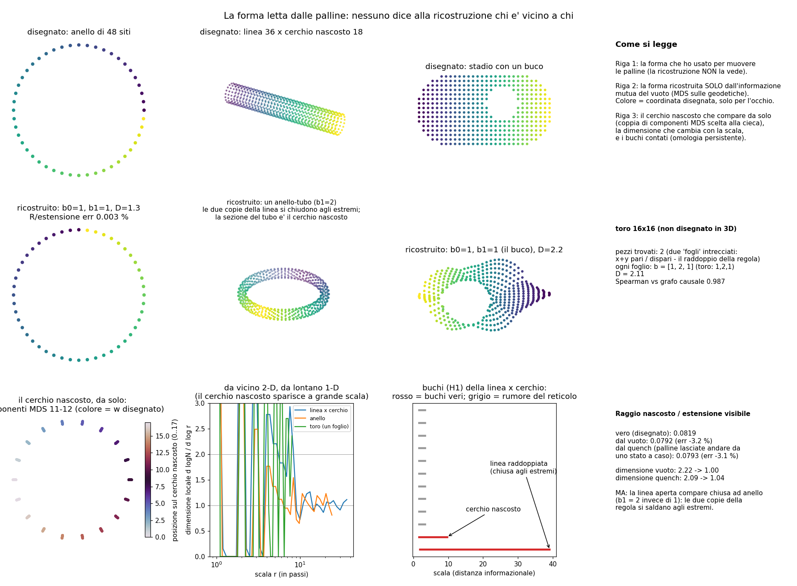
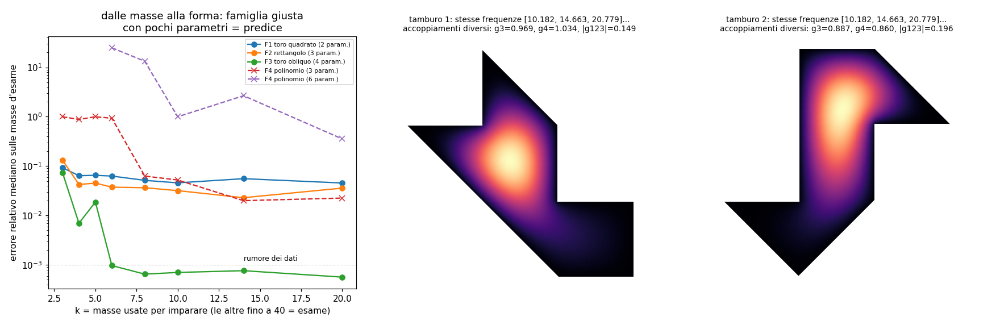

# La forma letta dalle palline

Laboratorio: `lab/geo_*.py` (Python 3.14 + numpy/scipy + `ripser` per l'omologia persistente).
Registri e numeri in `lab/out/geo_*.json` / `.log`, figure `lab/out/geo_forma.png` e `lab/out/geo_inverso.png`.
Pre-registrazione: `lab/geo_prereg.py` → `lab/out/geo_prereg.json`, **messa in git (commit b084721) prima
di tutti gli esami**.

## 1. L'idea (di Valerio)

> "Non usiamo la forma per muovere le palline. Muoviamo le palline per scoprire che forma dovrebbero
> seguire, poi usiamo quella forma per generare il nostro universo."

Quindi la geometria deve essere un **risultato**, non un ingrediente. Chi ci ha già pensato:
Van Raamsdonk (2010, lo spazio è "cucito" dall'entanglement), Cao, Carroll e Michalakis (2017, "lo spazio
dallo spazio di Hilbert": distanza = −log dell'informazione mutua).

## 2. Parte A: lo spazio letto dalle palline

**Come.** Disegno una forma (catena, anello, toro 16×16, linea 36 × cerchio nascosto 18, stadio con un
buco). La uso **solo** per far muovere le palline con la regola zig-zag di sempre (`zz_core.py`: trasla a c,
poi gira di θ = 0,5). Prendo il vuoto (il "mare di Dirac": tutti i modi a energia negativa pieni, conto esatto
con la matrice di correlazione) e calcolo l'**informazione mutua** I(i,j) fra ogni coppia di siti. Alla
ricostruzione do **solo** questa tabella: niente vicini, niente coordinate, niente dimensione.
Poi: distanza d = −log(I/I₀) → grafo dei vicini più stretti → distanze geodetiche → disegno (MDS), dimensione
(quanti punti stanno entro un raggio r, N ∝ r^D), buchi (omologia persistente: b0 = pezzi, b1 = buchi ad
anello, b2 = cavità), raggio del cerchio nascosto dal buco più piccolo (un cerchio lungo L "muore" a L/3).
Versione dinamica ("quench"): parto da uno stato a caso senza nessuna correlazione, lascio andare le
palline, e la distanza fra due siti è **il tick in cui la loro correlazione arriva** (I > 10⁻³).

**Risultati (vuoto)** — `geo_space_vac_*.json`

| forma disegnata | pezzi | b (b0,b1,b2) | dimensione | fedeltà (Spearman vs grafo della regola / vs forma disegnata) | raggio |
|---|---|---|---|---|---|
| catena 48 | 1 | 1,0 | 1,33 | 1,000 / 1,000 | – |
| anello 48 | 1 | 1,1 | 1,30 | 0,999 / 0,999 | errore 0,003 % |
| toro 16×16 | **2** | 1,2,1 per pezzo | 2,11 | 0,987 / 0,949 | – |
| linea 36 × cerchio 18 | 1 | 1,**2**,0 | **2,22 da vicino → 1,00 da lontano** | 1,000 / **0,586** | **−3,2 %** |
| stadio con buco | 1 | 1,1,1 | 2,16 | 0,997 / 0,961 | – |

**Il cerchio nascosto compare da solo**: nel disegno MDS della linea × cerchio c'è una coppia di componenti
(scelte alla cieca: la prima coppia di autovalori uguali che non è un'armonica di un anello già trovato) che
forma un cerchio perfetto, ordinato esattamente come il cerchio disegnato (correlazione 1,00). La dimensione
è 2 a corta distanza e 1 a grande distanza: proprio quello che fa una dimensione extra arrotolata. Il
rapporto raggio nascosto / lunghezza visibile esce 0,0792 contro 0,0819 vero.

**Versione dinamica (quench)** — `geo_space_quench_*.json`: anello 2 pezzi (anelli da 24), raggio errore
0,1 %; toro 4 pezzi, ognuno b = 1,2,1; linea × cerchio: 2 pezzi, b = 1,2, dimensione 2,09 → 1,04, raggio
**−3,1 %**. Fallimenti: catena (diventa un anello, fedeltà 0,58 < 0,9 pre-registrato); stadio b1 = 4 (né 1 né 2).

### Che cosa NON va (onestamente)

* **La regola raddoppia lo spazio.** In 2-D ogni componente si sposta di un sito per asse a ogni tick, quindi il
  vuoto correla solo siti con differenze x e y entrambe dispari: lo spazio della regola sono **due fogli
  intrecciati** (x+y pari / dispari). Sul toro escono 2 pezzi separati (nel quench 4). Ai bordi aperti lo
  specchio fa passare da un foglio all'altro, e i due fogli si **saldano**: la linea aperta appare come un
  anello lungo il doppio, per questo b1 = 2 invece di 1 nella linea × cerchio. Le palline vedono la forma
  della *regola*, non quella che ho disegnato. È il raddoppio dei fermioni (scacchiera di Feynman) in un altro
  vestito. Scoperto nella calibrazione e pre-registrato come seconda previsione; per lo stadio quella
  previsione (b1 = 2) è **sbagliata**: esce b1 = 1, cioè la forma disegnata. Non ho capito perché.
* Nello stadio il vuoto ha un **modo a energia esattamente zero** (gap 10⁻¹⁶): il "mare" non è unico, la scelta
  è numerica.
* La dimensione da vicino è 1,3 per catena e anello (si arrotonda a 1): lo stimatore è grezzo su reticoli piccoli;
  la curva della dimensione locale in figura è rumorosa.
* Debito: ho tolto l'alternanza dell'ordine degli assi (x,y / y,x) della regola: con l'alternanza le due bande
  si sovrappongono su due tick e "il vuoto" non è definito.
* Calibrazione: θ, mappa d, soglie sono state scelte su forme più piccole dello stesso tipo prima di
  pre-registrare. Gli esami usano forme più grandi, mai viste.
* Correzioni dopo il primo giro (dichiarate nei file): `geo_inverse` aveva un bug di enumerazione del reticolo
  (log del giro sbagliato conservato in `geo_inverse_run1_bug.log`); `geo_drums` trovava prima due copie
  congruenti dello stesso tamburo (`geo_drums_run1_congruent.log`), ho aggiunto la richiesta "non congruenti".

## 3. Parte B: dalle masse alla forma

### 3.1 Sintetico (`geo_inverse.py`)
Forma nascosta: toro piatto obliquo (lati 1 e 1,37, angolo 63°) + massa di base. "Masse" = torre di
Kaluza-Klein E = √(m₀² + k²), 40 livelli, rumore 10⁻³. Imparo dai primi k, predico gli altri.

* Famiglia giusta (4 parametri): con k ≥ 6 (cioè 4 numeri diversi, perché ±k sono doppi) predice tutti gli
  altri livelli con errore mediano **6–10·10⁻⁴** (= il rumore). Con k = 3–5 molte forme spiegano i dati e le
  previsioni si sparpagliano del 2–60 %. Pre-registrazione: **passata**.
* Famiglie sbagliate (toro quadrato 2 param., rettangolo 3): errore 2–6 % che non scende con più dati.
* Curva senza forma (polinomio): con tanti parametri quanti dati ricopia l'allenamento e sbaglia l'esame da 100 %
  a 10⁴ %. Più parametri che dati = nessuna previsione.

### 3.2 Forme diverse, stesse masse (`geo_drums.py`)
Due tamburi da 7 mezzi quadrati (costruzione di Sunada / Buser-Conway-Doyle-Semmler, tipo Gordon-Webb-Wolpert
1992; non garantisco che sia la coppia esatta del loro disegno), non congruenti. Elementi finiti: i primi
12 autovalori coincidono a **3·10⁻¹⁵**. Ma gli "accoppiamenti" fra modi (in Kaluza-Klein sono le costanti di
interazione fra particelle) sono diversi: ∫u₁⁴ = 1,034 contro 0,860 (13× l'errore di discretizzazione),
|∫u₁u₂u₃| = 0,149 contro 0,196 (38×), ∫u₁³ = 0,969 contro 0,887 (9,5×, appena sotto la soglia 10× scelta prima).
**Le masse da sole non bastano a fissare la forma; le interazioni rompono il pareggio.**

### 3.3 Dati veri, pilota (`geo_real.py`, pre-registrato)

| famiglia | parametri | allenata su | esame | risultato |
|---|---|---|---|---|
| 2-toro KK (carica × "generazione" n = 0,1,2) | 2 | e, μ | τ | 211 MeV contro 1776,86: **fallisce** (fattore 8,4); prevede anche 37 leptoni carichi sotto 2 GeV (ne esistono 3) |
| stesso, livelli liberi | 2 + scelte discrete | e, μ, τ | – | con livelli fino a 2·10⁵ ci sono 1464 scelte che "funzionano": è un **fit**, non una previsione |
| tre punti su un cerchio (Koide) | 2 per settore | e, μ | τ | 1776,97 MeV, +0,9σ: **passa** |
| stesso | 2 | u, c | t | 19,9 GeV contro 172,6: **fallisce** (−88 %) |
| stesso | 2 | d, s | b | 2,2 GeV contro 4,18: **fallisce** (−47 %) |

Attenzione: nel cerchio di Koide l'ampiezza √2 è stata scelta nel 1981 conoscendo già i leptoni: è un
parametro nascosto. Il successo sul τ è un indizio debole; i due fallimenti sui quark contano (con il debito
che le masse dei quark dipendono dallo schema). **Nessuna famiglia "di forma" costruita qui supera un esame
onesto sui dati veri.** Per un esame vero servirebbe una famiglia che preveda insieme masse **e**
accoppiamenti (angoli di mescolamento, costanti di Yukawa) con meno parametri dei numeri misurati: cioè le
sovrapposizioni dei modi sulla forma nascosta, come nei tamburi. Non l'ho costruita.

## 4. Conti: parametri contro previsioni

* Parte A: parametri a mano θ = 0,5 e 6 soglie/mappe fissate prima. Esami: 5 forme × 2 modi; passano raddrizzando
  la forma della **regola**; contro la forma **disegnata** falliscono b1 per linea × cerchio (vuoto e quench), catena
  quench, stadio quench, e il numero di pezzi su toro (e anello quench). Il raggio nascosto passa sempre (3 su 3, < 3,3 %).
* Parte B sintetica: 4 parametri, 6 livelli di allenamento, 34 previsioni a 10⁻³.
* Parte B reale: 1 previsione passata su 5 tentativi, con 1 parametro nascosto.

## 5. Debiti

1. Il raddoppio della regola (due fogli) va capito o curato: oggi lo spazio delle palline non è quello disegnato.
2. Ordine fisso degli assi invece dell'alternanza; modo zero nello stadio.
3. Soglie di significatività e mappa d = −log(I/I₀) sono scelte (pre-registrate, ma scelte).
4. "Usare la forma per generare il nostro universo" non è fatto: manca una forma con meno numeri di quelli che
   spiega, e manca il legame fra modi e accoppiamenti veri.

## 6. File
`lab/geo_core.py` (regola su una forma qualsiasi, vuoto, quench, ricostruzione cieca), `lab/geo_prereg.py`,
`lab/geo_space.py` (parte A), `lab/geo_inverse.py`, `lab/geo_drums.py`, `lab/geo_real.py` (parte B),
`lab/geo_figure.py`.
