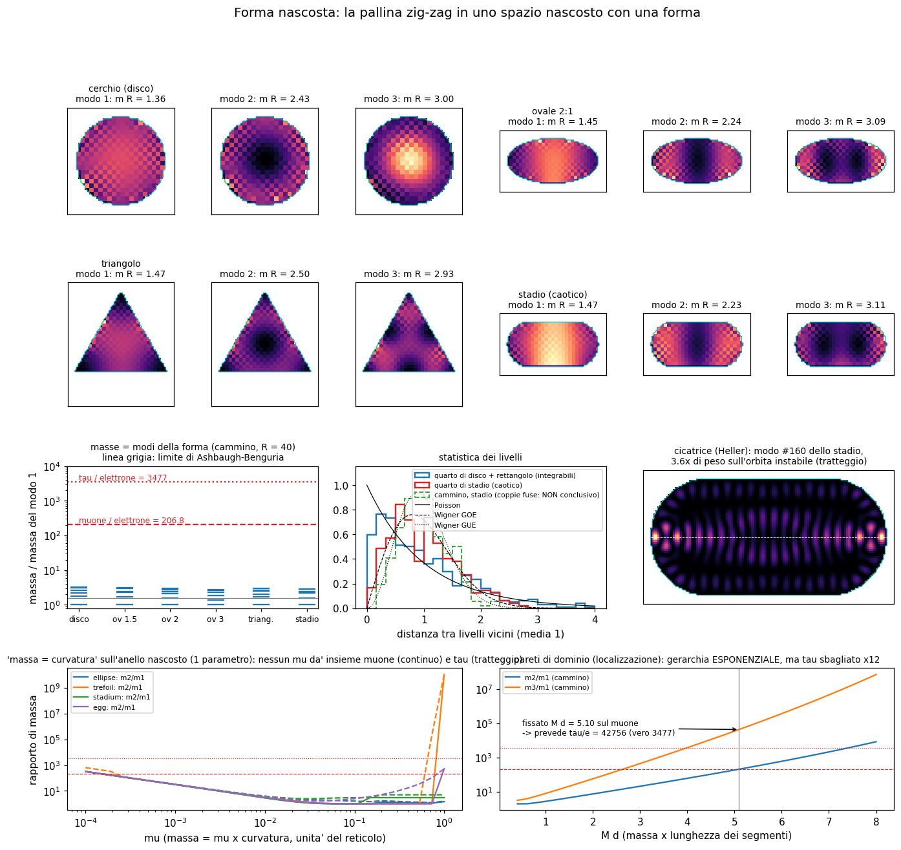

# Forma nascosta: e se la dimensione nascosta non fosse un cerchio?

Laboratorio: `lab/kk_shape_*.py` (Python 3.14 + numpy/scipy, 2 thread), costruito sulla regola zig-zag di
`lab/zz_core.py` e sul cerchio nascosto di `lab/kk_core.py` (`docs/CARICA_NASCOSTA.md`).
Registri `lab/out/kk_shape_*.log`, numeri `lab/out/kk_shape_*.json`, figura `lab/out/kk_shape.png`.
Pre-registrazione: `lab/kk_shape_prereg.py` → `lab/out/kk_shape_prereg.json` (scritta e salvata **prima** di
lanciare i test, ore 16:59). Seed 20261009. Unità del reticolo: passo = tick = 1, c = ħ = 1.

## 1. L'idea (di Valerio)

> Lo spazio nascosto non è un cerchio ma una **forma**: un triangolo, un ovale, un "ovale particolare".
> La pallina che ci gira dentro incontra curvature diverse in punti diversi. Guardata con velocità diverse,
> la stessa cosa sembrerebbe particelle di massa diversa (elettrone, muone, tau): la massa sarebbe decisa
> dalla curvatura, o dall'angolo, di un'orbita che matematicamente non è stabile (caotica).

## 2. Che cosa dice già la fisica (controllato)

* **Una curva chiusa da sola non ha forma.** Per chi ci vive dentro (una dimensione), un triangolo, un ovale e
  un cerchio della stessa lunghezza sono **identici**: in 1-D non esiste curvatura "intrinseca", conta solo la
  lunghezza. La forma si sente solo se (a) la curva è immersa in uno spazio più grande e questo lascia un
  segno (per esempio il potenziale geometrico di da Costa, 1981, −ħ²κ²/8m per una particella costretta su una
  curva), (b) mettiamo a mano qualcosa che dipende dal punto (una massa o un potenziale lungo la curva),
  oppure (c) lo spazio nascosto ha **due o più dimensioni** (una superficie, una "membrana di tamburo").
* **La carica viene dalla simmetria del cerchio** (Noether): ruotare il cerchio non cambia niente, quindi il
  numero di giri n si conserva. In `CARICA_NASCOSTA.md` un cerchio bitorzoluto perdeva la carica (deriva
  0,85-2,25). Quindi un triangolo o un ovale come **unico** spazio nascosto **rompe** la conservazione della
  carica. La toppa naturale: spazio nascosto = **cerchio (carica) × forma (masse)**. Le proviamo tutte e due.
* **Le masse sono le note del tamburo.** Una pallina ferma nello spazio vero ha energia = massa; se è chiusa
  nella forma nascosta, le energie permesse sono i **modi propri** della forma (come le note di un tamburo).
  "Si può sentire la forma di un tamburo?" (Kac, 1966): in generale **no** (Gordon-Webb-Wolpert 1992 hanno
  trovato tamburi diversi con le stesse note), ma lo spettro dipende davvero dalla forma.
* **Caos e righe nette convivono.** Nello stadio di Bunimovich l'orbita classica è instabile (caotica), ma i
  livelli quantistici sono **perfettamente netti**. Il caos si vede nella loro **statistica**: livelli che si
  "respingono" (Wigner-Dyson, matrici casuali; congettura di Bohigas-Giannoni-Schmit 1984) invece di cadere a
  caso (Poisson) come nelle forme regolari; e nelle **cicatrici** (Heller 1984): alcuni modi si addensano
  proprio sulle orbite periodiche instabili. Questo mette d'accordo "orbita instabile" con il fatto che la
  massa del muone è nettissima (105,6583755(23) MeV, 2·10⁻⁸) e costante.
* **Ma "la stessa particella vista in momenti diversi" non va bene per i leptoni carichi.** Il muone decade
  (vita media 2,2 μs) in elettrone + **due neutrini**, mai in elettrone e basta: μ → eγ ha probabilità
  < ~4·10⁻¹³ (MEG). Se elettrone e muone fossero la stessa cosa vista diversamente, uno si trasformerebbe
  nell'altro di continuo. **Quello che resta possibile è "modi stabili diversi della stessa forma"**: tre note
  diverse dello stesso tamburo, ognuna una particella a sé.
* **Le gerarchie.** Le note di un tamburo crescono lentamente (in 2-D la n-esima nota ~ √n): rapporti come
  206,77 e 3477 con le note più basse sono quasi impossibili. Teorema (Ashbaugh-Benguria 1991): per
  **qualunque** forma piana, λ₂/λ₁ ≤ (j₁,₁/j₀,₁)² = 2,539, cioè massa₂/massa₁ ≤ 1,593. Le gerarchie
  **esponenziali** nascono invece dalla **localizzazione** in dimensioni extra con forma o "deformate":
  fermioni separati (Arkani-Hamed & Schmaltz 2000), Randall-Sundrum (1999), pareti di dominio
  (Jackiw-Rebbi 1976). In teoria delle stringhe la forma delle dimensioni extra decide particelle e masse, e il
  **numero di generazioni viene dalla topologia** (Candelas-Horowitz-Strominger-Witten 1985: |χ|/2 della
  varietà di Calabi-Yau), non da una nota in più.

## 3. Che cosa abbiamo fatto (regole, niente di nuovo nella regola)

La regola zig-zag di sempre (vai a c lungo ogni asse, poi gira L↔R di un angolo θ = massa). La **forma**
la disegniamo con la regola stessa: dentro θ = 0, fuori θ = π/2 ("muro di massa": fuori la pallina è
infinitamente pesante e rimbalza; è il bordo MIT/Berry-Mondragon). Gli assi nascosti: 0 = cerchio della
carica (n intero), 1-2 = piano nascosto con la forma. Per le masse basta la pallina ferma nello spazio vero.
Forme (tutte con la stessa area): disco (controllo), ovali 1,5 / 2 / 3, triangolo equilatero, stadio a = r.
Per gli anelli 1-D: cerchio, ovale 2:1, "trifoglio" r = 1 + 0,2 cos 3φ, stadio, "uovo" (0,15, 0,10).

Tecnica onesta da sapere: il reticolo crea copie fantasma ("doppioni", come in ogni fermione su reticolo).
Tre copie le togliamo esattamente con una simmetria (sottoreticolo pari-pari). **Una quarta copia** (un cono
a k = (π/2, π/2), nato dall'ordine palindromo degli assi) **non** si toglie: il muro netto la mescola con
quella vera, così ogni livello esce come **coppia quasi degenere**. Usiamo la media della coppia; la
separazione cala con la dimensione (0,31 → 0,10 → 0,05 in unità 1/R per R = 10, 20, 40). È un debito.

## 4. Che cosa è emerso (numeri)

**Test 1 - le masse sono le note della forma** (`kk_shape_spectra.py`, 40 s)

| forma | m₁R | m₂R | m₃R | m₂/m₁ | m₃/m₁ | Koide Q |
|---|---|---|---|---|---|---|
| disco | 1,392 | 2,512 | 3,054 | 1,805 | 2,193 | 0,342 |
| ovale 1,5 | 1,420 | 2,402 | 3,286 | 1,692 | 2,315 | 0,343 |
| ovale 2 | 1,489 | 2,326 | 3,213 | 1,563 | 2,159 | 0,341 |
| ovale 3 | 1,635 | 2,285 | 2,996 | 1,397 | 1,832 | 0,338 |
| triangolo | 1,511 | 2,587 | 3,016 | 1,713 | 1,996 | 0,340 |
| stadio | 1,490 | 2,305 | 3,270 | 1,547 | 2,195 | 0,342 |

(cammino, R = 40, R_eff = √(siti/π); le "forme" dei modi sono nelle prime due righe della figura.)
* **Disco contro il continuo** (biliardo di Dirac a massa infinita, J_l(kR) = ±J_{l+1}(kR)): errore massimo
  17,6 % / 8,2 % / 4,7 % a R = 10 / 20 / 40, cioè scende come 1/R (è il bordo a scalini). Il criterio
  pre-registrato (< 5 % già a R = 20) **fallisce**. Estrapolando (a posteriori, 2·x(40) − x(20)) l'errore
  diventa 0,2-1,8 %: il cammino tende al continuo giusto.
* Altre forme: da R = 20 a R = 40 i livelli cambiano del 3,7-4,8 % (criterio < 3 %: **fallisce**, stessa
  causa).
* Laplaciano (5 punti, Dirichlet): disco −2,5 % e triangolo −3,4 % a R = 30, −1,2 % e −1,7 % a R = 60
  (criterio 3 %: il triangolo a R = 30 **fallisce** di poco; converge). λ₂/λ₁ del disco = 2,537: proprio il
  massimo del teorema di Ashbaugh-Benguria (2,539).
* **Cerchio × forma**: nel settore di carica n la massa diventa √(k₀² + m_forma²) entro 2-3 % (n = 1) e 3-7 %
  (n = 2) con un cerchio di 64 siti. Con un cerchio corto (k₀a = 0,26) compaiono livelli **sotto** k₀ e
  appoggiati al bordo: effetto del reticolo/muro, debito.

**Test 1 - la carica** (stesso script, 400 tick)

| spazio nascosto | deriva massima della carica |
|---|---|
| solo anello, cerchio (massa = curvatura, o da Costa) | 3·10⁻¹⁶ / 0 |
| solo anello, ovale / trifoglio / stadio, massa = curvatura | 1,96 / 2,67 / 2,37 |
| solo anello, ovale / trifoglio / stadio, potenziale da Costa | 1,98 / 0,096 / 1,95 |
| solo forma 2-D, J_z: disco / ovale / triangolo / stadio (muro netto) | 2,16 / 4,25 / 2,61 / 3,86 |
| solo forma 2-D, J_z, muro morbido (a posteriori) | 0,25 / 2,15 / 2,36 / 1,48 |
| **cerchio × forma** (disco, ovale, triangolo, stadio + potenziale casuale) | **0 esatto** |

La previsione regge: **una forma da sola perde la carica, il prodotto cerchio × forma la tiene esatta**.
Onestà: nel disco col muro netto anche J_z deriva (2,16; previsto < 0,1) perché il muro mescola la copia
fantasma; con un muro morbido (8 siti, deciso dopo) scende a 0,25, ancora sopra 0,1 (il disco su reticolo
quadrato ha solo simmetria a 90°).

**Test 2 - statistica dei livelli e cicatrice** (`kk_shape_stats.py`, in 4 parti da < 5 min)
* Laplaciano, forme dimezzate due volte (~285 livelli): ⟨r̃⟩ = 0,420 quarto di disco, 0,392 rettangolo aureo
  (Poisson 0,386) contro **0,505 quarto di stadio** (GOE 0,531). **Passa**: lo stadio caotico ha livelli che
  si respingono, le forme regolari no (istogrammi in figura).
* Il cammino zig-zag sullo stadio: **non conclusivo**. Le coppie fantasma rovinano la statistica grezza
  (0,514 muro netto, 0,275 muro morbido); fondendo le coppie si ottiene 0,634 (stadio) ma anche 0,599 (quarto
  di disco), e il controllo mostra che fondere a coppie una sequenza di Poisson dà già 0,587. Quindi il numero
  del cammino non distingue caos e regolarità finché c'è il doppione. (Il valore atteso nel continuo sarebbe
  GUE 0,600: il muro di massa rompe l'inversione del tempo, Berry-Mondragon 1987.)
* **Cicatrice**: tra i 400 modi più bassi dello stadio, il modo #160 ha **3,6 volte** il peso uniforme nel
  tubo attorno all'orbita orizzontale **instabile** (misurato nelle due calotte, così i modi "rimbalzo" del
  rettangolo non contano); mediana 0,73; 7 modi sopra 3×. **Passa** (riquadro in figura).

**Test 3 - l'esame dei leptoni** (`kk_shape_leptons.py`, 3,5 min). Bersagli: 206,768, 3477,2, Q = 0,666661.

| famiglia | parametri | che cosa si fissa | previsione | risultato |
|---|---|---|---|---|
| E0: note della forma 2-D (6 forme) | 0 | niente | m₂/m₁ = 1,40-1,81, Q = 0,338-0,343 | **fallisce** (×100) |
| E0: ovale, rapporto 1…8 | 1 | — | m₂/m₁ ≤ 1,79, m₃/m₁ ≤ 2,29 | **fallisce** |
| E0 nel settore carico n ≠ 0 | +1 (R del cerchio) | — | i rapporti si schiacciano verso 1 (1,58; 1,32; 1,08) | peggio |
| E1: massa = μ·curvatura sull'anello | 1 (μ) | μ su m₂/m₁ | ovale/stadio/uovo: m₃/m₁ ≈ 207; trifoglio 414 (Q 0,47-0,49) | **fallisce** |
| E1, seconda soluzione (trifoglio, uovo: curvatura negativa → massa che cambia segno) | 1 | μ su m₂/m₁ | m₃/m₁ = 239 412 / 461 (Q 0,99 / 0,84) | **fallisce** |
| E1±: massa = μ(κ/⟨κ⟩ − 1) | 1 | — | modi quasi a massa zero (10⁻⁵-10⁻⁶): indice topologico (∫θ = 0) | non un esame: m₁ ≈ 0 |
| E2: pareti di dominio, segmenti d : 2d : 3d | 1 (M·d) | M·d su m₂/m₁ (M d = 5,10) | m₃/m₁ = **42 756**, Q = 0,8705 | **fallisce ×12** |
| E2, invece fissando Q = 2/3 | 1 | M d = 3,08 | m₂/m₁ = 22,9, m₃/m₁ = 526 | **fallisce** |
| E2 con lunghezze libere | 2 | entrambi i rapporti | nessuna (Q segue dai due rapporti) | fit, non previsione |

Che cosa si impara:
* Le **note di una forma** non fanno gerarchie: per il Laplaciano è un teorema (m₂/m₁ ≤ 1,593 per ogni
  forma piana), per il cammino di Dirac il massimo misurato è 1,81. E Q ≈ 0,34 è quasi il minimo possibile
  (1/3, masse uguali), lontanissimo da 2/3.
* "Massa = curvatura" con un parametro arriva a 206,77 solo nel modo banale (μ piccolissimo: l'elettrone è
  il giro "fermo" con massa ≈ μ, il muone il primo giro con massa 2π/L), e allora il tau esce uguale al muone
  o al doppio. Con curvatura che cambia segno compaiono masse quasi nulle, ma in quel regime (μ ≈ 1 per sito)
  il reticolo è lontano dal continuo.
* La **localizzazione** (pareti di dominio, la versione su reticolo di Randall-Sundrum / fermioni separati)
  dà davvero una gerarchia **esponenziale**: ln(m₂/m₁) cresce con M·d con pendenza 1,10 (ideale 1). È il
  meccanismo giusto per numeri come 206 e 3477. Ma con la forma "più semplice" (lunghezze equispaziate) la
  previsione è geometrica, m₃/m₁ = (m₂/m₁)² = 42 753: i leptoni veri hanno ln(m₃/m₁)/ln(m₂/m₁) = 1,529, non 2.
  Per farli tornare servono **due** lunghezze libere: due parametri per due rapporti, **zero previsioni**. E Koide
  allora non è una prova in più: Q è una funzione dei due rapporti già fissati.

## 5. Che cosa NON funziona (onestamente)

* **L'idea "stessa particella, velocità o momenti diversi" è esclusa dai dati** (μ → eγ < ~4·10⁻¹³, il muone
  decade con due neutrini). Resta "note diverse della stessa forma": possibile, ma non con le note basse di
  una forma, che sono troppo vicine (×1,4-1,8 invece di ×207).
* **Il caos non serve alle masse.** Rende la *statistica* dei livelli diversa (lo vediamo) e lascia le righe
  nettissime (lo vediamo: ogni livello è un autovalore esatto), ma non crea gerarchie.
* **Nessuna versione con 0-1 parametri passa l'esame.** La migliore onesta è la localizzazione (E2): giusta
  come *tipo* di numero (esponenziale), sbagliata di un fattore 12 sul tau con un parametro.
* **Mancati criteri pre-registrati** (lasciati come sono): accordo col continuo a R = 20 (8 % invece di 5 %),
  convergenza 20→40 (4-5 % invece di 3 %), Laplaciano triangolo a R = 30 (3,4 % invece di 3 %), deriva di J_z
  nel disco (2,16 invece di < 0,1), statistica del cammino (non conclusiva per il doppione).

## 6. Debiti (cose messe a mano)

1. Il **muro** θ = π/2 fuori dalla forma e la **forma stessa** li disegno io: la forma non ha una sua dinamica.
2. Il **doppione** a (π/2, π/2) del cammino a due tick palindromi: ogni livello in coppia. Il muro morbido
   (8 siti) è stato aggiunto **dopo** aver visto il problema.
3. "Massa = curvatura" (θ ∝ κ), il potenziale di **da Costa** (dalla meccanica non relativistica, non derivato
   per la regola) e la sottrazione della media in E1± sono ipotesi messe a mano.
4. Le lunghezze 1 : 2 : 3 e gli intervalli (50 siti) in E2 sono scelti da me (scelti prima, ma scelti).
5. Solo particelle **ferme**: 3 assi reali + 3 nascosti richiederebbero spinori più grandi (algebra di Clifford
   più grande); qui gli assi nascosti usano tutte e tre le matrici di Pauli.
6. Nel settore carico con k₀a grande (0,26) il reticolo produce livelli sotto k₀.

## 7. Conti: parametri contro previsioni

Con 0 parametri (forme fisse): 6 forme × 3 numeri (m₂/m₁, m₃/m₁, Q) = 18 previsioni, **tutte sbagliate**.
Con 1 parametro: 4 forme (E1) + 1 famiglia (E2) danno 1 previsione vera ciascuna (m₃/m₁, più Q che è una sua
funzione): **tutte sbagliate** (207-414 o 42 756 invece di 3477). Con 2 parametri: fit perfetto, 0 previsioni.
Conclusione: **la forma nascosta spiega bene perché le masse sono nette e costanti anche se l'orbita è
caotica, e la localizzazione spiega perché le gerarchie possono essere esponenziali; ma nessuna forma
semplice prevede 206,77 e 3477.**

## 8. Il prossimo passo

Una forma che non scelgo io: la forma (o le lunghezze dove la pallina si localizza) dovrebbe uscire da una
regola dinamica, come in teoria delle stringhe dove una "forma" stabile dello spazio nascosto fissa tutto.
E il "tre" delle generazioni andrebbe cercato nella **topologia** (quanti buchi, quanti modi a massa zero:
E1± ne mostra già due protetti dall'indice), non nella terza nota.

## 9. File

`lab/kk_shape_core.py` (regola sul piano/anello nascosto, operatori, forme, riferimenti continui),
`lab/kk_shape_prereg.py` (pre-registrazione), `lab/kk_shape_spectra.py` (test 1, 40 s),
`lab/kk_shape_stats.py` (test 2: parti `lap` 70 s, `scar` 15 s, `walk0` 125 s, `walk8` 135 s, `walkdisk`
190 s), `lab/kk_shape_leptons.py` (test 3, 215 s), `lab/kk_shape_figure.py` → `lab/out/kk_shape.png`.
