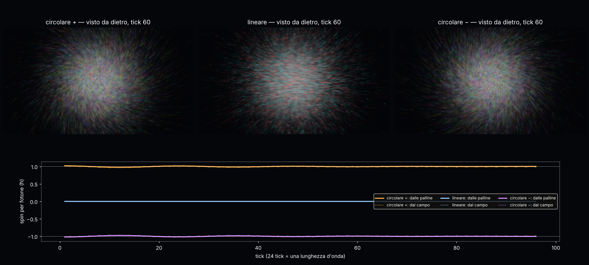

# Fotone a palline: via la spirale disegnata, lo spin si legge dal giro delle palline

Studio del 12–13/10/2026. Codice: `lab/fp_core.py` (regola + palline), `lab/fp_run.py` (corsa a pezzi),
`lab/fp_render.py` (disegno), `lab/fp_summary.py` (giudizio), `lab/fp_figure.py` (figura).
Pre-registrazione: `lab/out/fp_prereg.json` (commit c3b723d, prima di ogni corsa) + emendamento dichiarato
`lab/out/fp_amend.json`. Risultati: `lab/out/fp_summary.json`, `lab/out/fp_run_*.json`, figura `lab/out/fp_figure.png`.
Il quadro generale (quali particelle del Modello Standard si possono fare a palline) è in `MODELLO_STANDARD_PALLINE.md`.

---

## 1. Il problema

Nel Laboratorio Atomo il fotone circolare si vedeva come una **molla** (la punta di E lungo l'asse, tirata come
tubo liscio in `src/atomo/fotdisegno.rs`). A Valerio sembrava finta: aveva ragione. Era geometria aggiunta (un
tubo calcolato da pochi punti dell'asse), contro la regola "niente linee, solo palline".

## 2. L'idea, detta semplice

* Il campo vero lo calcola **la regola zig-zag della luce**, tick dopo tick (nessuna equazione di Maxwell nel moto).
* Le palline che si vedono sono **pezzetti dell'energia del campo**. Si mettono **una volta sola** all'inizio, più
  fitte dove l'energia è più densa. Poi ognuna viaggia con la velocità dell'energia nel suo punto,
  v = 2 E × cB / (E² + c²B²) (mai più di c).
* Siccome l'energia della luce si conserva (si sposta, non sparisce), la nuvola **resta fedele al campo da sola**:
  non serve ricrearla. È il primo esame (F1).
* Ogni pallina è **allungata lungo E** nel suo punto e **colorata dalla direzione di E** attorno all'asse; è più
  luminosa dove l'energia è densa. Le palline lasciano una piccola **scia fatta delle stesse palline** ai tick prima.

**Che cosa succede alla spirale.** Non serve disegnarla. Nella luce circolare la direzione di E gira una volta per
λ: guardando di lato si vedono bande di colore che scorrono (tutto l'arcobaleno in una λ). E, soprattutto, le
palline sul **bordo** del fascio **girano davvero attorno all'asse** mentre volano: guardato da dietro, il fotone
circolare è un **vortice** (orario o antiorario secondo lo spin), quello lineare è solo una pioggia dritta.
Quel giro è lo **spin del fotone**: una corrente di energia che c'è solo dove l'intensità cambia (al bordo).
È fisica nota (Allen et al. 1992; Berry 2009, "correnti ottiche"): qui è una **validazione**, non una scoperta.

## 3. Come è fatto (numeri)

* Regola: `zz_core.Walk('light')`, scritta in spazio di Fourier (un asse = la matrice exp(−i a k_j S_j)). Su
  scatola periodica è identica al reticolo: **gate G0 PASS**, differenza massima 6·10⁻¹⁶ dopo 4 tick su 32³.
* Impulso gaussiano costruito onda per onda (E ⊥ q, cB = q̂ × E), 24 celle per λ, w0 = 1,5 λ, lunghezza σ = 1 λ,
  scatola 192³ (8 λ per lato), 96 tick di volo (4 λ), 300 000 palline, tre polarizzazioni.
* Costo (CPU a 4 core, Python): ~4,5 s per tick di regola + ~1,7 s per spostare le palline. Un fotogramma
  1920×1080 disegnato in ~10 s. La GPU è un altro mondo (§7).

## 4. Esami (pre-registrati) e risultati

| esame | soglia | circolare + | circolare − | lineare | esito |
|---|---|---|---|---|---|
| G0 regola in k = reticolo | ≤ 1e-10 | 6·10⁻¹⁶ | | | **PASS** |
| F1 palline fedeli al campo dopo 96 tick, senza ricrearle | corr ≥ 0,95; TV ≤ TV(0)+0,05 | 0,9985; 0,022 (TV(0) 0,015) | 0,9984; 0,023 | 0,9980; 0,025 | **PASS** |
| F2 spin dal giro delle palline, in ħ per fotone | ±1 entro 5 %; lineare ≤ 0,05 | **+0,9989** | **−0,9992** | −1·10⁻⁵ | **PASS** |
| F3 velocità media delle palline contro baricentro dell'energia | entro 1 % | +0,037 % | +0,037 % | +0,027 % | **PASS** |
| F4 niente geometria disegnata | lettura del codice | solo macchie gaussiane da palline | | | **PASS** |

Il valore atteso esatto dello spin, per lo spettro di questo impulso, è ±1,0012 (k₀⟨1/k⟩): le palline danno
−0,2 % (circolare +) e −0,2 % (circolare −).

**Cose da dire chiare (non nascoste dietro ai PASS):**

* **Emendamento 1** (dichiarato prima di giudicare le palline): con la scatola pre-registrata (6 λ di lato,
  w0 = 2 λ) lo spin **letto dal campo stesso** era 0,894 al tick 0. Causa: lo spin vive al bordo del fascio e le
  copie periodiche della scatola lo cancellano in parte. Prova a parte: 6 λ / 2 λ → 0,894; 12 λ / 2 λ → 1,0063;
  8 λ / 1,5 λ → 1,0012. Cambiati solo scatola e w0, esami e soglie uguali; la corsa parziale è stata buttata.
* **Lo spin tick per tick oscilla.** Dal campo: tra 0,957 e 1,035 (pari/dispari si alternano, più un'onda lenta
  con periodo di circa una λ). Dalle palline: tra 0,976 e 1,020 (si muovono su un tick intero e fanno la media).
  La media su 96 tick è quella dell'esame. Causa probabile (non verificata): il reticolo cubico legge E e B nello
  stesso punto dopo i tre spostamenti uno per asse, e il giro di E rispetto agli assi del cubo si vede.
* La nuvola si allontana pochissimo dal campo (TV da 0,015 a 0,022–0,025 in 96 tick): è l'errore del passo
  (Heun su un tick) e dell'interpolazione lineare. Su corse lunghe va controllato.

## 5. Manopole

* **Fisica: 0.** λ è la scala (la regola senza massa non ha una lunghezza sua); w0, σ, scatola sono la scelta
  dell'impulso e del reticolo, non parametri di fisica.
* **Solo estetica (9):** grandezza della pallina, allungamento massimo, bagliore, scia (pesi), saturazione,
  quante palline nitide (25 000, le altre fanno bagliore), profondità della trasparenza, palette, vista tagliata.
  Non toccano nessun esame.

## 6. Debiti

1. Le palline sono una **lettura** del campo (traccianti del flusso di energia), non le palline della regola:
   è un'interpretazione, come i surfisti (CONTESTO_CLOUD, lezione 4). Va detto sempre sullo schermo.
2. Fotone **classico**: un'onda normalizzata, non il clic di un fotone solo (luce quantizzata: debito aperto).
3. Oscillazione tick per tick dello spin (±3,5 % dal campo, ±2 % dalle palline): causa da verificare.
4. Disegno su CPU in Python; il porto nel Laboratorio Atomo (WGSL, GPU) va fatto (§7).
5. Visto da tre quarti senza taglio il fotone diventa una nebbia (tutte le direzioni di E si sommano lungo lo
   sguardo): servono la vista tagliata o quella da dietro. Su GPU con l'ordinamento per profondità migliora.

## 7. Come va sulla GPU (piano)

* Regola: 3 passate per tick (una per asse), ognuna uno shader che legge una texture 3-D e scrive l'altra.
  Lungo l'asse la regola è esatta, nessun FFT serve: il roll del reticolo è proprio uno spostamento di una cella.
* Palline: buffer di posizioni; uno shader di calcolo campiona E e B (interpolazione trilineare in hardware) e fa
  il passo di Heun. Ogni pallina è disegnata come un quadratino con macchia gaussiana allungata lungo E;
  trasparenza pesata per profondità (McGuire–Bavoil 2013), bagliore a due scale.
* Stime: 192³ × 3 complessi in f32 = 170 MB per copia (×2); 1 milione di palline = 40 MB.
  Il portatile ha solo la Intel UHD (la GTX 1650 Ti è rotta): lì qualità bassa (96³–128³, 200 000 palline) o
  fotogrammi singoli. Su una scheda da 16 GB: 384³ (32 celle per λ con 12 λ di scatola) e 4 milioni di palline.
* Controllo dal portatile via ponte (`foto`), confrontando l'immagine GPU con quella di `fp_render.py`.
