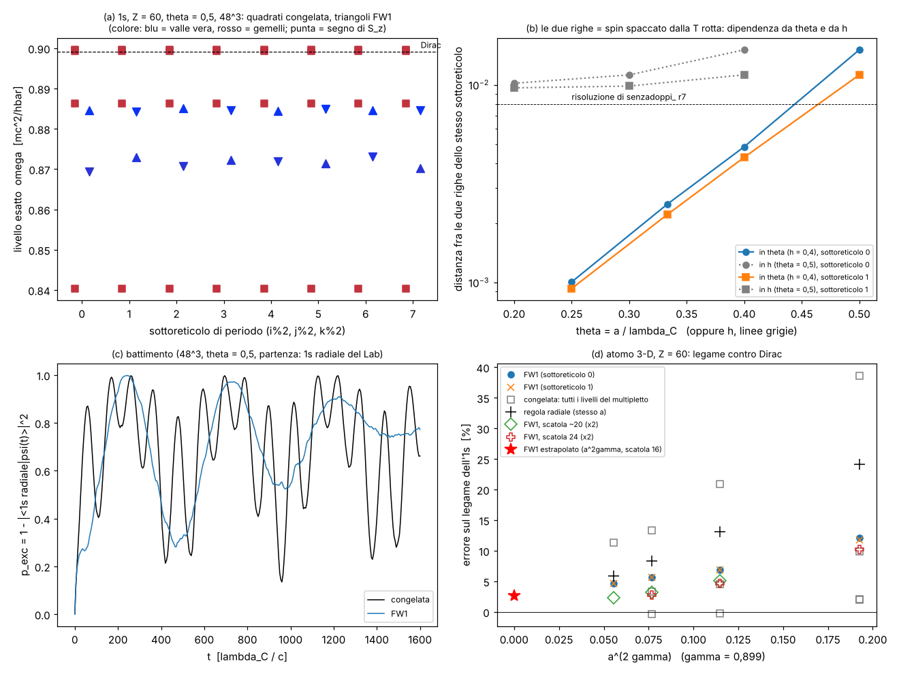

# FW1 come variante in prova: le due righe dell'1s, il battimento, l'atomo 3-D

Studio `fw1atomo_`. **FW1 è una VARIANTE IN PROVA accanto alla regola congelata, che resta il riferimento.**
Nessun file di altri studi toccato (né `zz_core.py`, né `senzadoppi_*`, né i file Rust del Laboratorio).

FW1 = la regola congelata **più un solo pezzo**: attorno alla moneta dei soli tick pari, per i 6 collegamenti ±2e_j,
la parte L in x e la parte R in x + v ruotano un pochino l'una nell'altra (Wilson "ritorto", asse Y di chiralità,
h = 0,4) — da `docs/SENZA_DOPPIONI.md` (§5.3). Lì FW1 toglieva i gemelli (≥ 0,37/a) ma a θ = 0,5 l'1s di Z = 60 aveva
ancora **due righe**, causa sconosciuta (debito D-SD7). Qui: (1) la causa, (2) il battimento del Laboratorio rifatto
con FW1, (3) l'atomo 3-D di ZIGZAG A1 rifatto con FW1.

File: strumenti `lab/fw1atomo_core.py` (regole F0 e FW1 copiate da `senzadoppi_real.py`, uguali bit per bit:
`lab/fw1atomo_check.py`; Ritz; diagnosi), pre-registrazione `lab/fw1atomo_prereg.py` → `lab/out/fw1atomo_prereg.json`
(**commit 98628ca, prima delle corse**), emendamenti `lab/out/fw1atomo_emendamenti.json` (A1–A4, **commit 1310ed0**,
prima delle corse che cambiano), corse `lab/fw1atomo_p1.py`, `_p2.py`, `_p3.py` → `lab/out/fw1atomo_p1.json`,
`_p2.json`, `_p3.json`; esplorazioni dopo la pre-registrazione `lab/fw1atomo_x1.py`, `lab/fw1atomo_x2.py` → `lab/out/fw1atomo_x1.json`, `_x2.json`;
figura `lab/fw1atomo_figura.py` → `lab/out/fw1atomo_figura.png`.

*(a) Livelli esatti vicino all'1s (Z = 60, θ = 0,5, 48³) per ognuno degli 8 sottoreticoli di periodo: quadrati la
congelata (4 livelli uguali in tutti, ognuno 25 % valle vera e 75 % gemelli: colore rosso-viola), triangoli FW1 (due
livelli per sottoreticolo, blu = valle vera; la punta dice il segno dello spin lungo z). (b) Distanza fra le due righe
dentro un sottoreticolo, contro θ (h = 0,4) e contro h (θ = 0,5). (c) p_exc del test del battimento: congelata e FW1.
(d) Atomo 3-D: errore sul legame dell'1s contro a^{2γ}.*

---

## 0. In breve (per Valerio)

1. **Le due righe a θ = 0,5: causa trovata.** Sono **lo stesso 1s con lo spin nei due versi**. FW1 rompe
   l'inversione del tempo (prezzo noto del Wilson ritorto), quindi il teorema di Kramers non tiene più: dentro **ogni**
   sottoreticolo l'1s si apre in due livelli con spin opposti, a 0,870–0,873 e 0,884–0,885 (distanza 0,011–0,015 mc²).
   Il verso basso si mescola per il 12–17 % coi gemelli (che a θ = 0,5 pesano solo 1,18 volte l'elettrone) ed è più
   stretto (⟨r⟩ 2,2 contro 2,7 λ_C). Non sono i sottoreticoli (era la mia previsione: **sbagliata**), non è un'eco
   Floquet, non è un artefatto. La distanza cala come θ^{~3,3}: 0,0049 a θ = 0,4, 0,0025 a 1/3, **0,0010 a 0,25** (per
   questo senzadoppi_ r7 vedeva una riga sola).
2. **Battimento (48³, θ = 0,5).** La congelata ridà alla lettera il Laboratorio: **0,84037 / 0,88627 / 0,89930 /
   0,89960** (validazione PASS). FW1 dà **due righe** (0,870–0,873 e 0,8845–0,8850) come previsto: il battimento c'è
   ancora (ampiezza 0,69) ma **si spegne** in ~1500 λ_C/c (0,04 alla fine) perché le 8 coppie hanno spaccature un po'
   diverse. Partito dal suo livello esatto FW1 sta fermo (8·10⁻¹⁵).
3. **Atomo 3-D (Z = 60).** FW1, **senza proiettore e senza partire da k = 0** (spinori a caso attorno al nucleo), trova
   **un solo 1s** (coppia di spin, ≥ 99,5 % nella valle vera) a a ≤ 0,3; la congelata dalla stessa partenza trova 3–4
   livelli larghi fino a 0,037 mc², ognuno al 25 % nella valle vera. Legame: +12,1 / +6,9 / +5,65 / +4,69 % a a = 0,4 /
   0,3 / 0,24 / 0,2 (scatola 16); estrapolato **+2,7 %** (A1 a 1 %: FAIL; a 3 %: PASS). Ma la scatola pesa: con scatola
   24 l'estrapolazione dà −2,5 % (−1,1 % con i due punti più fini), con scatola 20 e a = 0,3–0,2 dà −0,35 %: l'errore vero sta fra ~−2,5 % e +2,7 %, non dimostrato entro 1 %. Il −11,6 % di ZIGZAG A1 era soprattutto il
   protocollo di ascolto: con i livelli esatti la media del multipletto della congelata è quasi uguale a FW1.
4. **Costo:** FW1 costa **2,1–2,4×** la congelata per periodo (numpy, 1 core).
5. **In una riga:** FW1 fa quello che promette (un 1s solo, niente toppe) **a θ ≤ 1/3**; a θ = 0,5 (il passo del
   Laboratorio) resta una coppia di spin aperta di 0,013 mc² che batte, e non la si cura con h né spostando il nucleo.
   Per il Laboratorio con FW1 serve un reticolo più fine (a ≤ 0,33 λ_C), che va nel verso della regola HD del progetto.

Tabellone: **P1** causa trovata ((a), (b), (e) confermate; (c), (d) scartate); **V0, V1, V2, F3, A1b, A3 PASS**;
**F1, F2** FAIL come previsto; **A1, A1c FAIL**.

---

## 1. Che cosa si sapeva (letteratura e studi nostri)

Non ho potuto cercare in rete in questa corsa; cito dalla mia conoscenza (autori/anno/rivista **non verificati online**).

- **Kramers (1930).** Se una regola rispetta l'inversione del tempo, ogni livello di un elettrone è doppio (spin su /
  spin giù con la stessa energia), qualunque sia la forma del potenziale. Un termine che rompe T può spaccare la coppia.
  FW1 rompe T: SENZA_DOPPIONI E5 lo aveva misurato (coppie spaccate di 5·10⁻² con un potenziale a caso a θ = 0,37).
- **Wilson ritorto / twisted mass (Frezzotti, Grassi, Sint, Weisz, JHEP 2001; Frezzotti–Rossi, JHEP 2004).** Il termine
  di Wilson ruotato rispetto alla massa toglie i doppioni ma rompe parità (e, nei modelli a un sapore come il nostro,
  T) a passo finito; gli effetti vanno a zero col passo. È la strada seguita da FW1.
- **Stati spuri nei calcoli relativistici degli atomi.** Chi risolve Dirac su una griglia o in una base finita trova
  livelli in più vicino all'1s (Drake–Goldman 1981; "kinetic balance" Stanton–Havriliak 1984; Shabaev et al., PRL 2004,
  "dual kinetic balance"; su griglie a differenze finite il raddoppio è quello di Drell–Weinstein–Yankielowicz 1976 e la
  cura classica è la griglia sfalsata o un termine alla Wilson). Le nostre "righe in più" sono parenti di questi.
- **La cuspide del nucleo.** Vicino a un nucleo puntiforme l'1s di Dirac va come r^{γ−1} (γ = √(1 − (Zα)²) = 0,899 a
  Z = 60): l'errore di un reticolo va come a^{2γ} = a^{1,8}, non a² (ZIGZAG §5.6).
- **Studi nostri.** BATTIMENTO_1S: con la congelata l'1s è un multipletto di 4 livelli (0,8404 / 0,8863 / 0,8993 /
  0,8996), ognuno 25 % su ognuna delle 4 valli; SOTTORETICOLO: 4 colori che non si parlano; ZIGZAG A1: regola cubica a
  Z = 60, −11,6 % dopo l'estrapolazione (FALLITO). SENZA_DOPPIONI: FW1, una riga al 97 % nella valle vera a θ = 0,25,
  due righe a θ = 0,5.

**Cosa è nuovo qui:** la causa delle due righe (una coppia di Kramers spaccata dentro ogni sottoreticolo), come va con
θ, h e la posizione del nucleo; il battimento e l'atomo 3-D con FW1. Niente di questo è "fisica nuova": è il prezzo
(o il guadagno) di una regola di reticolo, misurato.

---

## 2. Le due righe a θ = 0,5 (P1)

Configurazione (pre-registrata): Z = 60, a = 0,5 λ_C (θ = 0,5, il passo del Laboratorio), 40³ celle (scatola 20 λ_C),
nucleo puntiforme sull'angolo di 8 celle, partenza = 1s di Dirac del continuo (stato di prova). Ritz (diagonalizzazione
del filtro, come `src/atomo/zz.rs::ritz`) su [0,80; 0,97], 1600 periodi. Per ogni livello esatto (residuo < 10⁻⁸) si
guarda: energia, valle (in k: valle vera Γ, gemelli N a (π/2, π/2, 0), valli π), sottoreticolo, spin, ⟨r⟩, peso entro
1 λ_C dal nucleo.

**Primo fatto (P1a): con FW1 ogni livello vive su UN solo sottoreticolo di periodo.** La regola si ripete ogni due tick
e in due tick ogni pallina torna sulla stessa classe di celle (i, j, k pari/dispari): 8 sottoreticoli che non si
parlano mai (i 4 "colori" di SOTTORETICOLO, ognuno diviso in due). Con la congelata gli 8 hanno gli **stessi** livelli
(entro 10⁻⁵); con FW1 no: si separano di qualche 10⁻³. Per questo la Ritz su tutto il cubo da una partenza sola non
trova i livelli di FW1 (16 livelli in 4·10⁻³) e si fa sottoreticolo per sottoreticolo (emendamenti A1, A4: è esatto,
perché la regola di due tick è a blocchi).

**Secondo fatto (P1b): dentro ogni sottoreticolo ci sono TUTTE E DUE le righe, con spin OPPOSTI.**

| sottoreticolo | riga bassa | riga alta | distanza | spin (bassa → alta) |
|---|---|---|---|---|
| 0 | 0,86936 | 0,88440 | 0,0150 | (−0,49, −0,23, −0,66) → (+0,48, +0,24, +0,72) |
| 1 | 0,87290 | 0,88414 | 0,0112 | (−0,58, −0,32, +0,54) → (+0,58, +0,34, −0,58) |
| 2 | 0,87069 | 0,88482 | 0,0141 | opposti |
| 3 | 0,87214 | 0,88433 | 0,0122 | opposti |
| 4 | 0,87190 | 0,88426 | 0,0124 | opposti |
| 5 | 0,87125 | 0,88470 | 0,0135 | opposti |
| 6 | 0,87302 | 0,88434 | 0,0113 | opposti |
| 7 | 0,87011 | 0,88436 | 0,0143 | opposti |
| congelata (tutti e 8 uguali) | 0,84034 · 0,88606 · 0,89888 · 0,89918 | | | coppie di Kramers |

| | riga bassa (8 sottoreticoli) | riga alta |
|---|---|---|
| peso nella valle vera Γ | 0,83 – 0,88 | 0,957 – 0,964 |
| peso nei gemelli N + π | **0,12 – 0,17** | 0,04 |
| ⟨r⟩ (λ_C) | 2,09 – 2,25 | 2,70 – 2,74 |
| peso entro r < 1 λ_C | 0,26 – 0,31 | 0,14 |

(Dirac del continuo, solo esame: ω = 0,8991, ⟨r⟩ = 3,20.) Lo spin di ogni livello punta lungo una direzione
inclinata (circa (±0,5, ±0,3, ±0,7)), diversa da sottoreticolo a sottoreticolo: per questo, partendo con spin su,
**tutte e due** le righe sembrano "spin su" (⟨σ_z⟩ 0,54 e 0,49 in senzadoppi_ x2): da ogni sottoreticolo si prende la
riga il cui spin ha la componente z positiva, e in 4 sottoreticoli è quella alta, negli altri 4 quella bassa.

**La causa, con le regole di decisione scritte prima:**

| ipotesi | regola (pre-registrata) | misura | esito |
|---|---|---|---|
| (d) artefatto | meno di due livelli esatti distinti | 2 livelli per sottoreticolo, residui ~10⁻⁹ | **scartata** |
| (c) sottoreticoli | ogni sottoreticolo su UNA riga | ogni sottoreticolo ha tutte e due le righe | **scartata** (era la mia previsione: sbagliata) |
| (e) spin con T rotta | due righe nello stesso sottoreticolo, non degeneri, spin opposti (cos < −0,5) | cos ≈ −1,0 in 8/8 | **confermata** |
| (a) livello di reticolo più stretto | ⟨r⟩_B < 0,85 ⟨r⟩_A o peso(r<1) ×1,5 | 2,17 / 2,72 = 0,80; ×2,0 | **confermata** |
| (b) mescolato coi gemelli | peso N + π della riga bassa > 5 % | 12 – 17 % | **confermata** |

**Che cosa vuol dire, come a un ventenne.** Le due righe sono **lo stesso 1s con lo spin in due versi**. Nella regola
congelata i due versi hanno la stessa energia (teorema di Kramers: la regola rispetta l'inversione del tempo). FW1 la
rompe (è il prezzo del Wilson ritorto, già dichiarato in SENZA_DOPPIONI). Vicino al nucleo l'elettrone ha momenti
grandi, dove il Wilson pesa; e a θ = 0,5 i gemelli di FW1 stanno solo a 0,59/a, cioè **1,18 volte la massa
dell'elettrone**: non sono "pesanti" per un nucleo che a una cella di distanza vale −1 mc². Così un verso dello spin si
mescola coi gemelli per il 12–17 %, diventa più stretto e scende di 0,011–0,015 mc²; l'altro resta al 96 % nella valle
vera. Le tre ipotesi (a), (b), (e) sono tre facce della stessa cosa: **una coppia di Kramers spaccata dalla T rotta,
con il verso "sbagliato" che si mescola coi gemelli attraverso la cuspide del nucleo.** Non è un'eco Floquet
(nessun ripiegamento: le righe restano vicino a 0,88 e il bordo π è lontano), non è un artefatto.

**Dipendenze (P1c–P1e; numeri sottoreticolo 0 / 1).**

| | distanza fra le due righe | note |
|---|---|---|
| θ = 0,5 (n 40) | 0,0150 / 0,0112 | riga bassa 13–17 % gemelli |
| θ = 0,4 (n 50) | 0,0049 / 0,0043 | gemelli 1–3 % |
| θ = 1/3 (n 60) | 0,0025 / 0,0022 | gemelli ≤ 1 % |
| θ = 0,25 (n 80) | **0,0010 / 0,0009** | gemelli 0,3 %: sotto la risoluzione 8·10⁻³ di senzadoppi_ r7 → "una riga sola" |
| h = 0,2 (θ = 0,5) | 0,0102 / 0,0097 | |
| h = 0,3 | 0,0112 / 0,0099 | |
| h = 0,4 | 0,0150 / 0,0112 | |
| h = 0,6 e 0,8 | **nessun 1s legato** | gemelli liberi a 0,43 e 0,46 per tick < m = 0,5: più leggeri dell'elettrone; il peso entro 6 λ_C scende da 0,69 a 0,23 (h 0,6) e da 0,73 a 0,35 (h 0,8) in 1600 periodi (x1, esplorazione dichiarata) |
| nucleo sull'angolo (1/2,1/2,1/2) | 0,0150 / 0,0112 | i sottoreticoli vedono il nucleo allo stesso modo |
| sullo spigolo (1/2,1/2,0) | 0,0188 / 0,0056 | righe 0,850/0,869 e 0,872/0,878: sottoreticoli diversi |
| sulla faccia (1/2,0,0) | 0,0007 / 0,0016 | ma i sottoreticoli si separano: 0,913 contro 0,889 |
| su un sito (D4) | 0,0004 / 0,0002 | ma 0,910 contro 0,887; anche la congelata cambia (0,8994 contro 0,873/0,899) |

Lettura: la distanza cala circa come **θ^3,3** (da 0,4 a 0,25: ×4,9 per ×1,6 in θ). La dipendenza da h **non** va a
zero con h: a θ = 0,5 il Wilson più debole lascia i gemelli più vicini (h = 0,2: riga bassa 13,5 % nei gemelli N),
quindi la "cura" non è abbassare h. Spostare il nucleo su un sito o su una faccia riduce la spaccatura di spin ma
**separa i sottoreticoli** di 0,02: altre righe. Non c'è una posizione che dia una riga sola a θ = 0,5.

**Risposta alla domanda del punto 1:** causa **trovata**. A θ = 0,5 l'1s di FW1 è una coppia di Kramers spaccata
(0,011–0,015 mc²) dalla T rotta del Wilson ritorto, con il verso basso mescolato al 12–17 % coi gemelli (che a θ = 0,5
pesano solo 1,18 m). La previsione pre-registrata (c) era **sbagliata**; (a), (b), (e) confermate.

---

## 3. Il battimento rifatto (P2)

Stesso test di BATTIMENTO_1S: 48³ celle, a = 0,5 λ_C, Z = 60, nucleo puntiforme nudo sull'angolo di 8 celle, partenza
= 1s della **regola radiale** messo sul cubo (come `Atomo::con_stato` del Laboratorio). Ritz su [0,82; 0,94], 600
periodi (= 1200 tick, come l'esame del Laboratorio); sopravvivenza su 3200 tick.

**Validazione (congelata).** Livelli esatti **0,84037 / 0,88627 / 0,89930 / 0,89960** con pesi 0,259 / 0,235 /
0,215 / 0,215 nella partenza: gli stessi di BATTIMENTO (0,8404 / 0,8863 / 0,8993 / 0,8996, pesi 0,259 / 0,235 / 0,215 /
0,215), scarto massimo 3,5·10⁻⁵ (**V1 PASS**). p_exc batte fino a **0,998** (V2 PASS; il Laboratorio dava 0,889
partendo dall'1s "ascoltato", qui si parte dallo stato radiale grezzo). Righe della sopravvivenza 0,8994 / 0,8404 /
0,8863. Tutti e 8 i sottoreticoli uguali.

**FW1.** Con la Ritz per sottoreticolo (emendamento A1):

| | righe | peso nella partenza |
|---|---|---|
| riga alta (8 livelli, uno per sottoreticolo) | 0,88433 – 0,88502 | 0,467 in tutto |
| riga bassa (8 livelli) | 0,86944 – 0,87313 | 0,432 in tutto |
| congelata | 0,8404 / 0,8863 / 0,8993+0,8996 | 0,26 / 0,24 / 0,43 |

* **F1 "una riga sola": FAIL**, come previsto: due gruppi (0,8702–0,8730 e 0,8845–0,8850), pesi 0,38 e 0,41 (livelli con
  peso ≥ 2 %). È la coppia di spin del §2, non il multipletto delle valli: le righe di FW1 stanno al 96 % (alta) e 85 %
  (bassa) nella valle vera, quelle della congelata al 25 %.
* **F2 "niente battimento": FAIL**: max − min di p_exc per t ∈ [450, 1600] = **0,69** (congelata 0,86). Ampiezza nel
  tempo (max − min in finestre di 200 λ_C/c):

| t | 0–200 | 200–400 | 400–600 | 600–800 | 800–1000 | 1000–1200 | 1200–1400 | 1400–1600 |
|---|---|---|---|---|---|---|---|---|
| congelata | 0,99 | 0,52 | 0,73 | 0,35 | 0,80 | 0,56 | 0,77 | 0,68 |
| FW1 | 0,93 | 0,53 | 0,36 | 0,33 | 0,34 | 0,35 | **0,14** | **0,04** |

  Con FW1 il battimento c'è (periodo 2π/0,013 ≈ 480 λ_C/c, come la congelata per caso) ma **si spegne**: le 8 coppie
  hanno spaccature un po' diverse (0,0112–0,0152) e dopo ~1500 λ_C/c sfasano. Non è che l'atomo si calmi: p_exc resta
  alto (media 0,75) perché lo stato radiale è distribuito su 16 livelli. Con la congelata invece il battimento resta
  pieno per sempre (4 livelli uguali in tutti i sottoreticoli).
* **F3 (strumento): PASS**: FW1 partito dal suo livello esatto principale resta fermo, max p_exc **8·10⁻¹⁵** su 3200 tick.

**Lettura per il Laboratorio.** A θ = 0,5 FW1 **non** toglie il battimento: lo cambia (da valli a spin) e lo fa
sfasare. La cura del Laboratorio (prendere un livello esatto come 1s) funziona anche con FW1, ma va fatta
**per sottoreticolo**, e il livello scelto ha uno spin inclinato. A θ ≤ 0,33 la spaccatura è ≤ 2,5·10⁻³ (battimento
lento, periodo ≥ 2500 λ_C/c).

---

## 4. L'atomo 3-D (P3)

Equivalente di `lab/zz_atom3d.py` (ZIGZAG A1): Z = 60, nucleo puntiforme sull'angolo di 8 celle, a = 0,4 / 0,3 / 0,24 /
0,2 λ_C, scatola ~16 λ_C (n = 40 / 54 / 66 / 80). Invece del lock-in gaussiano di zz_atom3d (che media il multipletto,
vedi sotto) uso i **livelli esatti** (Ritz, 600 λ_C/c, sottoreticoli 0 e 1: emendamento A3). Energia dell'1s di FW1 =
media della coppia di spin (pre-registrato). Due partenze: "dirac" (1s di Dirac del continuo, stato di prova) e
**"cieca"**: spinori a caso sui 4³ siti attorno al nucleo, cioè tutti i momenti, tutte le valli, tutte e due le energie:
**nessun proiettore e nessuna scelta di k = 0** (le due toppe della congelata).

**Validazione V0.** La congelata con il protocollo di zz_atom3d (macchia proiettata, lock-in, Rayleigh) a a = 0,4,
scatola 24: legame **0,1300425** contro 0,1300425 di ZIGZAG (scarto 2·10⁻⁹). **PASS.**

**I livelli (scatola ~16).** Errore sul legame dell'1s (B = 1 − ω) contro Dirac (0,100948):

| a | FW1: coppia di spin (sottoreticolo 0) | spaccatura | valle vera | FW1 sottoreticolo 1 | congelata: livelli del multipletto (ognuno 25 % valle vera) | regola radiale |
|---|---|---|---|---|---|---|
| 0,4 | 0,88447 / 0,88921 → **+12,1 %** | 4,7·10⁻³ | 97–99 % | +11,8 % | 0,8601 / 0,8891 / 0,8969 / 0,8971 (da +38,6 % a +2,0 %; media pesata +12,0 %) | +24,1 % |
| 0,3 | 0,89128 / 0,89285 → **+6,9 %** | 1,6·10⁻³ | 99,5 % | +6,9 % | 0,8779 / 0,8945 / 0,8993 (media +7,7 %) | +13,1 % |
| 0,24 | 0,89296 / 0,89374 → **+5,65 %** | 7,8·10⁻⁴ | 99,8 % | +5,65 % | 0,8856 / 0,8958 / 0,8994 (media +6,3 %) | +8,3 % |
| 0,2 | 0,89407 / 0,89457 → **+4,69 %** | 5,0·10⁻⁴ | 99,9 % | +4,69 % | 0,8877 / 0,8943 / 0,8965 / 0,8965 (media +5,2 %) | +5,8 % |

* **Estrapolazione pre-registrata** (B0 + c a^{2γ} sui 3 a più fini, scatola 16): **+2,70 %** (in a²: +3,00 %).
  **A1 (≤ 1 %): FAIL. A1b (≤ 3 %): PASS.**
* **A1c (entro 2 % dalla regola radiale per a ≤ 0,3): FAIL**: FW1 in 3-D lega **meno** della regola radiale dello
  stesso a (−5,4 % a 0,3; −2,5 % a 0,24; −1,1 % a 0,2): sta più vicino a Dirac della radiale. Previsione sbagliata.
* **A3 (senza toppe): PASS.** Dalla partenza cieca FW1 trova **un solo gruppo** di livelli esatti (la coppia di spin,
  ≥ 99,5 % nella valle vera) per a = 0,3 / 0,24 / 0,2. A a = 0,4 i gruppi sono 2 perché la coppia di spin è aperta di
  4,7·10⁻³ (> 2·10⁻³ della regola), ma tutti e due al 97–99 % nella valle vera. La congelata dalla stessa partenza:
  2–3 gruppi a ogni a, **ognuno al 25 % nella valle vera** (il multipletto delle valli; a a = 0,2 la Ritz trova anche
  la coppia 0,8965 con residuo 5·10⁻⁵, fuori dalla soglia 10⁻⁶). **Con FW1 l'1s esce da solo, senza proiettore e senza
  partire da k = 0.**
* **A4 spin:** la spaccatura di Kramers dell'1s cala da 4,7·10⁻³ (a 0,4) a 5,0·10⁻⁴ (a 0,2), circa come a^{3}.

**La scatola conta (esplorazione x2, dichiarata, dopo).** Con una scatola periodica di 16 λ_C la coda dell'1s (~3 %
oltre 8 λ_C) sente le immagini del nucleo e lega di più. Rifatto FW1 con scatole più grandi:

| a | scatola 16 | scatola 20 | scatola 24 |
|---|---|---|---|
| 0,4 | +12,1 % | +10,4 % (P1d, 1200 λ_C/c) | **+10,2 %** |
| 0,3 | +6,9 % | +5,1 % | **+4,7 %** |
| 0,24 | +5,65 % | +3,2 % | **+2,8 %** |
| 0,2 | +4,69 % | +2,3 % (100³; il compagno di spin ha residuo 1,6·10⁻⁶) | — (120³: troppo per qui) |

Estrapolazione in a^{2γ} con la scatola 24 (0,4 / 0,3 / 0,24): **−2,5 %** (con i due più fini: −1,1 %; in a²: −1,7 %).
Con la scatola ~20 e i tre a più fini (0,3 / 0,24 / 0,2): **−0,35 %** (in a²: +0,03 %); ma da 20 a 24 λ_C il legame
cala ancora di ~0,4 punti, quindi anche la scatola 20 non è convergente. Cioè: a a ≤ 0,24 l'errore di FW1 è di pochi %, ma **l'estrapolazione non è stabile**: va da −2,5 % a +2,7 % a seconda della
scatola e dei punti. Il numero onesto è "FW1 3-D a Z = 60: entro ~3 % da Dirac dopo l'estrapolazione, con incertezza
dello stesso ordine". Il test A1 a 1 % resta **non passato**.

**Confronto con ZIGZAG A1 (−11,6 %).** Quella corsa usava il lock-in gaussiano corto sullo stato proiettato: con la
congelata lo stato filtrato è un miscuglio dei livelli del multipletto (che a a = 0,4 vanno da +2 % a +39 %) e degli stati
liberi; il numero (0,1300 a a = 0,4, cioè +28,8 %) non è un livello. Con i livelli esatti la **media pesata** del
multipletto della congelata fa +12,0 / +7,7 / +6,3 / +5,2 % (estrapolata +3,0 %, scatola 16): **quasi uguale a FW1**. La
differenza vera fra le due regole non è l'energia media, è che **FW1 ha un livello solo** (una coppia di spin quasi
chiusa) e la congelata 3–4 livelli larghi da 0,009 (a 0,2) a 0,037 (a 0,4) mc², che non si sa quale chiamare "1s".

**Costo per periodo** (numpy, 1 core, stesso codice):

| n | 40³ | 54³ | 66³ | 80³ |
|---|---|---|---|---|
| congelata | 0,018 s | 0,043 s | 0,085 s | 0,15–0,19 s |
| FW1 | 0,044 s | 0,10 s | 0,195 s | 0,35–0,39 s |
| rapporto | 2,4 | 2,4 | 2,3 | 2,1 |

(Previsione 2,5–3: un po' meglio. Il Wilson sono 12 rotazioni di collegamento per periodo; in Rust/GPU il rapporto
dipende da quanto costano gli spostamenti di 2 celle.)

---

## 5. Tabellone pre-registrato

| esame | che cosa | soglia | misurato | esito |
|---|---|---|---|---|
| P1 (d) | artefatto | — | 2 livelli esatti per sottoreticolo, residui 10⁻⁹ | scartata |
| P1 (c) | righe = sottoreticoli diversi | ≥ 80 % su una riga | ogni sottoreticolo ha le due righe | scartata (**mia previsione: sbagliata**) |
| P1 (e) | spin spaccato da T rotta | cos < −0,5 | cos ≈ −1, 8/8 | **confermata** |
| P1 (a) | riga bassa più stretta | ⟨r⟩ < 0,85 o r<1 ×1,5 | 0,80; ×2,0 | **confermata** |
| P1 (b) | mescolata coi gemelli | N + π > 5 % | 12–17 % | **confermata** |
| P1c–e | dipendenze | — | θ^3,3; non va a 0 con h; h ≥ 0,6 niente 1s legato; posizione: cambia, nessuna dà una riga | misurate |
| V1 | congelata, livelli del Laboratorio | ≤ 5·10⁻⁴ | 3,5·10⁻⁵ | **PASS** |
| V2 | congelata batte | max p_exc ≥ 0,8 | 0,998 | **PASS** |
| F1 | FW1 una riga (θ = 0,5) | 1 gruppo | 2 gruppi (0,870–0,873; 0,8845–0,8850) | **FAIL** (previsto) |
| F2 | FW1 niente battimento | < 0,05 | 0,69 (poi si spegne: 0,04 a t = 1400–1600) | **FAIL** (previsto) |
| F3 | strumento | < 10⁻⁶ | 8·10⁻¹⁵ | **PASS** |
| V0 | protocollo zz_atom3d | ±2·10⁻⁴ | 2·10⁻⁹ | **PASS** |
| A1 | FW1 estrapolato | ≤ 1 % | +2,70 % (scatola 16) | **FAIL** |
| A1b | FW1 estrapolato | ≤ 3 % | +2,70 % | **PASS** (ma la scatola sposta il numero di ~5 %: vedi x2) |
| A1c | FW1 vicino alla radiale | ≤ 2 % per a ≤ 0,3 | −5,4 / −2,5 / −1,1 % | **FAIL** (previsione sbagliata) |
| A3 | FW1 senza toppe: un gruppo | a ≤ 0,3 | 1 / 1 / 1 | **PASS** |
| A4 | spaccatura di spin cala con a | — | 4,7·10⁻³ → 5,0·10⁻⁴ | come previsto |
| costo | FW1 / congelata | previsto 2,5–3 | 2,1–2,4 | misurato |

Emendamenti (tutti prima delle corse che cambiano): A1 (Ritz per sottoreticolo in P2), A2 (dw 0,01 in P1d per la
memoria), A3 (P3 per sottoreticolo), A4 (P1c–e per sottoreticolo). Esplorazioni dopo la pre-registrazione: x1 (h 0,6 e
0,8), x2 (scatola). Nessuna soglia cambiata.

---

## 6. Validazione, scoperta, limite

- **Validazione:** la congelata ritrova i livelli del Laboratorio (0,84037 / 0,88627 / 0,89930 / 0,89960 con gli
  stessi pesi di BATTIMENTO) e il numero di ZIGZAG A1 (0,1300425) con il codice Python indipendente: le regole copiate
  sono quelle giuste. Che i livelli della congelata siano uguali negli 8 sottoreticoli e coppie di Kramers è quello che
  la simmetria dice.
- **Scoperta (piccola, nostra, controllata):** (1) le due righe di FW1 a θ = 0,5 sono una **coppia di Kramers spaccata**
  dalla T rotta, dentro ogni sottoreticolo, con il verso basso mescolato coi gemelli (12–17 %) attraverso la cuspide del
  nucleo; la spaccatura va come θ^{~3,3} e a θ = 0,25 è 10⁻³. (2) Con FW1 gli 8 sottoreticoli **non** sono più
  equivalenti (livelli diversi di qualche 10⁻³ a θ = 0,5, 10⁻⁵ a θ ≤ 0,3): i livelli vanno cercati per sottoreticolo.
  (3) Il −11,6 % di ZIGZAG A1 era in gran parte il protocollo (lock-in corto su un multipletto), non la regola: con i
  livelli esatti la congelata (media) e FW1 stanno a +3 % dopo l'estrapolazione con la scatola 16, e la scatola sposta
  il numero di qualche %. Niente di questo è fisica nuova: sono proprietà del nostro reticolo, misurate.
- **Limite:** (1) a θ = 0,5 (il reticolo del Laboratorio) FW1 non dà un 1s solo, e h non lo cura: con h ≥ 0,6 i
  gemelli diventano più leggeri dell'elettrone e l'1s non è più legato; con h ≤ 0,3 i gemelli stanno più vicini. La
  finestra di h a θ = 0,5 è stretta (h = 0,2–0,4 legano, h = 0,6 e 0,8 no). (2) Serve θ ≤ 1/3 (a ≤ 0,33 λ_C, cioè ≥ 7 celle sul raggio di Bohr di Z = 60, 2,28 λ_C) perché la coppia di spin si chiuda
  sotto 2,5·10⁻³ e i gemelli scendano sotto l'1 %: è il verso della regola HD del progetto (risoluzione fisica). (3) L'estrapolazione a 1 % non c'è: servono a ≤ 0,2 con
  scatole ≥ 24 λ_C (≥ 120³ celle), cioè la GPU.

---

## 7. Debiti

- **D1** h = 0,4: regolatore scelto a mano (FW1, SENZA_DOPPIONI A3). Qui si vede che a θ = 0,5 la finestra utile è
  stretta: h ≥ 0,6 slega l'1s.
- **D2** T rotta: coppia di spin dell'1s spaccata di 0,011–0,015 mc² a θ = 0,5, 1,6·10⁻³ a 0,3, 5·10⁻⁴ a 0,2.
  Lo spin di ogni livello punta in una direzione inclinata che dipende dal sottoreticolo.
- **D3** stati di partenza (1s di Dirac del continuo, 1s della regola radiale, partenza cieca): solo stati di prova.
- **D4** nucleo su un sito (solo P1e): V(0) = −Zα·2,380077/a (media di 1/r sulla cella), scelta a mano.
- **D5** impostazioni di Ritz (finestre, passi, durate, soglia di residuo 10⁻⁶ o 10⁻⁵ nelle tabelle) e Ritz per
  sottoreticolo (A1, A3, A4): risoluzione, non fisica.
- **D6** scatola: P3 usa 16 λ_C; la scatola sposta il legame di 2–3 punti percentuali (x2). I numeri pre-registrati
  sono quelli della scatola 16.
- **D7** nucleo puntiforme nudo (non il nucleo "imparato" di NUCLEO_1S che ora il Laboratorio usa di default): scelto per
  rifare BATTIMENTO alla lettera.

**Parametri liberi:** FW1 **1** (h = 0,4, non ritoccato); congelata 0. Ingressi fisici: c, ħ, mₑ (θ = a/λ_C), α, Z = 60.

---

## 8. Come rifare le corse

    export OMP_NUM_THREADS=1
    python lab/fw1atomo_check.py                       # regole = senzadoppi_real bit per bit
    python lab/fw1atomo_prereg.py; python lab/fw1atomo_emendamenti.py
    for c in $(python lab/fw1atomo_p1.py list); do until timeout 590 python lab/fw1atomo_p1.py $c; do :; done; done   # exit 3 = checkpoint
    python lab/fw1atomo_p1.py sum
    for s in ritz_F0 ritz_FW1 surv_F0 surv_FW1; do until timeout 590 python lab/fw1atomo_p2.py $s; do :; done; done
    for c in 0 1 2 3 4 5 6 7; do FW1_CLS=$c timeout 590 python lab/fw1atomo_p2.py ritzc_FW1; done   # emendamento A1
    timeout 590 python lab/fw1atomo_p2.py fix_FW1; python lab/fw1atomo_p2.py sum
    for s in $(python lab/fw1atomo_p3.py list); do until timeout 590 python lab/fw1atomo_p3.py $s; do :; done; done
    python lab/fw1atomo_p3.py sum
    for h in 0.4 0.6 0.8; do timeout 590 python lab/fw1atomo_x1.py $h; done; python lab/fw1atomo_x1.py sum
    for b in 0.3 0.24 0.3b24 0.24b24 0.2b20 0.4b24; do until timeout 590 python lab/fw1atomo_x2.py $b; do :; done; done; python lab/fw1atomo_x2.py sum
    python lab/fw1atomo_figura.py

(I checkpoint stanno nella cartella scratch `fw1atomo/`; tempo totale ~6 ore su un core.)
