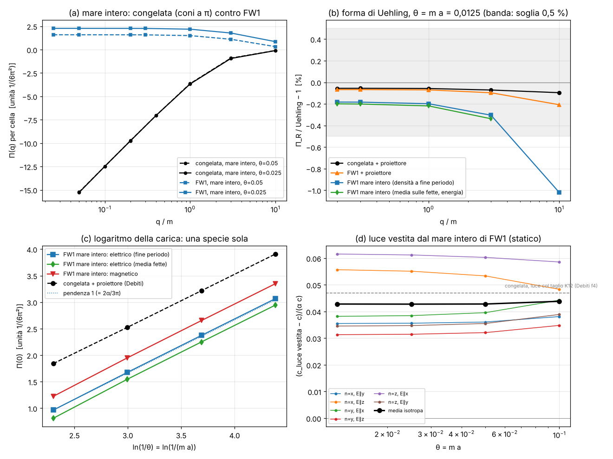

# Il vuoto di FW1: polarizzazione senza proiettore

Studio `fw1vuoto_`. Variante in prova **FW1** (`docs/SENZA_DOPPIONI.md` §5.3: regola congelata + **un solo** Wilson
ritorto, collegamenti ±2e_j, h = 0,4, attorno alla moneta dei soli tick pari) accanto alla regola congelata, che resta
il riferimento. **La regola congelata non è stata toccata**; i file `vuoto_*` del thread Debiti non sono stati toccati
(letti da origin/master con `git show`; motore copiato da `lab/vuoto_core.py` @ 48fbe35, numeri di confronto da
`lab/out/vuoto_3d*.json` @ 4f50e2c, documento @ 47782ae).

File: motore `lab/fw1vuoto_core.py`; pre-registrazione `lab/fw1vuoto_prereg.py` → `lab/out/fw1vuoto_prereg.json`
(commit **04ef3cb**, prima delle corse); emendamento A1 `lab/out/fw1vuoto_emendamenti.json` (commit **877b588**, prima
della sua corsa); corse `lab/fw1vuoto_run.py` (driver `lab/fw1vuoto_drive.sh`) → `lab/out/fw1vuoto_raw_w0/1.json`,
`lab/fw1vuoto_slice.py` → `lab/out/fw1vuoto_slice.json`; esami `lab/fw1vuoto_analyze.py` →
`lab/out/fw1vuoto_exams.json`; figura `lab/fw1vuoto_figure.py` → `lab/out/fw1vuoto_figura.png`.

*(a) Π(q) per cella della zona, mare intero: la congelata (nero) scende come un logaritmo a grande distanza (4 coni
senza massa capovolti: niente carica rinormalizzata finita); FW1 (blu) è piatta per q → 0 (Π(0) finito). (b) Forma di
Uehling a θ = 0,0125: tutte dentro la banda dello 0,5 % fino a q = 3 m; FW1 a mare intero −0,2/−0,3 %, a 10 m −1,0 %
(cala come a²). (c) Il logaritmo della carica: pendenza 1 (in unità 2α/3π) per FW1 a mare intero, sia elettrico sia
magnetico. (d) Velocità della luce vestita dal mare intero di FW1, per direzione n e polarizzazione E: tutte sopra c di
0,03–0,06 α, non calano col reticolo.*

---

## 0. In breve (per Valerio)

1. **Sì: con FW1 il vuoto si polarizza giusto col mare intero, senza proiettore.** Il coefficiente del logaritmo della
   carica è **2α/3π a −0,14 %** (fit su 4 reticoli; ultimo passo +0,07 %), la forma di Uehling entro **−0,18 % / −0,20 %
   / −0,30 %** a q = 0,3 / 1 / 3 m (θ = 0,0125) e l'errore cala come a² (×3,7 a ogni dimezzamento). I gemelli pesanti
   (≥ 0,37/a) cambiano **solo la costante** della carica nuda (un controtermine). Zero parametri adattati; h = 0,4 resta
   un debito. **Validazione** (è quello che fanno i fermioni di Wilson nel reticolo euclideo), ma per la nostra regola
   è il primo vuoto sano senza correzioni a mano e senza rallentare l'elettrone (la "moneta che respira" di Debiti lo
   rallentava).
2. **La congelata a mare intero conta 4 − 4 = 0 specie, non 1.** Previsto e misurato entro l'1 %: 4 specie pesanti
   normali meno 4 coni senza massa capovolti (velocità cos θ). A grande distanza anti-schermo come 4 "anti-specie"
   (pendenza 4,03 contro 4,00 previsto, θ = 0,025): Π(0) non esiste. Questo è il problema che FW1 risolve.
3. **Validazione del motore:** la congelata col proiettore ridà i numeri di Debiti a **1·10⁻¹⁴** (72 punti). FW1 col
   proiettore e congelata col proiettore differiscono di 0,01–0,03 % (FW1 vicino a Γ è la congelata).
4. **La luce vestita, finalmente col mare intero (cosa nuova).** Il mare di FW1 non ha coni a π, quindi si può vestire
   la luce **senza taglio**: invarianza di gauge esatta (Ward 2·10⁻⁸), fotone **senza massa** (10⁻⁷, contro −0,73 α
   da togliere a mano in Debiti fase 4), logaritmo magnetico 2α/3π a +0,10 %. Risultato: la luce vestita corre **più
   veloce di c di +0,043 α** (media isotropa), costante da θ = 0,1 a 0,0125: **non cala col reticolo** (Collins e
   colleghi). In più è **birifrangente**: secondo direzione e polarizzazione va da +0,031 a +0,062 α (es. lungo x:
   E∥y +0,036, E∥z +0,056 α). Parte della birifrangenza (quella lungo y) viene **solo** dal fatto che FW1 mette il Wilson
   nei soli tick pari (rompe la simmetria x ↔ z della congelata); l'altra parte (y speciale) è permessa anche nella
   congelata. Il c dell'elettrone vestito con FW1 **non** l'ho calcolato (serve il loop con i collegamenti del
   Wilson): quindi la differenza c_e − c_luce per FW1 resta aperta.
5. **Inversione del tempo rotta: niente Chern–Simons.** Il termine CPT-dispari (Carroll–Field–Jackiw, lineare in q) è
   **zero** (≤ 2·10⁻⁸ L, va come q², non come q), anche quello "chirale magnetico" (≤ 3·10⁻¹⁰). Compare invece un
   accoppiamento **magneto-elettrico** E·κ·B (P- e T-dispari) di ~10⁻⁴ L, che però **cala come a** (dimezza a ogni
   dimezzamento di θ): sparisce nel continuo. Controllo: nella congelata la risposta corrispondente è 0 esatto.
   Restano, non piccoli e non calanti, termini **pari** anisotropi (anche fuori diagonale: ν_xy ≈ 0,008 L).

Tabellone pre-registrato: **E1 PASS, E2 PASS, E3a–f PASS, E3g PASS ma banale** (emendamento A1: rifatto sulla media
delle due fette: congelata x = z a 10⁻¹⁴, FW1 x ≠ z di 0,055 L → **PASS**), **E4 PASS, E5a–d PASS, E5e riportato**
(+0,043 α, nella forbice prevista), **E6a PASS, E6b PASS, E6c "visto" ma O(a), E6d PASS**.

---

## 1. Il problema in parole semplici

Il vuoto della regola zig-zag è il "mare di Dirac": tutti gli stati a energia negativa pieni. Un nucleo lo deforma
(polarizzazione del vuoto): la carica vista da lontano è più piccola di quella nuda di un fattore che cresce col
logaritmo del taglio (coefficiente 2α/3π), e a distanze ~λ_C compare il potenziale di **Uehling**.

Il thread Debiti (`docs/VUOTO_POLARIZZA.md` su origin/master, fasi 1–4) ha trovato che con la regola congelata:

- il **mare intero** non va bene: in ogni cella della zona ci sono 4 specie pesanti normali e **4 coni senza massa**
  a quasi-energia π, riempiti "al contrario"; il risultato è un anti-schermo che cresce a grande distanza;
- contando **solo la specie fisica** (un proiettore dichiarato, K1 = 0,6, K2 = 1,05) la regola ridà la QED:
  log 2α/3π a −0,07 %, Uehling entro 0,1–0,2 %;
- in fase 4 la luce non si poteva vestire col mare intero (i coni a π chiudono la zona di Floquet), e il taglio di
  specie rompe la gauge (massa del fotone da togliere a mano, c della luce sporcato di 0,007–0,05 α).

FW1 (studio SENZA_DOPPIONI) toglie i doppioni leggeri: tutti i gemelli stanno a ≥ 0,37/a da energia 0 e ≥ 0,40/a dal
bordo π; le coppie dal vuoto contate su tutta la zona danno 0,99 di una specie. Se è vero che i gemelli pesanti sono
"innocui", il **mare intero** di FW1 deve polarizzare come la QED **senza nessun proiettore**: i gemelli possono
cambiare solo la costante della carica nuda (un controtermine), non il logaritmo né la forma di Uehling.

## 2. Cosa si sa (letteratura)

Non ho potuto verificare online in questa sessione: cito a memoria, con autori e anno.

- **Uehling (1935), Serber (1935)**: il potenziale di polarizzazione del vuoto al primo ordine in α. Il coefficiente
  del log della rinormalizzazione della carica, 2α/3π per specie, è di Dirac–Heisenberg–Weisskopf (anni '30).
- **Fermioni di Wilson sul reticolo (Wilson 1974; Karsten–Smit 1981; Kawai–Nakayama–Seo 1981)**: nel reticolo
  euclideo la polarizzazione del vuoto con fermioni di Wilson è invariante di gauge e i doppioni (masse ~ r/a)
  contribuiscono solo a costanti e a termini O(a²): il log viene da una sola specie. È il risultato standard che qui
  si vuole **ritrovare** per una regola a tempo discreto: validazione, non scoperta.
- **Massa ritorta (twisted mass, Frezzotti–Grassi–Sint–Weisz 2001, Frezzotti–Rossi 2004)**: un termine di Wilson
  "ruotato" rispetto alla massa (come il Wilson lungo Y di FW1, ortogonale alla moneta lungo X) rompe parità e
  inversione del tempo ma conserva la loro combinazione; a torsione massima gli errori O(a) si cancellano.
- **Tempo discreto contro reticolo 4-D**: nel reticolo euclideo la simmetria ipercubica vieta termini di dimensione 4
  che rompono Lorentz nel settore del fotone. Una regola a tempo discreto con solo simmetria cubica **nello spazio**
  (anzi, la congelata ha solo D4h con y speciale) non ha questa protezione: la velocità della luce vestita può
  differire da c di O(α) senza calare con a (Collins, Perez, Sudarsky, Urrutia, Vucetich, PRL 93, 191301 (2004)).
- **Termini dispari**: Carroll–Field–Jackiw (PRD 41, 1231 (1990)): un termine di Chern–Simons b_μ ε^{μνρσ}A_ν F_ρσ
  (CPT-dispari) rende il vuoto birifrangente; Jackiw–Kostelecký (PRL 82, 3572 (1999)) e altri: un tale termine
  indotto dai fermioni è ambiguo/dipende dal regolatore. Settore del fotone del Modello Standard Esteso
  (Colladay–Kostelecký 1997–98, Kostelecký–Mewes 2002): tutti i coefficienti di dimensione 3 (CPT-dispari) e 4
  (CPT-pari, tra cui il termine magneto-elettrico E·κ·B, P-dispari e T-dispari). Effetto magneto-elettrico/assione:
  Wilczek (1987).
- **Passeggiate quantistiche**: non conosco lavori che calcolino la polarizzazione del vuoto del mare di Floquet di un
  automa di Dirac 3-D (D'Ariano–Perinotti, Arrighi, Bisio studiano la dinamica a una particella). Il thread Debiti è,
  per quanto so, il primo; questo studio ne è la continuazione con FW1.

**Cosa è aperto qui** (per la nostra regola, non per la fisica): se FW1 dia un vuoto sano senza correzioni a mano, e
quanto la sua inversione del tempo rotta (coppie di Kramers spaccate 5·10⁻²) sporchi il vuoto.

---

## 3. Che cosa ho calcolato (semplice)

- **Il vuoto** = tutti gli stati di Floquet con quasi-energia in (−π, 0) per periodo (2 tick). **Mare intero** vuol dire
  tutta la zona: nessun proiettore, nessuna scelta di valle. La regola ha 8 copie esatte (W(k + πe_j) = W(k)), quindi si
  integra su una cella di lato π: per FW1 in una cella c'è **una** specie leggera (Γ); per la congelata 4 specie pesanti
  e 4 coni senza massa.
- **Il nucleo** = la fase e^{−iV} della regola dopo ogni tick (per FW1, tick 0: dopo la seconda metà del Wilson; messo
  fra la moneta e la seconda metà cambia Π di −0,13 / −0,16 %, quasi tutto una costante: scelta dichiarata).
- **Risposta "di Debiti"**: densità indotta alla fine del periodo (formula di Riesz), stesso codice di `vuoto_core`,
  riscritto a **mosse** (passi, rotazioni sui collegamenti, moneta) così vale per qualunque variante.
- **Risposta nuova, dall'energia del mare**: la somma delle quasi-energie occupate E = Σ Ω, al secondo ordine esatto in
  un campo statico (formula per una matrice normale con le differenze divise di i·log). Con un potenziale V dà χ (la
  densità **mediata sulle fette**), con un potenziale vettore A (fase di Peierls con l'integrale di linea esatto su
  **ogni** salto, anche sui collegamenti ±2e_j del Wilson) dà la risposta magnetica, e misto V–A dà le risposte dispari.
  Controllo: contro le differenze finite su una supercella esatta (4 siti) per V, A_x, A_y, congelata e FW1: 10⁻⁶; un A
  longitudinale (pura gauge) dà 0 esatto.
- **Unità**: a = 1, c = 1, m = θ. L = 1/(6π²) = 0,016887 è "una specie" (2α/3π dopo 4πα).

## 4. Risultati contro la pre-registrazione

### 4.1 Validazione: la congelata col proiettore (E1)

72 punti (4 θ × 3 direzioni × 6 q) contro `lab/out/vuoto_3d.json` di Debiti: scarto massimo **1,4·10⁻¹⁴**. **PASS.**
Col mio motore: L = 0,99926 (Debiti −0,07 %), Uehling a θ = 0,0125: −0,055 / −0,057 / −0,071 / −0,096 % (q = 0,3 / 1 /
3 / 10 m), uguale a Debiti.

### 4.2 La congelata a mare intero (E2: PASS)

Previsione: per cella Π(q) = 4 [specie pesante] − 4 [cono senza massa, velocità cos θ]: pendenza d Π/d ln q =
4 [1/(6π² cos θ) − d Π_R,Uehling/d ln q].

| θ | pendenza a grande distanza (0,05→0,1 m) / L | previsto 4/cos θ | finestra 3→10 m / L | previsto | scarti di tutte le coppie di q |
|---|---|---|---|---|---|
| 0,1 | 4,007 | 4,020 | 0,665 | 0,724 | ≤ 1,5 % |
| 0,05 | 3,960 | 4,005 | 0,681 | 0,709 | ≤ 1,0 % |
| 0,025 | 4,033 | 4,001 | 0,705 | 0,705 | ≤ 1,0 % |

(soglia 3 % della parte dei coni; quadratura n = 96 contro 64: 0,1–0,15 %, è lo scarto che si vede). In parole: la
congelata a mare intero **non** conta una specie e nemmeno 4: conta **4 − 4**. Nella finestra m ≪ q ≪ 1/a la carica
quasi non "corre" (0,7 L invece di 1 L nella zona di q misurata, → 0 più in alto), a grande distanza va come
**−4 specie** (anti-schermo, Π → −∞): nessuna carica rinormalizzata. Il compito diceva "4+ specie": il conto giusto è
4 pesanti **meno** 4 coni.

### 4.3 FW1 a mare intero (E3: PASS)

| esame | misurato | soglia | esito |
|---|---|---|---|
| E3a Π(0) finito: pendenza 0,025→0,05 m | −2,5…−2,7·10⁻⁴ L (tutti i θ) | ≤ 0,02 L | **PASS** |
| E3b log della carica | fit **0,99864 L** (−0,14 %); passi 1,025 → 1,0047 → **1,0007** | 2 % | **PASS** |
| E3c Uehling θ = 0,0125 | **−0,18 / −0,20 / −0,30 %** (q = 0,3 / 1 / 3 m); **−1,02 %** a 10 m | 0,5 % / 1,5 % | **PASS** |
| E3d convergenza | errore ÷3,69 (1 m) e ÷3,67 (3 m) da θ = 0,025 a 0,0125 (cioè ~a²) | ≥ ×3 | **PASS** |
| E3e coefficiente q² (q = 0,2 m) | 0,99817 | 1 % | **PASS** |
| E3f isotropia (1,1,1) contro media | +0,13 % | 1 % | **PASS** |
| E3g anisotropia x ≠ z | (z−x)/L = 0,20 a fine periodo | > 10⁻⁶ | PASS **banale** (vedi A1) |

Quadratura: n = 80 contro 64: ≤ 5·10⁻⁸. La costante della carica nuda c (fit L·ln(1/θ) + c): −0,0221, contro +0,0058
della congelata col proiettore: è il contributo dei gemelli pesanti + Wilson, cioè il **controtermine** (non fisico).

Uehling per ogni reticolo (errore in %, media x, y, z):

| θ | 0,3 m | 1 m | 3 m | 10 m |
|---|---|---|---|---|
| 0,1 | −9,5 | −10,3 | −15,2 | −38 |
| 0,05 | −2,5 | −2,7 | −4,1 | −12,7 |
| 0,025 | −0,68 | −0,73 | −1,12 | −3,7 |
| 0,0125 | **−0,18** | **−0,20** | **−0,30** | **−1,02** |

L'errore di FW1 è ~3 volte quello della congelata col proiettore allo stesso θ (−0,06 %), ma va a zero come a²: è il
prezzo dei gemelli a 0,37/a (contano come regolatori non lontanissimi) e del Wilson vicino a Γ. Per avere lo 0,1 % a
q = 3 m serve θ ≈ 0,0075.

**Emendamento A1 (dichiarato, scritto prima della corsa).** E3g confrontava x e z alla sola fetta di fine periodo,
dove anche la congelata ha x ≠ z (le due fette scambiano x e z, Debiti V2f): il PASS non diceva niente. Rifatto
sull'altra fetta e mediato: **congelata (z−x)/L = 2·10⁻¹⁵ (x = z esatto)**, **FW1 (z−x)/L = 0,057 / 0,055** (θ = 0,025 /
0,0125) → la simmetria x ↔ z è rotta da FW1, come previsto (soglia 10⁻⁴: **PASS**). Lo stesso numero (0,055 L) viene
dal metodo dell'energia (media sulle fette, §4.5): due metodi indipendenti d'accordo.

### 4.4 Il controllo col proiettore (E4: PASS)

- FW1 col proiettore: L = 0,99853; Uehling a θ = 0,0125: −0,07 / −0,07 / −0,10 / −0,21 %.
- FW1 col proiettore contro congelata col proiettore: −0,012 / −0,013 / −0,025 % (q = 0,3 / 1 / 3 m): vicino a Γ FW1 è la
  congelata (il Wilson va come k⁴ in quadratura con la massa).
- FW1 mare intero contro FW1 col proiettore: −0,12 / −0,13 / −0,21 %: è questo il contributo dei gemelli alla forma.

### 4.5 La luce vestita dal mare intero di FW1 (E5)

Dal secondo ordine dell'energia del mare: ε − 1 = 4πα Π_e (potenziale statico), 1/μ − 1 = 4πα Π_b (campo magnetico
statico trasverso); per la luce c² = (1/μ)/ε, quindi δc/c = 2πα (Π_b − Π_e), presa per ogni direzione di propagazione n
e polarizzazione E (B ∥ n × E).

| esame | misurato | soglia | esito |
|---|---|---|---|
| E5a Ward (A longitudinale) | K_L/K_T = 1,8·10⁻⁸ | 10⁻⁶ | **PASS** |
| E5b fotone senza massa | K0/(K2 m²) ≤ 1,2·10⁻⁷, cala con θ | 10⁻⁴ | **PASS** |
| E5c log magnetico | **1,0010 L**; passi 1,047 → 1,013 → 1,0035 | 2 % | **PASS** |
| E5d log elettrico (media fette) | 0,99875 L; Uehling −0,20 / −0,22 / −0,34 % | 2 % / 0,5 % | **PASS** |
| controllo ν (due modi di misurare lo stesso B) | ≤ 10⁻⁵ L | — | ok |

**δc della luce, in unità α c** (positivo = più veloce di c):

| θ | n=x E∥y | n=x E∥z | n=y E∥x | n=y E∥z | n=z E∥x | n=z E∥y | **media** |
|---|---|---|---|---|---|---|---|
| 0,1 | 0,0381 | 0,0483 | 0,0443 | 0,0348 | 0,0586 | 0,0389 | 0,0438 |
| 0,05 | 0,0361 | 0,0534 | 0,0396 | 0,0321 | 0,0603 | 0,0355 | 0,0428 |
| 0,025 | 0,0356 | 0,0551 | 0,0385 | 0,0315 | 0,0612 | 0,0347 | 0,0428 |
| 0,0125 | 0,0355 | 0,0557 | 0,0382 | 0,0313 | 0,0616 | 0,0345 | **0,0428** |
| a → 0 (retta) | 0,0353 | 0,0566 | 0,0376 | 0,0310 | 0,0620 | 0,0342 | **0,0428** |

**E5e (riportato): +0,043 α isotropo, dentro la forbice prevista (0,005–0,2 α), non cala con a.** È l'effetto di
Collins e colleghi per la luce: il taglio del reticolo (tempo discreto, simmetria solo cubica e anzi meno) lascia
nella luce vestita un c diverso di O(α). Confronto con Debiti fase 4 (congelata, mare tagliato): +0,047 α (K12),
+0,029 α (K12/3) con incertezza 0,007–0,05 α dovuta al taglio; il mio numero **non ha taglio** e non ha l'artefatto di
gauge, quindi è il primo numero "netto" della luce vestita in una variante della regola.

**Birifrangenza.** Le due polarizzazioni non corrono uguali: lungo x 0,035 contro 0,057 α, lungo y 0,038 contro 0,031,
lungo z 0,062 contro 0,034 (cioè ~1,5·10⁻⁴ in velocità relativa). Per simmetria: la congelata (gruppo D4h con y
speciale) vieta la birifrangenza lungo **y**; quella di FW1 lungo y (0,007 α) viene **tutta** dalla rottura x ↔ z (il
Wilson solo nei tick pari). Lungo x e z la birifrangenza è permessa anche nella congelata (viene dall'asse y speciale,
qui Π_b lungo y è più grande di 0,22 L); Debiti, col metodo dinamico e il mare tagliato, nella congelata ne vedeva solo
2–4·10⁻⁵ α. Il mio metodo statico non si può usare sul mare intero della congelata (i coni a π chiudono la zona), quindi
**non so dire** quanta della birifrangenza lungo x, z sia di FW1 e quanta del reticolo: è aperto. In più, il tensore
magnetico di FW1 ha pezzi **fuori diagonale** che non calano con a: ν_xy ≈ 0,008 L, ν_xz ≈ 0,002 L, ν_yz ≈ 0,001 L
(≲ 10⁻³ α sulla velocità): gli assi della birifrangenza non sono esattamente x, y, z. Probabile origine: l'ordine fisso
dei 6 collegamenti dentro il Wilson.

**c dell'elettrone con FW1: non fatto** (dichiarato in pre-registrazione). Serve rifare il loop elettrone–fotone di
Debiti fase 3–4 con la fase di Peierls anche sui collegamenti ±2e_j. Senza quel numero la differenza c_e − c_luce per
FW1 non si può dire; quello che si può dire: **la parte della luce c'è, è finita, pulita, +0,043 α, e non va via.**

### 4.6 Inversione del tempo rotta: risposte dispari (E6)

FW1 rompe T (coppie di Kramers spaccate 5·10⁻²). Che cosa si vede nel vuoto?

| esame | che cosa | misurato | esito |
|---|---|---|---|
| E6a controllo | congelata + proiettore: densità indotta da un A statico (q ⊥ A) | **0** (< 10⁻¹⁵) | **PASS** |
| E6b Chern–Simons (CFJ, b·B, CPT-dispari) | parte di V–A **lineare** in q | ≤ 2·10⁻⁷ L per q a; va come q³ (non q), e cala come θ²: **nessun termine lineare** | **PASS** (zero) |
| E6b' "chirale magnetico" (b₀) | parte antisimmetrica di K_jk lineare in q | ≤ 2·10⁻⁸ L, a θ = 0,0125 ≤ 3·10⁻¹⁰ | **PASS** (zero) |
| E6c magneto-elettrico E·κ·B (P- e T-dispari, CPT-pari) | parte di V–A in q² | **visto**: \|κ\| fino a 4,5·10⁻⁴ L (θ = 0,05), 2,2·10⁻⁴ (0,025), **1,1·10⁻⁴ (0,0125)**: dimezza col reticolo → **O(m a)**, sparisce nel continuo | visto, innocuo per a → 0 |
| E6d risposta scalare dispari | Im χ / Re χ | ≤ 1·10⁻⁹ | **PASS** |

In parole: la T rotta di FW1 **non** produce un termine di Chern–Simons (la combinazione CPT resta, come per la massa
ritorta della QCD sul reticolo). Produce un piccolo effetto magneto-elettrico (il vuoto, sotto un campo magnetico,
accumula un po' di carica dove il campo varia) che va come m·a: a θ = 0,0125 è 10⁻⁴ di una specie, e sparisce col
reticolo. Anche la densità a fine periodo (stroboscopica) risponde a un A statico in FW1 (5,8·10⁻⁴ L a θ = 0,05), mentre
nella congelata è zero esatto: è la stessa firma della T rotta.

## 5. Validazione, scoperta, limite

- **Validazione:** log 2α/3π e Uehling dal mare intero di FW1 (lo stesso che fanno i fermioni di Wilson nel reticolo
  euclideo dagli anni '80); il numero di Debiti ritrovato a 10⁻¹⁴; la conta 4 − 4 della congelata.
- **Nuovo (per la regola, controllato con convergenza in a):** (1) una variante a tempo discreto dello stile "corri a
  c, poi ruota" con un vuoto sano **senza proiettore e senza rallentare l'elettrone**; (2) la luce vestita in modo
  **invariante di gauge** (fotone senza massa a 10⁻⁷) e il suo c: +0,043 α, costante in a, birifrangente; (3) la T rotta
  di FW1 non dà Chern–Simons, dà un magneto-elettrico O(a). Non lo chiamerei "scoperta di fisica": sono proprietà della
  nostra regola.
- **Limite:** la luce vestita **non** corre a c (O(α), non cala con a) ed è birifrangente: come teoria della natura
  questo è un problema serio (i limiti sperimentali su queste rotture di Lorentz sono di molti ordini più stretti, cito
  a memoria). Serve una simmetria o un controtermine (una manopola) — il dilemma di Collins resta, FW1 non lo cura. In
  più FW1 rompe x ↔ z (0,055 L sul controtermine della carica, 0,007 α di birifrangenza lungo y).

## 6. Debiti e parametri

- **h = 0,4** del Wilson (debito di FW1, fissato in SENZA_DOPPIONI A3, non regolato qui).
- Posizione della fase del potenziale nel tick 0 di FW1 (dopo la seconda metà del Wilson): scelta; spostarla cambia Π
  di ~0,13 % (quasi tutto costante).
- La costante della carica nuda (controtermine) dipende da h e dal reticolo: la carica fisica è quella vista da lontano
  (schema on-shell, come Debiti).
- Il "c della luce" è preso dalla risposta **statica** del mare (ω → 0): giusto al primo ordine per un vuoto con gap,
  ma non ho fatto la risposta dinamica.
- Solo primo ordine in Zα e un loop; niente livelli atomici con FW1 (il Nd⁵⁹⁺ di Debiti si potrebbe rifare uguale).
- Proiettore K1 = 0,6, K2 = 1,05: usato **solo** nelle corse di controllo (E1, E4).
- **Parametri adattati: 0.** Ingressi: θ (= m a), α. h = 0,4 è l'unica manopola di FW1.

## 7. Costo

~570 integrali 3-D (griglie 64³ = 262 144 punti), due processi a un core: ~45 minuti in tutto, più 4 minuti per
l'emendamento. Per un punto: congelata ~4 s, FW1 densità ~6–15 s, FW1 energia (con A) ~15–25 s (il Wilson sono 12 mosse
in più per periodo; il motore a mosse non è ottimizzato).

## 8. Cosa resta / dove può aiutare Valerio

1. **c dell'elettrone con FW1** (loop di Debiti fase 3–4 con i collegamenti del Wilson): serve per dire c_e − c_luce.
2. **Il c della luce +0,043 α.** È lo stesso tipo di numero che Debiti trova per l'elettrone. Se luce ed elettrone si
   spostano **dello stesso** c, non si vede niente (solo la differenza è fisica). Ti viene un'idea geometrica per cui i
   due loop si compensino? (Vale anche per la congelata.)
3. **x ↔ z**: un FW1 "simmetrico" (metà Wilson nel tick pari e metà nel dispari) non funziona (le valli π restano senza
   massa, SENZA_DOPPIONI §4). Un'alternativa: alternare l'ordine dei collegamenti, o un periodo di 4 tick con il Wilson
   una volta in ogni coppia (da provare).
4. Rifare i livelli (Nd⁵⁹⁺, idrogeno) col vuoto di FW1 a mare intero: è lo stesso codice di Debiti, ora senza
   proiettore.

## 9. Come rifare

    python lab/fw1vuoto_core.py          # autotest: mosse = zz_core / senzadoppi, energia = supercella (10^-6)
    python lab/fw1vuoto_prereg.py        # pre-registrazione (già committata, 04ef3cb)
    sh lab/fw1vuoto_drive.sh             # corse di produzione, due processi, pezzi da 10 min (~45 min)
    OMP_NUM_THREADS=1 timeout 590 python lab/fw1vuoto_slice.py   # emendamento A1 (~4 min)
    python lab/fw1vuoto_analyze.py       # → lab/out/fw1vuoto_exams.json
    python lab/fw1vuoto_figure.py        # → lab/out/fw1vuoto_figura.png
