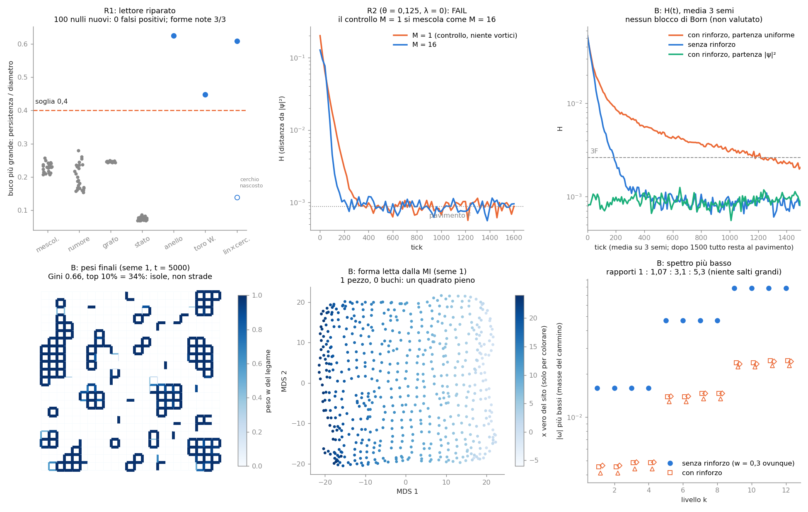

# La geometria che si costruisce da sola (le due riparazioni e il passo grande)

Laboratorio: `lab/big_*.py` (nucleo `lab/big_core.py`). Numeri: `lab/out/big_*.json` / `.log`. Figura: `lab/out/big_figure.png`.
Pre-registrazione in due tempi, **ognuna messa in git prima delle corse**:
* `lab/out/big_prereg_R.json` (riparazioni R1, R2), commit **ca4ce1f**;
* `lab/out/big_prereg_B.json` (passo grande B, scritto dopo R1/R2 e prima di B), commit **59fb1be**.

Prima di scrivere la prima pre-registrazione ho fatto solo una prova dei tempi (dichiarata nel file). Non ho guardato
nessun risultato del lettore sui nulli o sulle forme di R1.

## In due righe

Nel documento `PRE_ESPERIMENTI.md` il verdetto era: "**non partire** così com'è, **parti** dopo due riparazioni".
1. **Il lettore di forma** vedeva buchi nel rumore. **Riparato: passa** (0 falsi su 100 nulli nuovi, 3 forme note su 3).
2. **Il mescolamento finto** (i surfisti sul reticolo si mescolano anche senza vortici). **Non riparato: fallisce**
   anche con λ = 0 e θ piccolo. Quindi la domanda "il rinforzo blocca la regola di Born?" **non si può fare** qui.

Il passo grande l'ho fatto lo stesso, ma **solo per la forma**, come era scritto prima. Risultato: i surfisti
costruiscono **isole** di legami aperti (non strade). **Nessuna forma nuova** (niente buchi, niente pezzi staccati,
niente dimensione nascosta). Le "masse" del cammino si abbassano di 3,5 volte, ma senza rapporti grandi.

---

## R1 — Riparare il lettore di forma

**Il problema.** Il vecchio lettore (`geo_core`) contava un "buco" quando una barra della omologia persistente
viveva più di 1,5 volte la distanza fra vicini. Nel rumore questo succede sempre: vedeva buchi nel 60–100% dei casi.

**La regola nuova, fissata prima.** Prendo il pezzo più grande, faccio le distanze come prima (−log dell'informazione
mutua, poi geodetiche), e guardo **la vita di ogni buco divisa per il diametro** dello spazio:

* buco = barra H1 con **persistenza / diametro > 0,4**;
* filtrazione **completa** (ripser fino alla fine, ogni barra muore a un valore finito: niente taglio a metà diametro);
* al massimo 220 punti "punto di riferimento" (max–min), come prima.

**Cosa ho tolto (e cosa costa).** Le cavità (b2) non fanno parte del lettore: con la filtrazione completa su metriche
senza forma non finisce. Conseguenza dichiarata: questo lettore **non vede cavità** (una sfera); un toro lo
riconosce solo dai suoi due anelli (H1).

**Esame su nulli nuovi** (24×24 = 576 siti, misura uguale a quella del passo grande; semi mai usati prima):

| classe senza forma | casi | falsi "buchi" | buco più grande (max / mediana), in unità di diametro |
|---|---|---|---|
| MI del box mescolata | 25 | **0** | 0,26 / 0,23 |
| rumore log-normale con le stesse statistiche | 25 | **0** | 0,28 / 0,19 |
| vuoto di un grafo a caso 4-regolare | 25 | **0** | 0,25 / 0,25 |
| stato a caso (Haar) | 25 | **0** | 0,09 / 0,07 |

**Esame su forme note:**

| forma | buchi letti | persistenza/diametro dei buchi più grandi |
|---|---|---|
| anello 48 | 1 ✔ | 0,62 |
| toro 16×16 con correzione Wilson r = 1 (un solo foglio) | 1 ✔ (ne aspettavo 2) | 0,45 e **0,38** (il secondo anello resta sotto soglia) |
| linea 36 × cerchio nascosto 18 | 1 ✔ | 0,61; il cerchio nascosto: **0,14** |

Criterio pre-registrato (≤ 5% falsi in ogni classe **e** 3/3 veri): **PASSA**. L'alternativa di riserva (bootstrap)
non è servita. Il margine non è enorme: il nullo peggiore arriva a 0,28, la forma vera più debole a 0,45.

**Attenzione, due cose oneste.**
* Sul toro con Wilson il secondo anello è a 0,38: il lettore conta **1 buco invece di 2**. Il criterio "almeno un buco"
  passa, ma il numero giusto (b1 = 2) no.
* Sulla linea × cerchio il buco che il lettore trova **non è il cerchio nascosto**. È l'anello lungo che nasce perché
  i due fogli della regola si saldano agli estremi aperti (vedi `FORMA_DALLE_PALLINE.md`). Il cerchio nascosto vive
  solo 0,14 diametri: **un lettore "relativo al diametro" non può vedere una dimensione piccola arrotolata.** L'avevo
  previsto prima (nella pre-registrazione, come previsione non valutata) ed è andata così.

### Quali risultati vecchi (`FORMA_DALLE_PALLINE.md`) sopravvivono al lettore riparato

Ho applicato lo stesso criterio alle matrici salvate dei vecchi esperimenti (`lab/big_r1_audit.py`):

| forma disegnata | b1 disegnato | b1 vecchio (vuoto / quench) | buchi nuovi (vuoto / quench) | sopravvive? |
|---|---|---|---|---|
| catena 48 | 0 | 0 / 0 | 0 / **1** | vuoto sì; quench: il buco falso resta (la catena diventa un anello, artefatto già noto) |
| anello 48 | 1 | 1 / 1 | 1 / 1 | **sì** |
| toro 16×16 | 2 | 2 / 2 per pezzo | 2 / 2 per pezzo | **sì** (ma resta il problema dei 2 o 4 pezzi) |
| linea 36 × cerchio 18 | 1 | 2 / 2 | 1 / 1 | il numero ora coincide, ma **per il motivo sbagliato**: resta l'anello dei fogli, sparisce il cerchio nascosto |
| stadio con buco | 1 | 1 / 4 | **0 / 0** | **no**: il buco dello stadio è piccolo rispetto al diametro (0,24 e 0,27) e il lettore nuovo non lo vede |

**Il raggio del cerchio nascosto** (−3,2% nel vuoto, −3,1% nel quench) e il cerchio disegnato dall'MDS sono **un'altra
misura**: non contano i buchi, leggono la scala a cui muore la barra più corta e la coppia di componenti MDS. Il lettore
riparato non li conferma e non li smentisce. Però adesso sappiamo che quella barra (0,11–0,14 diametri) è **più corta
dei buchi falsi del rumore** (fino a 0,28): da sola, senza sapere già dove guardare, non sarebbe una prova. La
dimensione "2 da vicino, 1 da lontano" (2,22 → 1,00) resta il segno più forte della dimensione arrotolata.

---

## R2 — Riparare il mescolamento finto

**Il problema.** Sul reticolo i surfisti saltano a caso (catena di Markov). Una catena di Markov si mescola da sola,
anche se l'onda è un solo modo fermo e non ci sono vortici. Nel continuo, invece, un solo modo **non** si mescola.
Il controllo è: M = 1 (un modo) deve restare fermo, M = 16 (tanti modi) deve mescolarsi.

**Fissato prima.** Scatola 24×24 (quella del passo grande), surfisti λ = 0 (si muove solo chi è costretto dalla corrente
netta), θ = 0,125 e 0,0625, partenza uniforme, 20 000 surfisti, 3 semi nuovi. Passa se M = 1 è almeno 3× più lento
di M = 16, **oppure** M = 1 resta sopra il 10% e M = 16 scende sotto il 3%.

| θ | τ (M = 1) | τ (M = 16) | rapporto | H finale / iniziale M = 1 | M = 16 | esito |
|---|---|---|---|---|---|---|
| 0,125 | 35 tick | 54 tick | **0,65** | 0,4% | 0,8% | **FAIL** |
| 0,0625 | 98 tick | 67 tick | **1,46** | 0,7% | 0,6% | **FAIL** |

**Il singolo modo si mescola come (o più veloce di) tanti modi.** Il mescolamento finto **non si spegne** a 24×24.
Nel pre-esperimento P1e c'era un indizio contrario (θ = 0,125 con n = 96: M = 1 restava al 17%), ma lì la scatola era
4 volte più grande in unità fisiche e i modi molto concentrati (H iniziale 8,6 contro 0,2 qui). In una scatola piccola
come quella che posso permettermi nel passo grande l'indizio non regge.

**Conseguenza (scritta prima):** θ = 0,125 e **l'esame "il rinforzo blocca Born" non vale niente** qui. Il passo grande
si fa **solo per la forma**.

---

## B — Il passo grande (solo forma)

**Fissato prima** (`big_prereg_B.json`): regola a reticolo con pesi sui legami, θ = 0,125, scatola 24×24 con
specchi ai bordi (il Wilson in spazio k non si può usare quando i pesi cambiano da posto a posto), surfisti λ = 0,
20 000 surfisti, M = 16. Rinforzo **con parametri fissi**: ogni K = 10 tick w ← (1−η)w + η·w̄·J^μ/media(J^μ),
η = 0,3, μ = 2, w̄ = 0,3, w_min = 0,02, taglio in [w_min, 1], media riportata a w̄. 5000 tick, 3 semi.
Per ogni seme: con rinforzo da partenza uniforme, senza rinforzo da partenza uniforme, con rinforzo da partenza |ψ|².
Durata vera: ~100 s per seme.

### Risultati

| esame | criterio pre-registrato | seme 1 | seme 2 | seme 3 | esito |
|---|---|---|---|---|---|
| Born: equivarianza (partenza \|ψ\|² con rinforzo) | max H ≤ 3F = 0,0026 | 0,0016 | 0,0016 | 0,0018 | **PASS** 3/3 |
| Born: blocco (H finale con / senza rinforzo) | non valutato (R2 fallito) | 0,00101 / 0,00084 | 0,00086 / 0,00082 | 0,00087 / 0,00079 | nessun blocco: tutti al pavimento |
| "strade" | Gini > 0,2 e top 10% > 30% | 0,66 / 34% | 0,66 / 34% | 0,67 / 34% | **PASS** 3/3 |
| forma (lettore riparato) | buchi ≥ 1 o pezzi > 1, uguale in 3/3 | 1 pezzo, 0 buchi | 1, 0 | 1, 0 | **nessuna forma emersa** |
| dimensione nascosta | (D_vicino − D_lontano) − riferimento > 0,5 | 0,45 − 0,51 | 0,49 − 0,51 | 0,57 − 0,51 | **no** |
| "incastro" localizzato | modo più basso su < 10% dei siti, 3/3 | 7,7% | 6,2% | 10,7% | **no** (2 su 3; riferimento 19%) |

Altre cose misurate:
* **Rilassamento più lento ma non bloccato.** Con il rinforzo H scende con τ ≈ 34–85 tick contro 28–61 senza; alla
  fine tutto è al pavimento del rumore. (Con il mescolamento finto acceso questo non dice niente su Born.)
* **Vortici.** Gli avvolgimenti di fase passano da ~11 a **~170–185** con il rinforzo (senza rinforzo restano ~12).
  Il rinforzo riempie l'onda di vortici; ma su questo reticolo i vortici non sono il cucchiaino (P1), quindi è
  un'osservazione, non una spiegazione.
* **Che aspetto hanno le "strade".** Non sono strade: sono **isole** (figura, in basso a sinistra). Circa il 21–24% dei
  legami arriva a w = 1 e forma **quadratini chiusi e grappoli compatti**; il resto si abbassa (nessuno tocca w_min).
  I surfisti girano in piccoli anelli dentro le isole e le rinforzano. Gini e top 10% passano il criterio, ma la parola
  "autostrade" sarebbe sbagliata.

### Lo spettro delle masse (il cammino a fine corsa)

Le |ω| più basse vicino a ω = 0 (le "masse" dei modi più leggeri), 12 livelli:

| | ω₁ | rapporti ω_k/ω₁ (livelli 1–12) | primo livello vicino a ω = π |
|---|---|---|---|
| riferimento (w = 0,3 ovunque) | 0,0159 | 1, 1, 1, 1, **2,95** ×4, **4,94** ×4 | 1,86 |
| rinforzo, seme 1 | 0,0045 | 1, 1, 1,07, 1,07, 3,08, 3,08, 3,25, 3,25, 5,28, … 5,46 | 0,42 |
| rinforzo, seme 2 | 0,0041 | 1, 1, 1,07, 1,07, 3,14, … 5,57 | 0,32 |
| rinforzo, seme 3 | 0,0046 | 1, 1, 1,05, 1,05, 3,02, … 5,28 | 0,37 |

In parole:
* Il rinforzo rende il modo più leggero **3,5 volte più leggero** e divide i gruppi da 4 in due coppie (1 : 1,07).
* La scala 1 : 3 : 5 (come le armoniche dispari di una corda) **c'è già senza rinforzo** ed è la stessa in tutti i semi.
* **Nessun rapporto grande** fra i 12 livelli più bassi (massimo 5,6). Il salto fra il ramo vicino a 0 e quello vicino
  a π (≈ 80–95 volte) c'era già nel riferimento (≈ 117): non è nato dal rinforzo.
* Attenzione: ω₁ = 0,016 è molto sotto θ = 0,125. Con w < 1 ogni legame è uno specchio parziale, e la regola non è più
  "Dirac con massa θ". Le masse qui sono masse della **scatola di specchi**, non della particella. Non ho fatto nessun fit
  alle masse dei leptoni.

---

## Tabellone

| fase | esito | numero chiave |
|---|---|---|
| R1 lettore riparato | **PASS** | falsi 0/25 in ogni classe; veri 3/3 (ma toro b1 = 1 invece di 2; il cerchio nascosto non si vede) |
| R2 mescolamento finto | **FAIL** | τ(M=1)/τ(M=16) = 0,65 (θ = 0,125), 1,46 (θ = 0,0625); serviva ≥ 3 |
| B equivarianza | **PASS** | max H 0,0018 ≤ 0,0026 |
| B blocco di Born | **non valutabile** | (per R2) |
| B strade | **PASS** (ma sono isole) | Gini 0,66, top 10% 34% |
| B forma emersa | **no** | 1 pezzo, 0 buchi, 3/3 semi |
| B dimensione nascosta / incastro | **no / no** (incastro 2 su 3) | |
| B spettro | nessun rapporto grande | ω₁ ×1/3,5; scala 1:3:5 già presente |

## Quanti parametri

* **Regola + rinforzo: 6** (θ, η, μ, w̄, w_min, K) + 1 scelta discreta (λ = 0) + 1 scelta di bordo (scatola).
* **Stato e surfisti: 3** (M = 16, ω₀ = 1,8 θ, N = 20 000).
* **Lettore: 4** (soglia I 10⁻¹⁰, fattore Isomap 1,5, 220 punti di riferimento, soglia 0,4).
* **Previsioni valutate nel passo B: 6 esami** (equivarianza, strade, forma, dimensione, incastro, + spettro descritto).
  Nessun parametro è stato regolato dopo aver visto i risultati di B.

## Debiti (onesti)

1. **Il mescolamento finto è ancora lì.** Finché il salto dei surfisti è a caso, la domanda "il rinforzo combatte Born?"
   non si può fare. Servirebbero scatole molto più grandi in unità fisiche (n ≥ 96, come in P1e) o una regola di salto
   deterministica, che sul reticolo non esiste esatta.
2. **Il lettore riparato è cieco alle cose piccole.** Una soglia relativa al diametro non vede una dimensione arrotolata
   piccola, né il buco dello stadio. Per quello serve un'altra misura (dimensione da vicino / da lontano, coppie MDS),
   che però va ritestata sui nulli come ho fatto qui.
3. **Niente b2.** Il lettore non vede cavità.
4. **Toro: b1 = 1 invece di 2** con la soglia 0,4. Margine fra nulli (≤ 0,28) e forme vere (≥ 0,45) piccolo.
5. **Il passo grande è piccolo:** 24×24, 5000 tick, 3 semi; la scatola è solo 3 lunghezze Compton.
6. Le "isole" sono una struttura dei **pesi**, non della forma letta dalla MI: la MI vede ancora un quadrato pieno.
   Perché nascono isole chiuse e non strade (probabilmente: μ = 2 premia chi ripassa sempre dallo stesso legame, e
   un quadratino chiuso è il modo più corto per ripassarci) non l'ho verificato.
7. Le masse sono di una scatola di specchi parziali (ω₁ ≪ θ): non sono masse di particelle.

## File

`lab/big_core.py` (lettore riparato, corse con rinforzo, spettro), `lab/big_prereg.py` + `lab/big_prereg_b.py`
(pre-registrazioni), `lab/big_r1.py` (R1, ~5 min), `lab/big_r1_audit.py` (vecchi risultati, 20 s),
`lab/big_r2.py` (R2, 30–50 s per θ), `lab/big_b.py` (B, ~100 s per seme + riferimento), `lab/big_figure.py`.
