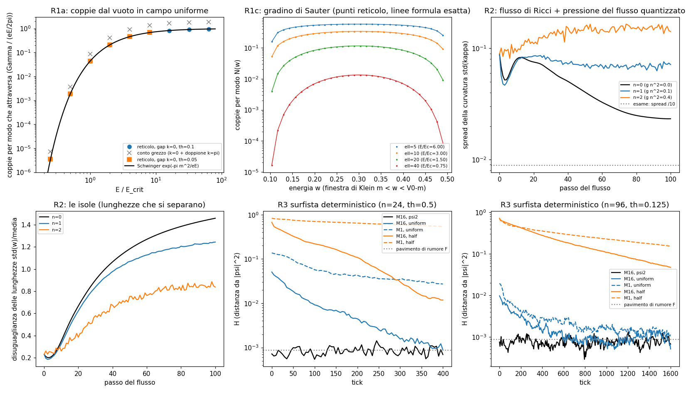

# Idee riprese: tre idee buone che avevamo lasciato cadere troppo presto

Laboratorio: `lab/redo_*.py`. Numeri: `lab/out/redo_*.json` / `.log`. Figura: `lab/out/redo_figure.png`.
Pre-registrazione: `lab/redo_prereg.py` → `lab/out/redo_prereg.json`, **committata (e73737e, 22:37) prima di ogni
corsa**. Prima di scriverla ho guardato solo i risultati vecchi (`pre_p1p5.json`, `flow_a.json`).

Una revisione a posteriori aveva trovato idee scartate in fretta o provate in modo superficiale. Qui ne riprendo tre.

## Tabellone

| test | esito | numero chiave |
|---|---|---|
| R1a Schwinger in campo uniforme | **PASS** | rapporto reticolo/Schwinger fra 0,98 e 1,04 per E/E_crit da 0,25 a 64 |
| R1b doppioni (previsione di artefatto) | **confermato** | P_π / P_0 = 1,000 esatto: il conto grezzo è 2× Schwinger |
| R1c gradino di Sauter | **PASS** | reticolo/esatto 0,992–0,996 (ℓ = 5…40) |
| R1d Unruh | **saltato** | (opzionale, per tempo) |
| R2 il flusso frena le isole | **FAIL** | n = 1, 2: anelli 0, spread di κ peggiora; n = 4 esplode |
| R3 surfista deterministico | **PASS (fragile)** | M=1 resta al 20% e al 65%, M=16 scende all'1,7%; ma sul reticolo fine il controllo fallisce |

---

## R1 — Il vuoto pieno di coppie, rotto da un campo forte (Schwinger)

**L'idea di Valerio.** Il vuoto è pieno di coppie particella–antiparticella perfettamente mescolate. Non si vedono finché
qualcosa di forte o veloce non le rompe (come vicino ai nuclei d'oro negli urti pesanti).

**Come l'ho provato.** La regola zig-zag in 1+1 dimensioni: la componente R va a destra, L va a sinistra, poi il "giro"
di angolo θ (θ = massa m, in unità del reticolo). Il **vuoto** = la banda bassa tutta piena (il "mare di Dirac").
* **Campo uniforme E**: una fase di Peierls che cresce nel tempo, A(t) = E·t, su ogni salto. Ogni onda del mare resta
  un'onda piana con impulso k(t) = k + E·t, quindi l'evoluzione del mare è **esatta** (una matrice 2×2 per ogni k).
  Controllo: lo stesso conto fatto nello spazio vero, su un anello di 128 siti con tutto il mare dentro, coincide a
  **1·10⁻¹⁴**.
* **Formula da confrontare (verificata).** In 1+1 D il numero **medio di coppie** per lunghezza e per tempo è
  Γ = (eE/2π)·exp(−π m²/eE) (Nikishov). Il motivo è semplice: ogni unità di tempo passano per k = 0 eE/2π modi per
  unità di lunghezza, e ognuno si "rompe" in una coppia con probabilità exp(−π m²/eE) (Landau–Zener). Attenzione:
  la "velocità di decadimento del vuoto" (eE/2π)·Σ e^(−nπm²/eE)/n è un'altra cosa. E_crit = m²/e.

**R1a (campo uniforme), θ = 0,1:**

| E/E_crit | 0,25 | 0,5 | 1 | 2 | 4 | 8 | 16 | 32 | 64 |
|---|---|---|---|---|---|---|---|---|---|
| coppie per modo (reticolo) | 3,6·10⁻⁶ | 0,00184 | 0,0428 | 0,207 | 0,457 | 0,675 | 0,817 | 0,912 | 0,939 |
| Schwinger exp(−πm²/eE) | 3,5·10⁻⁶ | 0,00187 | 0,0432 | 0,208 | 0,456 | 0,675 | 0,822 | 0,906 | 0,952 |
| rapporto | 1,043 | 0,984 | 0,991 | 0,996 | 1,001 | 0,999 | 0,994 | 1,006 | 0,986 |

Con θ = 0,05 il rapporto è fra 0,998 e 1,003: avvicinandosi al continuo l'accordo migliora. La piccola differenza a
θ = 0,1 la spiega quasi tutta la **formula di Dykhne con la dispersione esatta del reticolo** (cos ω = cos θ cos k
continuata a k immaginario): rapporto con quella 0,995–1,006 nel campo valido.

**R1b — i doppioni.** La regola ha un **secondo buco** (gap) a quasi-energia π, grande uguale (2θ): sono i "modi π" dei
cammini a tempo discreto. Un'onda del mare che passa per k = π si rompe in una "coppia" con la **stessa** probabilità
(P_π/P_0 = 1,000000, è una simmetria esatta). Quindi il **conto grezzo** delle coppie su un periodo di Bloch intero è
**il doppio** di Schwinger (crocette grigie in figura). Le coppie fisiche sono solo quelle del buco a k = 0.

**Finestra valida (da dichiarare).** (1) Contare solo il buco k = 0, o restare entro **mezzo periodo di Bloch**
t < π/E (dopo, le coppie create arrivano al bordo della zona di Brillouin, passano il buco π e possono ri-annichilarsi:
oscillazioni di Bloch). A E/E_crit = 64 il periodo di Bloch è solo 10 tick. (2) E/E_crit fino ad almeno 64 a θ = 0,1
(cioè E fino a 0,64 per tick) la probabilità per modo resta entro il 5%. Il reticolo non si rompe dove temevo.

**R1c — il gradino di Sauter (Klein).** Un potenziale fermo V(x) = (V0/2)(1 + tanh(x/ℓ)), alto V0 = 0,6 = 6m. Fra
m e V0 − m c'è la "finestra di Klein": un'onda del mare a destra trova stati liberi a sinistra, e passa = una coppia.
Ho calcolato la trasmissione esatta della regola con le matrici di trasferimento, e come riferimento la soluzione
numerica dell'equazione di Dirac continua sullo stesso gradino.

| ℓ (siti) | E_max/E_crit | coppie al secondo, reticolo | esatto (continuo) | rapporto |
|---|---|---|---|---|
| 5 | 6 | 0,03117 | 0,03130 | 0,996 |
| 10 | 3 | 0,01647 | 0,01653 | 0,996 |
| 20 | 1,5 | 0,004713 | 0,004736 | 0,995 |
| 40 | 0,75 | 0,000431 | 0,000435 | 0,992 |

Controllo dipendente dal tempo: un pacchetto d'onda del mare mandato sul gradino (ℓ = 10) passa per il 33,898%,
come previsto dalla trasmissione (differenza 10⁻¹³). La formula chiusa di Sauter coincide con l'equazione continua a
10⁻¹⁰ **nella forma** N = sinh(πℓp_L)·sinh(πℓp_R) / [sinh(πℓ(V0+p_L−p_R)/2)·sinh(πℓ(V0−p_L+p_R)/2)].
*Errore mio, dichiarato:* la prima versione che avevo scritto a memoria era **capovolta** (dava N > 1); l'ha preso il
controllo pre-registrato contro l'equazione continua. Il verdetto non dipendeva dalla formula (si confronta con l'ODE).

**Cosa vuol dire.** L'idea di Valerio, nella sua forma di fisica standard, **la regola zig-zag la contiene già**: il
mare pieno è il vuoto, e un campo forte rompe le coppie con la legge di Schwinger, senza nessun parametro aggiustato
(input: solo θ = massa ed E). Non è una scoperta nuova di fisica: è la conferma che la nostra regola fa la cosa giusta.
L'unico "trucco" del reticolo sono i doppioni a quasi-energia π, che raddoppiano il conto se non li si separa.

**R1d Unruh: saltato** (era opzionale).

---

## R2 — Il flusso come freno contro le isole

**L'idea.** In teoria delle stringhe i flussi quantizzati che passano nei buchi dello spazio nascosto impediscono ai
buchi di chiudersi. Il nostro flusso di Ricci (OCCHIO_E_FLUSSO) spaccava il toro in isole. Un flusso nei due cicli
del toro lo terrebbe in un pezzo?

**Il termine aggiunto (uno solo, fissato prima).** Per ogni vertice v e per ciascuno dei due cicli del toro: ℓ = il
giro chiuso più corto che passa per v e fa il giro del toro. Energia del flusso E = g·n²·Σ L/ℓ (costa di più se i giri
si accorciano). Entra nel flusso come una pressione che allunga i legami dei giri corti:
w ← w − ε·w·(κ − P). Il toro piatto resta un punto fisso. **Parametri nuovi: 1** (g = 0,1). Tutto il resto identico
(stesso toro sgualcito, stesso seme, ε = 0,5, 100 passi). Ho scelto la lunghezza dei giri e non l'area, perché il flusso
normalizzato tiene fissa la lunghezza totale: un termine ∝ 1/area non farebbe quasi niente.

| n | g n² | spread di κ prima → dopo | calo | lunghezze (std/media) | legami w > 2 | occhio: pezzi / anelli | spinori | esito |
|---|---|---|---|---|---|---|---|---|
| 0 | 0 | 0,089 → 0,023 | 3,8× | 1,46 | 27% | 1 / 0 | 0 | FAIL (= corsa vecchia, identica) |
| 1 | 0,1 | 0,089 → 0,072 | 1,2× | 1,24 | 25% | 1 / 0 | 0 | **FAIL** |
| 2 | 0,4 | 0,089 → 0,142 | **0,6×** (peggiora) | 0,84 | 15% | 1 / 0 | 0 | **FAIL** |
| 4 (sonda) | 1,6 | esplode al passo ~40 (κ ~ 10⁵) | — | — | — | — | — | numericamente instabile |

**Cosa succede.** Il flusso **frena un po' la separazione delle lunghezze** (le isole: legami lunghi dal 27% al 15%,
disuguaglianza da 1,46 a 0,84), ma **non salva la forma**: l'occhio vede sempre 0 anelli, la curvatura diventa *più*
disordinata, e compaiono ~94 triangoli "impossibili" (che violano la disuguaglianza triangolare). Il motivo: la
pressione agisce solo sui giri più corti, che cambiano a scatti da un passo all'altro; spinge a strappi su strisce
sottili invece di lisciare. Con g n² = 1,6 il passo esplicito diventa instabile e il conto esplode: **il risultato
dipende dalla taratura dell'accoppiamento**, e nessuna delle tarature provate passa.

**Controllo di un errore superficiale (debito 9 di OCCHIO_E_FLUSSO).** Era l'instabilità colpa del passo ε = 0,5 troppo
grande? Toro piatto + 1% di rumore, stesso tempo di flusso 10: con ε = 0,5 il disordine delle lunghezze cresce
0,006 → 0,051, con ε = 0,1 (100 passi) 0,006 → 0,062. **L'instabilità è vera**, non del passo: il punto piatto di
questo flusso (Ollivier, peso e^(−w²)) è instabile. *Errore mio, dichiarato:* la prima corsa di questo controllo con
ε = 0,1 si era fermata dopo 1 passo sulla tolleranza (ε·κ troppo piccolo); rifatta senza tolleranza.

**Verdetto R2: FAIL, ed è un fallimento vero.** Il problema non è nel freno ma nel motore: il flusso di Ricci di
Ollivier con questo peso ha il piatto instabile. Un freno globale non basta. Strada sensata: cambiare flusso (Chow–Luo
/ Regge combinatorio, che ha teoremi di convergenza) prima di aggiungere flussi.

---

## R3 — Il surfista deterministico sul reticolo

**Il vecchio problema.** In PRE_ESPERIMENTI (P1c) il controllo con un solo modo (M = 1, senza "cucchiaino") si
mescolava veloce come M = 16 (τ ≈ 16 tick, scende allo 0,5%). Sospetto: era colpa dei **salti a caso** dei surfisti
(una catena di Markov si mescola da sola).

**La riparazione.** Niente caso. Durante ogni mezzo passo della regola (prima lungo x, poi lungo y) la densità lungo
ogni riga cambia da ρ a ρ'. Il surfista ha una posizione continua e viene spostato con la **mappa monotona delle
cumulate**: se prima aveva il 30% della riga alla sua sinistra, dopo ha ancora il 30% alla sua sinistra. In una
dimensione questo è esattamente il moto con velocità j/ρ (la corrente netta minima), integrato sul mezzo passo.
È deterministico, i surfisti non si sorpassano sulla riga, e conserva |ψ|² **esattamente** (controllato a 2σ di rumore).
**Parametri nuovi: 0.** Tutto il resto identico a P1 (scatola 24×24, θ = 0,5, 20 000 surfisti, celle 4×4, 400 tick).

| esame (pre-registrato) | surfista a salti (vecchio, λ=w) | **deterministico (nuovo)** | esito |
|---|---|---|---|
| R3a parte da \|ψ\|²: max H ≤ 3F = 0,0026 | 0,0015 | 0,0014 | **PASS** |
| R3b M=16 uniforme: H finale/iniziale < 0,1 | 0,013 | 0,017 (τ = 48) | **PASS** |
| R3b M=16 metà scatola | 0,0016 | 0,018 (τ = 78) | **PASS** |
| R3c controllo M=1 uniforme | 0,005, τ = 16 | **0,198**, τ = 132 (rapporto τ 2,8; M=1 > 10% e M=16 < 3%) | **PASS** |
| R3c controllo M=1 metà scatola (riportato) | 0,001, τ = 26 | **0,655**, τ = ∞ | PASS |

**Quindi il grosso del mescolamento finto era davvero un artefatto superficiale dei salti a caso.** Con il surfista
deterministico il singolo modo resta lontano dall'equilibrio, mentre 16 modi si mescolano: il risultato di Valentini
**regge anche sulla nostra regola a reticolo**, almeno su questo caso.

**Ma è fragile (onestamente):**
1. **Riproducibilità.** I modi della scatola sono degeneri, e ARPACK restituisce combinazioni diverse a seconda del
   numero di thread (l'ho verificato). La mia prima corsa (1 thread) aveva stati leggermente diversi da P1: lì M=1
   uniforme restava al 21% (τ rapporto 6,2: PASS), ma **M=1 metà scatola scendeva all'8%** (rapporto τ 1,2: il controllo
   falliva). La corsa con 2 thread riproduce esattamente gli stati di P1 (H iniziali identici) ed è quella pre-registrata.
   Questo problema di riproducibilità c'era già nelle corse vecchie.
2. **Il singolo modo si mescola comunque un po'** (M=1 uniforme scende dal 100% al 20% in 400 tick). Nel continuo era
   fermo del tutto. Il motivo è vero, non superficiale: nella regola zig-zag l'onda **si sposta a ogni mezzo passo**
   (zitterbewegung a scala di sito), quindi anche un autostato fa muovere i surfisti avanti e indietro, e due mappe
   monotone (x poi y) composte non sono l'identità.
3. **Reticolo fine (secondario, θ = 0,125, 96×96, celle 16×16, 1600 tick): il controllo FALLISCE.** Metà scatola:
   M=1 scende al 22% (τ = 794) e M=16 al 6,6% (τ = 422), rapporto τ solo 1,9 e M=16 non arriva al 3%. Uniforme: la
   partenza è quasi già all'equilibrio (H iniziale 0,01–0,02) e non dice niente. L'equivarianza tiene (max H 0,0013).

**Verdetto R3: PASS sul test pre-registrato, ma non robusto.** Il vecchio fallimento P1c era per gran parte
superficiale (i salti a caso: τ di M=1 passa da 16 a 132 tick, ∞ per metà scatola); resta un mescolamento lento e vero
del singolo modo, dovuto allo zig-zag stesso.

---

## Quali fallimenti erano superficiali e quali veri

| fallimento vecchio | adesso |
|---|---|
| "Mescolamento finto" sul reticolo (P1c) | **in gran parte superficiale** (salti a caso). Resta un mescolamento lento vero dello zig-zag, e su reticolo fine il controllo non passa. |
| "Il vuoto pieno di coppie" mai provato sulla regola | **funziona**: Schwinger e Sauter entro l'1% (con l'avvertenza dei doppioni). |
| Isole del flusso di Ricci (L2) | **vero**: il punto piatto è instabile per qualunque passo; un flusso quantizzato nei cicli non lo salva. |

## Quanti parametri

* R1: nessuno aggiustato. Input fisici θ (massa), E oppure (V0, ℓ).
* R2: **1 nuovo** (g = 0,1) sopra i 5 del flusso. n = 1, 2 pre-registrati, n = 4 come sonda dichiarata.
* R3: **0 nuovi**.

## Debiti

1. R1: Unruh non fatto. Il conteggio è il numero **medio** di coppie (non la probabilità di decadimento del vuoto) e
   non include la reazione del campo (le coppie non schermano E). Il conto in campo uniforme è per modo (Landau–Zener
   esatto per ogni k): è esatto, ma è un problema "facile" perché un campo uniforme non mescola i k.
2. R1: la formula di Sauter l'avevo scritta capovolta; corretta dopo il controllo pre-registrato.
3. R2: la pressione usa i giri più corti (cambiano a scatti); altre scelte (tutti i giri dritti del reticolo, o
   l'area di Regge) non provate. Il passo esplicito non regge accoppiamenti forti (n = 4 esplode).
4. R2: il controllo D2 rifatto dopo un errore mio sulla tolleranza.
5. R3: gli stati iniziali dipendono dal numero di thread (modi degeneri, ARPACK): andrebbero fissati in modo
   canonico (per esempio diagonalizzando dentro il sottospazio degenere). Un solo seme, un solo insieme di modi.
6. R3: la mappa delle cumulate è "la" scelta naturale in 1-D, ma con due assi alternati non è il flusso di Bohm del
   continuo; a reticolo fine il controllo fallisce: il limite continuo non è dimostrato.

## File

`lab/redo_prereg.py` (pre-registrazione), `lab/redo_r1.py` (20 s), `lab/redo_r2.py 0|1|2|4|diag` (~140 s l'una),
`lab/redo_r3.py main|fine` (15 s / 90 s), `lab/redo_figure.py`.

