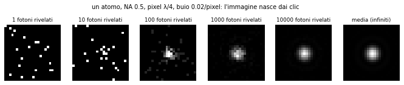
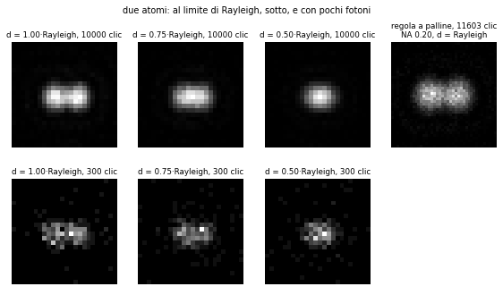

# Come i fotoni fanno un'immagine

Laboratorio: `lab/img_*.py` (Python 3.14 + numpy/scipy). Tutti i numeri qui sotto vengono da esecuzioni
reali con seed fissi su questo PC (i5-10300H, 4 core, condiviso con un altro agente che lavorava nello
stesso momento: i tempi variano fino a 2× da una corsa all'altra). Registri in `lab/out/img_*.log`
(non versionati), immagini in `lab/out/img_*.png`.

| script | che cosa fa | test | tempo |
|---|---|---|---|
| `img_core.py` | pezzi comuni: camera, PSF, Planck, idrogeno esatto, raccolta del dipolo | — | — |
| `img_sensor.py` | il sensore: clic, rumore, SNR = √N | 21/21 | 1,4 s |
| `img_pilot.py 6000` | immagine di 1 e 2 atomi con la **regola a palline** (livello 1/2) | 3/3 | 6 min 15 s |
| `img_resolve.py` | due atomi al limite di Rayleigh, statistica dei fotoni, PNG | **6/7** | 56 s |
| `img_hydrogen.py` | quanti fotoni dà un atomo di idrogeno | 3/3 | 22 s |
| `img_levels.py` | livelli di zoom per le immagini, velocità | 5/5 | 63 s |

Comandi: `PYTHONIOENCODING=utf-8 timeout 590 python lab/<script>.py` (per `img_pilot.py` il numero di
fotoni per emettitore; `img_pilot.py --analyse` rifà solo l'analisi dei clic salvati).

---

## 1. L'idea in una frase

Un'immagine **non è** una cosa che la luce "porta": è il **conteggio dei clic** su una griglia di pixel.
Ogni fotone atterra in un punto a caso, con la probabilità data dall'onda; dopo tanti clic, i pixel con
più clic sono le parti chiare. Con pochi fotoni l'immagine è una pioggia di puntini; con molti diventa
liscia. Tutto il resto (lenti, risoluzione, rumore) è **dove** atterrano i fotoni e **quanti** ne arrivano.



---

## 2. Il sensore (la camera è un dispositivo, non fisica della scena)

Un pixel conta i clic. La camera ha **parametri suoi**, quelli scritti sul foglio tecnico di chi la vende;
non sono proprietà della scena né di un materiale (`img_core.Camera`):

| parametro | che cosa fa | come entra |
|---|---|---|
| efficienza quantica QE | ogni fotone che arriva fa clic con probabilità QE | moneta per fotone (binomiale) |
| conteggi di buio (e/pixel/s) | elettroni termici che sembrano fotoni | Poisson, ∝ tempo di esposizione |
| rumore di lettura (e) | rumore dell'amplificatore, una volta per lettura | gaussiano |
| pozzo pieno, guadagno, ADC | saturazione e conversione in numeri | taglio e arrotondamento |

**Risultato** (`img_sensor.py`, 400 000 pixel per riga):

| fotoni per pixel N | SNR misurato (camera ideale) | √N | Fano (varianza/media) | SNR camera reale* misurato | teoria QE·N/√(QE·N + buio + lettura²) |
|---|---|---|---|---|---|
| 1 | 0,9987 ± 0,0014 | 1 | 1,0006 | 0,4548 ± 0,0016 | 0,4544 |
| 10 | 3,1688 ± 0,0036 | 3,1623 | 0,9970 | 2,4947 ± 0,0030 | 2,4927 |
| 100 | 9,975 ± 0,011 | 10 | 1,0052 | 8,839 ± 0,010 | 8,818 |
| 1000 | 31,69 ± 0,04 | 31,62 | 0,9959 | 28,23 ± 0,03 | 28,24 |
| 10 000 | 99,95 ± 0,11 | 100 | 1,0009 | 89,38 ± 0,10 | 89,43 |

\* QE 0,8, buio 0,05 e per pixel per esposizione, lettura 1,5 e.

* **SNR = √N**: con 100 fotoni per pixel l'errore è del 10%, con 10 000 dell'1%. Non è un difetto
  della camera: è il fatto che la luce arriva a granelli (rumore di Poisson, Fano = 1).
* Il rumore di lettura conta solo con pochissimi fotoni: con 1,5 e di lettura l'SNR è metà di quello
  ideale a 0,77 fotoelettroni per pixel, ed entro il 10% dell'ideale solo sopra 9,8.
* I clic contati **fotone per fotone** (moneta QE su ciascun fotone atterrato) e quelli estratti in blocco
  da Poisson danno lo stesso SNR (test T4): le due strade sono la stessa fisica.
* Un'immagine intera (Airy su 64×64 pixel): errore rms 65% / 20% / 6,7% / 2,2% / 0,65% con
  10² … 10⁶ fotoni in tutto; pendenza −0,498 (teoria −0,5).

Un errore di analisi (corretto, non è cambiata nessuna tolleranza): nella prima corsa l'SNR della camera
reale contava come segnale anche la media del buio; T3 falliva a N = 1 e 10. Il segnale si misura dopo
aver sottratto il buio medio (calibrazione), come in ogni camera vera.

---

## 3. Un atomo visto da una lente, con la regola a palline (`img_pilot.py`)

**Scena** (unità λ = 1): un emettitore puntiforme a 40 λ da una lente sottile ideale, pupilla di raggio
8 λ, sensore a 40 λ dall'altra parte (ingrandimento −1), **NA = 0,196**. La lente è una **lamina di
fase quadratica** exp(−i k r²/2f): nessun materiale. Sulla pupilla l'onda è l'onda sferica dell'emettitore
per la fase della lente; le palline-fotone nascono lì con probabilità |B|² e volano guidate dalle
palline-onda della regola base v2 (`docs/REGOLA_BASE.md`), **senza nessun ritocco**. Aberrazione della
lente quadratica rispetto a una lente perfetta: r⁴/8 (1/s_o³ + 1/s_i³) = 0,016 λ al bordo, trascurabile.
Palline-onda: 3324 origini × 3217 direzioni = 1,07·10⁷ (livello 0).

| misura | palline (6000 fotoni, 5791 clic) | onda esatta (Rayleigh–Sommerfeld vettoriale, stessa pupilla) | formula 0,61 λ/NA | esito |
|---|---|---|---|---|
| raggio del primo anello scuro | 3,169 ± 0,028 λ | 3,142 λ | 3,110 λ | **PASS** (tolleranza max(3σ, 3%)) |
| stesso stimatore su campioni ideali dell'onda esatta | — | 3,124 ± 0,025 | | |
| istogramma radiale contro l'onda: correlazione | 0,9996 | | | **PASS** (≥ 0,98) |
| errore rms nei bin luminosi | 7,5% | campionatore ideale 10,5 ± 2,6% | | χ²/gdl 0,69 |
| frazione dentro il primo anello | 0,902 | 0,908 | | |
| secondo emettitore a 0,61 λ/NA (scena sua): distanza tra le due nuvole di clic | 3,128 λ | | 3,110 λ | **PASS** (±5%) |
| due emettitori: buca/picco (finestre 0,8 × 1 λ) | 0,783 ± 0,046 | 0,774 (stesse finestre); 0,742 puntuale | 0,735 | |

**Che livello e che errore.** Qui si usa il **livello 1/2** (palline-onda + una pallina-fotone per
fotone). Contro il livello 3 (l'onda) le palline non mostrano errore oltre il rumore dei clic (7,5% contro
10,5% atteso dal solo rumore). La formula da libro di testo 0,61 λ/NA (Airy parassiale, livello 3
semplificato) sbaglia il primo zero dell'1,0% a NA 0,2 rispetto all'onda esatta (3,110 contro 3,142).

**Un fallimento, onesto.** La prima corsa ha dato FAIL sul primo zero (3,326 ± 0,013): lo stimatore era
una parabola simmetrica sul minimo, che è storto. Applicato a campioni ideali dell'**onda esatta** lo
stesso stimatore dà 3,326 anche lui: il difetto era dello stimatore, non dei fotoni. Ho rifatto l'analisi
sugli **stessi clic** con lo stimatore già validato del progetto (`base_exp2d.min_position`, cubica
pesata, quello del disco di Airy di REGOLA_BASE): PASS. La tolleranza non è cambiata.

**Due atomi**: le due scene sono separate perché due atomi indipendenti sono emettitori **incoerenti**:
i fotoni dell'uno non interferiscono con quelli dell'altro, e l'immagine è la **somma delle intensità**.
(Il fatto che un atomo emetta un fotone alla volta, l'antibunching, cambia i tempi tra i clic, non
dove atterrano: per l'immagine non serve il livello 1.)

Costo: **48 fotoni al secondo** (4 thread).

---

## 4. Risolvere due atomi (`img_resolve.py`, livello 3 + clic)

Qui l'immagine media è la somma di due Airy (livello 3), i clic li estrae la camera. NA 0,5, pixel λ/4,
buio 0,02 per pixel.

| test | misurato | teoria | esito |
|---|---|---|---|
| R1 primo zero di Airy | 0,60983 λ/NA | 0,6098 (zero di J1 / 2π) | PASS |
| R2 buca/picco alla distanza di Rayleigh | 0,7350 (0,7346 con 0,61 arrotondato) | 0,735 | PASS |
| R3 distanza di Sparrow (la buca sparisce) | 0,4736 λ/NA = 0,777 Rayleigh | 0,4735 | PASS |
| R4 stima della distanza da 10⁴ clic, d = Rayleigh | 0,9990 ± 0,0074 Rayleigh | Cramér–Rao 0,0072 (rapporto 1,034) | PASS |
| R4 idem, d = 0,5 Rayleigh | 0,5003 ± 0,0080 | Cramér–Rao 0,0083 (rapporto 0,967) | PASS |
| R5a "risolti" (test 2 contro 1 atomo a 3σ) con 10⁴ clic a d = Rayleigh | 100% | ≥ 95% | PASS |
| R5b esponente di N₉₀ ∝ d^k tra 0,5 e 0,25 Rayleigh | k = −2,72 | atteso tra −5 e −3 | **FAIL** |

Clic necessari per dire "sono due" nel 90% delle immagini: **≈ 30** a d = Rayleigh, **≈ 208** a 0,5,
**≈ 1369** a 0,25 Rayleigh.

**Cosa insegna.** Il limite di Rayleigh **non è un muro**: è il punto dove l'occhio vede la buca. Con
abbastanza fotoni si separano anche atomi più vicini (e si misura la loro distanza con l'errore minimo
possibile, Cramér–Rao). Ma il prezzo cresce in fretta quando d scende: è la "maledizione di Rayleigh".

**Il FAIL R5b.** Mi aspettavo N₉₀ ∝ d⁻⁴. Dopo la corsa ho calcolato (diagnostica, non test) l'osservatore
ideale (rapporto di verosimiglianza atteso per fotone): N₉₀ = 14 / 90 / 889 / 11 344 / 166 984 a
1 / 0,5 / 0,25 / 0,125 / 0,0625 Rayleigh, con esponenti locali −3,31, −3,67, −3,88: la legge d⁻⁴ vale
solo per d ≪ λ/NA, e tra 0,5 e 0,25 l'esponente vero è −3,3. Il mio test misura −2,72 e inoltre
chiede **1,5–2,2 volte più fotoni** dell'osservatore ideale (griglie grossolane del fit, 100 prove per
punto, griglia di N a passi di 3×). Da sistemare: fit più fine e confronto diretto con l'osservatore ideale.



(In alto a destra: gli 11 603 clic della regola a palline, sezione 3, NA 0,2, due atomi a distanza di Rayleigh.)

---

## 5. Quanti fotoni vediamo davvero da un atomo di idrogeno (`img_hydrogen.py`)

### 5.1 Le regole di luce dell'atomo (segnaposto)

`docs/MOLECOLE.md` non esiste ancora. Al suo posto uso valori di **meccanica quantistica esatta**
dell'idrogeno (equazione di Schrödinger con il potenziale di Coulomb e la massa ridotta), **risolta qui**
su una griglia radiale (`img_core.hydrogen`), non presa da tabelle di materiali.
**Segnaposto: da sostituire con il valore delle nostre palline.**

| grandezza | calcolata | forma chiusa esatta | errore relativo |
|---|---|---|---|
| E(1s) | −0,49972784 Hartree | −μ/2 | 9·10⁻¹¹ |
| E(2p) | −0,12493196 | −μ/8 | 4·10⁻¹⁰ |
| ⟨1s∣z∣2p⟩ | 0,745341 a₀ | 128√2/243 /μ | 5·10⁻¹¹ |
| polarizzabilità statica α(0) | 4,5074 a₀³ | 4,5/μ³ | 3·10⁻⁶ |
| Lyman-α | 121,568 nm, 10,199 eV | | |
| A = Γ (Einstein) | 6,2649·10⁸ s⁻¹ (τ = 1,596 ns, Γ/2π = 99,7 MHz) | | |

Struttura fine e iperfine trascurate (per il conteggio dei fotoni la riga 1s–2p è trattata come un
sistema a due livelli chiuso). Il diagramma di emissione è quello del dipolo, 3/(8π) sin²ψ.

### 5.2 (a) Luce bianca: un corpo nero come il Sole

Sorgente: corpo nero di Planck a 5772 K con le dimensioni angolari del Sole visto da 1 UA (parametri della
scena). Controllo: 1361,1 W/m² contro σT⁴(R/d)² = 1361,2 (PASS).

* Fotoni sull'atomo: 6,3·10²¹ al secondo per m².
* Sezione d'urto di Rayleigh calcolata da α(ω): 1,03·10⁻³¹ m² a 500 nm (α = 4,741 a₀³), 7,8·10⁻³⁰ m² a 200 nm.
* **Fotoni diffusi da UN atomo: 3,8·10⁻¹⁰ al secondo — uno ogni 84 anni.**
* Assorbimento risonante della Lyman-α dello stesso corpo nero: n̄ = 1,2·10⁻⁹ fotoni per modo,
  1,3·10⁻⁵ al secondo (uno ogni 22 ore). Con un vero Sole sarebbe diverso perché la sua Lyman-α viene
  dalla cromosfera, che non è un corpo nero; qui la sorgente ha solo Planck.

### 5.3 (b) Laser risonante Lyman-α

* σ₀ = 3λ²/2π = 7,1·10⁻¹⁵ m² (≈ 7·10¹⁶ volte la sezione di Rayleigh a 500 nm).
* Intensità di saturazione I_sat = ħωΓ/(2σ₀) = 7,25 W/cm²: per s = 1 in un fascio di vita 100 µm
  servono 1,14 mW di luce a 121,6 nm.
* Fotoni diffusi: 2,8·10⁷ / 1,57·10⁸ / 2,8·10⁸ / 3,13·10⁸ al secondo a s = 0,1 / 1 / 10 / 1000;
  il massimo è Γ/2 = 3,13·10⁸.
* **Il problema vero è il rinculo.** Ogni fotone dà all'atomo 3,26 m/s (l'idrogeno è leggerissimo):
  lo sposta di 0,27 Γ in Doppler, quindi un fascio solo lo porta fuori risonanza dopo ≈ 2 fotoni.
  Con fasci contrapposti (melassa) l'atomo si raffredda al più a T_D = ħΓ/2k_B = 2,39 mK, dove si
  muove a 4,44 m/s: attraversa un elemento di risoluzione (93 nm a NA 0,8) in **21 ns**, nei quali la
  camera vede **0,33 fotoni**. Un atomo d'idrogeno libero non si fotografa: serve una trappola che lo
  tenga fermo mentre diffonde.

### 5.4 (c) Lente, camera, esposizione

Clic al secondo = fotoni diffusi × frazione raccolta (NA, dipolo) × QE. Ottica ideale (trasmissione 1).
QE = 0,5 è un parametro della camera, non un dato misurato.

| NA | raccolta: dipolo ⊥ asse | ∥ asse | isotropa | risoluzione 0,61 λ/NA | FWHM | clic/s, Lyα s = 1 | clic/s, Sole |
|---|---|---|---|---|---|---|---|
| 0,5 | 0,0941 | 0,0129 | 0,0670 | 148 nm | 125 nm | 5,2·10⁶ | 1,3·10⁻¹¹ |
| 0,8 | 0,2480 | 0,1040 | 0,2000 | 93 nm | 78 nm | 1,6·10⁷ | 3,8·10⁻¹¹ |
| 0,95 | 0,3791 | 0,2734 | 0,3439 | 78 nm | 66 nm | 2,7·10⁷ | 6,5·10⁻¹¹ |

(Le frazioni sono controllate contro le forme chiuse (4 − 3c − c³)/8 e (2 − 3c + c³)/4, c = cos θ: PASS.)

**Esposizione per un'immagine riconoscibile** (rivelare l'atomo nel 95% dei casi con falso allarme
≤ 10⁻³ in una finestra 3×3 di pixel di Nyquist λ/4NA, che contiene il 76,7% dei fotoni):

| luce | buio della camera | esposizione | fotoni rivelati |
|---|---|---|---|
| Lyα, s = 1, NA 0,8 | 0 / 10⁻³ / 1 e/pixel/s | 0,25 µs | 3,9 |
| Sole (Rayleigh), NA 0,8 | 0 | 1,0·10¹¹ s (3300 anni) | 4,0 |
| Sole (Rayleigh), NA 0,8 | 10⁻³ e/pixel/s | 2,4·10²⁰ s (7,6·10¹² anni) | — |

Per localizzare l'atomo a 1/10 della risoluzione servono ≈ 12 fotoni (σ ≈ 0,21 λ/NA /√N): 0,76 µs con il
laser. **Cioè: con il laser i fotoni bastano e avanzano; il limite è tenere fermo l'atomo. Con la luce
bianca un atomo d'idrogeno è, in pratica, invisibile.**

### 5.5 Confronto con gli esperimenti veri (rubidio, non idrogeno)

| | Bakr et al. 2009 (Nature 462, 74) | Sherson et al. 2010 (Nature 467, 68) | idrogeno qui (Lyα, NA 0,8) |
|---|---|---|---|
| atomo, riga | ⁸⁷Rb, 780 nm | ⁸⁷Rb, 780 nm | H, 121,6 nm |
| NA | 0,8 (lente a immersione solida) | 0,68 | 0,8 |
| risoluzione | FWHM misurata 570 / 630 nm; limite di diffrazione 500 nm (nostro Airy: 502 nm) | FWHM ≈ 700 nm (nostro Airy: 590 nm) | FWHM 78 nm |
| passo del reticolo | 640 nm | 532 nm | — |
| fotoni | fino a 2·10⁴ raccolti per atomo al secondo | ≈ 5000 raccolti per atomo in 900 ms; diffusione ≈ 60 kHz; efficienza totale ≈ 9% | 1,6·10⁷ clic/s |
| esposizione | 200–1000 ms → 4000–20 000 fotoni per atomo | 900 ms | 0,25 µs per vederlo |

Controllo aritmetico su Sherson: 60 kHz × 0,9 s × angolo solido 15% × trasmissione 71% = 5751 fotoni sulla
camera (articolo: ≈ 5000), × QE 0,85 = 4888. Per NA 0,68 il nostro dipolo isotropo dà 13,3% invece del
15% dell'articolo (l'articolo non dice come l'ha calcolato).

**Perché sono così diversi.**
1. **Il rubidio è pesante** (87 volte l'idrogeno) e la sua riga è nel rosso: il rinculo è minuscolo, e
   la stessa luce che lo fa brillare (una melassa ottica) lo tiene freddo dentro un reticolo profondo.
   Così può diffondere ~10⁴–10⁵ fotoni restando nel suo sito: si espone per un secondo intero.
2. **Diffonde piano di proposito**: 60 kHz, migliaia di volte meno del massimo, perché la luce deve anche
   raffreddare. L'idrogeno, al massimo, ne darebbe 3·10⁸ al secondo, ma ogni fotone lo scalcia via.
3. **La Lyman-α è nell'ultravioletto da vuoto**: risoluzione 6,4 volte migliore, ma laser, lenti e
   camere a 121 nm sono un problema di tecnologia (che qui non simuliamo: la lente è ideale e la QE è
   un parametro).
4. Le loro immagini sono peggiori del limite di diffrazione (570–700 nm contro 500–590): pixel finiti,
   moto dell'atomo nel sito, aberrazioni. Il nostro modello non ha nessuna di queste cose.

---

## 6. I livelli di zoom delle immagini (`img_levels.py`)

### 6.1 La catena

```
sorgente ── raggi (livello 4) ──► pupilla della lente ── onda (livello 3) ──► sensore ── clic (livello 2) ──► immagine
         "fotone gigante" =                          la PSF allarga il punto            la camera estrae Poisson
         un raggio con w fotoni                       d'arrivo del raggio
vicino a un atomo: le sue regole di luce (righe, Γ, α(ω), dipolo) decidono quanti fotoni e in che direzione.
```

### 6.2 Quando un gruppo di fotoni è un solo "fotone gigante"

1. **Il tratto lontano (sorgente → lente) può andare a raggi** se il numero di Fresnel della pupilla vista
   dalla sorgente N_F = a²/(λ s) è grande (criterio già misurato in `MULTIFOTONE.md` §6.3: 1% per
   N_F > 4400, 10% per N_F > 13). Esempio: pupilla di raggio 5 mm a 50 mm, λ = 500 nm → N_F = 1000: raggi buoni
   al ~2%. Nella scena di laboratorio della sezione 3 (a = 8 λ, s = 40 λ) N_F = 1,6: lì servono le palline.
2. **Al sensore i raggi da soli sbagliano**: mettono tutti i fotoni di un punto nel suo pixel geometrico.
   Errore misurato (fotoni che in realtà cadono fuori):

   | pixel (λ/NA) | 0,25 | 0,5 | 1 | 2 | 4 | 8 | 16 | 32 |
   |---|---|---|---|---|---|---|---|---|
   | errore | 82% | 47% | 16,6% | 8,9% | 4,5% | 2,3% | 1,14% | 0,57% |

   **Raggi senza onda: 10% con pixel > 1,75 λ/NA, 1% solo con pixel > 18 λ/NA** (la coda di Airy cala
   come 1/distanza). Per un oggetto esteso (disco uniforme di raggio R) la distanza tra immagine a raggi e
   immagine vera è 0,304·(R/(λ/NA))^−0,973: 10% per R > 3,1 λ/NA, 1% per R > 33 λ/NA.
   **Regola**: il fotone gigante viaggia a raggi fino alla pupilla, poi il suo punto d'arrivo si allarga
   con la PSF (livello 3). È esatto per emettitori incoerenti nella zona dove la PSF non cambia.
3. **Quanti raggi per pixel**: se ogni raggio porta w fotoni, l'immagine media ha un errore Monte Carlo
   1/√(raggi per pixel), misurato: 70,4% / 22,9% / 7,17% / 2,31% con 2 / 20 / 198 / 1982 raggi per pixel
   (1/√r: 71,0 / 22,5 / 7,10 / 2,25%; esponente −0,496). **Per un errore ε servono 1/ε² raggi per pixel**
   (10%: 100; 1%: 10⁴), qualunque sia il numero di fotoni veri.
4. **Quando contano i clic singoli (luce debole)**: se i fotoni veri per pixel sono **meno** di 1/ε²,
   conviene usare **un raggio per fotone**: il rumore Monte Carlo è allora esattamente il rumore fisico
   (Fano misurato 1,0026). Se invece si usano fotoni giganti con w = 10 e li si conta come clic, il rumore
   è sbagliato (Fano 9,993); va rifatto così: fotoni giganti → immagine media → la camera estrae Poisson
   (Fano 1,0012). **Regola**: fotoni giganti solo per costruire la media; i clic li fa sempre la camera.
5. Nessuna parte di un'immagine ordinaria richiede il livello 1: le palline-fotone servono solo per luce
   non classica **misurata** come tale (correlazioni tra clic, HOM, entanglement).

### 6.3 Velocità su questo PC (numpy, un processo; due corse, macchina condivisa)

| cosa | velocità |
|---|---|
| raggi attraverso la lente (livello 4) | 7,3·10⁶ – 1,4·10⁷ al secondo |
| punti d'arrivo estratti dalla PSF di Airy (livello 3) | 3,4·10⁶ – 6,5·10⁶ al secondo |
| fotone completo: punto della sorgente + PSF + pixel | 2,0·10⁶ – 3,5·10⁶ al secondo |
| immagine media 1024² ⊗ PSF 129² (FFT, livello 3) | 0,06 – 0,14 s |
| camera (Poisson + buio + lettura) | 5·10⁶ – 9·10⁶ pixel al secondo |
| regola a palline (livello 1/2), NA 0,2 | 48 fotoni al secondo |

La catena raggi + onda + clic è **≈ 4·10⁴ volte** più veloce della regola a palline, e per le immagini di
emettitori incoerenti dà lo stesso risultato entro il rumore (sezione 3).

---

## 7. Che cosa non funziona o non è ancora fatto (onestà)

1. **R5b FAIL** (sezione 4): l'esponente della maledizione di Rayleigh misurato è −2,72 contro −3,3 dell'osservatore
   ideale a quelle distanze; il mio test di risoluzione spreca 1,5–2,2× fotoni. Previsione −4 sbagliata
   per queste distanze (vale solo per d ≪ λ/NA).
2. **PSF scalare e parassiale** (Airy) nel livello 3: errore 1,0% sul primo zero a NA 0,2 contro l'onda
   vettoriale esatta. A NA 0,8 (gli esperimenti del rubidio) gli effetti vettoriali e l'orientazione del
   dipolo cambiano la PSF: **non misurato**. Si può fare con la stessa quadratura di `img_pilot.py`.
3. La regola a palline è stata provata solo a NA 0,2 (pupilla 16 λ): una NA alta richiede più distanza
   e più palline; costo non misurato.
4. Le regole dell'atomo sono un **segnaposto** (idrogeno esatto, sistema a due livelli, niente struttura
   fine e iperfine, niente fotoionizzazione o Raman). Da sostituire con `docs/MOLECOLE.md`.
5. Il moto dell'atomo durante l'esposizione è stimato (tempo per attraversare un elemento di risoluzione
   al limite Doppler), non simulato: niente trappola, niente immagine sfocata dal moto.
6. Ottica ideale: nessuna aberrazione, trasmissione 1, nessuna luce diffusa di fondo. Nel caso del Sole
   si assume che la luce diretta non entri nella lente (campo scuro).
7. Solo Python; nessun visore Rust.
