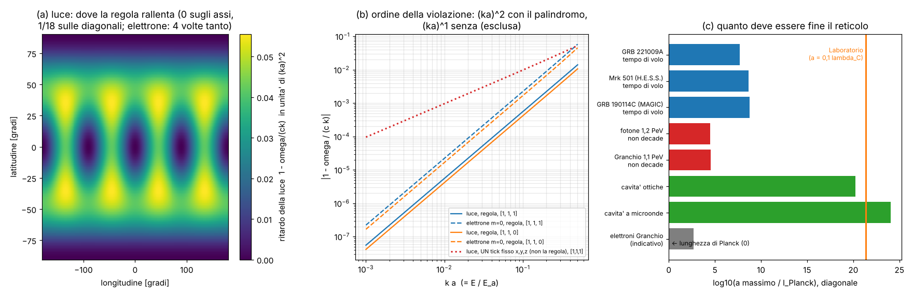

# Quanto deve essere fine il reticolo dell'universo (limiti di Lorentz per la regola zig-zag)

Studio `lv_` — 2026-10-13. Regola: `lab/zz_core.py` congelata, nessuna modifica. Parametri liberi: **0**
(il passo a è l'incognita da limitare; l'orientazione del reticolo rispetto al cielo è sconosciuta e la tratto come
caso peggiore / caso medio, non la aggiusto).

File: `lab/lv_core.py` (formule), `lab/lv_prereg.py` → `lab/out/lv_prereg.json` (commit aa9df3f, prima delle
corse), `lab/lv_r1.py` → `lab/out/lv_r1.json` (controllo numerico), `lab/lv_r2.py` → `lab/out/lv_r2.json` (limiti),
`lab/out/lv_emendamenti.json`, `lab/lv_figure.py` → `lab/out/lv_figure.png`.

## In una riga

Se l'universo fosse **davvero** la nostra regola su un reticolo di passo a, la luce e l'elettrone avrebbero
"impronte" del reticolo. Le abbiamo calcolate esattamente: **niente** termine lineare in E, **niente** birifrangenza,
solo un rallentamento ∝ (E a/ħc)² che dipende dalla direzione (zero sugli assi, massimo in diagonale) ed è **4 volte
più forte per l'elettrone che per il fotone**. Per questo i fotoni di altissima energia potrebbero decadere in e⁺e⁻:
l'osservazione di fotoni da 1,2 PeV (LHAASO) impone **a ≲ 5·10⁻³¹ m ≈ 3·10⁴ lunghezze di Planck**. Non è uno
scandalo: un reticolo alla scala di Planck passa tutti gli esami di oggi. Il reticolo del **nostro Laboratorio**
(a ≈ 0,1 λ_C ≈ 4·10⁻¹⁴ m) invece è escluso da **17 ordini di grandezza**: il reticolo del calcolo non può essere
quello fisico, e l'unico modo di salire dal calcolo all'universo è estrapolare a → 0 e usare l'agglomeratore.

---

## 1. Il problema (spiegato semplice)

Se lo spazio è fatto di celle, un'onda molto corta (energia alta) "sente" le celle: va un po' più piano, o più
veloce, in modo diverso a seconda della direzione, e forse a seconda della polarizzazione. È il programma della
"fenomenologia della gravità quantistica" (Amelino-Camelia et al. 1998; review Mattingly, *Living Rev. Rel.* 8, 5
(2005); Liberati, *CQG* 30, 133001 (2013); Addazi et al., *Prog. Part. Nucl. Phys.* 125, 103948 (2022)).
Si scrive di solito

  v(E) = c [1 − s (n+1)/2 · (E/E_QG,n)ⁿ]

con n = 1 (lineare: operatori di dimensione 5) o n = 2 (quadratico: dimensione 6). Più E_QG,n è grande, meno
c'è violazione.

**Cosa è noto (numeri verificati online dove indicato):**

| esperimento | cosa misura | limite | verificato |
|---|---|---|---|
| LHAASO, GRB 221009A (*PRL* 133, 071501 (2024)) | ritardo dei fotoni TeV | E_QG,1 > 10 E_Pl; **E_QG,2 > 6·10⁻⁸ E_Pl = 7,3·10¹¹ GeV** | sì (arXiv 2402.06009) |
| MAGIC, GRB 190114C (*PRL* 125, 021301 (2020)) | ritardo | E_QG,2 > 6,3·10¹⁰ GeV | memoria |
| H.E.S.S., Mrk 501 (*ApJ* 870, 93 (2019)) | ritardo | E_QG,2 > 8,5·10¹⁰ GeV | memoria |
| Fermi, GRB 090510 (Abdo et al., *Nature* 462, 331 (2009); Vasileiou et al., *PRD* 87, 122001 (2013)) | ritardo | E_QG,1 > 1,2–7,6 E_Pl | memoria |
| LHAASO, fotone 1,42 PeV (J2032+4102; *Nature* 594, 33 (2021)) e Granchio 1,1 PeV (*Science* 373, 425 (2021)) | il fotone **non decade** in e⁺e⁻ | fotone superluminale: E_LV,2 ≥ 1,4·10¹⁵ GeV (Chen et al., arXiv 2105.07927) | sì |
| elettroni del Granchio ~2,3 PeV (Li e Ma, *PLB* 829, 137034 (2022)) | niente Čerenkov nel vuoto | elettrone superluminale: E_LV,2 ≳ 2·10¹⁶ GeV | sì |
| piano fotone–elettrone (He e Ma, arXiv 2308.02021) | γ→ee ed e→eγ insieme | solo n = 1 numerico | sì |
| Pierre Auger (*JCAP* 01 (2022) 023) | propagazione dei raggi cosmici | δ_had,2 < 10⁻⁵⁷ eV⁻² (segno superluminale); δ_γ,2 > −10⁻⁵⁸ eV⁻² (solo con protoni oltre 10¹⁹ eV) | sì (arXiv 2112.06773) |
| Jacobson, Liberati, Mattingly (*Nature* 424, 1019 (2003)) | sincrotrone del Granchio | elettroni, n = 1 | memoria |
| polarizzazione di GRB e CMB (Kostelecký e Mewes, *PRL* 110, 201601 (2013) e seguenti) | **birifrangenza** | coefficienti d = 5 ≲ 10⁻³⁴ GeV⁻¹: fortissimo | memoria |
| cavità ottiche (Herrmann et al., *PRD* 80, 105011 (2009)) | isotropia di c (Michelson moderno) | Δc/c ≲ 10⁻¹⁷ | memoria |
| cavità a microonde (Nagel et al., *Nat. Commun.* 6, 8174 (2015)) | isotropia di c | Δc/c ≲ 10⁻¹⁸ | sì (titolo) |
| tabelle SME (Kostelecký e Russell, *RMP* 83, 11, aggiornate ogni anno, arXiv 0801.0287) | tutto | — | memoria |

**Automi cellulari quantistici e Lorentz (letteratura sulla nostra famiglia di regole):**
Bialynicki-Birula (*PRD* 49, 6920 (1994)) costruisce Weyl, Dirac e Maxwell come automi su reticolo cubico (è la
regola da cui viene la nostra). D'Ariano e Perinotti (*PRA* 90, 062106 (2014)) derivano Weyl/Dirac come automa
su reticolo **BCC**; Bisio, D'Ariano, Tosini (*Ann. Phys.* 354, 244 (2015)) il Dirac in 1-D; Bisio, D'Ariano,
Perinotti, "Quantum cellular automaton theory of light" (*Ann. Phys.* 368, 177 (2016), arXiv 1407.6928) fanno il
fotone come **coppia di Weyl con k/2 ciascuno** e dicono che l'unico effetto accessibile oggi è il ritardo dei
lampi da distanze cosmologiche; Bibeau-Delisle et al. (*EPL* 109, 50003 (2015)) e Bisio, D'Ariano, Perinotti
(*PRA* 94, 042120 (2016)) mostrano che le simmetrie dell'automa danno una relatività "deformata" alla Planck
(tipo DSR). Arrighi, Facchini, Forets (*NJP* 16, 093007 (2014)) studiano la covarianza di Lorentz discreta dei walk.
Il problema generale delle correzioni radiative è in Collins, Perez, Sudarsky, Urrutia, Vucetich (*PRL* 93, 191301
(2004), gr-qc/0403053). Non ho trovato (ricerca rapida) nessuno che abbia fatto **per la nostra regola specifica**
(reticolo cubico, ordine degli assi alternato x,y,z | z,y,x, fotone spin-1 indipendente dall'elettrone) lo sviluppo
completo con la cinematica di soglia e i limiti di LHAASO. Non posso escludere che le formule chiuse sotto siano già
in Bialynicki-Birula 1994: non l'ho potuto controllare riga per riga.

## 2. Cosa dice la regola (derivazione, prima dei dati)

**Un trucco che rende tutto esatto.** In uno spazio di Fourier, un passo lungo l'asse j per la pallina di luce è
exp(−i k_j a S_j): con gli S_j di spin 1 questa è **una rotazione di angolo k_j a attorno all'asse j**. Due tick
(x,y,z poi z,y,x) sono il prodotto di 5 rotazioni R_x R_y R_z² R_y R_x. Le rotazioni si compongono con i quaternioni,
e viene (sympy, poi verificato numericamente):

> **luce:** cos(ω Δt) = cos(k_x a) · cos(k_y a) · cos(k_z a)

La formula del piano x–z già trovata in `ZIGZAG.md` (cos ω = cos k_x a cos k_z a) è il caso k_y = 0.
Per lo spin ½ il passo è exp(−i k_j a σ_j), che è una rotazione di angolo **doppio** (2 k_j a) — è il famoso
"spin ½ gira due volte". Con la rotazione di massa θ = m c a/ħ in mezzo:

> **elettrone:** cos(2 ω Δt) = cos²θ · cos(2k_x a) cos(2k_y a) cos(2k_z a) − sin²θ

(la forma massiva l'ho trovata con una prova numerica su 4 punti prima di pre-registrare: dichiarato.) Senza massa
segue un'identità esatta a tutti gli ordini: **ω_elettrone(k) = ω_luce(2k) / 2**.

**Sviluppo** (ħ = c = 1, E_a = ħc/a, A(n̂) = n_x²n_y² + n_y²n_z² + n_z²n_x², che vale 0 sugli assi, 1/4 sulle
diagonali di faccia, 1/3 sulla diagonale del cubo; media sulla sfera 1/5):

- luce: ω = k [1 − (A/6)(k/E_a)² + …], velocità di gruppo v = 1 − (A/2)(E/E_a)²;
- elettrone: E² = m² + p² − (4/3) A p⁴/E_a² − m²p²/(3E_a²) + …

**Cosa questo significa:**
1. **Nessun termine lineare in E (n = 1).** Merito del tick palindromico: un prodotto simmetrico di esponenziali ha
   solo potenze dispari nel logaritmo, quindi ω è dispari in k e la prima correzione è (ka)². Con un ordine **fisso**
   x,y,z il termine lineare c'è: ω = k [1 ∓ n_x n_y n_z (ka)/2], con segno opposto per k e −k (in metà delle
   direzioni la luce sarebbe **più veloce di c**).
2. **Nessuna birifrangenza, esatta.** La matrice di Bloch della luce è reale (è una rotazione), quindi le due elicità
   hanno |ω| identico per ogni k, a tutti gli ordini. Il doppietto di spin dell'elettrone è degenere a tutti gli
   ordini (forma chiusa sopra).
3. **Anisotropia con simmetria cubica** (A è invariante per le 48 operazioni del cubo, anche se l'ordine degli assi
   x,y,z | z,y,x sembrerebbe privilegiare z): zero sugli assi, massima sulle diagonali. Nessun termine di dimensione 4
   (a k → 0 tutto va a c in ogni direzione).
4. **L'elettrone è 4 volte più "lento di reticolo" del fotone** (stessa direzione, stesso impulso). Conseguenze di
   cinematica (conto mio, con le dispersioni esatte):
   - **γ → e⁺e⁻ è PERMESSO** sopra una soglia: Δ E = (A/2)(1−2x)² k³/E_a² − m²/(2k x(1−x)), massimo per
     x(1−x) = 1/8, soglia **k_th = 2 √(m E_a) · A^(−1/4)**;
   - **e → e γ (Čerenkov nel vuoto) VIETATO**, γ → γγ vietato, e → 3e e ν → 3ν vietati (stessa legge per tutti:
     la concavità fa costare di più i pezzi).

## 3. Esami pre-registrati (`lv_r1.py`, 1,8 s)

| esame | soglia | trovato | esito |
|---|---|---|---|
| E1 forma chiusa luce (2000 k) | < 1e−12 | 7,5·10⁻¹⁶ | PASS |
| E2 forma chiusa Dirac + spin degenere | < 1e−12 | 5,3·10⁻¹⁶ / 4,4·10⁻¹⁶ | PASS |
| E3 coefficiente di k³ (5 direzioni, luce ed elettrone) | < 1e−6 | 2,7·10⁻⁸ | PASS |
| E4 birifrangenza \|ω₊\| − \|ω₋\| | < 1e−12 | 4,4·10⁻¹⁶ | PASS |
| E5 termine lineare (palindromo) / un tick ∓n_xn_yn_z/2 | < 1e−8 / 1e−6 | 1,1·10⁻¹⁰ / 1,3·10⁻⁸ | PASS |
| E6 simmetria cubica (48 operazioni) | < 1e−12 | 5,0·10⁻¹⁶ | PASS |
| E7 ω_e(k) = ω_γ(2k)/2 | < 1e−12 | 2,2·10⁻¹⁶ | PASS |
| E8 soglia γ→ee numerica vs analitica (9 casi) | 1 % | 1,1·10⁻⁴ | PASS |
| E8 e→eγ vietato | max ΔE < 0 | −1,1·10⁻⁹ | PASS |
| E8 γ→γγ vietato | max ΔE ≤ 1e−15 | 1,5·10⁻¹² (sull'asse) | **FAIL formale** |

Il FAIL di E8 è una soglia scritta male da me: sugli assi la dispersione è esattamente lineare, ΔE = 0 esatto, e
arccos vicino a 1 dà un arrotondamento di 10⁻¹²; fuori dagli assi ΔE ≈ −1,5·10⁻¹⁰ (vietato). Emendamento EM1 in
`lab/out/lv_emendamenti.json`. Controllo extra non collineare: aprire un angolo fra e⁺ ed e⁻ riduce sempre l'eccesso
(il massimo è collineare). Valori numerici del coefficiente di k³ (luce, analitico −A/6): asse 0 (−4·10⁻⁹),
faccia −0,0416667 (−1/24), corpo −0,0555556 (−1/18); elettrone esattamente 4 volte. La tabella di `ZIGZAG.md`
(−0,86 % in diagonale a λ = 16a) è ritrovata: −(1/18)(2π/16)² = −0,857 %.

## 4. Quanto deve essere fine il reticolo (`lv_r2.py`)

Passo massimo a, con la dispersione esatta della regola (A = 1/3: sorgente in diagonale, caso peggiore;
A = 1/5: valore medio). 1 l_P = 1,616·10⁻³⁵ m.

| esperimento | come entra | a_max (A = 1/3) | in l_P | a_max (A = 1/5) | in l_P |
|---|---|---|---|---|---|
| **fotone 1,2 PeV non decade (LHAASO J2032+4102)** | k_th > E_γ | **4,8·10⁻³¹ m** | **3,0·10⁴** | 6,2·10⁻³¹ m | 3,8·10⁴ |
| fotone 1,1 PeV dal Granchio | idem | 5,8·10⁻³¹ m | 3,6·10⁴ | 7,5·10⁻³¹ m | 4,6·10⁴ |
| GRB 221009A, tempo di volo (LHAASO) | E_QG,2 = E_a √(3/A) | 8,1·10⁻²⁸ m | 5,0·10⁷ | 1,0·10⁻²⁷ m | 6,5·10⁷ |
| Mrk 501 (H.E.S.S.) | idem | 7,0·10⁻²⁷ m | 4,3·10⁸ | 9,0·10⁻²⁷ m | 5,6·10⁸ |
| GRB 190114C (MAGIC) | idem | 9,4·10⁻²⁷ m | 5,8·10⁸ | 1,2·10⁻²⁶ m | 7,5·10⁸ |
| cavità ottiche, Δc/c < 10⁻¹⁷ a 1,17 eV | anisotropia fra bracci (ΔA ≤ 1/4) | 2,6·10⁻¹⁵ m | 1,6·10²⁰ | idem | idem |
| cavità a microonde, 10⁻¹⁸ a 13 GHz | idem | 1,8·10⁻¹¹ m | 1,1·10²⁴ | idem | idem |
| *indicativo:* elettroni del Granchio 2,3 PeV (Lorentz massimo dell'elettrone ≥ 4,5·10⁹) | γ_max = √(E_a/(4√A m)) | 8,3·10⁻³³ m | 5·10² | 1,1·10⁻³² m | 6,6·10² |
| birifrangenza (GRB, CMB) | **zero esatto nella regola** | nessun limite | — | — | — |

**Il più severo (robusto): il fotone PeV che non decade, a ≲ 5·10⁻³¹ m ≈ 3·10⁴ l_P**, cioè E_a = ħc/a ≳ 4·10¹⁴ GeV.
È ~1700 volte più severo del tempo di volo dei GRB (che per n = 2 è debole: E² sotto la scala). Le cavità, che per
n = 2 misurano a energie di un elettronvolt, sono deboli di 16 ordini rispetto ai fotoni PeV. L'indicativo degli
elettroni del Granchio (dipende da come si deduce l'energia degli elettroni dal modello di Compton inverso) darebbe
~500 l_P.

**Verdetto secondo i criteri pre-registrati: COMPATIBILE** (a_max ≥ 10 l_P). Un reticolo a passo di Planck oggi
passa: ritardo previsto per GRB 221009A a 10 TeV in diagonale = 9·10⁻¹⁵ s (niente da misurare), soglia di
decadimento del fotone ≈ 2·10¹⁷ eV.

**Casi condizionati (non contati):**
- Auger, adroni: il limite δ_had,2 < 10⁻⁵⁷ eV⁻² è per adroni **superluminali**; nella regola le palline sono tutte
  sub-luminali, e comunque il protone è un composto (dipende da come l'agglomeratore eredita la dispersione).
  Non si applica.
- Auger, fotoni: δ_γ,2 > −10⁻⁵⁸ eV⁻² presuppone elettroni senza violazione; nella regola i fotoni sopra k_th
  decadono, cioè ci sarebbero **meno** fotoni ultra-energetici, non di più. Auger ne ha visti zero: nessun conflitto.
- Neutrini (IceCube, KM3NeT 220 PeV): sarebbero walker di Weyl con lo stesso coefficiente dell'elettrone; ν → 3ν e
  ν → ν e⁺e⁻ sono vietati (controllo EM2), il ritardo è piccolissimo. Nessun limite utile.

**Variante senza palindromo (un tick a ordine fisso; NON la regola):** termine n = 1 con fotone superluminale in metà
delle direzioni → tempo di volo: a < 0,02 l_P; decadimento del fotone superluminale (E_LV,1 ≥ 1,7·10²⁴ GeV):
**a < 4·10⁻⁵ l_P**. Cioè: **senza l'alternanza degli assi la regola sarebbe esclusa come teoria fondamentale**
(servirebbe un passo 25 000 volte sotto Planck). L'alternanza x,y,z | z,y,x, che avevamo messo per avere il
second'ordine nel calcolo, è anche ciò che salva la regola dagli esperimenti.

**Previsione falsificabile (nuova, per la nostra regola):** a_max ∝ 1/E_γ². Un solo fotone cosmico da **1 EeV**
(10¹⁸ eV) che arrivi da una direzione non vicina a un asse del reticolo darebbe a < 0,04 l_P (A = 1/3), cioè
escluderebbe la regola con passo di Planck. Auger, TA e i futuri GRAND/POEMMA cercano proprio questi fotoni.

## 5. Il limite onesto del framework

| | passo |
|---|---|
| Laboratorio (a = 0,05 … 1 λ_C) | 1,9·10⁻¹⁴ … 3,9·10⁻¹³ m = 10²¹ … 2·10²² l_P |
| massimo ammesso (fotoni PeV) | 5·10⁻³¹ m = 3·10⁴ l_P |
| distanza | **~17 ordini di grandezza** (≈ 8·10¹⁶ a a = 0,1 λ_C) |

Nel "mondo del Laboratorio" preso alla lettera: la luce visibile avrebbe un'anisotropia di 8·10⁻¹⁵ (le cavità
vedono 10⁻¹⁷: già escluso di un fattore ~800), e i fotoni sopra ~4 MeV in diagonale decadrebbero da soli in
coppie. Quindi:

1. **Il reticolo del calcolo non è e non può essere il reticolo fisico.** Ogni numero del Laboratorio va letto come
   una discretizzazione da estrapolare a a → 0 (come già facciamo).
2. **"Una sola strada" regge, ma solo con l'agglomeratore.** Se la regola fosse la fisica vera, il suo passo sarebbe
   ≤ 10⁴ l_P (≤ 5·10⁻³¹ m): fra il passo vero e l'atomo (5·10⁻¹¹ m) ci sono ≥ 20 ordini, fra il passo vero e il passo del Laboratorio ≥ 17.
   Nessun calcolo diretto li attraversa: l'unico modo è bloccare–imparare–controllare–ripetere, livello per livello.
3. **Niente di strutturale nella dispersione libera la esclude.** Non c'è un termine d = 4 (anisotropia che non
   sparisce a bassa energia), non c'è un termine lineare (d = 5), non c'è birifrangenza: i tre killer classici dei
   reticoli fondamentali mancano tutti, e mancano **esattamente** (a tutti gli ordini, per simmetria), non per un
   caso numerico. La parte (ka)² che le cavità vedono è innocua per qualunque a ≲ 10⁻¹⁵ m.
4. **Il rischio strutturale vero (NON calcolato qui): le correzioni radiative.** Collins et al. (2004) mostrano che in
   una teoria con interazioni le violazioni alla scala del reticolo "risalgono" con i loop fino alle basse energie
   con un peso ~ α/π, **non** soppresso da a. La simmetria cubica della regola vieta un'anisotropia di dimensione 4
   (un tensore simmetrico invariante per il cubo è ∝ δ_ij), ma **non** vieta una differenza isotropa fra la velocità
   limite del fotone e quella dell'elettrone (il coefficiente κ̃_tr della SME). In reticolo euclideo una simmetria
   ipercubica tempo↔spazio la protegge; nella nostra regola il tick e la cella non sono legati da una simmetria
   del reticolo, quindi **non c'è una protezione evidente**. Stima ingenua: |κ̃_tr| ~ α/π ~ 2·10⁻³, contro limiti
   dell'ordine di 10⁻¹⁹–10⁻²⁰ dai raggi cosmici (Klinkhamer e Risse, *PRD* 77, 117901 (2008); memoria) e ~10⁻¹¹ da
   LEP/Tevatron (Klinkhamer e Schreck 2008): 16 ordini. Se un calcolo con interazioni (la polarizzazione del vuoto
   **sul reticolo** della regola, territorio dello studio `vuoto_`) trovasse un κ̃_tr ≠ 0 a bassa energia, la regola
   sarebbe esclusa come teoria fondamentale **per qualunque a**, perché nella regola la velocità c non è una manopola
   da ritoccare. Questo è il test strutturale che resta aperto, ed è il più importante.

## 6. Validazione, scoperta, limite

- **Validazione:** il controllo numerico ritrova le formule chiuse a 10⁻¹⁵ e i coefficienti a 10⁻⁸; ritrova la tabella
  di dispersione di `ZIGZAG.md`; il quadro (n = 2, soglie γ→ee) è la fenomenologia standard di Jacobson–Liberati–
  Mattingly; il mio limite da decadimento del fotone (E_a ≳ 4·10¹⁴ GeV) è dello stesso ordine di quello di letteratura
  per fotoni superluminali n = 2 (1,4·10¹⁵ GeV, Chen et al. 2021), come deve.
- **Nuovo per la nostra regola** (non trovato in letteratura in una ricerca rapida; potrebbe esistere in parte in
  Bialynicki-Birula 1994): le formule chiuse cos ω = Π cos k_j a e cos 2ω = cos²θ Π cos 2k_j a − sin²θ; l'identità
  ω_e(k) = ω_γ(2k)/2 (in Bisio–D'Ariano–Perinotti è vera **per costruzione**, perché lì il fotone è fatto di due Weyl;
  qui esce da sola dal fatto che spin ½ ruota di un angolo doppio, con fotone ed elettrone walker indipendenti); la
  conseguenza "γ → e⁺e⁻ permesso, e → eγ vietato"; il fatto che il palindromo uccida il termine n = 1 e che senza di
  esso la regola sarebbe esclusa; il numero a_max ≈ 3·10⁴ l_P e la previsione sui fotoni EeV.
  Non è una scoperta di fisica: è una carta d'identità precisa della regola davanti agli esperimenti.
- **Limite:** il reticolo del Laboratorio è escluso di ~17 ordini; la questione radiativa (κ̃_tr) è aperta e potrebbe
  escludere la regola come teoria fondamentale a ogni a.

## 7. Debiti (cose messe a mano)

1. **Orientazione del reticolo rispetto al cielo** (3 angoli): sconosciuta. Non l'ho aggiustata: riporto caso peggiore
   (A = 1/3) e medio (A = 1/5). Una sorgente quasi su un asse non darebbe limite; con due sorgenti PeV diverse
   (Cygnus e Granchio) e molti GRB è improbabile, ma non l'ho quantificato.
2. **Rate del decadimento:** uso la soglia (come la letteratura), non il rate; sopra soglia il decadimento via QED è
   rapidissimo su distanze di kpc, ma non l'ho calcolato.
3. **Numeri sperimentali** presi dagli articoli (solo come esame). Alcuni citati a memoria (segnati sopra).
4. **Elettroni del Granchio da 2,3 PeV:** dedotti con un modello di Compton inverso (Li e Ma 2022): per questo il
   limite relativo è solo indicativo.
5. **Cosmologia** (Ω_m = 0,315, H₀ = 67,4) solo per il ritardo illustrativo di §4.
6. **Interazioni:** tutti i conti sono per particelle libere; il limite strutturale vero (loop) non è calcolato.

## 8. Come rifare

    export OMP_NUM_THREADS=1 OPENBLAS_NUM_THREADS=1
    cd lab
    python lv_prereg.py     # pre-registrazione (già committata)
    python lv_r1.py         # esami E1-E8, 2 s  -> out/lv_r1.json
    python lv_r2.py         # limiti E9, 1 s     -> out/lv_r2.json
    python lv_figure.py     # out/lv_figure.png

Figura: (a) dove la luce rallenta sulla sfera delle direzioni (A/6, in unità di (ka)²): zero sui 6 assi, massimo
sulle 8 diagonali; (b) l'errore va come (ka)² con il palindromo, come (ka) con un tick a ordine fisso; (c) passo
massimo ammesso da ogni esperimento, in lunghezze di Planck, con la linea del Laboratorio.

Fonti verificate online: [LHAASO GRB 221009A](https://arxiv.org/abs/2402.06009v3),
[Chen et al. fotoni PeV](https://arxiv.org/pdf/2105.07927), [Li e Ma, elettroni del Granchio](https://ar5iv.labs.arxiv.org/html/2204.02956),
[He e Ma, piano fotone-elettrone](https://arxiv.org/pdf/2308.02021), [Auger LIV](https://arxiv.org/abs/2112.06773v1),
[Bisio–D'Ariano–Perinotti, luce](https://arxiv.org/pdf/1407.6928), [Bisio–D'Ariano–Perinotti, relatività](https://arxiv.org/abs/1503.01017v3),
[Nagel et al. 2015](https://arxiv.org/pdf/1412.6954), [Collins et al. 2004](https://arxiv.org/pdf/gr-qc/0403053).
