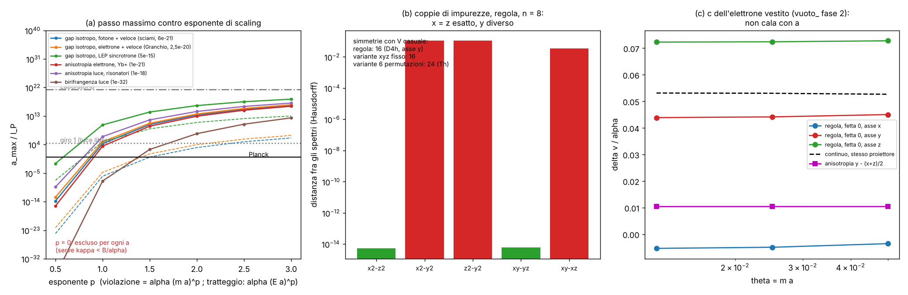

# La violazione di Lorentz che arriva dai loop (problema di Collins et al.) e il reticolo dell'universo

Studio `lvloop_` — 2026-10-13. Regola: `lab/zz_core.py` congelata, non toccata. **Parametri liberi: 0.**
Non ricalcolo nessun loop: i loop sono dello studio `vuoto_` (Debiti). Qui ci sono teoria, simmetria, un controllo
numerico della simmetria della regola con interazioni, i limiti sperimentali e una tabella di verdetti preparata
prima dei loro numeri.

File: `lab/lvloop_prereg.py` → `lab/out/lvloop_prereg.json` (commit f0f5d43, **prima** delle corse),
`lab/out/lvloop_emendamenti.json` (EM1, commit prima della corsa v2), `lab/lvloop_sym.py` → `lab/out/lvloop_sym.json`,
`lab/lvloop_figure.py` → `lab/out/lvloop_figura.png`.

## In una riga

Il giro 1 diceva: "la luce libera della regola ha solo una violazione (ka)² con simmetria del cubo: con passo di
Planck passa tutto". **Con le interazioni questa frase non regge più così com'è.** La regola congelata, in realtà,
**non** ha la simmetria del cubo. Ha solo quella di un prisma a base quadrata (D₄h), con l'asse **y** (il passo di mezzo
di xyz|zyx) diverso dagli altri due: l'ho misurato, ed era il risultato pre-registrato. Con questa simmetria i loop
possono dare all'elettrone (e alla luce) una c diversa lungo y. Per il meccanismo di Collins questa differenza non
cala con il passo. I primi numeri di Debiti dicono proprio questo (≈ 0,01 α, piatto in a). Se la fase 3 lo conferma,
**la regola congelata è esclusa come teoria fondamentale per qualunque passo**: gli ioni Yb⁺ vedono 10⁻²¹, la regola
darebbe ~10⁻⁴. Con l'ordine dei passi a giro torna una simmetria abbastanza alta da vietare l'anisotropia. Resta però
un pericolo che nessuna simmetria della regola copre: la **c isotropa dell'elettrone diversa da quella della luce**.
Per quella il numero che decide non esiste ancora (manca il vestito della luce).

---

## 1. Il problema (spiegato semplice)

Una particella che vola non è mai sola: emette e riassorbe continuamente fotoni virtuali, e quei fotoni hanno
**tutti** gli impulsi, anche quelli grandi come 1/a, dove il reticolo si sente al 100 %. Il risultato di questa
"nuvola" finisce dentro le proprietà della particella che vediamo a bassa energia: massa, momento magnetico,
**velocità limite**. Se il reticolo rompe Lorentz alla scala a, la nuvola si porta la rottura giù fino alle basse
energie. E la porta con un peso ~ α, non ~ (a·E)².

È il lavoro di **Collins, Perez, Sudarsky, Urrutia, Vucetich, PRL 93, 191301 (2004)** (verificato online):
con un sistema di riferimento privilegiato alla scala di Planck, le interazioni note producono una violazione di
Lorentz "al livello del percento", cioè **~20 ordini di grandezza** sopra le stime ingenue, a meno di sintonizzare in
modo estremo i parametri nudi.

**Le risposte (verificate online dove indicato):**
- **Gambini, Rastgoo, Pullin, CQG 28, 155005 (2011)** (arXiv 1106.1417, verificato): in approcci non perturbativi
  (gravità a loop) la deviazione può essere di un tipo diverso, che non porta per forza a effetti a bassa energia.
- **Polchinski, commento (arXiv 1106.6346, CQG 29 (2012), verificato l'arXiv):** la fisica ad alta scala appare a
  bassa energia come termini locali, e **ogni operatore permesso dalle simmetrie viene generato**. Gli operatori di
  dimensione 4 non sono soppressi dall'analisi dimensionale (coefficiente ~ M⁰). I modelli di GRP danno m⁴/M⁴ solo
  perché la soppressione è messa a mano a tutte le scale. **L'unica eccezione nota è una simmetria che vieti i
  termini di dimensione 4: la supersimmetria.**
- **Groot Nibbelink e Pospelov, PRL 94, 081601 (2005)** (arXiv hep-ph/0404271, verificato): con la supersimmetria la
  violazione è permessa solo da dimensione 4 in su. Nel MSSM la simmetria di gauge esclude anche la dimensione 4, e
  il primo termine è di dimensione 5, soppresso da 1/M. Dopo la rottura della SUSY la protezione vale solo fino a
  ~m_soft/M (dettagli non riletti: cito dall'introduzione).
- **Jacobson, Liberati, Mattingly** (Ann. Phys. 321, 150 (2006), review; a memoria) e **Mattingly, Living Rev. Rel.
  8, 5 (2005)** (a memoria) discutono lo stesso problema di "naturalezza".

**Morale per noi:** una regola su reticolo senza supersimmetria è esposta a Collins. Lo scampa solo se una
**simmetria esatta della regola** vieta i coefficienti pericolosi. Quindi la domanda è: quali simmetrie ha davvero
la regola?

## 2. Il vocabolario: la SME (Standard-Model Extension)

Kostelecký e Russell, *Data tables for Lorentz and CPT violation*, RMP 83, 11 (2011), aggiornate ogni gennaio su
arXiv 0801.0287 (verificato che esiste e si aggiorna; non ho letto l'ultima versione riga per riga). Coefficienti di
**dimensione 4** (quelli che Collins fa risalire con peso α):

| cosa fisica | coefficiente SME | rango sotto rotazioni |
|---|---|---|
| (a) c limite dell'elettrone diversa da quella della luce, uguale in tutte le direzioni | c_TT dell'elettrone (c₀₀) e κ̃_tr della luce; l'osservabile è la differenza, ~ κ̃_tr − (4/3)c₀₀ | 0 (scalare) |
| (b) c dell'elettrone diversa a seconda della direzione | c_JK a traccia nulla (5 componenti: c_Q, c₋, c_XY, c_XZ, c_YZ) | 2 |
| c della luce che dipende dalla direzione, senza birifrangenza | κ̃_e− (5) | 2 |
| luce birifrangente (le due polarizzazioni vanno a velocità diverse) | κ̃_e+ (5), κ̃_o− (5) | 2 |
| termini che dipendono da un verso (vettori) | c_TJ, κ̃_o+, b_J, … | 1 |

**Fatto chiave:** tutti i coefficienti di dimensione 4 della luce (19 = 1 + 5 + 3 + 5 + 5) e dell'elettrone hanno
rango ≤ 2 sotto le rotazioni. Quindi una simmetria discreta che **non ha tensori invarianti di rango 1 e 2** lascia
vivi solo gli scalari, cioè il gap isotropo (a).

## 3. La simmetria vera della regola (il cuore)

### 3.1 Cosa si pensava

La consegna (e il §5.4 del giro 1) diceva: "la regola ha la simmetria del cubo, e un tensore simmetrico a traccia
nulla di rango 2 invariante per il cubo è zero. Quindi l'anisotropia c_jk di dimensione 4 è vietata, e resta solo il
gap isotropo". **La matematica è giusta**: per il gruppo del cubo O_h, e anche per il suo sottogruppo T_h, la
rappresentazione l = 2 si spezza in E_g + T_2g e non contiene l'identità. Ma **la premessa è sbagliata**.

### 3.2 Cosa c'è davvero

La regola, nel tempo, è la sequenza **x y z C z y x C x y z C …** (C = moneta + fase del potenziale). Guardiamo che
posto ha ogni asse:
- x compare come "x C x", z come "z C z": si scambiano con una **traslazione di un tick**;
- y sta **sempre in mezzo**, mai accanto alla moneta. Nessuna traslazione nel tempo lo scambia con x o z.

Quindi le simmetrie della dinamica sono: l'inversione P (L↔R, k→−k), le rotazioni di π attorno ai tre assi (ogni
passo resta sé stesso) e lo scambio x↔z con un tick di ritardo. In tutto **16 elementi: il gruppo D₄h con asse
distinto y**. Le rotazioni di ordine 3 (x→y→z) **non** ci sono.

**Perché il giro 1 vedeva la simmetria del cubo:** la relazione di dispersione **libera**,
cos 2ω = cos²θ Π cos 2k_j a − sin²θ, è simmetrica in x, y, z **per caso**: la traccia di quel prodotto di rotazioni
non dipende dall'ordine. Gli **autovettori**, invece, dipendono dall'ordine. Ho cercato una matrice costante S con
S W(k) S⁻¹ = W(g k): esiste solo per x↔z (con la fetta di tempo scambiata). Per x↔y, y↔z e per la rotazione di
ordine 3 non esiste, nemmeno con trasposta, coniugio, inversa o spostamenti di π (esplorazione, scratchpad). Un loop
usa gli autovettori, cioè i vertici, e non solo la dispersione: vede il gruppo vero D₄h.

### 3.3 Controllo numerico (`lvloop_sym.py`, pre-registrato S1–S4 + EM1)

Si mette sulla regola congelata un potenziale (la sua fase di carica e^{−iV dt}, `zz_core`) e si confronta lo spettro
dell'operatore di periodo per V(r) e per V(g⁻¹r), per tutte le 48 operazioni g del cubo. Spettri uguali significa
che g è una simmetria della dinamica. Prima l'ho verificato contro `zz_core.Walk.tick`: 2·10⁻¹⁵.

| esame | previsione | trovato | esito |
|---|---|---|---|
| S1 (pre-registrato: 4 impurezze, metrica sugli angoli) | 16 | 48 a n = 6, 3 a n = 8 | **FAIL formale**: configurazione non generica e metrica sbagliata (EM1) |
| S1' (EM1: V casuale su tutti i siti, Hausdorff), regola, n = 6 (due semi) e n = 8 | 16, permutazioni {id, x↔z} | **16, {id, x↔z}** (distanza dagli altri ≥ 1,8·10⁻²; dentro il gruppo ~10⁻¹⁴) | **PASS** |
| S3' coppie di impurezze sullo stesso sottoreticolo, n = 8 | x = z ≠ y | x−z 5·10⁻¹⁵; x−y 0,108; (2,2,0)−(0,2,2) 6·10⁻¹⁵; (2,2,0)−(2,0,2) 0,034 | **PASS** |
| S2' variante "6 permutazioni a giro" | 48 | **24**, permutazioni {id, C₃, C₃²}, cioè T_h | **FAIL** sul numero; la conclusione non cambia (vedi sotto) |
| S4' variante "xyz a ogni tick" (descrittivo) | < 48 | 16 | — |

Cosa è andato storto in S1, onestamente: l'operatore di due tick collega solo siti a distanza **pari** su ogni asse
(8 sottoreticoli disgiunti: 27 siti su 216 raggiungibili da un sito). Le 4 impurezze pre-registrate cadevano ognuna
su un sottoreticolo diverso, e uno spettro così non può dipendere dalle posizioni. In più la metrica sugli angoli
ordinati salta quando un autovalore passa per ±π. Prima della corsa v2 ho fatto due prove esplorative, dichiarate in
EM1.

**S2' fallito ma innocuo:** con le 6 permutazioni a giro la rotazione di ordine 3 diventa una traslazione di 2 tick
(trovata). Lo scambio x↔z, che pensavo diventasse l'inversione temporale, invece non c'è. Il gruppo è T_h (24
elementi), non O_h. **T_h basta comunque:** non ha tensori di rango 2 a traccia nulla invarianti, né vettori. La cura
vieta l'anisotropia di dimensione 4 come l'avrebbe vietata O_h.

**Conferma indipendente:** Debiti, nello sviluppo della fase 3 (`vuoto_f3_prereg.json`, su origin/master), ha cercato
le simmetrie locali (24 rotazioni di Clifford × L/R × trasposte × fette × segni) e trova la stessa cosa: solo x↔z.
Il suo motore esatto a tempo discreto dà δv_x = δv_z esattamente. I due controlli sono fatti in modo diverso (il mio
è sugli spettri con potenziale casuale, il suo cerca operatori locali) e dicono la stessa cosa.

### 3.4 Coefficienti SME permessi in ciascun caso (dimensione 4)

Con P e T simmetrie della regola (T² = −1 esatta: studio Surfisti, origin/master 0f888bb) si eliminano anche i pezzi
dispari per P o per T.

| coefficiente | O_h o T_h (cubo, oppure ordine a giro) | D₄h asse y (regola congelata) |
|---|---|---|
| gap isotropo c_e − c_γ (c_TT, κ̃_tr) | **permesso** | **permesso** |
| c_JK dell'elettrone (rango 2) | vietato | **una componente**: c_yy − (c_xx+c_zz)/2 |
| κ̃_e− della luce (non birifrangente) | vietato | **una componente** (stessa forma) |
| κ̃_e+ della luce (**birifrangente**) | vietato | **una componente permessa** (non forzata) |
| κ̃_o−, κ̃_o+, c_TJ, b_J, … (vettori o dispari per P/T) | vietati | vietati (P e le rotazioni di π) |
| anisotropia cubica n_x⁴+n_y⁴+n_z⁴ | solo da dimensione ≥ 6, soppressa da (pa)² | idem |

Sul caso cubico la consegna aveva ragione: l'anisotropia di dimensione 4 è vietata, la n⁴ è di dimensione 6. Per la
regola congelata no.

**Il pericolo nuovo: la birifrangenza.** Una luce che si veste attraverso il vuoto (polarizzazione) con simmetria
D₄h è come un cristallo uniassico (la calcite). È birifrangente se l'anisotropia della risposta **elettrica** (ε)
è diversa da quella della risposta **magnetica** (1/μ). Se il vestito fosse "una metrica sola" (come succede quando
la luce si veste con elettroni che hanno solo c_μν), al primo ordine verrebbe solo κ̃_e−, non birifrangente. Il
reticolo però non è obbligato a dare una metrica sola. La fase 1 di Debiti ha già misurato un'anisotropia ε fra y e
(x,z) di **4·10⁻⁵** dopo la media sulle fette (V2f), e non cala con a. Manca l'anisotropia magnetica (numero N5).
I limiti sulla birifrangenza sono ~10⁻³² o meglio (a memoria).

## 4. Limiti sperimentali (solo esami)

δ = (c_e − c_γ)/c per il gap isotropo, coefficiente adimensionale per l'anisotropia.

| esperimento | cosa limita | limite | verificato |
|---|---|---|---|
| decadimento del fotone negli sciami UHE (Duenkel, Niechciol, Risse, PRD 104, 015010 (2021)) | fotone più veloce dell'elettrone | κ > −6·10⁻²¹ (98 % CL) | sì |
| fotone 1,42 PeV di LHAASO (Nature 594, 33 (2021)); conto nostro δ < 2m²/E² | idem | 2,6·10⁻¹⁹ | sì (dato), conto nostro |
| Tevatron, fotoni che non decadono (Hohensee et al., PRL 102, 170402 (2009)) | idem | 5,8·10⁻¹² | sì (via Altschul) |
| elettroni PeV del Granchio (Li e Ma, PLB 829, 137034 (2022)); conto nostro m²/2E² | elettrone più veloce (Čerenkov nel vuoto) | 2,5·10⁻²⁰ (indicativo) | sì (dato) |
| LEP, niente Čerenkov a 104,5 GeV (Hohensee et al. 2009) | idem | 1,2·10⁻¹¹ | sì |
| LEP, perdite di sincrotrone (Altschul, PRD 80, 091901 (2009)) | entrambi i segni | \|κ̃_tr − (4/3)c₀₀\| < 5·10⁻¹⁵ | sì |
| sciami UHE, Čerenkov di adroni (Duenkel et al., arXiv 2303.05849) | κ < 3·10⁻²⁰ | riguarda il protone (composto): non usato | sì |
| **Yb⁺ E3/E2, orologi** (Sanner et al., Nature 567, 204 (2019)) | **c_JK dell'elettrone** | c_X−Y 0,9 ± 1,6·10⁻²⁰; c_XY −6,9 ± 8,0·10⁻²¹; c_XZ 1,3 ± 1,3·10⁻²⁰ | sì |
| Yb⁺ Ramsey a impulsi composti (Dreissen et al., Nat. Commun. 13, 7314 (2022)) | c_JK | "livello 10⁻²¹" | sì (abstract) |
| Ca⁺ (Pruttivarasin et al., Nature 517, 592 (2015)); Dy (Hohensee et al., PRL 111, 050401 (2013)) | c_JK | 2,3·10⁻¹⁸; 5,7·10⁻¹⁷ | sì (dalla tabella di Sanner) |
| risonatori ottici e a microonde (Nagel et al., Nat. Commun. 6, 8174 (2015)) | κ̃_e− della luce | ~10⁻¹⁸ | a memoria |
| polarizzazione cosmologica e dei GRB (Kostelecký e Mewes, PRL 87, 251304 (2001); PRL 110, 201601 (2013)) | birifrangenza, dimensione 4 | ≲ 10⁻³² (GRB più forte) | a memoria |

Avvertenza sull'orientazione: se l'asse y del reticolo fosse quasi parallelo all'asse di rotazione della Terra,
l'anisotropia apparirebbe soprattutto come c_Q, che la rotazione terrestre non modula. Lì valgono limiti più deboli
(debito 1).

## 5. Tabella condizionale (pre-registrata in `lvloop_prereg.json`, prima di ogni numero della fase 3)

Scenario "tipo massa": la violazione è α·κ·θ^p con θ = m a/ħ, costante a tutte le energie (è quello che Debiti
misura variando θ). Il passo massimo vale a_max = λ_C·(B/(ακ))^{1/p}. Con κ = 1 (per κ ~ 10⁻², a_max cresce di
100^{1/p}). Scenario "tipo impulso" (α κ (Ea)^p, operatori di dimensione 4+p): a_max alla soglia del test.

| test (limite B) | p = 0 | p = 1 (massa) | p = 2 (massa) | p = 1 (impulso) | p = 2 (impulso) |
|---|---|---|---|---|---|
| gap isotropo, fotone più veloce (sciami, 6·10⁻²¹) | **esclusa per ogni a** | 3,2·10⁻³¹ m = 2·10⁴ l_P | 2·10¹³ l_P | 1·10⁻⁶ l_P (esclusa) | 1,2·10³ l_P |
| gap isotropo, elettrone più veloce (Granchio, 2,5·10⁻²⁰) | **esclusa** | 8·10⁴ l_P | 4·10¹³ l_P | 2·10⁻⁵ l_P (esclusa) | 1·10⁴ l_P |
| gap isotropo, LEP sincrotrone (5·10⁻¹⁵) | **esclusa** | 1,6·10¹⁰ l_P | 2·10¹⁶ l_P | 8·10⁴ l_P | 1·10¹¹ l_P |
| anisotropia elettrone, Yb⁺ 2022 (10⁻²¹) | **esclusa** | 3,3·10³ l_P | 9·10¹² l_P | — | — |
| anisotropia luce, risonatori (10⁻¹⁸) | **esclusa** | 3·10⁶ l_P | 3·10¹⁴ l_P | — | — |
| birifrangenza luce (10⁻³²) | **esclusa** | 3·10⁻⁸ l_P (esclusa) | 3·10⁷ l_P | — | — |

"Esclusa per ogni a" vuol dire questo: serve κ < B/α ~ 10⁻¹⁸–10⁻¹⁹, cioè sintonizzare un parametro nudo della regola
(per esempio la velocità dell'elettrone con la "moneta che respira", che la rallenta di cos μ) a 1 parte su 10¹⁶–10¹⁷.
È la scappatoia "fine tuning" di Collins: una manopola in più, e per giunta innaturale. Non la conto come salvezza.

**Scenari che la fase 3 di Debiti può trovare, e il verdetto:**

| scenario | regola congelata | ordine a giro |
|---|---|---|
| A. anisotropia q = 0 (finita per a → 0) | **esclusa per ogni a** (Yb⁺: 10⁻⁴ contro 10⁻²¹) | vietata dalla simmetria (T_h) |
| **C. anisotropia finita nella congelata, sparisce con l'ordine a giro** (chiesto dal coordinatore) | esclusa; il giudizio passa alla variante, giudicata dal suo gap isotropo (righe "gap isotropo"). Cambiare l'ordine dei passi è un cambio di regola: decide Valerio, coordinato con tutti i thread | vedi gap |
| B. anisotropia q ≥ 1 | salva con Planck (q = 1: a ≲ 3·10³ l_P per Yb⁺) | — |
| gap isotropo p = 0 | **esclusa per ogni a** salvo fine tuning | **esclusa per ogni a** salvo fine tuning |
| gap isotropo p = 1 | salva con a ≲ 2·10⁴ l_P (il limite è dello stesso ordine del giro 1) | idem |
| gap isotropo p ≥ 2 | salva largamente | idem |

**Previsioni pre-registrate per la fase 3** (P1–P4 nel json):
- P1: δv_x = δv_z esattamente (simmetria x↔z). *Già confermata in sviluppo da Debiti col motore esatto.*
- P2: nella congelata l'anisotropia y−(x+z)/2 resta finita per a → 0 (q = 0). **Questo corregge la consegna**, che
  diceva "deve sparire": sarebbe vero solo se la dinamica fosse cubica, e non lo è.
- P3: con l'ordine a giro l'anisotropia di rango 2 deve andare a zero almeno come θ², oppure essere < 10⁻³ α.
- P4: il gap isotropo non è protetto da nessuna simmetria (tick e cella non sono legati da una simmetria del
  reticolo). Previsione: p = 0, salvo cancellazioni.

## 6. I numeri di Debiti: cosa c'è oggi su origin/master (ultimo fetch: commit 63c1219)

**La fase 3 è pre-registrata (commit a38fda3) ma i risultati delle corse non sono ancora arrivati.** Ci sono:

1. **Fase 2** (H_eff, fetta 0, `vuoto_f2_exams.json`): δv/α = x −0,0036 / −0,0049 / −0,0053; y 0,0450 / 0,0441 /
   0,0439; z 0,0728 / 0,0724 / 0,0723 a θ = 0,05 / 0,025 / 0,0125. Anisotropia y−(x+z)/2 = **0,0104 α, piatta in θ
   (q = 0)**. Figura (c). Però la fase 3 dichiara che questi numeri sono **un artefatto del vertice H_eff** (x ≠ z
   rompe una simmetria esatta).
2. **Fase 3, osservazioni di sviluppo dichiarate** (motore esatto a tempo discreto, solo θ = 0,05): con il taglio
   K12 = (0,6; 1,05) x = z = −0,0365 α, y = −0,1286 α, quindi **anisotropia −0,092 α**. Con il taglio K12/3:
   (0,0440; 0,0343; 0,0440), anisotropia **−0,0097 α**. La proposta "ordine ciclico" dà 0,03964 su tutti e tre gli
   assi (isotropa, come vuole la simmetria).

**Applicazione provvisoria della tabella (non è il verdetto pre-registrato, che aspetta la fase 3):**
- **anisotropia:** tutti i numeri disponibili stanno fra 0,01 e 0,09 α, cioè (0,7–7)·10⁻⁴, e la fase 2 è piatta in θ.
  Se la fase 3 (esame A2) trova |d₀| ≥ 0,01 α, siamo nello **scenario A/C: regola congelata esclusa per qualunque a**,
  di 16–17 ordini rispetto a Yb⁺.
- **La dipendenza forte dal taglio** (−0,092 contro −0,0097 α al cambio di K12) dice una cosa importante: con il
  proiettore di specie il numero non è ancora la "regola vera" (che non ha proiettore, ma ha i doppioni e i coni).
  Anche il valore piccolo, però, sta 10¹⁶ sopra il limite. Nessuna scelta ragionevole del taglio salva la congelata.
- **gap isotropo:** oggi non decidibile. Il motore misura solo il lato elettrone. Il continuo con lo stesso
  proiettore dà anche lui ~0,053 α, che lì è puro artefatto del regolatore. La c della luce vestita non è calcolata
  (Debiti lo dichiara: con il peso di specie il vestito della luce non è invariante di gauge).

### Numeri che servono, esattamente

- **N2 / A2:** D(θ) = δv_y − (δv_x+δv_z)/2 della regola congelata a 5 θ, fit d₀ + d₁θ, con i due tagli. Decide
  l'esclusione della congelata.
- **N4 / A4, A6:** lo stesso per l'ordine ciclico (deve essere ≤ 10⁻³ α) e la sua parte isotropa.
- **N1 + vestito della luce:** il gap isotropo Δ_iso = [c_e vestito − c_γ vestita], estrapolato a a → 0, **stabile al
  cambio del regolatore**. È l'unico numero che può escludere anche la regola curata. Oggi non esiste un modo
  invariante di gauge di calcolare c_γ vestita con il proiettore. È il prossimo problema tecnico vero.
- **N5:** anisotropia magnetica della risposta del vuoto (Π trasverso a q → 0), da confrontare con quella elettrica
  (4·10⁻⁵): decide se la congelata è anche **birifrangente**.

## 7. La conclusione del giro 1, aggiornata

La frase del giro 1 era: "un reticolo a passo di Planck passa tutti gli esami di oggi; il rischio strutturale vero
sono i loop". Dopo questo studio:

1. **Per la luce e l'elettrone liberi la frase resta vera** (a ≲ 5·10⁻³¹ m ≈ 3·10⁴ l_P, fotoni PeV). Le tre
   proprietà esatte del giro 1 (niente termine lineare, niente birifrangenza libera, niente dimensione 4 libera)
   restano esatte.
2. **Con le interazioni la frase non vale più "gratis".** Il §5.4 del giro 1 diceva "la simmetria cubica della regola
   vieta un'anisotropia di dimensione 4". **Era sbagliato per la regola congelata:** la simmetria cubica è solo
   della dispersione libera. La dinamica ha D₄h con asse y (misurato: 16 operazioni, x = z ≠ y). Un'anisotropia c_jk
   con asse y è permessa, e i primi numeri dei loop la danno di ~10⁻²–10⁻¹ α, piatta in a. Se la fase 3 lo conferma,
   **la regola congelata è esclusa come teoria fondamentale per qualunque passo, anche di Planck**. Il motivo è lo
   stesso del giro 1 per l'ordine fisso dei passi: lì l'alternanza xyz|zyx salvava il termine lineare, qui non basta
   per l'anisotropia dei loop.
3. **L'ordine dei passi a giro** (rotazione di ordine 3 dentro il gruppo: T_h, misurato) vieta per simmetria tutta
   la dimensione 4 anisotropa, anche la birifrangenza. È la seconda volta che la scelta dell'ordine dei passi decide
   se la regola sopravvive agli esperimenti. Ha però un prezzo già visto da Debiti: zona di Floquet 3 volte più
   piccola (A7 iv).
4. **Anche con la cura resta il gap isotropo c_e − c_γ.** Nessuna simmetria della regola lo protegge (non c'è una
   simmetria tempo↔spazio, né la supersimmetria che Polchinski indica come unica protezione nota). Per Collins e
   Polchinski il caso generico è p = 0 con peso ~α·O(10⁻²). Se è così, **la regola è esclusa per qualunque a** (limiti
   10⁻²¹–10⁻¹⁵), salvo sintonizzare la velocità nuda dell'elettrone a 1 parte su ~10¹⁷. Se invece il gap andasse come
   (ma) (p = 1), il passo massimo sarebbe ~2·10⁴ l_P, cioè di nuovo il numero del giro 1.

**Frase aggiornata:** *"Con passo di Planck la regola passa tutti gli esami **delle particelle libere**. Con le
interazioni, la regola congelata è probabilmente esclusa a ogni passo dall'anisotropia lungo y (in attesa della fase 3
di Debiti). La versione con l'ordine dei passi a giro è protetta dall'anisotropia, ma resta esposta al gap isotropo
c_e − c_γ. Quel numero, con la c della luce vestita, non l'ha ancora calcolato nessuno."*

## 8. Validazione, scoperta, limite

- **Validazione:** il problema e la sua soluzione standard (simmetria che vieta la dimensione 4, oppure fine tuning)
  sono di Collins et al. 2004 e Polchinski 2012. Il teorema "nessun tensore di rango 2 invariante per il cubo" è di
  teoria dei gruppi. Nulla di nuovo qui.
- **Nuovo per la nostra regola (controllato):** (i) la simmetria del cubo della dispersione libera è **accidentale**;
  la dinamica ha solo D₄h con asse y, misurato con potenziali casuali (16/48, x↔z esatto a 10⁻¹⁴, x↔y rotto di
  10⁻²) e confermato in modo indipendente da Debiti con un metodo diverso; (ii) l'ordine "6 permutazioni a giro" ha
  T_h (24/48), che basta a vietare la dimensione 4 anisotropa; (iii) la regola congelata permette una componente di
  birifrangenza di dimensione 4; (iv) l'elenco dei numeri che decidono il destino della regola come teoria
  fondamentale.
- **Limite:** la regola senza supersimmetria non ha protezione per c_e − c_γ. Oggi il conto di quel numero è bloccato
  dal fatto che, con il proiettore di specie, il vestito della luce non è invariante di gauge.

## 9. Debiti (cose messe a mano o non fatte)

1. **Orientazione del reticolo rispetto al cielo e alla Terra:** sconosciuta. Uso i limiti sulle componenti come se
   l'anisotropia le riempisse; con l'asse y lungo l'asse terrestre i limiti di laboratorio si indeboliscono (c_Q).
2. **κ = 1 nella tabella:** i coefficienti veri (~10⁻²–10⁻¹) spostano a_max di (1/κ)^{1/p}, e non toccano i verdetti
   p = 0.
3. **Conversioni SME ↔ δv** fatte a meno di fattori O(1) (per esempio il 4/3 di Altschul): non cambiano gli ordini
   di grandezza.
4. **Limiti a memoria:** risonatori (10⁻¹⁸), birifrangenza (10⁻³²), H.E.S.S. elettroni 40 TeV (solo nel json, non
   usato nei verdetti).
5. **Accoppiamento della luce alla regola:** il test di simmetria usa solo il potenziale scalare (la fase di carica
   della regola). Il vertice con la luce (Peierls a ogni passo) è di Debiti. Il test basta a dire quali tensori sono
   permessi, non quanto valgono.
6. **Due fallimenti dichiarati:** S1 (configurazione non generica, EM1) e S2' (T_h invece di O_h).

## 10. Come rifare

    export OMP_NUM_THREADS=1 OPENBLAS_NUM_THREADS=1
    cd lab
    python lvloop_prereg.py        # tabella condizionale -> out/lvloop_prereg.json (già committata)
    python lvloop_sym.py           # simmetrie della regola con potenziale, ~9 min -> out/lvloop_sym.json
    git show origin/master:lab/out/vuoto_f2_exams.json > /tmp/f2.json
    python lvloop_figure.py /tmp/f2.json   # out/lvloop_figura.png

Figura: (a) passo massimo contro esponente di scaling per ogni limite (linea piena: violazione ∝ (ma)^p; tratteggio:
∝ (Ea)^p), con le linee di Planck, del giro 1 e del Laboratorio; a p = 0 tutto è escluso. (b) Regola con due
impurezze sullo stesso sottoreticolo: separazioni lungo x e lungo z danno lo stesso spettro (10⁻¹⁴), lungo y no (0,1).
(c) Il controtermine di velocità dell'elettrone vestito della fase 2 di Debiti: l'anisotropia y−(x+z)/2 è piatta in θ.

Fonti verificate online: [Collins et al. 2004](https://arxiv.org/abs/gr-qc/0403053),
[Gambini–Rastgoo–Pullin 2011](https://arxiv.org/abs/1106.1417), [Polchinski, commento](https://arxiv.org/abs/1106.6346),
[Groot Nibbelink–Pospelov](https://arxiv.org/abs/hep-ph/0404271), [Sanner et al. 2019](https://arxiv.org/abs/1809.10742),
[Dreissen et al. 2022](https://arxiv.org/abs/2206.00570), [Altschul LEP 2009](https://arxiv.org/abs/0905.4346),
[Duenkel et al. 2021, decadimento del fotone](https://arxiv.org/abs/2106.01012),
[Duenkel et al. 2023, Čerenkov](https://arxiv.org/abs/2303.05849),
[Tabelle SME](https://physics.nmu.edu/~nrussell/research/datatables.htm).
