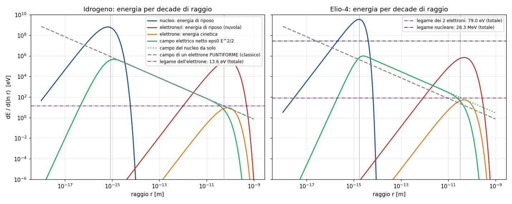

# Luce intrappolata: la materia è luce chiusa in una forma?

Laboratorio: `lab/trap_*.py` (Python 3.14 + numpy/scipy). Tutti i numeri di questo documento vengono da
esecuzioni reali con seed fissi su una macchina condivisa (i5-10300H, carica al 100% da altri lavori); registri
in `lab/out/trap_*.log`, risultati in `lab/out/trap_*.json|npz`, figure `lab/out/trap_*.png`.
Come rieseguire: §8.

---

## 1. L'ipotesi, in parole semplici

L'ipotesi di Valerio: **tutti i costituenti dell'atomo vengono da un fotone (luce) intrappolato in una forma
geometrica stabile che lo "chiude" in una particella.** Nella versione più vicina al nostro modello a palline:
un *surfista* (la pallina-fotone) che corre a velocità c sulla sua *onda* (le palline-onda), più un *fattore
geometrico esterno* che lo costringe a girare in tondo in uno stato semi-stabile, come in uno spaziotempo
attorcigliato. Se fosse vero, massa, carica e spin sarebbero proprietà della forma del giro.

Il compito qui non è né demolirla né venderla: è separare **ciò che è vero**, **ciò che è stato provato e non
ha funzionato** (e perché), e **ciò che si può ancora provare**, con numeri calcolati.

In breve, prima dei dettagli:

* **vero e misurato**: luce e materia si trasformano l'una nell'altra (γ → e⁺e⁻, e⁺e⁻ → γγ, γγ → e⁺e⁻); la
  luce chiusa in una scatola pesa E/c²; il protone è fatto per il ~99% di energia di campo (quark che si
  muovono e gluoni), non di "massa dei pezzi"; esistono (nella teoria) oggetti fatti solo di campo di gluoni.
* **provato e fallito (finora)**: elettrone come fotone chiuso in un toro, geoni di Wheeler, atomi-vortice di
  Kelvin, luce annodata come particella. Il muro più duro è sperimentale: l'elettrone è puntiforme fino a
  ~10⁻²⁰ m, non ha stati eccitati, ha spin ½ e g = 2,002 319 304 36…
* **funziona davvero, ma non è luce**: il protone (e i nuclei) come **skyrmione**, un nodo topologico stabile
  del campo dei pioni. Lo abbiamo ricalcolato: con 2 numeri fissati, predice gli altri entro il 30–50%.
* **i nostri numeri**: con la regola delle palline così com'è (= Maxwell nel vuoto) qualsiasi luce chiusa si
  apre in un tempo pari al tempo che un raggio rettilineo impiega a uscire (verificato all'1%); la vera non
  linearità del vuoto (QED) è 10⁴–10⁵ volte troppo debole per un elettrone; un indice di Kerr dà solo fasci
  (che corrono a c), non particelle ferme; forme ferme e stabili richiedono **topologia + un termine che
  impedisca il collasso** (Derrick), esattamente come nello skyrmione.

---

## 2. Che cosa è VERO: luce ↔ materia (fatti misurati)

| fatto | che cosa si vede | riferimenti primari |
|---|---|---|
| **creazione di coppie** γ → e⁺e⁻ vicino a un nucleo | soglia 2 m_e c² = 1,022 MeV; il nucleo serve solo a conservare l'impulso | Anderson, *Phys. Rev.* 43, 491 (1933); Blackett & Occhialini, *Proc. R. Soc. A* 139, 699 (1933); sezione d'urto: Bethe & Heitler, *Proc. R. Soc. A* 146, 83 (1934) |
| **annichilazione** e⁺e⁻ → 2γ | due fotoni da 511 keV opposti (è il principio della PET) | Dirac, *Proc. Camb. Phil. Soc.* 26, 361 (1930); Klemperer, *Proc. Camb. Phil. Soc.* 30, 347 (1934) |
| **Breit–Wheeler** γγ → e⁺e⁻ (solo luce!) | materia creata dall'urto di due fotoni; osservato con fotoni "quasi reali" nelle collisioni ultraperiferiche di ioni d'oro | Breit & Wheeler, *Phys. Rev.* 46, 1087 (1934); STAR, *Phys. Rev. Lett.* 127, 052302 (2021); versione multi-fotone: SLAC E144, Burke et al., *Phys. Rev. Lett.* 79, 1626 (1997) |
| **luce che diffonde luce** γγ → γγ | il vuoto quantistico è (debolmente) non lineare | ATLAS, *Nature Phys.* 13, 852 (2017) |
| **la luce chiusa ha massa** | una scatola di specchi piena di radiazione di energia E ha massa inerziale E/c² in più; E = mc² verificata a 4·10⁻⁷ confrontando masse e energie dei fotoni γ emessi | Einstein, *Ann. Phys.* 18, 639 (1905); Rainville et al., *Nature* 438, 1096 (2005) |
| **il protone è soprattutto energia di campo** | QCD su reticolo, a μ = 2 GeV: energia dei quark (moto + interazione) 32%, energia del campo dei gluoni 36%, anomalia di traccia 23%, condensato dei quark 9%. Le masse "a riposo" dei quark u, d danno ~1% | Yang et al. (χQCD), *Phys. Rev. Lett.* 121, 212001 (2018) |
| **glueball**: stati legati di solo campo di gluoni | previsti dalla QCD pura su reticolo: 0⁺⁺ ≈ 1,73 GeV, 2⁺⁺ ≈ 2,4 GeV, 0⁻⁺ ≈ 2,6 GeV; candidati sperimentali f₀(1500), f₀(1710), X(2370) (BESIII, J^PC = 0⁻⁺) ma non c'è ancora un'identificazione univoca (si mescolano con mesoni di quark) | Morningstar & Peardon, *Phys. Rev. D* 60, 034509 (1999); BESIII, *Phys. Rev. Lett.* 132, 181901 (2024); rassegna: Klempt & Zaitsev, *Phys. Rep.* 454, 1 (2007) |

Che cosa dicono e che cosa **non** dicono questi fatti:

* Dicono che l'energia non ha "etichetta": la stessa energia può essere luce o coppie elettrone-positrone, e la
  massa di un oggetto composto è in gran parte energia di campo confinato. I glueball sono letteralmente
  "particelle fatte di campo di forza intrappolato" — ma il campo è quello dei **gluoni**, che (a differenza
  dei fotoni) **interagiscono tra loro**: è questa auto-interazione che li confina.
* **Non** dicono che l'elettrone *sia* un fotone girato su se stesso. In γ → e⁺e⁻ la carica non nasce dalla
  forma: nascono **sempre** una carica + e una −, lo spin si conserva, e servono leggi (QED) in cui l'elettrone
  è un campo a sé (campo di Dirac). La luce si **trasforma** in materia; non è **arrotolata** in materia.

---

## 3. I modelli "materia = luce o campo annodato": che cosa hanno ottenuto e dove cadono

### 3.1 I modelli

1. **Atomi-vortice di Kelvin** (W. Thomson, *Proc. R. Soc. Edinburgh* 6, 94 (1867)). Gli atomi sarebbero
   nodi di vortice nell'etere; i diversi elementi = diversi nodi. *Predice*: una tabella di atomi = tabella dei
   nodi (da qui nasce la teoria matematica dei nodi di Tait!). *Esperimenti*: niente etere (Michelson–Morley);
   gli spettri atomici sono spiegati dalla meccanica quantistica; nessuna corrispondenza nodi ↔ elementi.
2. **Geoni di Wheeler** (*Phys. Rev.* 97, 511 (1955)). Un "pacchetto" di onde elettromagnetiche (o
   gravitazionali) tenuto insieme dalla **propria** gravità. *Predice*: oggetti di massa enorme (la gravità è
   debolissima: §5.5 calcola 2,4·10⁻⁴³ come rapporto gravità/elettricità per l'elettrone), quindi un geone
   della massa dell'elettrone non esiste; i geoni classici sono **instabili** (si disperdono o collassano in un
   buco nero in un tempo dell'ordine del tempo di attraversamento). *Esperimenti*: nessuno.
3. **Elettrone come fotone toroidale** (J. G. Williamson & M. B. van der Mark, *Ann. Fond. L. de Broglie* 22,
   133 (1997)). Un fotone di lunghezza d'onda λ_C = h/m_e c chiuso due volte in un toro; la carica e lo spin ½
   verrebbero dalla geometria (doppio giro). *Predice*: una carica dell'ordine di e (stima, non un calcolo
   esatto), spin ½ "per costruzione", raggio ~λ_C/4π ≈ 2·10⁻¹³ m. *Problemi*: non dà
   un'equazione del moto: non spiega **che cosa tiene chiuso il fotone** (nel vuoto lineare non c'è nulla: §5.1),
   non calcola g − 2, né le sezioni d'urto; la dimensione è 10⁷ volte sopra il limite sperimentale.
4. **Luce annodata di Rañada** (*Lett. Math. Phys.* 18, 97 (1989); *J. Phys. A* 23, L815 (1990); con Trueba,
   *Phys. Lett. A* 202, 337 (1995)). Soluzioni **esatte** delle equazioni di Maxwell nel vuoto in cui ogni
   coppia di linee di campo è concatenata (mappa di Hopf); Rañada propone che la quantizzazione della carica
   venga dalla topologia. Costruite in laboratorio come fasci (Irvine & Bouwmeester, *Nature Phys.* 4, 716
   (2008)); famiglie di nodi arbitrari: Kedia, Bialynicki-Birula, Peralta-Salas, Irvine, *Phys. Rev. Lett.* 111,
   150404 (2013). *Fatto chiave*: la topologia (l'elicità) si **conserva**, ma il campo **si allarga** alla
   velocità della luce — lo verifichiamo in §5.1. Sono nodi che volano via, non particelle.
5. **Skyrmioni** (T. H. R. Skyrme, *Proc. R. Soc. A* 260, 127 (1961); *Nucl. Phys.* 31, 556 (1962)). Il
   nucleone è un **solitone topologico** del campo dei pioni; il numero topologico B è il numero barionico.
   Witten (*Nucl. Phys. B* 223, 422 e 433 (1983)) ha mostrato che è il limite della QCD con molti colori e che
   lo skyrmione è un fermione (spin ½) se il numero di colori è dispari; Adkins, Nappi, Witten (*Nucl. Phys. B*
   228, 552 (1983)) hanno calcolato le proprietà del nucleone (rifatto in §5.4); Lau & Manton (*Phys. Rev.
   Lett.* 113, 232503 (2014)) gli stati del carbonio-12 (incluso lo stato di Hoyle). **È il caso riuscito**:
   materia come forma topologica stabile di un campo. Ma il campo è quello dei **pioni** (particelle con massa,
   fatte di quark), non quello della luce.
6. **Nodi di Faddeev–Niemi** (*Nature* 387, 58 (1997)). Un campo vettoriale unitario con un termine di tipo
   Skyrme ha solitoni **annodati** stabili con carica di Hopf intera; calcolati in 3D da Battye & Sutcliffe
   (*Phys. Rev. Lett.* 81, 4798 (1998)). Proposti come modello delle glueball. Sono la versione "nodo" dello
   skyrmione: stabili grazie a topologia + termine quartico.
7. **Zitterbewegung** (E. Schrödinger, *Sitzungsber. Preuss. Akad. Wiss.* 24, 418 (1930)) e il **modello
   di Hestenes** (*Found. Phys.* 20, 1213 (1990); 40, 1 (2010)). Nell'equazione di Dirac l'operatore velocità
   ha autovalori ±c: un pacchetto che mescola energie positive e negative oscilla ("trema") a frequenza
   2m_ec²/ħ ≈ 1,6·10²¹ rad/s con ampiezza ħ/2m_ec ≈ 1,9·10⁻¹³ m. Hestenes ne fa un modello geometrico:
   una carica che **gira a velocità c** su un anello di raggio ħ/2mc; spin ½ e g = 2 vengono come conseguenze
   del giro. È **la cosa più vicina al "surfista che gira a c"** dell'ipotesi. Lo verifichiamo in §5.6.
8. **Elettrone di Kerr–Newman** (B. Carter, *Phys. Rev.* 174, 1559 (1968); A. Burinskii, *Grav. Cosmol.* 14,
   109 (2008) e lavori successivi; E. T. Newman, *J. Math. Phys.* 14, 102 (1973), "spostamento complesso").
   La soluzione di Einstein–Maxwell di una massa carica che ruota ha rapporto giromagnetico **g = 2 esatto**,
   come l'elettrone di Dirac (Carter): un fatto vero e sorprendente. Con i parametri dell'elettrone
   (J = ħ/2, carica e, massa m_e) il momento angolare è enorme rispetto alla massa (a = J/mc = ħ/2mc ≫ Gm/c²),
   quindi non c'è orizzonte: resta una **singolarità ad anello di raggio ħ/2mc** — di nuovo il raggio della
   Zitterbewegung. Burinskii collega l'anello alla Zitterbewegung di Dirac. *Problemi*: la soluzione è classica
   (lo spin ½ e la statistica di Fermi non escono), ha una singolarità nuda che va "riempita" a mano, e un
   anello di carica di raggio 1,9·10⁻¹³ m darebbe un fattore di forma visibile negli urti (§3.3).
9. **Torsione di Einstein–Cartan** (rassegna: Hehl, von der Heyde, Kerlick, Nester, *Rev. Mod. Phys.* 48, 393
   (1976)). Se lo spaziotempo ha anche torsione, lo spin della materia la genera e ne risente: è il candidato
   naturale a "fattore geometrico esterno che fa girare il surfista". *Il numero che conta*: l'accoppiamento è
   quello della gravità (G). L'effetto di torsione su un elettrone diventa paragonabile alla sua energia solo
   alla **scala di Cartan** r ~ (ƛ_C ℓ_P²)^{1/3} ≈ 5·10⁻²⁸ m (calcolato in `trap_eh.py`), 10⁸ volte sotto il
   limite sperimentale della dimensione e 10¹⁵ volte sotto il raggio della Zitterbewegung. Per avere a
   ħ/2mc un effetto geometrico forte quanto l'elettromagnetismo servirebbe una costante G_eff ≈ α ħc/m_e²
   ≈ **4·10⁴² G**: niente in Einstein–Cartan lo dà (esistono modelli di "gravità forte" ad hoc, es. Salam,
   Sivaram–Sinha anni '70, ma non predicono numeri dell'elettrone verificati).
10. **Raggi "classici" dell'elettrone** (Dirac, *Proc. R. Soc. A* 167, 148 (1938); Wheeler & Feynman, *Rev. Mod.
   Phys.* 17, 157 (1945)). Raggio classico r_e = e²/4πε₀m_ec² = 2,82·10⁻¹⁵ m: è la dimensione alla quale
   l'energia del campo elettrico di una sfera carica eguaglierebbe m_ec². Raggio di Compton ridotto
   ƛ_C = ħ/m_ec = 3,86·10⁻¹³ m; raggio della Zitterbewegung ħ/2m_ec = 1,93·10⁻¹³ m. **Nessuno dei due è la
   "grandezza" dell'elettrone**: negli urti l'elettrone appare puntiforme fino a ~10⁻²⁰ m (§3.2).

### 3.2 I vincoli sperimentali che un "elettrone di luce" deve rispettare

| vincolo | valore misurato | fonte |
|---|---|---|
| **carica quantizzata** | tutte le cariche libere sono multipli di e; |q_e + q_p|/e < 10⁻²¹ | Bressi et al., *Phys. Rev. A* 83, 052101 (2011) |
| **spin ½ e statistica di Fermi** | principio di Pauli (tavola periodica, stelle di neutroni); le ricerche di transizioni "proibite" nel rame (VIP/VIP-2, Gran Sasso) non trovano violazioni | Pauli 1925; esperimenti VIP |
| **momento magnetico** | g/2 = 1,001 159 652 180 59(13), cioè g = 2,002 319 304 361 18(26); l'**anomalia** a_e = (g−2)/2 = 0,001 159 652 180 59(13) è calcolata dalla QED (diagrammi fino a 5 loop) e coincide a 10⁻¹²: il primo termine α/2π (Schwinger 1948) è l'effetto dei fotoni virtuali che l'elettrone emette e riassorbe | Fan, Myers, Sukra, Gabrielse, *Phys. Rev. Lett.* 130, 071801 (2023) |
| **dimensione** | nessuna interazione di contatto fino a Λ ≈ 8–26 TeV a LEP2 ⇒ r ≲ ħc/Λ ≈ 10⁻²⁰ m (ordine di grandezza: Λ non è un raggio). Nessun **elettrone eccitato** e* fino a qualche TeV (LHC) | ALEPH, DELPHI, L3, OPAL, LEP EW WG, *Phys. Rep.* 532, 119 (2013); ricerche di leptoni eccitati di ATLAS e CMS |
| **momento di dipolo elettrico** | |d_e| < 4,1·10⁻³⁰ e·cm: la carica è centrata sul centro di massa entro 4·10⁻³² m | Roussy et al. (JILA), *Science* 381, 46 (2023) |
| **stabilità** | τ(e → γν) > 6,6·10²⁸ anni | Borexino, *Phys. Rev. Lett.* 115, 231802 (2015) |
| **rapporto di massa** | m_p/m_e = 1836,152 673 426(32) | CODATA 2022 |
| **creazione e annichilazione** | le sezioni d'urto e⁺e⁻ → γγ, γZ → e⁺e⁻ (Bethe–Heitler), e⁺e⁻ → e⁺e⁻ (Bhabha) sono quelle di un fermione **puntiforme** di Dirac con correzioni QED, verificate da keV a 200 GeV | Dirac 1930; Bethe–Heitler 1934; LEP (sopra) |

### 3.3 "Centro o anello?" — l'argomento decisivo per i modelli a giro

Il modello di Hestenes e quello di Kerr–Newman dicono: l'elettrone è una carica **puntiforme** che gira su un
anello di raggio ħ/2mc ≈ 1,9·10⁻¹³ m. La difesa standard contro il limite di 10⁻²⁰ m è: "negli urti ad alta
energia si vede la carica puntiforme, non l'anello". Questo argomento non regge, per lo stesso motivo per cui
il protone **non** appare puntiforme anche se i suoi quark sono puntiformi e si muovono a velocità vicine a c:

* nella diffusione **elastica** (l'elettrone esce intero) si misura la media di e^{iq·x} sulla posizione della
  carica, cioè il **fattore di forma**. Una carica distribuita (in media nel tempo) su un anello di raggio a dà
  F(q) = J₀(qa): si spegne per q ≳ 1/a, cioè per impulsi trasferiti ≳ ħc/a ≈ 1 MeV. Gli urti Bhabha e Møller
  fino a 200 GeV vedono F = 1 (con le sole correzioni QED);
* se invece la carica si stacca dall'anello nell'urto, ci sono stati **eccitati** (come protone → Δ): per
  l'elettrone non se ne vede nessuno fino a qualche TeV.

Quindi un anello **di carica** reale di raggio ħ/2mc è escluso. Che cosa resta vero: nella teoria di Dirac la
Zitterbewegung è l'interferenza tra componenti a energia positiva e negativa, e il suo effetto misurabile è il
**termine di Darwin** della struttura fine dell'idrogeno (l'elettrone "sente" il potenziale mediato su una
regione ~ħ/mc), verificato insieme a tutta la struttura fine e al Lamb shift. È un effetto della teoria di Dirac
+ QED (una particella puntiforme), non la prova di un oggetto esteso. Esperimento che deciderebbe: un fattore
di forma elastico dell'elettrone diverso da 1 a q ~ 1 MeV (già escluso) o uno stato eccitato e*; per i
modelli in cui l'anello è "solo di fase" e non porta carica, non esiste oggi una predizione distinta dalla QED
da misurare — e finché non c'è, il modello non è falsificabile.

### 3.4 Tabella: modello × vincolo

✔ = soddisfatto (calcolato), ✘ = violato, ~ = in parte/solo con ipotesi aggiunte, — = non affrontato.

| modello | carica quantizzata | spin ½, Fermi | g = 2,0023… | dimensione < 10⁻¹⁸ m | stabilità | m_p/m_e | creazione/annichilazione |
|---|---|---|---|---|---|---|---|
| vortici di Kelvin | — | — | — | — | ~ (vortici in fluido ideale) | — | — |
| geoni di Wheeler | — | — | — | ✘ (massa enorme o instabile) | ✘ (instabili) | — | — |
| fotone toroidale (WvdM 1997) | ~ (stima dell'ordine di e) | ~ (spin ½ per costruzione, non Fermi) | — (g − 2 non calcolato) | ✘ (~10⁻¹³ m) | ✘ (nulla lo tiene chiuso, §5.1) | — | — |
| luce annodata (Rañada) | ~ (proposta topologica) | — | — | ✘ (si allarga a c) | ✘ (si disperde, §5.1) | — | — |
| Zitterbewegung / Hestenes | ✔ (presa da Dirac) | ✔ spin ½ (da Dirac); Fermi solo in QFT | g = 2 ✔; anomalia: — | ✘ se l'anello porta la carica (§3.3); ~ se è solo fase | ✔ (è l'eq. di Dirac) | — | — (servono le QFT) |
| Kerr–Newman (Carter, Burinskii) | — (e messa a mano) | ✘ classico | g = 2 ✔ (esatto, classico); anomalia — | ✘ (anello di 1,9·10⁻¹³ m) | ~ (singolarità nuda da regolarizzare) | — | — |
| torsione Einstein–Cartan | — | — | — | (scala 10⁻²⁷ m) | — | — | — (accoppiamento 10⁴² volte troppo debole, §5.5) |
| **skyrmione (nucleone)** | ✔ B intero; carica Q = B/2 + I₃ | ✔ (Witten, Finkelstein–Rubinstein) | μ_p, μ_n entro ~30% (§5.4) | raggio ~0,6 fm (giusto per il protone, non vale per l'elettrone) | ✔ (B si conserva: protone stabile) | — (non tratta l'elettrone) | ~ (barione-antibarione) |
| nodi di Faddeev–Niemi | ✔ carica di Hopf intera | ~ | — | — | ✔ (in 3D, numerico) | — | — |
| **QED standard** (elettrone puntiforme di Dirac) | ✔ (ipotesi) | ✔ | ✔ a 10⁻¹² | ✔ | ✔ | ✘ non spiegato (input) | ✔ |

Lettura onesta: nessun modello "di luce intrappolata" rispetta insieme dimensione, spin-statistica e g − 2;
il solo modello topologico che funziona quantitativamente (lo skyrmione) descrive i **barioni** con un campo
**diverso** dalla luce; la teoria standard non spiega m_p/m_e (né perché la carica sia quantizzata, se non
tramite l'unificazione o i monopoli): sono domande aperte vere, ma non indicano la luce intrappolata.

---

## 4. Il punto di partenza: la nostra regola delle palline nel vuoto è Maxwell lineare

Nel vuoto le palline-onda di `docs/REGOLA_BASE.md` sommano **ondine esatte** (la funzione di Green delle
equazioni di Maxwell). Una somma di ondine esatte con sorgenti campionate sopra Nyquist **è** il propagatore
esatto delle onde: due modi di scrivere la stessa soluzione lineare. Per questo i test usano il propagatore
spettrale (e^{−i|k|t} nello spazio di Fourier, esatto e conservativo: energia costante a 10⁻¹⁶), e un controllo
esplicito "a palline": la formula di Poisson 2D, cioè la somma delle ondine ritardate G = 1/(2π√(t² − r²))
emesse da ogni punto del campo iniziale, coincide col propagatore spettrale entro **1,9·10⁻²** (relativo al
massimo del campo; l'errore viene dall'interpolazione bilineare del campo iniziale nella quadratura,
`lab/trap_core.py: kirchhoff_poisson_2d`).

Conseguenza importante: in un'equazione **lineare** due onde si sommano senza toccarsi. Niente può tenere
chiusa la luce se non qualcosa di esterno (specchi, un mezzo) o un termine **non lineare** nuovo.

---

## 5. I nostri risultati numerici

### 5.1 Test nullo: la luce chiusa nel vuoto lineare si apre (`trap_null.py`)

Unità: λ = 1, c = 1. Si misura la frazione di energia rimasta nella regione iniziale e il **tempo di fuga
t½** (metà dell'energia uscita).

**Anello che gira in 2D** (campo TM E_z = e^{−(r−R)²/w²} e^{imφ}, m = 2πR/λ: le creste corrono lungo
l'anello). Previsione "a raggi": un raggio tangente all'anello va dritto e si allontana dal centro come
√(R² + t²); esce dal tubo |r − R| < 2w a t = √(4Rw + 4w²) ed esce dal disco r < 2R a t = √3·R.

| R/λ | w/λ | m | t½ tubo (misura) | raggi | t½ disco 2R (misura) | raggi |
|---|---|---|---|---|---|---|
| 1 | 0,5 | 6 | 1,74 | 1,73 | 1,74 | 1,73 |
| 2 | 0,5 | 13 | 2,24 | 2,24 | 3,47 | 3,46 |
| 2 | 1 | 13 | 3,45 | 3,46 | 3,45 | 3,46 |
| 4 | 0,5 | 25 | 2,99 | 3,00 | 6,93 | 6,93 |
| 4 | 1 | 25 | 4,47 | 4,47 | 6,94 | 6,93 |
| 4 | 2 | 25 | 6,83 | 6,93 | 6,83 | 6,93 |
| 8 | 1 | 50 | 6,02 | 6,00 | 13,87 | 13,86 |
| 8 | 2 | 50 | 8,90 | 8,94 | 13,84 | 13,86 |
| 16 | 1 | 101 | 8,26 | 8,25 | 27,72 | 27,71 |

(Per R = 1 e R = 2, w = 1 il tubo contiene il centro, e il disco 2R coincide col tubo.)

**Fotone toroidale in 3D** (lo stesso anello in un tubo gaussiano, campo polarizzato lungo z e reso trasverso,
Maxwell vettoriale esatto, griglia 128³):

| R/λ | w/λ | t½ tubo | raggi | t½ sfera 2R | raggi |
|---|---|---|---|---|---|
| 2 | 0,75 | 2,75 | 2,87 | 3,44 | 3,46 |
| 4 | 0,75 | 3,51 | 3,77 | 6,92 | 6,93 |
| 6 | 0,75 | 4,07 | 4,50 | 10,39 | 10,39 |
| 4 | 1,5 | 5,54 | 5,74 | 6,85 | 6,93 |

**Hopfione** (il nodo di luce di Rañada, E e B esatti a t = 0, scala a = 1; |E| = |B| ovunque, E·B = 0 a
10⁻¹⁷, ∇·E e ∇·B = 2% del campo massimo per la discretizzazione 128³ su 44a):

| t [a/c] | 0 | 2 | 4 | 6 | 8 |
|---|---|---|---|---|---|
| energia entro r < 1 | 0,692 | 0,010 | 0 | 0 | 0 |
| energia entro r < 4 | 0,998 | 0,993 | 0,450 | 0,002 | 0,000 |
| raggio del guscio di energia | 0,38 | 2,12 | 4,12 | 6,12 | 8,12 |
| elicità (magnetica, elettrica) | (4,000, 4,000) | (4,000, 4,000) | (4,000, 4,000) | (4,000, 4,000) | (4,000, 4,000) |

t½: 0,45 (r < 1), 1,77 (r < 2), 3,90 (r < 4) tempi a/c; energia conservata a 10⁻⁶, elicità a 4·10⁻⁸.

Che cosa dicono questi numeri:

* il tempo di fuga è **puramente geometrico** (quello dei raggi rettilinei, entro l'1% in 2D e il 5–10% nel
  tubo 3D, dove la diffrazione lo accorcia un po'); non c'è alcuna dipendenza da λ oltre a questa: luce
  chiusa più grande dura di più solo perché impiega più tempo ad attraversare se stessa;
* il nodo di luce **conserva la sua topologia** (l'elicità, che conta quante volte le linee di campo si
  concatenano, resta 4,000) **ma si disperde comunque** come un guscio che corre a c (raggio = t + 0,12):
  topologia senza non linearità non lega. Per un elettrone (λ = λ_C = 2,4·10⁻¹² m) il tempo di fuga sarebbe
  ~10⁻²⁰ s, contro una vita misurata > 6,6·10²⁸ anni.

Figura: `lab/out/trap_null.png`.

### 5.2 La non linearità vera del vuoto: Euler–Heisenberg (`trap_eh.py`)

La QED dice che il vuoto non è perfettamente lineare: fotoni virtuali e⁺e⁻ danno una correzione
L_EH = (2α²/45 m⁴)[(E² − B²)² + 7(E·B)²] (Euler & Heisenberg, *Z. Phys.* 98, 714 (1936)), misurata
(diffusione luce-luce, ATLAS 2017). Due fatti:

* **un'onda piana da sola non sente nulla**: per essa E² − B² = 0 e E·B = 0 esattamente; serve luce che si
  incrocia (onde che vanno in versi diversi, come in un anello o in un nodo);
* il vuoto attraversato da un campo forte ha indice n = 1 + κ(α/45π)(E/E_S)², con E_S = m²c³/eħ =
  **1,32·10¹⁸ V/m** (campo di Schwinger) e κ tra 2 e ~56 secondo la geometria (Adler, *Ann. Phys.* 67, 599
  (1971); Heinzl et al., *Opt. Commun.* 267, 318 (2006)). Usiamo κ = 56, il caso **più favorevole**.

Per intrappolare luce di lunghezza d'onda λ in una regione di raggio a serve un salto d'indice
Δn ≥ ½(2,405 λ/2πa)² (condizione di modo legato di una guida). Risultati:

| campo | E/E_S | Δn del vuoto | raggio minimo di una "trappola" |
|---|---|---|---|
| campo nell'atomo di H a r = a₀ (5,1·10¹¹ V/m) | 3,9·10⁻⁷ | 4,4·10⁻¹⁶ | 1,3·10⁷ λ |
| laser record 1,1·10²³ W/cm² | 6,9·10⁻⁴ | 1,4·10⁻⁹ | 7,3·10³ λ |
| 0,1 E_S | 0,1 | 2,9·10⁻⁵ | 50 λ |
| E_S | 1 | 2,9·10⁻³ | 5 λ |

Al contrario, per legare luce in un raggio a = λ serve E ≈ **5 E_S** (a = λ/2: 10 E_S). Ma sopra E_S il
vuoto **si rompe in coppie** (Schwinger, *Phys. Rev.* 82, 664 (1951)): con il tasso di Schwinger il campo
necessario si svuota in coppie e⁺e⁻ in 5–7·10⁻¹⁹ s (qualche centinaio di tempi ħ/mc²). Il "legame" trasforma la
luce in materia — che è il fatto vero del §2 — ma non produce un oggetto stabile di luce.

**L'elettrone come un fotone di energia m_ec² chiuso nel proprio volume:**

| volume | E/E_S | Δn (EH) | Δn necessario | manca un fattore |
|---|---|---|---|---|
| cubo di lato λ_C = 2,43·10⁻¹² m | 0,027 | 2,1·10⁻⁶ | 0,29 | **1,4·10⁵** |
| cubo di lato ƛ_C = 3,86·10⁻¹³ m | 0,43 | 5,3·10⁻⁴ | 11,6 | **2,2·10⁴** |
| cubo di lato 10⁻¹⁸ m | 1,0·10⁸ | (3·10¹³) | (1,7·10¹²) | formula non valida: E ≫ E_S e ħω ≫ mc² |

Un fotone che si legherebbe "da solo" nel cubo della sua lunghezza d'onda dovrebbe avere λ ≈ 1,3·10⁻¹³ m,
cioè 9,8 MeV ≈ 19 m_ec²: ben oltre la soglia delle coppie, dove la formula di Euler–Heisenberg (valida per
ħω ≪ mc², E ≪ E_S) non vale più. **Conclusione**: la non linearità reale del vuoto è 10⁴–10⁵ volte troppo
debole nel regime in cui è valida, e dove diventerebbe abbastanza forte crea coppie invece di legare.

### 5.3 Una non linearità tipo Kerr (`trap_kerr.py`)

È la via dei libri di ottica: in un **mezzo** (vetro, fibra) l'indice cresce con l'intensità e la luce si
auto-focalizza (Chiao, Garmire, Townes, *Phys. Rev. Lett.* 13, 479 (1964)); in fibra nascono solitoni temporali
(Mollenauer, Stolen, Gordon, *Phys. Rev. Lett.* 45, 1095 (1980)). Abbiamo provato **due** situazioni.

**(i) Fasci** (la luce corre lungo z a c; si guarda la sezione): equazione i ψ_z + ∇⊥²ψ + N(|ψ|²)ψ = 0.

| caso | risultato misurato |
|---|---|
| 1 dimensione trasversa, Kerr: √2 sech(x) | picco 1,414 e larghezza 1,797 identici per z = 0…100 (100 lunghezze di dispersione): **stabile** (è il solitone integrabile di Zakharov–Shabat) |
| idem con ampiezza ×1,3 | si riassesta su un solitone più stretto (picco 2,2–2,3) e radiazione: **stabile** (attrattore) |
| 2 dimensioni trasverse, Kerr, profilo di Townes (potenza critica P_cr = 11,7009, letteratura 11,70) × 0,95 | il picco scende da 2,10 a 0,35 in z = 10: **diffrazione** |
| idem × 1,00 | resta 2,21 → 2,19 (equilibrio instabile; la griglia lo tiene un po') |
| idem × 1,05 | il picco sale 2,32 → 12,2 in z = 1,5: **collasso** (poi il picco oscilla a 10–16 perché la griglia, passo 0,19, non risolve più la singolarità) |
| 2 dimensioni trasverse, Kerr **saturabile** N = I/(1+I) (soluzione esatta: picco 2,556), +10% di ampiezza e deformazione ellittica del 5% | il picco si assesta a 2,77–2,78 e la larghezza ⟨r²⟩ resta 5,6 ± 0,05 per z = 0…100: **stabile** (si riassesta su un solitone vicino) |

Queste sono "particelle" solo in sezione: il fascio intrappolato **corre comunque a c lungo z**. Non è un
oggetto fermo con massa.

**(ii) Luce ferma (impulso totale zero), Maxwell 2D completo** in un mezzo di Kerr istantaneo
D = (1 + Δε(E²))E: cubico Δε = χE², saturabile Δε = δ·(E²/S)/(1 + E²/S). Anello che gira R = 3λ, w = λ,
spugna assorbente ai bordi, frazione di energia entro r < 2R:

| mezzo | ampiezza A (Δε massimo) | t½ entro r < 2R | frazione a t = 10 | a t = 16 | a t = 24 |
|---|---|---|---|---|---|
| vuoto lineare | — | 5,00 | 0,000 | 0,000 | 0,000 |
| Kerr cubico χ = 1 | 0,2 (0,04) | 5,01 | 0,001 | 0,000 | 0,000 |
| Kerr cubico χ = 1 | 0,4 (0,16) | 5,09 | 0,028 | 0,013 | 0,001 |
| Kerr cubico χ = 1 | 0,6 (0,36) | 5,97 | 0,129 | 0,039 | 0,003 |
| saturabile δ = 0,5 | 0,3 (0,35) | 6,43 | 0,139 | 0,093 | 0,007 |
| saturabile δ = 0,5 | 1,0 (0,48) | 6,77 | 0,033 | 0,026 | 0,008 |
| saturabile δ = 1,0 | 1,0 (0,96: indice fino a 1,4) | 7,12 | 0,069 | 0,088 | 0,047 |

(griglia 160², passo λ/6,7, RK4 pseudo-spettrale, spugna negli ultimi 4λ; R = 3λ, w = λ.) Anche con un indice
che sale del 40% dove la luce è intensa, l'anello fermo trattiene al più qualche percento dopo 24 periodi e
continua a perdere energia: rallenta la fuga (t½ da 5,0 a 7,1) ma **non** forma un oggetto stabile. Nel caso
cubico non abbiamo visto collasso fino ad A = 0,6: l'anello si apre prima di poter collassare.

La ragione generale (vale in 2D e 3D, per **qualsiasi** non linearità locale del campo di luce senza massa):
un oggetto fermo che oscilla a frequenza ω, lontano dal suo centro, dove il campo è debole, obbedisce
all'equazione lineare ∇²E + ω²E = 0, che **non ha soluzioni che decadono**: ogni ω > 0 è anche una frequenza
delle onde libere, quindi l'oggetto irradia. I solitoni fermi esistono quando le onde libere hanno una **soglia**
(massa: ω² = k² + m², e l'oggetto vive sotto la soglia, ω < m). La luce nel vuoto non ha soglia. Per questo le
"pallottole di luce" (Silberberg, *Opt. Lett.* 15, 1282 (1990)) esistono solo in un mezzo e in moto.

### 5.4 Derrick, topologia e lo skyrmione (`trap_derrick.py`)

**Teorema di Derrick** (*J. Math. Phys.* 5, 1252 (1964)): in 3D un campo scalare con energia
E = ∫(½|∇φ|² + V(φ)) non ha solitoni statici stabili. Ingrandendo (o rimpicciolendo) la forma di un fattore
μ, il termine dei gradienti scala come μ e il potenziale come μ³: nel punto di equilibrio l'energia è un
**massimo** rispetto a μ. Verificato:

* φ_tt = ∇²φ − φ + φ³, soluzione statica Q(r) con Q(0) = 4,337 39 (letteratura 4,3374); identità di Pohozaev
  T + 3(V₂ − V₄) = −1,2·10⁻⁶ (≈ 0);
* E(μ) per μ = 0,8…1,2: 16,98 – 18,53 – 18,82 – **18,90** – 18,83 – 18,67 – 18,15: **massimo** in μ = 1,
  d²E/dμ² = −56,7;
* dinamica (radiale, spugna ai bordi): partendo da 0,999·Q si disperde (φ(0) < 5% a t = 5,0); da 1,001·Q
  collassa (φ(0) > 50 a t = 1,74); da Q esatto collassa a t = 2,16 (basta l'errore di discretizzazione).

**Skyrmione 3D** (campo dei pioni U = exp(iF(r) r̂·τ), "riccio"). L'energia ha due termini: E₂ (gradienti,
scala come μ) ed E₄ (termine di Skyrme, scala come 1/μ): la somma ha un **minimo**. Il numero topologico B
(quante volte il campo avvolge la sfera S³) è un intero che non può cambiare con continuità.

| quantità | nostro calcolo | letteratura |
|---|---|---|
| massa classica M | 36,463 F_π/e | 36,5 (ANW) |
| M / limite di Bogomolny 12π²·F_π/4e | 1,2315 | 1,232 |
| E₂, E₄ (viriale di Derrick: uguali) | 18,206 / 18,257 | uguali |
| numero barionico B | 1,000 000 | 1 |
| momento d'inerzia Λ | 49,61 | 50,9 (ANW) |
| E(μ) per μ = 0,8…1,25 | 37,36 – 36,66 – **36,46** – 36,63 – 37,39 | minimo: stabile |
| senza termine di Skyrme | il riccio si restringe fino al passo di griglia, energia 9,36 → 0,66 | collasso (Derrick) |

**Fit e predizioni** (procedura di Adkins–Nappi–Witten). Si fissano **due** numeri, M_N = 938,92 MeV e
M_Δ = 1232 MeV (lo spin del riccio che ruota: M = M_cl + J(J+1)/2λ). Ne escono F_π = 128,4 MeV ed
e = 5,408 (ANW: 129 e 5,45). Poi, **senza toccare nulla**:

| predizione | skyrmione | misura |
|---|---|---|
| costante di decadimento del pione F_π (= 2f_π) | 128,4 MeV (fittata) | 184 MeV (−30%) |
| raggio di carica isoscalare | 0,600 fm (ANW 0,59) | 0,77 fm |
| μ_p (magnetoni nucleari) | 1,885 | 2,793 |
| μ_n | −1,319 | −1,913 |
| μ_p/μ_n | 1,429 | 1,46 |
| costante assiale g_A | 0,640 (ANW 0,61) | 1,275 |

È il risultato che ci si aspetta da un modello serio ma semplice: le forme giuste e i rapporti buoni (μ_p/μ_n
al 2%), i valori assoluti al 30–50%. Versioni moderne (pioni con massa, mesoni vettori, correzioni quantistiche)
fanno meglio; i nuclei leggeri (B = 2…12) escono con forme e stati eccitati corretti (Lau & Manton 2014).

**Baby-skyrmione 2D** (campo unitario n ∈ S², termini: gradienti + Skyrme κ² = 1 + potenziale μ² = 0,1),
rilassato **sul campo 2D completo** (96² punti, nessuna simmetria imposta), partendo da una forma ellittica
(35%) con rumore del 2%:

* gradiente analitico controllato con le differenze finite (17,919 1969 = 17,919 1969);
* energia 38,95 → **19,633** (profilo radiale 1D: 19,658; differenza −0,12% = errore della griglia), carica
  topologica Q = −0,98 (−0,98 alla partenza: il "−" è l'orientazione; sul reticolo Q non è esattamente intero),
  anisotropia 103% → **0,8%**: la forma torna rotonda da sola; E₂ = 13,64 ≥ 4π|Q| (limite topologico);
* **senza** termine di Skyrme (κ = 0) lo stesso campo si restringe: raggio della zona n₃ < 0 da 1,38 a 0,33
  in 1200 iterazioni, poi "cade" tra i nodi del reticolo e Q va a 0 (iterazione 1350): il collasso di Derrick
  in 2D (il termine dei gradienti è invariante di scala, il potenziale spinge a rimpicciolire).

Nota tecnica onesta: la prima versione usava differenze centrali, che hanno un modo a scacchiera di energia
nulla: il campo si srotolava attraverso di esso anche **con** il termine di Skyrme. Con differenze in avanti il
problema sparisce. Lo segnaliamo perché è il tipo di errore che fa sembrare instabile (o stabile) un oggetto
per colpa della griglia.

Figura: `lab/out/trap_solitons.png`.

### 5.5 Gravità e geometria alla scala dell'elettrone (`trap_eh.py`)

* G m_e² / (e²/4πε₀) = **2,4·10⁻⁴³** (vale a ogni distanza, entrambe ~1/r). Raggio di Schwarzschild
  dell'elettrone 2Gm/c² = 1,35·10⁻⁵⁷ m, lunghezza di Planck 1,6·10⁻³⁵ m.
* Einstein–Cartan: la torsione conta per un elettrone solo sotto r ~ (ƛ_C ℓ_P²)^{1/3} = 4,7·10⁻²⁸ m.
* Un "fattore geometrico" capace di far girare l'elettrone su ħ/2mc con forza paragonabile all'elettricità
  richiederebbe G_eff ≈ α ħc/m_e² = 2,8·10³² N·m²/kg², cioè **4,2·10⁴² G**.

### 5.6 Diagnostica di Dirac: Zitterbewegung e velocità di Bohm (`trap_dirac.py`)

(Solo diagnostica: la regola relativistica del surfista la sta costruendo un altro agente.) Unità ħ = c = m = 1.

**1D**, pacchetto gaussiano con spinore (1, i)/√2 (mescola energie + e −):

| larghezza σ | frequenza di ⟨x⟩(t) | ampiezza 0 < t < 5 | ampiezza 35 < t < 40 | max \|v_Bohm\| |
|---|---|---|---|---|
| 5 ƛ_C | 2,042 (atteso ≈ 2 = 2mc²/ħ) | 0,495 (atteso ħ/2mc = 0,5) | 0,446 | 1,000 |
| 1 ƛ_C | 2,042 | 0,411 | 0,117 | 1,000 |
| 5 ƛ_C, solo energie positive | nessuna oscillazione | 0,0000 | 0,0000 | 0,400 |

(La frequenza è 2E con E = √(k² + m²) mediato sul pacchetto, e la risoluzione in frequenza della finestra è
0,16: 2,04 è compatibile con 2,00–2,05.) La Zitterbewegung c'è, con la frequenza e l'ampiezza previste, **solo**
se si mescolano energie positive e negative; si smorza quando le due parti si separano; il pacchetto fatto
solo di energie positive (un elettrone vero, senza coppie) **non trema**.

**2D**, pacchetto a energia positiva, spin su, fermo: la velocità di Bohm–Dirac v = ψ†αψ/ψ†ψ **gira** attorno
al centro (è la corrente di spin di Gordon), sempre ≤ c:

| σ [ħ/mc] | max \|v\| | v_φ a r = σ | ~1/(2mσ) | traiettorie: giri | velocità media sulle traiettorie |
|---|---|---|---|---|---|
| 3 | 0,886 | 0,155 | 0,167 | 0,09 giri in t = 12 | 0,17 c |
| 1 | 1,000 | 0,356 | 0,500 | 0,22 giri in t = 12 | 0,41 c |
| 0,3 | 1,000 | 0,608 | (1,67: limitato da c) | 0,26 giri in t = 3 | 0,72 c |

Quindi: il "surfista" di Bohm-Dirac di un elettrone fermo **gira davvero** attorno allo spin, ma il raggio del
giro è la **larghezza del pacchetto**, non ħ/2mc, e la velocità è < c (si avvicina a c solo se il pacchetto
è stretto quanto ƛ_C, cioè quando servono le energie negative = le coppie). Mentre gira, il pacchetto si
allarga e le traiettorie si aprono a spirale: non è un'orbita chiusa stabile. Figura: `lab/out/trap_dirac.png`.

### 5.7 Pagella delle forme stabili trovate

| forma | stabile? | quantizzata? | dimensione | contro i vincoli dell'elettrone (§3.2) |
|---|---|---|---|---|
| luce nel vuoto lineare (anello, toro, nodo) | ✘ (t½ = tempo dei raggi) | elicità conservata ma inutile | si allarga a c | ✘ stabilità |
| vuoto di Euler–Heisenberg | ✘ (10⁴–10⁵ troppo debole; sopra E_S fa coppie) | — | — | ✘ |
| fascio di Kerr 1+1 | ✔ (in sezione) | — | λ-ish | non è fermo: corre a c, non ha massa a riposo |
| fascio di Kerr 2+1 cubico | ✘ collasso o diffrazione | — | — | ✘ |
| fascio saturabile 2+1 | ✔ (in sezione) | — | — | non è fermo |
| luce ferma in Kerr (Maxwell completo) | ✘ (al più 5% resta dopo 24 periodi, e cala) | — | — | ✘ |
| scalare 3D senza topologia | ✘ (Derrick) | — | — | ✘ |
| **skyrmione** | ✔ | ✔ B = 1,000000 | 0,6 fm | ottimo per il **nucleone**; per l'elettrone ✘ (dimensione, e il campo non è luce) |
| baby-skyrmione 2D | ✔ | ✔ Q = 1 (0,98 sul reticolo) | ~1,6 unità | modello 2D, non un elettrone |

**Nessun parametro è stato aggiustato per far tornare un numero, tranne F_π ed e nello skyrmione**, che sono
fittati su due masse (M_N, M_Δ) e poi tenuti fissi per tutte le altre predizioni.

---

## 6. La mappa energetica dell'atomo (fisica stabilita) — `trap_atom_energy.py`



Che cosa è disegnato: per ogni componente, quanta energia c'è in ogni "decade" di raggio (dE/d ln r = 4πr³u),
da 10⁻¹⁸ m a 10⁻⁹ m. Ingredienti:

* **protone**: 938,272 MeV di energia di riposo distribuita con raggio quadratico medio di **massa** 0,755 fm
  (Duran et al., *Nature* 615, 813 (2023); dipende dal modello: il raggio "scalare" dello stesso lavoro è
  ~1,0 fm) e carica con raggio 0,840 75 fm (CODATA 2022), profili esponenziali;
* **elettrone**: 0,511 MeV distribuiti come la nuvola 1s |ψ₁ₛ|² (a = 52,946 pm, con la massa ridotta). Nel
  quadro di Bohm l'elettrone è in un punto preciso, ma *dove* è descritto dalla nuvola: la nuvola è la mappa
  delle sue posizioni possibili;
* **energia cinetica** dell'elettrone (ħ²/2m)|∇ψ|²: integrale 13,59 eV;
* **campo elettrico** ε₀E²/2 con E dalla carica del protone meno quella della nuvola racchiusa.

**Idrogeno** (totale 938,783 073 MeV):

| componente | energia | frazione del totale | dove sta |
|---|---|---|---|
| protone, riposo | 938,272 MeV | 99,946% | r < 3 fm: 99,99% |
| (di cui campo elettrico del protone) | 0,927 MeV | 0,099% | 74% sotto 3 fm, 26% tra 3 fm e 1 pm |
| elettrone, riposo | 0,511 MeV | 0,0544% | tutto sopra 1 pm |
| elettrone, cinetica | 13,59 eV | 1,4·10⁻⁸ | sopra 1 pm |
| energia di legame | −13,598 eV | 1,45·10⁻⁸ | |

Note che contano:

* **il campo del protone (0,93 MeV) fa già parte dei 938 MeV**: non è un'energia in più. Quanto pesa davvero
  l'elettromagnetismo nel nucleone si sa dalla QCD+QED su reticolo: circa 1 MeV nella differenza di massa
  neutrone-protone (Borsanyi et al., *Science* 347, 1452 (2015)).
* **elettrone puntiforme** (linea tratteggiata): il campo classico fuori da 10⁻¹⁸ m vale già **720 MeV**,
  1400 volte m_ec², e diverge come 1/r al centro. È il "paradosso dell'autoenergia" di Dirac e
  Wheeler–Feynman. La QED lo risolve così: l'autoenergia è solo logaritmica, δm/m = (3α/2π) ln(Λ/m) = 0,05 con
  un taglio a 1 TeV e 0,18 anche alla scala di Planck, e viene assorbita nella massa misurata
  (rinormalizzazione); inoltre le coppie virtuali schermano la carica (polarizzazione del vuoto).
* **la nuvola non respinge se stessa**: se si calcola ingenuamente ε₀E²/2 con la nuvola come carica classica,
  il campo del protone + nuvola ha 18,70 eV in meno del campo del protone da solo = −27,20 eV (attrazione
  protone-nuvola) + 8,50 eV (autorepulsione classica della nuvola, (5/16)e²/4πε₀a). In meccanica quantistica il
  secondo termine **non esiste** (un elettrone non si respinge): l'energia vera è −27,20 (potenziale) + 13,59
  (cinetica) = −13,6 eV. È un buon esempio di dove l'immagine "campo classico" va corretta.

**Elio-4** (totale 3728,401 MeV; nucleo con raggio 1,678 fm, Krauth et al., *Nature* 589, 527 (2021), usato
anche come raggio di massa — approssimazione; elettroni 1s con Z_eff = 27/16):

| componente | energia | frazione |
|---|---|---|
| nucleo, riposo | 3727,379 MeV | 99,973% |
| (di cui legame nucleare) | −28,296 MeV | −0,76% |
| (di cui campo elettrico del nucleo) | 1,68 MeV | 0,045% |
| 2 elettroni, riposo | 1,022 MeV | 0,0274% |
| elettroni, cinetica (Z_eff) | 77,5 eV | 2,1·10⁻⁸ |
| legame elettronico (misurato) | −79,005 eV | 2,1·10⁻⁸ |

L'immagine giusta dell'atomo, in energia: **una punta di 10⁹ eV in 1 fm**, un mare di campo elettrico che
scende come 1/r (≈ 10⁵ eV per decade vicino al nucleo, poche decine di eV a scala atomica) e una nuvola di
5·10⁵ eV di energia di riposo dell'elettrone a 50 pm. Tutto ciò che fa la chimica (eV) è una parte su 10⁸.
File: `lab/out/trap_atom_energy_H.npz`, `trap_atom_energy_He4.npz` (r e densità di ogni componente).

---

## 7. Verdetto, e il passo serio successivo

**Che cosa è vero dell'ipotesi.** Luce e materia sono due forme della stessa energia e si convertono l'una
nell'altra (misurato in tutti i versi). La massa del protone — cioè il 99,95% della massa dell'atomo di
idrogeno — è quasi tutta **energia di campo confinato** (gluoni e quark in moto). In questo senso preciso
"la materia è soprattutto campo intrappolato" è **vero**. Ed esiste un modello topologico che funziona: il
nucleone come skyrmione, una forma annodata stabile di un campo.

**Che cosa non regge.** L'idea che sia **la luce** (il campo elettromagnetico) chiusa in una forma geometrica
a fare elettroni e protoni:

1. le equazioni della luce sono lineari: niente la trattiene (§5.1: si apre nel tempo di volo, anche annodata);
2. la non linearità vera del vuoto è 10⁴–10⁵ volte troppo debole, e dove sarebbe forte crea coppie (§5.2);
3. qualsiasi non linearità locale della luce senza massa non dà oggetti fermi: irradiano (§5.3);
4. le forme stabili richiedono topologia + un termine anti-collasso (Derrick, §5.4), e i campi che le hanno
   (pioni, gluoni) **non** sono la luce;
5. per l'elettrone il muro è sperimentale: puntiforme fino a ~10⁻²⁰ m, nessuno stato eccitato, dipolo
   elettrico < 4·10⁻³² m·e, g − 2 calcolato dalla QED a 10⁻¹² trattandolo come puntiforme. Un anello di carica
   di raggio ħ/2mc (Hestenes, Kerr–Newman) dà un fattore di forma già escluso (§3.3).

**Il passo serio più promettente** (in ordine):

1. **Nucleoni e nuclei come skyrmioni** nel nostro simulatore: è fisica nucleare riconosciuta, è "materia come
   forma topologica stabile di un campo", e si presta alla nostra filosofia a palline e livelli di zoom (un
   campo su reticolo che rilassa a forme stabili; numero barionico = numero topologico). Primo obiettivo
   concreto: lo skyrmione 3D su griglia completa (non solo il riccio radiale), B = 1, 2, 4 (deutone, alfa) e
   confronto con le energie di legame misurate; poi skyrmioni con massa del pione.
2. **Glueball** come "campo di forza che si chiude da solo": è la cosa più vicina in natura alla "luce
   intrappolata" — ma con gluoni che interagiscono tra loro. Si può riprodurre in piccolo la QCD pura SU(2) su
   reticolo 2D/3D per vedere il confinamento (legge dell'area dei loop di Wilson) con le nostre palline.
3. **Per l'elettrone**: tenere la QED (elettrone puntiforme di Dirac) e usare la Zitterbewegung e la corrente di
   spin di Bohm–Dirac (§5.6) come **immagine** del surfista che gira, senza attribuirle una dimensione fisica.
   Qualsiasi modello alternativo deve prima riprodurre g − 2 = 0,002 319 304 36 e il fattore di forma = 1 fino
   a 200 GeV: è il test d'ingresso.

---

## 8. Come rieseguire (tempi su macchina carica)

```
timeout 590 python lab/trap_null.py 2d       # ~2 min  anelli 2D + controllo a palline
timeout 590 python lab/trap_null.py torus    # ~4 min  toro 3D (128^3)
timeout 590 python lab/trap_null.py hopf     # ~1.5 min hopfione 3D
python lab/trap_eh.py                        # istantaneo
timeout 590 python lab/trap_kerr.py beam     # ~5-8 min fasci NLS
timeout 590 python lab/trap_kerr.py ring K   # K = 0..6, anello fermo in Kerr (in parallelo)
timeout 590 python lab/trap_derrick.py       # ~2-6 min Derrick, skyrmione, baby-skyrmione
timeout 590 python lab/trap_dirac.py         # ~5 min  Zitterbewegung, Bohm-Dirac
python lab/trap_atom_energy.py               # istantaneo, mappa dell'atomo + figura
python lab/trap_plots.py                     # figure trap_null.png, trap_solitons.png, trap_dirac.png
```

Codice comune: `lab/trap_core.py` (griglie, propagatori esatti 2D/3D, elicità, controllo a palline).
