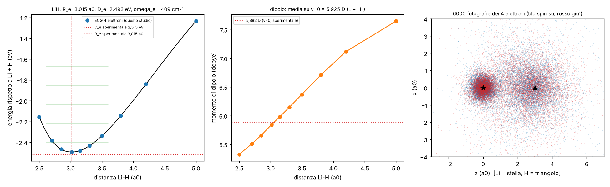

# Molecole piccole (studio `mol_`) — PARZIALE

Nota sul nome: il compito chiedeva `docs/MOLECOLE.md`, ma quel file esiste già ed è il documento storico della
strada DMC (`src/molecole/`). Per non sovrascriverlo, questo studio sta qui.

File: macchina ECG a N elettroni e più nuclei `lab/mol_ecg.py` (+ nucleo numba `lab/mol_fast.py`), LiH
`lab/mol_lih.py`, esportazione `lab/mol_export.py`, figura `lab/mol_figure.py`, geometrie dell'acqua
`lab/mol_acqua_geom.py` (solo geometria, nessuna energia ancora). Pre-registrazione `lab/mol_prereg.py` →
`lab/out/mol_prereg.json`, **commit 2435e02, prima delle corse di produzione**. Esiti `lab/out/mol_lih.json`.



## 0. In breve

**LiH con tutti e 4 gli elettroni correlati (livello "esatto"): 5 PASS / 1 FAIL.** Ingressi: m_e, α (nella regola),
Z = 3 e 1, masse del nucleo di ⁷Li e del protone (solo per la vibrazione). Massa cinetica della regola m0 = 1,0000000046.

| esame | cosa | risultato | soglia | esito |
|---|---|---|---|---|
| L0 | E(LiH, R = 3,015) contro −8,070553 Eh | −8,069091 (+1,46 mEh) | 2 mEh | **PASS** |
| L1 | lunghezza di legame (minimo della curva) | **3,0146 a₀** (−0,015 %) | 0,5 % | **PASS** |
| L2 | D_e contro 2,515 eV | **2,493 eV** (−22 meV) | 43 meV | **PASS** |
| L3 | ω_e armonico contro 1405,6 cm⁻¹ | **1408,9 cm⁻¹** (+0,24 %) | 2 % | **PASS** |
| L4 | dipolo medio su v = 0 contro 5,882 D | **5,925 D** (+0,73 %); a R_e 5,843 D | 2 % | **PASS** (vedi §2) |
| L5 | atomo di Li con la stessa macchina contro −7,478060 | −7,477501 (+0,56 mEh) | 0,5 mEh | **FAIL** |

Detto semplice: **quattro elettroni, due nuclei, nessuna chimica in ingresso: il legame Li–H esce dove deve (entro
5 millesimi di raggio di Bohr), profondo giusto entro 22 meV, vibra giusto entro lo 0,24 %, e la molecola è
polarizzata come Li⁺H⁻ con il dipolo giusto entro l'1 %.** È una **validazione** (LiH è noto), non una scoperta.

## 1. Come è fatto

- Stessa strada di H₂ (AGGLOMERATO_DUE_ATOMI §12) estesa a N elettroni: gaussiane correlate con i centri sull'asse,
  antisimmetria con la funzione di spin (singoletto 12 × singoletto 34, tutte le 4! permutazioni), base cresciuta a caso
  e raffinata (SVM). Nuovo: test veloce dei candidati con l'equazione secolare (una diagonalizzazione per passo invece
  di una per candidato) e nucleo numba: ~5× più veloce dell'implementazione numpy, controllato a 10⁻¹⁵.
- Base: K = 600 funzioni a R = 3,015 (3 passate di raffinamento, ~25 min), poi per ogni R della griglia (10 punti,
  2,5–5,0 a₀) la stessa base stirata (centri z → z R/R0) e 2 passate (~10 min per punto). Li: K = 300, 3 passate.
- Curva: fit quartico su 2,7–3,5 a₀ per R_e e ω_e (pre-registrato). Vibrazione: DVR sulla spline, massa ridotta dei
  nuclei. Dipolo: dal vettore ECG esatto, μ(R) = R − ⟨Σz⟩.

## 2. Fallimenti e cose da sapere (onestà)

- **L5 FAIL**: Li a K = 300 resta 0,56 mEh sopra il valore esatto (soglia 0,5). La macchina converge piano
  (algebricamente in K); serve K più grande. D_e beneficia di una parziale cancellazione: LiH è a +1,46 mEh, Li a
  +0,56, quindi D_e è sottostimato di ~0,9 mEh = 24 meV, esattamente il −22 meV osservato.
- **Livelli di vibrazione sbagliati (non era un esame, va detto)**: il salto 0→1 esce 1481 cm⁻¹ contro 1360 misurato.
  Causa: la curva comincia a R = 2,5 a₀ e la DVR mette lì un muro che schiaccia gli stati v ≥ 1. Anche il dipolo medio
  su v = 0 (L4) risente un po' del muro: è PASS ma va ricontrollato con la curva estesa a R < 2,5. ω_e (dal fit vicino
  al minimo) non ne risente. Da rifare: 2–3 punti a R = 2,1–2,4 (~30 min).
- Riferimenti: energie BO non relativistiche (solo esame); D_e, ω_e, dipolo sperimentali contengono piccoli effetti
  non modellati (relatività, correzioni adiabatiche), sotto le soglie.

## 3. Esportazione (per il renderer)

Cartella `LiH/` con `manifest.json` (tier **"esatto"**, geometria trovata, energie, esami), `lih_elettroni.npy`
(40 000 fotografie dei 4 elettroni insieme da |Ψ|², float32 (n,4,3), spin 0/2 su, 1/3 giù), `lih_densita.npz`
(densità in coordinate cilindriche), livelli di vibrazione e righe IR con dipoli di transizione (con l'avviso del
muro). Controllo: dipolo dai campioni −2,325 u.a. contro −2,299 esatto (1 %). **La cartella
`/mnt/project-files/debiti/dati/molecole/` dava errore di I/O al momento della scrittura**: i file sono pronti in
`<scratchpad>/molecole/LiH/` e vanno copiati dal coordinatore (o rigenerati con
`MOL_DEST=/mnt/project-files/debiti/dati/molecole python lab/mol_export.py lih`, ~3 min, serve
`lab/out/mol_lih_R3.015.npz`, non committato).

## 4. Livello "approssimato" (N₂, O₂, H₂O, NH₃, CH₄, CO₂, dimero e trimero d'acqua): NON ANCORA MISURATO

Dipende da `hf_griglia` di `lab/tavg_grid.py` (altro studio, importato in sola lettura). Al momento del passaggio i
blocchi-nucleo esistevano per B, C, O, Ne ma non per N e H, e `docs/TAVOLA_GRIGLIA.md` non c'era ancora: niente
corse, niente pre-registrazione dell'emendamento. Pronto: `lab/mol_acqua_geom.py` (monomero rigido dalla sua
minimizzazione, famiglia del legame a idrogeno lineare, orientazioni quasi casuali di Halton per ogni R, trimero
ciclico per il termine a tre corpi). Esami da pre-registrare (emendamento): legame H 0,21 eV, O–O 2,91 Å, termine a 3
corpi del trimero; scansione in `lab/out/mol_acqua_scan.json`. Avviso già da ora: HF da solo sbaglia le energie di
dissociazione (N₂ di diversi eV) e non vede la dispersione; vanno riportati HF e HF + correzione di correlazione.

### Quante geometrie servono per imparare la forza acqua–acqua (stima)

Monomeri rigidi: 6 coordinate (R e 5 angoli). Se l'agglomeratore impara una forma a siti (cariche/poli sui nuclei e
sulle "coppie solitarie" che escono dai dati, più ripulsione e dispersione per coppie di siti, ~30–60 manopole), bastano
**~500–1000 geometrie** del dimero ben distribuite (10 distanze 2,4–8 Å × 50–100 orientazioni), più ~100 di controllo
non usate nel fit. Una forma libera (rete o polinomi di simmetria in 6-D) ne vuole **qualche migliaio** (i potenziali
noti della letteratura ne usano da ~2500 a ~40 000). Il termine a tre corpi: ~200–500 trimeri. Costo stimato col
livello approssimato: dipende dai tempi di `hf_griglia` per 16 elettroni di valenza in una scatola di ~20 a₀; se è
~10 min per geometria, 1000 geometrie = ~7 giorni su un core: si fa a pezzi, o sulla GPU.

## 5. Debiti

- **Born–Oppenheimer** (nuclei fermi, poi vibrazione 1-D, J = 0): mio.
- Base ECG scelta a caso e raffinata: un **risolutore**, non i camminatori della regola (come H₂).
- Ereditati dal thread principale: Coulomb istantaneo, antisimmetria imposta con la funzione di spin, resto α² della
  banda non incluso.
- Iper-parametri del risolutore (dichiarati, non fittati): K = 600/300, 60/30 prove, passate 3/2, larghezze
  log-uniformi per gruppi di elettroni (guscio del Li, legame, H).

**Parametri liberi di fisica: zero.**

## 6. Idee geometriche e visive

1. **Il dipolo che si vede** — a schermo: i due elettroni del legame (bagliori) stanno quasi tutti sull'H, i due del
   guscio stretti sul Li; un fotone infrarosso da ~7 μm fa oscillare la distanza e la nube "sciaborda" avanti e
   indietro. Perché funziona: μ(R) è calcolato (pendenza ~0,3 u.a./a₀ vicino a R_e) e il dipolo di transizione
   0→1 è 0,23 D. Costo: zero (dati esportati). Regole: rispettate.
2. **Buca di Pauli contro buca di Coulomb** — fissare un elettrone del legame e mostrare dove *non* sta l'altro con lo
   stesso spin (buca grande) e quello con spin opposto (buca piccola): si vede che "due elettroni per legame" è una
   conseguenza, non una regola. Costo: basso (dalle fotografie esportate o da Ψ esatta). Regole: rispettate.
3. **Griglia a ellissi per le biatomiche** — il problema a due centri si separa in coordinate sferoidali (già visto in
   aggmol: il nodo 2σg è un ellissoide con i protoni nei fuochi). Una griglia agglomerata in (ξ, η, φ) mette le celle
   fitte solo vicino ai due nuclei: per LiH meno celle a parità di errore. Costo: medio. Regole: è la geometria del
   problema, non un ingresso.
4. **L'acqua come pallina con quattro lobi che emergono** — dalla scansione dimero: se l'agglomeratore trova da solo
   che la forza si descrive con 2 siti positivi (H) e 2 negativi fuori asse (coppie solitarie), a schermo ogni molecola
   è una pallina con 4 bagliori a tetraedro, e la goccia si organizza da sola in anelli. Da provare dopo la scansione.

## 7. Dove l'intuizione di Valerio può aiutare

- Per la goccia d'acqua: preferisci vedere prima **pochi anelli giusti** (dimero, trimero, esamero con energie
  esatte) o **una goccia grande approssimata**? Le due cose costano in modo molto diverso.
- Il legame Li–H è quasi ionico (Li⁺H⁻): ti torna l'idea di mostrare a schermo la carica che "salta" sull'H mentre i
  due atomi si avvicinano (abbiamo μ(R) da 2,5 a 5 a₀)?

## 8. Cosa resta (in ordine)

1. Estendere la curva di LiH a R = 2,1–2,4 a₀ e rifare livelli/dipolo v = 0 (~30 min). Li con K = 450.
2. Quando `tavg_grid` ha i blocchi N e H e il suo documento: emendamento della pre-registrazione, poi H₂O → dimero e
   trimero d'acqua (richiesta di Valerio) → N₂, O₂, NH₃, CH₄, CO₂.
3. Copiare l'esportazione di LiH in `/mnt/project-files/debiti/dati/molecole/LiH/`.

## 9. Come rieseguire

```
python lab/mol_prereg.py                          # già committato (2435e02)
python lab/mol_lih.py li ; python lab/mol_lih.py re ; python lab/mol_lih.py curve   # ripetere finché DONE
python lab/mol_lih.py analyze ; python lab/mol_export.py lih ; python lab/mol_figure.py
```
