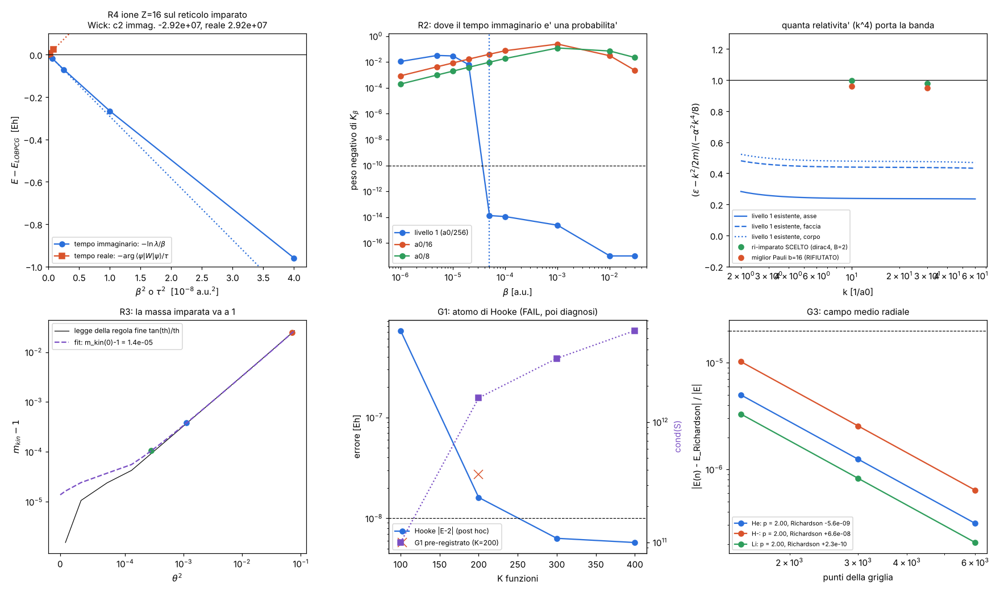

# Molti elettroni: elio (e oltre) dalla regola zig-zag agglomerata

**Stato: M0 (la regola e i controlli) fatto quasi tutto; M1 (elio) a metà: la parte "esatta" ECG è FERMA per un gate
fallito (G1), la parte a camminatori (DMC) è partita.** Brief: `docs/MOLTI_ELETTRONI_PIANO.md`.
Pre-registrazione: `lab/out/multi_e_prereg.json` (committata in `9b1e4d0` **prima di ogni corsa**).
Giudizio automatico: `python lab/multi_e_summary.py` → `lab/out/multi_e_results.json`. Figura: `lab/out/multi_e_figure.png`.

---

## 0. In breve

**Cosa la zig-zag dà davvero agli atomi** (da dire chiaro, prima di tutto). Senza relatività, la regola agglomerata
porta agli atomi:
1. uno spinore a 2 componenti (Pauli) con un generatore **limitato dal basso**: è il permesso per il tempo immaginario
   (la regola fine a 4 componenti non ce l'ha: affonda, R1);
2. **un numero**, la massa cinetica m_kin(θ), che va a 1 quando θ → 0 (legge tan θ/θ);
3. lo spin come etichetta conservata (parte di spin 4·10⁻¹¹);
4. un nucleo di salto che è una **probabilità** solo sopra β_min = 5·10⁻⁵ a.u.;
5. il termine relativistico α²k⁴ della sua banda (in parte: vedi R6), senza termine di Darwin.

Tutto il resto è meccanica quantistica di fermioni identici con l'operatore della regola, più debiti dichiarati.
Quantitativamente il metodo scalabile è la DMC a nodo fisso: **la novità è la tracciabilità di ogni pezzo e il
controllo esatto, non il metodo**. Non è "la vecchia DMC con un nome nuovo", ma ci assomiglia molto: lo diciamo noi.

| prova | cosa | risultato | esito |
|---|---|---|---|
| G0 | parità della regola fine: matrici di Bloch a +k e −k | autofasi uguali a 5,6·10⁻¹⁶; banda Pauli a 1,1·10⁻¹⁵ | **PASS** → la parte dispari dello stencil (6,6·10⁻⁴ a kh = 0,01) è un artefatto: si simmetrizza (DEBT-8) |
| R1 | permesso del tempo immaginario (1-D) | regola fine: −1,40 mc² già a β = 1, −30,42 mc² a β = 50 (fondo del reticolo −30,44); livello Pauli 1-D: proiezione = autovalore a 4,7·10⁻⁹ | **PASS** |
| R2 | il nucleo dei camminatori è una probabilità? | livello 1: peso negativo 1–3 % sotto β = 2·10⁻⁵, **≤ 1,3·10⁻¹⁴ da β_min = 5·10⁻⁵**; D = 0,4998084 (curvatura) = 0,4998084 (spazio reale, a 7·10⁻¹¹); curtosi 0,0038; livelli a₀/16 e a₀/8 negativi fino al 24 % → non camminatori | **PASS** |
| R3 | m_kin(θ → 0) = 1 entro 5·10⁻⁵ | **1,0000138 ± 0,0000026** (3 catene × 2 semi) | **PASS** (ma 5σ da 1: vedi §2.3) |
| R4a | stessa regola, due direzioni del tempo (Z = 16, 192³) — deterministico | immaginario (fit pre-registrato) 1,9·10⁻⁴; tempo reale 2,0·10⁻⁴ (soglie 1·10⁻⁶ e 3·10⁻⁵) | **FAIL** — causa trovata (§2.5): errore di Strang, pari in β, grande a Z = 16; diagnosi post hoc: 5,5·10⁻⁸ e 1,3·10⁻⁹, e i due coefficienti sono **uguali e opposti** (rotazione di Wick vista nei numeri) |
| R4b | camminatori sul reticolo = iterazione deterministica allo stesso β | β = 2·10⁻⁴: −129,0181 ± 0,0037 contro −129,0211 (0,8 σ); β = 10⁻⁴: −128,8525 ± 0,0058 contro −128,8545 (0,35 σ); σ relativo 2,9 e 4,5·10⁻⁵ | **PASS** |
| L1c | livello 1 ri-imparato con l'osservabile Z = 10, budget 3·10⁻⁵ | **nessun candidato Pauli passa**: la macchina sceglie il livello a 4 componenti B = 2 (cioè quasi la regola fine) | rischio 4 del brief **avverato** (§2.4) |
| G1 | macchina ECG su sistemi non-esame | H 5,5·10⁻⁹ PASS; Li/Be non interagenti 3·10⁻¹¹ / 8·10⁻¹³ PASS; **Hooke 2,7·10⁻⁸ (soglia 10⁻⁸) FAIL**; **Monte Carlo 1,34·10⁻⁴ (soglia 10⁻⁴) FAIL** | **FAIL** → produzione ECG FERMA (§3) |
| G3 | campo medio (test d'implementazione con valori HF della letteratura) | He 5,6·10⁻⁹, H⁻ 6,6·10⁻⁸, Li 2,3·10⁻¹⁰, Be 5,9·10⁻⁹ (soglia 2·10⁻⁵); partenze casuali ≤ 1,2·10⁻¹²; Ne: in corso | **PASS** per He, H⁻, Li, Be |
| G5 | rapporto 2s/1s monotono (nodo esatto r₁ = r₂ per He 2³S) | non monotono in 778 punti, **tutti a r < 4,2·10⁻⁷ a₀, salti ≤ 1,4·10⁻¹⁵** | **FAIL** come scritto; causa: arrotondamento (§2.7) |
| G4 | cucitura della banda oltre la zona | non valutabile senza le basi ECG | — |
| M1–M3, R5, R6, E1, E2, D1, D2 | elio con l'ECG | **fermi** per G1 (e D2 anche per G5) | — |
| He DMC | elio con i camminatori (solo riportato) | vedi §4 | in corso |

---

## 1. La catena (cosa è dato, cosa è imparato, cosa è messo a mano)

- **Dato**: la regola fine zig-zag (4 componenti, giro θ = m c a/ħ, fase di Coulomb). Ingressi: m_e (θ), α, Z.
- **Imparato** (agglomeratore, già fatto in `AGGLOMERATO_ZIGZAG.md`): il livello 1 (cella a₀/256, tick 2,85·10⁻⁵ a.u.,
  125 posti, spinore di Pauli). Qui lo usiamo **simmetrizzato** (G0) e ne leggiamo m_kin e D = 1/(2 m_kin).
- **Derivato**: ruotando il passo di Strang in tempo immaginario (τ → −iβ) si ottiene
  φ ← e^{−βV/2} K_β ∗ (e^{−βV/2} φ), con K_β = IFFT e^{−β(H(k) − H(0))}. Siccome H è limitato dal basso, e^{−βH} proietta
  sullo stato fondamentale. Il passo libero di N palline è il prodotto dei passi di una pallina (esatto).
- **Messo a mano (debiti)**: interazione elettrone-elettrone come fase di Coulomb istantanea (DEBT-1); antisimmetria
  (DEBT-2); nucleo puntiforme e infinitamente pesante (DEBT-3); proiezione non relativistica k²/2m_kin (DEBT-4);
  campo medio = Hartree–Fock come portatore dei nodi (DEBT-5); famiglia di J (DEBT-6); nodo fisso (DEBT-7);
  simmetrizzazione dello stencil (DEBT-8); nucleo continuo gaussiano per i camminatori (DEBT-9); configurazioni (DEBT-10).

## 2. M0: la regola, controllata pezzo per pezzo

### 2.1 G0 — la regola fine è pari (PASS)
Le matrici di Bloch a due tick a +k e −k hanno le stesse autofasi a 5,6·10⁻¹⁶, e c'è proprio l'identità
W(−k) = P W(k) P con P = scambio sinistra↔destra (a 2,2·10⁻¹⁶): la parità è esatta perché la pallina L va a sinistra
quanto la R va a destra. Il controllo incrociato "matrice di Bloch = far girare davvero la pallina su onde piane" vale
5,9·10⁻¹⁵. Quindi la parte dispari dello stencil imparato (6,6·10⁻⁴ a kh = 0,01, 5,8·10⁻² a kh = 1) **non è fisica**: è
rumore dei minimi quadrati (i k campionati non sono simmetrici). Si usa Re(G_j) (DEBT-8, ma ora con la prova).

### 2.2 R1 — perché serve l'agglomeratore per il tempo immaginario (PASS)
Regola fine 1-D in un pozzo morbido (θ = 0,1): partendo da uno stato a energia positiva (+0,95 mc²), e^{−βH} lo porta a
−1,40 mc² già a β = 1 ħ/mc² e a **−30,42 mc²** a β = 50, contro il fondo del reticolo −30,44 (≈ −π/dt): la regola fine
**non ha un fondo fisico**, affonda nella banda negativa. Nota onesta: la parte vicino a k = π ha nello stato iniziale
un peso dell'ordine dell'arrotondamento (10⁻¹⁶), ed e^{−βH} la ingigantisce: è proprio il punto — *qualunque* granello di
banda negativa vince. Un livello Pauli 1-D imparato (1 componente, b = 16, w = 4, DV3) invece converge al suo stato
legato: −0,0023623383766 contro −0,0023623383878 dell'autovalore diretto (4,7·10⁻⁹).

### 2.3 R3 — la massa imparata (PASS, con una nota)
| catena | θ | m_kin (seme 1 / seme 2) | tan θ/θ |
|---|---|---|---|
| A/2 (nuova) | 0,016728 | 1,0001077 / 1,0001041 | 1,0000933 |
| A | 0,033456 | 1,0003833 / 1,0003815 | 1,0003733 |
| B | 0,267648 | 1,0245393 / 1,0245666 | 1,0245832 |

Fit m(θ) = m₀ + aθ² + bθ⁴: **m₀ = 1,0000138 ± 0,0000026**, a = 0,329 (legge: 1/3). Passa la soglia 5·10⁻⁵. Ma la barra
dai semi (2,6·10⁻⁶) dice che lo scarto da 1 (1,4·10⁻⁵) è **sistematico**: l'agglomeratore aggiunge circa +1·10⁻⁵ alla
massa a θ piccoli (A: +1,0·10⁻⁵ sopra tan θ/θ; A/2: +1,3·10⁻⁵). Causa probabile: il fit relativo del generatore pesa
poco i k piccolissimi, dove sta la curvatura (lo stesso difetto che fa fallire il livello ri-imparato, §2.4). Per l'elio
vale 2,9·10⁻⁵ Eh: piccolo ma non zero, ed entra nel budget d'errore.

### 2.4 Il livello ri-imparato con l'osservabile "1s di Z = 10" (rischio avverato)
Stesso algoritmo, stessi iper-parametri, solo l'osservabile cambia (1s di taglia a₀/10, budget energia 3·10⁻⁵). La
macchina prova 28 candidati e **nessun livello Pauli passa**: il migliore (b = 16, w = 4) ha errore 2,4·10⁻⁴; sceglie
allora il livello a 4 componenti B = 2 (cella a₀/2048), che è il primo raggruppamento esatto della regola fine.
**Cercando la causa**: il miglior candidato Pauli ha un errore relativo **costante** −4,6·10⁻⁵ a k piccoli (k = 0,3–3 a.u.):
è un errore della **massa** (m = 1,000419 contro 1,000373), non del termine k⁴, che invece porta quasi tutto (96 % in
media; asse/faccia/corpo 0,90/0,98/1,00). Il livello 1 esistente porta solo il 24/44/48 % del k⁴ (media 40 %), come
già visto in sviluppo. Conseguenza: R6 "sul livello ri-imparato" diventerebbe un esame sulla regola fine stessa (il
livello B = 2 ha il 99,7 % del k⁴), e non dice niente sull'agglomerato. Lo dichiariamo. Idea per uscirne: §7.

### 2.5 R4 — stessa regola, due direzioni del tempo (a: FAIL con causa; b: PASS)
Ione Z = 16 sul livello 1 simmetrizzato, 192³ celle. LOBPCG: **E = −128,7813141 Eh**, contro l'idrogenoide
−m_kin Z²/2 = −128,0491. Scomposto (non è un errore, è la fisica di questa banda): la parte non quadratica della banda
imparata vale −0,960 Eh (la "massa-velocità" di Dirac su questo stato vale −2,749: la banda ne porta il 35 %); il
Coulomb mediato sulla cella e il reticolo danno +0,228 Eh.

**(a) FAIL come pre-registrato.** Iterazione in tempo immaginario a β = 2·10⁻⁴, 10⁻⁴, 5·10⁻⁵: −129,7409 / −129,0475 /
−128,8520; fit pre-registrato (con termine lineare) → −128,7574: scarto 1,9·10⁻⁴ (soglia 10⁻⁶). Lettura in tempo reale
al tick grosso: −128,7559, scarto 2,0·10⁻⁴ (soglia 3·10⁻⁵).
**Causa** (cercata, non solo dichiarata): (E(β) − E₀)/β² = −2,40/−2,66/−2,83·10⁷: l'errore è il termine di Strang
**pari** in β (lo split simmetrico non ha termine lineare: la forma del fit pre-registrato era sbagliata), e il suo
coefficiente a Z = 16 è enorme (~3·10⁷ Eh³, il doppio commutatore del Coulomb di cella con la banda): la stima del
brief "errore di Trotter < 3·10⁻⁵ al tick grosso" era sbagliata di un fattore ~10. **Diagnosi post hoc** (non rigiudica
R4a): scendendo a β = 2,5 e 1,25·10⁻⁵ e a τ/2, τ/4, τ/8 con la forma pari, il tempo immaginario dà −128,7813212
(5,5·10⁻⁸) e il tempo reale −128,7813143 (1,3·10⁻⁹). E il bello: **il coefficiente di x² vale −2,915·10⁷ nel tempo
immaginario e +2,923·10⁷ nel tempo reale**: uguali e opposti (0,3 %), come deve essere se τ → −iβ (x² → −x²). È la
rotazione di Wick vista direttamente sulla regola imparata.

**(b) PASS.** Camminatori veri sul reticolo (posizioni intere, salti estratti da K_β, pesi di Strang, 20 000 palline,
guida non esatta e^{−Z m r}): −129,0181 ± 0,0037 contro il valore deterministico −129,0211 a β = 2·10⁻⁴ (0,8 σ), e
−128,8525 ± 0,0058 contro −128,8545 a β = 10⁻⁴ (0,35 σ). Le palline in tempo immaginario fanno esattamente quello che
fa l'operatore.

### 2.6 G1 — la macchina ECG (FAIL) e cosa c'è sotto
Gaussiane correlate (ECG) con crescita stocastica della base (SVM), antisimmetria con le sole permutazioni degli
elettroni con lo stesso spin.
- Idrogeno: −0,5 a 5,5·10⁻⁹ (PASS).
- **Antisimmetrizzatore** (DV2): Li-like e Be-like non interagenti su una base prodotto (1274 e 2025 funzioni) danno la
  somma degli autovalori di una particella a 3·10⁻¹¹ e 8·10⁻¹³ (PASS); la versione bosonica scende a −13,50 e −31,98
  (contro −10,12 e −20,00): il segno conta. La distanza da −10,125 / −20 (4·10⁻⁴, 2·10⁻³) è la completezza della base,
  solo riportata.
- **Hooke ω = 1/2: 2,000000027 (errore 2,7·10⁻⁸, soglia 10⁻⁸): FAIL.**
- **Monte Carlo di ⟨1/r⟩: un elemento a −1,34·10⁻⁴ (soglia 10⁻⁴): FAIL.**

Per la regola, un gate fallito ferma il ramo: **la produzione ECG (M1–M3, R5, R6, E1, E2) non è partita.** Il codice è
pronto e rifiuta di partire senza una decisione scritta (`MULTI_E_G1_DECISION`).
**Diagnosi post hoc** (`lab/multi_e_g1_diag.py`, non rigiudica il gate):
- Monte Carlo: l'errore statistico di ogni elemento con 10⁸ campioni è 7,5·10⁻⁵, quindi lo scarto peggiore è a
  **1,8 σ**: il test era sottodimensionato (errore mio nella pre-registrazione: con i 4·10⁶ campioni scritti, σ sarebbe
  stata 4·10⁻⁴). Una verifica indipendente e deterministica (1/r = (2/√π)∫e^{−t²r²}dt, quadratura) concorda con la
  formula a **2·10⁻¹⁶** su tutti gli elementi. La formula è giusta.
- Hooke: |E − 2| = 7,3·10⁻⁷ (K = 100), 1,6·10⁻⁸ (200), **6,3·10⁻⁹ (300)**, 5,8·10⁻⁹ (400): è convergenza della base
  (la funzione esatta ha la cuspide in r₁₂, che le gaussiane imparano lentamente). Sotto ~6·10⁻⁹ c'è un pavimento
  **numerico**: il numero di condizionamento della matrice di sovrapposizione cresce fino a 6·10¹² e, cercando la causa,
  i giri di raffinamento a volte *alzano* l'energia di 10⁻¹¹–4·10⁻¹⁰ (la previsione con l'equazione secolare e il
  valore vero differiscono di quel tanto). Per gli esami dell'elio (tolleranze 10⁻⁴) è irrilevante; per un gate a
  10⁻⁸ no.

### 2.7 G3, G5 — il campo medio
Hartree–Fock radiale "ascoltato" dall'operatore della regola (lo chiamiamo col suo nome, DEBT-5). Griglia in ln r
da 10⁻⁹/Z a 60 a₀, derivata seconda al 4° ordine, integrali col trapezio.
- **Una causa trovata strada facendo**: risolvere il problema nella forma simmetrica u = r f mette nella matrice
  numeri fino a 1/r_min² ~ 10¹⁸ e l'autovalore usciva −907 335 (assurdo). Con l'iterazione "shift-invert" sul problema
  generalizzato (come chiedeva il brief) il bare-hydrogen dà −2, −0,5, −0,2222222. Per i gusci aperti (Li, He 2³S) i
  vincoli di ortogonalità vanno messi esattamente (sistema "bordato"), altrimenti l'energia non scende in modo monotono.
- Gli errori vanno come h² esatto (ordine misurato **p = 2,00** per tutti: è lo spigolo di r_</r_> nel trapezio), quindi
  Richardson: He −2,8616799839 (5,6·10⁻⁹), H⁻ −0,4879297323 (6,6·10⁻⁸), Li −7,4327269017 (2,3·10⁻¹⁰), Be −14,5730231137
  (5,9·10⁻⁹). **PASS** (soglia 2·10⁻⁵). Ne: corsa a 6000 punti sospesa per dare i core all'elio.
- 5 partenze casuali a banda limitata + la partenza dall'idrogenoide: stesso punto fisso entro 4·10⁻¹³ (He),
  3·10⁻¹³ (He 2³S), 7·10⁻¹³ (Li), 1,2·10⁻¹² (H⁻). Nessun orbitale "da tabella" nascosto.
- H⁻ nel campo medio: −0,48793 > −0,5: **non legato** (come atteso): lo lega solo la correlazione.
- **G5 FAIL come scritto**: il rapporto 2s/1s di He 2³S non è monotono in 778 punti. Causa: sono tutti a r < 4,2·10⁻⁷ a₀,
  con salti ≤ 1,4·10⁻¹⁵. Vicino al nucleo le due cuspidi uguali (−Z m) cancellano il termine lineare, il rapporto è
  c₀ + c₂r² ed è piatto sotto l'arrotondamento. Fisicamente è monotono; ma la soglia l'avevo scritta "su tutti i punti" e
  non la cambio. Per la DMC 2³S il nodo esatto si può prendere direttamente dalla simmetria (idea in §7).

## 3. Elio con l'ECG: fermo

Vedi G1. Quello che serve per ripartire è una decisione di Valerio (§8), non un'altra corsa.

## 4. Elio con i camminatori (in corso, solo riportato)

*(sezione aggiornata alla fine della corsa)*

## 5. Validazione e scoperta

- **Validazione** (ritrovare numeri noti): G3 (valori HF della letteratura), R3 (m → 1), il controllo su H e Li/Be non
  interagenti, R4b, e — quando ci sarà — l'energia dell'elio. Nessuno di questi è una scoperta.
- **Cose che non sapevamo e che abbiamo visto**: (i) la regola fine affonda in tempo immaginario e il livello Pauli no:
  il "permesso" del tempo immaginario nasce dall'agglomerazione (R1, R2); (ii) il nucleo è una probabilità solo sopra
  β_min = 5·10⁻⁵ a.u. (circa 1,75 tick grossi): sotto, la regola imparata *non* è un processo di palline; (iii) il
  coefficiente di Strang è uguale e opposto nelle due direzioni del tempo (Wick sui numeri); (iv) la banda imparata ha
  un k⁴ fortemente anisotropo (24 % lungo gli assi, 48 % lungo le diagonali); (v) l'agglomeratore sposta la massa di
  +1·10⁻⁵, e questo da solo basta a fargli rifiutare un livello che porterebbe il 96 % della relatività.

## 6. Debiti

| debito | cosa | stato in questa sessione |
|---|---|---|
| DEBT-1 | e-e come fase di Coulomb istantanea (niente Breit, ritardo): ~10⁻⁵–10⁻⁴ Eh nell'elio | aperto; idea §7 |
| DEBT-2 | antisimmetria postulata | G1 mostra che il segno cambia tutto (bosonico −13,50 contro −10,12); idea §7 |
| DEBT-3 | nucleo puntiforme e infinitamente pesante; massa ridotta solo negli esami E | aperto |
| DEBT-4 | proiezione k²/2m_kin | aperto; il livello che porterebbe la relatività è stato rifiutato (§2.4) |
| DEBT-5 | campo medio = Hartree–Fock come portatore dei nodi | usato solo come guida della DMC; idea §7 per eliminarlo nel litio |
| DEBT-6 | famiglia di J | non ancora (M2) |
| DEBT-7 | nodo fisso | per l'elio 1¹S nessun nodo; per 2³S il nodo è esatto per simmetria |
| DEBT-8 | simmetrizzazione dello stencil | ora giustificata da G0 (la regola fine è pari a 10⁻¹⁵) |
| DEBT-9 | camminatori col nucleo gaussiano continuo D = 1/(2m_kin) | R4b fa la versione sul reticolo; D0b (elio) non fatto |
| DEBT-10 | configurazioni | non ancora (Be) |

## 7. Idee geometriche e visive per togliere debiti (con la prova che le decide)

1. **Il nodo è uno specchio (DEBT-5, DEBT-7).** Due palline identiche vivono in uno spazio a 6 dimensioni piegato dallo
   specchio "scambia 1 con 2". Per He 2³S il nodo *è* lo specchio |r₁| = |r₂|: non serve nessun orbitale, basta la
   simmetria. Per il litio (due elettroni con lo stesso spin) è noto che il nodo è quasi esattamente |r₁| = |r₂|.
   **Prova**: DMC del litio con il nodo puro "specchio" (nessun campo medio) contro l'ECG del litio (D4): se l'errore di
   nodo è < 0,1 mEh, il DEBT-5 cade per il litio e il nodo diventa geometria, non Hartree–Fock.
2. **Il nodo del berillio come due specchi incrociati.** Con due coppie di spin uguali il candidato geometrico è
   (|r₁| − |r₂|)(|r₃| − |r₄|) = 0, che per il teorema delle tasselle deve dividere lo spazio in esattamente 2 celle
   nodali. **Prova**: contare le celle nodali con i camminatori (connettività: si lascia diffondere una pallina in
   tempo immaginario senza mai attraversare e si guarda se raggiunge le copie permutate) e misurare l'energia contro
   l'ECG (D5).
3. **Pauli come "due palline non stanno nella stessa cella" (DEBT-2).** In 1-D le palline dure e i fermioni hanno la
   stessa energia (mappa di Girardeau). **Prova**: due palline con lo stesso spin sulla regola 1-D, una volta con la
   regola "vietato stare nella stessa cella" e una con l'antisimmetria: in 1-D devono coincidere; in 3-D (He 2³S) la
   regola dura dà un'energia diversa, e la differenza misura quanto "Pauli" è più di un divieto di contatto.
4. **La relatività persa per colpa della massa (DEBT-4).** La banda imparata è quasi un paraboloide: invece di imparare
   ε(k) intera, imparare la massa dai k piccoli (curvatura) e poi la *deviazione dal paraboloide* sul resto. **Prova**:
   rifare L1c così; il candidato Pauli b = 16 deve passare il controllo a 3·10⁻⁵ (oggi 2,4·10⁻⁴, dominato dall'errore di
   massa 4,6·10⁻⁵) e R6 diventa un esame vero sull'agglomerato.
5. **Un reticolo più rotondo (anisotropia del k⁴).** Il cubo vede la relatività al 24 % sugli assi e al 48 % sulle
   diagonali: la sua zona di Brillouin è un cubo, la fisica è una sfera. **Prova**: far scegliere all'agglomeratore
   anche blocchi a reticolo cubico a corpo centrato (la zona più "rotonda"): il rapporto asse/diagonale del k⁴ deve
   avvicinarsi a 1.
6. **Il Coulomb fra elettroni dalle palline di luce (DEBT-1).** Due elettroni sulla regola 1+1 D con un campo di luce
   che li collega (la stessa regola della luce): l'energia del sistema in funzione della distanza deve dare il
   potenziale istantaneo più una correzione di ritardo. **Prova**: la correzione deve scalare come (v/c)², cioè ~10⁻⁴ Eh
   nell'elio (ordine del termine di Breit).
7. **Vedere il nodo.** Per il laboratorio: disegnare i camminatori dell'elio 2³S nel piano (|r₁|, |r₂|): le palline
   devono restare da una sola parte della diagonale, che è il nodo; per il litio si può fare lo stesso con la coppia di
   spin uguali e vedere *quanto* il nodo vero si scosta dalla diagonale.

## 8. Dove Valerio può aiutare

1. **G1 (decisione necessaria).** Il gate è fallito per due motivi che ora conosciamo (Monte Carlo sottodimensionato da
   me nella pre-registrazione; convergenza lenta della base sulla cuspide di Hooke, con un pavimento numerico a ~6·10⁻⁹).
   Proposta da approvare *prima* di qualunque corsa sull'elio: emendamento dichiarato "G1-Hooke a K = 300 con la stessa
   soglia 10⁻⁸; G1-MC con la verifica deterministica a 10⁻¹² più il MC a 3σ". Senza la tua decisione l'ECG resta ferma.
2. **Il "permesso" del tempo immaginario.** Il nucleo è una probabilità solo sopra β_min; sotto, 42 posti dello stencil
   hanno il segno sbagliato. Hai un'idea fisica del perché la regola imparata "spinga indietro" sulle scale corte (è il
   ricordo della banda negativa?) e se un raggruppamento diverso la renderebbe positiva a ogni β?
3. **Il campo medio (DEBT-5).** Il brief chiede di usare un Hartree–Fock "ascoltato" come portatore dei nodi, ma
   `MOLECOLE.md` diceva "niente Hartree–Fock". L'idea §7.1 potrebbe toglierlo almeno per il litio: vale la pena provarla
   prima di decidere.
4. **La massa dell'agglomeratore.** Ti torna l'idea di imparare la massa a parte (§7.4)? È un cambio
   dell'algoritmo, quindi va pre-registrato.

## 9. Cambi dopo la pre-registrazione (tutti dichiarati)

- G1-MC: 10⁸ campioni per elemento invece di 4·10⁶ (deciso prima di lanciare G1(d), dopo aver capito che 4·10⁶ dà
  σ ~ 4·10⁻⁴ > soglia; la soglia è rimasta 10⁻⁴).
- G3: aggiunta la griglia a 1500 punti per misurare l'ordine (il brief diceva 3000 e 6000).
- Diagnosi post hoc di G1, R4a e G5: corse dopo i FAIL, non rigiudicano niente.
- Tabelle F(s): la prima versione interpolava ε(k) linearmente (errore 5 % a s = 0,01); ora si interpola il rapporto
  ε/(k²/2) e sotto k = 1 a.u. si usa la serie della curvatura. Nessun esame era stato corso con le tabelle vecchie.
- Il controllo della popolazione dei camminatori del reticolo: prima versione con un controllo integrale (oscilla) e
  un vettore di pesi di taglia fissa (si rompeva); corretta prima della corsa buona.
- Il motore DMC: riscritto senza allocazioni e in parallelo (2 thread) prima delle corse di produzione dell'elio
  (prova: idrogeno con guida sbagliata −0,50027 ± 0,00036 contro −0,500192).

## 10. Manopole e parametri

- Ingressi fisici: m_e (θ), α, Z; masse dei nuclei solo per la massa ridotta.
- Imparati dalla regola fine: stencil del livello 1 (125 posti, simmetrizzato), D = 0,4998084, m_kin(0) = 1,0000138.
- Calcolati (0 liberi): orbitali del campo medio; cuspidi di Kato (m_kin/2, m_kin/4).
- Scelti a mano e pre-registrati (manopole di metodo): b = 1 a₀⁻¹ nella guida DMC, τ, numero di camminatori, T_pop,
  griglie, K, prove SVM, soglie.
- Adattati agli esami: **0**.

## 11. Come rieseguire

    python lab/multi_e_prereg.py
    python lab/multi_e_kernel.py g0 ; ... learn ; ... mkin ; ... kbeta ; ... r1
    python lab/multi_e_disp.py learn ; python lab/multi_e_disp.py tables
    python lab/multi_e_ecg.py g1 ; python lab/multi_e_g1_diag.py mc ; python lab/multi_e_g1_diag.py hooke
    python lab/multi_e_meanfield.py g3 ; ... starts ; ... carrier
    python lab/multi_e_lattice.py det ; ... diag ; ... walk 2e-4 40000 ; ... walk 1e-4 60000
    python lab/multi_e_dmc.py He 0.02 dmc 6000 6e-5   (ripetere finché 'done'; poi 0.01 e 0.005)
    python lab/multi_e_summary.py ; python lab/multi_e_figure.py
