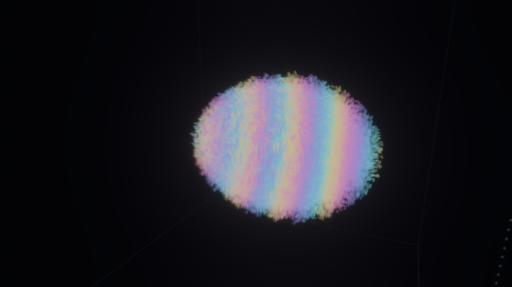

# Motore grafico a palline: istanze sulla GPU, regola sulla GPU, preset fino a Ultra

Studio del 13/10/2026. Pre-registrazione `lab/out/mg_prereg.json` (prima di ogni misura) + emendamento 1 dichiarato
`lab/out/mg_amend.json` (i preset riusano i gradini di qualità già esistenti). Risultati: `lab/out/mg_r1.json`,
`mg_r3.json`, `mg_r4.json`. Il lato fisico dei livelli (quale agglomerato usa ogni regione, passo locale) è di
`MOTORE_OTTIMIZZATO.md`: qui solo il **disegno**.

*Il fotone circolare al preset "alta" (24 celle per λ, 192³, 750 000 palline disegnate), fotografato dal portatile
di Valerio (Intel UHD) attraverso il ponte. Niente elica: solo palline di energia allungate lungo E.*

## 1. Cosa è cambiato, detto semplice

* **Palline a istanze.** Prima ogni pallina era una piccola mesh (4 vertici + 6 indici, ~208 byte) ricostruita a
  ogni fotogramma. Adesso è **un'istanza di 32 byte** (posizione, grandezza, allungamento, colore) disegnata su un
  unico quadratino: la CPU riempie solo una lista, la GPU fa il resto, e il buffer si rifà solo quando le palline
  cambiano (`src/atomo/istanze.rs`, `istanze.wgsl`). Il vecchio disegno resta con `--mesh` per il confronto.
* **La regola della luce sulla GPU** (`src/atomo/gpu_regola.rs`, `assets/atomo/regola_luce.wgsl`): una passata per
  asse, due buffer a ping-pong. Provata, non ancora collegata alla scena (debito 1).
* **Preset** `--qualita bassa | media | alta | ultra` (anche dal ponte e dal pannello):

| preset | celle per λ | scatola | palline di energia | scia |
|---|---|---|---|---|
| bassa | 12 | 128³ | 20 000 | 4 |
| media | 16 | 160³ | 60 000 | 4 |
| (medio-alta) | 20 | 176³ | 120 000 | 4 |
| alta | 24 | 192³ | 250 000 | 4 |
| ultra | 32 | 384³ | 1 000 000 | 4 |

*Aggiornato dopo lo studio: il preset più basso usa 12 celle per λ (pavimento della luce di `MOTORE_OTTIMIZZATO.md`,
esame EL: a 8 celle la diffrazione cambia del −21 %, la dinamica non si sfoca soltanto). Anche la scatola conta: a 12 celle per λ una scatola di 8 λ (96³) apre il fascio del −11,5 % rispetto a Maxwell (fuori dal 10 % di `MOTORE_OTTIMIZZATO.md`), una di 10,7 λ (128³) del −9,8 % (dentro, ma di poco); test `fotone_divergenza_scatola`. Per questo bassa è 12 celle su 128³: sul portatile costa circa 74 ms/tick (misura del vecchio preset media, stessa griglia), non più 32. La scia ha 4 campioni a ogni
preset, λ/3 l'uno dall'altro (regola di Valerio: i preset cambiano risoluzione e numeri, mai i fenomeni). Da
`MOTORE_GRAFICO_GPU.md`: alta e ultra girano con la regola, le palline e le misure sulla GPU.*

* **Scie vere**: la coda di ogni pallina è la pallina stessa 2, 4, 6, 8 tick prima (il percorso curvo vero), non una
  retta lungo la velocità.
* `--tick N` ferma il fotone al tick N: due foto dello stesso istante si possono confrontare.
* **Foto anche dal cloud**: il Laboratorio gira nel cloud con Vulkan software (llvmpipe) sotto Xvfb. Lento, ma serve
  per controllare le immagini senza aspettare il portatile.

## 2. Esami

| esame | soglia | risultato | esito |
|---|---|---|---|
| R1 regola GPU = CPU (96 tick, n = 96) | ≤ 1e-4 | **0** (identici bit per bit su llvmpipe) | **PASS** |
| R2 istanze = vecchio disegno, stesso fotogramma | PSNR ≥ 35 dB | **71,3 dB** (scarto massimo 1 livello su 255: il colore a 8 bit) | **PASS** |
| R3 livelli di disegno (blocchi 2ᵏ celle) | energia 1e-6, baricentro 0,05, spin 1 % | k = 1, 2: tutto entro (spin −0,07 % e −0,3 %); **k = 3: spin −1,2…−1,5 %** | **FAIL a k = 3** |
| R4 tempi sulla Intel UHD, preset bassa | ≥ 20 fps, ≤ 50 ms/tick | **60 fps** (tetto del vsync), **32 ms/tick** | **PASS** |
| R5 niente geometria | lettura del codice | solo quadratini con macchia gaussiana | **PASS** |

Solo riportati (R4): media 60 fps e 74 ms/tick (181 000 palline); alta 60 fps e 258 ms/tick (751 000 palline).
**Il disegno non è il collo di bottiglia nemmeno a 750 000 palline sulla Intel: lo è la regola sulla CPU.**

**R3 spiegato.** Per vedere da lontano si possono unire le palline di un blocco in una sola (peso = quante sono,
posizione e velocità medie). Energia e baricentro si conservano esatti per costruzione. Lo spin no: la pallina
unita perde il giro **dentro** il blocco. Con blocchi di λ/12 e λ/6 la perdita è sotto lo 0,3 %; con blocchi di
λ/3 è l'1,2–1,5 %: fallisce. Regola pratica: blocchi ≤ λ/6. Idea per dopo (non un rimedio a R3): la pallina unita
porta con sé il suo **giro interno** (Σ (r − R) × (v − V) del blocco) e lo mostra ruotando: così lo spin disegnato
torna esatto per costruzione, come l'agglomeratore che porta gli stati interni dei blocchi.

## 3. Manopole

Fisica: 0. Disegno: le stesse del Laboratorio (grandezza, luce), più palline e scia per preset.

## 4. Debiti

1. **La regola GPU non è collegata alla scena.** Per farlo bisogna tenere sulla GPU anche le palline e le misure
   (rileggere 170 MB a ogni tick dalla GPU costerebbe più del calcolo). È il passo che serve davvero ad "alta" e "ultra".
2. **Ultra non è provato** su una GPU da 16 GB (non ce n'è una). Sul portatile gira ma a fotogrammi lenti.
3. **La vista da dietro** del fotone circolare nel Laboratorio è ancora una nebbia bianca: le palline allungate lungo
   E e la trasparenza senza ordine coprono il vortice che nel prototipo Python (FOTONE_PALLINE) si vede bene. Servono
   trasparenza pesata per profondità (Bevy 0.15 ha anche l'OIT vero) e scie più lunghe in quella vista.
4. I tempi vengono dal contatore del Laboratorio (media mobile); 60 fps è il tetto del vsync, non il massimo.

## 5. Prossimi passi

1. Palline e misure sulla GPU, poi la regola GPU collegata (alta e ultra).
2. Trasparenza pesata per profondità e vista "da dietro" che mostri il vortice dello spin.
3. Palline unite con giro interno per la vista da lontano (livelli di disegno), agganciate ai livelli di
   `MOTORE_OTTIMIZZATO.md`.

---

## Appendice: R1 in dettaglio (dall'agente che l'ha fatto)

### R1: regola sulla GPU

**Cosa si prova.** La regola zig-zag della luce (`Fotone3D::tick` in `src/atomo/fotone3d.rs`) riscritta
come compute shader WGSL (`assets/atomo/regola_luce.wgsl`, lato Rust `src/atomo/gpu_regola.rs`). Stessa
regola, niente di nuovo: per ogni asse (x, y, z nei tick pari; z, y, x nei dispari) F si divide sugli
autovettori di S_j, la parte +1 va avanti di una cella, la −1 indietro, la 0 resta. Una dispatch per asse,
due buffer che si passano il campo a ping-pong (3 numeri complessi f32 per cella), cubo periodico.

**Esame pre-registrato** (`lab/out/mg_prereg.json`): stesso impulso del Laboratorio (parametri di default:
8 celle per λ, n = 96, w0 = 1 λ, circolare +, lungo x), 96 tick su CPU e su GPU,
max|F_gpu − F_cpu| / max|F_cpu| ≤ 1e-4.

**Risultato (cloud, Vulkan software llvmpipe): PASSA.**

| misura | valore |
|---|---|
| max\|F_gpu − F_cpu\| / max\|F_cpu\| dopo 96 tick | **0** (identici bit per bit) |
| soglia | 1e-4 |
| quanto si è mosso il campo in 96 tick (max\|F₉₆ − F₀\| / max\|F\|) | 1.29 (il confronto non è banale) |
| 96 tick avanti + 96 indietro sulla GPU, errore rispetto al lancio | 7.5e-7 (arrotondamenti f32) |
| ms per tick, CPU (rayon, 4 core) | 8.8 |
| ms per tick, GPU llvmpipe (cioè Vulkan che gira sulla CPU) | 41 |

**Come leggerlo.** La differenza è zero perché lo shader fa le stesse operazioni f32 nello stesso ordine
e llvmpipe non le fonde (niente FMA). Su una scheda vera il compilatore può fondere moltiplicazione e
somma: lì ci aspettiamo differenze dell'ordine di 1e-7, sempre molto sotto la soglia — da verificare sul
portatile via ponte. I tempi del cloud **non dicono niente** sulla GPU: llvmpipe è un emulatore su CPU,
più lento di rayon. È una validazione (la GPU rifà esattamente la regola), non una scoperta.

**Manopole:** zero. **Debiti nuovi:** nessuno. **Limite noto:** un buffer di campo pesa 24·n³ byte
(n = 192: 170 MB; n = 384: 1.36 GB, due buffer); serve che il device abbia
`max_storage_buffer_binding_size` abbastanza grande (il default di wgpu è 128 MB).
