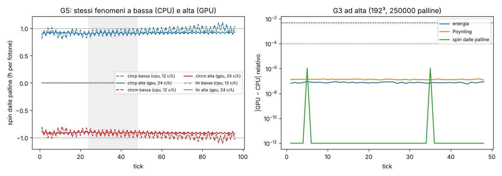
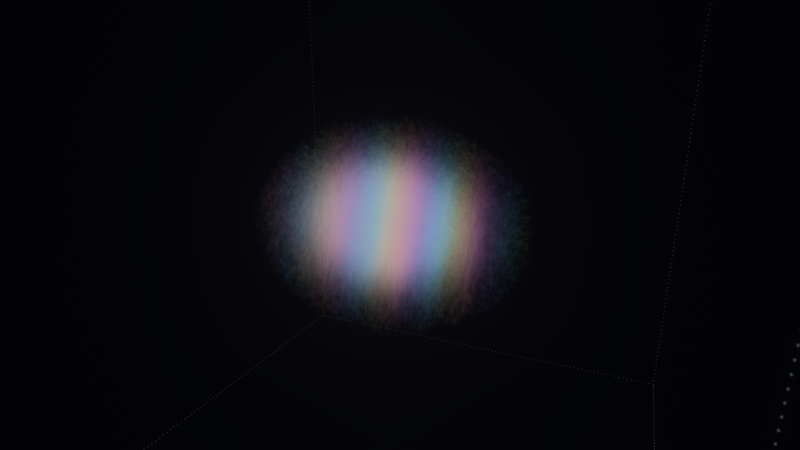

# Motore grafico, parte GPU: il fotone intero sulla scheda (regola, palline, misure, disegno)

Studio del 13/10/2026, debito 1 di `MOTORE_GRAFICO.md`. Pre-registrazione `lab/out/mg_gpu_prereg.json` (prima di ogni
misura) + emendamento 1 dichiarato `lab/out/mg_gpu_amend.json` (preset bassa a 12 celle per λ, esame di diffrazione
in più). Risultati: `lab/out/mg_gpu_g123.json`, `mg_gpu_g5.json` (giudice `lab/mg_gpu_g5.py`), `mg_gpu_g4.json`,
`mg_gpu_r1_split.json`. Codice: `src/atomo/gpu_fotone.rs`, `assets/atomo/gpu_fotone.wgsl`, `src/atomo/gpu_regola.rs`,
`assets/atomo/regola_luce.wgsl`, esami in `src/atomo/gpu_esami.rs`.

*A sinistra: lo spin letto dalle palline, tick per tick, a bassa (CPU, tratteggio) e ad alta (GPU, linea piena), per
la luce circolare + (blu), − (rosso) e lineare (grigio). Stesso fenomeno ai due preset. A destra: ad alta, quanto
differiscono GPU e CPU (energia, flusso di Poynting, spin): 10⁻⁷ o meno, contro soglie di 10⁻⁴ e 5·10⁻³.*

## 1. Cosa è cambiato, detto semplice

Prima, al preset "alta", la regola della luce girava sulla CPU (258 ms per tick sulla Intel UHD) anche se la GPU la
sapeva già fare (esame R1). Il problema era che le palline e le misure stavano sulla CPU: per muoverle bisognava
rileggere il campo dalla GPU a ogni tick, 170 MB a 192³.

Adesso, per **alta e ultra**, sulla GPU c'è tutto:

* **il campo** e la regola zig-zag (una passata per asse, due terne di buffer a ping-pong);
* **le palline di energia**: stesso passo della CPU (`Traccianti::avanza`), v = 2 E×B/(E²+B²) letta dal campo per
  interpolazione trilineare, |v| ≤ c, la scia (storia delle posizioni);
* **le misure**: energia, centro e larghezza dell'energia, elicità, **flusso di Poynting totale** Σ E×B e **spin
  letto dalle palline** (come l'esame F2 di `FOTONE_PALLINE.md`). Ogni gruppo di 64 righe della scatola fa le sue
  somme, la CPU rilegge solo queste (36 KB a 192³) e le somma in doppia precisione;
* **il disegno**: un kernel scrive le istanze (32 byte per pallina, stesso formato di `istanze.rs`, stessi colori,
  allungamento e scia di `fotdisegno::palline`) in un buffer che il disegno a istanze usa direttamente. Le palline
  **non passano mai dalla CPU**.

Bassa e media restano sulla CPU (devono andare sulla Intel UHD come prima). L'interruttore è `--regola gpu|cpu`
(senza: GPU per alta e ultra, CPU per bassa e media). Se la GPU non regge il preset la scena torna sulla CPU da sola e
lo scrive nel pannello ("regola sulla cpu (gpu: motivo)").

**Regola di Valerio** ("una mela in 4K e in 480p marciscono tutte e due"): i preset cambiano risoluzione, numero di
palline e precisione, mai i fenomeni. Per questo il flusso di Poynting e lo spin dalle palline sono misurati **anche
sul cammino CPU** con la stessa formula, e il pannello li mostra a ogni preset ("spin letto dalle palline", "flusso di
energia"). L'esame G5 controlla che si vedano le stesse cose a bassa e ad alta.

**Limiti di wgpu.** Il campo è diviso in tre buffer, uno per componente (n³ × 8 byte): 56 MB ad alta, dentro i 128 MB
minimi di WebGPU per un binding; prima era un buffer solo da 170 MB. Ultra chiede 453 MB per componente e 160 MB di
istanze: si controllano i limiti dell'adattatore prima di partire (Bevy li chiede già tutti).

## 2. Esami

| esame | soglia | risultato | esito |
|---|---|---|---|
| G1 campo GPU = CPU, alta, 96 tick | ≤ 1e-4 | **0** (identici bit per bit su llvmpipe; il campo si è mosso di 1,0) | **PASS** |
| G2 palline GPU = CPU, alta, 250 000 palline, 48 tick | scarto medio ≤ 0,01 λ | **0** su tutte le 250 000 (nessuna rinata) | **PASS** |
| G3 misure GPU = CPU, alta, tick 1–48 | energia e Poynting ≤ 1e-4, spin ≤ 0,5 % | energia 9·10⁻⁸, Poynting 1,5·10⁻⁷, spin 1·10⁻⁸ (centro 8·10⁻⁷ celle, elicità 9·10⁻⁸) | **PASS** |
| G4 il Laboratorio gira nel cloud (llvmpipe, Xvfb) ad alta con la regola GPU | gira, foto, log "gpu" | gira (356 s, 90 fotogrammi), log "regola sulla gpu"; bassa e alta `--regola cpu` girano anche | **PASS** |
| G5a direzione del flusso, bassa (CPU) e alta (GPU) | cos(P, d) ≥ 0,99 | **1,0000** in tutte e 6 le corse | **PASS** |
| G5b spin dalle palline, circolari | segno giusto; ‖S‖ entro 5 % di 1 ad alta, 10 % a bassa | bassa **±0,922** (−7,8 %, dentro); alta **±0,911** (−8,9 %, **fuori**) | **FAIL ad alta** |
| G5b' stesso spin ai due preset | ‖S_alta − S_bassa‖ ≤ 0,10 | **0,011** (+ e −) | **PASS** |
| G5c spin, lineare | ≤ 0,05 alta, ≤ 0,10 bassa | 4·10⁻⁵ e 3·10⁻⁵ | **PASS** |
| G5d elicità media | segno giusto, entro 0,05 di ±1 / 0 | bassa ±1,017, alta ±1,021, lineare 0 | **PASS** |
| G5e apertura del fascio θ contro λ/(π w0) | entro 10 % | alta 0,299 (**−6,2 %**, dentro); bassa 0,278 (**−12,6 %**, **fuori**) | **FAIL a bassa** |

Tempi (solo riportati), cloud con 4 core: ad alta la CPU fa regola + palline + misure in **568 ms per tick**,
llvmpipe (Vulkan che gira sulla stessa CPU) in **959 ms**. Non dice niente su una GPU vera: llvmpipe è un emulatore.
Il tempo vero ad alta sulla Intel UHD è chiesto al portatile via ponte (§2.3).

### 2.1 Come leggere i risultati

* **G1–G3 sono validazioni**, non scoperte: la GPU rifà le stesse operazioni f32 nello stesso ordine, e llvmpipe non
  fonde moltiplicazione e somma, quindi esce identico bit per bit (come R1). Su una scheda vera ci aspettiamo
  differenze di 10⁻⁷ (le somme delle misure sono in un altro ordine già qui: 10⁻⁷).
* **G2 non ha messo alla prova la rinascita**: in 48 tick nessuna pallina si è persa, quindi la regola diversa della
  GPU (sotto, debito 2) non è stata esercitata da questo esame.
* **G5: i fenomeni sono gli stessi ai due preset** (flusso, segno e misura dello spin, elicità, lineare senza spin):
  la regola di Valerio regge. **Ma due soglie assolute falliscono, e falliscono uguali sui due cammini**, quindi non
  sono colpa della GPU (G3 dice GPU = CPU a 10⁻⁸):
  * **lo spin dalle palline è 0,91–0,92, non 1**, nei tick 24–48 (attorno al fuoco). Cresce lungo il volo: a bassa
    arriva a ~1,0 al tick 96, ad alta a ~0,94 (figura). In `FOTONE_PALLINE.md` (Python, w0 = 1,5 λ, passo di Heun,
    asse fisso) veniva 0,999. Differenze con il Laboratorio: w0 = 1 λ (fuoco più stretto), passo di Eulero, centro
    misurato invece dell'asse. **Causa non verificata.** Non abbiamo cambiato soglia né finestra dopo aver visto.
  * **la diffrazione a bassa è il 12,6 % più piccola** di λ/(π w0). Il reticolo da solo ne toglie il 9,3 % a 12
    celle per λ (fattore ka/tan ka, `MOTORE_OTTIMIZZATO.md`); il resto (~3 %, lo stesso ad alta: −6,2 % contro −2,3 %
    del reticolo) è probabilmente il fuoco stretto (w0 = 1 λ non è parassiale) e il fit su un volo corto. A 12 celle
    per λ il pavimento del 10 % non regge con questo impulso: **o si alza il pavimento, o si misura contro il valore
    del reticolo** (da decidere prima di ricorrere, non adesso).

### 2.2 G4 nel cloud

Tre corse con gli stessi argomenti (`--foto … --frames 90 --tick 24 --ritmo 60 --pannello`): alta con la regola
sulla GPU (356 s), alta con `--regola cpu` (321 s), bassa (CPU, 122 s). Tutte escono pulite. **La foto ad alta con le
palline disegnate dal buffer della GPU è uguale a quella del cammino CPU: PSNR 104,5 dB**, scarto massimo 1 livello
su 255 in qualche pixel (riportato, non era una soglia). Cioè: il kernel `istanze` disegna le stesse palline, con gli
stessi colori, scie e allungamenti, del codice Rust.

*Il fotone circolare ad alta (192³, 250 000 palline), tick 24, regola e palline sulla GPU (llvmpipe nel cloud).*

### 2.3 Ponte: la Intel UHD del portatile ad alta

Richiesta `ponte/richieste/2026-10-13_mg_gpu_alta.json` (foto ad alta, 900 fotogrammi, pannello), eseguita sul
commit 7901945 (`ponte/risultati/2026-10-13_mg_gpu_alta/`). **Gira**: log "fotone: regola sulla gpu (192³, 250 000
palline)", 1 251 164 palline disegnate, **60 fps** (tetto del vsync), elicità +1,021 (uguale al cloud: 1,0212), foto
giusta. **Ma il tempo per tick non migliora**: al fotogramma 900 il contatore segna **500 ms per tick**, che è il
tetto della media mobile del Laboratorio (prima, con la regola sulla CPU, alta faceva 258 ms per tick). Il fotone era
al tick 1 (appena rilanciato). Detto onesto: **sulla Intel la regola GPU collegata non è (ancora) più veloce della
CPU**; il numero vero è "almeno 500 ms" o un picco del rilancio che la media non ha smaltito. Cause possibili, non
verificate: il thread del fotone aspetta la GPU e rilegge le somme a ogni tick (`device.poll(Wait)` mentre Bevy
disegna a 60 fps sulla stessa scheda), il rilancio del fotone (campo lanciato sulla CPU e ricaricato: 170 MB), le tre
letture per componente con `switch` nel kernel della regola. Serve una misura col tempo di ogni pezzo (debito 9).

## 3. Manopole

Fisica: **0**. Disegno: le stesse del Laboratorio. Nuove: **0** (lo spostamento di ±1 cella della rinascita sulla GPU
è copiato dalla semina della CPU; 64 righe per gruppo di lavoro e 64 gruppi per le somme delle palline cambiano solo
l'ordine delle somme).

## 4. Debiti

1. **Lo spin dalle palline è 0,91 attorno al fuoco** (G5b), uguale su CPU e GPU: causa da trovare (passo di Eulero
   contro Heun, fuoco stretto, centro misurato). Diagnosi da pre-registrare.
2. **Rinascita diversa dalla CPU**: sulla GPU una pallina persa prende il posto di una viva scelta a caso (±1 cella),
   sulla CPU rinasce con probabilità ∝ |F|² per blocchi. Le due cose hanno la stessa distribuzione solo in media; non
   ancora esercitata dagli esami (nessuna rinata in 48 tick).
3. **Diffrazione a bassa −12,6 %** (G5e): il pavimento di 12 celle per λ non basta per questo impulso con la soglia del
   10 % contro Maxwell.
4. **Viste di diagnosi** (fronti d'onda, frecce di E e B, Poynting disegnato, sezione) sul cammino GPU rileggono il
   campo intero a ogni fotogramma: lente, come prima. La vista "spin" (E(t−1) × E(t)) sul cammino GPU non c'è
   (E del tick prima vive solo sulla GPU).
5. **I colori del disegno sono scritti due volte** (`fotdisegno::palline` in Rust e il kernel `istanze` in WGSL):
   chi cambia l'uno deve cambiare l'altro. Il passo della scia (λ/3) è copiato da `fotdisegno::passo_scia`.
6. **Il campo resta anche sulla CPU** (lancio e copia per il prossimo fotone: 2–3 volte 24 n³ byte di RAM; a ultra
   ~4 GB). Il lancio si potrebbe fare sulla GPU.
7. **Ultra non è provato** (nessuna GPU da 16 GB); i limiti si controllano, ma nessuno l'ha visto girare.
8. **Il thread del fotone aspetta la GPU a ogni tick** (rilegge 36 KB): sulla scheda vera si potrebbe leggere un tick
   in ritardo senza aspettare.
9. **Sulla Intel UHD ad alta il cammino GPU non è più veloce** (≥ 500 ms per tick contro 258 della CPU, §2.3): da
   misurare pezzo per pezzo (regola, misure, palline, attesa, rilancio) prima di dire che la GPU "serve".
10. **Due test vecchi ora falliscono per la nuova tabella dei preset** (non per questo studio): `fotone_f2_elicita`
    (qual 2 = 20 celle per λ: elicità 1,0204, soglia 0,02) e `fotone_divergenza_come_la_regola` (qual 0 = 12 celle
    per λ: −2,5 % contro la previsione del reticolo, soglia 2 %). Erano legati agli indici di qualità (lo diceva già
    `mg_amend.json`): vanno riscritti sui valori in celle per λ, non sugli indici.

## 5. Sottoreticoli (domanda del coordinatore, solo lettura)

Per l'elettrone il cubo si spezza in 4 "colori" che non si parlano (`SOTTORETICOLO.md`). **Per la luce no**, almeno
non allo stesso modo: nella regola della luce la parte 0 di S_j (F_j) resta ferma mentre le altre due si spostano,
quindi un pezzo di campo può spostarsi o no lungo ogni asse e cambia classe di parità. Prova veloce (non
pre-registrata, `scratch`: regola in numpy su 8³): le 4 classi "migliori" di (componente, parità) perdono il 7,7 % del
campo verso le altre in 20 tick. I kernel GPU indicizzano comunque la cella come (i n + j) n + k senza ipotesi sulla
parità: farne girare 1, 2 o 4 colori (dove la regola lo permette) resta possibile; nella scena se ne usano tutti.
