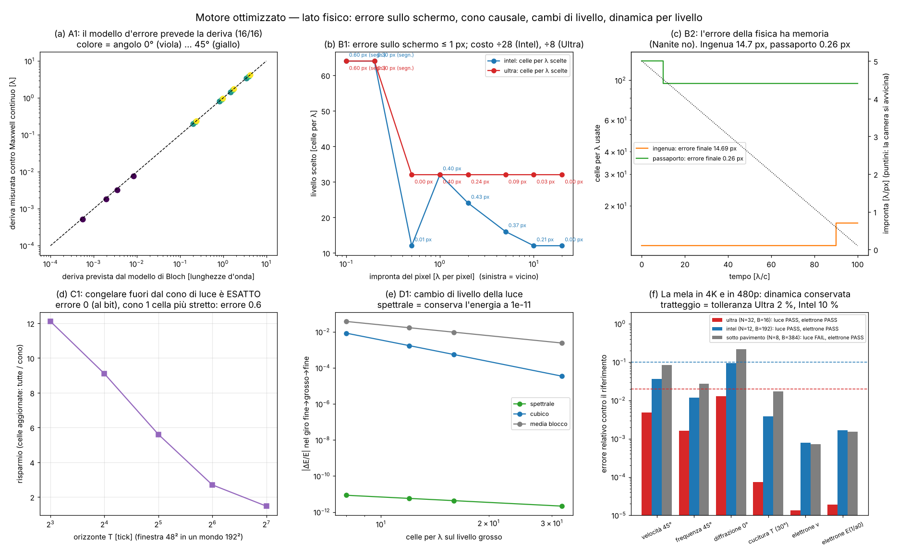
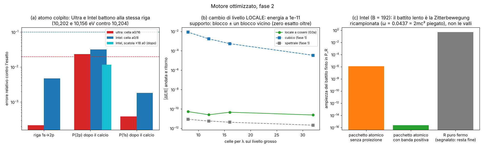
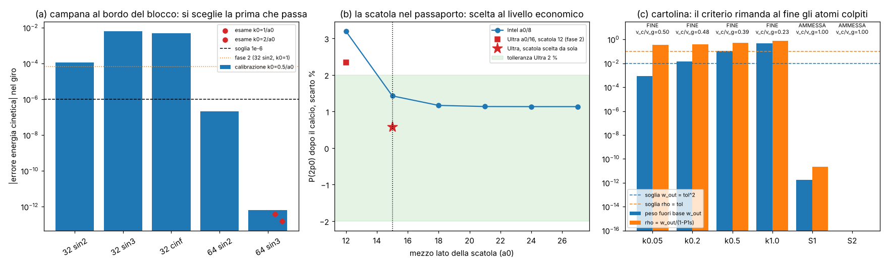

# Motore ottimizzato: quale livello simulare, dove, e quando (lato fisico)

**La domanda di Valerio.** "Un ottimo sistema di ottimizzazione grafica come Unreal Engine", con idee geniali, visive e
geometriche. Nel progetto le impostazioni grafiche **sono** i livelli di agglomerato (`VISIONE_SISTEMA.md`). E poi il
principio, detto con la sua immagine: **una mela in 4K e una in 480p devono marcire tutte e due.** Sulla Intel UHD del
portatile si accetta meno risoluzione e più errore, ma la **dinamica** deve restare la stessa.

**Perimetro (cambiato dal coordinatore a metà lavoro).** Qui c'è solo il **lato fisico** dello schema multilivello:
1. quale livello di agglomerato usa ogni regione, entro un limite di errore fisico (anche **proiettato sullo schermo**,
   come criterio di scelta, alla Nanite);
2. come si passa da un livello all'altro **senza scatti**, conservando carica ed energia;
3. il **passo di tempo locale** (fino a "orologio fermo" per le regioni che nessuno guarda);
4. che cosa vuol dire, in modo misurabile, **"dinamica conservata"** ai livelli grossi, con esami Ultra contro Intel.

Il disegno (splat gaussiani, preset grafici, regola sulla GPU) è del thread "Modello standard a palline": le idee che
avevo le trovi in fondo, nell'appendice da passare a loro. La GTX 1650 Ti è rotta: ogni budget qui è sulla **Intel UHD**
(e su una scheda da 16 GB come obiettivo).

File: motore `lab/motore_core.py`; pre-registrazione `lab/motore_prereg.py` → `lab/out/motore_prereg.json`
(**committata in e540d7f prima delle corse**); corse `lab/motore_m1.py` (A, B1, B2), `lab/motore_m2.py` (C),
`lab/motore_m3.py` (D), `lab/motore_m4.py` (EL, EE, giudizio); emendamento dichiarato `lab/motore_amend.py`;
figura `lab/motore_figure.py` → `lab/out/motore_figure.png`.

---

## 0. In breve

| esame | cosa | risultato | esito |
|---|---|---|---|
| A1 | il modello d'errore (dispersione di Bloch della regola, pesata sullo spettro del pacchetto) prevede deriva e fase della luce contro Maxwell vero | 16 casi su 16 (deriva entro 5 % + 0,01 λ, fase entro 0,05 rad) | **PASS** |
| A2 | lo stesso con un solo k₀ (il modello economico che userebbe il motore) | 16/16 | **PASS** |
| B1 | scena "errore sullo schermo": 8 pacchetti da 0,1 a 20 λ per pixel, 100 λ di volo | errore misurato ≤ **0,43 px** su tutti i pacchetti non segnalati; costo **÷28** (Intel) e ÷8 (Ultra) rispetto a tutto a 64 celle/λ; ma i 2 pacchetti segnalati misurati sotto 0,5 px per un difetto della **mia misura** (scatola troppo piccola, vedi §3) | **FAIL** (sotto-criterio; i punti principali passano) |
| B2 | l'errore della fisica **ha memoria**: camera che si avvicina | ingenua (alla Nanite) **14,7 px** di errore finale; col "passaporto d'errore" **0,26 px** | **PASS** (la ingenua doveva fallire, e fallisce) |
| C1 | congelare tutto fuori dal **cono di luce all'indietro** della regione guardata | regione guardata identica **al bit** (luce 2-D e Dirac 2-D con nucleo Z = 60); con un cono più stretto di 1 cella errore 0,58–1,45 | **PASS** |
| C2 | "orologio pigro": recuperare 1024 tick con un salto esatto in Fourier | differenza 1,9·10⁻¹³; 38 volte più veloce dei tick uno per uno | **PASS** |
| C3 | la regola agglomerata imparata ha un cono? | quasi: coda fuori dal cono fisico 10⁻⁴–10⁻² per una sola cella accesa, fuori da 2× lo stencil ≤ 6·10⁻⁶ dopo un passo e 10⁻¹⁵ dopo 4 | descrittivo |
| D1 | cambio di livello della luce (N → N/2 → N) | **spettrale**: energia conservata a 10⁻¹¹, nessun salto; cubico (quello di oggi nel reticolo) 3·10⁻⁵…9·10⁻³; media a blocchi 2·10⁻³…4·10⁻² | **PASS** |
| D2 | cambio di livello dell'elettrone (fine → livello imparato → fine) | blocco dell'agglomeratore + prolungamento spettrale (che "disfa" il blocco): carica e energia cinetica tornano a 10⁻¹⁵; prolungamento a gradini: energia cinetica **+105 %…+3800 %** | **PASS** |
| EL | dinamica della luce, Ultra (32 celle/λ) / Intel (12) / sotto il pavimento (8), contro Maxwell | Ultra **PASS**, Intel **PASS** (diffrazione −9,3 %: al limite del 10 %), sotto il pavimento **FAIL** come previsto (diffrazione −21 %, cucitura T = 0,983, anisotropia 8,5 %) | come pre-registrato |
| EE | dinamica dell'elettrone a scala atomica sui livelli imparati (celle a₀/256, a₀/21, a₀/11) | velocità, allargamento, energie cinetiche entro 0,4 %, norma 10⁻¹³ a **tutti e tre** i livelli | **PASS** (3/3) |

**Il colpo d'occhio.** Le tre idee che reggono il motore sono uscite tutte **esatte o prevedibili**:
il **cono di luce** permette di non calcolare niente fuori da quello che potrà influenzare ciò che guardi (esatto al
bit, perché la pallina zig-zag non va mai più veloce di una cella per tick); il **cambio di livello spettrale**
conserva energia e carica a 10⁻¹¹; e l'**errore di ogni livello si calcola in anticipo** dalla regola stessa (16 casi su
16). La lezione più importante è un **no**: nella fisica, a differenza di Nanite, l'errore **si accumula**. Scegliere il
livello solo in base a quanto è lontano adesso porta a 14,7 pixel di errore quando ti avvicini. Serve un "passaporto"
dell'errore per ogni regione, oppure (per la luce libera) il salto esatto nel tempo.

---

## 1. L'idea in parole semplici

Nanite (Unreal) disegna ogni pezzo di montagna col numero di triangoli che basta perché l'errore **sullo schermo** stia
sotto un pixel: lontano pochi triangoli, vicino tanti. Noi vogliamo la stessa cosa ma per la **fisica**: lontano celle
grosse (livelli di agglomerato alti), vicino celle fini, e l'errore detto in pixel.

Ma ci sono due differenze di fondo, e lo studio gira attorno a queste:

1. **Una montagna non si muove; la fisica sì.** Se simuli un fotone con celle grosse, sbaglia un po' la velocità; dopo
   100 lunghezze d'onda ha accumulato un ritardo. Quando la camera si avvicina, il ritardo **è ancora lì**: non sparisce
   passando a celle fini. L'errore ha memoria (esame B2).
2. **Sotto un certo livello la fisica cambia, non si sfoca soltanto.** Un'onda con meno di ~12 celle per lunghezza
   d'onda non diventa "più sfocata": cambia **diffrazione** (−21 % a 8 celle/λ), **velocità di sbieco** (−8,5 %) e
   attraversa male le cuciture. È il **pavimento dinamico**: l'hardware debole può scendere fino lì, non sotto
   (esami EL). Per non scendere sotto, sulla Intel si **rimpicciolisce la scena**, non la risoluzione.

## 2. Il modello d'errore (A1, A2): sapere in anticipo quanto sbaglia un livello

La regola zig-zag della luce su un livello con N celle per λ ha una dispersione nota esattamente (la matrice di Bloch
di due tick, `zz_core.bloch_batch`). Da lì escono, **senza simulare**:

* errore di frequenza δω/ω (la fase che si accumula: le frange scivolano di δφ λ/2π);
* errore della velocità di gruppo (l'inviluppo arriva in ritardo, e di sbieco devia: "walk-off");
* fattore di diffrazione (quanto si apre il fascio rispetto alla luce vera).

| celle per λ | velocità a 45° | frequenza a 45° | diffrazione a 0° | diffrazione a 45° |
|---|---|---|---|---|
| 8 | −8,43 % | −2,71 % | 0,785 | 1,135 |
| 12 | −3,57 % | −1,17 % | 0,907 | 1,058 |
| 16 | −1,97 % | −0,65 % | 0,948 | 1,033 |
| 32 | −0,48 % | −0,16 % | 0,987 | 1,008 |
| 64 | −0,12 % | −0,04 % | 0,997 | 1,002 |

(Lungo gli assi la luce è un puro spostamento: errore zero di velocità e frequenza, ma la diffrazione è il fattore
ka/tan ka già noto. L'errore scala come N⁻².)

**A1/A2.** Ho fatto volare 16 pacchetti (N = 8, 12, 16, 32 × angoli 0°, 22,5°, 30°, 45°) per 50 λ con la regola vera
(evoluzione esatta in Fourier) e con **Maxwell continuo** (la luce vera, l'esame), dagli stessi dati iniziali.
La deriva misurata cade sulla retta della previsione per 4 ordini di grandezza (figura, pannello a). 16/16 sia col
modello pesato sullo spettro, sia con quello a un solo k₀.

**Una lezione di sviluppo (dichiarata).** Nella prima prova la deriva di traverso a 30° era sbagliata del 45 %: non era
il modello, era la **scatola periodica troppo piccola** (le code del pacchetto rientravano dall'altro lato). Con ±4,5 σ
torna tutto. Questa stessa trappola mi ha poi morso in B1 (§3).

## 3. La scelta del livello con l'errore sullo schermo (B1)

**La regola del motore.** Per ogni regione: impronta del pixel p (quante λ copre un pixel a quella distanza), orizzonte
T (quanto a lungo vivrà la cosa), pavimento del livello (32 per Ultra, 12 per Intel). L'errore visibile in pixel è

* **inviluppo**: deriva / p — sempre;
* **frange**: (δφ/2π)·λ / p — **solo se le frange sono risolte** sullo schermo (almeno 2 pixel per λ); se un pixel
  copre più di mezza λ, il pixel fa la media delle frange e la fase non si vede.

Si sceglie il livello più grosso con errore previsto ≤ 0,5 px (margine 2). Se nessun livello della scala basta, la
regione viene **segnalata**.

| impronta [λ/px] | 0,1 | 0,2 | 0,5 | 1 | 2 | 5 | 10 | 20 |
|---|---|---|---|---|---|---|---|---|
| angolo | 30° | 30° | 0° | 22,5° | 45° | 60° | 15° | 0° |
| livello Intel | segn. | segn. | 12 | 32 | 24 | 16 | 12 | 12 |
| errore misurato Intel [px] | — | — | 0,013 | 0,395 | 0,431 | 0,365 | 0,214 | 0,000 |
| livello Ultra | segn. | segn. | 32 | 32 | 32 | 32 | 32 | 32 |
| errore misurato Ultra [px] | — | — | 0,002 | 0,395 | 0,241 | 0,091 | 0,029 | 0,000 |

* **Errore ≤ 1 px dappertutto**: massimo 0,43 px; previsione e misura coincidono entro il 3 %.
* **Costo** (celle × tick, in 2-D ∝ N³) sui pacchetti non segnalati: **÷28** su Intel rispetto a tenerli tutti a 64
  celle/λ (soglia ÷4: PASS), ÷8 su Ultra (il pavimento di Ultra a 32 costa).
* Notare il pacchetto a 1 λ/px a 22,5°: anche su Intel vuole 32 celle/λ. Le frange non si vedono, ma in 100 λ
  l'inviluppo di sbieco si sposta più di mezzo pixel. **L'angolo conta quanto la distanza.**

**Il FAIL (dichiarato).** Il pre-registro chiedeva anche che i due pacchetti segnalati, misurati al livello più fine
(64), sbagliassero davvero più di 0,5 px. Misurati: 0,605 e **0,302** px. Il secondo "smentiva" la segnalazione. Ma per
non riempire la memoria li avevo fatti con σ = 2 λ, e in 100 λ un pacchetto così stretto si apre per diffrazione
fino al bordo della scatola (±9 λ): le code rientrano e falsano il centro, lo stesso difetto di §2. **Emendamento A1**
(`lab/motore_amend.py`, dopo la corsa, dichiarato): stessi due casi in una scatola di ±7 σ → **1,05 px e 0,52 px**:
la segnalazione era giusta. Il verdetto di B1 resta FAIL perché così era scritto; il motore non ha sbagliato, la mia
misura sì.

## 4. L'errore ha memoria (B2): il passaporto

La camera parte lontana (5 λ/px) e arriva vicina (0,1 λ/px) in 100 λ di volo, pacchetto a 30°.

* **Politica ingenua** (Nanite puro: ogni 10 λ sceglie il livello che basta **adesso**): usa 12 celle/λ quasi tutto il
  tempo (da lontano basta), passa a 16 alla fine. Quando la camera è vicina il pacchetto ha già 1,5 λ di ritardo e
  5,2 rad di fase accumulati: **14,7 px** di errore. Cambiare livello alla fine non serve: l'errore è già nella fisica.
* **Passaporto d'errore**: ogni regione porta con sé l'errore **accumulato** (previsto dal modello di §2) e il motore
  sceglie il livello pensando alla **impronta più piccola che la camera potrà raggiungere** (la camera ha una velocità
  massima: anche lei ha un "cono"). Risultato: 128 poi 96 celle/λ, errore finale **0,26 px** (previsto: fase 0,080,
  misurata 0,081 rad).
* **Il prezzo**: il passaporto costa 3,3·10¹⁰ celle×tick contro 6,4·10⁷ dell'ingenua, **500 volte di più**. È il prezzo
  vero di vedere da vicino una cosa che ha viaggiato a lungo.

**Come non pagarlo (per la luce libera).** Nel vuoto la regola è lineare e uguale dappertutto: lo stato dopo m tick si
calcola **con un salto solo** (W(k)^m in Fourier, esame C2: identico ai tick uno per uno a 2·10⁻¹³). Quindi un fotone che
nessuno guarda **non si simula affatto**: si tiene il suo fotogramma chiave e, quando la camera arriva, si salta
direttamente al presente al livello fine. Costo: una trasformata, invece di 10¹⁰ celle×tick. Per la **materia che
interagisce** il salto non esiste: lì il passaporto dice "rifai da un fotogramma chiave al livello fine" (il costo si
rimanda, non si toglie).

## 5. Il tempo locale (C1, C2, C3)

**C1: il cono di luce come "frustum" causale.** La regola zig-zag sposta ogni pallina di **al massimo una cella per
asse per tick**. Quindi quello che vedrai fra T tick nella finestra guardata dipende solo dalle celle entro distanza T
(nella metrica "a scacchiera", L∞). Tutto il resto si può **congelare**. Prova: mondo 192², finestra 48², 64 tick, campo
dappertutto (tre pacchetti + fondo casuale), sia luce sia elettrone di Dirac con nucleo Z = 60:

| | errore nella finestra | con cono 1 cella più stretto |
|---|---|---|
| luce 2-D | **0 (identico al bit)** | 0,58 |
| Dirac 2-D + Coulomb | **0 (identico al bit)** | 1,45 |

Il cono è **esatto e minimo**: una cella in meno e il risultato è sbagliato. Celle aggiornate: il 37 % (risparmio ×2,7
su 64 tick); ×12 su 8 tick, ×5,6 su 32 (in 3-D i risparmi vanno al cubo invece che al quadrato).

**C2: l'orologio pigro.** Una regione congelata accumula un "debito di tick". Per la luce nel vuoto lo si paga con un
salto in Fourier: 1024 tick in 0,09 s invece di 3,4 s (n = 128), differenza 1,9·10⁻¹³.

**C3: e le regole imparate dall'agglomeratore?** La regola grossa imparata (1-D, livelli B = 16, 64, 192) non ha un cono
perfetto: è il fattore unitario di uno stencil, quindi ha una coda. Partendo da **una sola cella accesa** (il caso
peggiore: contenuto fino al limite del livello) dopo un passo l'1 % circa della norma sta fuori dal cono fisico
(1 cella grossa per passo), ma fuori da **2 volte lo stencil** l'ampiezza è ≤ 6·10⁻⁶ dopo un passo e 10⁻¹⁵ dopo 4.
Regola pratica per il motore: sui livelli imparati, congelare fuori da un cono di velocità **2w celle per passo** (w =
raggio dello stencil), con un errore ≤ 10⁻⁵ per passo, controllabile.

**Berger–Oliger (calcolo, non esame).** Nel mondo R3 del reticolo (21 livelli, 717 568 celle) ogni livello fa metà dei
tick di quello sotto: costo per tick fine 127 357 contro 717 568, **×5,6**. Il cono e l'orologio pigro sono il caso
estremo dello stesso principio: il passo di tempo di una regione che nessuno può vedere è **infinito**.

## 6. Cambiare livello senza scatti (D1, D2)

**Luce (D1).** Pacchetto a 30°, proiettato sulla banda giusta del reticolo fine, portato al livello grosso e
ritorno:

| celle/λ sul grosso | spettrale: ΔE/E | cubico (oggi nel reticolo): ΔE/E andata e ritorno | media a blocchi | banda sbagliata sul grosso |
|---|---|---|---|---|
| 32 | −2·10⁻¹² | −3,5·10⁻⁵ | −2,4·10⁻³ | 3,5·10⁻⁶ |
| 16 | −4·10⁻¹² | −5,5·10⁻⁴ | −9,6·10⁻³ | 5,7·10⁻⁵ |
| 12 | −6·10⁻¹² | −1,7·10⁻³ | −1,7·10⁻² | 1,9·10⁻⁴ |
| 8 | −9·10⁻¹² | −8,6·10⁻³ | −3,8·10⁻² | 1,0·10⁻³ |

* Lo **spettrale** (tieni i coefficienti di Fourier sotto il limite del livello grosso, Parseval) conserva l'energia a
  10⁻¹¹, il centro non salta (10⁻¹⁵ λ), il giro di andata e ritorno ha fedeltà 1. **È il cambio "senza pop".**
* La parte che finisce sulla **banda sbagliata** del reticolo grosso (elicità o modo fermo) non dipende dal metodo: è
  il fatto che i "fotoni del reticolo" a 12 celle/λ sono un po' diversi da quelli a 24. 1,9·10⁻⁴ a 12 celle/λ,
  sotto la soglia 10⁻³; a 8 celle/λ arriva a 10⁻³ (un altro segnale del pavimento).
* La media a blocchi (il modo più ovvio) **perde l'1–4 % dell'energia** a ogni cambio: un motore che cambia livello
  spesso così farebbe "svanire" la luce.

**Elettrone (D2).** Il descrittore dell'agglomeratore è la media sul blocco. Quella media **non** conserva
esattamente la norma (−3,7·10⁻⁴ a B = 192, k = 1/a₀: è un filtro). La soluzione esatta:
* la **carica vestita** del livello grosso, Q = Σ_K |ψ̂(K)|²/|S(K)|² (S = il filtro del blocco), è uguale alla carica
  fine a 10⁻¹⁶ ed è conservata dalla regola grossa (che è unitaria e uguale dappertutto);
* il **prolungamento spettrale** (dividere per S in Fourier: "disfare" il blocco) riporta stato, norma ed energia
  cinetica al fine a 10⁻¹⁵.

Il prolungamento a gradini (ripetere il valore della cella grossa) conserva la norma ma **inventa energia cinetica**:
+105 % a B = 16, +1850 % a B = 192, +3800 % a B = 384. È il "pop" fisico: gli spigoli dei gradini sono onde corte
finte.

## 7. La mela in 4K e in 480p: che cosa deve restare (EL, EE)

**La definizione (pre-registrata).**

| deve restare uguale | come si misura | tolleranza Ultra / Intel |
|---|---|---|
| leggi di conservazione | norma (carica), energia sum\|F\|² nel livello | **10⁻¹⁰** (tutti) |
| tempi caratteristici e frequenze | velocità, frequenza, apertura per diffrazione, energie cinetiche | 2 % / 10 % |
| sequenza degli eventi | due eventi separati più di tol·t restano nello stesso ordine (≡ errore di velocità < tol/2) | 1 % / 5 % sulle velocità |
| simmetrie | purezza di elicità, isotropia (max − min della velocità sugli angoli) | 2 % / 10 % |
| attraversare le cuciture fra livelli | T ≥ 1 − tol/20, energia persa e elicità sbagliata ≤ tol/20, velocità dopo entro tol | 0,999 / 0,995 |

**Può peggiorare:** la nitidezza (la cella), il contenuto più corto di ~12 celle, la Zitterbewegung.

**Luce** (riferimento: Maxwell continuo; la cucitura col mondo a blocchi di `reticolo_core`):

| | Ultra 32 celle/λ | Intel 12 | sotto il pavimento 8 |
|---|---|---|---|
| velocità peggiore (45°) | −0,48 % | −3,58 % | −8,47 % |
| frequenza peggiore (45°) | −0,16 % | −1,17 % | −2,70 % |
| diffrazione 0° / 45° (misura; previsione) | 0,987 / 1,008 (0,987 / 1,008) | **0,907** / 1,057 (0,907 / 1,058) | **0,786** / 1,131 |
| cucitura T peggiore (30°) / energia persa | 0,99993 / 7·10⁻⁵ | 0,9962 / 3,8·10⁻³ | **0,983** / 1,7·10⁻² |
| anisotropia | 0,48 % | 3,6 % | **8,5 %** |
| energia nel livello | 1,5·10⁻¹² | 5·10⁻¹³ | 3·10⁻¹³ |
| verdetto | **PASS** | **PASS** | **FAIL** (diffrazione, cucitura, sequenza) |

**Elettrone** (livelli 1-D imparati da `agg_zz_1d`, riferimento: la regola fine esatta; pacchetto atomico k₀ = 1/a₀,
σ = a₀/2, fino al tempo di allargamento 2mσ² ≈ 9400 ħ/mc²):

| | Ultra B = 16 (a₀/256) | Intel B = 192 (a₀/21) | sotto B = 384 (a₀/11) |
|---|---|---|---|
| velocità | +1,4·10⁻⁵ | +7,9·10⁻⁴ | +7,2·10⁻⁴ |
| allargamento | +7·10⁻⁶ | −2,1·10⁻⁴ | −2,2·10⁻⁴ |
| energia cinetica a k = 0,5 / 1 / 2 (1/a₀) | 3·10⁻⁵ / 2·10⁻⁵ / 1·10⁻⁵ | 3,6·10⁻³ / 1,7·10⁻³ / 7,8·10⁻⁴ | 3,4·10⁻³ / 1,5·10⁻³ / 6,8·10⁻⁴ |
| norma | 2·10⁻¹³ | 2·10⁻¹³ | 1·10⁻¹⁴ |
| verdetto | **PASS** | **PASS** | **PASS** |

* **La luce ha un pavimento a ~12 celle/λ**, fissato dalla diffrazione (ka/tan ka), non dalla velocità. Intel a 12 passa,
  ma di poco (−9,3 % contro 10 %). Sotto (8) la luce **cambia fisica**: si apre il 21 % in meno, perde l'1,7 % alle
  cuciture, e due fotoni che arrivano a 5 % di distanza possono scambiarsi l'ordine.
* **L'elettrone a scala atomica non tocca il pavimento** nemmeno a a₀/11: le regole imparate sono già Schrödinger con la
  massa giusta e l'errore è di qualche 10⁻³. (Il pavimento per la materia viene dal nucleo: la cuspide degli stati s,
  `AGGLOMERATO_ZIGZAG.md`: 2s +1,0 % ad a₀/8.)
* **Zitterbewegung (EE5, descrittivo).** Ad Ultra (passo 0,54 ħ/mc²) il tremolio si vede alla frequenza giusta (2,03
  contro 2). A Intel (passo 6,4) non è "sparito": la regola imparata con i due fogli (R, L) lo **ricampiona** e mostra un
  battito **lento finto** ~~a 0,12 mc²/ħ~~ [correzione fase 2: 0,12 era solo il limite di risoluzione della FFT con 8 campioni; la frequenza vera, misurata in §14.4, è 0,0437 mc²/ħ = l'alias del tremolio], identico a quello del fine guardato agli stessi istanti. Per il motore è una
  trappola visiva: un'oscillazione che sembra fisica e non lo è. Ai livelli grossi va usato il descrittore di **Pauli**
  (solo energie positive), come già fa la catena 3-D: lì il tremolio non c'è e non c'è nemmeno il fantasma.

## 8. Il budget sull'hardware (calcolo, da misurare col ponte)

**Dati.** Misurato nel Laboratorio (dal coordinatore): ~42 ms per passo fisico con ~33 800 palline, sulla Intel UHD
(oggi la fisica gira sulla CPU; il porto WGSL della regola non c'è ancora). Dati di catalogo, **non misurati**: Intel
UHD della famiglia del portatile ≈ 0,4 TFLOPS, memoria condivisa DDR4, banda pratica ~25 GB/s; scheda da 16 GB ≈
288 GB/s (fascia media) – 717 GB/s (fascia alta).

**Conto.** La regola della luce è limitata dalla banda di memoria: 24 byte per cella (3 complessi a 32 bit), da 48 byte
per cella-tick (passata fusa) a 144 (tre passate per asse). Celle×tick al secondo:

| | Intel UHD | 16 GB fascia media | 16 GB fascia alta |
|---|---|---|---|
| celle×tick/s | 1,7·10⁸ – 5,2·10⁸ | 2,0·10⁹ – 6,0·10⁹ | 5,0·10⁹ – 1,5·10¹⁰ |
| livello | pavimento: 12 celle/λ | Ultra: 32 | Ultra: 32 |
| scatola 3-D con il fotone che avanza di 1 λ al secondo (costo (NL)³·N) | **L ≈ 20–29 λ** | L ≈ 12–18 λ | L ≈ 17–24 λ |
| memoria (due copie del campo) | (12·25)³ celle → 1,3 GB | (32·20)³ → 12,6 GB | idem |

**La cosa bella:** perché il costo va come N⁴ in 3-D, il rapporto Ultra/Intel (32/12)⁴ ≈ 50 è dello stesso ordine del
rapporto di banda (12–29). Quindi **la stessa scena, grande ~20 λ, gira sulla Intel a 12 celle/λ e sulla scheda da
16 GB a 32 celle/λ**: è esattamente "la mela in 480p e in 4K". Se la scena è più grande, sulla Intel si **taglia la
scatola** (o si congela fuori dal cono, §5), mai la risoluzione sotto il pavimento.

**Atomo** (regola imparata di Pauli, due FFT per passo, ~100 byte per cella): Intel a₀/8 (96³, ±6 a₀) ~3,5 ms per passo;
Ultra a₀/16 (192³) ~2,4 ms sulla scheda media. Ma un battito 1s–2p dura 18 000–37 000 passi: **circa un minuto** per
battito su entrambe. Per vedere battere un atomo isolato dal vivo serve il salto esatto (idea 4 sotto), non più GPU.

**Richieste di ponte proposte** (formato `docs/PONTE.md`, **non create**):
1. `{"azione": "ping"}` — conferma che wgpu vede la Intel UHD e quanta RAM condivisa c'è.
2. `{"azione": "test", "args": {"filtro": "motore_banco_regola", "ignored": true}}` — dopo la patch §10.3: tempo per tick
   della regola della luce sulla CPU a 96³ e 128³, per tarare i byte per cella-tick.
3. Dopo il porto WGSL della regola (thread "Modello standard"): lo stesso banco sulla GPU, con il nome dell'adattatore,
   per sostituire le stime della tabella con numeri veri.

## 9. Idee geometriche e visive

| # | idea | cosa si vedrebbe | perché funziona | costo | regole |
|---|---|---|---|---|---|
| 1 | **Il cono di luce come frustum** (provata, C1) | niente di diverso a schermo: è il punto. In una vista di controllo, le palline fuori dal cono restano ferme e si rimettono in moto quando entrano | la pallina zig-zag non supera mai una cella per tick: dipendenza esatta | zero; risparmio ×2,7–12 in 2-D, al cubo in 3-D | fisica pura, nessun fake |
| 2 | **Clipmap di livelli attorno all'occhio** | gusci concentrici, ognuno grande il doppio e con celle il doppio, centrati sulla camera; mentre ti muovi i gusci scorrono | è il "camino" del reticolo (R4: 25 610 celle per livello), ma attorno all'occhio invece che attorno a un oggetto: costo ∝ numero di livelli = log(mondo) | 20 livelli × 64³ ≈ 5·10⁶ celle per un mondo 2²⁰ volte la cella fine | si scala solo con l'agglomeratore; il contenuto vince sull'occhio (il pavimento §7) |
| 3 | **Passaporto d'errore come colore** | in vista di controllo, ogni regione ha un alone del colore del suo errore accumulato in pixel (verde < 0,5, rosso > 1) | il passaporto è già calcolato (§4) | nullo | è solo un indicatore; niente linee |
| 4 | **Atomo-cartolina spettrale** | un atomo lontano che "respira": le palline seguono \|Σ cₙ ψₙ e^{−iEₙt}\|², battono alle frequenze vere | un atomo isolato è lineare: nella base dei suoi stati fermi (calcolati dalla regola stessa, come in A2 di AGGLOMERATO_ZIGZAG) il tempo è un giro di fasi esatto; il salto di §4 per la materia | pochi numeri per atomo; errore = solo il peso degli stati tagliati, misurabile | gli stati vengono dalla regola, nessuna tabella; si torna alla griglia quando arriva la luce |
| 5 | **Reticolo più rotondo (BCC/FCC)** | la luce di sbieco non rallenta: fronti d'onda davvero sferici | il difetto obliquo (−3,6 % a 12 celle/λ) è il cubo; esistono automi di Weyl sul reticolo cubico a corpo centrato (D'Ariano–Perinotti) più isotropi | da calcolare: dispersione e anisotropia a 12 celle/λ | **cambia la regola**: non si fa senza Valerio (una sola strada) |
| 6 | **Il pavimento come "risoluzione onesta"** | sulla Intel la stessa scena, più piccola o più sgranata, ma con la luce che si apre e arriva come sulla scheda grossa | §7–§8: sotto ~12 celle/λ cambia la fisica, sopra cambia solo la nitidezza | — | è la regola del motore |

La più promettente nel mio perimetro (1) l'ho provata: esatta al bit.

## 10. Patch proposte per altri file (non toccati)

1. **`src/atomo/` (thread Laboratorio Atomo)** — modulo nuovo `livelli.rs`:
   * `TabellaErrori`: per N ∈ {8, 12, 16, 24, 32, 48, 64} e angoli a passi di 5°, δω/ω, errore di velocità, walk-off,
     fattore di diffrazione, calcolati all'avvio dalla matrice di Bloch (porto di `motore_core.level_errors`; con il
     `zigzag/walk.rs` esistente).
   * `Passaporto { livello, deriva_acc: [f32; 3], fase_acc: f32, t_chiave, stato_chiave }` per regione; scelta del
     livello con l'impronta minima raggiungibile dalla camera (velocità massima della camera).
   * `cono.rs`: maschera L∞ delle celle da aggiornare (distanza dalla finestra ≤ tick rimanenti); sui livelli
     imparati velocità 2w.
   * `trasferisci.rs`: cambio di livello spettrale (rustfft, già nell'ecosistema) per luce ed elettrone, con
     deconvoluzione del blocco.
2. **`lab/reticolo_core.py` / `reticolo_spec.json`** — sostituire, per il cambio di livello di un'intera regione, la
   restrizione cubica (−1, 9, 9, −1)/16 con quella spettrale (debito 14: chiude anche il "fantasma del gamma" per il
   contenuto risolto). La cucitura locale fra blocchi resta cubica; quella conservativa del flusso è ancora da fare.
3. **`src/atomo/tests.rs`** — test ignorato `motore_banco_regola`: 200 tick della regola della luce a 96³ e 128³,
   stampa ms/tick e byte/s stimati (per la richiesta di ponte 2).
4. **`docs/PIANO.md`, `docs/CONTESTO_CLOUD.md`** — aggiungere questo studio; in CONTESTO §4 debito 25 ("≥ 24 celle/λ a
   ≥ 30 tick/s non entra nel portatile"): sostituire con il pavimento 12 celle/λ e la tabella di §8.
5. **Agglomeratore 1-D** — ai livelli grossi (passo > π/2 ħ/mc²) usare il descrittore a energia positiva, per evitare
   il battito finto della Zitterbewegung ricampionata (EE5).

## 11. Fallimenti, debiti, cambi rispetto alla pre-registrazione

**FAIL:** B1 (sotto-criterio dei pacchetti segnalati: difetto della mia misura, emendamento A1 lo mostra); EL "sotto il
pavimento" (atteso, è la prova che il pavimento esiste).

**Cambi e correzioni dichiarati:**
* Prima della pre-registrazione: esplorazioni di sviluppo elencate nel JSON.
* Nel pre-registro, prima delle misure: il costo di B1 contato sui soli pacchetti non segnalati (la prima stesura
  contava i segnalati come N = 64).
* B2: la scala del passaporto estesa a 96 e 128 celle/λ (nessun livello fino a 64 tiene 0,5 px a 0,1 λ/px per
  100 λ: lo dicono già le segnalazioni di B1). B2 riorganizzato per far girare di fila gli intervalli con lo stesso
  livello (stessa fisica, solo più veloce: la prima versione non stava nei 10 minuti).
* D2: un errore di arrotondamento nel mio script (indici di Fourier `astype(int)` invece di `rint`) dava −11 % a
  B = 16; corretto e rifatto, l'esame non è cambiato.
* Emendamento A1 (dopo B1): i due pacchetti segnalati rifatti in una scatola più grande; il verdetto non cambia.

**Debiti nuovi o rimasti:**
1. Le regioni di B1 sono pacchetti in scatole separate (la luce non interagisce con la luce); la convivenza di più
   livelli in un mondo è quella del reticolo (R3b, 4,8·10⁻⁷), non rifatta qui.
2. Il cambio di livello spettrale è globale sulla regione (FFT): per i blocchi del reticolo serve una versione locale.
3. Il passaporto è provato solo per la luce libera; per la materia (atomo in un campo) l'errore per livello va preso dai
   controlli dell'agglomeratore (8,8·10⁻⁵ … 2,8·10⁻⁴ di energia per livello in 3-D), non verificato in una scena.
4. Solo 2-D (luce) e 1-D (elettrone). Il 3-D è un conto (§8): l'errore della luce è lo stesso (la dispersione), il
   costo va al cubo/quarta.
5. Tutti i tempi GPU sono stime di catalogo: da misurare col ponte.
6. L'atomo-cartolina (idea 4) e la clipmap (idea 2) non sono provate.

**Quanti numeri:** **0 parametri di fisica** (c e la regola sono quelli di `ZIGZAG.md`; i livelli dell'elettrone sono quelli
già imparati in `agg_zz_1d`). **Manopole di progetto** (scelte, non fisica): tolleranze 2 % / 10 %, margine 0,5 px,
scala dei livelli, intervallo di controllo 10 λ, pavimenti 32 / 12, regola del cono 2w sui livelli imparati.

## 12. Dove l'intuizione di Valerio può aiutare

1. **Quanto deve "marcire uguale" la mela?** Ho messo 10 % per la Intel. Per te conta di più che i **tempi** siano
   giusti (il fotone arriva quando deve) o che le **forme** lo siano (quanto si apre il fascio)? Sulla Intel a 12 celle/λ
   i tempi sbagliano del 3,6 %, le forme del 9 %.
2. **L'errore che ha memoria.** Accettiamo che una cosa vista da lontano per tanto tempo, quando ti avvicini, "si
   ricalcoli" (pausa di un istante, rifatta dal fotogramma chiave)? Oppure preferisci che il motore la simuli sempre
   abbastanza bene "per sicurezza"? La prima costa 500 volte meno nel caso di B2.
3. **Il cono di luce come regola del mondo.** Fisicamente dice: quello che non può raggiungerti non conta *ancora*. Ti
   piace che il motore **fermi l'orologio** delle zone che nessuno può vedere? Si vede solo se lo si mostra apposta.
4. **Reticolo più rotondo.** La luce di sbieco rallenta perché le palline vivono su un cubo. Un reticolo a "corpo
   centrato" (come il ferro) sarebbe più rotondo, ma è un'altra regola. Vuoi che lo valuti (solo calcolo, senza cambiare
   strada)?
5. **L'atomo lontano come cartolina che respira.** Un atomo da solo è "una musica": pochi stati che girano. Ti sembra
   onesto disegnarlo così da lontano (stati calcolati dalla regola), e tornare alle palline vere quando arriva la luce?

## 13. Cosa resta da fare

1. Ponte: `ping` e, dopo la patch, il banco della regola (richieste di §8).
2. Passaporto per la materia: un atomo agglomerato colpito da un impulso, Ultra (a₀/16) contro Intel (a₀/8), con le
   stesse definizioni di "dinamica conservata" (righe, tempi, conservazione).
3. Atomo-cartolina spettrale: provare che il salto nella base degli stati fermi riproduce la griglia, e quanto costa
   tornare alla griglia quando arriva la luce.
4. Cambio di livello spettrale **locale** per i blocchi del reticolo.

(Punti 2–4 fatti in fase 2, §14. Restano: ponte; cinetica al bordo del blocco (D-F2-2); cartolina con più stati (D-F2-3).)

## 14. Fase 2: la mela vera (un atomo colpito), il cambio di livello locale, il descrittore a energia positiva

Pre-registrazione: `lab/out/motore_f2_prereg.json` (committata prima delle corse, `lab/motore_f2_prereg.py`).
Codice: `lab/motore_f2_core.py`, `lab/motore_f2_run.py`; controllo dichiarato a posteriori `lab/motore_f2_posthoc.py`;
figura `lab/out/motore_f2_figure.png`; esiti in `lab/out/motore_f2_{atom,lot,pos,clip,judge,posthoc}.json`.

### 14.1 La scena: un atomo agglomerato che prende un calcio

L'atomo è quello della catena 3-D (regola imparata, `agg_zz_3d_A.pkl`), risolto in un ottante (nucleo sullo spigolo,
stencil simmetrizzato sulle 48 operazioni del cubo: cambia i livelli di ≤ 4·10⁻⁵). Lo stato 1s prende un impulso
brevissimo lungo z (ψ → e^{iqz}ψ, q = 0,5/a₀), poi "batte": il dipolo ⟨z⟩(t) oscilla alla riga 1s→2p. È la versione
per la materia della mela: **stessa scena, due risoluzioni, deve marcire allo stesso modo**.

| | Ultra (a₀/16, ottante 192³) | Intel (a₀/8, ottante 96³) | esatto |
|---|---|---|---|
| 1s / 2s / 2p (eV) | −13,59335 / −3,44062 / −3,39130 | −13,54753 / −3,43550 / −3,39145 | −13,606 / −3,401 / −3,401 |
| riga 1s→2p (G1a) | 10,2021 eV (−0,02 %) **PASS** | 10,1561 eV (−0,47 %) **PASS** | 10,2043 |
| P(2p0) dopo il calcio (G1b) | 0,07545 (+2,33 %) **FAIL** (tol 2 %) | 0,07608 (+3,19 %) **PASS** (tol 10 %) | 0,073728 |
| P(1s) | −0,04 % | −0,18 % | 0,784665 |
| P(2s) | 0,0077 | 0,0078 | ~~(0 nel continuo)~~ 0,00819 [correzione fase 3, §15] |
| norma dopo M passi (G1c) | 1,5·10⁻¹⁴ **PASS** | 4,5·10⁻¹⁴ **PASS** | ≤ 10⁻¹⁰ |
| sequenza + primi 4 zeri del dipolo (G1d) | **PASS** | **PASS** | |
| cartolina (G2) | **PASS**, peso tagliato 13,2 % | **PASS**, peso tagliato 13,3 % | |
| costo griglia / cartolina per passo | ×3,5·10⁶ | ×5,3·10⁵ | |

**G1e (Intel contro Ultra entro 10 %): PASS.** La riga differisce dello 0,45 %, P(2p0) dello 0,8 %.

**Il FAIL di Ultra (G1b) è dichiarato e resta FAIL.** Il controllo a posteriori (`motore_f2_posthoc.json`, solo Intel,
scatola più grande) dice da dove viene: P(2p0) +3,19 % a ±12 a₀, **+1,17 % a ±18 a₀, +1,13 % a ±24 a₀**. Circa 2 punti
erano la **scatola** (lo stato 2p, largo ~5 a₀, a ±12 a₀ viene schiacciato), non la risoluzione. Avevo scelto la scatola
pre-registrata per stare nei 10 minuti; è stato un errore mio di disegno dell'esame, non della dinamica. Anche la riga
si sposta un poco con la scatola (Intel 10,156 → 10,145 eV). Lezione per il motore: **anche la scatola è un livello**, e
va messa nel passaporto d'errore come la risoluzione.

**La cartolina.** Tre stati fermi (1s, 2s, 2p0) fatti girare con le loro fasi riproducono la griglia, nel sottospazio,
a livello di arrotondamento, e costano un milione di volte meno. **Ma il 13 % del calcio va fuori**: in stati più alti e
nel continuo (ionizzazione). Una cartolina a 3 stati quindi **non** è l'atomo colpito: o si aggiungono stati (3s, 3p,
…), o quel 13 % resta sulla griglia. Onestamente: la cartolina vale per l'atomo **lontano e tranquillo**, non per quello
che sta prendendo la botta.

### 14.2 Cambio di livello LOCALE (G3): trasformata a coseni locali

Cosa: invece di cambiare livello su tutto il mondo con la FFT (D1, fase 1), lo si cambia **a blocchi** con una base di
coseni locali (Coifman–Meyer/Malvar: blocchi di 32 celle fini = 16 grosse, sovrapposizione 16/8, campana = seno iterato
2 volte). È ortogonale, quindi l'energia si conserva per costruzione; tenendo la metà bassa dei coefficienti si passa
al livello grosso solo dentro quel blocco.

* **G3a PASS.** Luce 2-D, pacchetti a 30°: |ΔE/E| = 2,4·10⁻¹¹ … 5,4·10⁻¹¹ per N grosso = 32, 16, 12 **e anche 8**;
  salto del baricentro ≤ 6·10⁻⁷ λ. Come lo spettrale globale di D1 (10⁻¹¹), molto meglio del cubico (3,5·10⁻⁵…8,6·10⁻³).
* **G3b FAIL (come registrato).** Avevo scritto "il campo grosso cambia solo entro il blocco ± la sovrapposizione".
  Sbagliato io: la funzione di base di un blocco tocca anche **il blocco vicino**, e la restrizione grossa ha la sua
  sovrapposizione. Il supporto vero, misurato, è blocco ± (blocco vicino + sovrapposizione grossa): righe grosse
  [40,104) per il blocco fine [128,160), e **oltre è esattamente zero**. La località c'è, è solo un blocco più larga.
* **G3c FAIL.** Elettrone 1-D, 4 dimezzamenti locali: la **carica** passa (|ΔN/N| 1,6·10⁻¹⁰ ≤ 10⁻⁶), ma l'**energia
  cinetica** nel giro andata-ritorno sbaglia di 7·10⁻⁵ e 2,8·10⁻⁵ (soglia 10⁻⁶). Perché: quell'1e-10 di norma che si
  perde finisce su frequenze della scala del blocco, che portano 10⁴–10⁵ volte l'energia cinetica media. La campana
  morbida riduce questa fuga ma non la annulla. Rimedio da provare (non fatto): campana più lunga (sovrapposizione
  piena) o correzione della cinetica sul bordo del blocco. Debito D-F2-2.

### 14.3 Descrittore a energia positiva ai livelli grossi (G4): PASS

Al livello Intel 1-D (B = 192) si proietta sulla banda positiva della regola imparata dopo il blocco.

* pacchetto atomico positivo: peso negativo dopo il blocco 3,6·10⁻¹²;
* battito finto: 1,3·10⁻⁶ senza proiezione → **2,5·10⁻¹⁶** con proiezione (soglia 10⁻¹⁰);
* fuga fra bande per passo 1,9·10⁻²⁹; dinamica lenta cambiata di ~3·10⁻⁸ (baricentro, larghezza);
* stato "R puro fermo" (peso negativo 0,5): **segnalato**, resta al fine; senza proiezione il suo battito finto ha
  ampiezza 0,495.

Quindi: ai livelli grossi si porta solo la parte a energia positiva (descrittore di Pauli); dove la parte negativa pesa
(> 10⁻³), il motore **non** sale di livello lì.

### 14.4 Il battito finto viene dalle valli? (ipotesi del thread principale) — No

Il thread principale ha trovato (`BATTIMENTO_1S.md`, 83485bc) che la regola cubica 3-D ha 4 valli d'impulso che il
nucleo mescola, e che questo fa battiti finti. Ho controllato se il mio battito lento ai livelli grossi è la stessa cosa.

* Il picco del battito è a ω = 0,043711; l'alias del tremolio (2mc² ripiegato dal passo grosso) è 0,043707. Coincide.
* I candidati "valle" ripiegati sono 0 e 0,0437: coincidono anche loro **per costruzione** in 1-D (la seconda valle
  sta a k = π e si ripiega sulla stessa frequenza), quindi la frequenza da sola non decide.
* Decide il contenuto: il peso del pacchetto vicino a k = π grosso è **1,3·10⁻³³**. Non c'è niente nella seconda valle.

**Esito dichiarato: è Zitterbewegung aliasata, non mescolanza delle valli.** In più, per la catena 3-D A: il blocco con
b = 16 uccide esattamente le valli a (π/2, π/2, 0), perché Σ_{j=0}^{15} e^{iπj/2} = 0. Questo è coerente coi livelli
puliti dell'ottante (§14.1). Le valli restano un problema del livello fine vicino al nucleo, non del motore ai livelli grossi.

**Correzione della fase 1.** In §7 avevo scritto "battito lento finto a 0,12 mc²/ħ". Era sbagliato: con 8 campioni 0,12
era solo la risoluzione della FFT. La frequenza vera è 0,0437 mc²/ħ (misurata 0,04371).

### 14.5 Gusci di livelli attorno all'occhio (G5, solo calcolo)

Ogni guscio ha m³ celle (meno il buco del guscio più fine), e la cella raddoppia a ogni guscio. Col passo locale, un
guscio di livello ℓ fa un tick ogni 2^ℓ tick fini.

| m | gusci | celle totali | memoria luce | costo per tick fine (passo locale) | lato del mondo / lato fine |
|---|---|---|---|---|---|
| 64 | 10 | 2,33 M | 0,11 GB | 491 k | 512 |
| 64 | 20 | 4,62 M | 0,22 GB | 491 k | 5,2·10⁵ |
| 64 | 40 | 9,21 M | 0,44 GB | 491 k | 5,5·10¹¹ |
| 96 | 10 | 7,85 M | 0,38 GB | 1,66 M | 512 |
| 96 | 40 | 31,1 M | 1,49 GB | 1,66 M | 5,5·10¹¹ |

Il punto bello: **col passo locale il costo per tick non cresce coi gusci** (serie geometrica: ~1,07 volte il guscio
fine). Un mondo grande 10¹¹ volte la zona fine costa come la zona fine. Contro questo c'è il passaporto (B2): l'errore
dei gusci lontani si accumula e va tenuto sotto la soglia del pixel. Le transizioni fra gusci sono il cambio locale di
§14.2, perciò il debito D-F2-2 (cinetica al bordo) pesa proprio lì.

### 14.6 Conto fase 2

* Esami: G1a ✓✓, G1b ✗(Ultra) ✓(Intel), G1c ✓✓, G1d ✓✓, G1e ✓, G2 ✓✓, G3a ✓, G3b ✗, G3c ✗, G4 ✓ (G5 senza
  soglia). **PASS 12, FAIL 3.**
* Manopole nuove: 4 scelte di disegno, fissate prima delle corse e non adattate: blocco 32, sovrapposizione 16,
  campana iterata 2 volte, soglia di segnalazione 10⁻³ del peso negativo. Più q e la scatola della scena (sono esame).
  Nessun fit.
* Debiti nuovi:
  - **D-F2-1** scatola ±12 a₀ troppo stretta per P(2p): la scatola entra nel passaporto.
  - **D-F2-2** cinetica al bordo del blocco nel cambio locale (G3c).
  - **D-F2-3** cartolina a 3 stati: perde il 13 % di un atomo colpito; servono più stati o la griglia.
  - **D-F2-4** stencil simmetrizzato sul cubo (≤ 4·10⁻⁵ sui livelli), messo a mano per usare l'ottante.
* Cambi rispetto alla pre-registrazione, dichiarati:
  - controllo della scatola a posteriori (non cambia gli esiti);
  - verifica delle valli aggiunta dopo la richiesta del coordinatore.
* Ponte: nessuna richiesta creata; l'atomo-cartolina e i gusci restano da misurare sul portatile (§8).

## 15. Fase 3: campana al bordo del blocco, cartolina con n = 3 e criterio di ritorno, scatola nel passaporto

Pre-registrazione: `lab/out/motore_f3_prereg.json` (commit 3bf7c0d, prima delle corse). Le soglie vecchie sono
rimaste uguali. Codice: `lab/motore_f3_core.py`, `lab/motore_f3_run.py`. Esiti: `lab/out/motore_f3_{lot,sweep,ultra,card,truth,judge}.json`.
Figura: `lab/out/motore_f3_figure.png`.

**Conto: 10 esami PASS, 0 FAIL** (più C3 solo riportato). Due previsioni erano sbagliate e le dichiaro: la scatola
scelta è 15 a₀, non 18; il rapporto delle velocità per i calci forti è più basso di 0,495 (vedi §15.2).

### 15.1 La cinetica al bordo del blocco (G3c bis): PASS

Il problema della fase 2: le funzioni di base locali hanno una "campana" ai bordi del blocco. Se la campana è corta,
ha code ad alta frequenza, e un pezzettino di norma (10⁻¹⁰) va a frequenze che portano un'energia cinetica enorme.

La correzione resta **locale** (stesso tipo di supporto) e **conservativa** (la base resta ortogonale): si cambia solo
la forma e la lunghezza della campana. La scelta è automatica. Si prova una lista in ordine di località (blocco 32,
poi 64, poi 128; campana seno iterato 2 o 3 volte, oppure C∞). Si prende la **prima** che, su un pacchetto di
calibrazione **diverso** da quelli d'esame (k₀ = 0,5/a₀), tiene norma ed energia cinetica entro 10⁻⁷.

| blocco, campana | errore cinetica (calibrazione) |
|---|---|
| 32, sin2 (fase 2) | 1,1·10⁻⁴ |
| 32, sin3 | 6,3·10⁻³ |
| 32, C∞ | 5,0·10⁻³ |
| 64, sin2 | 2,2·10⁻⁷ |
| **64, sin3 (scelta)** | **6,3·10⁻¹³** |

Lezione: una campana più liscia **non** basta se è troppo corta. Sul livello grosso restano 8 campioni di campana, e
una forma più ripida fa peggio. Serve la campana lunga (blocco 64, sovrapposizione 32 fini, 16 grossi).

* **G3c bis PASS:** sui pacchetti registrati (k₀ = 1 e 2 /a₀) la cinetica sbaglia di **4,0·10⁻¹³ e 1,6·10⁻¹³**
  (soglia 10⁻⁶; in fase 2 era 7·10⁻⁵), la norma di 10⁻¹⁵.
* **G3a bis PASS:** luce 2-D, |ΔE/E| 1,3·10⁻¹³…2,1·10⁻¹² (in fase 2 era 10⁻¹¹), anche a N = 8.
* **G3b bis PASS:** col supporto dichiarato nuovo (blocco ± un blocco ± mezza sovrapposizione grossa), fuori il
  cambio è **esattamente 0**.
* **Prezzo:** il supporto raddoppia (256 celle fini contro 128) e la trasformata costa ~10⁻⁷ s per cella. È sempre
  locale, ma meno stretta.

### 15.2 Cartolina con 3s/3p/3d₀ e criterio automatico di ritorno al livello fine

Livello Intel (a₀/8), scatola ±27 a₀ (ottante 216³). Stati presi dalla regola:

* 1s −13,548 eV, 2s −3,395, 2p −3,403;
* 3p −1,511, 3s −1,5137, poi la coppia 3d (3z²−r², x²−y²) a −1,5136, degenere come vuole il cubo.

Nel continuo il livello n = 3 vale −1,511 eV. Sul reticolo 3s e 3d sono staccati di 2·10⁻⁵ eV: è la cuspide del nucleo.

**C1 PASS** (calcio q = 0,5, reticolo contro Schrödinger):

| | 1s | 2s | 2p₀ | 3s | 3p₀ | 3d₀ |
|---|---|---|---|---|---|---|
| esatto | 0,78466 | 0,00819 | 0,07373 | 0,00147 | 0,01570 | 0,00146 |
| reticolo | −0,18 % | +1,0 % | +1,1 % | −0,9 % | +1,8 % | +1,2 % |

**Correzione della fase 2.** In §14 avevo scritto "P(2s) = 0 nel continuo". Era sbagliato: e^{iqz} contiene anche una
parte con l = 0 (j₀(qr)), quindi P(2s) = 0,00819. Il reticolo dava 0,0077 a ±12 a₀ e dà 0,0083 a ±27 a₀.

**C2 PASS:** la cartolina a 7 stati gira con le sue fasi e coincide con la griglia nel sottospazio a 1,1·10⁻⁸, sotto
il limite M·r·2 = 3,3·10⁻⁵.

**Il criterio.** La cartolina è ammessa solo se:
1. il peso fuori base è w_out ≤ tol² = 0,01, cioè lo stato è giusto entro il 10 %;
2. **e** la parte di eccitazione persa è ρ = w_out/(1 − P₁ₛ) ≤ tol = 0,1, cioè quello che è successo all'atomo è
   catturato entro il 10 %.

Se una delle due condizioni salta, l'atomo torna alle palline vere.

La "verità" si misura con 40 passi della griglia completa contro la cartolina. Lo scenario è VERO se valgono tutte e due:
- la distanza fra i due stati è ≤ 10 %;
- la velocità iniziale del dipolo è giusta entro il 10 %.

| scenario | w_out | ρ | criterio | distanza | v_cart/v_griglia | VERO |
|---|---|---|---|---|---|---|
| calcio q = 0,05 | 8,9·10⁻⁴ | 0,35 | **fine** | 0,030 | 0,50 | no |
| calcio q = 0,2 | 0,015 | 0,38 | **fine** | 0,12 | 0,48 | no |
| calcio q = 0,5 | 0,115 | 0,53 | **fine** | 0,34 | 0,39 | no |
| calcio q = 1,0 | 0,477 | 0,80 | **fine** | 0,74 | 0,23 | no |
| S1 = 1s + 0,3i·2p | 2·10⁻¹² | 2·10⁻¹¹ | **cartolina** | 3·10⁻⁶ | 1,000 | sì |
| S2 = 1s+2s+3s+3p | ~0 (−7·10⁻¹², arrotondamento) | ~0 | **cartolina** | 3·10⁻⁶ | 1,000 | sì |

* **C4 PASS (sicurezza):** nessuno scenario ammesso è falso.
* **C5 PASS:** gli stati legati sono ammessi, quindi niente rifiuti inutili.
* **C6 PASS:** la griglia dopo il calcio si muove a v = ħq/m entro lo **0,07–0,18 %**. È il teorema di Ehrenfest:
  il calcio dà proprio l'impulso q.
* **C3 (riportato):** il peso fuori base del reticolo coincide con l'esatto (q = 0,05: 8,91·10⁻⁴ contro 8,94·10⁻⁴;
  q = 0,5: 0,1150 contro 0,1148; q = 1: 0,477 contro 0,475).

**La cosa importante, detta semplice.** Anche col calcio più piccolo (q = 0,05) lo stato è giusto al 97 %
(w_out < 10⁻³). Eppure la cartolina si muove **a metà velocità** (0,498). Il motivo è una regola nota, la regola di
somma di Thomas–Reiche–Kuhn: la "forza" con cui l'atomo risponde a una spinta si divide fra tutti gli stati p. 2p e 3p
ne hanno il 41,6 % + 7,9 % = 49,5 %. L'altra metà sta negli stati più alti e nel **continuo** (ionizzazione).

Quindi un atomo colpito, descritto con pochi stati, **perde metà dell'impulso**. Una vera mela non lo fa: la
"dinamica conservata" (conservazione dell'impulso) lo vieta. Il primo criterio (w_out) da solo l'avrebbe ammessa
per q = 0,05. Il secondo (ρ) la rimanda giustamente al fine.

La previsione 0,495 vale per calci piccoli (misurato 0,498 a q = 0,05). Per calci forti il rapporto scende (0,39 a
q = 0,5; 0,23 a q = 1), perché va sempre più peso nel continuo. Questo l'avevo previsto male.

Conclusione per il motore: la cartolina va bene per atomi **tranquilli o già eccitati in stati legati** (S1, S2:
esatta a 10⁻⁶, un milione di volte più economica). Un atomo che **prende una botta** torna subito al livello fine. Il
criterio automatico lo decide da solo e in modo sicuro.

### 15.3 La scatola dentro il passaporto d'errore

La regola è stata registrata prima: provare le scatole al livello **economico** (Intel) e prendere la più piccola
dopo la quale P(2p₀), riga e P(1s) cambiano meno di tol_Ultra/4 = 0,5 % allargando di 3 a₀.

| scatola (a₀) | 12 | **15** | 18 | 21 | 24 | 27 |
|---|---|---|---|---|---|---|
| P(2p₀) Intel, scarto | +3,19 % | **+1,43 %** | +1,17 % | +1,14 % | +1,13 % | +1,13 % |
| cambio al passo dopo | 1,7 % | **0,26 %** | 0,03 % | 0,003 % | 0,0003 % | – |

Scelta automatica: **±15 a₀** (avevo previsto 18). L'errore di scatola rimasto, stimato contro 27 a₀, è 0,29 %. Va
scritto nel passaporto.

* **B1 PASS:** Ultra (a₀/16, ottante 240³) a ±15 a₀ dà P(2p₀) **+0,58 %** (in fase 2 era +2,33 % a ±12, FAIL),
  P(1s) −0,04 % e riga 10,1918 eV (−0,12 %). Tutto entro il 2 %.
* **B2 PASS, e notevole:** l'effetto scatola misurato a Ultra (P(12)/P(15) − 1 = 1,742 %) coincide con quello di
  Intel (1,741 %) a 10⁻⁵. Cioè l'errore di scatola **non dipende dalla risoluzione**: si misura sul livello economico
  e vale per tutti.

È il principio della mela applicato alla scatola: la scatola è un "livello" come la risoluzione, e il suo errore si
misura una volta, al livello che costa poco.

### 15.4 Debiti e manopole (fase 3)

* **Chiusi:**
  - D-F2-1 (scatola): ora è scelta automaticamente ed entra nel passaporto;
  - D-F2-2 (cinetica al bordo): G3c bis PASS.
* **D-F2-3 (cartolina) cambiato:** non è più "servono più stati". Per un atomo colpito **nessun** numero piccolo di
  stati legati basta: manca il continuo, metà della regola di somma. Il debito ora è "una cartolina che contenga il
  continuo" (per esempio stati di scatola fino a qualche Rydberg), da provare.
* **Nuovi:**
  - D-F3-1: il supporto del cambio locale raddoppia (blocco 64), quindi la località costa di più;
  - D-F3-2: le soglie del criterio della cartolina (tol² e tol) sono una scelta di disegno, non derivate dalla fisica.
* **Manopole nuove: 4 scelte di disegno, nessun fit:**
  - la lista dei candidati per la campana;
  - la soglia di calibrazione 10⁻⁷;
  - le due soglie del criterio della cartolina.
  - Il passo dello sweep della scatola (3 a₀) e la soglia tol/4 sono scelte anche loro.
* **Cosa ho deciso nello scrivere lo script** (prima delle corse, dichiarato): la cartolina viene rinormalizzata alla
  norma della griglia, per conservare la carica.
* **Ponte:** nessuna richiesta creata.

## Appendice — idee di disegno da passare al thread "Modello standard a palline"

* I descrittori della super-pallina di `ZOOM.md` (n, X, s²: quante, dove, quanto larga) **sono già uno splat gaussiano**:
  ogni agglomerato si disegna come una pallina morbida con centro, larghezza e peso suoi.
* Lontano, una pallina per impronta di pixel che porta la **somma dell'energia** delle celle che copre (un mipmap
  dell'energia): la luminosità totale si conserva esattamente quando si cambia livello, quindi niente "pop" di luce.
* Le frange più strette di 2 pixel non si disegnano (il pixel ne fa la media, come in §3): si disegna l'inviluppo.
* "Lunga esposizione" = quello che misura un rivelatore vero (energia integrata su un tempo): è fisica, e le palline
  che la campionano possono continuare a muoversi lungo il flusso d'energia.
* Vista di controllo: palline colorate per livello e per errore del passaporto (idee 1 e 3), mai linee.
* Budget di §8: la Intel regge ~20 λ di scatola a 12 celle/λ; una 16 GB la stessa scatola a 32.

## Come rifarlo

    python lab/motore_prereg.py
    python lab/motore_m1.py A ; python lab/motore_m1.py B1 ; python lab/motore_m1.py B2   # ~1, 2, 5 min
    python lab/motore_m2.py                                                               # ~1 min
    python lab/motore_m3.py                                                               # ~3 min
    python lab/motore_m4.py EE ; python lab/motore_m4.py EL4 ; python lab/motore_m4.py EL3 ; python lab/motore_m4.py judge
    python lab/motore_amend.py ; python lab/motore_figure.py
