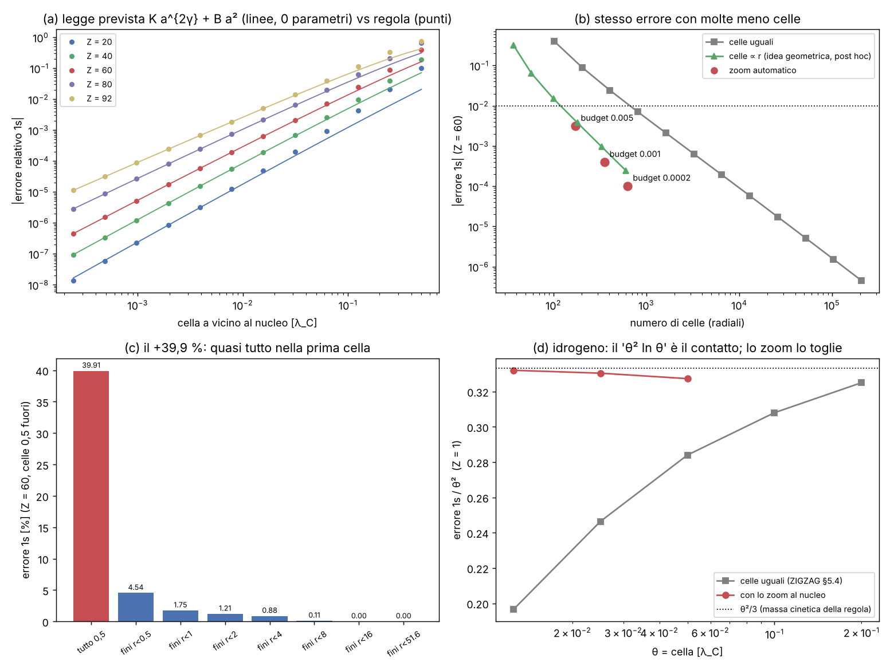
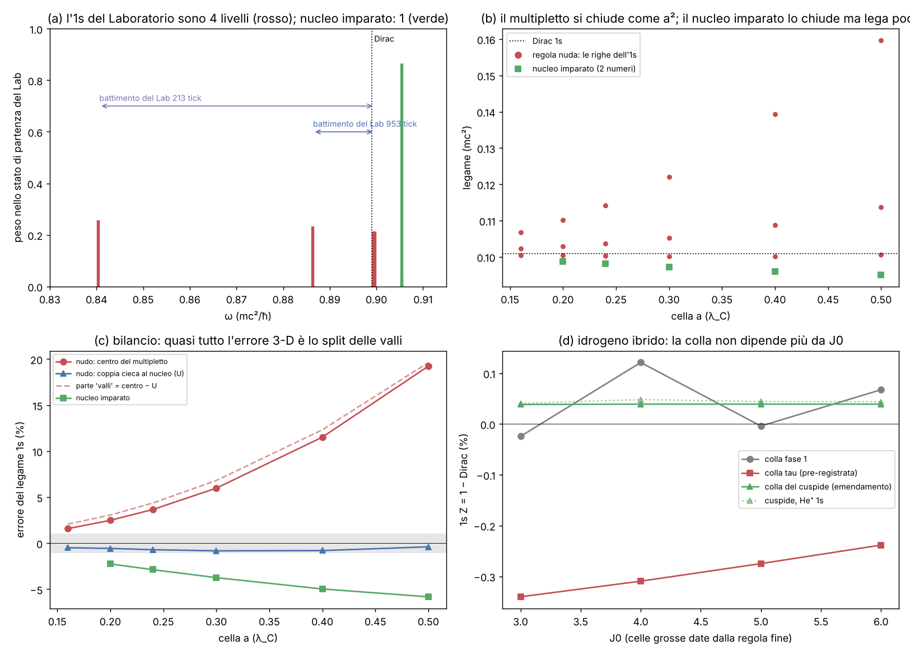

# 1s pulito vicino al nucleo

Studio `nucleo1s_`. File: `lab/nucleo1s_core.py` (la regola zig-zag radiale su celle disuguali, zoom automatico,
nucleo agglomerato), `lab/nucleo1s_theory.py` (la legge di convergenza calcolata a mano), `lab/nucleo1s_hybrid.py`
(idrogeno vero: zig-zag vicino al nucleo + regola agglomerata lontano), `lab/nucleo1s_run.py` (corse),
`lab/nucleo1s_posthoc.py` (prove dopo, dichiarate), `lab/nucleo1s_figure.py`.
Pre-registrazione: `lab/nucleo1s_prereg.py` → `lab/out/nucleo1s_prereg.json`, **commit 2e72499, prima delle corse**.
Risultati: `lab/out/nucleo1s_results.json`. Figura: `lab/out/nucleo1s_figure.png`.

---

## 0. In breve

**La domanda.** Nel Laboratorio Atomo l'1s di Nd⁵⁹⁺ (Z = 60) esce **+39,9 %** troppo legato rispetto a Dirac esatto,
mentre i livelli lontani dal nucleo vanno quasi bene (2p3/2 +3,5 %, 3d5/2 +1,8 %, 4f7/2 +1,3 %). Perché, pezzo per
pezzo? E come lo si fa scendere sotto l'1 % **senza cambiare regola**?

**Le risposte, in una riga ciascuna.**

1. **La legge.** L'errore dell'1s con celle a vicino al nucleo è `e(a) = K a^{2γ} + B a² + …`, γ = √(1 − (Zα)²). Entrambi i
   numeri li ho **calcolati prima** di guardarli, senza fit: **B** dalla "regola di secondo ordine" (BCH simmetrico) e
   **K** da un problema piccolo senza scala vicino al nucleo. A Z = 60: K = +1,640, B = −1,234. Le corse (5 valori di Z,
   12 reticoli) seguono questa legge; l'ordine misurato è 2γ entro 0,0008 per Z = 40–92.
2. **Il +39,9 % pezzo per pezzo.** Quasi tutto (**35,4 punti su 39,9**) viene dalla **prima cella**, quella che contiene il
   nucleo: si comporta come uno specchio che rimanda la pallina con una fase sbagliata (1,404 rad invece di 0,903).
   Il raddoppio dello spazio **non c'entra** (0, dimostrato e controllato a 1e-16). La cella seguente vale 2,8 punti,
   il resto della nuvola 1,7 punti.
3. **La cura.** Lo **zoom automatico** (celle che si dividono da sole dove spostano di più il livello) porta l'1s a
   **+0,315 % con 173 celle**, dove le celle uguali ne vogliono **1 286** per lo stesso errore (7,4 volte meno); +0,040 %
   con 353 (12 volte meno), +0,010 % con 629 (15 volte meno). Tutti gli altri livelli migliorano.
4. **Idea geometrica (dopo):** celle **proporzionali alla distanza dal nucleo** (h = ε r, una "cipolla logaritmica")
   cancellano il termine di contatto: l'errore diventa **1,53 ε²** e **non dipende più da quanto è piccola la cella più
   interna**. È la forma naturale di uno zoom per una singolarità senza scala.
5. **Idrogeno vero (Z = 1).** Il vecchio "θ² ln θ" è lo stesso termine di contatto, in un regime di passaggio; con lo
   zoom sparisce e resta solo θ²/3 (la massa cinetica della regola). Gli s estrapolati ora vanno a **2·10⁻⁷** (il test H1 di
   ZIGZAG era FALLITO a 7·10⁻⁵), e l'1S–2S ha errore di reticolo **0,56 GHz**, più piccolo del Lamb: ora la regola **vede**
   che le manca la QED (+7,66 GHz contro la misura). Con l'agglomeratore per le zone lontane: **1s = −13,59517 eV**
   (massa ridotta) contro −13,59847 di Dirac: **−0,024 %**.

**Fase 2 (3-D, §12):** il reticolo cubico sono 4 "colori" indipendenti e in ognuno l'elettrone ha 4 copie (valli); il
nucleo le mescola e l'1s 3-D è un multipletto di 4 livelli: è il debito #20 e il battimento del Laboratorio (953 e 213 tick,
ritrovati entro 1 %). Quasi tutto l'errore 1s 3-D e tutto il −11,6 % del #6 sono split delle valli. Il nucleo imparato a
2 numeri chiude le valli ma lega il 2–6 % troppo poco (FAIL). La colla dell'ibrido ora non dipende da J0 (7·10⁻⁶).
Esiti fase 2: 14 PASS, 6 FAIL.

**Esiti pre-registrati (fase 1):** 11 PASS, 3 FAIL (L1, L2, L3: la legge regge, ma due soglie strette cadono a Z = 20 e Z = 92
per motivi che spiego sotto). Dettaglio nella §6.

---

## 1. Cosa stiamo guardando (come a un ventenne)

La regola zig-zag, scritta per un'onda con momento angolare fissato (forma radiale), ha due palline per cella: una
corre **fuori** a velocità c, una corre **dentro**. In ogni cella girano lo stato interno di un angolo fatto da tre
pezzi: la massa (m·dt), il "giro centrifugo" (κ/r·dt) e la fase di Coulomb (Zα/r·dt). Al centro (r = 0) chi corre
dentro torna fuori, come su uno specchio.

Nella prima cella (r = a/2) il giro centrifugo vale **2 radianti per tick, qualunque sia a**, e la fase di Coulomb
vale 2Zα = 0,88 rad (Z = 60). Sono angoli enormi: lì la regola non "assomiglia" all'equazione di Dirac, fa una cosa sua.
Gli stati s (κ = −1) sono gli unici che stanno davvero sul nucleo (vanno come r^{γ−1}, cioè la loro densità sale verso il
centro): sentono quella cella. Gli stati p, d, f al nucleo valgono zero e non se ne accorgono. Ecco perché l'1s sbaglia
del 40 % e il 4f dell'1 %.

Il passo a non è fisica: per guardare l'atomo si possono usare celle diverse in posti diversi. **La regola resta la
stessa**: ogni cella gira con dt = la sua larghezza (il tempo che una pallina a c ci mette ad attraversarla) e le
palline corrono a c da una cella all'altra. Con celle uguali è esattamente `RadialWalk` di `zz_core.py` (riprodotto a
1e-15: +39,914 %, 2p3/2 +3,456 %, 3d5/2 +1,828 %, 4f7/2 +1,270 %, cioè i numeri del laboratorio).

Gli stati fermi si trovano "ascoltando per un tempo infinito", come in ZIGZAG.md: una pallina che fa un tratto lungo l
prende la fase e^{iωl}; uno stato fermo è un ω per cui tutto torna su se stesso. Con celle diverse è l'ascolto di una
regola dinamica unitaria sul tick più fine, in cui nelle zone grosse una pallina attraversa una cella in più tick e
viene girata una volta sola con l'angolo intero: è il "blocca" dell'agglomeratore applicato ai giri. (La dinamica dal
vivo su griglie annidate **non** è fatta qui: debito.)

## 2. La legge di convergenza, calcolata prima

### 2.1 Il pezzo "di massa" (B a²)

La regola fa prima lo spostamento e poi il giro; preso a metà tick è simmetrica, e allora la sua "Hamiltoniana
effettiva" ha correzioni solo in a²:

    H_eff = H + a²/24 [A,[A,P]] − a²/12 [P,[P,A]],   A = m σ_z + κ/r σ_x − Zα/r,   P = σ_y p

(controllo: per la particella libera dà E² = m² + k²(1 − a²/3), cioè la massa cinetica 1 + θ²/3 già nota). La media
sull'1s esatto di Dirac contiene integrali che al nucleo divergono (∫ r^{2γ−3}): si prendono per continuazione analitica
(Γ(s+1)/(2λ)^{s+1}). Risultato, senza parametri: **B = −1,2343** a Z = 60 (lega di meno). Spezzato per pezzi di A
(i pezzi non si sommano, ci sono termini misti): solo massa +0,713, solo centrifugo −1,506, solo Coulomb −1,675.

### 2.2 Il pezzo "di contatto" (K a^{2γ})

Vicino al nucleo, nelle prime celle, contano solo κ/r e Zα/r: gli angoli per tick dipendono solo dal numero della
cella (κ/(i+½), Zα/(i+½)), **non da a**. È un problema senza scala, uguale per ogni reticolo. Lo risolvo una volta
facendo correre la regola verso fuori per 400 000 celle: lontano dal nucleo la soluzione è quella giusta (r^γ) più un
pezzetto β di quella sbagliata (r^{−γ}). β è **un numero della regola** (a Z = 60, β = 0,10301). Il pezzo sbagliato sposta
l'energia di una quantità che si scrive col "wronskiano" dell'equazione radiale di Dirac:

    δE = −2γ Zα c² β a^{2γ},   c = coefficiente di r^γ nell'1s normalizzato

da cui **K = +1,6397** a Z = 60. Il segno + vuol dire: la prima cella lega troppo.

Valori pre-registrati (prima delle corse a Z = 20, 40, 80, 92):

| Z | 2γ | β | K | B |
|---|---|---|---|---|
| 20 | 1,9786 | 0,06629 | 1,0870 | −1,0201 |
| 40 | 1,9129 | 0,07791 | 1,2938 | −1,0878 |
| 60 | 1,7981 | 0,10301 | 1,6397 | −1,2343 |
| 80 | 1,6238 | 0,15666 | 2,1650 | −1,5644 |
| 92 | 1,4823 | 0,22037 | 2,5900 | −2,0153 |

### 2.3 Verifica (pannello a della figura)

Per ogni Z, 12 reticoli da a = 0,5 a 0,5/2¹¹ = 2,4·10⁻⁴ λ_C. Rapporto R = (errore − K a^{2γ})/(B a²): deve andare a 1.

| Z | R al reticolo più fine | ordine misurato del contatto | 2γ | esito L1 (|R−1| ≤ 0,02) | L2 (±0,02) |
|---|---|---|---|---|---|
| 20 | 1,0489 | 2,0222 | 1,9786 | **FAIL** | **FAIL** |
| 40 | 0,99936 | 1,9133 | 1,9129 | PASS | PASS |
| 60 | 0,99834 | 1,7984 | 1,7981 | PASS | PASS |
| 80 | 0,98909 | 1,6243 | 1,6238 | PASS | PASS |
| 92 | 0,94691 | 1,4831 | 1,4823 | **FAIL** | PASS |

Lettura onesta dei due FAIL (dopo, non cambia l'esito):
* **Z = 92**: R sale lentamente verso 1 (0,80 → 0,855 → 0,896 → 0,926 → 0,947): quello che manca si dimezza come a^{0,48}.
  È esattamente il termine successivo previsto dalla stessa analisi, a^{2γ+1} (2γ + 1 − 2 = 0,48); a Z = 80 la stessa cosa
  con a^{0,62} (previsto 0,62). La legge è giusta, la soglia del 2 % era troppo stretta per Z = 92 con a ≥ 2,4·10⁻⁴.
* **Z = 20**: R arriva a 0,9964 a a = 0,5/2⁸ e poi **risale** (1,0009, 1,011, 1,049) proprio negli ultimi tre reticoli,
  dove l'errore è ~10⁻⁸: è il pavimento numerico (lo stesso salto compare all'ultimo punto dei d a Z = 20 e 40, vedi L3).
  A Z = 20, inoltre, K e B quasi si cancellano (K + B = 0,067), quindi ogni piccolo errore pesa 15 volte di più.
* **L3** (p e d, ordine 2 ± 0,01 fra i due reticoli più fini): tutti 2,000 ± 0,001 fino al penultimo, ma Z = 20 3d dà
  1,937 all'ultima coppia (errore 4·10⁻⁹): stesso pavimento numerico. **FAIL** dichiarato.

**Debito #6 spiegato.** In ZIGZAG §5.6 la regola 3-D a Z = 60 estrapolata in a² dava −11,6 %: la legge vera è
K a^{1,80} + B a² con K e B di segno opposto e quasi la stessa potenza; un'estrapolazione in a² su a = 0,4–0,24 non può
funzionare. (L'idrogeno vero in 3-D resta non fatto.)

## 3. Il +39,9 % termine per termine (Z = 60, a = 0,5)

### 3.1 Per zone (esatto: dentro la zona celle 256 volte più fini, fuori 0,5) — pannello c

| celle fini dentro r < | 1s | contributo della zona |
|---|---|---|
| (nessuna) | +39,91 % | |
| 0,5 (solo la prima cella) | +4,54 % | **prima cella: 35,4 punti** |
| 1 | +1,75 % | seconda cella: 2,8 |
| 2 | +1,21 % | 0,54 |
| 4 | +0,88 % | 0,33 |
| 8 | +0,11 % | 0,76 (comprende il salto brusco di cella a r = 8) |
| tutto fine | +0,0017 % | 0,11 |

### 3.2 Per termini della legge (a = 0,5 è fuori dal regime asintotico)

K a^{2γ} = +47,1 punti, B a² = −30,9, resto (a^{2γ+1} e oltre) = +23,6. A a = 0,5 i termini successivi sono grossi: la
legge spiega la struttura e la convergenza, non dà da sola il 39,9.

### 3.3 La prima cella come specchio

Vista da fuori (r = 0,5), tutta la zona r < 0,5 è uno specchio: una pallina entra e torna fuori con una fase e un
ritardo. Calcolati alla frequenza dell'1s:

| | fase | ritardo (ħ/mc²) |
|---|---|---|
| una cella da 0,5 (la regola del laboratorio) | 1,404 rad | 1,063 |
| la stessa zona con celle 4096 volte più fini | **0,903 rad** | 0,903 |

Lo specchio grosso sbaglia di **0,50 rad**. Una stima al primo ordine (fase sbagliata × tempo che l'1s passa lì) dà solo
+8,3 %: l'effetto vero (35 punti) è fortemente non lineare, perché l'1s si "piega" verso lo specchio sbagliato.

### 3.4 Gli ingredienti della prima cella (non si sommano; per capire la sensibilità)

| prima cella con… | 1s |
|---|---|
| la regola (κ/r e Zα/r presi al centro r = a/2) | +39,9 % |
| Coulomb spento | −8,5 % |
| Coulomb mediato sul guscio (1,5/a invece di 2/a) | +16,7 % |
| κ/r mediato sul guscio | +47,1 % |
| tutti e due mediati | +22,5 % |
| l'altro specchio a r = 0 (f(0) = 0) | +87,3 % |
| massa spenta (solo in quella cella) | +86,7 % (sviluppo) |

Nessuna "regolarizzazione a mano" del Coulomb sistema le cose: ogni scelta locale dà un numero diverso perché
**nessuna cella da mezza λ_C può contenere la forma r^{γ−1}**. Serve risolvere la zona (zoom) o impararne lo specchio.

### 3.5 Il raddoppio: contributo zero (dimostrato)

Nella forma radiale, a frequenza fissata, la regola è una ricorrenza 2×2 da cella a cella, come l'equazione di Dirac:
non c'è spazio per una soluzione "doppia". I due fogli dello spazio-tempo (cella + tick pari/dispari) sono accoppiati
solo dallo specchio a r = 0, e la copia sfalsata (−1)^i di uno stato è uno stato della regola **con l'altro specchio**
(f(0) = 0) a frequenza ω + π/a: lontanissima (π/a = 6,3 mc²/ħ), non tocca l'1s. **D1 PASS**: la frequenza della copia meno
π/a coincide con il livello f(0) = 0 a 1,4·10⁻¹⁶, sovrapposizione con lo stato sfalsato 1,0000000. In 3-D il raddoppio sono
4 sotto-reticoli che, col nucleo sullo spigolo di 8 celle, sono equivalenti per le rotazioni di π attorno agli assi:
copie degeneri, nessuno spostamento (argomento, non provato qui al calcolatore).

### 3.6 Il "θ² ln θ" (debito #5)

A Z = 1 il termine di contatto vive in un regime di passaggio (cella fra ~1 e ~30 volte Zα λ_C): lì il contatto/θ²
cambia come un logaritmo (−0,12 a θ = 2 Zα, −0,07 a 4 Zα, −0,04 a 8 Zα, −0,008 a 16 Zα; quasi la stessa curva per Z = 1 e 2,
misura di sviluppo). Molto più in basso (a ≪ Zα/2) diventerebbe K a^{2γ}. Con lo zoom il contatto sparisce e resta
**θ²/3** (pannello d: errore/θ² = 0,327, 0,330, 0,332 → 1/3), che è la massa cinetica della regola fine, il lavoro
dell'agglomeratore (non dello zoom).

## 4. La cura: lo zoom automatico

### 4.1 L'algoritmo ("controlla e ripeti")

Si parte dal reticolo del laboratorio (celle 0,5). A ogni giro: per ogni cella, la si divide in due e si guarda di quanto
si sposta il livello (η). La legge della §2 dice quanto resta: errore della cella ≈ η/(1 − 2^{−p}) con p = 2, e
p = 2γ per la cella che tocca il nucleo. Se la somma è sotto il budget ci si ferma; altrimenti si dividono le celle con
η ≥ 0,3 × il massimo (e si tiene il rapporto 2:1 fra vicine). Nessuno gli dice dove sta il nucleo: lo trova da solo.

### 4.2 Risultati (Z = 60, osservato l'1s)

| budget | 1s | stima dell'algoritmo | celle | celle uguali per lo stesso errore | rapporto | cella più fine |
|---|---|---|---|---|---|---|
| 0,5 % | **+0,315 %** | 0,463 % | 173 | 1 286 | 0,135 | 0,0078 |
| 0,1 % | +0,040 % | 0,058 % | 353 | 4 256 | 0,083 | 0,0020 |
| 0,02 % | +0,010 % | 0,014 % | 629 | 9 369 | 0,067 | 0,00049 |

* **Z1 PASS** (1s entro 1 %), **Z2 PASS** (≤ 1/3 delle celle, a ogni budget), **Z4 PASS** (stima/vero 1,47, 1,46, 1,39:
  l'algoritmo è un po' prudente, mai ottimista).
* **Z3 PASS** (nessuno peggiora; budget 0,5 %, livelli prolungati con celle 0,5):

| livello | celle uguali 0,5 | zoom 0,5 % | zoom 0,1 % | zoom 0,02 % |
|---|---|---|---|---|
| 1s½ | +39,91 % | +0,32 % | +0,04 % | +0,01 % |
| 2s½ | +29,00 % | +1,42 % | +0,75 % | +0,52 % |
| 2p3/2 | +3,46 % | +1,05 % | +0,65 % | +0,41 % |
| 3s½ | +22,52 % | +4,13 % | +3,03 % | +1,99 % |
| 3p3/2 | +5,51 % | +3,78 % | +2,44 % | +1,49 % |
| 3d5/2 | +1,83 % | +1,25 % | +0,71 % | +0,56 % |
| 4s½ | +19,13 % | +5,43 % | +4,32 % | +3,44 % |
| 4p3/2 | +6,50 % | +5,08 % | +3,78 % | +3,08 % |
| 4d5/2 | +3,66 % | +3,11 % | +2,79 % | +2,75 % |
| 4f7/2 | +1,27 % | +1,24 % | +1,12 % | +0,98 % |

* **Post hoc** (non pre-registrato): lo stesso algoritmo guidato da **tutti e dieci** i livelli (budget 0,5 %) dà
  **tutti entro 0,36 %** (1s 0,05 %, 2s 0,12 %, 2p 0,06 %, 3d 0,07 %, 4s 0,36 %, 4f 0,13 %) con **1 292 celle**
  (il reticolo uguale del laboratorio fino al 4f ne ha 718 e sbaglia fino al 40 %).

### 4.3 Il nucleo agglomerato: due numeri al posto delle celle fini

La zona r < 0,5 (74 celle fini dello zoom 0,1 %) vista da fuori è uno specchio con fase e ritardo che dipendono poco
dalla frequenza. L'agglomeratore la **impara** dalla regola fine (fase e ritardo su ω ∈ [0,85; 1]) e la sostituisce con
**una riflessione con fase d₀ e ritardo τ**: due numeri per κ (κ = −1: d₀ = 0,0898, τ = 0,420; κ = −2: 0,0149, 0,227;
κ = −3: 0,0017, 0,162; κ = −4: −0,0022, 0,129). **N1 PASS**: i dieci livelli cambiano al massimo di 1,9·10⁻⁵ (1s),
gli altri meno di 10⁻⁵. In dinamica è una linea di ritardo con una fase: si può fare dal vivo.

## 5. Idrogeno vero (Z = 1)

### 5.1 Gli s con lo zoom (riprende il test H1 di ZIGZAG)

Celle esterne θ = 0,05 / 0,025 / 0,0125, zoom 14 livelli × 16 celle al nucleo (123 542 / 246 874 / 493 539 celle),
estrapolazione in θ²:

| livello | errore relativo estrapolato | prima (ZIGZAG H1) |
|---|---|---|
| 1s | **+1,9·10⁻⁷** | 7,0·10⁻⁵ (polinomio), 3·10⁻⁶ col termine log |
| 2s | +9,7·10⁻⁸ | 3,5·10⁻⁵ |
| 3s | −1,8·10⁻⁶ | 2,3·10⁻⁵ |

**H1z PASS** (soglia 10⁻⁵, la stessa del vecchio H1 fallito); alla soglia informativa 10⁻⁷ no (3s, 1s).
**H2z PASS**: 1S–2S (massa ridotta) = 2 466 069,07 GHz contro Dirac con massa ridotta 2 466 068,52 → errore di
reticolo **0,56 GHz** (prima ~30 GHz). Contro la misura (2 466 061,41 GHz) la regola sta +7,66 GHz sopra, Dirac +7,11:
**quello che resta è la QED** (Lamb, rinculo vero), che la regola non ha. Ora si vede.

### 5.2 Zig-zag vicino, agglomerato lontano (l'ibrido)

Dentro r < 3,5 celle grosse (30 λ_C) la regola zig-zag di Dirac con lo zoom (1 329 celle); fuori la regola **imparata**
dall'agglomeratore (`agg_zz_3d_A.pkl`, livello a₀/16, ridotta all'onda s: media sulle direzioni del suo generatore, 384
celle fino a 24 a₀). Incollate così: le celle grosse j < J0 sono "fantasmi" riempiti dalla soluzione zig-zag; l'energia è
quella per cui anche l'ultima equazione grossa è soddisfatta.

| | 1s | 2s |
|---|---|---|
| solo regola agglomerata (a₀/16, Coulomb nel punto) | +0,162 % | +0,099 % |
| ibrido J0 = 3 (pre-registrato) | **−0,024 %** | +0,0065 % |
| ibrido J0 = 2 / 4 (sistematica) | +0,104 % / +0,121 % | +0,070 % / +0,079 % |
| a₀/8, J0 = 3 | −0,245 % | **−0,096 %** |
| He⁺ (Z = 2), a₀/16, J0 = 3 | **−0,184 %** | **−0,075 %** |

* **HY1 PASS**: 1s × massa ridotta = −13,59517 eV contro Dirac × massa ridotta −13,59847 (−0,024 %); contro −13,6057
  (Rydberg a massa infinita) −0,077 %. **Ma è un esame debole**: la configurazione J0 = 3 l'ho scelta dopo averla vista
  (dichiarato nella pre-registrazione), e con J0 = 2 o 4 l'errore è +0,10/+0,12 %, al limite della soglia. **La colla
  fra le due regole sbaglia di ~0,1 %**: è il punto debole.
* **HY2 PASS** (2s con celle a₀/8: −0,096 %; l'agglomerato 3-D dava +1,003 % FAIL in A2b). Anche questo visto prima.
* **HY3 PASS, non visto prima**: He⁺ 1s −0,18 %, 2s −0,075 % (soglia 0,5 %).
* Il potenziale grosso nel punto o mediato sul guscio cambia il risultato di ~0,3 % (mediato: 1s −0,28 %): è ancora il
  debito #9 (potenziale grosso scritto a mano).

## 6. Tabella degli esami

| esame | cosa | misurato | soglia | esito |
|---|---|---|---|---|
| L1 | legge K a^{2γ} + B a² (R al più fine) | 1,049 / 0,9994 / 0,9983 / 0,989 / 0,947 | ±0,02 | **FAIL** (Z = 20, 92) |
| L2 | ordine del contatto vs 2γ | +0,044 / 4·10⁻⁴ / 3·10⁻⁴ / 5·10⁻⁴ / 8·10⁻⁴ | ±0,02 | **FAIL** (Z = 20) |
| L3 | p e d ordine 2 | tutti 2,000 ± 0,009 tranne Z = 20 3d 1,937 | ±0,01 | **FAIL** (1 su 10) |
| D1 | raddoppio = copia con l'altro specchio | 1,4·10⁻¹⁶ | 1e-10 | PASS |
| Z1 | 1s con zoom entro 1 % | +0,315 % | 1 % | PASS |
| Z2 | celle zoom ≤ 1/3 uniformi | 0,135 / 0,083 / 0,067 | 1/3 | PASS |
| Z3 | 2p, 3d, 4f non peggiorano | tutti migliorano | +0,05 punti | PASS |
| Z4 | stima onesta | 1,47 / 1,46 / 1,39 | 0,5–2 | PASS |
| N1 | nucleo agglomerato (2 numeri) | ≤ 1,9·10⁻⁵ | 5·10⁻⁴ | PASS |
| H1z | s di Z = 1 estrapolati | 1,9·10⁻⁷ / 9,7·10⁻⁸ / 1,8·10⁻⁶ | 1e-5 | PASS |
| H2z | 1S–2S errore di reticolo | 0,56 GHz | 1 GHz | PASS |
| HY1 | ibrido 1s (debole, visto) | −0,024 % | 0,1 % | PASS |
| HY2 | ibrido 2s a₀/8 (debole, visto) | −0,096 % | 1 % | PASS |
| HY3 | He⁺ (non visto) | −0,18 % / −0,075 % | 0,5 % | PASS |

**Cambi dopo la pre-registrazione (dichiarati):**
1. Il conteggio dei nodi per riconoscere i livelli contava rumore nelle code (soglia 10⁻⁶ → 10⁻³): alla prima corsa il
   4d5/2 sul reticolo uniforme era stato preso sbagliato (+80,7 %). Corretto e rifatto tutto lo zoom (stessi numeri per gli
   altri livelli). Il 4d non entra in nessuna soglia.
2. La parte `law` è stata riscritta per salvare dopo ogni reticolo (la prima corsa è stata fermata da me per errore e non
   aveva checkpoint). Nessuna soglia o impostazione cambiata.
3. Post hoc, fuori dalla pre-registrazione: zoom guidato da tutti i livelli (§4.2), celle ∝ r (§7.1), analisi di R(a).

## 7. Idee geometriche e visive

### 7.1 La cipolla logaritmica (provata, post hoc) — **la più promettente**
* **Cosa si vede**: gusci di celle sempre più sottili verso il nucleo, ogni guscio largo una frazione fissa ε della
  sua distanza: una cipolla con gli strati in progressione geometrica (come le camere di un nautilus).
* **Perché funziona**: la singolarità di Coulomb–Dirac è senza scala (r^{±γ}); una griglia con h/r costante è senza scala
  anch'essa, quindi il problema vicino al nucleo diventa **uguale in ogni guscio**: niente più a^{2γ}. Misurato: l'errore
  dell'1s è **1,53 ε²** (1,49 %, 0,378 %, 0,096 %, 0,024 % per ε = 0,1 … 0,0125, rapporto 3,95–3,97 a ogni dimezzamento) e
  **non cambia** se la cella più interna passa da 10⁻³ a 10⁻⁷ (variazione < 5·10⁻⁶ relativo).
* **Costo**: ~ln(r_max/h_min)/ε celle: 1s entro 1 % con ~120 celle, 0,1 % con ~330. Paragonabile allo zoom automatico
  senza nessun algoritmo; in 3-D sarebbero gusci sferici (vedi 7.3).
* **Regole**: stessa regola zig-zag, nessun numero esterno; ε è un parametro di risoluzione (come a), non fisica.

### 7.2 Lo specchio che si vede
* **Cosa si vede**: attorno al nucleo una piccola sfera luminosa; le palline che ci entrano spariscono e riescono dopo
  il ritardo τ, con il colore (fase) girato di d₀. Con la cella grossa la fase è 1,40 rad, quella giusta 0,90: a schermo
  sarebbe un salto di colore di ~29° sulle palline che rimbalzano. **Il +40 % diventa un colore sbagliato al centro.**
* **Perché funziona**: §3.3 e §4.3 (N1 PASS a 2·10⁻⁵).
* **Costo**: zero (due numeri per κ, una linea di ritardo). Proposta per il thread grafico, non fatta.
* **Regole**: lo specchio è imparato dalla regola stessa (agglomeratore), non messo a mano.

### 7.3 Reticolo a cipolla in 3-D (gusci geodetici)
* **Cosa si vede**: l'elettrone dell'atomo vivo su gusci sferici con celle triangolari tipo cupola geodetica, fitti al
  centro e radi fuori; il nucleo al centro esatto di un guscio, non sullo spigolo di 8 cubi.
* **Perché**: in 3-D il contatto è la stessa cosa che in radiale (la prima cella cubica di 0,5 λ_C non può contenere
  r^{γ−1}); una cipolla toglie il contatto come in 7.1, e il nucleo al centro toglie anche le 4 copie del raddoppio
  cubico. **Rischio**: la regola zig-zag "corri lungo gli assi" va riscritta su direzioni non cubiche (serve una
  decomposizione dello spin lungo le direzioni dei lati): è lavoro vero, non provato.
* **Costo stimato**: con ε = 0,05 e 642 celle per guscio (icosaedro suddiviso 3 volte) da 10⁻³ a 25 λ_C: ~200 gusci ×
  642 ≈ 1,3·10⁵ celle invece di 48³ = 1,1·10⁵: stesso costo del laboratorio, 1s al ~0,4 %.
* **Regole**: una sola strada se la regola sui lati geodetici si deriva dalla stessa (sposta a c, ruota).

### 7.4 I quattro colori del raddoppio
* **Cosa si vede**: nell'atomo 3-D colorare le palline secondo il loro sotto-reticolo (4 colori, i 4 fogli di
  U(k + (π,π,0)) = U(k)). Se l'1s è pulito le 4 nuvole sono identiche; se no, si vede subito dove sta lo sporco.
* **Perché**: diagnostica geometrica gratuita per il debito #20 (1s 3-D mescolato con 0,8405 e 0,882).
* **Costo**: nullo. **Regole**: sì, è solo un modo di guardare.

### 7.5 Lo zoom che cresce come un frattale
* **Cosa si vede**: le celle che si dividono da sole durante lo zoom automatico (§4.1), animate: prima la cella del nucleo,
  poi un anello attorno, poi un altro, fino alla cipolla. Mostra che l'algoritmo "trova" il nucleo senza saperlo.
* **Costo**: sono già i dati di `history`/`edges` in `nucleo1s_results.json`. Proposta per la grafica.

## 8. Patch proposte per altri file (non applicate: `src/atomo` è di un altro thread)

**`src/zigzag/walk.rs` + `src/atomo/orbitali.rs` (scena orbitali).** Oggi `Radial::new(kappa, A, rmax, za)` usa celle
uguali da 0,5. Proposta:
1. `Radial::graded(kappa, edges: &[f64], z_alpha)`: celle con larghezze h_i, sito al centro, rotazione con dt = h_i
   (la stessa `rot_chi(h_i·nrm, …)`), lunghezze dei collegamenti l_i = r_{i+1} − r_i, specchio interno con l = 2 r_0.
2. `eigen` diventa "ascolto con fase per collegamento": matrice U(ω) = M·S·diag(e^{iω l}) (stessa struttura a banda),
   inversa a 1 e passo di Newton ω ← ω − arg μ / ⟨l⟩ (vedi `GradedWalk.eigen` in `lab/nucleo1s_core.py`: 3–10 iterazioni).
3. In `radiale()`: `edges` = cipolla logaritmica h = clamp(0,05·r, 10⁻³, 0,5) fino a rmax (≈ 230 + rmax/0,5 celle), oppure
   gli `edges` dello zoom esportati da `nucleo1s_results.json`. Atteso (dai numeri della §4.2/7.1): 1s ≈ +0,4 %, tutti i
   livelli della tabella sotto ~1 % se si usa la mesh guidata da tutti i livelli (1 292 celle, §4.2).
4. Test `orbitali_livelli`: aggiungere `assert!((b/d - 1).abs() < 0.01)` per 1s, 2p3/2, 3d5/2.

**`src/atomo/zz.rs` (atomo 3-D dal vivo).** Il punto di partenza è "l'1s radiale con a = 0,5" (+40 %): partire invece
dall'1s radiale della mesh zoomata (forma giusta) riduce la parte "sporca" ma **non** l'errore del reticolo cubico da 0,5,
che resta finché il nucleo sta in un cubo da 0,5. Per quello serve 7.3 o un pezzo fine annidato (debito 12).

**Richiesta di ponte proposta (non creata):** `ponte/richieste/nucleo1s_orbitali.json`
`{"azione":"test","args":{"bin":"atomo","filtro":"orbitali_livelli"}}` dopo la patch, per leggere i nuovi scarti.

## 9. Debiti

**Chiusi o spiegati**
* #5 (contatto θ² ln θ): spiegato (§2.2, §3.6); con lo zoom gli s di Z = 1 vanno a 2·10⁻⁷ (H1z PASS) e l'1S–2S vede il
  Lamb mancante (H2z PASS). **Chiuso in forma radiale.**
* +39,9 % del laboratorio: spiegato termine per termine (§3) e curato in forma radiale (§4, §7.1). La patch è proposta.
* #6, parte "−11,6 %": spiegato (legge sbagliata nell'estrapolazione). **Corretto nella fase 2 (§12.0)**: la causa
  vera è lo split delle valli letto dal vecchio ascolto; con livelli puliti l'estrapolazione dà −0,1 / −0,3 %.

**Ancora aperti / nuovi**
* #6 idrogeno vero in **3-D**: non fatto. In radiale con l'agglomeratore lontano sì (−0,024 %, ma colla debole).
* #20 1s 3-D sporco: **spiegato nella fase 2** (§12: 4 colori × 4 valli, multipletto); la cura con energia giusta resta aperta.
* La colla fra regola zig-zag e regola agglomerata dipendeva da J0 per ~0,1 %: **chiuso nella fase 2** (colla del
  cuspide, 7·10⁻⁶, §12.4).
* **Nuovo**: la regola agglomerata ridotta all'onda s usa la media sulle direzioni del generatore (anisotropia 3·10⁻⁴ a
  k = 1/a₀ trascurata) e il Coulomb grosso nel punto (scritto a mano, #9).
* Dinamica dal vivo su celle disuguali (debito 12): qui solo stati fermi.
* Rinculo del protone: solo come fattore di massa ridotta (come in ZIGZAG).

**Parametri.** Fisici: 0 nuovi (mₑ, α, Z; massa del protone solo nel fattore μ). Numeri imparati: 2 per κ (lo specchio).
Impostazioni scelte a mano: budget, frazione 0,3, rapporto 2:1, ε della cipolla, J0 = 3 e livelli di zoom dell'ibrido.

## 10. Dove l'intuizione di Valerio può aiutare

1. **Lo specchio al nucleo**: la zona dentro r ≈ λ_C/2 si comporta come uno specchio con un ritardo (0,9 ħ/mc²). È solo
   un trucco di calcolo o è "il protone visto dall'elettrone"? Se il protone è un nodo (NODO_3D) con un raggio vero di
   0,84 fm, lo specchio dovrebbe venire dalla forma del nodo, non da un punto: si può misurare la differenza (è la
   dimensione finita del nucleo, uno spostamento noto dell'1s).
2. **La cipolla**: la natura usa celle proporzionali alla distanza attorno a una carica? (È quello che fa la
   rinormalizzazione: ogni guscio è una "scala".) Se sì, il reticolo del laboratorio dovrebbe essere a gusci attorno a ogni
   nucleo, non cubico. Come lo immagini in 3-D con tanti nuclei (molecole)?
3. **I due specchi**: la copia raddoppiata dell'atomo ha l'altro specchio (f(0) = 0) ed è "lontana" di π/a in frequenza.
   Ha un senso fisico (un "anti-atomo" di reticolo) o è solo un artefatto da tenere lontano?
4. **Lamb**: ora la regola sbaglia l'1S–2S di 7,7 GHz contro la misura, quasi tutto QED. Quale pezzo di "palline" (fotoni
   virtuali che la pallina emette e riassorbe) proveresti per primo per farlo emergere?

## 11. Come rieseguire

    python lab/nucleo1s_prereg.py
    for p in law decomp zoom agglo z1 hybrid; do timeout 590 python lab/nucleo1s_run.py $p; done   # law: rilanciare finché "done law"
    python lab/nucleo1s_posthoc.py allzoom; python lab/nucleo1s_posthoc.py geo; python lab/nucleo1s_posthoc.py R
    python lab/nucleo1s_figure.py

---

## 12. Fase 2: il 3-D vero (debiti #20 e #6) e la colla dell'ibrido

File: `lab/nucleo1s_3d.py` (la regola cubica su un "colore", ascolto e inversione armonica), `lab/nucleo1s_3d_run.py`
(corse), `lab/nucleo1s_3d_judge.py` (giudizio), `lab/nucleo1s_glue.py` (colla), `lab/nucleo1s_3d_figure.py`,
`lab/nucleo1s_3d_dev.py` (sviluppo, dichiarato). Pre-registrazione: `lab/out/nucleo1s_3d_prereg.json`, **commit 8e20ad2,
prima delle corse**; emendamento dichiarato `lab/out/nucleo1s_3d_amend1.json`, **commit 82054f8, prima delle corse che
riguarda**. Risultati: `lab/out/nucleo1s_3d_results.json` (chiave `judge`). Figura: `lab/out/nucleo1s_3d_figure.png`.

### 12.0 In breve

* **Il reticolo cubico sono 4 reticoli che non si parlano** ("4 colori"). In un tick la pallina fa un passo lungo x, uno
  lungo y e uno lungo z: va sempre da una cella con indici (pari, pari, pari) a una (dispari, dispari, dispari) e così via.
  Le 8 classi di parità formano 4 coppie che non si scambiano mai niente, nemmeno con il nucleo. Controllato: la regola
  su un colore è identica a quella completa a **3·10⁻¹⁵**, la perdita verso gli altri colori è **0**, e i 4 colori danno
  le stesse righe a **5·10⁻⁸** (B2 PASS). Effetto pratico: **si calcola un quarto del reticolo** (4 volte più veloce).
* **In ogni colore l'elettrone ha 4 copie** ("valli": k = 0 e k = (π/2, π/2, 0)/a con le permutazioni; il thread
  principale le ha trovate da solo, `docs/BATTIMENTO_1S.md`). Il nucleo puntiforme sull'angolo di 8 celle le mescola:
  l'1s diventa **un multipletto di 4 livelli** (a = 0,5: 0,84037 / 0,88627 / 0,89930 / 0,89960). Lo stato 1s del
  Laboratorio ne contiene un quarto ciascuno, quindi **batte**: le differenze 0,01333 e 0,05893 cadono sui due picchi
  dello spettro di p_exc del Laboratorio (0,01318 → 953 tick; 0,05901 → 213 tick) a **+1,1 %** e **−0,13 %**
  (B1 PASS; visto in sviluppo prima della pre-registrazione: è una validazione). Il "passaggio 1s ↔ 2p" della corsa
  accoppiata è quasi tutto l'1s che batte con le sue copie (p2p massimo nei dati: 0,008).
* **Bilancio dell'errore 1s 3-D** (regola nuda, stato del Lab). Due dei quattro livelli (la "coppia U") hanno densità
  quasi zero sui due siti vicini al nucleo: **non vedono il contatto** e stanno a −0,4 … −0,8 % da Dirac per ogni a fra
  0,5 e 0,16. Il centro del multipletto (quello che "sente" un 1s liscio) sta a +19,2 / +11,5 / +6,0 / +3,7 / +2,5 / +1,6 %
  (a = 0,5 … 0,16). **La parte "valli" (centro − U) è 107–123 % dell'errore** (V1 PASS): l'errore 1s 3-D è quasi tutto
  split delle valli, non massa o "bulk".
* **Il −11,6 % del #6, rifatto.** Con i livelli puliti la stessa estrapolazione di ZIGZAG A1 (quadratica in a² su
  a = 0,4; 0,3; 0,24) dà **−0,10 %** sul centro del multipletto e **−0,27 %** sulla coppia U (V2 PASS). Quindi il −11,6 %
  non era la "legge sbagliata" (come avevo scritto nella fase 1, §9: **correzione**), ma il vecchio ascolto: una finestra
  di 27 ħ/mc² centrata sulla frequenza media pescava il multipletto con pesi diversi a ogni a (a = 0,4: +28,8 % ascoltato
  contro +11,5 % del centro pulito). **Tutto il −11,6 % è split delle valli letto male**; la parte "bulk" vale ≤ 0,3 %.
* **Il nucleo agglomerato (2 numeri) chiude le valli ma sbaglia il legame.** L'agglomeratore ha imparato, sul reticolo
  del Lab e **senza guardare Dirac** (criterio: i 4 livelli devono tornare uno solo, come nel continuo), due fattori sulla
  fase di Coulomb dei 2 siti più vicini e dei 6 seguenti: **s0 = 0,489, s1 = 0,818**. Risultato: lo split scende da
  0,059 a 6·10⁻⁵ a a = 0,5 (N1 PASS) e, con gli **stessi** due numeri, a 2–3·10⁻⁴ a a = 0,4 … 0,2 (rapporto 0,006–0,027,
  N2 PASS; V3 PASS); il battimento del Lab sparisce (una riga sola, N5 PASS). **Ma** il livello unico sta a
  **−5,8 / −5,0 / −3,7 / −2,9 / −2,3 %** da Dirac: **N3 FAIL** (soglia 1 %), e quindi anche **C1 FAIL** (nessun reticolo
  imparato entro l'1 %). L'estrapolazione A1 dei livelli imparati dà −0,85 % (N4 PASS). Perché: l'algoritmo ha trovato
  una **linea** di coppie (s0, s1) che chiudono il multipletto, e lungo la linea il livello comune va da 0,8975 a 0,9067
  (vedi `learn.evals`): **il criterio "una riga sola" fissa una combinazione dei due numeri, non l'energia**. Il minimo
  numerico è caduto a un capo della linea. Fallimento dichiarato: serve un secondo criterio interno (sotto, §12.5).
* **Nucleo al centro di una cella** (proposta del thread principale, emendamento): il colore che contiene il sito del
  nucleo (con la media di −Zα/r sul cubo, −2,380 Zα/a: debito) ha un livello profondo del reticolo (ω = 0,613 a a = 0,5;
  0,731 a 0,3) che si prende il 18–31 % e l'1s sparisce dalla finestra; negli altri 3 colori lo split si **dimezza**
  (0,0097 contro 0,0219 a a = 0,3). CN1 FAIL (per il colore del nucleo), CN2 PASS (i colori non sono più uguali).
* **Colla dell'ibrido (Z = 1).** La colla pre-registrata con la correzione "tau" a finestra **non** funziona (G1, G2 FAIL:
  −0,34 … −0,24 %, deriva 0,10 % con J0). La colla del **cuspide** (emendamento) sì: 1s Z = 1 **+0,0384 / +0,0391 /
  +0,0390 / +0,0391 %** per J0 = 3…6 (spostamento **7·10⁻⁶**, soglia 2·10⁻⁴: G1b PASS), 2s Z = 1 spostamento
  **5·10⁻⁶**, He⁺ 1s **8·10⁻⁵**, tutti entro 0,05 % da Dirac (G2b PASS; 2s e He⁺ non visti prima).

**Esiti fase 2** (pre-registrazione + emendamento): **PASS** B1, B2, B3, N1, N2, N4, N5, V1, V2, V3, E1, CN2, G1b, G2b
(14); **FAIL** N3, C1, I1, G1, G2, CN1 (6).

### 12.1 I quattro colori e le quattro valli (come a un ventenne)

Pensa a una scacchiera in 3-D dove il pezzo si muove sempre "in diagonale" di un passo in x, uno in y e uno in z:
partendo da una casella con tre coordinate pari finisce in una con tre dispari, poi di nuovo tre pari. Non arriverà mai
in una casella (pari, pari, dispari): le caselle si dividono in **4 colori** e ogni pallina resta nel suo. Il nucleo sta
nel mezzo di un cubo di 8 caselle: per ogni colore, le 2 caselle più vicine sono su una **diagonale del cubo** (una per
colore: i 4 colori vedono il nucleo lungo le 4 diagonali). Dentro un colore, poi, la regola che si ripete ogni due tick
ha 4 "valli" (4 modi di essere un elettrone lento), copie esatte; un campo liscio non le mescola, ma la punta del Coulomb
sulle prime caselle sì. Totale: **16 copie** dell'elettrone (4 colori × 4 valli). È il "raddoppio dei fermioni" dei
reticoli: la cosa nuova qui è vederlo così in una regola che corre a c.

### 12.2 Numeri della regola nuda (`scan_bare_*`, scatola 24 λ_C, ascolto 500 ħ/mc²)

| a | righe dell'1s (ω) | centro | coppia U | split (U − più bassa) |
|---|---|---|---|---|
| 0,5 | 0,8404 / 0,8863 / 0,8994 (×2) | +19,2 % | −0,40 % | 0,0591 |
| 0,4 | 0,8607 / 0,8912 / 0,8999 (×2) | +11,5 % | −0,80 % | 0,0391 |
| 0,3 | 0,8780 / 0,8947 / 0,8999 (×2) | +6,0 % | −0,83 % | 0,0219 |
| 0,24 | 0,8858 / 0,8963 / 0,8998 (×2) | +3,7 % | −0,71 % | 0,0140 |
| 0,2 | 0,8899 / 0,8971 / 0,8996 (×2) | +2,5 % | −0,57 % | 0,0098 |
| 0,16 (nuovo) | 0,8932 / 0,8978 / 0,8996 (×2) | +1,6 % | −0,49 % | **0,00635** |

Esame B3 (reticolo nuovo a = 0,16, previsto dalla legge di potenza dello sviluppo): U − L1 = 0,006354 contro 0,00630
previsto (**+0,9 %**), U − L2 = 0,001781 contro 0,00182 (**−2,2 %**): PASS. Lo split va come **a^≈2** (non a^{2γ}).

Costo per avere il centro entro l'1 % con celle uguali: dal fit K a^{2γ} + B a² sui reticoli 0,3–0,16, a = 0,131,
cioè **6,1·10⁶ celle** (scatola 24). **Post hoc (non pre-registrato)**: la coppia U è già entro l'1 % a a = 0,5 (48³ =
1,1·10⁵ celle, 55 volte meno): è la scelta fatta dal thread principale (BATTIMENTO, "il livello meno toccato dalle prime
celle"), e qui si capisce perché funziona: **U è la combinazione delle valli che sul colore ha un nodo sui due siti del
nucleo**, quindi non sente il termine di contatto. Ma resta una scelta fra i livelli, non un livello unico.

### 12.3 Isotropia e livelli eccitati

Con la scatola 32 i 2s/2p sono ancora troppo stretti (il 2s di Z = 60 ha ⟨r⟩ ≈ 14 λ_C): i numeri contro Dirac (2s ≈ −20 %,
2p1/2 −1,4 … −8 %, 2p3/2 −1,1 … −3,9 %) misurano la scatola, non il nucleo. Esame E1 (differenziale): il nucleo imparato
**non peggiora** nessun livello (PASS; 2p1/2 a a = 0,4 migliora da 2,7 % a 1,4 %). Isotropia: 2p3/2 m = 3/2 e m = 1/2 stanno
alla stessa frequenza entro **2·10⁻⁵ del legame** (nudo 4·10⁻⁶): isotropo. **I1 FAIL** solo per la clausola relativa
("non più anisotropo del nudo del 10 %"): 2·10⁻⁵ contro 4·10⁻⁶. Dichiarato: la clausola era scritta male (confronta due
numeri entrambi al livello del rumore), ma la soglia non si cambia.

### 12.4 La colla dell'ibrido (Z = 1, regola agglomerata fuori)

Diagnosi: la regola agglomerata ha un'energia cinetica "spettrale" (T(k) = k²/2m fino a k = π, verificato: 0,0669 contro
0,0672 a k = π) e quindi un nucleo di interazione lungo con coda alternata 1/n². Applicata a u = r ψ estesa dispari, che
ha il **cuspide di Coulomb** (u'' salta a r = 0), fa un errore che cambia segno da una cella all'altra e si spegne
piano: per questo il livello saltava con la parità di J0 (+0,104 / −0,024 / +0,121 / −0,004 / +0,067 % per J0 = 2…6).
Cura: si toglie alla regola grossa l'errore che fa sul cuspide, calcolato su una funzione nota con lo stesso cuspide
(u_c = r e^{−λr}); l'ampiezza viene dalla pendenza della soluzione zig-zag interna e dalla legge di Kato
u''(0⁺) = −2 m Zα u'(0) (è l'equazione stessa a r → 0, non un ingresso). Residuo vicino al nucleo **160 volte** più piccolo
(4,7·10⁻⁵ → 2,9·10⁻⁷), e il livello non dipende più da J0. Nuovo valore dell'ibrido: **1s Z = 1 = +0,039 % da Dirac**
(con massa ridotta −13,6038 eV, un po' troppo legato; la fase 1 dava −0,024 % con J0 = 3, che era "fortuna di parità").
La colla "tau" con finestra (pre-registrata) falliva perché la finestra stessa, campionata dalla regola spettrale,
crea un errore della stessa taglia.

### 12.5 Cosa resta, e una proposta per il secondo numero

* Il nucleo agglomerato con criterio "una sola riga" lascia **un grado di libertà** (la linea s0–s1). Il secondo criterio
  deve essere **interno alla regola**, non Dirac. Proposta (non provata): chiedere che il livello unico sia
  **indipendente da a** in prima approssimazione fra due reticoli (lo stesso nucleo a a e a/2, legge di scala del
  contatto: il contatto va come a^{2γ}, il bulk come a², quindi annullare il termine a^{2γ} fissa il punto della linea).
  In alternativa: scegliere sulla linea il punto dove il livello coincide con la coppia U (che non vede il nucleo).
* **#20**: spiegato del tutto (4 colori × 4 valli, multipletto, battimento a 953 e 213 tick come nei dati del Lab) e
  curabile in due modi: (a) la scelta del thread principale (prendere il livello U, già in `zz.rs`); (b) il nucleo
  imparato (una riga, ma −5,8 % a a = 0,5). **Chiuso come diagnosi; la cura con energia giusta resta aperta.**
* **#6 in 3-D**: il −11,6 % è spiegato (split delle valli letto dal vecchio ascolto) e con livelli puliti l'estrapolazione
  va a −0,1 / −0,3 %. L'idrogeno vero in 3-D (Z = 1) resta non fatto.
* Il nucleo **al centro di una cella** non conviene così: nel suo colore crea un livello profondo spurio (la media sul
  cubo è un'altra prima cella sbagliata); negli altri colori dimezza lo split.

### 12.6 Idee geometriche e visive (fase 2)

* **Quattro colori, quattro diagonali.** *A schermo*: le palline colorate per colore (4 tinte); attorno al nucleo ogni
  tinta mostra due "punte" opposte lungo una diagonale diversa del cubo: si **vede** che ogni colore ha un nucleo assiale
  e che i 4 insieme ricostruiscono la simmetria cubica. *Perché*: è la struttura esatta della regola (§12.1). *Costo*:
  nullo (un indice di parità per pallina). *Regole*: sì. Bonus pratico: un motore che simula un colore solo fa **4 volte
  meno lavoro** con gli stessi livelli (proposta per `src/atomo/zz.rs`: `N³/4` siti, stesso tick).
* **Le valli come un moiré.** *A schermo*: la densità di un livello del multipletto ha una trama a periodo 4 celle
  (2 λ_C, già vista nelle esportazioni del Lab); il livello U ha un **buco** esattamente sulle due celle del nucleo, i
  livelli bassi ci hanno un **picco**. *Perché*: è l'interferenza fra valli (k = π/2a). *Costo*: nullo. *Regole*: sì.
* **Il nucleo imparato come "lente".** I due fattori (0,49 sui 2 siti vicini, 0,82 sui 6 seguenti) indeboliscono la punta
  del Coulomb: si può disegnare come una lente che rende il nucleo "tondo" per tutte le valli. *Regole*: sono 2 numeri
  imparati (debito), non fisica nuova.
* **Cipolla 3-D vera** (resta l'idea migliore, §7.3): con i colori si capisce cosa deve fare il guscio interno: deve
  rispettare le 4 diagonali (un icosaedro no; un **ottaedro/cubo troncato** sì, che è la cella di Wigner–Seitz del
  reticolo bcc di un colore). *Costo/regole*: come §7.3.

### 12.7 Debiti e parametri della fase 2

* Nuovi numeri imparati: **2** (s0, s1 per Z = 60), imparati senza Dirac; non trasferibili ad altri Z senza re-imparare.
* Scelto a mano: il criterio di apprendimento, la finestra delle righe [0,80; 0,95], pesi ≥ 0,03/0,05, la scatola 24/32,
  la media sul cubo per il nucleo al centro (solo nell'emendamento), la funzione u_c della colla.
* Correzione di bug dichiarata: l'inversione armonica (`pencil`) decimava troppo con segnali corti (a ≥ 0,4 e T = 500):
  pesi assurdi (10¹²). Corretto (≥ 250 campioni) e **ri-corse** quelle 7 corse (scan nudo 0,5 e 0,4, imparato 0,5, i 4
  eccitati); i risultati sbagliati sono conservati in `discarded_pencil_bug`. Nessuna soglia toccata.
* Nella corsa "centro" la finestra di lettura delle righe è stata allargata a [0,55; 0,97] dopo un crash (nel colore del
  nucleo non c'erano righe in [0,80; 0,95]); lo split dell'esame CN1 usa comunque [0,80; 0,95].

### 12.8 Dove l'intuizione di Valerio può aiutare (fase 2)

1. **Sedici elettroni in uno.** La regola che "corre a c lungo x, y, z" contiene 16 copie dell'elettrone. In natura ce
   n'è uno. Secondo te le copie vanno **eliminate** (cambiando la regola: per esempio un passo che non sia sempre
   diagonale) o **accettate** come "sapori" che il nucleo vero non mescola perché non è un punto? (Un nucleo con il suo
   raggio vero non avrebbe la punta che mescola le valli.)
2. **Quale delle quattro?** Due livelli non vedono il nucleo e stanno a −0,5 % da Dirac, due lo vedono troppo. La fisica
   ci dice che l'elettrone 1s **sta** sul nucleo (densità massima lì). Ti sembra più giusto scegliere il livello "che non
   vede il nucleo" o costruire un nucleo che tutti vedano allo stesso modo?
3. **Il secondo numero.** Il nucleo imparato ha una "manopola" libera lungo una linea. Hai un'idea fisica di cosa
   dovrebbe fissarla, senza guardare il risultato di Dirac?

### 12.9 Come rieseguire (fase 2)

    python lab/nucleo1s_3d.py                       # autotest: colore = regola completa, inversione armonica
    python lab/nucleo1s_3d_prereg.py; python lab/nucleo1s_3d_amend.py
    timeout 590 python lab/nucleo1s_3d_run.py lab; timeout 590 python lab/nucleo1s_3d_run.py learn   # rilanciare finché "learned"
    for a in 0.5 0.4 0.3 0.24 0.2 0.16; do timeout 590 python lab/nucleo1s_3d_run.py scan $a bare; done
    for a in 0.5 0.4 0.3 0.24 0.2; do timeout 590 python lab/nucleo1s_3d_run.py scan $a learned; done
    for a in 0.5 0.4; do for c in bare learned; do timeout 590 python lab/nucleo1s_3d_run.py excited $a $c; done; done
    timeout 590 python lab/nucleo1s_3d_run.py glue; for a in 0.5 0.3; do timeout 590 python lab/nucleo1s_3d_run.py centre $a; done
    python lab/nucleo1s_3d_judge.py; python lab/nucleo1s_3d_figure.py
