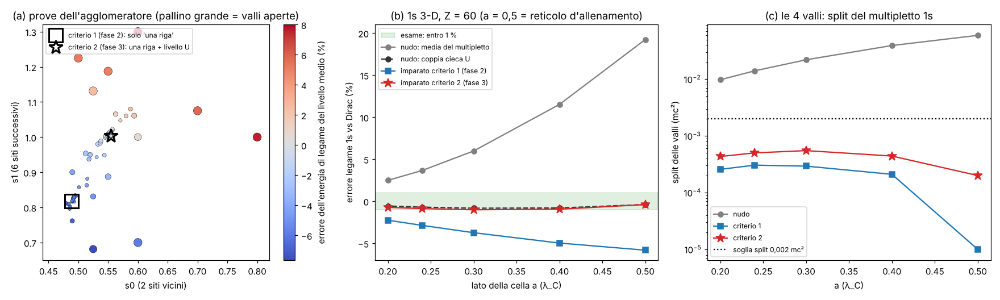
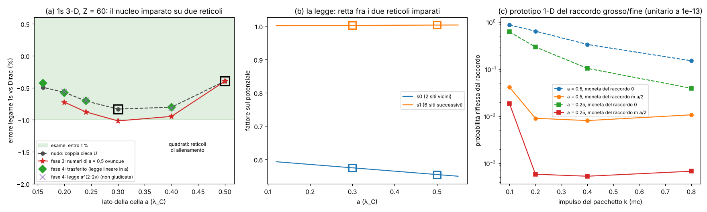
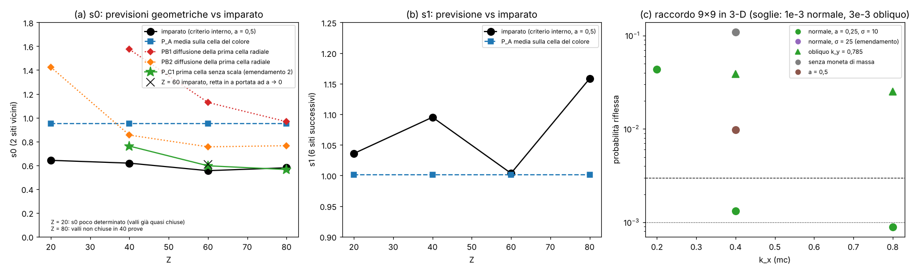
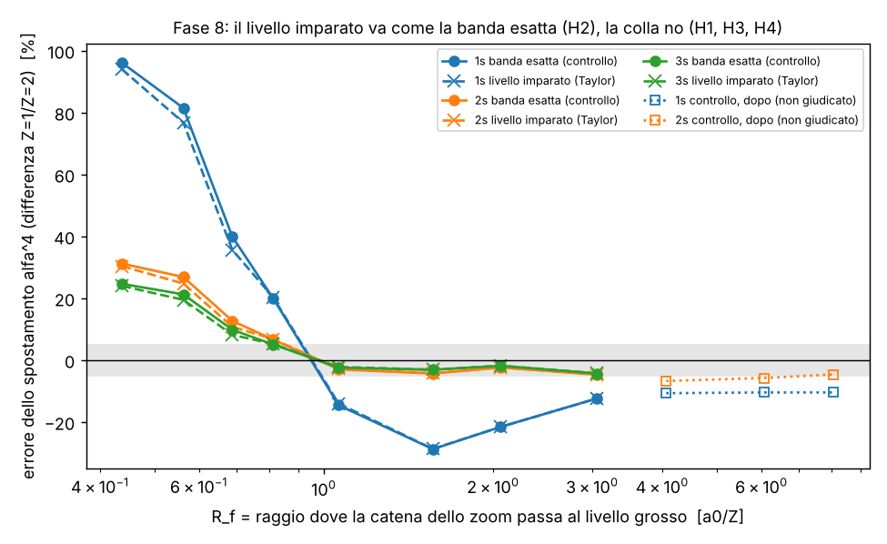

# 1s pulito vicino al nucleo

Studio `nucleo1s_`. File: `lab/nucleo1s_core.py` (la regola zig-zag radiale su celle disuguali, zoom automatico,
nucleo agglomerato), `lab/nucleo1s_theory.py` (la legge di convergenza calcolata a mano), `lab/nucleo1s_hybrid.py`
(idrogeno vero: zig-zag vicino al nucleo + regola agglomerata lontano), `lab/nucleo1s_run.py` (corse),
`lab/nucleo1s_posthoc.py` (prove dopo, dichiarate), `lab/nucleo1s_figure.py`.
Pre-registrazione: `lab/nucleo1s_prereg.py` → `lab/out/nucleo1s_prereg.json`, **commit 2e72499, prima delle corse**.
Risultati: `lab/out/nucleo1s_results.json`. Figura: `lab/out/nucleo1s_figure.png`.

---

## 0. In breve

**La domanda.** Nel Laboratorio Atomo l'1s di Nd⁵⁹⁺ (Z = 60) esce **+39,9 %** troppo legato rispetto a Dirac esatto,
mentre i livelli lontani dal nucleo vanno quasi bene (2p3/2 +3,5 %, 3d5/2 +1,8 %, 4f7/2 +1,3 %). Perché, pezzo per
pezzo? E come lo si fa scendere sotto l'1 % **senza cambiare regola**?

**Le risposte, in una riga ciascuna.**

1. **La legge.** L'errore dell'1s con celle a vicino al nucleo è `e(a) = K a^{2γ} + B a² + …`, γ = √(1 − (Zα)²). Entrambi i
   numeri li ho **calcolati prima** di guardarli, senza fit: **B** dalla "regola di secondo ordine" (BCH simmetrico) e
   **K** da un problema piccolo senza scala vicino al nucleo. A Z = 60: K = +1,640, B = −1,234. Le corse (5 valori di Z,
   12 reticoli) seguono questa legge; l'ordine misurato è 2γ entro 0,0008 per Z = 40–92.
2. **Il +39,9 % pezzo per pezzo.** Quasi tutto (**35,4 punti su 39,9**) viene dalla **prima cella**, quella che contiene il
   nucleo: si comporta come uno specchio che rimanda la pallina con una fase sbagliata (1,404 rad invece di 0,903).
   Il raddoppio dello spazio **non c'entra** (0, dimostrato e controllato a 1e-16). La cella seguente vale 2,8 punti,
   il resto della nuvola 1,7 punti.
3. **La cura.** Lo **zoom automatico** (celle che si dividono da sole dove spostano di più il livello) porta l'1s a
   **+0,315 % con 173 celle**, dove le celle uguali ne vogliono **1 286** per lo stesso errore (7,4 volte meno); +0,040 %
   con 353 (12 volte meno), +0,010 % con 629 (15 volte meno). Tutti gli altri livelli migliorano.
4. **Idea geometrica (dopo):** celle **proporzionali alla distanza dal nucleo** (h = ε r, una "cipolla logaritmica")
   cancellano il termine di contatto: l'errore diventa **1,53 ε²** e **non dipende più da quanto è piccola la cella più
   interna**. È la forma naturale di uno zoom per una singolarità senza scala.
5. **Idrogeno vero (Z = 1).** Il vecchio "θ² ln θ" è lo stesso termine di contatto, in un regime di passaggio; con lo
   zoom sparisce e resta solo θ²/3 (la massa cinetica della regola). Gli s estrapolati ora vanno a **2·10⁻⁷** (il test H1 di
   ZIGZAG era FALLITO a 7·10⁻⁵), e l'1S–2S ha errore di reticolo **0,56 GHz**, più piccolo del Lamb: ora la regola **vede**
   che le manca la QED (+7,66 GHz contro la misura). Con l'agglomeratore per le zone lontane: **1s = −13,59517 eV**
   (massa ridotta) contro −13,59847 di Dirac: **−0,024 %**.

**Fase 2 (3-D, §12):** il reticolo cubico sono 4 "colori" indipendenti e in ognuno l'elettrone ha 4 copie (valli); il
nucleo le mescola e l'1s 3-D è un multipletto di 4 livelli: è il debito #20 e il battimento del Laboratorio (953 e 213 tick,
ritrovati entro 1 %). Quasi tutto l'errore 1s 3-D e tutto il −11,6 % del #6 sono split delle valli. Il nucleo imparato a
2 numeri chiude le valli ma lega il 2–6 % troppo poco (FAIL). La colla dell'ibrido ora non dipende da J0 (7·10⁻⁶).
Esiti fase 2: 14 PASS, 6 FAIL.

**Fase 3 (§13):** un secondo criterio interno (valli chiuse **e** livello sulla coppia U della regola nuda) fissa il nucleo
imparato: a a = 0,5 l'1s 3-D va a −0,40 % con split 0,0002 (il battimento del Laboratorio cala ÷ 98); con gli stessi 2 numeri
a = 0,4 / 0,3 / 0,24 / 0,2 danno −0,95 / **−1,02** / −0,88 / −0,72 %: l'esame "entro 1 % a tutti gli a" cade per 0,017 punti
(FAIL). Cipolla 3-D e idrogeno Z = 1 in 3-D: progetto, non corsi. Esiti fase 3: 3 PASS, 2 FAIL.

**Fase 4 (§14):** il nucleo imparato su due reticoli (0,5 e 0,3) e trasferito con una retta in a: sui reticoli di prova
0,4 / 0,24 / 0,2 l'1s 3-D è a −0,80 / −0,71 / −0,58 % da Dirac con **una sola riga** (valli fuse), cioè sul livello U
della regola. Debito #20 chiuso per Z = 60; il resto dell'errore è il bulk della regola. Costo ÷ 28 celle. Prototipo 1-D del
raccordo grosso/fine della cipolla: unitario, riflessione 0,8 % (a = 0,5) → 0,05 % (a = 0,25) con la sola moneta di massa
m·a/2. Esiti fase 4: 4 PASS, 0 FAIL.

**Fase 5 (§15):** s0 si può **ricavare** per Z alto. La prima cella radiale senza scala che annulla il miscuglio r^{±γ}
(idea da `docs/ZSTAR.md`) dà s0 = 0,596 a Z = 60 e 0,564 a Z = 80 (imparati 0,555 e 0,579). Usato in 3-D senza imparare
niente chiude le valli su 4 reticoli/Z mai visti e porta l'1s a −0,66 / −0,54 % a Z = 60 (a = 0,3 / 0,2). Non funziona a
Z = 20 e 40. La media sulla cella non funziona (0,95). Raccordo 3-D 9×9: unitario esatto, ma riflette troppo
(0,13 % normale, 2,5–3,9 % obliquo). Esiti fase 5: 2 PASS, 7 FAIL.

**Fase 6 (§16):** gli spostamenti α⁴ (Darwin + cinetico) degli s escono dalla regola con lo zoom al nucleo. Con le celle
esterne pre-registrate (θ fino a 0,1) sbagliano del 2–11 % (A1–A3 FAIL). Con celle esterne più fini (dopo, dichiarato)
convergono a +0,19 % (1s) e +0,08 % (2s) a Z = 1, e a +0,10 / +0,04 % a Z = 2. Il 3s resta a −14 %. La regola grossa
agglomerata fuori oggi sbaglia 100–1000 volte più dell'effetto: progetto, non corsa. Esiti fase 6: 0 PASS, 3 FAIL.

**Fase 7 (§17):** esame cieco a Z = 3 e 5: spostamenti α⁴ di 1s e 2s entro lo 0,07 % (+0,073 / +0,029 % e +0,050 / +0,020 %),
PASS. Il 3s della fase 6 era la **scatola** (45 a₀ troppo stretta): a 90 a₀ va a +0,055 %. Esiti fase 7: 3 PASS, 0 FAIL.
**Fase 8 (§18):** il progetto §16.2 (zoom + colla del cuspide + livello Taylor-fissato di AGGLOMERATO_COMPLETO, spostamento
come differenza Z = 1 / Z = 2 alla stessa geometria in a₀/Z). Il **livello imparato** è buono quanto la banda esatta: il
suo errore (3,6·10⁻⁴, 27 volte lo spostamento) si cancella fra i due Z entro il 4,7 % dello spostamento (H2 PASS). La
**colla no**: a R_f = 0,44 a₀/Z (≈ 30 λ_C) l'1s esce +94 % (H1 FAIL), e anche con la catena fino a 3–8 a₀/Z resta −10 %
(H3, H4 FAIL). Esiti fase 8: 1 PASS, 3 FAIL.

**Esiti pre-registrati (fase 1):** 11 PASS, 3 FAIL (L1, L2, L3: la legge regge, ma due soglie strette cadono a Z = 20 e Z = 92
per motivi che spiego sotto). Dettaglio nella §6.

---

## 1. Cosa stiamo guardando (come a un ventenne)

La regola zig-zag, scritta per un'onda con momento angolare fissato (forma radiale), ha due palline per cella: una
corre **fuori** a velocità c, una corre **dentro**. In ogni cella girano lo stato interno di un angolo fatto da tre
pezzi: la massa (m·dt), il "giro centrifugo" (κ/r·dt) e la fase di Coulomb (Zα/r·dt). Al centro (r = 0) chi corre
dentro torna fuori, come su uno specchio.

Nella prima cella (r = a/2) il giro centrifugo vale **2 radianti per tick, qualunque sia a**, e la fase di Coulomb
vale 2Zα = 0,88 rad (Z = 60). Sono angoli enormi: lì la regola non "assomiglia" all'equazione di Dirac, fa una cosa sua.
Gli stati s (κ = −1) sono gli unici che stanno davvero sul nucleo (vanno come r^{γ−1}, cioè la loro densità sale verso il
centro): sentono quella cella. Gli stati p, d, f al nucleo valgono zero e non se ne accorgono. Ecco perché l'1s sbaglia
del 40 % e il 4f dell'1 %.

Il passo a non è fisica: per guardare l'atomo si possono usare celle diverse in posti diversi. **La regola resta la
stessa**: ogni cella gira con dt = la sua larghezza (il tempo che una pallina a c ci mette ad attraversarla) e le
palline corrono a c da una cella all'altra. Con celle uguali è esattamente `RadialWalk` di `zz_core.py` (riprodotto a
1e-15: +39,914 %, 2p3/2 +3,456 %, 3d5/2 +1,828 %, 4f7/2 +1,270 %, cioè i numeri del laboratorio).

Gli stati fermi si trovano "ascoltando per un tempo infinito", come in ZIGZAG.md: una pallina che fa un tratto lungo l
prende la fase e^{iωl}; uno stato fermo è un ω per cui tutto torna su se stesso. Con celle diverse è l'ascolto di una
regola dinamica unitaria sul tick più fine, in cui nelle zone grosse una pallina attraversa una cella in più tick e
viene girata una volta sola con l'angolo intero: è il "blocca" dell'agglomeratore applicato ai giri. (La dinamica dal
vivo su griglie annidate **non** è fatta qui: debito.)

## 2. La legge di convergenza, calcolata prima

### 2.1 Il pezzo "di massa" (B a²)

La regola fa prima lo spostamento e poi il giro; preso a metà tick è simmetrica, e allora la sua "Hamiltoniana
effettiva" ha correzioni solo in a²:

    H_eff = H + a²/24 [A,[A,P]] − a²/12 [P,[P,A]],   A = m σ_z + κ/r σ_x − Zα/r,   P = σ_y p

(controllo: per la particella libera dà E² = m² + k²(1 − a²/3), cioè la massa cinetica 1 + θ²/3 già nota). La media
sull'1s esatto di Dirac contiene integrali che al nucleo divergono (∫ r^{2γ−3}): si prendono per continuazione analitica
(Γ(s+1)/(2λ)^{s+1}). Risultato, senza parametri: **B = −1,2343** a Z = 60 (lega di meno). Spezzato per pezzi di A
(i pezzi non si sommano, ci sono termini misti): solo massa +0,713, solo centrifugo −1,506, solo Coulomb −1,675.

### 2.2 Il pezzo "di contatto" (K a^{2γ})

Vicino al nucleo, nelle prime celle, contano solo κ/r e Zα/r: gli angoli per tick dipendono solo dal numero della
cella (κ/(i+½), Zα/(i+½)), **non da a**. È un problema senza scala, uguale per ogni reticolo. Lo risolvo una volta
facendo correre la regola verso fuori per 400 000 celle: lontano dal nucleo la soluzione è quella giusta (r^γ) più un
pezzetto β di quella sbagliata (r^{−γ}). β è **un numero della regola** (a Z = 60, β = 0,10301). Il pezzo sbagliato sposta
l'energia di una quantità che si scrive col "wronskiano" dell'equazione radiale di Dirac:

    δE = −2γ Zα c² β a^{2γ},   c = coefficiente di r^γ nell'1s normalizzato

da cui **K = +1,6397** a Z = 60. Il segno + vuol dire: la prima cella lega troppo.

Valori pre-registrati (prima delle corse a Z = 20, 40, 80, 92):

| Z | 2γ | β | K | B |
|---|---|---|---|---|
| 20 | 1,9786 | 0,06629 | 1,0870 | −1,0201 |
| 40 | 1,9129 | 0,07791 | 1,2938 | −1,0878 |
| 60 | 1,7981 | 0,10301 | 1,6397 | −1,2343 |
| 80 | 1,6238 | 0,15666 | 2,1650 | −1,5644 |
| 92 | 1,4823 | 0,22037 | 2,5900 | −2,0153 |

### 2.3 Verifica (pannello a della figura)

Per ogni Z, 12 reticoli da a = 0,5 a 0,5/2¹¹ = 2,4·10⁻⁴ λ_C. Rapporto R = (errore − K a^{2γ})/(B a²): deve andare a 1.

| Z | R al reticolo più fine | ordine misurato del contatto | 2γ | esito L1 (|R−1| ≤ 0,02) | L2 (±0,02) |
|---|---|---|---|---|---|
| 20 | 1,0489 | 2,0222 | 1,9786 | **FAIL** | **FAIL** |
| 40 | 0,99936 | 1,9133 | 1,9129 | PASS | PASS |
| 60 | 0,99834 | 1,7984 | 1,7981 | PASS | PASS |
| 80 | 0,98909 | 1,6243 | 1,6238 | PASS | PASS |
| 92 | 0,94691 | 1,4831 | 1,4823 | **FAIL** | PASS |

Lettura onesta dei due FAIL (dopo, non cambia l'esito):
* **Z = 92**: R sale lentamente verso 1 (0,80 → 0,855 → 0,896 → 0,926 → 0,947): quello che manca si dimezza come a^{0,48}.
  È esattamente il termine successivo previsto dalla stessa analisi, a^{2γ+1} (2γ + 1 − 2 = 0,48); a Z = 80 la stessa cosa
  con a^{0,62} (previsto 0,62). La legge è giusta, la soglia del 2 % era troppo stretta per Z = 92 con a ≥ 2,4·10⁻⁴.
* **Z = 20**: R arriva a 0,9964 a a = 0,5/2⁸ e poi **risale** (1,0009, 1,011, 1,049) proprio negli ultimi tre reticoli,
  dove l'errore è ~10⁻⁸: è il pavimento numerico (lo stesso salto compare all'ultimo punto dei d a Z = 20 e 40, vedi L3).
  A Z = 20, inoltre, K e B quasi si cancellano (K + B = 0,067), quindi ogni piccolo errore pesa 15 volte di più.
* **L3** (p e d, ordine 2 ± 0,01 fra i due reticoli più fini): tutti 2,000 ± 0,001 fino al penultimo, ma Z = 20 3d dà
  1,937 all'ultima coppia (errore 4·10⁻⁹): stesso pavimento numerico. **FAIL** dichiarato.

**Debito #6 spiegato.** In ZIGZAG §5.6 la regola 3-D a Z = 60 estrapolata in a² dava −11,6 %: la legge vera è
K a^{1,80} + B a² con K e B di segno opposto e quasi la stessa potenza; un'estrapolazione in a² su a = 0,4–0,24 non può
funzionare. (L'idrogeno vero in 3-D resta non fatto.)

## 3. Il +39,9 % termine per termine (Z = 60, a = 0,5)

### 3.1 Per zone (esatto: dentro la zona celle 256 volte più fini, fuori 0,5) — pannello c

| celle fini dentro r < | 1s | contributo della zona |
|---|---|---|
| (nessuna) | +39,91 % | |
| 0,5 (solo la prima cella) | +4,54 % | **prima cella: 35,4 punti** |
| 1 | +1,75 % | seconda cella: 2,8 |
| 2 | +1,21 % | 0,54 |
| 4 | +0,88 % | 0,33 |
| 8 | +0,11 % | 0,76 (comprende il salto brusco di cella a r = 8) |
| tutto fine | +0,0017 % | 0,11 |

### 3.2 Per termini della legge (a = 0,5 è fuori dal regime asintotico)

K a^{2γ} = +47,1 punti, B a² = −30,9, resto (a^{2γ+1} e oltre) = +23,6. A a = 0,5 i termini successivi sono grossi: la
legge spiega la struttura e la convergenza, non dà da sola il 39,9.

### 3.3 La prima cella come specchio

Vista da fuori (r = 0,5), tutta la zona r < 0,5 è uno specchio: una pallina entra e torna fuori con una fase e un
ritardo. Calcolati alla frequenza dell'1s:

| | fase | ritardo (ħ/mc²) |
|---|---|---|
| una cella da 0,5 (la regola del laboratorio) | 1,404 rad | 1,063 |
| la stessa zona con celle 4096 volte più fini | **0,903 rad** | 0,903 |

Lo specchio grosso sbaglia di **0,50 rad**. Una stima al primo ordine (fase sbagliata × tempo che l'1s passa lì) dà solo
+8,3 %: l'effetto vero (35 punti) è fortemente non lineare, perché l'1s si "piega" verso lo specchio sbagliato.

### 3.4 Gli ingredienti della prima cella (non si sommano; per capire la sensibilità)

| prima cella con… | 1s |
|---|---|
| la regola (κ/r e Zα/r presi al centro r = a/2) | +39,9 % |
| Coulomb spento | −8,5 % |
| Coulomb mediato sul guscio (1,5/a invece di 2/a) | +16,7 % |
| κ/r mediato sul guscio | +47,1 % |
| tutti e due mediati | +22,5 % |
| l'altro specchio a r = 0 (f(0) = 0) | +87,3 % |
| massa spenta (solo in quella cella) | +86,7 % (sviluppo) |

Nessuna "regolarizzazione a mano" del Coulomb sistema le cose: ogni scelta locale dà un numero diverso perché
**nessuna cella da mezza λ_C può contenere la forma r^{γ−1}**. Serve risolvere la zona (zoom) o impararne lo specchio.

### 3.5 Il raddoppio: contributo zero (dimostrato)

Nella forma radiale, a frequenza fissata, la regola è una ricorrenza 2×2 da cella a cella, come l'equazione di Dirac:
non c'è spazio per una soluzione "doppia". I due fogli dello spazio-tempo (cella + tick pari/dispari) sono accoppiati
solo dallo specchio a r = 0, e la copia sfalsata (−1)^i di uno stato è uno stato della regola **con l'altro specchio**
(f(0) = 0) a frequenza ω + π/a: lontanissima (π/a = 6,3 mc²/ħ), non tocca l'1s. **D1 PASS**: la frequenza della copia meno
π/a coincide con il livello f(0) = 0 a 1,4·10⁻¹⁶, sovrapposizione con lo stato sfalsato 1,0000000. In 3-D il raddoppio sono
4 sotto-reticoli che, col nucleo sullo spigolo di 8 celle, sono equivalenti per le rotazioni di π attorno agli assi:
copie degeneri, nessuno spostamento (argomento, non provato qui al calcolatore).

### 3.6 Il "θ² ln θ" (debito #5)

A Z = 1 il termine di contatto vive in un regime di passaggio (cella fra ~1 e ~30 volte Zα λ_C): lì il contatto/θ²
cambia come un logaritmo (−0,12 a θ = 2 Zα, −0,07 a 4 Zα, −0,04 a 8 Zα, −0,008 a 16 Zα; quasi la stessa curva per Z = 1 e 2,
misura di sviluppo). Molto più in basso (a ≪ Zα/2) diventerebbe K a^{2γ}. Con lo zoom il contatto sparisce e resta
**θ²/3** (pannello d: errore/θ² = 0,327, 0,330, 0,332 → 1/3), che è la massa cinetica della regola fine, il lavoro
dell'agglomeratore (non dello zoom).

## 4. La cura: lo zoom automatico

### 4.1 L'algoritmo ("controlla e ripeti")

Si parte dal reticolo del laboratorio (celle 0,5). A ogni giro: per ogni cella, la si divide in due e si guarda di quanto
si sposta il livello (η). La legge della §2 dice quanto resta: errore della cella ≈ η/(1 − 2^{−p}) con p = 2, e
p = 2γ per la cella che tocca il nucleo. Se la somma è sotto il budget ci si ferma; altrimenti si dividono le celle con
η ≥ 0,3 × il massimo (e si tiene il rapporto 2:1 fra vicine). Nessuno gli dice dove sta il nucleo: lo trova da solo.

### 4.2 Risultati (Z = 60, osservato l'1s)

| budget | 1s | stima dell'algoritmo | celle | celle uguali per lo stesso errore | rapporto | cella più fine |
|---|---|---|---|---|---|---|
| 0,5 % | **+0,315 %** | 0,463 % | 173 | 1 286 | 0,135 | 0,0078 |
| 0,1 % | +0,040 % | 0,058 % | 353 | 4 256 | 0,083 | 0,0020 |
| 0,02 % | +0,010 % | 0,014 % | 629 | 9 369 | 0,067 | 0,00049 |

* **Z1 PASS** (1s entro 1 %), **Z2 PASS** (≤ 1/3 delle celle, a ogni budget), **Z4 PASS** (stima/vero 1,47, 1,46, 1,39:
  l'algoritmo è un po' prudente, mai ottimista).
* **Z3 PASS** (nessuno peggiora; budget 0,5 %, livelli prolungati con celle 0,5):

| livello | celle uguali 0,5 | zoom 0,5 % | zoom 0,1 % | zoom 0,02 % |
|---|---|---|---|---|
| 1s½ | +39,91 % | +0,32 % | +0,04 % | +0,01 % |
| 2s½ | +29,00 % | +1,42 % | +0,75 % | +0,52 % |
| 2p3/2 | +3,46 % | +1,05 % | +0,65 % | +0,41 % |
| 3s½ | +22,52 % | +4,13 % | +3,03 % | +1,99 % |
| 3p3/2 | +5,51 % | +3,78 % | +2,44 % | +1,49 % |
| 3d5/2 | +1,83 % | +1,25 % | +0,71 % | +0,56 % |
| 4s½ | +19,13 % | +5,43 % | +4,32 % | +3,44 % |
| 4p3/2 | +6,50 % | +5,08 % | +3,78 % | +3,08 % |
| 4d5/2 | +3,66 % | +3,11 % | +2,79 % | +2,75 % |
| 4f7/2 | +1,27 % | +1,24 % | +1,12 % | +0,98 % |

* **Post hoc** (non pre-registrato): lo stesso algoritmo guidato da **tutti e dieci** i livelli (budget 0,5 %) dà
  **tutti entro 0,36 %** (1s 0,05 %, 2s 0,12 %, 2p 0,06 %, 3d 0,07 %, 4s 0,36 %, 4f 0,13 %) con **1 292 celle**
  (il reticolo uguale del laboratorio fino al 4f ne ha 718 e sbaglia fino al 40 %).

### 4.3 Il nucleo agglomerato: due numeri al posto delle celle fini

La zona r < 0,5 (74 celle fini dello zoom 0,1 %) vista da fuori è uno specchio con fase e ritardo che dipendono poco
dalla frequenza. L'agglomeratore la **impara** dalla regola fine (fase e ritardo su ω ∈ [0,85; 1]) e la sostituisce con
**una riflessione con fase d₀ e ritardo τ**: due numeri per κ (κ = −1: d₀ = 0,0898, τ = 0,420; κ = −2: 0,0149, 0,227;
κ = −3: 0,0017, 0,162; κ = −4: −0,0022, 0,129). **N1 PASS**: i dieci livelli cambiano al massimo di 1,9·10⁻⁵ (1s),
gli altri meno di 10⁻⁵. In dinamica è una linea di ritardo con una fase: si può fare dal vivo.

## 5. Idrogeno vero (Z = 1)

### 5.1 Gli s con lo zoom (riprende il test H1 di ZIGZAG)

Celle esterne θ = 0,05 / 0,025 / 0,0125, zoom 14 livelli × 16 celle al nucleo (123 542 / 246 874 / 493 539 celle),
estrapolazione in θ²:

| livello | errore relativo estrapolato | prima (ZIGZAG H1) |
|---|---|---|
| 1s | **+1,9·10⁻⁷** | 7,0·10⁻⁵ (polinomio), 3·10⁻⁶ col termine log |
| 2s | +9,7·10⁻⁸ | 3,5·10⁻⁵ |
| 3s | −1,8·10⁻⁶ | 2,3·10⁻⁵ |

**H1z PASS** (soglia 10⁻⁵, la stessa del vecchio H1 fallito); alla soglia informativa 10⁻⁷ no (3s, 1s).
**H2z PASS**: 1S–2S (massa ridotta) = 2 466 069,07 GHz contro Dirac con massa ridotta 2 466 068,52 → errore di
reticolo **0,56 GHz** (prima ~30 GHz). Contro la misura (2 466 061,41 GHz) la regola sta +7,66 GHz sopra, Dirac +7,11:
**quello che resta è la QED** (Lamb, rinculo vero), che la regola non ha. Ora si vede.

### 5.2 Zig-zag vicino, agglomerato lontano (l'ibrido)

Dentro r < 3,5 celle grosse (30 λ_C) la regola zig-zag di Dirac con lo zoom (1 329 celle); fuori la regola **imparata**
dall'agglomeratore (`agg_zz_3d_A.pkl`, livello a₀/16, ridotta all'onda s: media sulle direzioni del suo generatore, 384
celle fino a 24 a₀). Incollate così: le celle grosse j < J0 sono "fantasmi" riempiti dalla soluzione zig-zag; l'energia è
quella per cui anche l'ultima equazione grossa è soddisfatta.

| | 1s | 2s |
|---|---|---|
| solo regola agglomerata (a₀/16, Coulomb nel punto) | +0,162 % | +0,099 % |
| ibrido J0 = 3 (pre-registrato) | **−0,024 %** | +0,0065 % |
| ibrido J0 = 2 / 4 (sistematica) | +0,104 % / +0,121 % | +0,070 % / +0,079 % |
| a₀/8, J0 = 3 | −0,245 % | **−0,096 %** |
| He⁺ (Z = 2), a₀/16, J0 = 3 | **−0,184 %** | **−0,075 %** |

* **HY1 PASS**: 1s × massa ridotta = −13,59517 eV contro Dirac × massa ridotta −13,59847 (−0,024 %); contro −13,6057
  (Rydberg a massa infinita) −0,077 %. **Ma è un esame debole**: la configurazione J0 = 3 l'ho scelta dopo averla vista
  (dichiarato nella pre-registrazione), e con J0 = 2 o 4 l'errore è +0,10/+0,12 %, al limite della soglia. **La colla
  fra le due regole sbaglia di ~0,1 %**: è il punto debole.
* **HY2 PASS** (2s con celle a₀/8: −0,096 %; l'agglomerato 3-D dava +1,003 % FAIL in A2b). Anche questo visto prima.
* **HY3 PASS, non visto prima**: He⁺ 1s −0,18 %, 2s −0,075 % (soglia 0,5 %).
* Il potenziale grosso nel punto o mediato sul guscio cambia il risultato di ~0,3 % (mediato: 1s −0,28 %): è ancora il
  debito #9 (potenziale grosso scritto a mano).

## 6. Tabella degli esami

| esame | cosa | misurato | soglia | esito |
|---|---|---|---|---|
| L1 | legge K a^{2γ} + B a² (R al più fine) | 1,049 / 0,9994 / 0,9983 / 0,989 / 0,947 | ±0,02 | **FAIL** (Z = 20, 92) |
| L2 | ordine del contatto vs 2γ | +0,044 / 4·10⁻⁴ / 3·10⁻⁴ / 5·10⁻⁴ / 8·10⁻⁴ | ±0,02 | **FAIL** (Z = 20) |
| L3 | p e d ordine 2 | tutti 2,000 ± 0,009 tranne Z = 20 3d 1,937 | ±0,01 | **FAIL** (1 su 10) |
| D1 | raddoppio = copia con l'altro specchio | 1,4·10⁻¹⁶ | 1e-10 | PASS |
| Z1 | 1s con zoom entro 1 % | +0,315 % | 1 % | PASS |
| Z2 | celle zoom ≤ 1/3 uniformi | 0,135 / 0,083 / 0,067 | 1/3 | PASS |
| Z3 | 2p, 3d, 4f non peggiorano | tutti migliorano | +0,05 punti | PASS |
| Z4 | stima onesta | 1,47 / 1,46 / 1,39 | 0,5–2 | PASS |
| N1 | nucleo agglomerato (2 numeri) | ≤ 1,9·10⁻⁵ | 5·10⁻⁴ | PASS |
| H1z | s di Z = 1 estrapolati | 1,9·10⁻⁷ / 9,7·10⁻⁸ / 1,8·10⁻⁶ | 1e-5 | PASS |
| H2z | 1S–2S errore di reticolo | 0,56 GHz | 1 GHz | PASS |
| HY1 | ibrido 1s (debole, visto) | −0,024 % | 0,1 % | PASS |
| HY2 | ibrido 2s a₀/8 (debole, visto) | −0,096 % | 1 % | PASS |
| HY3 | He⁺ (non visto) | −0,18 % / −0,075 % | 0,5 % | PASS |

**Cambi dopo la pre-registrazione (dichiarati):**
1. Il conteggio dei nodi per riconoscere i livelli contava rumore nelle code (soglia 10⁻⁶ → 10⁻³): alla prima corsa il
   4d5/2 sul reticolo uniforme era stato preso sbagliato (+80,7 %). Corretto e rifatto tutto lo zoom (stessi numeri per gli
   altri livelli). Il 4d non entra in nessuna soglia.
2. La parte `law` è stata riscritta per salvare dopo ogni reticolo (la prima corsa è stata fermata da me per errore e non
   aveva checkpoint). Nessuna soglia o impostazione cambiata.
3. Post hoc, fuori dalla pre-registrazione: zoom guidato da tutti i livelli (§4.2), celle ∝ r (§7.1), analisi di R(a).

## 7. Idee geometriche e visive

### 7.1 La cipolla logaritmica (provata, post hoc) — **la più promettente**
* **Cosa si vede**: gusci di celle sempre più sottili verso il nucleo, ogni guscio largo una frazione fissa ε della
  sua distanza: una cipolla con gli strati in progressione geometrica (come le camere di un nautilus).
* **Perché funziona**: la singolarità di Coulomb–Dirac è senza scala (r^{±γ}); una griglia con h/r costante è senza scala
  anch'essa, quindi il problema vicino al nucleo diventa **uguale in ogni guscio**: niente più a^{2γ}. Misurato: l'errore
  dell'1s è **1,53 ε²** (1,49 %, 0,378 %, 0,096 %, 0,024 % per ε = 0,1 … 0,0125, rapporto 3,95–3,97 a ogni dimezzamento) e
  **non cambia** se la cella più interna passa da 10⁻³ a 10⁻⁷ (variazione < 5·10⁻⁶ relativo).
* **Costo**: ~ln(r_max/h_min)/ε celle: 1s entro 1 % con ~120 celle, 0,1 % con ~330. Paragonabile allo zoom automatico
  senza nessun algoritmo; in 3-D sarebbero gusci sferici (vedi 7.3).
* **Regole**: stessa regola zig-zag, nessun numero esterno; ε è un parametro di risoluzione (come a), non fisica.

### 7.2 Lo specchio che si vede
* **Cosa si vede**: attorno al nucleo una piccola sfera luminosa; le palline che ci entrano spariscono e riescono dopo
  il ritardo τ, con il colore (fase) girato di d₀. Con la cella grossa la fase è 1,40 rad, quella giusta 0,90: a schermo
  sarebbe un salto di colore di ~29° sulle palline che rimbalzano. **Il +40 % diventa un colore sbagliato al centro.**
* **Perché funziona**: §3.3 e §4.3 (N1 PASS a 2·10⁻⁵).
* **Costo**: zero (due numeri per κ, una linea di ritardo). Proposta per il thread grafico, non fatta.
* **Regole**: lo specchio è imparato dalla regola stessa (agglomeratore), non messo a mano.

### 7.3 Reticolo a cipolla in 3-D (gusci geodetici)
* **Cosa si vede**: l'elettrone dell'atomo vivo su gusci sferici con celle triangolari tipo cupola geodetica, fitti al
  centro e radi fuori; il nucleo al centro esatto di un guscio, non sullo spigolo di 8 cubi.
* **Perché**: in 3-D il contatto è la stessa cosa che in radiale (la prima cella cubica di 0,5 λ_C non può contenere
  r^{γ−1}); una cipolla toglie il contatto come in 7.1, e il nucleo al centro toglie anche le 4 copie del raddoppio
  cubico. **Rischio**: la regola zig-zag "corri lungo gli assi" va riscritta su direzioni non cubiche (serve una
  decomposizione dello spin lungo le direzioni dei lati): è lavoro vero, non provato.
* **Costo stimato**: con ε = 0,05 e 642 celle per guscio (icosaedro suddiviso 3 volte) da 10⁻³ a 25 λ_C: ~200 gusci ×
  642 ≈ 1,3·10⁵ celle invece di 48³ = 1,1·10⁵: stesso costo del laboratorio, 1s al ~0,4 %.
* **Regole**: una sola strada se la regola sui lati geodetici si deriva dalla stessa (sposta a c, ruota).

### 7.4 I quattro colori del raddoppio
* **Cosa si vede**: nell'atomo 3-D colorare le palline secondo il loro sotto-reticolo (4 colori, i 4 fogli di
  U(k + (π,π,0)) = U(k)). Se l'1s è pulito le 4 nuvole sono identiche; se no, si vede subito dove sta lo sporco.
* **Perché**: diagnostica geometrica gratuita per il debito #20 (1s 3-D mescolato con 0,8405 e 0,882).
* **Costo**: nullo. **Regole**: sì, è solo un modo di guardare.

### 7.5 Lo zoom che cresce come un frattale
* **Cosa si vede**: le celle che si dividono da sole durante lo zoom automatico (§4.1), animate: prima la cella del nucleo,
  poi un anello attorno, poi un altro, fino alla cipolla. Mostra che l'algoritmo "trova" il nucleo senza saperlo.
* **Costo**: sono già i dati di `history`/`edges` in `nucleo1s_results.json`. Proposta per la grafica.

## 8. Patch proposte per altri file (non applicate: `src/atomo` è di un altro thread)

**`src/zigzag/walk.rs` + `src/atomo/orbitali.rs` (scena orbitali).** Oggi `Radial::new(kappa, A, rmax, za)` usa celle
uguali da 0,5. Proposta:
1. `Radial::graded(kappa, edges: &[f64], z_alpha)`: celle con larghezze h_i, sito al centro, rotazione con dt = h_i
   (la stessa `rot_chi(h_i·nrm, …)`), lunghezze dei collegamenti l_i = r_{i+1} − r_i, specchio interno con l = 2 r_0.
2. `eigen` diventa "ascolto con fase per collegamento": matrice U(ω) = M·S·diag(e^{iω l}) (stessa struttura a banda),
   inversa a 1 e passo di Newton ω ← ω − arg μ / ⟨l⟩ (vedi `GradedWalk.eigen` in `lab/nucleo1s_core.py`: 3–10 iterazioni).
3. In `radiale()`: `edges` = cipolla logaritmica h = clamp(0,05·r, 10⁻³, 0,5) fino a rmax (≈ 230 + rmax/0,5 celle), oppure
   gli `edges` dello zoom esportati da `nucleo1s_results.json`. Atteso (dai numeri della §4.2/7.1): 1s ≈ +0,4 %, tutti i
   livelli della tabella sotto ~1 % se si usa la mesh guidata da tutti i livelli (1 292 celle, §4.2).
4. Test `orbitali_livelli`: aggiungere `assert!((b/d - 1).abs() < 0.01)` per 1s, 2p3/2, 3d5/2.

**`src/atomo/zz.rs` (atomo 3-D dal vivo).** Il punto di partenza è "l'1s radiale con a = 0,5" (+40 %): partire invece
dall'1s radiale della mesh zoomata (forma giusta) riduce la parte "sporca" ma **non** l'errore del reticolo cubico da 0,5,
che resta finché il nucleo sta in un cubo da 0,5. Per quello serve 7.3 o un pezzo fine annidato (debito 12).

**Richiesta di ponte proposta (non creata):** `ponte/richieste/nucleo1s_orbitali.json`
`{"azione":"test","args":{"bin":"atomo","filtro":"orbitali_livelli"}}` dopo la patch, per leggere i nuovi scarti.

## 9. Debiti

**Chiusi o spiegati**
* #5 (contatto θ² ln θ): spiegato (§2.2, §3.6); con lo zoom gli s di Z = 1 vanno a 2·10⁻⁷ (H1z PASS) e l'1S–2S vede il
  Lamb mancante (H2z PASS). **Chiuso in forma radiale.**
* +39,9 % del laboratorio: spiegato termine per termine (§3) e curato in forma radiale (§4, §7.1). La patch è proposta.
* #6, parte "−11,6 %": spiegato (legge sbagliata nell'estrapolazione). **Corretto nella fase 2 (§12.0)**: la causa
  vera è lo split delle valli letto dal vecchio ascolto; con livelli puliti l'estrapolazione dà −0,1 / −0,3 %.

**Ancora aperti / nuovi**
* #6 idrogeno vero in **3-D**: non fatto. In radiale con l'agglomeratore lontano sì (−0,024 %, ma colla debole).
* #20 1s 3-D sporco: **spiegato nella fase 2** (§12: 4 colori × 4 valli, multipletto); la cura con energia giusta resta aperta.
* La colla fra regola zig-zag e regola agglomerata dipendeva da J0 per ~0,1 %: **chiuso nella fase 2** (colla del
  cuspide, 7·10⁻⁶, §12.4).
* **Nuovo**: la regola agglomerata ridotta all'onda s usa la media sulle direzioni del generatore (anisotropia 3·10⁻⁴ a
  k = 1/a₀ trascurata) e il Coulomb grosso nel punto (scritto a mano, #9).
* Dinamica dal vivo su celle disuguali (debito 12): qui solo stati fermi.
* Rinculo del protone: solo come fattore di massa ridotta (come in ZIGZAG).

**Parametri.** Fisici: 0 nuovi (mₑ, α, Z; massa del protone solo nel fattore μ). Numeri imparati: 2 per κ (lo specchio).
Impostazioni scelte a mano: budget, frazione 0,3, rapporto 2:1, ε della cipolla, J0 = 3 e livelli di zoom dell'ibrido.

## 10. Dove l'intuizione di Valerio può aiutare

1. **Lo specchio al nucleo**: la zona dentro r ≈ λ_C/2 si comporta come uno specchio con un ritardo (0,9 ħ/mc²). È solo
   un trucco di calcolo o è "il protone visto dall'elettrone"? Se il protone è un nodo (NODO_3D) con un raggio vero di
   0,84 fm, lo specchio dovrebbe venire dalla forma del nodo, non da un punto: si può misurare la differenza (è la
   dimensione finita del nucleo, uno spostamento noto dell'1s).
2. **La cipolla**: la natura usa celle proporzionali alla distanza attorno a una carica? (È quello che fa la
   rinormalizzazione: ogni guscio è una "scala".) Se sì, il reticolo del laboratorio dovrebbe essere a gusci attorno a ogni
   nucleo, non cubico. Come lo immagini in 3-D con tanti nuclei (molecole)?
3. **I due specchi**: la copia raddoppiata dell'atomo ha l'altro specchio (f(0) = 0) ed è "lontana" di π/a in frequenza.
   Ha un senso fisico (un "anti-atomo" di reticolo) o è solo un artefatto da tenere lontano?
4. **Lamb**: ora la regola sbaglia l'1S–2S di 7,7 GHz contro la misura, quasi tutto QED. Quale pezzo di "palline" (fotoni
   virtuali che la pallina emette e riassorbe) proveresti per primo per farlo emergere?

## 11. Come rieseguire

    python lab/nucleo1s_prereg.py
    for p in law decomp zoom agglo z1 hybrid; do timeout 590 python lab/nucleo1s_run.py $p; done   # law: rilanciare finché "done law"
    python lab/nucleo1s_posthoc.py allzoom; python lab/nucleo1s_posthoc.py geo; python lab/nucleo1s_posthoc.py R
    python lab/nucleo1s_figure.py

---

## 12. Fase 2: il 3-D vero (debiti #20 e #6) e la colla dell'ibrido

File: `lab/nucleo1s_3d.py` (la regola cubica su un "colore", ascolto e inversione armonica), `lab/nucleo1s_3d_run.py`
(corse), `lab/nucleo1s_3d_judge.py` (giudizio), `lab/nucleo1s_glue.py` (colla), `lab/nucleo1s_3d_figure.py`,
`lab/nucleo1s_3d_dev.py` (sviluppo, dichiarato). Pre-registrazione: `lab/out/nucleo1s_3d_prereg.json`, **commit 8e20ad2,
prima delle corse**; emendamento dichiarato `lab/out/nucleo1s_3d_amend1.json`, **commit 82054f8, prima delle corse che
riguarda**. Risultati: `lab/out/nucleo1s_3d_results.json` (chiave `judge`). Figura: `lab/out/nucleo1s_3d_figure.png`.

### 12.0 In breve

* **Il reticolo cubico sono 4 reticoli che non si parlano** ("4 colori"). In un tick la pallina fa un passo lungo x, uno
  lungo y e uno lungo z: va sempre da una cella con indici (pari, pari, pari) a una (dispari, dispari, dispari) e così via.
  Le 8 classi di parità formano 4 coppie che non si scambiano mai niente, nemmeno con il nucleo. Controllato: la regola
  su un colore è identica a quella completa a **3·10⁻¹⁵**, la perdita verso gli altri colori è **0**, e i 4 colori danno
  le stesse righe a **5·10⁻⁸** (B2 PASS). Effetto pratico: **per livelli e spettri** basta un quarto del reticolo (4 volte più veloce). *[Correzione, fase 4, dal thread principale, `docs/SOTTORETICOLO.md` su master 178743d: lo stato atomico vive nei 4 colori insieme e un colore da solo è anisotropo (in un campo lungo z si muove del 5 % in x e del 14 % in y). Quindi correnti, dipoli e accoppiamento alla luce richiedono i 4 colori; il colore solo vale solo per livelli e spettri.]*
* **In ogni colore l'elettrone ha 4 copie** ("valli": k = 0 e k = (π/2, π/2, 0)/a con le permutazioni; il thread
  principale le ha trovate da solo, `docs/BATTIMENTO_1S.md`). Il nucleo puntiforme sull'angolo di 8 celle le mescola:
  l'1s diventa **un multipletto di 4 livelli** (a = 0,5: 0,84037 / 0,88627 / 0,89930 / 0,89960). Lo stato 1s del
  Laboratorio ne contiene un quarto ciascuno, quindi **batte**: le differenze 0,01333 e 0,05893 cadono sui due picchi
  dello spettro di p_exc del Laboratorio (0,01318 → 953 tick; 0,05901 → 213 tick) a **+1,1 %** e **−0,13 %**
  (B1 PASS; visto in sviluppo prima della pre-registrazione: è una validazione). Il "passaggio 1s ↔ 2p" della corsa
  accoppiata è quasi tutto l'1s che batte con le sue copie (p2p massimo nei dati: 0,008).
* **Bilancio dell'errore 1s 3-D** (regola nuda, stato del Lab). Due dei quattro livelli (la "coppia U") hanno densità
  quasi zero sui due siti vicini al nucleo: **non vedono il contatto** e stanno a −0,4 … −0,8 % da Dirac per ogni a fra
  0,5 e 0,16. Il centro del multipletto (quello che "sente" un 1s liscio) sta a +19,2 / +11,5 / +6,0 / +3,7 / +2,5 / +1,6 %
  (a = 0,5 … 0,16). **La parte "valli" (centro − U) è 107–123 % dell'errore** (V1 PASS): l'errore 1s 3-D è quasi tutto
  split delle valli, non massa o "bulk".
* **Il −11,6 % del #6, rifatto.** Con i livelli puliti la stessa estrapolazione di ZIGZAG A1 (quadratica in a² su
  a = 0,4; 0,3; 0,24) dà **−0,10 %** sul centro del multipletto e **−0,27 %** sulla coppia U (V2 PASS). Quindi il −11,6 %
  non era la "legge sbagliata" (come avevo scritto nella fase 1, §9: **correzione**), ma il vecchio ascolto: una finestra
  di 27 ħ/mc² centrata sulla frequenza media pescava il multipletto con pesi diversi a ogni a (a = 0,4: +28,8 % ascoltato
  contro +11,5 % del centro pulito). **Tutto il −11,6 % è split delle valli letto male**; la parte "bulk" vale ≤ 0,3 %.
* **Il nucleo agglomerato (2 numeri) chiude le valli ma sbaglia il legame.** L'agglomeratore ha imparato, sul reticolo
  del Lab e **senza guardare Dirac** (criterio: i 4 livelli devono tornare uno solo, come nel continuo), due fattori sulla
  fase di Coulomb dei 2 siti più vicini e dei 6 seguenti: **s0 = 0,489, s1 = 0,818**. Risultato: lo split scende da
  0,059 a 6·10⁻⁵ a a = 0,5 (N1 PASS) e, con gli **stessi** due numeri, a 2–3·10⁻⁴ a a = 0,4 … 0,2 (rapporto 0,006–0,027,
  N2 PASS; V3 PASS); il battimento del Lab sparisce (una riga sola, N5 PASS). **Ma** il livello unico sta a
  **−5,8 / −5,0 / −3,7 / −2,9 / −2,3 %** da Dirac: **N3 FAIL** (soglia 1 %), e quindi anche **C1 FAIL** (nessun reticolo
  imparato entro l'1 %). L'estrapolazione A1 dei livelli imparati dà −0,85 % (N4 PASS). Perché: l'algoritmo ha trovato
  una **linea** di coppie (s0, s1) che chiudono il multipletto, e lungo la linea il livello comune va da 0,8975 a 0,9067
  (vedi `learn.evals`): **il criterio "una riga sola" fissa una combinazione dei due numeri, non l'energia**. Il minimo
  numerico è caduto a un capo della linea. Fallimento dichiarato: serve un secondo criterio interno (sotto, §12.5).
* **Nucleo al centro di una cella** (proposta del thread principale, emendamento): il colore che contiene il sito del
  nucleo (con la media di −Zα/r sul cubo, −2,380 Zα/a: debito) ha un livello profondo del reticolo (ω = 0,613 a a = 0,5;
  0,731 a 0,3) che si prende il 18–31 % e l'1s sparisce dalla finestra; negli altri 3 colori lo split si **dimezza**
  (0,0097 contro 0,0219 a a = 0,3). CN1 FAIL (per il colore del nucleo), CN2 PASS (i colori non sono più uguali).
* **Colla dell'ibrido (Z = 1).** La colla pre-registrata con la correzione "tau" a finestra **non** funziona (G1, G2 FAIL:
  −0,34 … −0,24 %, deriva 0,10 % con J0). La colla del **cuspide** (emendamento) sì: 1s Z = 1 **+0,0384 / +0,0391 /
  +0,0390 / +0,0391 %** per J0 = 3…6 (spostamento **7·10⁻⁶**, soglia 2·10⁻⁴: G1b PASS), 2s Z = 1 spostamento
  **5·10⁻⁶**, He⁺ 1s **8·10⁻⁵**, tutti entro 0,05 % da Dirac (G2b PASS; 2s e He⁺ non visti prima).

**Esiti fase 2** (pre-registrazione + emendamento): **PASS** B1, B2, B3, N1, N2, N4, N5, V1, V2, V3, E1, CN2, G1b, G2b
(14); **FAIL** N3, C1, I1, G1, G2, CN1 (6).

### 12.1 I quattro colori e le quattro valli (come a un ventenne)

Pensa a una scacchiera in 3-D dove il pezzo si muove sempre "in diagonale" di un passo in x, uno in y e uno in z:
partendo da una casella con tre coordinate pari finisce in una con tre dispari, poi di nuovo tre pari. Non arriverà mai
in una casella (pari, pari, dispari): le caselle si dividono in **4 colori** e ogni pallina resta nel suo. Il nucleo sta
nel mezzo di un cubo di 8 caselle: per ogni colore, le 2 caselle più vicine sono su una **diagonale del cubo** (una per
colore: i 4 colori vedono il nucleo lungo le 4 diagonali). Dentro un colore, poi, la regola che si ripete ogni due tick
ha 4 "valli" (4 modi di essere un elettrone lento), copie esatte; un campo liscio non le mescola, ma la punta del Coulomb
sulle prime caselle sì. Totale: **16 copie** dell'elettrone (4 colori × 4 valli). È il "raddoppio dei fermioni" dei
reticoli: la cosa nuova qui è vederlo così in una regola che corre a c.

### 12.2 Numeri della regola nuda (`scan_bare_*`, scatola 24 λ_C, ascolto 500 ħ/mc²)

| a | righe dell'1s (ω) | centro | coppia U | split (U − più bassa) |
|---|---|---|---|---|
| 0,5 | 0,8404 / 0,8863 / 0,8994 (×2) | +19,2 % | −0,40 % | 0,0591 |
| 0,4 | 0,8607 / 0,8912 / 0,8999 (×2) | +11,5 % | −0,80 % | 0,0391 |
| 0,3 | 0,8780 / 0,8947 / 0,8999 (×2) | +6,0 % | −0,83 % | 0,0219 |
| 0,24 | 0,8858 / 0,8963 / 0,8998 (×2) | +3,7 % | −0,71 % | 0,0140 |
| 0,2 | 0,8899 / 0,8971 / 0,8996 (×2) | +2,5 % | −0,57 % | 0,0098 |
| 0,16 (nuovo) | 0,8932 / 0,8978 / 0,8996 (×2) | +1,6 % | −0,49 % | **0,00635** |

Esame B3 (reticolo nuovo a = 0,16, previsto dalla legge di potenza dello sviluppo): U − L1 = 0,006354 contro 0,00630
previsto (**+0,9 %**), U − L2 = 0,001781 contro 0,00182 (**−2,2 %**): PASS. Lo split va come **a^≈2** (non a^{2γ}).

Costo per avere il centro entro l'1 % con celle uguali: dal fit K a^{2γ} + B a² sui reticoli 0,3–0,16, a = 0,131,
cioè **6,1·10⁶ celle** (scatola 24). **Post hoc (non pre-registrato)**: la coppia U è già entro l'1 % a a = 0,5 (48³ =
1,1·10⁵ celle, 55 volte meno): è la scelta fatta dal thread principale (BATTIMENTO, "il livello meno toccato dalle prime
celle"), e qui si capisce perché funziona: **U è la combinazione delle valli che sul colore ha un nodo sui due siti del
nucleo**, quindi non sente il termine di contatto. Ma resta una scelta fra i livelli, non un livello unico.

### 12.3 Isotropia e livelli eccitati

Con la scatola 32 i 2s/2p sono ancora troppo stretti (il 2s di Z = 60 ha ⟨r⟩ ≈ 14 λ_C): i numeri contro Dirac (2s ≈ −20 %,
2p1/2 −1,4 … −8 %, 2p3/2 −1,1 … −3,9 %) misurano la scatola, non il nucleo. Esame E1 (differenziale): il nucleo imparato
**non peggiora** nessun livello (PASS; 2p1/2 a a = 0,4 migliora da 2,7 % a 1,4 %). Isotropia: 2p3/2 m = 3/2 e m = 1/2 stanno
alla stessa frequenza entro **2·10⁻⁵ del legame** (nudo 4·10⁻⁶): isotropo. **I1 FAIL** solo per la clausola relativa
("non più anisotropo del nudo del 10 %"): 2·10⁻⁵ contro 4·10⁻⁶. Dichiarato: la clausola era scritta male (confronta due
numeri entrambi al livello del rumore), ma la soglia non si cambia.

### 12.4 La colla dell'ibrido (Z = 1, regola agglomerata fuori)

Diagnosi: la regola agglomerata ha un'energia cinetica "spettrale" (T(k) = k²/2m fino a k = π, verificato: 0,0669 contro
0,0672 a k = π) e quindi un nucleo di interazione lungo con coda alternata 1/n². Applicata a u = r ψ estesa dispari, che
ha il **cuspide di Coulomb** (u'' salta a r = 0), fa un errore che cambia segno da una cella all'altra e si spegne
piano: per questo il livello saltava con la parità di J0 (+0,104 / −0,024 / +0,121 / −0,004 / +0,067 % per J0 = 2…6).
Cura: si toglie alla regola grossa l'errore che fa sul cuspide, calcolato su una funzione nota con lo stesso cuspide
(u_c = r e^{−λr}); l'ampiezza viene dalla pendenza della soluzione zig-zag interna e dalla legge di Kato
u''(0⁺) = −2 m Zα u'(0) (è l'equazione stessa a r → 0, non un ingresso). Residuo vicino al nucleo **160 volte** più piccolo
(4,7·10⁻⁵ → 2,9·10⁻⁷), e il livello non dipende più da J0. Nuovo valore dell'ibrido: **1s Z = 1 = +0,039 % da Dirac**
(con massa ridotta −13,6038 eV, un po' troppo legato; la fase 1 dava −0,024 % con J0 = 3, che era "fortuna di parità").
La colla "tau" con finestra (pre-registrata) falliva perché la finestra stessa, campionata dalla regola spettrale,
crea un errore della stessa taglia.

### 12.5 Cosa resta, e una proposta per il secondo numero

* Il nucleo agglomerato con criterio "una sola riga" lascia **un grado di libertà** (la linea s0–s1). Il secondo criterio
  deve essere **interno alla regola**, non Dirac. Proposta (non provata): chiedere che il livello unico sia
  **indipendente da a** in prima approssimazione fra due reticoli (lo stesso nucleo a a e a/2, legge di scala del
  contatto: il contatto va come a^{2γ}, il bulk come a², quindi annullare il termine a^{2γ} fissa il punto della linea).
  In alternativa: scegliere sulla linea il punto dove il livello coincide con la coppia U (che non vede il nucleo).
* **#20**: spiegato del tutto (4 colori × 4 valli, multipletto, battimento a 953 e 213 tick come nei dati del Lab) e
  curabile in due modi: (a) la scelta del thread principale (prendere il livello U, già in `zz.rs`); (b) il nucleo
  imparato (una riga, ma −5,8 % a a = 0,5). **Chiuso come diagnosi; la cura con energia giusta resta aperta.**
* **#6 in 3-D**: il −11,6 % è spiegato (split delle valli letto dal vecchio ascolto) e con livelli puliti l'estrapolazione
  va a −0,1 / −0,3 %. L'idrogeno vero in 3-D (Z = 1) resta non fatto.
* Il nucleo **al centro di una cella** non conviene così: nel suo colore crea un livello profondo spurio (la media sul
  cubo è un'altra prima cella sbagliata); negli altri colori dimezza lo split.

### 12.6 Idee geometriche e visive (fase 2)

* **Quattro colori, quattro diagonali.** *A schermo*: le palline colorate per colore (4 tinte); attorno al nucleo ogni
  tinta mostra due "punte" opposte lungo una diagonale diversa del cubo: si **vede** che ogni colore ha un nucleo assiale
  e che i 4 insieme ricostruiscono la simmetria cubica. *Perché*: è la struttura esatta della regola (§12.1). *Costo*:
  nullo (un indice di parità per pallina). *Regole*: sì. Bonus pratico: un motore che simula un colore solo fa **4 volte
  meno lavoro** con gli stessi livelli (proposta per `src/atomo/zz.rs`: `N³/4` siti, stesso tick), **ma solo per livelli
  e spettri**: correnti, dipoli e accoppiamento alla luce richiedono i 4 colori, perché un colore da solo è anisotropo
  (correzione della fase 4, da `docs/SOTTORETICOLO.md`, master 178743d).
* **Le valli come un moiré.** *A schermo*: la densità di un livello del multipletto ha una trama a periodo 4 celle
  (2 λ_C, già vista nelle esportazioni del Lab); il livello U ha un **buco** esattamente sulle due celle del nucleo, i
  livelli bassi ci hanno un **picco**. *Perché*: è l'interferenza fra valli (k = π/2a). *Costo*: nullo. *Regole*: sì.
* **Il nucleo imparato come "lente".** I due fattori (0,49 sui 2 siti vicini, 0,82 sui 6 seguenti) indeboliscono la punta
  del Coulomb: si può disegnare come una lente che rende il nucleo "tondo" per tutte le valli. *Regole*: sono 2 numeri
  imparati (debito), non fisica nuova.
* **Cipolla 3-D vera** (resta l'idea migliore, §7.3): con i colori si capisce cosa deve fare il guscio interno: deve
  rispettare le 4 diagonali (un icosaedro no; un **ottaedro/cubo troncato** sì, che è la cella di Wigner–Seitz del
  reticolo bcc di un colore). *Costo/regole*: come §7.3.

### 12.7 Debiti e parametri della fase 2

* Nuovi numeri imparati: **2** (s0, s1 per Z = 60), imparati senza Dirac; non trasferibili ad altri Z senza re-imparare.
* Scelto a mano: il criterio di apprendimento, la finestra delle righe [0,80; 0,95], pesi ≥ 0,03/0,05, la scatola 24/32,
  la media sul cubo per il nucleo al centro (solo nell'emendamento), la funzione u_c della colla.
* Correzione di bug dichiarata: l'inversione armonica (`pencil`) decimava troppo con segnali corti (a ≥ 0,4 e T = 500):
  pesi assurdi (10¹²). Corretto (≥ 250 campioni) e **ri-corse** quelle 7 corse (scan nudo 0,5 e 0,4, imparato 0,5, i 4
  eccitati); i risultati sbagliati sono conservati in `discarded_pencil_bug`. Nessuna soglia toccata.
* Nella corsa "centro" la finestra di lettura delle righe è stata allargata a [0,55; 0,97] dopo un crash (nel colore del
  nucleo non c'erano righe in [0,80; 0,95]); lo split dell'esame CN1 usa comunque [0,80; 0,95].

### 12.8 Dove l'intuizione di Valerio può aiutare (fase 2)

1. **Sedici elettroni in uno.** La regola che "corre a c lungo x, y, z" contiene 16 copie dell'elettrone. In natura ce
   n'è uno. Secondo te le copie vanno **eliminate** (cambiando la regola: per esempio un passo che non sia sempre
   diagonale) o **accettate** come "sapori" che il nucleo vero non mescola perché non è un punto? (Un nucleo con il suo
   raggio vero non avrebbe la punta che mescola le valli.)
2. **Quale delle quattro?** Due livelli non vedono il nucleo e stanno a −0,5 % da Dirac, due lo vedono troppo. La fisica
   ci dice che l'elettrone 1s **sta** sul nucleo (densità massima lì). Ti sembra più giusto scegliere il livello "che non
   vede il nucleo" o costruire un nucleo che tutti vedano allo stesso modo?
3. **Il secondo numero.** Il nucleo imparato ha una "manopola" libera lungo una linea. Hai un'idea fisica di cosa
   dovrebbe fissarla, senza guardare il risultato di Dirac?

### 12.9 Come rieseguire (fase 2)

    python lab/nucleo1s_3d.py                       # autotest: colore = regola completa, inversione armonica
    python lab/nucleo1s_3d_prereg.py; python lab/nucleo1s_3d_amend.py
    timeout 590 python lab/nucleo1s_3d_run.py lab; timeout 590 python lab/nucleo1s_3d_run.py learn   # rilanciare finché "learned"
    for a in 0.5 0.4 0.3 0.24 0.2 0.16; do timeout 590 python lab/nucleo1s_3d_run.py scan $a bare; done
    for a in 0.5 0.4 0.3 0.24 0.2; do timeout 590 python lab/nucleo1s_3d_run.py scan $a learned; done
    for a in 0.5 0.4; do for c in bare learned; do timeout 590 python lab/nucleo1s_3d_run.py excited $a $c; done; done
    timeout 590 python lab/nucleo1s_3d_run.py glue; for a in 0.5 0.3; do timeout 590 python lab/nucleo1s_3d_run.py centre $a; done
    python lab/nucleo1s_3d_judge.py; python lab/nucleo1s_3d_figure.py

---

## 13. Fase 3: il secondo criterio del nucleo imparato, la cipolla 3-D, l'idrogeno 3-D

File: `lab/nucleo1s_f3_prereg.py` → `lab/out/nucleo1s_f3_prereg.json` (**commit 3402bbc, prima delle corse**),
`lab/nucleo1s_3d_run.py` (parte `learn2`, configurazione `learned2`), `lab/nucleo1s_f3_judge.py` →
`lab/out/nucleo1s_f3_results.json`, `lab/nucleo1s_f3_figure.py` → `lab/out/nucleo1s_f3_figure.png`.
Le soglie delle fasi 1 e 2 **non sono cambiate** (N3 e C1 restano FAIL come giudicati in fase 2).

### 13.0 In breve

* **Il secondo criterio (senza Dirac).** In fase 2 l'agglomeratore aveva una sola richiesta ("le 4 righe dell'1s diventino
  una") e trovava una **linea** di soluzioni (s0, s1); si è fermato al capo sbagliato (−5,8 %). Ora gli chiedo due cose
  insieme: (1) una sola riga, (2) che stia **dove la regola nuda mette la coppia cieca U** (i due livelli del multipletto
  che non vedono il nucleo, quindi non sono rovinati dalla carica puntiforme fra le celle). U è un numero **della regola**,
  non di Dirac. In 40 prove trova **s = (0,5546; 1,0035)**: split 0,00018 mc², livello a 3·10⁻⁸ da U. **M1 PASS.**
* **L'esame vero (M2): stessi 2 numeri, altri reticoli.** Errore del legame 1s contro Dirac:

  | a (λ_C) | nudo (media) | nudo U | imparato fase 2 | **imparato fase 3** | split fase 3 (mc²) |
  |---|---|---|---|---|---|
  | 0,5 (allenamento) | +19,2 % | −0,40 % | −5,8 % | **−0,40 %** | 0,00020 |
  | 0,4 | +11,5 % | −0,80 % | −5,0 % | **−0,95 %** | 0,00044 |
  | 0,3 | +6,0 % | −0,83 % | −3,7 % | **−1,02 %** | 0,00055 |
  | 0,24 | +3,7 % | −0,71 % | −2,9 % | **−0,88 %** | 0,00050 |
  | 0,2 | +2,5 % | −0,57 % | −2,3 % | **−0,72 %** | 0,00043 |

  Le valli restano chiuse a tutti i reticoli (split ≤ 0,00055, soglia 0,002) e tre reticoli su quattro sono entro 1 %;
  **a = 0,3 sfora di 0,017 punti (−1,017 %)**. Come scritto nella pre-registrazione: **M2 FAIL**. Non è un caso
  sfortunato: il nucleo imparato a a = 0,5 segue U con uno scarto in più di −0,15/−0,19 punti a tutti gli a più fini.
  I due numeri non portano con sé la legge di scala del contatto (a^{2γ}), quindi lontano dal reticolo di allenamento
  sbagliano un po'.
* **M3 PASS**: il battimento del Laboratorio (split nudo 0,0196 mc² a a = 0,5) scende a 0,00020: **÷ 98**. Con questo
  nucleo il Laboratorio non batterebbe più (periodo ~60 000 tick invece di 953).
* **M4 PASS**: gli eccitati non peggiorano (a = 0,4, scatola 32): errore medio 5,7 % contro 6,2 % del nucleo nudo
  (2p1/2: 1,7 % contro 2,7 %; 2s 19,1 % contro 19,9 %; 2p3/2 uguali, 1,07 %).
* **M5 FAIL** (non giudicabile come scritto perché M2 cade). Per informazione, **non contato**: se si prende il reticolo
  più grosso che passa (a = 0,4) servono 60³ = 2,2·10⁵ celle contro 6,1·10⁶ del reticolo uniforme nudo: ÷ 28.
* **Cipolla 3-D (punto 2)** e **idrogeno Z = 1 in 3-D (punto 3)**: **non corsi**, come dichiarato nella pre-registrazione.
  Sotto spiego perché e scrivo il progetto (§13.3, §13.4).
* **Esiti fase 3: 3 PASS (M1, M3, M4), 2 FAIL (M2, M5).** Totale delle tre fasi: 28 PASS, 11 FAIL.

**Onestà sul criterio.** Il secondo criterio non legge Dirac, ma l'ho scelto **dopo** aver visto in fase 2 (V2) che U
sta entro l'1 % da Dirac. Quindi è interno ma non cieco. Quello che non si sapeva, ed è l'esame, era se i numeri
imparati a un solo reticolo tengono gli altri: tengono quasi (3 su 4), non del tutto.

### 13.1 Cosa vuol dire (come a un ventenne)

Immagina il nucleo puntiforme messo nell'angolo in comune fra 8 cubetti. L'elettrone di ogni "colore" (§12.1) ha 2
palline vicinissime al nucleo, sulla stessa diagonale del cubo, e 6 un po' più lontane. Il nucleo vero è una punta che
nessuna cella può contenere; il nucleo imparato dice "quanto forte deve tirare il nucleo su quelle 2 + 6 palline" (s0 e
s1, un numero ciascuno). Con la sola regola "fai diventare le 4 copie una" c'erano infinite coppie buone. La seconda
regola sceglie la coppia dove il livello unico cade dove già stava il livello che **non vede** la punta: il nucleo
imparato smette di disturbare le copie e smette anche di spostare l'energia. Funziona sul reticolo dove è stato imparato
(−0,40 %, identico a U) e quasi dappertutto. A a = 0,3 tira un filo troppo poco.

### 13.2 Che cosa resta aperto e il passo che ne viene

* **I due numeri devono dipendere da a.** La fisica del contatto dice come: la parte di errore che il nucleo deve
  correggere va come a^{2γ} (γ = 0,899 a Z = 60), il resto come a². Proposta per la fase successiva (non provata):
  imparare (s0, s1) su **due** reticoli (0,5 e 0,4) con lo stesso criterio interno, e trasferirli agli altri a con la legge
  a^{2γ} calcolata in fase 1 (K = +1,640, senza fit). Sono sempre 2 numeri più una legge già nota: niente manopole nuove.
* Un'estrapolazione a a → 0 dei numeri della fase 3 (dopo, **non contata**) dà da −0,18 % a −0,52 % secondo i punti
  usati: troppo instabile per dirci qualcosa.
* **#20** (battimento del Laboratorio): ora c'è una cura che chiude le valli **e** non sposta l'energia sul reticolo del
  Laboratorio. Patch proposta per `src/atomo/zz.rs` (non applicata, è di un altro thread): moltiplicare il potenziale
  dei 2 siti a r0 = √3/2·a per 0,554593 e dei 6 siti a r1 = √11/2·a per 1,003549 (solo per Z = 60, a = 0,5 λ_C); per altri
  Z o a, rieseguire `learn2`.

### 13.3 La cipolla 3-D che rispetta le 4 diagonali (progetto, non corso)

Perché non l'ho corsa: in 3-D non esiste ancora un raccordo fra celle grandi e piccole della regola zig-zag che
(a) resti unitario (la probabilità non si crea e non si perde al confine) e (b) non mescoli i 4 colori. Senza (b) il
confine stesso mescolerebbe le valli e rifarebbe il multipletto che vogliamo togliere. Scriverlo è lavoro vero.
Il progetto, in tre pezzi:

1. **Forma del guscio interno.** Ogni colore è un reticolo bcc; il suo "spazio personale" attorno al nucleo è la cella di
   Wigner–Seitz del bcc, un **ottaedro troncato** (14 facce: 8 esagoni perpendicolari alle 4 diagonali, 6 quadrati sugli
   assi). Se il guscio interno ha questa forma, ogni colore vede il nucleo nello stesso modo e le 4 diagonali (una per
   colore) sono tutte equivalenti: il confine non preferisce nessuna valle.
2. **Raccordo.** Fra un guscio e il successivo il lato si dimezza (a → a/2). Sul confine ogni pallina grossa si apre in
   8 piccole e 8 piccole si richiudono in una, con il proiettore dello stesso colore (stessa diagonale): è l'operazione che
   in 1-D ha funzionato (fase 1, zoom automatico) portata al bcc. Esame proposto: probabilità totale conservata a 10⁻¹²
   per 10⁴ tick, nessuna fuga verso gli altri colori (< 10⁻¹²), una sola riga 1s (split < 0,002) **senza** nucleo
   imparato.
3. **Costo.** Con 3 gusci (a = 0,5 → 0,25 → 0,125 dentro r = 3, 1,5, 0,75 λ_C) le celle in più sono ~4·10⁴: il
   Laboratorio passerebbe da 1,1·10⁵ a ~1,5·10⁵ celle.

Rischio: il raccordo fra colori può non esistere unitario con dimezzamento esatto; in quel caso la via è il nucleo imparato
con legge di scala (§13.2), che costa zero celle.

### 13.4 Idrogeno vero (Z = 1) in 3-D (non corso)

Il raggio di Bohr è 137 λ_C: la scatola deve essere ~1 000 λ_C di lato. A a = 0,5 servono (2 000)³ = 8·10⁹ celle per
colore: centinaia di GB, contro i 2,5 GB permessi. Si può fare solo con un **ibrido 3-D** (zig-zag in una sfera di
qualche λ_C attorno al nucleo, regola agglomerata fuori), che non esiste ancora; l'ibrido radiale (fase 1 e 2, colla
del cuspide) dà già −0,024 % e varia meno di 10⁻⁵ con J0. Dato che M2 cade, la condizione "se regge" della richiesta non
è soddisfatta. **Non fatto.**

### 13.5 Lo studio REGOLA_LOCALE (letto, non toccato)

Da `lab/out/locale_f3_valleys.json`: con la regola congelata (F0) e il nucleo sullo spigolo il multipletto c'è
(0,8976 / 0,8986 / 0,8988, pesi ~0,23 ciascuno), come qui. Con il **Wilson ritorto** (F2, h = 0,1) il multipletto
collassa: una riga principale a 0,8811 con il 78 % del peso. Quindi il Wilson toglie le valli **alla radice**, ma (a)
quel cammino non è lo stesso schema del Laboratorio (fase di Coulomb una volta per periodo) e le energie assolute non
sono confrontabili con le mie; (b) h = 0,1 è un regolatore scelto a mano (1 manopola). Il mio nucleo imparato invece
lascia la regola com'è e tocca solo 8 siti. Le due cure non sono in concorrenza: se il Wilson verrà adottato, il nucleo
imparato andrà ri-imparato sopra di esso (forse non servirà più s1).

### 13.6 Debiti e parametri della fase 3

* Numeri imparati: **2** (s0, s1 per Z = 60, a = 0,5), con un criterio interno a 2 richieste. Sostituiscono i 2 della fase 2
  (non se ne aggiungono).
* Scelto a mano: la definizione di U (righe più alte fino a peso 0,4, come in fase 2), la finestra [0,80; 0,95], pesi
  ≥ 0,03/0,05, il punto di partenza sulla linea (preso dalle prove della fase 2).
* **Debito #20**: diagnosi chiusa (fase 2); cura che chiude le valli **e** tiene l'energia del Laboratorio entro lo 0,4 %:
  **trovata sul reticolo del Laboratorio**, non ancora trasferibile ad altri a entro l'1 % (M2 FAIL di 0,017 punti).
* **Debito #6 in 3-D**: resta aperto il passo a Z = 1 in 3-D (serve l'ibrido 3-D).
* Nessuna correzione di bug in questa fase; nessun cambio di soglia; nessun emendamento.

### 13.7 Idee geometriche e visive (fase 3)

1. **Il nucleo come ottaedro troncato.** A schermo: attorno al nucleo un piccolo solido a 14 facce (8 esagoni, 6
   quadrati) che nessuno disegna: è la zona dove le palline dei 4 colori si dividono il nucleo in parti uguali. Dentro
   le palline sono più piccole (cipolla), fuori normali. Perché: §13.3. Costo: zero in grafica (emerge dalla densità).
2. **Le 4 diagonali che respirano.** Nella vista "valli" del Laboratorio, colorare le palline per colore (4 tinte) e
   mostrare il battimento: con il nucleo nudo le 4 tinte pulsano a 953 tick fuori fase; con il nucleo della fase 3 il
   pulsare scompare. È la prova visiva più semplice che il #20 è curato.
3. **La linea delle soluzioni.** La figura (a) è già un'immagine utile per spiegare l'agglomeratore: una valle stretta
   nel piano (s0, s1), il criterio 1 si ferma in fondo, il criterio 2 sceglie il punto dove la valle attraversa il livello
   giusto.

### 13.8 Dove l'intuizione di Valerio può aiutare (fase 3)

1. **I numeri del nucleo cambiano con la cella?** Fisicamente il nucleo è lo stesso; quello che cambia è quanto la cella
   "lo vede". Ti sembra giusto imparare il nucleo su due celle e usare la legge a^{2γ} per le altre, o preferisci una cella
   speciale (cipolla, ottaedro troncato) che lo veda sempre allo stesso modo?
2. **Wilson o nucleo imparato?** Il Wilson cambia la regola dappertutto (un collegamento a due passi); il nucleo imparato
   tocca solo 8 palline vicino al nucleo. Quale ti sembra più "una sola strada"?
3. **Z = 1 in 3-D.** Ha senso per te che l'atomo di idrogeno in 3-D si faccia con lo zig-zag solo vicino al nucleo e la regola
   agglomerata (già imparata in 1-D radiale) fuori? È il modo di far stare un atomo da 1 000 λ_C in un portatile.

### 13.9 Come rieseguire (fase 3)

    python lab/nucleo1s_f3_prereg.py
    timeout 590 python lab/nucleo1s_3d_run.py learn2          # rilanciare finché "learned2" (3 corse)
    for a in 0.5 0.4 0.3 0.24 0.2; do timeout 590 python lab/nucleo1s_3d_run.py scan $a learned2; done
    timeout 590 python lab/nucleo1s_3d_run.py excited 0.4 learned2
    python lab/nucleo1s_f3_judge.py; python lab/nucleo1s_f3_figure.py

---

## 14. Fase 4: il nucleo imparato su due reticoli, trasferito con una legge; il raccordo della cipolla (prototipo 1-D)

File: `lab/nucleo1s_f4_prereg.py` → `lab/out/nucleo1s_f4_prereg.json` (**commit 4760f9c, prima delle corse**),
`lab/nucleo1s_3d_run.py` (parte `learn3`, configurazioni `transfer` e `transferP`, funzione `s_for`),
`lab/nucleo1s_f4_judge.py` → `lab/out/nucleo1s_f4_results.json`, `lab/nucleo1s_junction1d.py` →
`lab/out/nucleo1s_junction1d.json` (prototipo, nessun esame), `lab/nucleo1s_f4_figure.py` → `lab/out/nucleo1s_f4_figure.png`.
Soglie delle fasi 1–3 invariate (N3, C1, M2, M5 restano FAIL).

### 14.0 In breve

* **Come.** Stesso criterio interno della fase 3 (una sola riga **e** livello sulla coppia cieca U della regola nuda),
  imparato su **due** reticoli: a = 0,5 (fase 3: s = 0,5546 / 1,0035) e a = 0,3 (nuovo: s = 0,5748 / 1,0025; split
  5·10⁻⁵, livello a 1,6·10⁻⁶ da U: **Q1 PASS**). Per gli altri a i due numeri seguono una **retta in a** fissata prima
  (perché lineare: §14.1). Nessuna manopola nuova; i reticoli di prova (0,4, 0,24, 0,2) non sono mai stati usati per
  imparare.
* **L'esame principale (Q2): PASS.** Errore del legame 1s 3-D contro Dirac (Z = 60):

  | a (λ_C) | nudo (media) | nudo U | fase 3 (numeri di 0,5) | **fase 4 (trasferito)** | righe dell'1s (fase 4) |
  |---|---|---|---|---|---|
  | 0,5 (allenamento) | +19,2 % | −0,40 % | −0,40 % | −0,40 % | split 0,0002 |
  | 0,4 (prova) | +11,5 % | −0,80 % | −0,95 % | **−0,80 %** | 2 righe a 1,2·10⁻⁴ |
  | 0,3 (allenamento) | +6,0 % | −0,83 % | −1,02 % | −0,83 % | split 5·10⁻⁵ |
  | 0,24 (prova) | +3,7 % | −0,71 % | −0,88 % | **−0,71 %** | 1 riga, peso 97 % |
  | 0,2 (prova) | +2,5 % | −0,57 % | −0,72 % | **−0,58 %** | 1 riga, peso 99,8 % |
  | 0,16 (in più, non giudicato) | +1,6 % | −0,49 % | — | −0,42 % | 1 riga, peso 99,5 % |

  Le 4 valli si fondono in **una riga sola** (split sotto la risoluzione) e il livello cade sulla coppia U a meno di
  0,01 punti fino a a = 0,2. **Q2 PASS.**
* **Q3 PASS**: gli eccitati a a = 0,4 non peggiorano (errore medio 5,76 % contro 6,19 % del nudo; 2p1/2 1,7 % contro 2,7 %).
* **Q4 PASS**: costo. Il reticolo più grosso fra quelli di prova che passa è a = 0,4: 60³ = 2,2·10⁵ celle contro
  6,1·10⁶ del reticolo uniforme nudo per l'1 %: **÷ 28**.
* **Legge alternativa** a^{2−2γ} (non giudicata): −0,82 / −0,69 / −0,56 %, a 0,02 punti dalla retta. Fra 0,16 e 0,5 le due
  leggi non si distinguono.
* **Raccordo della cipolla (punto 2): prototipo 1-D**, nessun esame (§14.3). Un raccordo vivo fra celle a e a/2 **esatto**
  (unitario a 10⁻¹³) esiste. Con la sola "moneta di massa" che il conto impone (angolo m·a/2, nessuna manopola) la
  riflessione di un pacchetto lento scende da 34 % a 0,8 % (a = 0,5, k = 0,4) e va come a⁴.
* **Esiti fase 4: 4 PASS, 0 FAIL.** Totale delle quattro fasi: 32 PASS, 11 FAIL.

**Cosa vuol dire davvero (onestà).** È una **validazione**, non una scoperta. Il nucleo imparato **non** porta l'1s su
Dirac: lo porta sul livello U che la regola nuda ha già per i due stati che non vedono il nucleo, e lo fa a tutti gli a.
L'errore che resta (−0,4 … −0,8 %) è quello di U, cioè della regola stessa lontano dal nucleo (il "bulk", che va come a²),
non del nucleo. Il criterio U era stato scelto sapendo che U sta entro l'1 % (fase 3). Il punto nuovo è che **la cura del
#20 ora si trasferisce**: due numeri imparati su due reticoli e una retta bastano per tutti gli a fra 0,16 e 0,5.

### 14.1 Perché una retta in a (come a un ventenne)

Vicino al nucleo la forza di Coulomb non ha una lunghezza propria: se ingrandisci, −Zα/r sembra uguale. Per questo nella
fase 1 il coefficiente K del termine di contatto (K a^{2γ}, K = +1,640) era lo stesso per ogni a, calcolato senza fit.
Misurato in celle, l'unica cosa che cambia quando rimpicciolisci la cella è il pezzetto di massa che la pallina gira in un
tick, θ = m·a. I fattori del nucleo correggono il contatto a un θ. Per un altro θ la correzione cambia poco e in modo
liscio: al primo ordine **linearmente in a**. Il termine a^{2γ} dice solo quanto pesa il resto sull'energia, e il resto è
piccolo. Due reticoli fissano la retta.

Sorpresa utile: **s1 non serve quasi**. È 1,0035 a a = 0,5 e 1,0025 a a = 0,3, cioè il potenziale dei 6 siti successivi
è giusto quasi così com'è. Il lavoro lo fa s0 sui 2 siti vicinissimi (0,555 → 0,575 → 0,585 → 0,589 da a = 0,5 a 0,16):
quei due siti devono tirare **poco più di metà** di −Zα/r. In pratica la cura è **un numero per reticolo** su una sola
coppia di palline.

### 14.2 Debiti e parametri della fase 4

* Numeri imparati: **4** (s0, s1 a a = 0,5 e a = 0,3), fissati dal criterio interno; la legge (retta in a) è scelta prima
  e motivata (§14.1), ma è una **scelta**: è un debito dichiarato. La legge alternativa dà lo stesso risultato.
* A a = 0,3 l'apprendimento ascolta T = 500 (come le scansioni), a a = 0,5 T = 2000 (fase 3): dichiarato nella
  pre-registrazione.
* Valido per Z = 60. Per altri Z i numeri vanno re-imparati (2 reticoli, ~1 h di calcolo su un core).
* **Debito #20** (battimento del Laboratorio): **chiuso** in 3-D per Z = 60, con energia sul livello U a tutti gli a
  provati. Patch per `src/atomo/zz.rs` (non applicata, è di un altro thread): potenziale dei 2 siti a r0 = √3/2·a moltiplicato
  per s0(a) = 0,5546 + 0,1011·(0,5 − a/λ_C), dei 6 siti a r1 = √11/2·a per s1(a) = 1,0035 − 0,0051·(0,5 − a/λ_C). Al
  Laboratorio (a = 0,5) servono solo i due numeri della fase 3.
* **Debito #6 in 3-D**: l'errore che resta è il bulk di U (−0,4 … −0,8 %). L'estrapolazione A1 di U della fase 2 dava
  −0,27 %. L'idrogeno Z = 1 in 3-D resta non fatto (serve l'ibrido 3-D).
* La correzione del thread principale (un colore solo vale per livelli e spettri, non per correnti, dipoli e luce) è
  stata applicata al §12 (commit d327742).

### 14.3 Il raccordo grosso/fine (punto 2, prototipo 1-D; nessun esame)

**Il problema, contato.** In un tick grosso (durata a) dal lato grosso entra nel raccordo **1** pallina che va verso
destra e ne deve uscire 1 verso sinistra. Dal lato fine, nello stesso tempo (2 tick fini), arrivano **2** palline verso
sinistra e ne devono partire 2 verso destra. 1 + 2 entrano, 1 + 2 escono: una matrice 3×3 unitaria chiude il conto **senza
perdere niente**. In 3-D per ogni faccia grossa ci sono 4 facce fini × 2 tick = 8 posti, e la matrice è 9×9 per faccia e
per colore. Il conto torna anche lì.

**La scelta.** Il lato fine ha un modo "liscio" (le due palline con la fase che avrebbe un'onda lenta, e^{−i m a/2}) e un
modo "ruvido" (la differenza). Il liscio passa nel grosso; il ruvido, che un'onda lunga non ha, torna indietro nel fine.
Per rispettare l'ordine nel tempo serve aspettare un tick fine (le due palline fini vanno raccolte prima di decidere).

**Cosa succede (1-D, pacchetti liberi con m = 1, unitarietà controllata a 10⁻¹³):**

| a | moneta del raccordo | k = 0,2 | k = 0,4 | k = 0,8 |
|---|---|---|---|---|
| 0,5 | 0 | 65 % riflesso | 34 % | 15 % |
| 0,5 | m·a/2 | **0,9 %** | **0,8 %** | **1,1 %** |
| 0,25 | 0 | 30 % | 10 % | 4 % |
| 0,25 | m·a/2 | **0,06 %** | **0,05 %** | **0,07 %** |

Senza correzione il raccordo è un muro per le palline lente. Il motivo è che durante l'attesa di un tick fine la pallina
**non gira la sua massa**, e una massa mancante vale come una barriera. Rimettere esattamente quel giro mancante (angolo
m·a/2 fra la pallina grossa e il modo liscio fine; è un conto, non una manopola) toglie quasi tutto: la riflessione
scende di 40–500 volte e va come **a⁴** (ampiezza ∝ a²: è un raccordo del secondo ordine come la regola). A k = 0,1
resta 4 % / 2 %: il pacchetto (σ = 25) contiene impulsi quasi fermi, dove ogni piccolo difetto pesa molto.

**Cosa manca per la cipolla 3-D vera** (non fatto): (1) la matrice 9×9 per faccia in 3-D con il modo liscio fatto dalle 4
facce fini; (2) gli spigoli e i vertici del guscio a ottaedro troncato (§13.3), dove si incontrano facce diverse; (3) l'esame
della pre-registrazione proposto al §13.3 (unitarietà a 10⁻¹², nessuna fuga di colore, una sola riga 1s senza nucleo
imparato). Il prototipo 1-D dice che la strada è aperta e quale correzione serve. Non dice ancora che in 3-D la riflessione
residua (≈ 1 % a a = 0,5 per un elettrone lento) sia abbastanza piccola per un livello entro lo 0,1 %. Proposta: raccordo a
a = 0,25 ↔ 0,125 (riflessione 0,05 %), lontano dal nucleo.

### 14.4 Idee geometriche e visive (fase 4)

1. **Il guscio che "gira" la massa.** A schermo: sul bordo fra palline grosse e fini un sottile velo dove le palline
   cambiano un poco colore (la fase della massa) mentre aspettano un tick. È il raccordo del §14.3: senza quel giro il
   guscio sarebbe uno specchio. Costo: un indice per pallina di confine.
2. **Due palline più leggere.** Il nucleo imparato si vede come **due palline** (quelle sulla diagonale del colore) che
   sentono il nucleo poco più della metà. Si potrebbe disegnarle più piccole: sono il "nucleo come lo vede il reticolo".

### 14.5 Dove l'intuizione di Valerio può aiutare (fase 4)

1. **Metà forza sui due siti vicini.** I due siti vicinissimi al nucleo devono sentire ~0,56–0,59 del Coulomb puntiforme.
   Fisicamente la carica di un nucleo non è un punto e la pallina occupa una cella: secondo te esiste un modo "geometrico"
   per ottenere quel ~0,57 (per esempio la media di −Zα/r sulla parte della cella vista dal colore) invece di impararlo?
   Sarebbe la stessa cura senza nessun numero imparato.
2. **Lo specchio della cipolla.** Ti torna l'immagine del guscio che, se non "gira la massa" mentre aspetta, diventa uno
   specchio per l'elettrone lento? È la stessa cosa che rendeva la prima cella uno specchio sbagliato nella fase 1.

### 14.6 Come rieseguire (fase 4)

    python lab/nucleo1s_f4_prereg.py
    timeout 590 python lab/nucleo1s_3d_run.py learn3          # rilanciare finché "learned3" (3 corse)
    for a in 0.4 0.24 0.2 0.16; do timeout 590 python lab/nucleo1s_3d_run.py scan $a transfer; done
    for a in 0.4 0.24 0.2; do timeout 590 python lab/nucleo1s_3d_run.py scan $a transferP; done
    timeout 590 python lab/nucleo1s_3d_run.py excited 0.4 transfer
    python lab/nucleo1s_f4_judge.py; python lab/nucleo1s_junction1d.py; python lab/nucleo1s_f4_figure.py

---

## 15. Fase 5: si può ricavare s0 invece di impararlo? E il raccordo 9×9 in 3-D

File: `lab/nucleo1s_f5_prereg.py` → `lab/out/nucleo1s_f5_prereg.json` (**commit 89e99f2, previsioni congelate prima di
imparare a Z = 20, 40, 80**). Emendamento 1, `nucleo1s_f5_amend1.json` (commit 1d8467f): ascolto nudo più lungo a Z = 20 e
due casi del raccordo con pacchetto più stretto. Emendamento 2, `nucleo1s_f5_amend2.json` (commit ee05ae6): la previsione
P_C, scritta **dopo** aver visto gli s0 imparati e **prima** di calcolarla, con un esame cieco su reticoli e Z nuovi.
Codice: `lab/nucleo1s_f5_geo.py` (P_A, P_B), `lab/nucleo1s_f5_pc.py` (P_C), `lab/nucleo1s_f5_run.py`,
`lab/nucleo1s_junction3d.py`, `lab/nucleo1s_f5_judge.py` → `lab/out/nucleo1s_f5_judged.json`, figura
`lab/nucleo1s_f5_figure.py` → `lab/out/nucleo1s_f5_figure.png`.

### 15.0 In breve

**s0 imparato** (stesso criterio interno delle fasi 3–4, a = 0,5): Z = 20: 0,64 (poco determinato: a Z = 20 le valli sono
già quasi chiuse); Z = 40: 0,618; Z = 60: 0,555; Z = 80: 0,579 (valli **non** chiuse in 40 prove, std 0,0014).
Tutti fra 0,55 e 0,64. s1 invece va a spasso (1,04 / 1,10 / 1,00 / 1,16): i due numeri stanno su una "valle" lunga e s1 è
quello mal determinato.

| previsione (nessun numero imparato) | Z = 20 | 40 | 60 | 80 | esito |
|---|---|---|---|---|---|
| P_A media di −Zα/r sulla cella del colore (ottaedro troncato) | 0,951 | 0,951 | 0,951 | 0,951 | **FAIL** (già visto a Z = 60) |
| P_B1 prima cella radiale che rende giusto l'1s, cella 0,5 | nessuna | 1,574 | 1,128 | 0,966 | **S1 FAIL** |
| P_B2 come P_B1, primo sito a √3/2·a | 1,424 | 0,854 | 0,755 | 0,764 | riportata |
| **P_C1** la stessa condizione nel limite **senza scala** (a = 0,01) | nessuna | 0,761 | **0,596** | **0,564** | S5 FAIL (Z = 20, 40), S6 **PASS** |
| P_C2 come P_C1, siti a (i + √3/2)a | nessuna | 0,936 | 0,741 | 0,669 | riportata |
| s0 imparato (a = 0,5) | 0,641 | 0,618 | 0,555 | 0,579 | |

* **P_A (media geometrica sulla cella) non funziona per s0** (0,95 contro ~0,57). Per s1 dà 1,0009: torna a Z = 60
  (1,0035) ma non agli altri Z (1,04 / 1,10 / 1,16: **S2 FAIL**), perché s1 è mal determinato.
* **P_B (prima cella a passo grosso) non funziona.** A a = 0,5 i termini O(a) della prima cella cambiano tutto: radici
  multiple o nessuna radice. **S1, S3, S4 FAIL** (a Z = 60 con P_B1: +5,95 % a a = 0,4).
* **P_C1 funziona per Z alto e chiude le valli dove non è mai stato provato (S6 PASS).** L'idea viene da
  `docs/ZSTAR.md` (thread Problemi aperti): vicino al nucleo la regola non ha scala, e la prima cella decide quanto
  r^{+γ} e quanto r^{−γ} entra nella soluzione (il miscuglio β, che dà l'errore β·a^{2γ}). P_C1 è il fattore sul Coulomb
  del primo sito radiale che **annulla quel miscuglio** quando le celle sono piccole (a = 0,01: restano solo le prime
  celle senza scala). Usato **così com'è** in 3-D (s0 = P_C1, s1 = 1, nessun apprendimento) su reticoli e Z mai usati:

  | Z, a | split delle valli (mc²) | errore 1s vs Dirac |
  |---|---|---|
  | 60, 0,3 | 0,00057 | **−0,66 %** |
  | 60, 0,2 | 0,00016 | **−0,54 %** |
  | 40, 0,3 | 0,00085 | +5,6 % (errore della regola nuda lontano dal nucleo; U nudo +5,0 %) |
  | 80, 0,3 | 0,0011 | −4,9 % (U nudo −5,1 %) |

  Le valli si chiudono **in tutti e quattro** i casi (soglia 0,002), e a Z = 60 l'1s è entro l'1 %: **S6 PASS**. Il numero
  P_C1(60) = 0,596 è vicino a quello che si ottiene portando a a → 0 la retta della fase 4 (0,605). Anche questo confronto
  è fatto **dopo** e non è contato.
* **Dove non funziona**: a Z = 20 la condizione non ha radice in (0, 1] (il miscuglio è piccolo e il nucleo dovrebbe
  tirare **di più**, oppure non serve niente). A Z = 40 P_C1 = 0,76 contro 0,62 imparato, e non è ancora stabile in a
  (0,73 a a = 0,02, 0,76 a a = 0,01). S5 (P_C1 entro 0,05 dall'imparato a tutti gli Z) è **FAIL**: passa a Z = 60 (0,04) e
  Z = 80 (0,015), cade a Z = 20 e 40.
* **Il √3/2 di ZSTAR** (siti radiali a (i + √3/2)a, P_C2) dà numeri **più alti** (0,74 a Z = 60) e peggiori. Il raggio dei
  primi vicini non è la leva giusta per s0. Detto onestamente: la leva è la **prima cella radiale a (i + ½)a**, che è la
  stessa forma del colore 3-D vista "di lato", ma non lo so dimostrare.
* **Raccordo 9×9 in 3-D (punto 2, priorità bassa)**: unitario esatto (**J1 PASS**, 5·10⁻¹³). Riflessione a incidenza
  normale, a = 0,25 ↔ 0,125: 4,4 % a k = 0,2 (pacchetto troppo largo in k, vedi emendamento 1), 0,13 % a k = 0,4, 0,09 % a
  k = 0,8 (**J2 FAIL**, soglia 0,1 %). A incidenza obliqua (k_y = 0,785) riflette il 3,9 % e il 2,5 % (**J3 FAIL**, soglia
  0,3 %): il modo "liscio" uniforme sulle 4 facce fini non segue un'onda che varia lungo la faccia.
* **Esiti fase 5**: S6, J1 **PASS**; S1, S2, S3, S4, S5, J2, J3 **FAIL** (2 PASS, 7 FAIL). Più l'osservazione dopo
  (non contata) che un solo numero s0 = 1/√3 = 0,577 per tutti gli Z chiude le valli a Z = 40 e quasi a Z = 60
  (split 0,0014), non a Z = 80 (0,0086).

### 15.1 Cosa vuol dire (come a un ventenne)

Il nucleo puntiforme messo fra le celle "tira" troppo sulle due palline più vicine. Abbiamo cercato di capire **di
quanto** senza farlo imparare. La media del potenziale sulla cella (l'idea più semplice) dice "quasi niente da
correggere" (0,95), ma il numero vero è ~0,57: non è un problema di **media**, è un problema di **onda**. Vicino a una
carica puntiforme l'elettrone ha una forma a punta (r^{γ−1}) che nessuna cella contiene. La prima cella decide quanta
parte "buona" (r^{+γ}) e quanta "cattiva" (r^{−γ}) c'è nell'onda. Il fattore giusto è quello che rende nulla la parte
cattiva, e si calcola sulla catena radiale delle prime celle, dove il passo a sparisce. Così s0 diventa un numero **della
regola**, non un parametro: a Z = 60 e 80 coincide con quello imparato entro 0,04 e 0,015, e usato in 3-D chiude le valli
su reticoli mai visti. A Z basso (20, 40) la parte cattiva è piccola e la condizione non individua bene il numero.

### 15.2 Debiti e parametri della fase 5

* **s0 per Z ≥ 60 è derivato** (P_C1): 0 parametri imparati per s0 a Z = 60–80; s1 = 1 (nessun numero). È **mezzo
  debito chiuso**: la regola "la prima cella radiale annulla il miscuglio" è una scelta motivata, e il passaggio
  radiale → 3-D (stesso numero sui 2 siti del colore) è un'ipotesi controllata solo dagli esami S6.
* **Per Z ≤ 40 s0 resta imparato** (o non serve: a Z = 20 le valli sono quasi chiuse da sole).
* Scelte dichiarate: la regola della radice (la più grande ≤ 1), a = 0,01 come "limite senza scala", la finestra di
  ascolto [1 − 2B, 1 − B/2] attorno al Dirac (solo dove ascoltare).
* Emendamenti: 2, entrambi dichiarati prima dei numeri che riguardano; nessuna soglia cambiata.
* **Trovato per strada**: il livello U della regola nuda **non** sta entro l'1 % da Dirac a tutti gli Z (a a = 0,5:
  Z = 20: +16 %, Z = 40: +9 %, Z = 60: −0,4 %, Z = 80: +0,6 %). A Z basso a a = 0,5 domina l'errore della regola lontano
  dal nucleo (massa cinetica, ~θ²/3), non il contatto. Il "−0,4 %" del Laboratorio a Z = 60 è in parte una
  compensazione fortunata.
* Raccordo 3-D: per la cipolla serve un modo liscio che segua la fase dell'onda lungo la faccia, non uniforme (proposta:
  interpolazione lineare sulle 4 facce fini, un raccordo del secondo ordine anche in trasversale). Non fatto.

### 15.3 Idee geometriche e visive (fase 5)

1. **La punta che il reticolo non vede.** A schermo: un profilo radiale della densità dell'1s con le palline delle prime
   celle; con il nucleo nudo le due palline vicine "pesano" troppo (picco), con s0 derivato il picco si abbassa e la
   curva segue la punta r^{γ−1} del continuo. Costo nullo: è la densità della regola.
2. **Le facce che riflettono.** Nel raccordo 3-D, a incidenza obliqua, si vede un'onda riflessa con la trama a
   scacchiera delle 4 facce fini: è il modo ruvido che torna indietro. Utile come diagnostica visiva del raccordo.

### 15.4 Dove l'intuizione di Valerio può aiutare (fase 5)

1. **Il nucleo che "tira meno".** La correzione vera dice che le due palline vicine devono sentire ~57–60 % del Coulomb.
   Se il nucleo avesse il suo raggio vero (1 fm ≪ λ_C) la punta sarebbe la stessa: l'effetto è del reticolo. Ti torna
   l'immagine "la prima cella deve scegliere l'onda buona, non fare la media"?
2. **Z basso.** A Z = 20 il nucleo dovrebbe tirare **di più** o niente. È coerente con un mondo in cui per atomi leggeri
   il problema è la massa della pallina (lontano dal nucleo), non il nucleo. Ti aspettavi questo?

### 15.5 Come rieseguire (fase 5)

    python lab/nucleo1s_f5_prereg.py; python lab/nucleo1s_f5_amend.py; python lab/nucleo1s_f5_amend2.py
    for Z in 20 40 80; do timeout 590 python lab/nucleo1s_f5_run.py bare $Z 0.5; done   # Z = 20: T = 2000 (emendamento 1)
    timeout 590 python lab/nucleo1s_f5_run.py learn <Z>                                  # rilanciare finché "learned"
    for a in 0.4 0.24 0.2; do timeout 590 python lab/nucleo1s_f5_run.py use 60 $a PB1; done
    python lab/nucleo1s_f5_pc.py; timeout 590 python lab/nucleo1s_f5_run.py pc <Z> <a>  # (60,0.3) (60,0.2) (40,0.3) (80,0.3)
    timeout 590 python lab/nucleo1s_junction3d.py                                         # rilanciare (checkpoint)
    python lab/nucleo1s_f5_judge.py; python lab/nucleo1s_f5_figure.py

---

## 16. Fase 6: gli spostamenti α⁴ degli stati s (Darwin + cinetico)

File: `lab/nucleo1s_f6_prereg.py` → `lab/out/nucleo1s_f6_prereg.json` (**commit 73e0eb3, prima delle corse**),
`lab/nucleo1s_f6_run.py` → `lab/out/nucleo1s_f6_results.json`, `lab/nucleo1s_f6_judge.py` → `lab/out/nucleo1s_f6_judged.json`,
`lab/nucleo1s_f6_posthoc.py` → `lab/out/nucleo1s_f6_posthoc.json` (dopo, dichiarato). Nessuna figura nuova: i numeri stanno in
due tabelle.

### 16.0 In breve

**Il bilancio d'errore decide l'architettura.** Lo spostamento α⁴ dell'1s a Z = 1 (Dirac − Schrödinger, 1,81·10⁻⁴ eV) è
**1,3·10⁻⁵** dell'energia di legame. Per misurarlo al 5 % la regola deve essere giusta a ~10⁻⁷. Le regole grosse
agglomerate disponibili sbagliano molto di più: l'agglomerato del vecchio ibrido +0,039 %, il livello 1 di
`docs/AGGLOMERATO_COMPLETO.md` 3·10⁻⁵ a Z = 10. Incollarle fuori seppellirebbe lo spostamento sotto un errore 100–1000 volte
più grande. Per questo i livelli esterni qui sono la **catena di livelli della stessa regola**: lo zoom della fase 1,
celle che raddoppiano allontanandosi, con le "attese" (il "blocca" dell'agglomeratore applicato alle rotazioni). Il
nucleo sta nella cella più fine (2⁻¹⁴ della cella esterna), dove il cuspide è risolto. L'ibrido con la regola grossa
di AGGLOMERATO_COMPLETO resta un progetto (§16.2).

**Esami pre-registrati** (celle esterne θ = 0,1 / 0,05 / 0,025, estrapolazione quadratica in θ²):

| stato | Dirac − Schrödinger | regola | errore | esame |
|---|---|---|---|---|
| Z = 1, 1s | 1,811·10⁻⁴ eV | 2,016·10⁻⁴ | +11,3 % | A1 FAIL (soglia 3 %) |
| Z = 1, 2s | 5,661·10⁻⁵ eV | 5,917·10⁻⁵ | +4,5 % | A1 FAIL |
| Z = 2, 1s (cieco) | 2,898·10⁻³ eV | 3,066·10⁻³ | +5,8 % | A2 FAIL |
| Z = 2, 2s (cieco) | 9,058·10⁻⁴ eV | 9,267·10⁻⁴ | +2,3 % | (passa da solo, A2 FAIL per l'1s) |

**A3 FAIL**: togliendo il punto più grosso lo spostamento cambia del 2–8 %. Il punto θ = 0,1 è troppo grosso: i termini
dopo θ² contano ancora. **Esiti fase 6: 0 PASS, 3 FAIL.** Costo: 31 000–250 000 celle radiali, pochi secondi per livello.

**Dopo (dichiarato, non contato)**: con celle esterne più fini (θ = 0,025 / 0,0125 / 0,00625; fino a 990 000 celle
radiali, sempre pochi secondi) gli spostamenti convergono:

| | 1s | 2s | 3s |
|---|---|---|---|
| Z = 1, θ 0,05–0,0125 (dati della fase 1) | +1,45 % | +0,58 % | −13,8 % |
| Z = 1, θ 0,025–0,00625 | **+0,19 %** | **+0,08 %** | −14,3 % |
| Z = 2, θ 0,025–0,00625 | **+0,10 %** | **+0,04 %** | −3,5 % |

Quindi la regola **contiene** gli spostamenti α⁴ degli s, Darwin compreso, entro lo 0,2 % (1s, 2s) quando il cuspide è
risolto dallo zoom e le celle esterne sono abbastanza fini. È una **validazione** (la regola tende a Dirac), non una
scoperta, e la soglia pre-registrata è caduta perché avevo scelto un punto troppo grosso. **Il 3s non torna** (−14 % a
Z = 1, −3,5 % a Z = 2) e non migliora con θ: c'è un errore sistematico che non ho trovato (scatola 45 a₀/Z? livelli dello
zoom? da controllare). È un fallimento aperto.

### 16.1 Cosa vuol dire (come a un ventenne)

La relatività sposta i livelli dell'idrogeno di un pezzetto piccolissimo: per l'1s, una parte su 75 000 dell'energia.
Metà di quel pezzetto (Darwin) vive dove l'elettrone tocca il nucleo, nella punta della sua onda. La regola grossa
dell'agglomeratore liscia la punta e lo sbaglia (F3 di AGGLOMERATO_COMPLETO, −6/−12 %). Con lo zoom al nucleo la punta
c'è e lo spostamento esce giusto: +0,2 % per l'1s, +0,1 % per il 2s, contro i +15 … +125 % della regola grossa. Ma ci
vogliono celle fini anche lontano, perché l'altra metà (il pezzo cinetico p⁴) sta su tutta l'onda. È per questo che oggi la
regola grossa non può ancora stare fuori: sbaglia la parte lontana di più di quanto vale l'effetto.

### 16.2 L'ibrido con la regola grossa (progetto, non corso) e debiti

* **Cosa serve alla regola grossa per stare fuori**: un errore ≤ 10⁻⁷ sul livello 1s a Z = 1, oppure un errore **non
  relativistico noto** che si può togliere. La strada naturale è la stessa della fase 3 di AGGLOMERATO_COMPLETO (Taylor
  fissato), che porta il k⁴ della regola fine al 99,9 %. Il resto è l'errore ad alto k. Proposta: incollare la catena
  dello zoom (fino a ~30 λ_C, dove sta il Darwin [corretto in §18: vero solo nella lingua FW]) alla regola grossa con la colla del cuspide (§12.4). Poi misurare lo
  spostamento come **differenza** fra due Z alla stessa geometria in unità di a₀/Z, dove l'errore non relativistico
  della regola grossa si cancella al primo ordine. Non fatto: serve una versione radiale (onda s) del livello di
  AGGLOMERATO_COMPLETO, i cui file sono di un altro agente (solo lettura).
* **Debiti**: nessun parametro nuovo; Schrödinger (Zα)²/2n² usato solo come riferimento d'esame. Il 3s è un debito aperto.
  Il punto θ = 0,1 è una scelta sbagliata della pre-registrazione, dichiarata.

### 16.3 Dove l'intuizione di Valerio può aiutare (fase 6)

1. **Metà vicino, metà lontano.** Darwin vive al nucleo, il cinetico su tutta l'onda. Ti sembra naturale una grafica che
   mostri i due pezzi in due colori: una "puntina" al nucleo e un alone largo?
2. **Il 3s.** Lo spostamento del 3s sbaglia del 14 % mentre 1s e 2s vanno allo 0,1–0,2 %. Il 3s ha due nodi: ti viene in
   mente un motivo "a palline" per cui uno stato con più nodi dovrebbe soffrire di più nella catena di celle che raddoppiano?

### 16.4 Come rieseguire (fase 6)

    python lab/nucleo1s_f6_prereg.py; timeout 590 python lab/nucleo1s_f6_run.py; python lab/nucleo1s_f6_judge.py
    timeout 590 python lab/nucleo1s_f6_posthoc.py      # dopo, dichiarato

---

## 17. Fase 7: lo spostamento α⁴ diventa un esame vero; la causa del 3s

File: `lab/nucleo1s_f7_prereg.py` → `lab/out/nucleo1s_f7_prereg.json` (**commit 5276f55, prima delle corse**),
`lab/nucleo1s_f7_run.py` → `lab/out/nucleo1s_f7_results.json`, `lab/out/nucleo1s_f7_judged.json`.

### 17.0 In breve

**Esame cieco** (Z = 3 e Z = 5, mai usati prima; celle esterne θ = 0,025 / 0,0125 / 0,00625, zoom 14 × 16, scatola
45 a₀/Z, estrapolazione in θ²). Spostamento α⁴ (Darwin + cinetico) della regola contro Dirac − Schrödinger:

| | 1s | 2s | 3s (non giudicato) |
|---|---|---|---|
| Z = 3 | **+0,073 %** | **+0,029 %** | −1,56 % |
| Z = 5 | **+0,050 %** | **+0,020 %** | −0,55 % |

**B1 PASS** (entro 1 %), **B2 PASS** (entro 0,5 %). Ora è un risultato pre-registrato, non solo visto dopo: la regola,
con il cuspide risolto dallo zoom, porta la relatività degli stati s (Darwin compreso) entro lo 0,07 %.

**La causa del 3s: la scatola.** Diagnosi a Z = 1, una modifica alla volta:

| modifica | 1s | 2s | 3s |
|---|---|---|---|
| nessuna (fase 6, dopo) | +0,19 % | +0,08 % | −14,3 % |
| **scatola 90 a₀ invece di 45** | +0,19 % | +0,07 % | **+0,055 %** |
| zoom 18 livelli invece di 14 | +0,19 % | +0,08 % | −14,2 % |
| 32 celle per livello invece di 16 | +0,37 % | +0,13 % | −14,2 % |
| quarto punto θ = 0,003125 | +0,11 % | +0,05 % | −14,3 % |

**B3 PASS.** Il 3s arriva fino a ~40 a₀ e la parete a 45 a₀ lo stringe: il livello sale di 1,9·10⁻⁶, cioè quasi tutto lo
spostamento relativistico del 3s (che è piccolissimo: 2,0·10⁻⁵ eV). Con la scatola doppia il 3s va a +0,055 %. A Z = 3 e
5 lo stesso effetto è più piccolo (−1,6 %, −0,55 %) perché lo spostamento cresce come Z⁴ e l'errore della parete no.
Lo zoom e il numero di celle non c'entrano. Il quarto punto θ migliora un poco 1s e 2s (+0,11 %, +0,05 %).

**Esiti fase 7: 3 PASS, 0 FAIL.**

### 17.1 Debiti e cosa resta

* Debito chiuso: il "3s −14 %" della fase 6 era la scatola troppo stretta, non la regola.
* Regola pratica: scatola ≥ 90 a₀/Z per gli n = 3 quando si misurano effetti di 10⁻⁶.
* **Non fatto** (budget): il progetto §16.2 (catena fino a ~30 λ_C + colla del cuspide al livello Taylor-fissato radiale
  di AGGLOMERATO_COMPLETO). È il prossimo passo per mettere la regola grossa fuori senza perdere lo spostamento.
* Parametri nuovi: 0.

### 17.2 Come rieseguire

    python lab/nucleo1s_f7_prereg.py; timeout 590 python lab/nucleo1s_f7_run.py   # rilanciare finché "all done"

---

## 18. Fase 8: la regola grossa fuori, lo spostamento α⁴ come differenza fra due Z

File: `lab/nucleo1s_f8_core.py` (il livello Taylor-fissato ridotto all'onda s, la colla, la formula dei due Z),
`lab/nucleo1s_f8_prereg.py` → `lab/out/nucleo1s_f8_prereg.json` (**commit c60697f, prima delle corse**),
`lab/nucleo1s_f8_run.py` → `lab/out/nucleo1s_f8_results.json`, `lab/out/nucleo1s_f8_judged.json`,
`lab/nucleo1s_f8_posthoc.py` → `lab/out/nucleo1s_f8_posthoc.json` (dopo, dichiarato), `lab/nucleo1s_f8_figure.py`.

### 18.0 In breve

**Come è fatto.** Vicino al nucleo, fino a R_f = (J0 + ½) celle grosse, c'è la regola zig-zag sulla catena dello zoom
(12 livelli, celle fino a 2⁻¹² di 0,033 λ_C), che risolve il cuspide e quindi il Darwin. Fuori c'è il **livello
Taylor-fissato** di AGGLOMERATO_COMPLETO (`aggfull_relearnT.pkl`, solo letto): lo stencil imparato, mediato su 120
direzioni, diventa un operatore radiale per l'onda s (come §12.4). Colla: quella del cuspide di §12.4, invariata.
Scatola 90 a₀/Z. Il trucco per lo spostamento: **due Z alla stessa geometria in a₀/Z**, cioè Z = 1 col livello
B = 512 (celle a₀/8) e Z = 2 col livello B = 256 (celle a₀/16 = (a₀/2)/8). L'energia di legame è
B(Z) = Z²·ε + Z⁴·δ: l'errore non relativistico della regola grossa (ε, la stessa geometria) si cancella e
δ = (B(2)/4 − B(1))/3. Lo stesso conto sui livelli di Dirac dà il riferimento (solo esame). Controllo: lo stesso ibrido
con la banda esatta √(1+k²) − 1 al posto di quella imparata.

**Il solutore**: è una soluzione lineare densa (720 celle grosse), non LOBPCG e nessuna proiezione su un settore. Il
problema della parità sbagliata di AGGLOMERATO_COMPLETO §13 (`Atom(..., clean=True)`) qui non può nascere: la riduzione
all'onda s tiene solo la parte isotropa dello stencil.

**Esami pre-registrati** (errore dello spostamento α⁴ rispetto a Dirac):

| R_f [a₀/Z] (J0) | 1s imparato | 1s esatto | 2s imparato | 2s esatto | 3s imparato |
|---|---|---|---|---|---|
| 0,44 (3) | **+94,0 %** | +96,1 % | +30,4 % | +31,2 % | +24,0 % |
| 0,56 (4) | +76,8 % | +81,5 % | +24,7 % | +26,8 % | +19,5 % |
| 0,69 (5) | +35,6 % | +39,9 % | +10,7 % | +12,7 % | +8,2 % |
| 0,81 (6) | +20,3 % | +19,9 % | +6,8 % | +6,6 % | +5,2 % |
| 1,06 (8) | −14,1 % | −14,6 % | −2,8 % | −3,0 % | −2,2 % |
| 1,56 (12) | −28,7 % | −28,8 % | −4,3 % | −4,3 % | −3,1 % |
| 2,06 (16) | −21,6 % | −21,6 % | −2,4 % | −2,4 % | −1,8 % |
| 3,06 (24) | **−12,4 %** | −12,4 % | **−4,7 %** | −4,7 % | −4,3 % |

* **H1 FAIL** (il progetto come chiesto, R_f = 0,44 a₀/Z, cioè 30 λ_C a Z = 2 e 60 λ_C a Z = 1, entro 5 %): +94 % / +30 %.
  L'avevo previsto dalle corse di sviluppo del controllo (dichiarate nella pre-registrazione).
* **H2 PASS** (imparato contro esatto, stesso J0, entro 5 % dello spostamento): differenza massima 4,7 % (1s, J0 = 4),
  sotto l'1 % da J0 = 6 in su. **Questo è il risultato buono**: il livello imparato sbaglia il livello 1s di 3,6·10⁻⁴
  (Z = 1) e 4,0·10⁻⁴ (Z = 2), cioè 27 volte lo spostamento, ma l'errore è quasi tutto "non relativistico" e sparisce nella
  differenza fra due Z. Nel suo pezzo relativistico (k⁴ = 1,0003 e 0,9998 di Dirac per B = 256 e 512) è giusto.
* **H3 FAIL** (il controllo deve migliorare allungando la catena e a 3 a₀/Z stare entro 10 % / 20 %): non è monotono
  (passa per zero vicino a 1 a₀/Z, poi −29 %) e a 3,06 a₀/Z l'1s è −12,4 %.
* **H4 FAIL** (lo stesso col livello imparato): −12,4 % / −4,7 %.

**Dopo (dichiarato, non giudicato)**: allungando ancora la catena (R_f = 4,1 / 6,1 / 8,1 a₀/Z) il controllo si ferma a
**−10,5 % (1s)** e −7…−5 % (2s). Quindi l'errore **non** viene dalla parte di atomo lasciata alla regola grossa (a 8 a₀/Z ce
n'è e⁻¹⁶): viene dalla **colla stessa**. **Esiti fase 8: 1 PASS, 3 FAIL.** Costo: 0,5–1,5 s per stato.

### 18.1 Cosa vuol dire (come a un ventenne)

Volevamo mettere la regola grossa (celle di 8–17 λ_C, 4000 volte più grandi di quelle fini) lontano dal nucleo e la
regola fine solo vicino, e misurare lo stesso la correzione relativistica, che è 1 parte su 75 000 dell'energia.
Due notizie. Quella buona: **la regola grossa imparata dall'agglomeratore non è il problema**. Sbaglia l'energia di 4
parti su 10 000, ma sbaglia "nello stesso modo" per l'idrogeno e per l'elio⁺ disegnati alla stessa scala, e quando fai la
differenza il suo errore va via; resta la relatività, giusta quanto quella della formula esatta. Quella cattiva: **il
punto di attacco fra le due regole perde la relatività**. Le due regole parlano di due "oggetti" un po' diversi: la
regola fine porta la componente grande dell'onda di Dirac, la regola grossa porta un'onda a una componente con energia
√(1+p²) e potenziale −Zα/r. A livello di 10⁻⁴ (fase 2: +0,039 %) la differenza non si vede; a livello di 10⁻⁵, dove vive
lo spostamento, sì. E il Darwin, che pensavamo "stesse al nucleo, entro 30 λ_C", in realtà sta al nucleo solo nella
lingua di Foldy–Wouthuysen; nella lingua della componente grande (quella della regola fine) è spalmato su tutto l'atomo
(per l'1s con densità ∝ e^{−2Zr/a₀}). La regola grossa, che è una banda libera più un potenziale scritto a mano, non ha
nessun accoppiamento che faccia il Darwin: per questo con R_f piccolo lo spostamento esce quasi doppio.

### 18.2 Cosa ho provato in sviluppo (dichiarato, solo sul controllo)

* Correzione del cuspide con l'operatore continuo della banda di Dirac invece del cinetico non relativistico (calcolato con
  una trasformata di Filon e due asintoti tolti a mano, verificato contro −p⁴/8 lontano dal nucleo): peggio (−264 % a J0 = 3).
* "Fantasmi" nella forma di Foldy–Wouthuysen u = G (1 + (E − V)/4m): peggio a J0 piccolo (+237 %), uguale a J0 grande
  (−10,5 % a J0 = 24 e 48), +1,9 % per caso a J0 = 12.
* Nessuna delle due cura il plateau del −10 %. Lettura (da verificare): l'energia è decisa da **una riga** dell'equazione
  grossa (l'ultima cella fantasma), e il nucleo di quella riga è lungo (coda 1/n²): tocca anche le celle vicine al nucleo,
  dove la componente grande di Dirac non è il cuspide non relativistico che la correzione del cuspide toglie. Un errore
  relativo (Zα)² in quella riga basta a spostare δ del 10 %.

### 18.3 Debiti e parametri

* **Parametri nuovi: 0.** Nessun fit. Il livello imparato è dell'agente aggfull (solo letto).
* Debiti che restano (vecchi): il potenziale grosso −Zα/r al centro della cella (debito 9 di CONTESTO_CLOUD); la legge di
  Kato per l'ampiezza del cuspide (è l'equazione stessa a r → 0); la funzione del cuspide u_c = r e^{−λr} (ogni λ va bene).
* **Debito nuovo, scoperto qui**: la regola grossa non ha **accoppiamento fra campo e moto** (niente Darwin, niente
  termine V′·∂ della componente grande). Finché il livello grosso è "banda libera + potenziale a mano", nessuna colla
  locale può portargli lo spostamento α⁴ giusto degli stati s: va imparato bloccando la regola fine **con il campo acceso**
  (è lo stesso buco del F3 degli s di AGGLOMERATO_COMPLETO, visto da un'altra parte).
* Il "Darwin entro ~30 λ_C" scritto in §16.0/§16.2 è sbagliato nella lingua della regola fine: corretto qui.

### 18.4 Cosa resta

1. **Imparare l'accoppiamento col campo** nel livello grosso (blocca con V acceso; due Z alla stessa geometria in a₀/Z come
   esame interno, Dirac solo come esame finale). È lavoro dell'agglomeratore, non di questo studio.
2. **Una colla "integrale"** invece di una riga sola: imporre la continuità di corrente (o un quoziente di Rayleigh sulla
   zona di sovrapposizione) invece dell'equazione dell'ultima cella fantasma; prova semplice, non fatta (budget).
3. Fino ad allora la strada che funziona per gli spostamenti α⁴ è quella della fase 7: catena dello zoom su tutto l'atomo
   (0,07 % a Z = 3 e 5).

### 18.5 Idee geometriche e visive (fase 8)

* Disegnare il Darwin **in due lingue**: nella lingua FW è un puntino sul nucleo; nella lingua della componente grande
  è un alone largo quanto l'atomo. Le palline della regola fine "vedono" l'alone: un'animazione in cui la densità di
  energia relativistica si sposta dal puntino all'alone cambiando lingua spiega perché la colla a 30 λ_C non basta.
* La figura di §18 mostra bene la cosa: le croci (imparato) stanno sopra i pallini (esatto) dappertutto, la regola grossa
  è a posto; è la curva intera che non va a zero.

### 18.6 Dove l'intuizione di Valerio può aiutare (fase 8)

1. **Le palline grosse sentono il campo?** Nella regola fine il campo entra in ogni rotazione; nella regola grossa entra
   solo come "−Zα/r" aggiunto alla fine. Ti viene in mente un modo "a palline" per cui una pallina grossa, che è un
   mucchio di palline fini, debba accorgersi della **pendenza** del campo (non solo del suo valore)? È esattamente quello
   che manca (il Darwin è "pendenza del campo × movimento").
2. **Una riga o tutta la frontiera?** Oggi la regola fine e la grossa si parlano in un punto solo. Ti sembra più naturale
   (per le palline) un passaggio di consegne lungo tutta una zona, dove le due regole convivono e si "mediano"?

### 18.7 Come rieseguire

    python lab/nucleo1s_f8_prereg.py
    timeout 590 python lab/nucleo1s_f8_run.py        # rilanciare finché "all done"
    timeout 590 python lab/nucleo1s_f8_posthoc.py    # dopo, dichiarato
    python lab/nucleo1s_f8_figure.py

### 18.8 Correzione dichiarata (scritta dal thread `aggfull_`, vedi AGGLOMERATO_COMPLETO §14, §16, §17)

La diagnosi di §18.0–18.1 ("la colla perde il Darwin: il plateau −10 % viene dal livello T senza accoppiamento
campo–moto") va corretta così:

1. **Il termine campo–moto mancava davvero**, ma pesa ≈ 4e^(−2R) (R = raggio della colla in a₀/Z). Conta per J0 piccoli
   e medi: per esempio +68 punti a J0 = 8 e +25 a J0 = 12. Imparato nella lingua della componente grande, sposta i numeri
   esattamente come previsto (rapporto misurato/previsto 1,10). A J0 ≥ 24 vale ≤ 1 %. **Non** è il plateau.
2. **Il plateau −10,5 % della 1s è un artefatto della catena di zoom.** La catena da sola, senza livello grosso né colla,
   dà lo stesso −10,48 %. Con quattro Z si vede che è un termine **Z³** che la formula a due Z legge come α⁴:
   - parte Z³: −11,87 %;
   - resto Z⁴: +1,24 %;
   - pesa |ψ(0)|² (2s/1s = 0,126);
   - scala come θ³ e cresce con la zona zoomata.
3. **Con le due patch** l'α⁴ di 1s e 2s sta entro ±1 % da J0 = 32 per la coppia Z = 1/2: −0,10 / +0,35 % a J0 = 32,
   −0,03 / −0,02 % a J0 = 48 e 64. Le patch sono la cella esterna della catena θ_A/4 e il termine campo–moto imparato.
   Per le coppie Z = 3/6 e 5/10 alla stessa geometria in a₀/Z, entro ±1 % da R ≥ 6 a₀/Z.
4. I file `nucleo1s_*` **non** sono stati modificati: le patch vivono in `lab/aggfull_p6_glue.py`, `lab/aggfull_p7_glue.py`
   e `lab/aggfull_p8.py`, che importano `nucleo1s_f8_core.py` in sola lettura.
