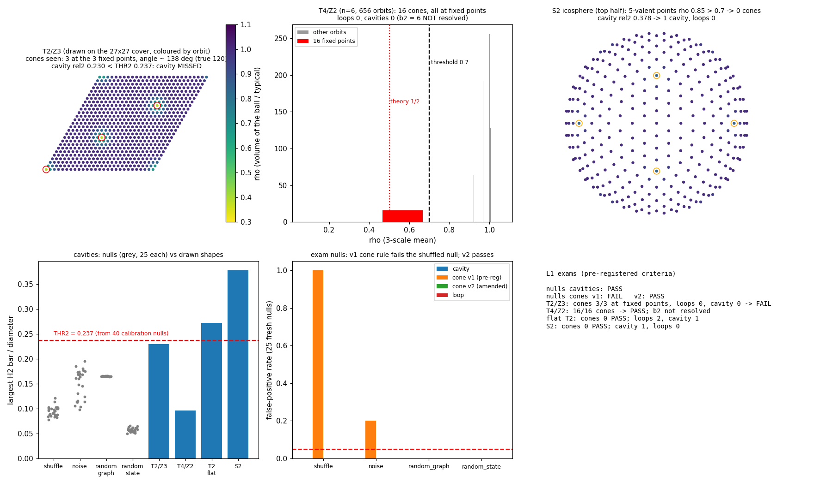
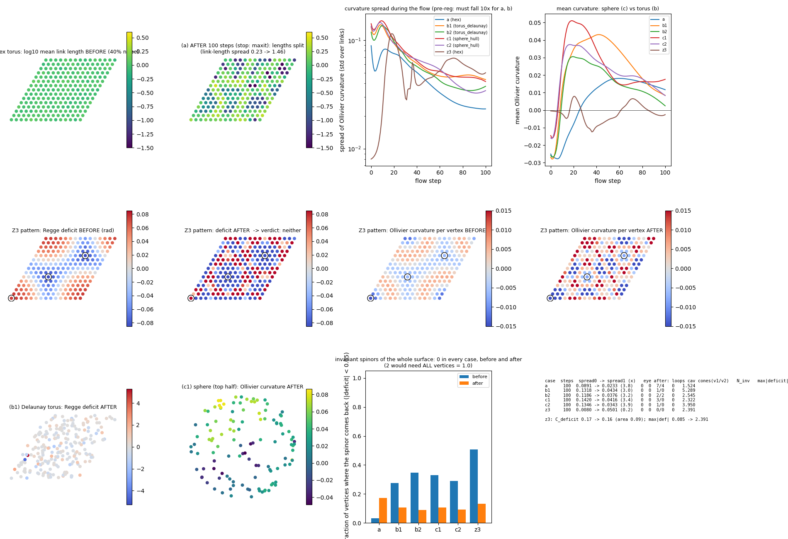

# L'occhio e il flusso: vedere cavità e punte, e provare a far nascere una forma da sola

Laboratorio: `lab/eye_*.py` (nucleo `lab/eye_core.py`) e `lab/flow_*.py` (nucleo `lab/flow_core.py`).
Numeri: `lab/out/eye_*.json`, `lab/out/flow_*.json` (+ `.log`, `.npz`). Figure: `lab/out/eye_figure.png`,
`lab/out/flow_figure.png`.

Pre-registrazione, **in git prima di qualsiasi corsa d'esame**:
* `lab/out/eye_prereg.json` (L1) e `lab/out/flow_prereg.json` (L2), commit **7bfd022**;
* dopo la calibrazione sui nulli (che non è un esame) e **prima** di nulli d'esame e forme: `lab/out/eye_calib.json`
  (soglia delle cavità) e l'**emendamento** `lab/out/eye_amend.json` (regola v2 delle punte), commit **9c03a62**.

Cosa ho guardato prima di scrivere le regole (dichiarato nei file di pre-registrazione): un nullo per classe con un
seme di prova, forme di prova di taglia **diversa** da quelle d'esame (toro 12 e 15, T²/Z3 da 12, icosfera piccola,
T⁴/Z2 con n = 4), tempi di calcolo, e 8 passi di flusso su un toro 6×6.

Tempo totale delle corse d'esame: circa **26 minuti** (calibrazione 3 min, nulli 6 min, forme 3 s, sei flussi da
~2,3 min l'uno).

## In due righe

**L'occhio:** adesso le palline vedono le **punte** (i punti conici). Su T²/Z3 trovano esattamente 3 punte, proprio
sui 3 punti fissi, con angolo stimato ~140° (vero: 120°); su T⁴/Z2 trovano esattamente 16 punte sui 16 punti fissi;
su toro piatto e sfera nessuna punta. Le **cavità** le vedono sulla sfera e sul toro, **ma non su T²/Z3** (mancata per
un soffio: 0,230 contro una soglia di 0,237). La prima regola delle punte, quella scritta prima, **falliva sui nulli**
(vedeva punte nel rumore): l'ho riparata dopo la calibrazione e prima degli esami (v2), e lo dico.
**Il flusso:** **fallisce.** Il flusso di Ricci discreto (Ollivier) **non** rende piatto un toro disturbato: lo
**spacca in isole** (un quarto dei legami diventa lunghissimo, gli altri cortissimi). Nessuna forma piatta, nessuna
punta nata da sola, la simmetria a 120° si rompe da sola. **Verdetto: non partire** con lo studio grande.

---

## L1 — L'occhio

### Come funziona (tutto dalla sola informazione mutua I fra i siti)

Le palline sulle forme disegnate sono fermioni che saltano sui legami (un modo per sito), in uno stato termico
(β = 1, μ = 0). Per i quozienti (orbifold) le palline vivono nel settore simmetrico (quello "non torto"). All'occhio
arriva **solo** la matrice I: niente coordinate, niente legami, niente simmetria.

1. Come prima: distanza d = −log(I/I₀), geodetiche (Isomap), diametro D.
2. **Anelli:** il lettore riparato di `big_core`, **non toccato** (barra H1 / D > 0,4).
3. **Cavità (nuovo):** omologia persistente H2 su 100 punti di riferimento; cavità = barra H2 / D > **THR2**.
   (150 punti costavano 15–80 s per nullo: troppo. 100 punti: ~2 s.)
4. **Punte (nuovo):** per ogni sito conto quanti siti ci sono in una palla di raggio r (r in unità della distanza
   tipica fra vicini h). ρ = volume della palla / volume tipico. In un piano piatto ρ = 1. Su un cono di angolo α la palla
   ha area α/(2π) volte quella piatta: **una punta a 120° ha ρ ≈ 1/3**, un punto fisso Z2 in 4-D ha **ρ ≈ 1/2**.
   Una punta = sito con ρ < 0,7 a tutte le scale, legato normalmente ai vicini (distanza dal vicino ≤ 1,2 h, cioè non
   un sito isolato), e il più piccolo nella sua palla. Angolo stimato = 2π·ρ.

### La calibrazione e la riparazione (prima degli esami)

* **Soglia delle cavità.** Su 40 nulli nuovi la barra H2 più lunga è 0,190 → regola scritta prima:
  THR2 = max(0,2; 1,25 × 0,190) = **0,237**.
* **Le punte v1 fallivano.** Con la regola scritta prima (due scale 1,5 h e 2,5 h) il nullo "MI mescolata" mostrava
  53–68 "punte" in **ogni** caso, il rumore log-normale 1–2 punte in 2 casi su 10. Una punta vera è un'**eccezione**
  isolata in uno spazio regolare; nel rumore mescolato i siti "piccoli" sono dappertutto.
* **v2 (emendamento, scritto e messo in git prima degli esami):** tre scale (1,5, 2,5, 3,5 h) invece di due; e un
  **cancello di regolarità**: se più del 5% dei siti sembra "piccolo", l'occhio **si rifiuta** di leggere punte. Su quei
  40 nulli di calibrazione: 0 punte. La v1 è stata comunque giudicata come scritta.

### Esame sui nulli (25 nuovi per classe, semi mai usati)

| classe | falsi anelli | false cavità | falsi coni v1 (pre-reg.) | falsi coni v2 (emendata) | barra H2 max |
|---|---|---|---|---|---|
| MI mescolata | 0/25 | **0/25** | **25/25 ✗** | **0/25** (rifiutata 25 volte) | 0,12 |
| rumore log-normale | 0/25 | **0/25** | **5/25 ✗** | **0/25** | 0,20 |
| grafo a caso 6-regolare | 0/25 | **0/25** | 0/25 | **0/25** | 0,17 |
| stato a caso | 0/25 | **0/25** | 0/25 | **0/25** | 0,07 |

### Esame sulle forme disegnate

| forma | anelli | cavità (barra H2/D) | punte v1 / v2 | dove | ρ delle punte (angolo) | esito |
|---|---|---|---|---|---|---|
| **T²/Z3** (L = 27, 245 orbite) | 0 ✔ | **0 ✗** (0,230 < 0,237) | **3 / 3** ✔ | sui 3 punti fissi | 0,40 / 0,38 → **143° / 138°** (vero 120°) | **FAIL** (solo per la cavità) |
| **T⁴/Z2** (n = 6, 656 orbite) | 0 ✔ | 0 (b2 = 6 non visto) | **16 / 16** ✔ | sui 16 punti fissi | 0,53 / 0,57 (teoria 0,5) | **PASS** (punte) |
| toro piatto (L = 15) | **2** | **1** (0,27) | 0 / 0 ✔ | – | – | **PASS** (riconosciuto come toro) |
| sfera (icosfera, 642) | 0 | **1** (0,38) | 0 / 0 ✔ | – | i 12 vertici a 5 vicini: ρ 0,85 (angolo 300°) restano sopra 0,7 | **PASS** |

**Tabellone L1 (come pre-registrato): FAIL.** Due motivi: (1) la regola v1 delle punte fallisce i nulli; (2) su T²/Z3
la cavità non si vede. Con la regola v2 (emendata dopo la calibrazione) le punte passano tutto: nulli 0/100, T²/Z3 3/3,
T⁴/Z2 16/16, controlli 0. Ma la cavità di T²/Z3 manca comunque.

**Cose oneste.**
* **La cavità di T²/Z3 è "schiacciata".** T²/Z3 è una sfera fatta come un cuscino triangolare (due triangoli cuciti
  sui bordi, con tre punte). Rispetto al suo diametro la cavità vive poco: 0,230, contro 0,378 della sfera rotonda.
  La soglia (dai nulli: fino a 0,196) e la cavità vera (0,230) sono troppo vicine. **Il margine non c'è.**
* **Gli angoli sono un po' troppo larghi** (~140° invece di 120°): vicino alla punta le palline sono più legate fra loro
  (nel settore simmetrico il salto verso la punta pesa √3), quindi le distanze lì sono più corte e la palla contiene
  un po' più di siti. La stima resta nella tolleranza pre-registrata (72°–180°).
* **T⁴/Z2: b2 = 6 non si vede**, come previsto prima: 100 punti di riferimento in 4 dimensioni sono troppo pochi.
  H3 e H4 non li ho calcolati (fuori budget). Del T⁴/Z2 l'occhio vede bene **le punte**, non i buchi a 2 dimensioni.
* Le punte si vedono perché il quoziente **è disegnato**. Questo esame dice solo che l'occhio *saprebbe* riconoscere
  una forma con punte **se** nascesse.

---

## L2 — Il flusso

### L'idea

Friedan (1980): quando "zoommi" un modello sigma, la forma nascosta cambia secondo il **flusso di Ricci**; le forme che
non cambiano più (punti fissi) sono quelle Ricci-piatte, cioè i Calabi–Yau. Su un grafo si può fare un flusso di
Ricci discreto (Ni–Lin–Gao–Gu 2019): ogni legame ha una lunghezza w; la curvatura di Ollivier κ di un legame dice
quanto costa spostare "la nuvola di passi" di una pallina da un capo all'altro (κ > 0: le nuvole si sovrappongono,
come su una sfera; κ < 0: si allontanano, come su una sella). Il flusso accorcia i legami curvi positivamente e
allunga quelli negativi: w ← w − ε·κ·w, poi riporto la lunghezza totale al valore iniziale.
Tutto usa **solo il trasporto delle palline** (cammino pigro: resta con prob. α, altrimenti salta con peso e^(−w²)).

Controllo utile visto prima: sul reticolo triangolare uniforme κ = 0 esattamente. Quindi "piatto" qui vuol dire κ = 0.

**Parametri del flusso: 5** (ε = 0,5, α = 0,5, tolleranza 10⁻³, massimo 100 passi, esponente 2 del peso).

**Lo spinore.** Il test di `orb_core` ha bisogno di una simmetria del reticolo, che un grafo con pesi non ha. Ho
fatto il controllo più vicino possibile: con le lunghezze calcolo gli angoli dei triangoli (geometria di Regge); a ogni
vertice il "difetto" δ = 2π − somma degli angoli; uno spinore che gira intorno al vertice viene ruotato di δ/2.
Spinori invarianti = 2 se **tutti** i |δ| < 0,05, altrimenti 0. (Toro piatto = il Calabi–Yau più semplice: 2.)

### Risultati

| partenza | passi | spread di κ prima → dopo | calo | lunghezze (spread) | occhio dopo: anelli / cavità / punte v2 | spinori invarianti | esito |
|---|---|---|---|---|---|---|---|
| (a) toro esagonale 15×15, pesi ±40% | 100 (non converge) | 0,089 → 0,023 | **3,8×** (serviva 10×) | 0,23 → **1,46** | 0 / 0 / 4 (prima: 1 / 1 / 0) | 0 → **0** | **FAIL** |
| (b1) triangolazione a caso su toro | 100 | 0,132 → 0,043 | **3,0×** | 0 → 1,62 | 0 / 0 / 0 | 0 → 0 | **FAIL** |
| (b2) idem, altro seme | 100 | 0,119 → 0,038 | **3,2×** | 0 → 1,57 | 0 / 0 / 2 | 0 → 0 | **FAIL** |
| (c1) triangolazione a caso su sfera | 100 | 0,142 → 0,042 | 3,4× | 0 → 1,54 | 0 / 0 / 0, **3 pezzi** | 0 (Gauss–Bonnet) | κ medio +0,018 |
| (c2) idem | 100 | 0,135 → 0,034 | 3,9× | 0 → 1,64 | 0 / 0 / 0, **3 pezzi** | 0 | κ medio +0,008 |

**Esame (c), sfera "più curva" del toro:** κ medio finale > 0 su entrambe le sfere ✔, ma il minimo delle sfere
(0,00833) **non** supera il massimo dei tori (0,00844): **FAIL** (per 10⁻⁴: in pratica sfera e toro finiscono
indistinguibili). Gli spinori sulla sfera sono 0 sempre, ma è banale: la somma dei difetti è 4π per forza
(Gauss–Bonnet), non è una prova.

**Cosa succede davvero (la cosa importante).** Il flusso **non liscia**: **spacca**. Alla fine circa il 25% dei
legami è lunghissimo (w > 2, fino a 5–7) e la metà è cortissima (mediana 0,06–0,15). Le palline restano chiuse in
isole: l'occhio non vede più anelli né cavità (le sfere si spezzano in 3 pezzi di informazione). Il motivo è un
**circolo vizioso**: un legame lungo riceve meno passi (peso e^(−w²)), quindi la sua κ diventa più negativa, quindi il
flusso lo allunga ancora. Il punto fisso piatto (tutte le lunghezze uguali, κ = 0) esiste, ma è **instabile**: con un
disturbo del 40% il flusso se ne allontana. È lo stesso flusso che Ni e colleghi usano per **trovare comunità** in una
rete (cioè per tagliarla): coerente con quello che vedo. Ricorda le **isole** del rinforzo in GEOMETRIA_AUTOCOSTRUITA.

### La variante Z3 (pesi con simmetria a 120°, non un quoziente)

Lunghezze w = 1 + 0,2·f, con f che ha i suoi estremi esattamente nei 3 punti fissi della rotazione di 120°.
Domanda dichiarata: il flusso concentra la curvatura in 3 punte, o la lava via?

| | prima | dopo |
|---|---|---|
| quota di \|δ\| entro un passo dai 3 punti fissi (base per area: 0,093) | 0,166 | 0,165 |
| quota di \|κ di vertice\| vicino ai 3 punti | 0,187 | 0,089 |
| \|δ\| massimo | 0,085 | **2,39** (×28) |
| punte viste dall'occhio | 0 | 0 |
| simmetria a 120° dei pesi (scarto massimo) | 7·10⁻¹⁶ | **5,2** |

**Verdetto pre-registrato: "né l'una né l'altra".** Non nascono 3 punte; non si lava via nemmeno (il difetto cresce di 28
volte). Il disegno si frantuma in una trama fine a scala di un legame, e **la simmetria a 120° si rompe da sola**:
il flusso è così instabile che amplifica gli errori di arrotondamento (10⁻¹⁶) fino a rompere la simmetria.

---

## Tabellone

| fase | esame | esito | numero chiave |
|---|---|---|---|
| L1 | nulli: cavità | **PASS** | 0/100 |
| L1 | nulli: punte v1 (pre-reg.) | **FAIL** | MI mescolata 25/25, rumore 5/25 |
| L1 | nulli: punte v2 (emendata dopo calibrazione) | PASS | 0/100 |
| L1 | T²/Z3 | **FAIL** | punte 3/3 ok, anelli 0 ok, cavità 0,230 < 0,237 |
| L1 | T⁴/Z2 punte | **PASS** | 16/16, ρ 0,53–0,57 (teoria 0,5); b2 = 6 non visto |
| L1 | toro piatto / sfera: 0 punte | **PASS / PASS** | toro: anelli 2, cavità 1; sfera: cavità 1 |
| L1 | **complessivo** | **FAIL** | |
| L2 | (a) spread ↓10× / occhio = toro / 2 spinori | **FAIL / FAIL / FAIL** | 3,8×; anelli 0; spinori 0 |
| L2 | (b) idem | **FAIL** (2 semi) | 3,0× e 3,2× |
| L2 | (c) sfera più curva del toro | **FAIL** | 0,00833 contro 0,00844 |
| L2 | Z3 | **"né l'una né l'altra"** | simmetria rotta, nessuna punta |

## Quanti parametri

* **Occhio, ereditati da R1: 4** (soglia I 10⁻¹⁰, fattore Isomap 1,5, 220 punti, soglia anelli 0,4).
* **Occhio, nuovi: 9** — stato delle palline (β, μ), 100 punti per H2, regola di THR2 (fattore 1,25, minimo 0,2),
  scale delle punte (1,5 / 2,5 / 3,5), soglia ρ 0,7, cancello del vicino 1,2, cancello di regolarità 5%.
* **Flusso: 5** (ε, α, tolleranza, massimo passi, esponente 2) + 1 per lo spinore (0,05 rad).
* **Partenze (scelte, non adattate):** disturbo 40%, ampiezza Z3 0,2, 225 vertici.
* Nessun parametro cambiato dopo aver visto un risultato d'esame.

## Debiti (onesti)

1. **La regola v2 delle punte è nata dopo la calibrazione** (non dopo gli esami, ma dopo aver visto che la v1 falliva
   sui nulli). È dichiarata come emendamento, non come pre-registrazione originale.
2. **Le cavità hanno un margine piccolo:** nulli fino a 0,196, T²/Z3 vero 0,230, soglia 0,237. Un lettore di cavità
   "relativo al diametro" fatica sulle forme schiacciate.
3. **Le palline dell'occhio sono fermioni che saltano**, non la pallina zig-zag: la regola zig-zag ha bisogno di assi,
   e un quoziente a 120° gli assi li mescola. Lo stato termico (β, μ) è una scelta mia.
4. **I quozienti sono ancora disegnati.** L1 dice solo che l'occhio *riconoscerebbe* le punte.
5. **T⁴/Z2: niente b2 = 6, niente H3/H4.**
6. **Lo spinore del flusso non è il test di `orb_core`:** è la geometria di Regge sulla triangolazione. Il giro intorno
   ai cicli del toro non l'ho calcolato.
7. **(b) e (c) sono triangolazioni di Delaunay**, non grafi "a raggio": un grafo a raggio non è una superficie e Regge
   non si può usare.
8. **Due correzioni numeriche dopo il primo crash di (a)** (stessa matematica): (i) il peso e^(−w²) calcolato spostato per
   non andare a zero; (ii) quando il risolutore HiGHS dichiara per errore "impossibile" un trasporto con masse ~10⁻⁷,
   riprovo una volta senza pre-elaborazione. La prima corsa di (a) si era fermata al passo 52 con gli stessi numeri.
9. **ε = 0,5 e 100 passi** li ho scelti dopo una prova di 8 passi su un toro piccolo (troppo lenta con ε = 0,25).
   Con un passo più piccolo l'instabilità resterebbe (il punto fisso è instabile), ma non l'ho provato.
10. Nessuna "chirurgia" (Ni et al. la usano proprio per tagliare i legami lunghi): voluto, era pre-registrato.

## Verdetto: andare avanti con uno studio grande di emergenza?

**No (NO-GO).** Regola pre-registrata: GO solo se L1 passa **e** (a) passa tutti gli esami **e** Z3 è "a punte".
Nessuna delle tre condizioni è vera.

Cosa ho imparato, in breve:
* **L'occhio per le punte funziona** (con la v2): conta punte e angoli senza sapere nulla della forma. È il pezzo
  nuovo più solido. **L'occhio per le cavità è fragile** (manca T²/Z3 per un soffio).
* **Il flusso di Ricci di Ollivier, così com'è, non fa nascere forme lisce: le taglia in isole.** Come il rinforzo di
  GEOMETRIA_AUTOCOSTRUITA. Due dinamiche diverse, stessa fine: isole.
* Passo piccolo sensato prima di qualsiasi studio grande: un flusso che abbia **il piatto come punto fisso stabile**
  (per esempio pesi del cammino che non premino i legami corti, o il flusso combinatorio di Regge/Chow–Luo, che ha
  teoremi di convergenza sulle superfici), provato prima sul toro disturbato (a). Solo se quello liscia, ha senso
  chiedere se nascono punte.

## File

`lab/eye_core.py` (occhio, forme disegnate, nulli), `lab/eye_prereg.py`, `lab/eye_calib.py`, `lab/eye_amend.py`,
`lab/eye_nulls.py` (una classe per corsa, 17–165 s), `lab/eye_shapes.py` (3 s), `lab/eye_figure.py`;
`lab/flow_core.py` (curvatura di Ollivier, flusso, Regge), `lab/flow_prereg.py`, `lab/flow_run.py` (un caso per corsa,
~130–140 s), `lab/flow_figure.py`.
