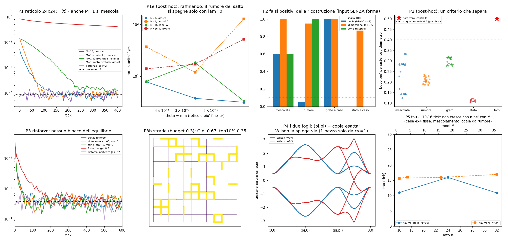

# Pre-esperimenti prima della "geometria che si costruisce da sola"

Laboratorio: `lab/pre_*.py`. Numeri: `lab/out/pre_*.json` / `.log`. Figura: `lab/out/pre_figure.png`.
Pre-registrazione: `lab/pre_prereg.py` → `lab/out/pre_prereg.json`, **committata (0392a5d) prima delle corse**.
Prima di scriverla ho fatto solo uno "smoke test" del codice: controlli di correttezza e tempi, dichiarati nel file.

## Il piano grande, in due righe
Le palline (i surfisti della regola zig-zag) **rinforzano i legami che usano** (come le scie di Physarum, o
"un cervello che cerca l'equilibrio"). Intanto, a ogni tappa, leggiamo la forma dello spazio con
l'informazione mutua (MI). Prima di costruirlo ho controllato cinque cose.

## Il motore nuovo (`lab/pre_core.py`)
* La regola è quella di sempre (`zz_core`/`geo_core`: trasla x poi y, gira di θ = 0,5), ma ogni **legame** fra
  due siti ha un peso w fra 0 e 1. w = 1: la regola normale. w = 0: uno specchio. In mezzo: un "beam splitter"
  2×2 che lascia passare √w e riflette il resto. È unitario (errore 10⁻¹⁵) e col toro e w = 1 coincide con
  `geo_core` (4·10⁻¹⁷).
* **Surfisti sul reticolo (niente continuo).** Sul reticolo non ci sono traiettorie lisce: un surfista salta
  da un sito al vicino con una probabilità calcolata dalla corrente dell'onda su quel legame. La regola di salto
  è scelta in modo che, se la folla parte come |ψ|², resta |ψ|² **esattamente** (è un processo alla Bell).
  C'è una famiglia di scelte, con una manopola λ: λ = 0 = "si muove solo chi è costretto" (flusso minimo di
  Bell), λ = 1 = "tutti si muovono come la regola" (balistico), λ = w = la mia scelta di default.

## P1 — Il rilassamento funziona sulla regola a reticolo?

Scatola 24×24, 20 000 surfisti, celle 4×4 (pavimento di rumore F = 0,000875), 400 tick.

| criterio pre-registrato | esito | numeri |
|---|---|---|
| P1a partendo da \|ψ\|² si resta lì (max H ≤ 3F) | **PASS** | max H = 0,0015 (λ=w) e 0,0014 (λ=0) ≤ 0,0026 |
| P1b partenza sbagliata, M=16, scende sotto il 10% | **PASS** | uniforme: 1,3% (τ = 16 tick); metà scatola: 0,16% (τ = 23) |
| P1c controllo M=1 resta fermo (come nel continuo) | **FAIL — come avevo previsto** | M=1 scende allo 0,5% (τ = 16), veloce come M=16 |
| P1d i fogli bloccano il mescolamento (λ=1) | **FAIL** (ma per un bug, vedi sotto) | |
| P1d con λ=0 si mescola fra i fogli | **PASS** | 0,3% |

**Cosa vuol dire.** Sul reticolo i surfisti **si mescolano anche senza vortici**. Il motivo è semplice: il salto è
a caso (una catena di Markov), e una catena di Markov si mescola da sola anche se l'onda è ferma. È un
**mescolamento finto**, un artefatto del reticolo: nel continuo (scatola, `EQUILIBRIO_QUANTISTICO.md`) M = 1
restava congelato. Anche il conto dei "vortici" qui non funziona: uno spinore a 4 componenti quasi mai si
annulla tutto insieme, quindi ho contato gli avvolgimenti di fase componente per componente: ~75–90 sia con
M = 1 che con M = 16. **Sul reticolo i vortici non sono il cucchiaino.**

**P1d, onestamente.** Nel run pre-registrato con λ = 1 ho usato λ = 1 anche sui legami-muro della scatola, dove
fa saltare i surfisti dall'altra parte del bordo periodico (un teletrasporto: bug). Rifatto (post-hoc,
`pre_p1_posthoc.py`): nella **scatola** i fogli si mescolano lo stesso (ai bordi lo specchio fa cambiare foglio,
come già visto in `FORMA_DALLE_PALLINE.md`); sul **toro** con λ = w (balistico) le popolazioni dei due fogli sono
**congelate per sempre** (H per foglio: 0,659 → 0,659, rapporto 0,999); con λ = 0 si mescolano (0,25%). Quindi la
previsione era giusta sul toro: **i due fogli possono bloccare il mescolamento** se nessuno può cambiare foglio.

**P1e (post-hoc): il mescolamento finto sparisce raffinando il reticolo?** θ = m·a = 0,5 / 0,25 / 0,125 con
n = 24 / 48 / 96 (stessa scatola in unità fisiche), τ in unità 1/m:

| θ | M=1, λ=w | M=16, λ=w | M=1, λ=0 | M=16, λ=0 |
|---|---|---|---|---|
| 0,5 | 7,8 | 8,0 | 36,9 | 13,9 |
| 0,25 | 3,7 | 18,4 | 12,0 | 17,2 |
| 0,125 | 3,1 | 3,3 | **128** (resta al 17%) | **52** (scende al 2%) |

Con λ = w (balistico) il rumore resta: si mescola tutto, sempre. Con λ = 0 (Bell minimo), al reticolo più
fine il singolo modo **rallenta molto** (τ 128) e M = 16 diventa ~2,5× più veloce: è il primo segno che il
comportamento del continuo (Vink 1993: il processo di Bell diventa Bohm quando a → 0) ritorna. Solo 3 punti e
non monotono; a θ = 0,125 i modi scelti sono molto concentrati (H iniziale ≈ 8,6), quindi è un indizio, non una prova.

## P2 — La ricostruzione dalla MI vede forme dove non ce ne sono?

Ho dato alla ricostruzione cieca di `geo_core` input **senza forma**: MI del toro **mescolata** a caso (20),
**rumore** log-normale con la stessa media e varianza (20), il vuoto di un **grafo a caso** 4-regolare (20), uno
**stato a caso** (10). Controllo positivo: toro 12×12 → 2 pezzi, b = (1,2,1) ciascuno: **OK**.

| input senza forma | "buchi" (b1+b2 ≥ 1) | "dimensione" fra 0,8 e 3,5 | b0 > 1 |
|---|---|---|---|
| MI mescolata | **60%** | 100% | 60% |
| rumore | 5% | 95% | 100% |
| grafo a caso | **100%** (in media 61 buchi!) | 100% | 0% |
| stato a caso | 0% | 90% | 0% |

Criterio pre-registrato (falsi positivi ≤ 10% per ogni classe): **FAIL**. La ricostruzione, così com'è,
**trova buchi e "dimensione 2–3" quasi sempre**, anche nel rumore. La dimensione non distingue niente.
Deviazione dichiarata: il b2 di `geo_core` su metriche senza forma non finisce (> 8 minuti); l'ho tagliato a
metà diametro, e così tagliato non vede più neanche la cavità del toro vero → b2 qui non è informativo.

**Post-hoc, una via d'uscita.** Misurando la persistenza del buco più grande **rispetto al diametro**: toro
vero 0,50; tutti i 70 input senza forma ≤ 0,33. Una soglia 0,4 li separerebbe tutti. Margine piccolo, scelta
dopo aver visto i dati: va **pre-registrata e ritestata** prima di usarla.

## P3 — Rinforzo contro mescolamento (giocattolo)

Regola fissata prima (4 parametri: η = 0,05, budget w̄ = 0,8, w_min = 0,02, K = 10 tick): ogni 10 tick conto
quanti surfisti attraversano ogni legame; w ← (1−η)w + η·w̄·J/media(J); taglio in [w_min, 1]; rimetto la media a
w̄. Scatola 12×12, M = 16, 3000 tick.

| criterio | esito | numeri |
|---|---|---|
| P3a il rinforzo blocca il non-equilibrio (H finale > 3× senza) | **NO** | H finale 0,00036 con e 0,00038 senza (= pavimento 0,000375) |
| P3b nascono "strade" (Gini > 0,2 e top 10% > 30% del peso) | **FAIL** | Gini 0,20, top 10% = 12% |
| P3d compare una forma vera | **FAIL** | la MI cambia (b passa da (1,0,0) a (10,1,1)), ma P2 dice che cambi così escono anche dal rumore |
| P3e col rinforzo l'equilibrio resta equilibrio (max H ≤ 3F) | **PASS** | 0,00084 ≤ 0,0011 |

**P3b era impossibile per come l'avevo scritto** (errore mio): con media 0,8 e tetto 1, il 10% dei legami può
portare al massimo il 12,5% del peso. Post-hoc (`pre_p3b.py`): budget w̄ = 0,3 e rinforzo forte e super-lineare
(η = 0,3, J², come nei modelli di Physarum): **le strade nascono** (Gini 0,67, top 10% = 35%; figura), ma
**l'equilibrio non si blocca** (H finale 0,00046 contro 0,00036 senza, entrambe al pavimento) e partendo da |ψ|²
si resta lì (0,00085). La forma letta dalla MI alla fine: un pezzo, b = (2,0,0): "due grappoli", che P2
trova anche nel rumore → **non è una scoperta**.

In parole: **il rinforzo non combatte la regola di Born** (ma qui il mescolamento è quello finto e rumoroso
di P1, quindi è un test debole). Le strade si formano solo se il "budget" totale è basso.

## P4 — I due fogli: è il raddoppio dei fermioni?

| verifica | esito |
|---|---|
| U(k + (π,π)) = U(k) (a 5·10⁻¹⁶) | **sì**: i due fogli sono una **copia esatta**, uguali a meno di uno spostamento di un sito (MI foglio B spostato = foglio A a 9·10⁻¹⁶) |
| U(k + (π,0)) = −U(k) | **sì**: c'è anche un "doppione" vero a quasi-energia π (i "modi π" dei cammini a tempo discreto, cugini del raddoppio di Nielsen–Ninomiya) |
| alternare l'ordine degli assi toglie i fogli? | **no** (pre-registrato come previsione, confermato): ogni componente si muove comunque in diagonale |
| correzione tipo Wilson r = 0,5 → un pezzo con b = (1,2) | **FAIL a metà**: un solo pezzo di MI, ma b0 = 2 (due grappoli). **Post-hoc** r = 1 e r = 2: un pezzo, b = (1,2,0), cioè il toro disegnato |
| i fogli hanno chiralità o "cariche" opposte? | **no**: tutti gli 8 coni (R e L, ai 4 punti) hanno lo stesso avvolgimento +1; numero di Chern del vuoto 0 |

Il mio criterio "L ha avvolgimento opposto a R" era **sbagliato come fisica**: in 2-D d → −d è una rotazione e non
cambia l'avvolgimento. Lo dichiaro come FAIL della previsione.

**Conclusione onesta.** I due fogli sono un **artefatto del reticolo**: ogni passo sposta di un numero dispari di
siti, quindi la scacchiera si divide in due metà che non si parlano. È parente del raddoppio "staggered"
(Kogut–Susskind: copie identiche legate da una traslazione), **non** di coppie con chiralità opposta. Non portano
etichette di carica diverse: **l'idea "la doppia regola costringe le particelle a coppie" qui non trova appoggio.**
Si toglie con un termine alla Wilson (massa che cresce vicino ai bordi della zona di Brillouin), ma la mia
versione è in spazio k, quindi **quasi-locale** (code di Bessel), non un vero automa cellulare: debito.

## P5 — Quanto costa crescere?

τ (tick, celle 4×4, λ = w): n = 16 / 24 / 32 → 11,0 / 15,9 / 10,9; M = 1 / 4 / 16 / 36 (n = 24) → 15,6 / 16,1 /
15,9 / 16,9. **Non cresce né con n né con M** (esponente ≈ 0): con celle fisse il rumore del salto mescola in
~15 tick a ogni scala. Per il passo grande vuol dire: il costo è dominato dai tick per far evolvere le strade
(migliaia), non dal rilassamento. Una corsa 12×12 da 3000 tick dura ~15 s; 24×24 ~ 4× di più; la ricostruzione MI
serve una diagonalizzazione densa 4N² (24×24: 2304, secondi; 48×48: 9216, minuti).

## Tabellone

| test | esito |
|---|---|
| P1a, P1b | PASS |
| P1c (controllo fermo) | FAIL, previsto: mescolamento finto da salto casuale |
| P1d | FAIL per bug; post-hoc sul toro la previsione regge |
| P2 | **FAIL**: falsi positivi 60–100% |
| P3a, P3b, P3d | no / FAIL (P3b impossibile per costruzione) / FAIL; P3e PASS |
| P4a, P4b | PASS; P4c FAIL a r = 0,5 (post-hoc OK a r ≥ 1); P4d chiralità FAIL (previsione sbagliata), traslazione PASS |

## Raccomandazione: **NO-GO così com'è; GO dopo due riparazioni (piccole)**

1. **Il lettore di forma va riparato prima (P2).** Oggi vede buchi nel rumore. Senza questo, qualunque "forma
   emersa" nel passo grande non vale niente.
2. **I surfisti sul reticolo mescolano per rumore (P1, P5).** Quindi la domanda "il rinforzo blocca Born?"
   oggi è truccata a favore del sì-si-mescola. Serve λ = 0 (Bell minimo) e un reticolo fine (θ ≤ 0,125),
   dove il rumore si spegne.

### Disegno concreto del passo grande (da pre-registrare prima)
* **Regola (fissa):** `pre_core.LatticeWalk` con pesi sui legami, θ = 0,125, surfisti λ = 0. Rinforzo di P3b:
  ogni K tick w ← (1−η)w + η·w̄·J^μ/media(J^μ), clip [w_min, 1], media = w̄.
  **Parametri: 5** (η = 0,3, μ = 2, w̄ = 0,3, w_min = 0,02, K = 10) + θ. Niente altro si regola dopo.
* **Fogli:** o toro con termine di Wilson (r = 1) o scatola (gli specchi saldano i fogli); dichiararlo prima.
* **Esami:**
  1. *lettore*: nuovo criterio di buco (persistenza / diametro > 0,4) ritestato su nuove 100 copie dei 4 nulli
     **e** su 3 forme note: falsi positivi ≤ 5%, veri positivi 3/3. Solo dopo, si usa.
  2. *Born*: partenza |ψ|² con rinforzo → H ≤ 3F (equivarianza); partenza sbagliata, controllo M = 1 contro
     M = 16 a θ = 0,125 con λ = 0: il blocco si dichiara solo se H finale > 3× il caso senza rinforzo.
  3. *forma*: la forma letta dalla MI a fine corsa deve passare il criterio dell'esame 1 **e** ripetersi su 3 semi
     diversi (stesso b0, b1); altrimenti "nessuna forma emersa".
  4. *budget*: 24×24, 5000 tick, 3 semi → ~10 minuti su 2 thread.

## Debiti
* Il salto dei surfisti è casuale: sul reticolo non esiste una guida deterministica che conservi |ψ|² in modo
  esatto. Il limite continuo (Vink) è solo accennato da P1e (3 punti, non monotono).
* A θ piccolo i modi scelti vicino a ω₀ sono molto localizzati (forse modi di bordo): da controllare.
* La correzione Wilson è in spazio k (quasi-locale); manca una versione locale vera (serve una componente che
  "sta ferma", altrimenti la scacchiera si divide sempre).
* Il b2 tagliato di P2 non vede la cavità del toro; il criterio 0,4 è post-hoc.
* Dopo i primi giri ho fissato il vettore di partenza di ARPACK (prima i modi degeneri, quindi ψ, cambiavano da
  corsa a corsa); tutti i numeri sopra sono del giro rifatto con la correzione.
* P3 su 12×12 con un solo seme.

## File
`lab/pre_prereg.py`, `lab/pre_core.py`, `lab/pre_p1p5.py` (P1+P5, 40 s), `lab/pre_p1_posthoc.py` (90 s),
`lab/pre_p2.py` (20 s), `lab/pre_p3.py` (110 s), `lab/pre_p3b.py` (40 s), `lab/pre_p4.py` (15 s), `lab/pre_figure.py`.

