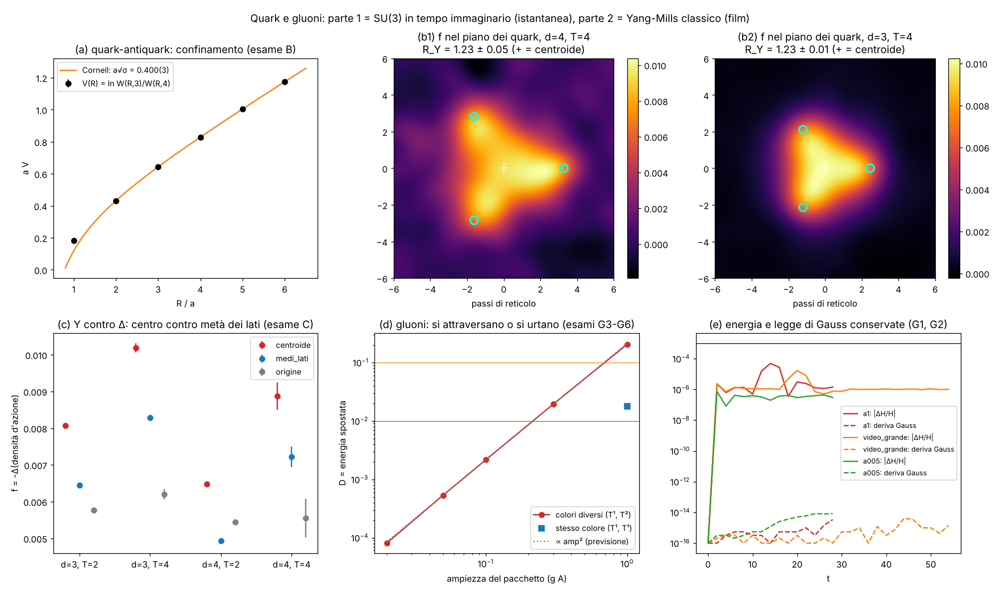
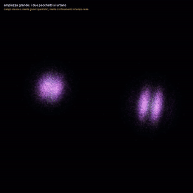

# Quark e gluoni: tre quark chiusi da un tubo a Y, e gluoni che si urtano

Studio `qg_` del 13–14/10/2026. Valerio: *"voglio vedere i gluoni e i quark"*. Due parti, tutte e due fatte con
palline-bagliore e senza niente di disegnato:

1. **Istantanea (tempo immaginario)**: tre quark fermi e il campo dei gluoni misurato attorno a loro. SU(3) vera su
   reticolo, Monte Carlo. **Non è un film.**
2. **Film (tempo reale)**: campo dei gluoni classico (Yang–Mills SU(3)), pacchetti d'onda che si incontrano. **Non è
   quantistico e non c'è il confinamento.**

Pre-registrazione: `lab/out/qg_prereg.json` (commit **8c74975**, prima delle corse di produzione; il pilota è
dichiarato nel file stesso). Aggiunta dichiarata dopo: `lab/out/qg_aggiunta.json` (corsa `video_tre`, solo per il
film). Voti: `lab/out/qg_verdetto.json`. Analisi della parte 1: `lab/out/qg_parte1_analisi.json`.

Immagini della parte 1: `docs/fig/qg_tre_quark_Y.png` (dall'alto), `docs/fig/qg_tre_quark_Y_obliquo.png`; orbita lenta
(12 s) `qg_tre_quark_Y_orbita_1080p.mp4` (fuori da git). Parte 2: fermo-immagine `docs/fig/qg_gluoni_urto.jpg` e
GIF corta `docs/fig/qg_gluoni_urto.gif` dal film `qg_gluoni_urto_1080p.mp4` (ampiezza 1, 20 s, fuori da git).

---

## 0. In breve (con i numeri)

| esame | cosa | noi | atteso | voto |
|---|---|---|---|---|
| A | placchetta a β = 5,7 | 0,5492(1) | 0,5492 | **PASS** |
| B | tensione di corda a√σ (fit di Cornell) | 0,400(3) | ≈ 0,40 | **PASS** |
| C | Y o Δ: R_Y = f(centro)/f(metà dei lati), d = 4, T = 4 | **1,23 ± 0,05** | > 1 a 2σ = Y | **PASS (Y)** |
| D | energia dei 3 quark contro la lunghezza della Y | pendenza 0,177 per passo | σ = 0,160(2) | riportato (+10 %) |
| G1 | legge di Gauss conservata | deriva ≤ 1,4·10⁻¹⁴ | ≤ 10⁻³ | **PASS** |
| G2 | energia conservata | ≤ 4,9·10⁻⁵ | ≤ 10⁻³ | **PASS** |
| G3 | ampiezza piccola: si attraversano | D(0,02) = 8,1·10⁻⁵ | ≤ 0,01 | **PASS** |
| G4 | ampiezza grande: si urtano | D(1,0) = 0,205 | ≥ 0,10 | **PASS** |
| G5 | stesso colore = quasi niente urto | D_stesso = 0,018 | ≤ D/3 = 0,068 | **PASS** |
| G6 | D ∝ ampiezza² | pendenza 2,04 | 1,6–2,4 (previsto 2) | **PASS** |
| G7 | palline fedeli al campo (r ≥ 0,9 in ogni fotogramma) | video_grande: min r = **0,8998** | ≥ 0,9 | **FAIL** (di un soffio) |

**Validazione, non scoperta.** Il tubo a Y fra tre quark statici è un risultato noto della QCD su reticolo
(Takahashi–Suganuma 2001, Bissey et al. 2007). Lo scattering non lineare dei gluoni classici è fisica nota. Il valore
di questo studio è che **esce dal nostro codice, con un solo numero (β), e lo vediamo con le palline**.

## 1. Parte 1 — tre quark e la colla (come a un ventenne)

**La regola.** Lo spazio-tempo è una griglia 12 × 12 × 12 × 12. Su ogni lato c'è una matrice 3×3 di SU(3): è il
campo dei gluoni (8 "colori" di colla). L'energia è l'azione di Wilson: per ogni quadratino si paga β·(1 − Re tr/3)
del giro dei quattro lati. **L'unico numero è β = 6/g² = 5,7.** Il computer pesca migliaia di "fotografie" del vuoto
con la probabilità giusta (heat bath di Cabibbo–Marinari + over-relaxation). Le fotografie sono **in tempo
immaginario**: non sono istanti di un film. Sono come un'esposizione lunga del vuoto quantistico.

**I quark.** Sono tre cariche di colore **ferme e infinitamente pesanti**, messe a mano ai vertici di un triangolo
equilatero: (d,0,0), (0,d,0), (0,0,d), lato d√2 (d = 4 → 5,66 passi ≈ 1 fm). Il "loop di Wilson barionico" fa nascere
i tre quark in un singoletto di colore (contrazione εε), li tiene fermi per un tempo T e poi li fa sparire. A metà
tempo misuriamo i quadratini del campo vicino a loro.

**Cosa si misura.** f = −Δ(densità d'azione), cioè quanto le fluttuazioni del vuoto vengono **spinte via** dove
passa la colla fra i quark. Dove f è grande c'è il tubo di flusso. Esame C: il tubo passa dal centro del triangolo
(Y, con il punto di giunzione di Steiner) o lungo i lati (Δ)? R_Y = f(centro)/f(metà dei lati).

**Risultato.** R_Y = 1,23 ± 0,05 a d = 4 (4,6σ sopra 1): **Y**. Anche le altre combinazioni danno Y: 1,25(0) a d = 3,
T = 2; 1,23(1) a d = 3, T = 4; 1,31(1) a d = 4, T = 2. Nella mappa del piano dei quark (figura, pannello b1) la Y si
vede bene: tre bracci che si incontrano al centro.

**L'operatore non sceglie per noi.** Le linee del loop partono dall'origine lungo gli assi. Distano 0,47·d dal centro e
0,50·d dalle metà dei lati: non favoriscono né Y né Δ. Nell'origine, dove le linee si toccano, f è più bassa che al
centro: 0,0056(5) contro 0,0089(4). Il tubo a mezzo tempo si è quindi spostato nel piano dei quark.

**Energia dei tre quark (D, non votato).** E₃Q(T = 3) = 0,952 / 1,373 / 1,818 per d = 2 / 3 / 4. La pendenza per
passo di lunghezza della Y (L_Y = √6·d) è 0,177, contro σ = 0,160(2) del quark-antiquark: la "legge della Y" (energia
∝ lunghezza minima della corda) entro il 10 %, a distanze ancora piccole.

**Cosa NON si vede e perché.**
* **Quark che si muovono e restano chiusi in tempo reale**: nessuno sa calcolarlo (problema del segno). Disegnarlo
  sarebbe un fake.
* **Il "colore" dei quark** (rosso/verde/blu) non è una cosa gauge-invariante: non si può disegnare.
* **Mare di quark, pioni, quark leggeri**: qui la teoria è solo colla (niente quark dinamici, "quenched").
* **Reticolo grossolano** (a ≈ 0,17 fm, 12 punti per lato): la larghezza del tubo è quasi come il triangolo. In 3-D
  l'immagine è un triangolo luminoso più acceso al centro, non una Y sottile. La Y si vede bene nella fetta del piano
  (figura b1) e nei numeri.

## 2. Parte 2 — gluoni che si urtano (Yang–Mills classico)

**La regola.** Griglia 3-D, campo SU(3) sui lati (U) e campo elettrico di colore (E). Equazioni di Hamilton,
salto della rana (leapfrog), dt = 0,1. Due pacchetti d'onda di colori diversi (T¹ polarizzato y, T² polarizzato z) si
vengono incontro lungo x. **Nessuna manopola fisica oltre alle condizioni iniziali** (ampiezza, forma, colore).

**Cosa si misura.** D = quanta energia, a fine corsa (t = 30), sta in posti diversi da dove la metterebbe l'onda
lineare (corsa di riferimento ad ampiezza 0,005 riscalata).
* ampiezza 0,02 → D = 8·10⁻⁵: **si attraversano come la luce**;
* ampiezza 1 → D = 0,205: **si urtano**. Il 20 % dell'energia va altrove: nasce campo nel terzo colore
  T³ = [T¹, T²];
* **controllo**: ampiezza 1 ma stesso colore (T¹ e T¹, che commutano) → D = 0,018, 11 volte meno. L'urto viene dal
  colore (la colla porta la carica a cui è sensibile), non dal reticolo;
* **previsione verificata**: D cresce come ampiezza^2,04. Il primo campo diffuso sta nel colore T³, ortogonale ai due
  di partenza: niente termine incrociato, quindi D ∝ ampiezza².

**Gauss ed energia.** Il residuo di Gauss iniziale non è zero (le code dei due pacchetti si toccano: 1,7·10⁻⁶ ×
ampiezza/0,005), ma si **conserva** fino a 10⁻¹⁴. L'energia si conserva entro 5·10⁻⁵.

**Il film (in corso al momento di scrivere).** Palline = pezzetti fissi dell'energia. Nascono con densità ∝ energia e
sono **portate dal vettore di Poynting di Yang–Mills** (v = S/ε, dentro la simulazione). Tre corse:
`video_piccolo` (ampiezza 0,05, si attraversano), `video_grande` (ampiezza 1, si urtano: **finita**), `video_tre`
(tre gluoni T¹, T², T⁴ da x, y, z, aggiunta dichiarata). Esame G7 su `video_grande`: correlazione palline–energia
minima 0,8998, sotto la soglia 0,9: **FAIL** di un soffio. Le palline seguono una corrente di energia sul reticolo
che non è esattamente conservata (S e ε definiti sui siti).

**Cosa si vede nel film (onestà).** Dopo l'incontro l'energia si allarga anche di lato: in parte è l'urto (il 20 %
misurato da D), in parte è la **diffrazione** di pacchetti stretti (σ = 4 passi), che c'è anche per la luce. La scatola è
**periodica**: quello che esce da un lato rientra dall'altro, e verso la fine si vedono i bordi della scatola.

**Cosa NON è.** Un campo classico: niente gluoni uno per uno, niente quantistica, niente confinamento in tempo
reale. I "colori" T¹, T² sono quelli delle condizioni iniziali (dipendono dalla gauge). Che si urtino perché non
commutano invece non dipende dalla gauge.

## 3. La grafica (regole di Valerio)

* **Aspetto base = l'atomo zig-zag** (`src/atomo/zzscena.rs`, copia offline `lab/vl_render.py`). In
  `lab/qg_bagliori.py`, costanti `ZZ`: stesso bagliore gaussiano, stesse dimensioni (spot 2 px, alone 16 px), stessa
  luce additiva per canale, alone 0,45, stesso sfondo, stessa tavolozza a 5 tappe `tinta`.
* **Colore (dichiarato, gauge-invariante)**: tinta = **quota elettrica** dell'energia, sulla parte non ciclica della
  tavolozza: ciano = magnetico, viola = metà e metà, oro = elettrico. Nella parte 1 è Δp_t/(Δp_t + Δp_s) del tubo;
  nella parte 2 è E²/(E²+B²) alla pallina (allargata ×1,5 attorno a 1/2). **Luminosità** come zzscena:
  0,1 + 0,9·(densità/max)^0,35.
* **Parte 1**: palline campionate con densità ∝ f (spline cubica dal reticolo 12³). Disegnate solo dove f supera
  **2 errori**, tolto il **fondo uniforme** (mediana di f a più di 5 passi dal centro: sulla scatola di 2 fm f non
  torna a 0). È una scelta di disegno: gli esami usano f com'è. I quark sono tre grandi bagliori bianchi nelle
  posizioni di ingresso.
* **Parte 2**: coda corta che si spegne (regola della sera del 13/10). Lo stesso bagliore viene ridisegnato nelle 6
  posizioni passate (0,25 s), più piccolo e più tenue (totale 0,6 della testa). Niente linee né catene di palline.
* **Struttura portabile**: `carica(...)` (loader: posizioni, colori, pesi) + `disegna(...)` / `bagliori(...)`
  (disegno). Per farne un modo del programma unico serve solo che il renderer centrale accetti per ogni pallina un
  peso e una dimensione (già in `Ball`: posizione, raggio, colore+alfa) e la coda (posizioni passate, ridisegnate con
  alfa e raggio decrescenti). Nessun cambio di interfaccia richiesto oltre a questo.

## 4. Manopole contate

* **Fisica**: parte 1 solo β = 5,7. Parte 2: ampiezza, lunghezza d'onda (12, nel film a tre 10), larghezze dei
  pacchetti (3,5 × 4; nel film a tre 5 × 5), colori e polarizzazioni.
* **Misura (parte 1)**: lisciamento APE 4-D (2 passi, α 0,5) per il campo di misura e le linee di tempo; APE spaziale
  (12 passi, α 0,5) per le linee spaziali; T = 2, 4; d = 3, 4; proiezione su SU(3) con Gram–Schmidt.
* **Grafica**: le costanti `ZZ` (copiate dall'atomo), soglia 2σ, raggio del fondo 5, coda (6 fotogrammi, decadimento
  2,2, ritiro 0,10, totale 0,6), allargamento del colore ×1,5, camera.

## 5. Debiti e cambi dichiarati

1. **Pilota prima della pre-registrazione** (40 misure; prove della parte 2). I numeri del pilota sono scritti nel
   prereg. La soglia G1 è stata riscritta dopo aver visto il residuo iniziale di Gauss.
2. **G1, interpretazione**: per le corse a colore uguale il residuo è zero di macchina (10⁻¹⁵). Lì la "deriva
   relativa" non ha senso e si guarda il valore assoluto (non scritto nel prereg).
3. **Reticolo grossolano e piccolo** (a ≈ 0,17 fm, scatola 2 fm): niente limite al continuo, niente volume infinito.
4. **Quenched**: niente quark dinamici.
5. **Corsa `video_tre` aggiunta dopo** la pre-registrazione, solo per il film.
6. **G7 FAIL** (0,8998): la corrente S/ε sul reticolo non è esattamente conservata.
7. Il film della parte 2 e l'orbita lenta della parte 1 **non sono ancora montati** al momento di questo documento
   (corse ancora in corso, con checkpoint). Comandi:
   `python3 lab/qg_gluoni.py video_piccolo|video_tre` (riprendibili), poi `python3 lab/qg_verdetto.py parte2`,
   `python3 lab/qg_render2.py refs` e `batch i0 i1` → `<SCR>/qg_film_1920/*.jpg`, montaggio con ffmpeg come
   `lab/vz_video.sh`. Orbita: `python3 lab/qg_render1.py orbita prod 4 4 <n> <i0> <i1>`.

## 6. Codice

`lab/qg_su3.py` (SU(3) su reticolo), `lab/qg_mc.py` (Monte Carlo), `lab/qg_run.py` (corse a pezzi),
`lab/qg_analisi1.py` (jackknife, Cornell, flusso), `lab/qg_ym.py` (Yang–Mills classico), `lab/qg_pacchetti.py`
(pacchetti), `lab/qg_gluoni.py` (corse e palline portate da Poynting), `lab/qg_verdetto.py`, `lab/qg_bagliori.py`
(bagliori, aspetto zig-zag), `lab/qg_render1.py`, `lab/qg_render2.py`, `lab/qg_figura.py`, `lab/qg_prereg.py`.
