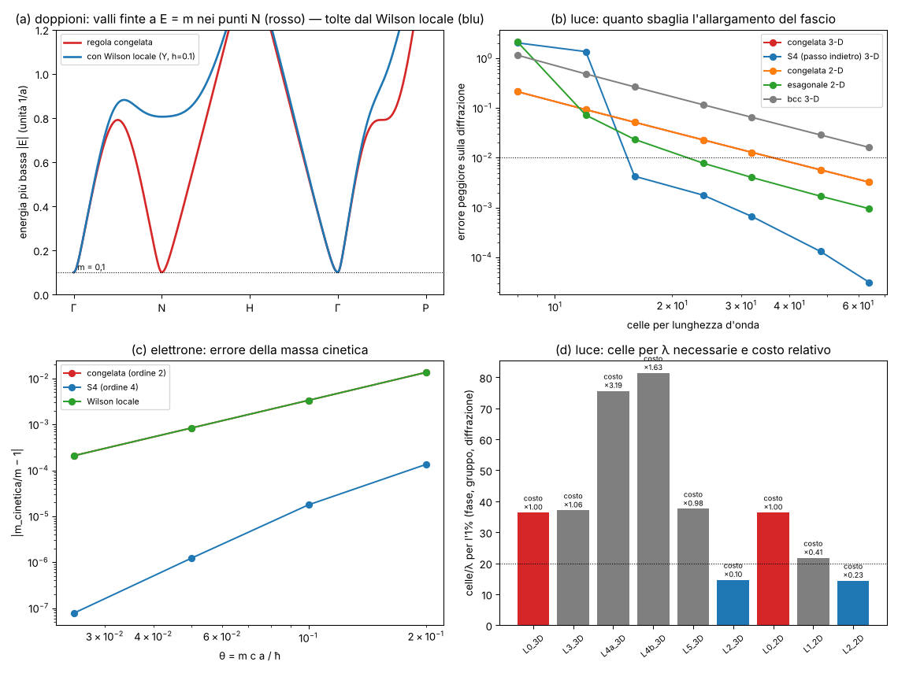
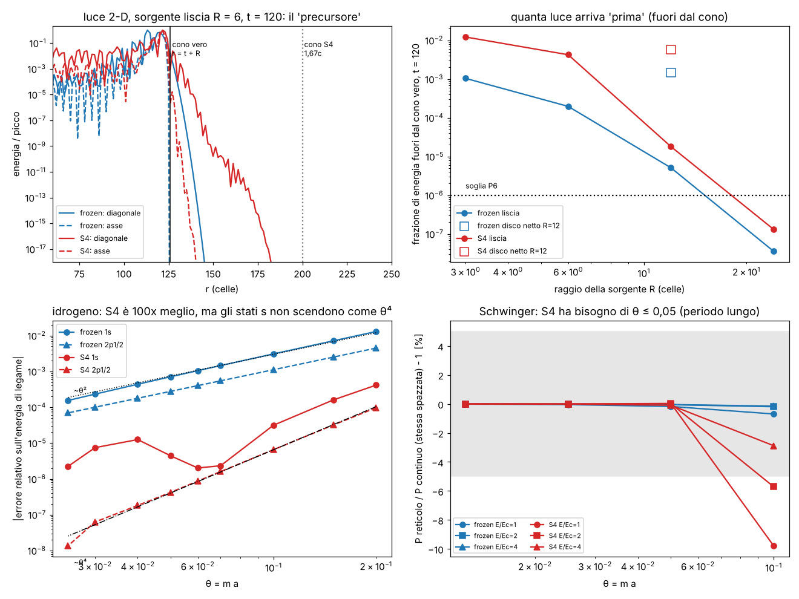
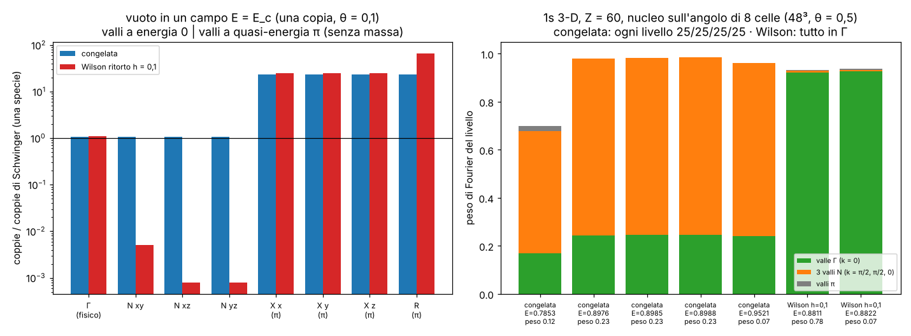

# Regola locale pulita: doppioni e luce di traverso

Studio sui **debiti #3 e #4** di `CONTESTO_CLOUD.md` §4:

- **#3** la zig-zag "raddoppia lo spazio" (U(k+(π,π)) = U(k)), e l'unica cura (Wilson) esisteva solo in spazio k,
  cioè non era un automa locale vero;
- **#4** la luce di traverso si allarga col fattore ka/tan(ka) e in obliquo va piano: servono ≥ 24–32 celle per λ.

La domanda: esiste una versione **locale** di "corri a c, poi ruota" (stessa pallina, stessi ingressi c, ħ, m) che
tolga i doppioni e/o richieda meno celle per λ? Oppure si può dimostrare che non esiste?

**La regola congelata (`lab/zz_core.py`) non è stata toccata.** Qui ci sono solo proposte, con i test da rifare.

File: motore `lab/locale_core.py`, candidati `lab/locale_cands.py`, pre-registrazione `lab/locale_prereg.py` →
`lab/out/locale_prereg.json` (commit **9d4f0bc**, prima delle corse), corse `lab/locale_r1.py`, `locale_r2.py`,
`locale_r3.py`, emendamento dichiarato `lab/locale_amend.py`, esplorazione dopo la pre-registrazione
`lab/locale_hexs4.py`, figura `lab/locale_figure.py` → `lab/out/locale_figure.png`.

---

## 0. In breve (per Valerio)

1. **I "due fogli" erano in realtà 8 (in 3-D) o 4 (in 2-D) universi identici e intrecciati.** Ogni pallina in un tick
   si sposta di ±1 su *ogni* asse, quindi dopo due tick tutte le coordinate sono cambiate di un numero pari. Il reticolo
   cubico si divide in 8 sotto-reticoli (2Z³ spostato) che non si parlano mai. La regola congelata calcola **8 volte
   la stessa fisica**. Basta tenerne uno: **stessa identica fisica con 1/8 delle celle** (verificato: differenza
   3·10⁻⁷ celle sul centro e sulla larghezza di un pacchetto, A2). È locale ed esatto, niente spazio k.
2. **Dentro ognuno di questi universi restano però dei doppioni veri** (fermioni "fantasma" a bassa energia nei punti
   N della zona di Brillouin, con chiralità opposta). **Teorema (alla Nielsen–Ninomiya, per i passeggi):** per *ogni*
   regola fatta a passi lungo una direzione alla volta, il "numero di avvolgimento" W₃ è zero, quindi la somma delle
   chiralità a energia 0 è zero: un elettrone senza massa a k = 0 si porta dietro per forza dei gemelli. Verificato su
   14 regole (tutte 0,0000) e con un controllo positivo che il calcolo sa vedere 1 e −2.
3. **Per l'elettrone con massa il teorema non vieta niente**, e ho trovato la **cura locale**: una piccola rotazione
   "sui collegamenti a due passi" (la parte sinistrorsa in x ruota con la destrorsa in x ± 2), attorno a un asse
   **perpendicolare** a quello della massa ("Wilson ritorto"). Risultato: i doppioni salgono da E = m a E ≥ 0,39/a
   (anche quando m → 0), la massa a riposo resta **esatta** (4·10⁻¹⁶) e la massa cinetica è **identica** a quella della
   regola congelata (differenza 4·10⁻¹⁰). Costo: raggio 2 celle, ~10 volte più operazioni per tick, ma su 1/8 dei siti.
4. **Luce: con soli passi in avanti non si può fare meglio** (teorema di Sheng–Suzuki: niente ordine > 2; ricerca su
   14 parole: la migliore è proprio la zig-zag). **Con un passo all'indietro sì**: la sequenza di blocchi
   **avanti 4, indietro 2, avanti 4** (S4: 1,1,1,1,−2,1,1,1,1; somma dei cubi = 0) è di **quarto ordine**. Bastano
   **14,6 celle/λ** per l'1% (contro 36,3), il costo in 3-D scende a **×0,10**. Sull'elettrone la massa cinetica passa
   da 3,3·10⁻³ a **1,8·10⁻⁵** (θ = 0,1). **Ma**: pagando con onde non risolte più veloci della luce (fino a 1,66 c) e un
   leggerissimo sorpasso di c (1,001 c) anche per onde risolte. Per questo l'esame pre-registrato M3 è **FAIL**.
5. Il reticolo **esagonale** in 2-D (luce lungo 3 direzioni a 60°) dà 21,7 celle/λ (costo ×0,41) **senza** nessun
   sorpasso di c: è la cura "pulita" per il 2-D, solo positiva. In 3-D nessun reticolo (fcc, bcc, misto) aiuta.
6. **Fase 2 (§11): S4 come regola? No.** Esami pre-registrati: idrogeno 100–400× più preciso a θ = 0,1, ma gli stati
   s non scendono come θ⁴ (P3 FAIL); Schwinger sbaglia del 6–14 % a θ = 0,1 perché il periodo è lungo (P4 FAIL, va
   bene da θ = 0,05); la luce di sorgenti piccole "esce dal cono" 3–20 volte più della congelata, fino a 1,57 c (P6
   FAIL). Nessun paradosso: il tick è un "adesso" globale, niente anelli causali. Anche la congelata ha un precursore
   (√2 in diagonale). S4 resta ottimo per la luce libera ben risolta (≥ 13 celle/λ, sorgenti ≥ 24 celle).
7. **Fase 3 (§12):** le 8 copie, le 4 valli del battimento 1s e le "4 + 4 specie" del vuoto sono la stessa cosa:
   8 mondi identici, ognuno con 4 elettroni massivi (1 vero + 3 doppioni) e 4 coni **senza massa** a quasi-energia π.
   Il Wilson ritorto spegne i 3 doppioni massivi: l'1s 3-D col nucleo sull'angolo passa da 25/25/25/25 % sulle valli
   a 92 % nella valle vera. Le coppie fisiche non cambiano (≤ 1,9 %). Ma i coni π restano senza massa e fanno coppie
   senza soppressione. Il protone vero non chiude il pavimento s di S4.
8. **Fase 4 (§13):** nessun termine locale dà massa alle valli π senza toccare l'elettrone. La moneta che respira
   (θ ∓ μ, di VUOTO) gliela dà, ma l'elettrone va a **c·cos μ** (legge misurata a 2·10⁻⁵). Lo 0,3 % storico di Schwinger
   regge, perché contava solo il buco k = 0. La coppia 0,8811/0,8822 è il doppietto di spin dell'1s, spaccato perché la
   regola non è simmetrica per inversione del tempo e il nucleo sta fuori centro nella sua copia.

Tabellone: r1 **66 PASS / 1 FAIL**, r2 **33 PASS / 16 FAIL**, r3 **20 PASS / 12 FAIL**, emendamento 6/0.
Molti FAIL sono **previsti nella pre-registrazione** (la regola congelata che fallisce gli esami dei doppioni); quelli
inattesi sono spiegati in §6.



*(a) energia più bassa lungo Γ–N–H–Γ–P (θ = 0,1): la regola congelata ha una valle finta a E = m nel punto N (un
doppione); con il Wilson locale la valle sale a 0,8. (b) errore sulla diffrazione contro celle per λ. (c) errore della
massa cinetica: S4 scende come θ⁴. (d) celle per λ per l'1% e costo relativo.*

---

## 1. Come ho lavorato

Ogni candidato è un **prodotto di pezzi locali**: spostamenti (la parte di autovalore ±1 di s·n si sposta di ±v),
rotazioni sul posto, rotazioni su un collegamento. Per una regola uguale dappertutto, l'effetto su un'onda piana è una
matrice W(k) (la "matrice di Bloch"): da lì si leggono energie, velocità, doppioni, avvolgimenti. Ho controllato che la
matrice coincida con la regola fatta girare sulle palline (G4, ≤ 2·10⁻¹⁴ per tutti) e, per la congelata, con
`zz_core.bloch_batch` (4·10⁻¹⁶).

Esplorazioni di sviluppo (dichiarate nella pre-registrazione, voce `dev_seen_before_prereg`): ho visto i numeri della
luce congelata, dell'esagonale, di S4 e del Wilson prima di scrivere le soglie; le soglie non sono state aggiustate su
quei numeri.

---

## 2. I fogli: 8 universi invece di 1 (debito #3, parte facile)

**Perché.** In un tick ogni componente si sposta di (±1, ±1, ±1). Dopo due tick lo spostamento ha tutte le coordinate
pari. La rotazione (massa) e il potenziale agiscono sul posto. Quindi un sito con coordinate tutte pari ai tick pari
parla solo con siti "tutti dispari" ai tick dispari, e viceversa: **8 classi** in 3-D (4 in 2-D) che non si toccano.
In formula: W(k + π e_j) = W(k) (T1a: 7·10⁻¹⁶). Lo stesso ragionamento vale per qualsiasi passeggio di spin ½ con
rotazioni sul posto: il numero di copie è almeno 2^d.

**Prova.** Pacchetto 3-D (larghezza 3 celle, k = 0,3) fatto girare 32 tick sul reticolo intero e su una sola classe:

| esame | risultato | soglia | esito |
|---|---|---|---|
| T1b sulla classe resta zero fuori | 0 esatto | 0 | PASS |
| T1b stessa fisica, scatola 32³ | centro diverso di 1,18 celle | 1% della larghezza | **FAIL** (pacchetto più largo della scatola: il "centro" in una scatola periodica non ha senso) |
| A2 (emendamento) stessa fisica, scatola 96³ | 3,4·10⁻⁷ / 1,3·10⁻⁷ celle (larghezza 27,1) | 0,27 | PASS |

Il FAIL di T1b resta nel tabellone: è un errore mio nella scelta della scatola, dichiarato e rifatto in A2.

**Conseguenza pratica (grossa).** Tutti i codici che usano la zig-zag per l'elettrone in 3-D (Laboratorio Atomo,
`zz_atom3d`, accoppiato) possono girare su **1/8 dei siti** con la stessa precisione. L'idrogeno 3-D "da ~3·10¹¹ celle"
del debito #6 diventa ~4·10¹⁰.

---

## 3. I doppioni veri e il teorema (debito #3, parte difficile)

Dentro una sola classe la regola vive su un reticolo cubico di passo 2 con zona di Brillouin [−π/2, π/2)³. Lì, per
l'elettrone senza massa (Weyl), i punti dove la regola ha un cono sono (r1, T2, `find_nodes`):

| energia | punti (k in unità di π) | chiralità | somma |
|---|---|---|---|
| 0 | Γ (0,0,0); spigoli N: (½,½,0), (½,0,½), (0,½,½) | −1; +1, −1, +1 | **0** |
| π (per periodo) | facce (½,0,0), (0,½,0), (0,0,½); vertice (½,½,½) | +1, −1, +1; −1 | **0** |

**Una regola geometrica bella:** in coordinate q = 2k sono gli 8 vertici del cubo {0, π}³. Quelli con un numero
**pari** di π stanno a energia 0, quelli con un numero **dispari** stanno a energia π. È il raddoppio di
Nielsen–Ninomiya (2³ = 8 doppioni), con metà spostati a energia π dal tempo discreto.

**Teorema (versione per i passeggi).** Per una matrice 2×2 di determinante 1, la somma delle chiralità dei coni a energia
0 è uguale al grado W₃ della mappa k → W(k) sulla sfera S³ (e così quella a energia π). W₃ di un prodotto è la somma
dei W₃ dei fattori (la classe di grado 3 di un gruppo di Lie è "primitiva"). Ogni fattore della zig-zag (spostamento
lungo v, rotazione su un collegamento v, rotazione sul posto) dipende da **una sola** combinazione k·v: passa per un
cerchio, e una mappa che passa per un cerchio ha W₃ = 0. Quindi **ogni regola a passi lungo una direzione alla volta
ha W₃ = 0**: un cono a Γ ha per forza dei gemelli di chiralità opposta a energia 0. Inoltre W(k) = e^{−iH(k)T} con H
continua ha anch'esso W₃ = 0 (si deforma fino all'identità).

Verifiche: W₃ = 0,0000 per U(xyz), U(zyx), W congelato, S4 e 10 regole casuali (con direzioni, assi di spin e rotazioni
su collegamenti casuali): 14/14 PASS. Controllo positivo (emendamento A1): su una mappa non locale nota il calcolo dà
+1,000000, −2,000000, +1,000000, 0 come atteso.

**Onestà sui limiti del teorema.** È dimostrato per i prodotti di pezzi a una direzione (tutto quello che si può
costruire "corri lungo un asse, ruota"). Per un automa locale generico in 3-D che non si scompone così non l'ho
dimostrato: congettura, collegata al teorema di Dubail–Read (proiettori a raggio finito hanno numero di Chern zero).
Per un neutrino (Weyl senza massa) quindi **i doppioni non si tolgono** con nessuna regola di questo tipo.

### 3.1 La cura locale per l'elettrone con massa: il Wilson "ritorto"

Con 4 componenti (L e R) il teorema non vale: basta dare ai doppioni una **massa grande**, che sia zero a Γ.

**La regola proposta (F2).** Dopo gli spostamenti di ogni tick:

1. metà del termine di Wilson: per ogni v in {±2e_x, ±2e_y, ±2e_z} la parte L in x e la parte R in x+v ruotano
   l'una nell'altra di un angolo piccolo (h/2 diviso sui 6 collegamenti, ordine palindromo), attorno all'asse **Y** di
   chiralità (perpendicolare all'asse X della massa); poi si toglie la parte "sul posto", così a k = 0 non succede
   niente;
2. la rotazione della massa θ come oggi;
3. l'altra metà del Wilson;
4. nei tick dispari l'ordine dei collegamenti è specchiato (−v prima di +v).

In spazio k al primo ordine il termine è −h Σ_v (1 − cos k·v) Y: zero a Γ, grande nei doppioni. Raggio 2 celle
(resta sulla stessa classe del §2).

Perché "ritorto": se l'asse fosse X (lo stesso della massa) la massa efficiente diventerebbe θ + w(k) e la massa
cinetica sbaglierebbe di O(h) (F2b: +9,1% a h = 0,1). Con Y si ha E² = p² + θ² + w(k)²: nessun termine misto, e w² ~
(h p²)² è piccolissimo. Il trucco dello specchio nei tick dispari è servito perché con l'ordine fisso la particella a
riposo **scivolava** a 2,4·10⁻³ c (∝ h³, dall'ordine dei collegamenti); con lo specchio la deriva è 3,5·10⁻¹² c.
Nella fisica dei reticoli è il "twisted mass" di Frezzotti–Rossi: là lo usano per lo stesso motivo.

| esame (θ = 0,1, 3-D) | congelata F0 | **Wilson Y, F2** | Wilson X, F2b | soglia |
|---|---|---|---|---|
| D1 E(0)/m − 1 | 4·10⁻¹⁶ | 4·10⁻¹⁶ | 4·10⁻¹⁶ | 10⁻¹² |
| D2 dispersione p ≤ m | 1,94·10⁻³ | 1,55·10⁻³ | **2,2·10⁻² FAIL** | 1% |
| D3 massa cinetica | +3,35·10⁻³ | +3,35·10⁻³ | **+9,1·10⁻² FAIL** | 1% |
| D4 deriva a riposo | 4·10⁻¹² c | 3,5·10⁻¹² c | 2·10⁻¹² c | 10⁻⁹ |
| D5 doppioni, θ = 0,1 | **0,100 FAIL** (punto N) | 0,404 PASS | 0,389 PASS | ≥ 0,3 |
| D5 doppioni, θ = 0,02 | **0,020 FAIL** | 0,392 PASS | 0,389 PASS | ≥ 0,3 |
| D7 velocità massima nella zona | 0,995 c PASS | **1,030 c FAIL** | 1,028 c FAIL | ≤ c |

In 2-D: F0 D5 FAIL (0,100 e 0,020 nel punto (½,½)π), F2 PASS (0,405 e 0,394), D7 F2 2-D 1,031 c FAIL.

Il valore 0,40 di D5 è il cono di Γ stesso al bordo |k| = 0,4: **sotto 0,39/a non c'è nient'altro**, e questo non dipende
da m (i doppioni non tornano giù quando la massa va a zero).

D6 (indipendenza da h): la massa cinetica non cambia con h (differenze 1,6·10⁻¹⁰, 4·10⁻¹⁰, 8·10⁻⁸ a h = 0,05; 0,1;
0,2) ma la dispersione a p = m cambia di 1·10⁻⁴ … 1,2·10⁻³ per il termine (h p²)². La soglia pre-registrata (10⁻⁶ su
entrambe) era troppo stretta: **FAIL** ×3. Con h = 0,1 l'effetto (4·10⁻⁴) è più piccolo dell'errore che la regola
congelata ha già (1,9·10⁻³), e va a zero come a⁴.

D7: il Wilson allarga il "cono di luce" del reticolo (collegamenti di raggio 2): onde corte con |k| ≥ 0,62 (3-D) / 0,43
(2-D) vanno fino a 1,03 c. Sono onde non risolte (meno di ~10 celle per lunghezza d'onda), ma è un difetto: dichiarato.

**Costo.** Per tick: 3 spostamenti + 24 rotazioni di collegamento + 3 rotazioni sul posto (contro 3 + 1). Su 1/8 dei
siti: in totale circa **lo stesso costo** della regola congelata di oggi, ma senza doppioni.

**Parametri.** Uno solo nuovo, h (regolatore senza fisica dentro: la massa cinetica non lo vede). Gli ingressi fisici
restano c, ħ, m.

---

## 4. La luce: meno celle per λ (debito #4)

### 4.1 Perché la zig-zag sbaglia di traverso, e perché non si può aggiustare con soli passi in avanti

Lungo un asse lo spostamento di una cella **è** la propagazione esatta per un tempo a/c. Quindi l'unico errore è quello
di "fare un asse alla volta" (errore di Trotter), con un passo di tempo grande (a/c). La zig-zag alterna l'ordine
(xyz, zyx): è la formula di Strang, errore ∝ (ka)². Teorema di Sheng (1989) e Suzuki (1991): **qualsiasi** formula
di questo tipo di ordine > 2 ha bisogno di passi negativi. Con passi interi in avanti, la ricerca su tutte le parole
palindrome fino a 12 lettere (2-D) dà come migliore proprio "xyyx", cioè la zig-zag (T3: 36,33 contro 36,33, PASS).

Celle per λ per l'1% (r3, M3; 2-D: 46 direzioni, 3-D: 160):

| candidato | fase | gruppo | diffrazione | peggiore | siti/λᵈ | costo ×congelata | onde risolte > c? |
|---|---|---|---|---|---|---|---|
| L0 congelata 3-D | 14,8 | 25,7 | **36,3** | 36,3 | 4,8·10⁴ | 1 | no |
| L3 ordini ciclati 3-D | 15,8 | 26,8 | 37,1 | 37,1 | 5,1·10⁴ | 1,06 | no |
| L4a fcc (diagonali di faccia) | 29,5 | 50,8 | 75,6 | 75,6 | 2,2·10⁵ | 3,19 | no |
| L4b bcc (diagonali di cubo) | 33,8 | 58,4 | 81,4 | 81,4 | 1,4·10⁵ | 1,63 | no |
| L5 assi + bcc (anisotropia cancellata al primo ordine) | 19,9 | 32,9 | 37,6 | 37,6 | 5,3·10⁴ | 0,98 | no |
| **L2 S4 3-D (avanti 4, indietro 2, avanti 4)** | 12,5 | 14,5 | **14,6** | **14,6** | 3,1·10³ | **0,10** | **1,001 c** |
| L0 congelata 2-D | 13,0 | 22,3 | 36,3 | 36,3 | 1320 | 1 | no |
| **L1 esagonale 2-D (6 ordini ciclati)** | 13,0 | 20,9 | 21,7 | 21,7 | 545 | **0,41** | no |
| **L2 S4 2-D** | 12,4 | 14,3 | 14,4 | 14,4 | 207 | **0,23** | **1,001 c** |

Esame M3 pre-registrato ("debito ridotto" se peggiore ≤ 20 **e** costo ≤ 1 **e** nessuna onda risolta più veloce di c):
**nessun candidato passa.** S4 manca solo per il terzo criterio (1,001 c), l'esagonale solo per il primo (21,7 > 20).

### 4.2 S4: il passo del gambero

La composizione palindroma di blocchi a due tick con passi interi m = (1,1,1,1,−2,1,1,1,1) ha Σm = 6 e Σm³ = 0: le
condizioni di Yoshida/Suzuki per il quarto ordine, con numeri interi. (Ricerca esaustiva: non esiste per lunghezze ≤ 7
con |m| ≤ 7; a lunghezza 9 questa è quella coi passi più piccoli.) Il blocco con m = −2 è la regola fatta **all'indietro
nel tempo**: le palline si spostano di 2 celle contro il loro spin e il flip torna indietro di 2θ. Resta "corri a c,
poi ruota", con la stessa pallina e gli stessi ingressi.

- Luce: c esatta lungo gli assi come prima; |ω/ck − 1| a 1000 celle/λ = 8·10⁻¹¹ (congelata 2·10⁻⁶).
- Elettrone (F3): massa a riposo esatta (D1 PASS), dispersione 2,5·10⁻⁵ (D2), massa cinetica −1,8·10⁻⁵ (D3), ordine
  in θ: rapporto 14,6 tra θ = 0,1 e 0,05 (D8 PASS, atteso 16). Per gli atomi è un guadagno enorme: l'errore θ²/3 del
  reticolo diventa ~θ⁴.
- **Prezzi**: (i) sotto ~10 celle/λ si rompe di colpo (a 8 celle: errore 200%, contro il 21% della congelata);
  (ii) il cono di luce del reticolo si allarga a 20 celle in 12 tempi = **1,66 c**: il 4% delle onde della zona va più
  veloce della luce (D7 FAIL 1,64 c per l'elettrone); (iii) anche onde risolte superano c di 10⁻³ (M3 FAIL);
  (iv) l'ordine misurato tra 16 e 32 celle è 5,7–6,0 invece di 12–20 (T3 FAIL: a 16 celle il quarto ordine non è
  ancora puro; tra 32 e 48 il rapporto è ~6, cioè (3/2)⁴ = 5,1 — coerente col quarto ordine, ma l'esame era su 16→32);
  (v) il periodo è 12 tick: le energie si "ripiegano" ogni π/12a, quindi serve E·a < 0,26 (θ ≤ ~0,1);
  (vi) il raggio di un pezzo resta 2 celle, ma in un periodo una componente può andare avanti/indietro fino a 20 celle.

### 4.3 Esagonale (2-D)

Con tre direzioni a 60° la simmetria è di ordine 6, e un errore "di grado 4" con simmetria 6 è per forza uguale in tutte
le direzioni: la luce sbaglia allo stesso modo in ogni direzione, e l'errore di diffrazione scende da 36 a 21,7 celle/λ.
Il costo per area è ×0,41 e nessuna onda supera c. Quello che non va: il modo "fermo" (longitudinale) è un po' più
mescolato (difetto 1,0·10⁻² a 16 celle contro 4·10⁻⁴), e serve un reticolo diverso da quello degli altri codici.

### 4.4 Cose provate che non funzionano (3-D)

Ciclare gli ordini (L3): nessun guadagno, l'errore dipende dal passo, non dall'ordine. fcc/bcc: peggio (passi più
lunghi). Mescolare assi e bcc per cancellare l'anisotropia al primo ordine (L5): l'anisotropia va via ma resta un errore
isotropo grande: 37,6. Esagonale + S4 (`locale_hexs4.py`, esplorazione dopo la pre-registrazione): 18,9 celle/λ,
peggio di S4 sul quadrato (14,4).

---

## 5. Tabellone

| corsa | PASS | FAIL | FAIL previsti nella pre-registrazione | FAIL non previsti |
|---|---|---|---|---|
| r1 (`locale_r1.json`, 65 s) | 66 | 1 | — | T1b (scatola troppo piccola; rifatto in A2: PASS) |
| r2 (`locale_r2.json`, 189 s) | 33 | 16 | D5 F0 ×4, D2/D3 F2b, D6 F2b ×3, D7 F2/F3 ×3 | D6 F2 ×3 (soglia troppo stretta sulla dispersione); D7 F2b |
| r3 (`locale_r3.json`, 158 s) | 20 | 12 | M3 L0 ×2 (la congelata) | M3 di tutti gli altri; M1 L4b (1,1·10⁻⁵ contro 10⁻⁵); T3 S4 ×2 (ordine 5,7–6,0) |
| emendamento A1–A2 (`locale_amend.json`) | 6 | 0 | | |

---

## 6. Fallimenti e debiti

**Fallimenti dichiarati.**

1. Nessuna regola locale toglie i doppioni del **neutrino** (Weyl senza massa): è il teorema del §3. Per l'elettrone
   sì, con il Wilson ritorto.
2. Nessun candidato passa l'esame M3 come scritto: S4 per 10⁻³ di velocità sopra c; l'esagonale per 1,7 celle.
3. Il Wilson e S4 allargano il cono di luce del reticolo (1,03 c e 1,66 c per onde non risolte).
4. Il mio T1b era scritto male (scatola), il mio D6 aveva una soglia irrealistica per la dispersione, il mio T3 per S4
   guardava un intervallo dove il quarto ordine non è ancora puro.
5. I numeri dei doppioni a energia π (il "buco π", rilevante per il conto delle coppie di `IDEE_RIPRESE.md` R1b) non
   migliorano: distanza minima da π 0,075 (F0) e 0,078 rad (F2). Il Wilson non ripara il buco π.

**Debiti chiusi o ridotti.**

- **#3 per l'elettrone**: chiuso in proposta (F2 locale, raggio 2), con i test da rifare (§7). Per i fogli: chiuso
  (1 classe su 8, esatto).
- **#3 per il neutrino / Weyl senza massa**: non chiudibile in questa classe di regole (teorema). Resta come proprietà.
- **#4**: ridotto in proposta (S4: 14,6 celle/λ, costo ×0,10 in 3-D; esagonale in 2-D 21,7, costo ×0,41), con il
  prezzo dichiarato del cono di luce. Non chiuso secondo l'esame pre-registrato.

**Debiti nuovi.**

- D-L1: h del Wilson è una manopola (regolatore). La massa cinetica non la vede, la dispersione sì a O((hp²)²).
- D-L2: S4 ha onde corte superluminali (fino a 1,66 c) e un sorpasso di 10⁻³ per onde risolte; con un accoppiamento non
  lineare o una sorgente stretta potrebbero essere eccitate. Va misurato in un esperimento vero.
- D-L3: il teorema dei doppioni è dimostrato per i prodotti di pezzi a una direzione, non per ogni automa locale.
- D-L4: la potenziale sulla singola classe di siti cambia leggermente la media rispetto a oggi (prima era la media di 8
  campionamenti spostati di una cella).

**Parametri liberi.** Fogli: 0. Wilson: 1 regolatore (h = 0,1). S4: 0 (una sequenza intera, non un numero reale).
Esagonale: 0.

---

## 7. Proposta (non applicata) e test da rifare

Proposta in tre pezzi indipendenti, da adottare solo se Valerio lo decide:

1. **Una sola classe di siti** per l'elettrone (subito, nessun rischio): rifare `zz_free` (F1–F5), `zz_atom3d` (A1–A2) e
   l'accoppiato con il potenziale campionato sulla classe; atteso: stessi numeri a meno di ~10⁻⁶, tempo ÷8.
2. **Wilson ritorto (F2)** dove contano i modi a bassa energia della zona intera: vuoto e coppie (`IDEE_RIPRESE` R1,
   `COPPIE_IN_SCATOLA`), lettore della forma del vuoto (`FORMA_DALLE_PALLINE`, i "due fogli"), agglomeratore (che oggi
   può imparare i doppioni). Da rifare: Schwinger/Sauter (attese: stesse probabilità per modo a k = 0), conteggio dei
   doppioni nel vuoto, 1s di `zz_atom3d`.
3. **S4** per la luce dove servono fronti d'onda belli con poche celle (doppia fenditura, fotone nel Laboratorio Atomo)
   e per gli atomi dove serve precisione (massa cinetica θ⁴). Da rifare: L1–L5 di `zz_light`, `zz_slit` a 8 e 16
   celle/λ (attesa: a 16 celle la correlazione deve superare 0,995; a 8 celle **peggiora**), il fronte di un impulso
   stretto (cercare precursori superluminali), `zz_free` F1–F3, struttura fine con la forma radiale (S4 radiale da
   scrivere).

### Patch proposte per altri file

- `lab/zz_core.py`: nessuna modifica (congelato). Al massimo una classe nuova `WalkS4` / opzione `coset=True` in un file
  nuovo che importa `zz_core`.
- `src/zigzag/walk.rs` e `src/atomo/**` (altro thread): indicizzazione su una sola classe 2Z³ (all'indice (i,j,k)
  della classe corrisponde il sito (2i+p, 2j+p, 2k+p), p = parità del tick); opzione S4 come sequenza di tick con
  passo m e flip mθ.
- `docs/CONTESTO_CLOUD.md` §4: #3 → "fogli: 8 copie esatte, basta una (REGOLA_LOCALE §2); doppioni: teorema W₃ = 0 per
  Weyl; cura locale per Dirac: Wilson ritorto (§3.1)". #4 → "S4 (passo indietro) 14,6 celle/λ con cono 1,66 c; esagonale
  2-D 21,7".
- Richiesta di ponte proposta (NON creata): `ponte/richieste/locale_s4_foto.json` con `{"azione": "foto", "scena":
  "fotone libero", "regola": "S4", "celle_per_lambda": 12}` per vedere se a schermo la differenza si nota (serve prima il
  porto in Rust).

---

## 8. Idee geometriche e visive

Ognuna: cosa si vedrebbe, perché funzionerebbe, costo, regole.

1. **Gli 8 universi a colori.** A schermo: colorare le palline secondo la loro classe (8 colori, come una scacchiera 3-D);
   un pacchetto liscio appare come 8 copie sovrapposte che si muovono insieme; spegnendone 7, la forma non cambia.
   Perché: §2, esatto. Costo: nessuno (anzi ÷8). Regole: rispettate, nessun fake. È anche un bel modo per spiegare cosa
   vuol dire "doppione".
2. **Il cubo dei doppioni.** A schermo: la zona di Brillouin come un cubo trasparente; al centro e su 3 spigoli
   brillano 4 coni a energia 0 (i gemelli, colori per chiralità ±1), sulle 3 facce e su un vertice i 4 coni a energia π.
   La regola "numero pari di π → energia 0, dispari → π" si vede. Con il Wilson acceso i coni sugli spigoli si
   spengono (la valle si alza, figura (a)). Perché: r1 T2, tabella §3. Costo: solo grafica di un diagramma. Regole: è
   un'immagine della regola, non della natura.
3. **Il "fiore" dell'anisotropia.** A schermo: un anello di luce che parte da un punto. Con la zig-zag il fronte è un
   po' quadrato (più lento in diagonale: 4 petali); sull'esagonale è rotondo (simmetria 6 → errore uguale in tutte le
   direzioni); con S4 è rotondo e più preciso. Perché: §4.3, tabella M3. Costo: esagonale ×0,41 in 2-D. Regole: ok;
   l'esagonale è un reticolo diverso, non un nuovo ingrediente.
4. **Il passo del gambero (S4).** A schermo: ogni 18 tick le palline fanno 8 tick in avanti, 2 all'indietro (le scie
   dei surfisti tornano indietro un attimo), 8 in avanti; il fronte d'onda alla fine è più pulito. È visivamente strano
   ma onesto: la regola "ripassa" all'indietro per cancellare l'errore. Perché: Σm³ = 0. Costo ÷10 in 3-D a parità di
   errore. Regole: stessa pallina, stessa regola fatta anche all'indietro; il cono 1,66 c va mostrato, non nascosto.
5. **Collegamenti che respirano (Wilson ritorto).** A schermo: tra palline a due passi di distanza un piccolo
   scambio di colore L↔R, forte solo dove il campo cambia segno da una cella all'altra (onde corte), spento dove il campo
   è liscio. È il Wilson che "spegne i gemelli". Perché: §3.1. Costo: ~10× operazioni per tick, compensato dal ÷8.
   Regole: è un pezzo locale nuovo con una manopola (h), dichiarata.
6. **Esplorazione fatta (la più promettente tra le geometriche nel mio studio): esagonale + S4.** Risultato: 18,9
   celle/λ, **peggio** di S4 sul quadrato (14,4) e costo 1240 contro 620 (2-D). Quindi: esagonale per la luce senza passi
   indietro, quadrato per S4. Non si sommano.

---

## 9. Dove l'intuizione di Valerio può aiutare

1. **Il passo all'indietro è fisica o trucco?** Una regola che ogni tanto va indietro nel tempo per correggersi:
   ti sembra accettabile per "una sola strada"? Se no, il debito #4 resta a ~36 celle/λ in 3-D (teorema di
   Sheng–Suzuki), e l'unico guadagno pulito è l'esagonale in 2-D.
2. **Il cono di luce del reticolo.** La congelata non supera mai c. S4 sì, solo per onde corte non risolte (fino a
   1,66 c). Per te conta più "mai più veloce della luce, nemmeno per errore" o "giusto con meno celle"?
3. **I gemelli del neutrino.** Il teorema dice che una particella senza massa e di una sola mano porta sempre gemelli.
   In natura il neutrino ha una massa piccolissima: la regola "suggerisce" che ogni particella abbia almeno una massa
   minima o un partner? È un'osservazione sul reticolo, non una previsione: si può trasformare in un test?
4. **Gli 8 universi intrecciati.** Fisicamente sono 8 copie che non si parlano. Ti piacerebbe usarle (ad esempio 8
   "sapori" o 8 elettroni indipendenti nello stesso reticolo, come nella fogliazione di `MULTIFOTONE`), oppure buttarle?

---

## 10. Come rifare tutto

```
OMP_NUM_THREADS=1 python lab/locale_prereg.py      # pre-registrazione (già committata)
OMP_NUM_THREADS=1 timeout 590 python lab/locale_r1.py     # G1-G4, T1, T2 (65 s)
OMP_NUM_THREADS=1 timeout 590 python lab/locale_r2.py     # fermioni D1-D8 (189 s)
OMP_NUM_THREADS=1 timeout 590 python lab/locale_amend.py  # emendamento A1-A2 (55 s)
OMP_NUM_THREADS=1 timeout 590 python lab/locale_r3.py     # luce M1-M4, T3 (158 s; exit 3 = rilanciare)
OMP_NUM_THREADS=1 python lab/locale_hexs4.py       # esplorazione esagonale + S4
OMP_NUM_THREADS=1 python lab/locale_figure.py
```

Letteratura citata (da verificare sulle fonti prima di usarla altrove): Nielsen–Ninomiya (1981); D'Ariano–Perinotti,
PRA 90, 062106 (2014) (la regola a un tick è il loro automa di Weyl su bcc: cos ω = c_x c_y c_z + s_x s_y s_z);
Sheng (1989), Suzuki (1991) per l'ordine dei metodi a passi; Yoshida (1990); Frezzotti–Rossi (twisted mass, 2004);
Dubail–Read (2015) per i proiettori a raggio finito.

---

## 11. Fase 2: "se è meglio, usiamo" — S4 messo alla prova

Valerio ha detto che per lui il passo all'indietro di S4 va bene e conta come regola. Allora la domanda non è più
"è lecito?" ma **"è davvero meglio, dappertutto?"**: idrogeno, creazione di coppie (Schwinger), ripiegamento di
Floquet, e cosa fa la luce che "arriva prima" (il cono del reticolo a 1,67 c).

File: strumenti `lab/locale_s4_core.py` (Dirac 1-D con campo, idrogeno radiale composto con la sequenza),
pre-registrazione `lab/locale_s4_prereg.py` → `lab/out/locale_s4_prereg.json` (commit **5b421b1**, prima delle
corse; la pre-registrazione della fase 1 non è stata toccata), corsa `lab/locale_s4_run.py` →
`lab/out/locale_s4_run.json` (171 s), diagnosi **dopo** la corsa (non pre-registrate, non cambiano nessun verdetto)
`lab/locale_s4_diag.py` → `lab/out/locale_s4_diag.json`, figura `lab/locale_s4_figure.py` →
`lab/out/locale_s4_figure.png`.



### 11.1 Verdetto in una riga

**Non adottare S4 come regola unica.** Secondo la regola pre-registrata ("NON ADOTTARE se P3 o P4 falliscono")
il verdetto è no: P3 fallisce (gli stati s dell'idrogeno non scendono come θ⁴), P4 fallisce (Schwinger a θ = 0,1
sbaglia del 6–14 %), e anche P6 fallisce (la luce di sorgenti piccole "esce dal cono" più della congelata).
S4 resta **molto meglio** per la luce libera ben risolta e per i livelli stazionari (100–400 volte più preciso
sull'idrogeno a θ = 0,1), ma ha tre punti deboli veri che la congelata non ha. Dettagli e numeri sotto.

### 11.2 Tabellone della fase 2 (contro `locale_s4_prereg.json`)

| esame | cosa | numeri | esito |
|---|---|---|---|
| P1 celle | N₁% S4 / congelata | 14,4/36,3 (2-D), 14,6/36,3 (3-D) = 0,40 ≤ 0,6 | **PASS** (fase 1, ridetto) |
| P2 massa | massa cinetica S4 a θ = 0,1 | −1,8·10⁻⁵ ≤ 10⁻⁴ | **PASS** (fase 1, ridetto) |
| P3a idrogeno ≥ 10× meglio a θ = 0,1 | errore relativo sul legame | 1s 3,1·10⁻⁵ contro 3,1·10⁻³ (98×), 2s 7,9·10⁻⁶ contro 3,2·10⁻³ (406×), 2p 6,5·10⁻⁶ contro 1,1·10⁻³ (170×) | PASS |
| P3b ordine θ 0,1 → 0,05 ≥ 8 | rapporto degli errori | 2p½ 15,5, 2p³⁄₂ 15,4; **1s 7,2, 2s 2,2** | **FAIL** |
| P3c struttura fine a θ = 0,1 | 2p³⁄₂ − 2p½ | errore relativo 9,0·10⁻⁵ ≤ 10⁻⁴ | PASS (di poco) |
| P3d residuo | autovettore | ≤ 5·10⁻¹⁰ | PASS |
| **P3** | | | **FAIL** (per P3b) |
| P4 Schwinger, θ = 0,1 | P/P_Schwinger − 1 per E/E_c = 1, 2, 4 | S4: **−13,6 %, −7,7 %, −6,0 %**; congelata: −1,8 %, −0,4 %, −5,8 % | **FAIL** |
| P5a ripiegamento luce | incroci evitati con gap > 10⁻⁶ per N ≥ 13 | 0 in 2-D (15 direzioni) e 3-D (40); il primo è a N = 12,06 con gap fino a 0,20 rad; gli incroci a N = 24 sono protetti (gap ≤ 2,6·10⁻¹³) | **PASS** |
| P5b ripiegamento Dirac 1-D | finestra e gap | S4: si ripiega a E = 5,23 m (k = 0,514), gap 0,096 rad per periodo; congelata: a E = 31,4 m (k = π), gap 0,2 | riportato |
| P6 causalità | sorgente liscia R ≥ 6: fuori cono ≤ 10⁻⁶ e v(10⁻⁶) ≤ 1,01; disco netto S4 ≤ 10× congelata | fuori cono R = 6: 4,2·10⁻³, R = 12: 1,8·10⁻⁵, R = 24: 1,3·10⁻⁷; v(10⁻⁶) diagonale 1,16 / 1,10 / 1,03; disco 5,7·10⁻³ contro 1,5·10⁻³ (3,8×) | **FAIL** (passa solo il disco) |
| P7 varianti | cono ≥ (c²+1)/(c²−1); seq_c(4) | limite verificato su tutte le sequenze (|m| ≤ 2, 3 fino a 13 passi; |m| ≤ 4 fino a 11); seq_c(4): N₁% 41,2, ripiegamento a N = 120 | riportato: **variante morta** |

Totale: PASS 7 sotto-esami (P1, P2, P3a, P3c, P3d, P5a, disco di P6), FAIL 3 esami (P3, P4, P6).

**Deviazioni dichiarate rispetto alla pre-registrazione** (nessuna soglia cambiata):

- P6: per S4 il periodo dura 12 tick, quindi i tempi t = 30 e 90 non esistono (si vede lo stato solo ogni 12); ci sono
  solo t = 60 e 120. Il tempo d'arrivo al ricevitore è interpolato in log tra due periodi (risoluzione 12 per S4, 2 per
  la congelata). Come controllo c'è anche il "raggio del fronte" a t = 120, che non ha interpolazione (stessa storia).
- P5b: la fase 2 di sviluppo parlava di "gap 0,048"; quello era il mezzo-gap. Il numero misurato qui è la distanza
  intera tra le due fasi (0,096 = 2 × 0,048).
- P4 era scritto male per E/E_c = 4: con una spazzata finita (k da −0,4 a +0,4) anche la **fisica continua** dà
  −3,3 % rispetto alla formula, e la congelata sbaglia −5,8 % rispetto alla formula ma −0,15 % rispetto al continuo con la
  stessa spazzata. Il FAIL di S4 però non dipende da questo: rispetto al continuo con la stessa spazzata S4 sbaglia
  −9,8 %, −5,7 %, −2,9 %, la congelata −0,7 %, −0,2 %, −0,1 %.

### 11.3 La particella che "arriva prima" (causalità)

**Cosa si vede.** Accendo una macchia di luce al centro (raggio R) e guardo a t = 120 l'energia lungo una retta
(figura, primo pannello, scala logaritmica). La luce vera, nel continuo, sta tutta dentro il cerchio r ≤ t + R (riga
nera): fuori c'è **zero esatto**. Sul reticolo invece davanti al fronte c'è una "coda" sottilissima che sporge: è il
**precursore**. Con S4 lungo la diagonale si arriva fino a r ≈ 180 (cioè 1,5 c) a livello 10⁻¹⁷ del picco. Non è una
pallina che viaggia nel tempo: è un'ombra debolissima della parte più "spigolosa" della sorgente (le onde corte che il
reticolo non sa fare bene) che corre davanti.

**Quanto pesa.** Frazione di energia fuori dal cono vero a t = 120 (secondo pannello):

| sorgente | congelata | S4 | S4 / congelata |
|---|---|---|---|
| liscia R = 3 | 1,0·10⁻³ | 1,2·10⁻² | 12 |
| liscia R = 6 | 2,0·10⁻⁴ | 4,2·10⁻³ | 21 |
| liscia R = 12 | 5,1·10⁻⁶ | 1,8·10⁻⁵ | 3,5 |
| liscia R = 24 | 3,6·10⁻⁸ | 1,3·10⁻⁷ | 3,6 |
| disco netto R = 12 | 1,5·10⁻³ | 5,7·10⁻³ | 3,8 |

Velocità d'arrivo al ricevitore a distanza 100 (soglia ε del picco): congelata, disco R = 12, diagonale: 1,04 c
(10⁻³), 1,09 c (10⁻⁶), 1,17 c (10⁻¹²); S4: 1,16 c, 1,36 c, **1,57 c**. Lungo l'asse S4 sta a 0,99–1,16 c.

**Tre cose da capire:**

1. **Anche la regola congelata ha il precursore.** Il suo cono di reticolo lungo la diagonale è √2 = 1,41 c (in 3-D
   √3), e la sua coda esce dal cono vero (2·10⁻⁴ dell'energia per una sorgente di 6 celle). Quindi "la particella che
   arriva prima" non è una novità di S4: S4 la rende **3–20 volte più grande** e più veloce (fino a 1,57 c misurati,
   1,67 c come limite sull'asse, 2,36 c sulla diagonale come limite geometrico). P6 fallirebbe anche per la congelata
   (R = 6: 2·10⁻⁴, v diagonale 1,07).
2. **Si cura risolvendo la sorgente.** La coda scende molto in fretta con R: con sorgenti lisce di ≥ 24 celle S4 è
   sotto 10⁻⁶ (1,3·10⁻⁷). Cioè: se la sorgente ha onde che il reticolo sa rappresentare, il precursore è trascurabile.
   È lo stesso fenomeno dei precursori di Sommerfeld–Brillouin nei materiali: la "velocità del fronte" la decide la
   struttura più fine del mezzo (qui il reticolo), quella del segnale utile la decide la velocità di gruppo.
3. **Niente paradossi, niente anelli causali.** Il reticolo ha un "adesso" globale: il tick. Ogni passo (anche quello
   all'indietro di S4, che è solo un pezzo interno del periodo) calcola lo stato al tick dopo da quello al tick prima.
   Quindi un segnale può arrivare "prima della luce" ma **mai prima di essere partito** nel tempo del reticolo, e non
   esiste un modo di farlo tornare indietro: nessun anello. Il "viaggio nel tempo" esiste solo per un osservatore che
   si muove rispetto al reticolo: per lui un segnale a velocità v > c arriva prima di partire se lui va più veloce di
   c²/v. Con v = 1,57 c serve un osservatore a più di **0,64 c** (0,6 c per il limite 1,67 c); per la congelata
   (1,17 c misurati) più di 0,85 c. Ma l'antitelefono (mandare la risposta indietro e ricevere prima di chiedere) non si
   può costruire, perché il canale superluminale esiste solo nel sistema del reticolo e non si "ruota" con un
   osservatore in moto. Fisica nota: è come una teoria con un sistema privilegiato (etere di Lorentz), che è
   coerente ma **non relativistica** nelle code.

### 11.4 Perché P3 e P4 falliscono (diagnosi dopo la corsa)

**Idrogeno, stati s** (terzo pannello, `locale_s4_diag.json` D1). Gli stati p scendono puliti come θ⁴ (2p½: 6,5·10⁻⁶
→ 4,2·10⁻⁷ → 1,4·10⁻⁸ per θ = 0,1, 0,05, 0,025). Gli stati 1s e 2s invece a θ ≤ 0,07 si fermano su un "pavimento"
di 2–13·10⁻⁶ che **cambia segno a caso** con θ (0,07: +2,3·10⁻⁶; 0,06: −2,0·10⁻⁶; 0,05: +4,4·10⁻⁶; 0,04: −1,3·10⁻⁵;
0,025: −2,2·10⁻⁶). La congelata invece scende come θ² senza sorprese. Spiegazione più probabile (non dimostrata):
vicino al nucleo la rotazione locale della prima cella ha un angolo di circa 1 radiante **a qualunque θ** (il termine
κ/r a r = a/2 vale 2/a), e il pezzo all'indietro lo raddoppia; lì lo sviluppo che dà il 4° ordine non vale. Solo gli
stati s hanno peso vicino al nucleo, perciò solo loro ne soffrono. In più l'autovettore S4 dell'1s contiene il 10–20 %
di onde corte (contro 10⁻⁹ della congelata), segno che si mescola con stati ripiegati quasi della stessa energia; uno
stato liscio filtrato però resta stabile (sopravvivenza 0,999999 dopo 222 periodi). Ho anche provato l'ipotesi "gemello
alternato esatto" (P W P = W con P = (−1)ⁱ): **falsa** (‖PWP − W‖ = 1,93, il bordo a r = 0 la rompe); dichiarata.
Comunque, anche col pavimento, S4 resta 30–200 volte più preciso della congelata a ogni θ provato.

**Schwinger** (quarto pannello, D3). Il campo cambia il momento di E·T in un periodo; per S4 il periodo è 6 volte più
lungo, e a θ = 0,1, E/E_c = 1 il "calcio" per periodo è 3·(E/E_c)·θ = 0,3 volte il gap 2m. Il 4° ordine vale per un
hamiltoniano fermo, non per uno che cambia molto **dentro** un periodo. Con θ = 0,05 S4 torna esatto (scarto dal
continuo ≤ 0,1 %), a θ = 0,1 no. Peggio: se l'elettrone viene accelerato oltre E = π/(Tθ) = **5,2 m** (a θ = 0,1)
attraversa il primo ripiegamento di Floquet e salta di banda per finta: con la spazzata fino a ±0,8 a E/E_c = 0,5 la
"creazione di coppie" viene **0,117 invece di 0,0019** (62 volte troppo). La congelata ha la finestra a 31 m e lì non
succede niente (0,3 %).

### 11.5 Varianti per tagliare il cono (P7 e fase 1)

- **Pesi diversi (passi interi).** Ho enumerato tutte le sequenze palindrome con Σm³ = 0 (condizione del 4° ordine) e
  |m| ≤ 2 o 3 fino a 13 blocchi, |m| ≤ 4 fino a 11. Il limite analitico cono ≥ (c²+1)/(c²−1) regge sempre. Con |m| ≤ 2
  S4 è **l'ottimo** (1,667). Con |m| ≤ 3 la migliore ha cono 3,67 (peggio). Per scendere davvero serve |m| = 4 e una
  sequenza lunghissima: seq_c(4) = 32 passi avanti, 4 indietro, 32 avanti, cono 1,133. Ma il periodo diventa 60 volte
  quello della congelata, la luce si ripiega a **N = 120 celle/λ** (gap fino a 1,1 rad) e la finestra di Dirac è
  0,52 m a θ = 0,1, **più piccola della massa**: inutilizzabile. N₁% misurato 41,2 (peggio della congelata, 36,3).
- **Combinazioni esagonali** (fase 1): esagonale da sola 21,7 celle/λ con cono vero ≤ c (nessun passo indietro);
  esagonale + S4 18,9, peggio di S4 sul quadrato (14,4).
- **Filtri locali**: un filtro che smorza le onde corte non è unitario (la carica non si conserva più) → vietato dalle
  regole del progetto; non provato.
- Conclusione: dentro "passi interi, 4° ordine" il cono 1,67 c è il minimo pratico. Non c'è modo gratis di avere 4°
  ordine e cono vero.

### 11.6 Cosa resta vero di buono e cosa propongo

Il punto dove S4 vince netto è la **luce libera ben risolta** (14,4 celle/λ contro 36,3, costo ×0,1 in 3-D): lì P5a
passa (nessun ripiegamento sopra 13 celle/λ) e il precursore è trascurabile se le sorgenti sono lisce su ≥ 24 celle.
Il punto dove perde è dove c'è **materia**: nucleo puntiforme (stati s), campi forti che cambiano in fretta
(Schwinger), elettroni veloci (finestra 5,2 m), sorgenti piccole (precursori 3–20 volte più grandi).

Quindi la mia proposta è: **la regola resta la zig-zag congelata.** Se Valerio vuole comunque usare S4, l'unico
uso che i numeri difendono è "S4 come modo di far correre la luce libera lontano dalle cariche" (per esempio
l'impostazione grafica alta della luce nel motore), ma questo vuol dire **due regole** (zig-zag per la materia, S4 per
la luce libera) e va contro "una sola strada": decide Valerio, e servirebbe una pre-registrazione nuova (con un esame
sul passaggio luce ↔ materia al confine).

### 11.7 Piano di migrazione (solo se Valerio decide di usare S4 lo stesso)

Il verdetto è no, quindi nessuna migrazione è proposta. Se si decidesse il contrario, ecco cosa andrebbe rifatto, in
ordine:

1. `zz_light` L1–L5 con S4 (attese: L-errori ÷6 a parità di celle) e `zz_slit` a 8 e 16 celle/λ (a 8 celle S4 è sotto
   la soglia di ripiegamento 13: atteso **peggio**).
2. Precursori nel 3-D (questo studio è 2-D): stessa P6 su 192³ col cono √3/2,36.
3. `zz_free` F1–F5 e `zz_atom3d` A1–A2 con S4 (attesa: 1s col pavimento ~10⁻⁵, non θ⁴).
4. Idrogeno radiale fine (`zz_hydrogen` / struttura fine) a θ ≤ 0,05; nucleo finito (raggio del protone) per vedere se
   il pavimento degli stati s sparisce (ipotesi da verificare).
5. Schwinger/Sauter (`COPPIE_IN_SCATOLA`) a θ ≤ 0,05 con controllo della finestra E < π/(Tθ).
6. Porto in Rust (`src/zigzag/walk.rs`, Laboratorio Atomo): sequenza di tick con passo m e flip mθ; richiesta di ponte
   proposta (NON creata) `ponte/richieste/locale_s4_precursore.json` con
   `{"azione": "foto", "scena": "impulso di luce da sorgente piccola", "regola": "S4", "raggio_sorgente": 6}` per vedere
   a schermo la coda davanti al fronte.

### 11.8 Debiti e parametri della fase 2

- Parametri: **0 nuovi**. S4 usa solo la sequenza intera (1,1,1,1,−2,1,1,1,1), fissata dalla condizione del 4° ordine
  con |m| ≤ 2 (è l'unica col cono minimo). θ, c, Z come prima.
- Debiti nuovi: (a) pavimento degli stati s di S4 non spiegato del tutto; (b) causalità misurata solo in 2-D e solo per
  la luce; (c) finestra di Floquet di S4 (E < 5,2 m a θ = 0,1, luce N ≥ 13) da rispettare in ogni uso.
- Debito #3 (doppioni): invariato dalla fase 1. Debito #4 (celle per λ): resta "ridotto in proposta", ma ora con il
  prezzo scritto (precursori, finestra, idrogeno s, Schwinger).

Come rifare la fase 2:

```
OMP_NUM_THREADS=1 python lab/locale_s4_prereg.py            # pre-registrazione (già committata, 5b421b1)
OMP_NUM_THREADS=1 timeout 590 python lab/locale_s4_run.py   # P3-P7 (171 s; exit 3 = rilanciare)
OMP_NUM_THREADS=1 timeout 590 python lab/locale_s4_diag.py  # diagnosi dopo la corsa (~5 min)
python lab/locale_s4_figure.py
```

---

## 12. Fase 3: vuoto di coppie col Wilson ritorto, valli del battimento 1s, nucleo finito, precursori 3-D

File: pre-registrazione `lab/locale_f3_prereg.py` → `lab/out/locale_f3_prereg.json` (commit **c095eb9**, prima delle
corse), emendamento dichiarato (chiesto dopo, per il battimento) `lab/locale_f3_amend_prereg.py` →
`lab/out/locale_f3_amend_prereg.json` (commit **3d822c9**, prima della sua corsa), corse `lab/locale_f3_run.py` →
`lab/out/locale_f3_run.json` e `lab/locale_f3_valleys.py` → `lab/out/locale_f3_valleys.json`, esplorazione **non**
pre-registrata `lab/locale_f3_stagger.py` → `lab/out/locale_f3_stagger.json`, figura `lab/locale_f3_figure.py` →
`lab/out/locale_f3_figure.png`.



*Sinistra: coppie create dal vuoto in un campo E = E_c, valle per valle, in unità delle coppie di Schwinger di una sola
specie. La congelata ha 4 valli a energia 0 che fanno ognuna le coppie di un elettrone vero, più 4 valli a quasi-energia π
senza massa che ne fanno 23 volte tanto. Il Wilson ritorto spegne le 3 valli N ma non le valli π. Destra: contenuto di
Fourier dei livelli "1s" 3-D col nucleo sull'angolo: con la congelata ogni livello è metà Γ e metà N (25/25/25/25 %),
col Wilson è tutto Γ.*

### 12.1 In breve (per Valerio)

1. **Conti riconciliati** (tabella sotto). Le 8 copie su 2Z³, le 4 valli del battimento e le "4 + 4 specie" del vuoto
   sono **la stessa cosa contata a due livelli**. Il reticolo contiene **8 mondi identici** che non si parlano (le
   copie). **Dentro ognuno** ci sono 8 punti di Dirac: 4 a energia 0 con massa m (l'elettrone vero più 3 doppioni,
   cioè le 4 valli del battimento) e 4 a quasi-energia π **senza massa**.
2. **Il Wilson ritorto toglie le 4 valli che il nucleo mescola.** Nel modello ridotto (48³, Z = 60, θ = 0,5, nucleo
   sull'angolo di 8 celle) la congelata riproduce il battimento: livelli 0,7853 / 0,8976 / 0,8985 / 0,8988, ognuno
   **25/25/25/25 %** sulle 4 valli. Col Wilson ritorto (h = 0,1) il livello profondo finto sparisce e l'1s sta al
   **92 % nella valle Γ**, con 0,2 % per ogni valle N. Resta una coppia di livelli vicini (0,8811 / 0,8822): sono
   **entrambi** in Γ, quindi non sono copie di valle. Gli esami scritti però falliscono alla lettera (vedi 12.3).
3. **Ma il vuoto ha un buco più grosso: le valli π sono senza massa.** È vero sia per la congelata sia per il Wilson
   ritorto (mezzo gap misurato 0). In un campo E = E_c le 4 valli π fanno **23 volte** le coppie di un elettrone
   vero ciascuna (senza la soppressione exp(−π m²/E)); con E = 4 E_c fanno 2 volte. Il Wilson ritorto **non le tocca**.
   Il motivo: a quei momenti ogni termine che mescola la chiralità (il flip di massa, il Wilson) cambia segno tra i due
   tick del periodo e si cancella. Un Wilson **alternato nel tempo** le apre (mezzo gap 0,40 e 1,19), ma rovina la
   massa cinetica (−9 %): esplorazione, non una cura (12.5).
4. **h non si fissa da un principio pre-registrato:** il gap minimo dei doppioni G(h) è 0 per ogni h, a causa delle
   valli π (S3 FAIL). Se si guardano solo le valli a energia 0, il loro gap g0(h) ha il massimo a **h ≈ 0,6 per ogni θ**
   (0,601 / 0,596 / 0,595 per θ = 0,1 / 0,05 / 0,02). Ma questo è dopo aver visto i dati, e la curva ha buchi
   (h = 0,4 e 0,8): resta una proposta.
5. **Nucleo finito: il pavimento degli stati s di S4 NON sparisce.** Il protone vero (0,84 fm = 2,2·10⁻³ λ_C) sta
   tutto dentro la prima cella per ogni θ provato, quindi cambia l'energia di **0 esatto**. Anche con un Coulomb
   addolcito a scala 0,1 a₀ (diagnosi, non fisica) gli stati s restano sul pavimento erratico di ~10⁻⁵, mentre i p
   scendono come θ⁴. Quindi la causa **non** è la singolarità del Coulomb né la dimensione del nucleo: è la zona
   vicino a r = 0 per le onde s. La mia ipotesi di fase 2 (solo il termine κ/r) è smentita, perché 2p½ ha lo stesso
   |κ| e scende pulito. Resta aperto.
6. **Precursori in 3-D:** come in 2-D. Sorgente liscia R = 12: fuori cono 1,1·10⁻⁵ (S4) contro 3,1·10⁻⁶ (congelata);
   R = 6: 2,0·10⁻³ contro 1,0·10⁻⁴. Velocità in diagonale di corpo v(10⁻¹²): 1,59 c (S4) contro 1,26 c (congelata).

### 12.2 Tabella unica dei conti (3-D)

| livello | che cosa | quante | massa (congelata) | col Wilson ritorto | chi l'ha visto |
|---|---|---|---|---|---|
| reticolo intero | copie su 2Z³ (classi di parità: la classe p ai tick pari, p + (1,1,1) ai dispari); W(k + π e_j) = W(k) | **8** mondi identici, non si parlano | — | restano 8 (il Wilson salta di 2 celle); innocue, basta tenerne una (÷8) | questo studio §2; BATTIMENTO "copie a +π, che sui tick pari sono la stessa cosa"; "le 8 classi hanno 1/8 del peso" |
| dentro una copia, energia 0 | Γ (k = 0) | 1 | m | m (identica; R_Γ cambia di +0,7 / +1,4 / +1,9 %) | l'elettrone vero |
| dentro una copia, energia 0 | N = (π/2, π/2, 0) e permutazioni | 3 | **m** (stesso spettro a 7·10⁻¹⁶) | mezzo gap 0,80/a al punto N, ≥ 0,43/a in tutta la zona (θ = 0,1) | BATTIMENTO: insieme a Γ sono "le 4 valli"; VUOTO: "4 specie massive" |
| dentro una copia, quasi-energia π | (π/2, 0, 0) ×3 e (π/2, π/2, π/2) | 4 | **0** (coni senza massa) | **0** (non toccate) | VUOTO: "4 coni senza massa a quasi-energia π"; qui in Schwinger R = 23 |
| totale per copia | | 4 massive + 4 senza massa | | 1 massiva + 4 senza massa | |
| totale nel reticolo | | 8 × (4 + 4) = 64 punti di Dirac | | 8 × (1 + 4) | |

"Cella di lato π" di VUOTO = la zona di **una** copia (passo 2 → zona di lato 2π/2 = π). Le chiralità sono quelle di §3.

### 12.3 Tabellone della fase 3

| esame | numeri | esito |
|---|---|---|
| S1 coppie fisiche invariate (Γ, Wilson h = 0,1 vs congelata) | +0,65 %, +1,36 %, +1,85 % per E/E_c = 1, 2, 4 (soglia 2 %) | **PASS** |
| S2 doppioni: congelata somma ≥ 1; Wilson ≤ 10⁻³ | congelata: N 3,24 + π 92,3 (E = E_c); Wilson: N 6,6·10⁻³, π 142 | **FAIL** (valli π senza massa; anche N sta sopra 10⁻³, vedi sotto) |
| S3 h da un principio | G(h) = 0 per ogni h (valli π) → nessun massimo interno | **FAIL** |
| N1 nucleo finito chiude il pavimento | 0 celle dentro il protone; cambio 0 esatto; rapporto 1s 0,1→0,05 = 7,2 e 2s 2,2 come prima | **FAIL** (come previsto) |
| N2 diagnosi Coulomb addolcito b = 0,1 a₀ | 1s S4: 2,7·10⁻⁵, 1,6·10⁻⁵, −7,1·10⁻⁶ per θ = 0,1, 0,05, 0,025 (erratico); 2p½: −6,5·10⁻⁶ → −4,4·10⁻⁷ | informazione: **non** è il Coulomb |
| C3 precursori 3-D, R = 12 | fuori cono S4 1,1·10⁻⁵ (> 10⁻⁶); v(10⁻⁶) corpo 1,10 c | **FAIL** (anche la congelata: 3,1·10⁻⁶, 1,09 c) |
| V2 controllo: congelata, angolo, ≥ 3 livelli | 4 livelli (0,7853 12 %; 0,8976 / 0,8985 / 0,8988, 23 % ciascuno), ma residui 2·10⁻⁶ – 1·10⁻⁵ > 10⁻⁶ richiesto | **FAIL alla lettera** (soglia sul residuo troppo stretta per 700 periodi; il multipletto c'è) |
| V3 Wilson, angolo: un solo livello ≥ 2 %, ≥ 90 % del peso | h = 0,1: 0,8811 (78 %) + 0,8822 (7 %), quota 91 %; h = 0,6: 0,9211 (58 %) + 0,9215 (31 %), quota 65 % | **FAIL** (due livelli) |
| V3 (aggiunta dichiarata, informazione): contenuto di valle | congelata: ogni livello 24,5 % per valle; Wilson h = 0,1: Γ 92 %, ogni N 0,2 %, ogni π ≤ 0,14 % | le valli **non** si mescolano più |
| V4 centro di cella (informazione) | congelata: 0,9019/0,9020 (residuo 3·10⁻⁴, mal risolti) e 0,9378; Wilson h = 0,6: nuovi livelli profondi a 0,813 / 0,816 / 0,683 | il nucleo su un sito con h = 0,6 **crea** livelli finti |

**Note oneste:**

- Il residuo N di S2 (R ≈ 10⁻³ – 10⁻², mentre exp(−π · 0,43²/E) ≈ 10⁻²⁵) non scala con E. È quasi certamente il
  "pavimento numerico" della spazzata a scalini (il campo dà un calcio a ogni periodo): non è fisica, ma non l'ho
  dimostrato.
- Il Wilson **sposta l'1s** a θ = 0,5: 0,8811 (h = 0,1) e 0,9211 (h = 0,6) contro 0,898 della congelata (Dirac
  0,89907). Sul reticolo grosso del Laboratorio il Wilson non è gratis: cambia la fisica vicino al nucleo di
  ~2 %. A θ = 0,1 invece non cambia né la massa né la massa cinetica (fase 1).
- La coppia rimasta (0,8811 / 0,8822, separazione 1,1·10⁻³, entrambi in Γ) è probabilmente l'1s spezzato dalla forma
  cubica della prima cella. Non è dimostrato.
- Deviazioni: h* del prereg è venuto 0,05 (argmax di una curva tutta a 0). La corsa "F2 a h*" quindi è un secondo
  Wilson debole, non un principio.

### 12.4 Cosa vuol dire per il battimento del Laboratorio

La cura del thread principale (prendere un livello esatto come 1s) resta giusta per l'esperimento: è una scelta dello
stato, non della regola. Il Wilson ritorto è la cura **della regola**: toglie la degenerazione delle 4 valli e così
l'1s 3-D diventa uno solo. Prezzi: (a) a θ = 0,5 sposta l'1s del 2 % e, col nucleo su un sito e h grande, crea livelli
finti; (b) non tocca le valli π; (c) costa ~10 volte i fattori per periodo (link). Proposta (non applicata):
**Wilson ritorto h = 0,1 + nucleo sull'angolo**, da provare nel Laboratorio con una richiesta di ponte (NON creata):
`ponte/richieste/locale_wilson_1s.json` con `{"azione": "test", "nome": "battimento_libero", "regola": "zigzag+wilson_y",
"h": 0.1}`. Atteso: p_exc senza luce < 10⁻² senza bisogno di scegliere il livello. Da rifare: B1–B4 di BATTIMENTO,
`zz_atom3d` A1–A2, il conteggio del vuoto di VUOTO_POLARIZZA (le 3 specie massive in più devono sparire, i 4 coni π no).

### 12.5 Esplorazione (non pre-registrata): Wilson alternato per le valli π

Wilson con segno che cambia tra i tick (tick 0: h_u + h_s, tick 1: h_u − h_s), θ = 0,1:

| h_u | h_s | mezzo gap N | X (π) | R (π) | min zona da π | m_cin/m − 1 | dispersione |
|---|---|---|---|---|---|---|---|
| 0 | 0 (congelata) | 0,100 | 0 | 0 | 0,112 | +3,4·10⁻³ | 1,9·10⁻³ |
| 0,1 | 0 (F2) | 0,805 | 0 | 0 | 0,041 | +3,4·10⁻³ | 1,6·10⁻³ |
| 0 | 0,1 | 0,100 | 0,398 | 1,187 | 0,414 | **−8,8·10⁻²** | 7,4·10⁻⁴ |
| 0,1 | 0,1 | 0,805 | 0,398 | 1,187 | 0,412 | **−0,24** | 2,0·10⁻³ |

Il Wilson alternato **apre le valli π**, ma cambia la massa cinetica (−9 % / −24 %): al secondo ordine in k non si
cancella come speravo. Non è una cura. Resta la domanda per una fase 4: un termine che apra le valli π e sia zero
fino a O(k⁴) vicino a Γ.

### 12.6 Debiti e parametri (fase 3)

- Parametri: il Wilson ha **1 manopola h**, ancora messa a mano (nessun principio pre-registrato ha funzionato).
- Debiti aperti: **valli π senza massa** (nuovo, il più importante per il vuoto: in campo fanno coppie senza
  soppressione); pavimento s di S4 (causa vicino a r = 0, non il nucleo); coppia 0,8811/0,8822 non spiegata; residuo
  numerico della spazzata a scalini.
- Debito chiuso in parte: "le 4 valli del battimento" hanno una cura locale nella regola (Wilson ritorto), verificata
  nel modello ridotto (contenuto di valle 92 % Γ).

Come rifare la fase 3:

```
OMP_NUM_THREADS=1 python lab/locale_f3_prereg.py            # (già committata, c095eb9)
OMP_NUM_THREADS=1 python lab/locale_f3_amend_prereg.py      # (già committata, 3d822c9)
OMP_NUM_THREADS=1 timeout 590 python lab/locale_f3_run.py   # rilanciare finché exit 0 (~6 pezzi)
OMP_NUM_THREADS=1 timeout 590 python lab/locale_f3_valleys.py      # 6 configurazioni (~5 pezzi)
OMP_NUM_THREADS=1 timeout 590 python lab/locale_f3_valleys.py vw   # contenuto di valle (2 pezzi)
OMP_NUM_THREADS=1 python lab/locale_f3_stagger.py
python lab/locale_f3_figure.py
```

---

## 13. Fase 4: massa alle valli π, i conteggi storici di Schwinger, la coppia 0,8811/0,8822

File: pre-registrazione `lab/locale_f4_prereg.py` → `lab/out/locale_f4_prereg.json` (commit **4dcb577**, prima delle
corse), motore `lab/locale_f4_core.py`, corse `lab/locale_f4_run.py` → `lab/out/locale_f4_run.json` e
`lab/locale_f4_pair.py` → `lab/out/locale_f4_pair.json`. Controllo fatto dopo (non pre-registrato)
`lab/out/locale_f4_breath_speed.json`, prodotto da un comando in linea, riportato sotto. I file `vuoto_*` sono stati solo
letti.

### 13.1 In breve (per Valerio)

1. **Nessun termine trovato** (0 candidati su 15 passano Q1–Q4). Il risultato più chiaro riguarda la **moneta che
   respira** di VUOTO (θ − μ, θ + μ): dà davvero massa μ alle valli π e lascia esatta la massa a riposo. Però
   **rallenta l'elettrone: la sua velocità limite diventa c·cos μ**. È una legge pulita:

   | μ | 0,02 | 0,1 | 0,3 | 0,6 |
   |---|---|---|---|---|
   | v/c misurata (θ = 0,02) | 0,999800 | 0,995002 | 0,955318 | 0,825258 |
   | cos μ | 0,999800 | 0,995004 | 0,955336 | 0,825336 |

   A θ = 0,1 l'accordo è un po' meno stretto (0,8234 contro 0,8253 per μ = 0,6). Non è un errore del reticolo che sparisce
   col passo: è **un'altra velocità della luce per l'elettrone** (la luce resta a c), cioè Lorentz rotto di μ²/2.
   Perché: la moneta gira la chiralità avanti e indietro di μ tra un passo e l'altro, e il passo a velocità c lo fa
   solo la proiezione cos μ. Nota per VUOTO_POLARIZZA: con μ = 0,1 l'elettrone va a 0,995 c (−0,5 %).
2. Gli altri tentativi sono peggio:
   - la moneta che respira lungo Y **sposta la massa** (2·10⁻³ a μ = 0,1);
   - il Wilson alternato nel tempo dà una **deriva lineare in k** (2,4·10⁻³ c a h_s = 0,1) e una massa cinetica
     anisotropa;
   - la combinazione con h_s scelto per annullare il termine in k² lungo x lo annulla solo lungo x (le altre direzioni
     restano a ±2,5·10⁻³) e si porta dietro la deriva.
3. **Ipotesi di ostacolo (non è un teorema):** alle valli π i termini uguali sui due tick si cancellano, quindi per
   dare massa lì serve un termine **dispari** tra i tick. Al secondo ordine quel termine tocca anche l'elettrone vero:
   rallentamento ~(M_π a)²/2 se è pulito (moneta), deriva o anisotropia se no. Visto su 3 famiglie, non dimostrato.
4. **Finestra pratica.** Massa delle valli π / m = μ/θ, errore di velocità μ²/2. Con un errore ≤ 10⁻⁴ serve μ ≤ 0,014,
   quindi le valli π pesano ≥ 10 m solo con θ ≤ 0,0014. Per gli atomi del Laboratorio (θ = 0,1–0,5) **non serve a
   niente**. Una strada che resta: rallentare **anche la luce** dello stesso cos μ (una "respirazione" del cammino della
   luce), così tutte le velocità tornano uguali. Da provare in una fase 5, se Valerio vuole.
5. **Conteggi storici di Schwinger: lo 0,3 % regge.** Sia R1 (IDEE_RIPRESE) sia COPPIE_IN_SCATOLA contavano
   **solo il buco k = 0** (vedi 13.3).
6. **La coppia 0,8811/0,8822 è il doppietto di spin dell'1s, spaccato.** Cambiando lo spin iniziale cambiano i pesi
   ma non le energie, e i due livelli hanno spin **opposti** (±(0,145; 0,206; 0,382)) → X1 **PASS**. È come un piccolo
   campo magnetico finto, di 1,1·10⁻³ m, che c'è solo quando il nucleo sta fuori centro nella sua copia (vedi 13.4).

### 13.2 Tabellone Q1–Q4 (θ = 0,1)

| candidato | min gap doppioni (≥ 0,3) | massa cinetica vs congelata (≤ 10⁻⁴) | pendenza di dE (≥ 3,5) | E(0), deriva | esito |
|---|---|---|---|---|---|
| C1 moneta che respira μ = 0,02 / 0,05 / 0,1 / 0,3 | 0,02 / 0,05 / 0,10 / 0,10 (le valli N restano a θ) | +4,0·10⁻⁴ / +2,5·10⁻³ / +1,0·10⁻² / +9,7·10⁻² (isotropa, = tan²μ) | 1,76 | esatti | FAIL |
| C2 moneta che respira lungo Y μ = 0,05 / 0,1 | 0,05 / 0,10 | +2,5·10⁻³ / +1,0·10⁻² | 0,59 | **E(0) spostata** 4·10⁻⁴ / 2·10⁻³ | FAIL |
| C3 Wilson alternato h_s = 0,02 / 0,05 / 0,1 | 0,08 / 0,10 / 0,10 | −8·10⁻⁴ … −0,10 (anisotropa) | 0,6–0,7 | **deriva** 2·10⁻⁵ / 3·10⁻⁴ / 2,4·10⁻³ | FAIL |
| C4 moneta che respira + Wilson ritorto (μ = 0,1 / 0,3, h_u = 0,1) | 0,10 / **0,30** | +1,0·10⁻² / +9,7·10⁻² | 1,55 / 1,75 | esatti | FAIL |
| C5 moneta che respira + Wilson alternato, h_s tarato (4 casi) | 0,10–0,32 | 0 lungo x, ±(0,4–2,5)·10⁻³ / ±(0,4–2,2)·10⁻² nelle altre | 1,7–1,9 | deriva 2·10⁻⁴ – 2·10⁻³ | FAIL |

C4 con μ = 0,3 è l'unico che dà massa a **tutti** i doppioni (≥ 0,30/a: N 0,76, π 0,30). Il prezzo è la velocità
dell'elettrone a 0,955 c.

### 13.3 Come contavano le coppie gli studi storici (H2)

- **R1 (`docs/IDEE_RIPRESE.md`, codice `lab/redo_r1.py`).** Regola 1+1 D a un tick. `crossing(th, E, 0)` fa partire
  l'onda del mare a k = −π/2 e la fa correre per π/E tick, cioè fino a k = +π/2: attraversa **solo il buco k = 0**,
  mai π. Il buco a π è stato misurato **a parte** (`crossing(th, E, π)`, R1b: P_π/P_0 = 1,000000) e dichiarato
  "doppione da non contare". In 1+1 D quel doppione ha massa θ come l'elettrone (gap 2θ: P5b, fase 2), non è senza
  massa.
- **COPPIE_IN_SCATOLA (`lab/box_core.py`, `schwinger_strip`).** Mare preso a k_x = −K, campo fino a k_x = +K con
  K = 1 (1,2 in un caso), più un taglio in quasi-energia W_CUT. Non arriva mai a k_x = π: **solo il buco k = 0**.
- **Quindi: sì, erano proiettati sul buco k = 0, e lo 0,3 % di Schwinger regge** (rapporto 0,998–1,003 a θ = 0,05;
  0,98–1,04 a θ = 0,1). È una validazione della specie fisica. Le valli π **senza massa** esistono solo nella regola
  3-D a due tick: non toccano quei numeri. Un conto "tutto il mare" in 3-D invece sarebbe dominato da loro (§12: 23
  volte Schwinger per valle a E = E_c).

### 13.4 La coppia 0,8811 / 0,8822 (X1)

Modello ridotto della fase 3 (48³, Z = 60, θ = 0,5, Wilson ritorto h = 0,1, nucleo sull'angolo):

| spin iniziale | peso a 0,88112 | peso a 0,88220 | ⟨S⟩ di 0,88112 | ⟨S⟩ di 0,88220 |
|---|---|---|---|---|
| su (fase 3) | 0,783 | 0,073 | — | — |
| giù | 0,073 | 0,789 | (+0,145; +0,206; +0,382) | (−0,145; −0,206; −0,382) |
| lungo x | 0,566 | 0,292 | uguale | uguale |

Le energie restano identiche (entro 10⁻⁵), i pesi seguono lo spin di partenza, e gli spin dei due livelli sono opposti
(|⟨S⟩₁ − ⟨S⟩₂| = 0,91): **è il doppietto j = ½ dell'1s**, spaccato di 1,1·10⁻³ m lungo la direzione (0,32; 0,45; 0,84).
Per il teorema di Kramers in un mondo simmetrico per inversione del tempo resterebbe degenere: qui no. Quindi la regola
(ordine degli assi x, y, z poi z, y, x) **non** è simmetrica per inversione del tempo, e si comporta come un campo
magnetico finto. Il campo si vede solo quando il nucleo sta **fuori centro nella sua copia**: sull'angolo di 8 celle il
nucleo è a (¼, ¼, ¼) della cella della copia (passo 2). Col nucleo su un sito della copia (caso "centro", fase 3) lo
split è 1·10⁻⁵. Le bande libere non spaccano lo spin (≤ 4·10⁻⁸ a h = 0,1), quindi serve il nucleo: è un effetto
"nucleo fuori centro × regola senza inversione del tempo". La direzione (più z che x) segue l'ordine degli assi. Non
ho misurato come scala col passo: debito.

### 13.5 Debiti e parametri (fase 4)

- Valli π senza massa: **ancora aperto**. La moneta che respira le chiude al prezzo v_e = c·cos μ (1 manopola μ più una
  violazione di Lorentz di μ²/2). Proposta per una fase 5: la stessa respirazione anche per la luce.
- Nuovo: la regola non è simmetrica per inversione del tempo. Col nucleo fuori centro nella copia l'1s si spacca come in
  un campo magnetico (1,1·10⁻³ m a θ = 0,5). La scala col passo non è misurata.
- Chiuso: lo 0,3 % storico di Schwinger è sul buco fisico k = 0, quindi regge.

Come rifare la fase 4:

```
OMP_NUM_THREADS=1 python lab/locale_f4_prereg.py          # (già committata, 4dcb577)
OMP_NUM_THREADS=1 timeout 590 python lab/locale_f4_run.py # 27 s
OMP_NUM_THREADS=1 timeout 590 python lab/locale_f4_pair.py   # 2 pezzi da ~5 min
```
