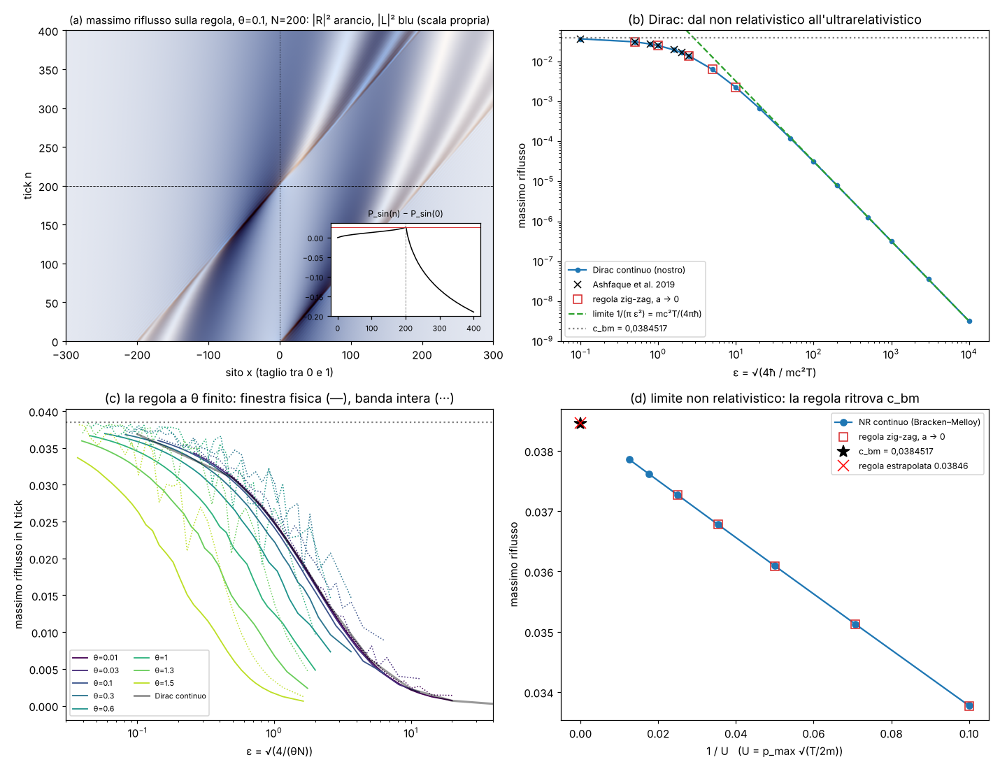

# Riflusso quantistico sulla regola zig-zag

Studio `rifl_` (13 ottobre 2026). File: `lab/rifl_*.py`, risultati `lab/out/rifl_*.json`, figura
`lab/out/rifl_figura.png`. Pre-registrazioni: `lab/out/rifl_prereg.json` (commit d7d6bb6) e
`lab/out/rifl_prereg2.json` (commit 1532227). Emendamenti A1–A10: `lab/out/rifl_emendamenti.json`.

---

## 0. In breve

Il riflusso quantistico (quantum backflow) e' un fenomeno "assurdo ma vero": una particella libera fatta
**solo di onde che vanno a destra** puo', per un po', far **crescere** la probabilita' di trovarla a
sinistra di un punto. Il massimo e' la costante di Bracken–Melloy c_bm = 0,0384517 (nota solo coi numeri).
Per l'elettrone relativistico (Dirac) il massimo dipende da ε = √(4ħ/(mc²T)) ed era noto solo con una
tabella fino a ε = 2,5.

Abbiamo messo il problema sulla nostra regola (corri a c, poi ruota). Sulla regola il flusso attraverso un
taglio e' **esatto** (conta le palline che attraversano il taglio in un tick), quindi il problema e' pulito.

| cosa | numero nostro | riferimento | esito |
|---|---|---|---|
| E0: c_bm dal nostro risolutore NR | 0,0384498 | 0,0384517 | PASS (−1,9·10⁻⁶, soglia 2·10⁻⁶) |
| E1: Dirac continuo vs tabella di Ashfaque et al. 2019 | 7 valori, scarti ≤ 7,4·10⁻⁵ | tabella | PASS (soglia 10⁻³); "stretto" 5·10⁻⁵ FALLITO a ε = 0,5 |
| E2: **la regola** nel limite non relativistico | 0,038457 | 0,0384517 | PASS (+0,014 %) |
| E3: **la regola** → Dirac per a → 0 (ε = 0,5 … 10) | scarti −0,21 % … +0,49 % | nostro Dirac | PASS (soglia 1 %) |
| E4: nucleo = regola vera (`zz_core.Walk`) | 2·10⁻¹⁶ | — | PASS |
| Q1b: Dirac ultrarelativistico c_rbf·πε² → 1 | 1 − 1,7·10⁻⁵ a ε = 10⁴ | previsione 1/π | PASS |
| Q1 (criterio originale: esponente stabile entro 0,05 su ε ∈ [20,100]) | 1,88 vs 1,95 | — | FALLITO (a ε ≤ 100 si e' ancora lontani dal regime asintotico) |

**Le tre cose nuove** (nuove per quanto ho trovato; vedi §6 per i dubbi):

1. **Limite rigoroso dalla velocita' della luce.** Per un elettrone di Dirac con energia e impulso
   positivi, il riflusso in un tempo T non puo' superare **mc²T/(4πħ)**. Il motivo e' semplice: tornano
   indietro solo le palline "L" (quelle che corrono a −c) e la loro quantita' totale negli stati a impulso
   positivo e' fissa, ∫L² dp = m c/2. Sulla regola zig-zag lo stesso limite vale **esattamente**, tick per
   tick, a ogni passo reticolare: la quota di L nella finestra fisica e' θ/(4π) per ogni θ (identita' esatta,
   verificata a 10⁻¹⁶). Nel limite non relativistico (c → ∞) il limite diventa infinito: e' la velocita'
   massima c che rende finito il riflusso istantaneo.
2. **Regime ultrarelativistico di Dirac** (T ≪ ħ/mc², ε grande): il massimo riflusso **satura** quel
   limite, c_rbf → mc²T/(4πħ) = 1/(πε²). Previsto prima delle corse (pre-registrazione 2), poi verificato:
   c_rbf·πε² = 0,9794 (ε = 100), 0,99930 (ε = 1000), 0,999983 (ε = 10⁴). Il fit della letteratura
   c_bm·exp[−(4ε/9)(1−4αε)] non va bene oltre ε ~ 3 (e contiene α, che in una particella libera non c'e').
3. **La regola a passo finito non supera mai c_bm** (in tutto cio' che abbiamo provato: θ da 0,01 a 1,5,
   fino a N = 20 000 tick, finestra fisica e banda intera col "doppione"). La banda intera a θ = 1,5 si
   avvicina a c_bm dal basso come c_bm − 0,55/N. E' diverso dal reticolo tight-binding a tempo continuo,
   dove il massimo arriva a 0,0765 ≈ 2 c_bm (Torres Arvizu et al. 2025). **Congettura** (non dimostrata):
   per la regola zig-zag l'estremo superiore e' c_bm.

In piu': la tabella di Ashfaque et al. a ε = 0,5 e' un po' bassa (0,03088 contro il nostro 0,030954 ± 0,000001,
cioe' 0,24 %); gli altri sei valori tornano entro 2·10⁻⁵.

Parametri liberi: **zero**. Ingressi: c, ħ, la massa (solo dentro θ = mca/ħ).

---



Figura: (a) lo stato di massimo riflusso sulla regola (θ = 0,1, N = 200) che si muove: palline R (arancio) e L
(blu, in scala propria); nel riquadro la probabilita' a sinistra del taglio, che **sale** fino a n = 200
(0,0264) mentre tutto va a destra, poi crolla quando passa il grosso del pacchetto. (b) Il massimo di Dirac
da ε = 0,1 a 10⁴: nostro continuo, tabella della letteratura, la regola per a → 0, e il limite
mc²T/(4πħ) raggiunto per ε grande. (c) La regola a passo finito, contro ε = √(4/(θN)). (d) Il limite
non relativistico: la regola ritrova c_bm.

## 1. Il problema in due righe

Prendi una particella libera fatta **solo** di onde che vanno a destra (impulsi positivi). Ti aspetti
che la probabilita' di trovarla a sinistra di un punto possa solo calare. In meccanica quantistica no:
per un po' di tempo puo' **crescere**. E' il *riflusso quantistico* (quantum backflow, Allcock 1969;
Bracken e Melloy 1994). Il massimo di probabilita' che puo' tornare indietro in un tempo qualsiasi T e'
un numero puro, la costante di Bracken–Melloy **c_bm = 0,0384517** (Penz, Grübl, Kreidl, Wagner,
J. Phys. A 39, 423, 2006), noto solo numericamente: non c'e' una formula chiusa.

## 2. Cosa e' noto (ricerca, ottobre 2026)

| chi | cosa |
|---|---|
| Allcock, Ann. Phys. 53, 311 (1969) | prima osservazione: corrente negativa con impulsi positivi |
| Bracken & Melloy, J. Phys. A 27, 2197 (1994) | il massimo e' un autovalore di un operatore integrale, ~0,04, indipendente da T, m, ħ |
| Penz et al., J. Phys. A 39, 423 (2006) | c_bm = 0,0384517 |
| Eveson, Fewster, Verch, Ann. H. Poincaré 6, 1 (2005) | limiti al flusso istantaneo (illimitato dal basso nel continuo non relativistico) |
| Bostelmann, Cadamuro, Fewster, PRA 96, 012112 (2017) | riflusso e scattering |
| Melloy & Bracken, Found. Phys. 28, 505 (1998) | elettrone di Dirac (energia e impulso positivi): il massimo dipende da ε = √(4ħ/(mc²T)) e cala da c_bm al crescere di ε |
| Su & Chen, Mod. Phys. Lett. A 33, 1850186 (2018) | Dirac spin 1/2 |
| Ashfaque, Lynch, Strange, Phys. Scr. 94, 125107 (2019), arXiv:1903.07618 | tabella c_rbf(ε): 0,03686 (ε=0,1), 0,03088 (0,5), 0,02722 (0,8), 0,02498 (1), 0,01947 (1,6), 0,01660 (2), 0,01372 (2,5); fit c_bm·exp[−(4ε/9)(1−4αε)] |
| Bialynicki-Birula et al., J. Phys. A 55, 255702 (2022) e Commento di Barbier, Fewster, Goussev, Morozov, Srivastava | riflusso nelle equazioni relativistiche; il commento distingue riflusso ondulatorio e riflusso quantistico |
| Paccoia, Panella, Roy, arXiv:2201.12916 (2022) | Dirac su un anello |
| Goussev, Quinque, Joo, Burbanks, PRA 110, 022216 (2024) | anello: limiti ottimali, curva frattale di dimensione 7/4 |
| Torres Arvizu, Ortega, Larralde, arXiv:2511.16867 (2025–26) | **reticolo tight-binding** (tempo continuo): massimo 0,0764734 ≈ 2 c_bm (a ν = τT/ħ ≈ 50); su anello 0,1313 |
| Eliezer, Zacharias, Bahabad, Optica 7, 72 (2020), e altri lavori ottici successivi | solo analoghi ottici; il riflusso della materia non e' mai stato misurato |

Nota: la richiesta citava "Ashfaque, Lynch, Bracken, Melloy 2019"; dalle fonti trovate gli autori del
lavoro del 2019 sono Ashfaque, Lynch e Strange (Bracken e Melloy sono gli autori del lavoro del 1998).

Aperto (prima di questo studio): (1) una forma chiusa di c_bm; (2) per Dirac la curva c_rbf(ε) era solo
una tabella fino a ε = 2,5 e la legge per ε grande non l'ho trovata; (3) nessuno studio trovato sul
riflusso in una **camminata quantistica a tempo discreto** (quantum walk di Dirac), che e' la nostra regola.
Limite della ricerca: ho letto abstract, la tabella di Ashfaque et al. e i riassunti delle pagine arXiv;
non ho potuto leggere per intero Melloy & Bracken 1998 ne' Su & Chen 2018.

## 3. Come si scrive il riflusso nella regola

Nella regola 1-D ogni tick sposta R di un sito a destra e L di uno a sinistra, poi ruota (R, L) di θ.
Quindi la probabilita' che attraversa il taglio tra i siti 0 e 1 in un tick e' **esatta**:
|R(0)|² va a destra, |L(1)|² va a sinistra. Il riflusso in N tick e'

  Δ_N = Σ_{n<N} ( |L_n(1)|² − |R_n(0)|² ).

Gli stati ammessi sono quelli della banda a energia positiva (cos ω = cos θ cos k) con k in una finestra:

- **finestra fisica** k ∈ (0, π/2): dove la regola somiglia a Dirac; per a → 0 contiene tutti gli
  impulsi positivi (p < π/(2a));
- **banda intera** k ∈ (0, π): contiene anche il "doppione" vicino a k = π (artefatto del reticolo).

In tutta la banda la velocita' di gruppo e' positiva, quindi "impulso positivo" e "velocita' positiva"
coincidono. Il massimo di Δ_N e' l'autovalore piu' grande di una matrice:

  K(k,k') = (1/2π) S_N(ω_k − ω_k') [ ū_L(k) u_L(k') e^{−i(k−k')} − ū_R(k) u_R(k') ],  S_N(δ) = Σ_{n<N} e^{iδn},

discretizzata con Gauss–Legendre a pannelli (`lab/rifl_core.py`). Per N grandi si usa la forma
"di Gram" equivalente, una matrice 2N × 2N (`walk_backflow_gram`). Le due forme coincidono a 10⁻¹⁵ e
coincidono con la regola vera fatta girare su un anello (`zz_core.Walk('dirac1')`) a 2·10⁻¹⁶ (E4).

Unita': ħ = c = m = 1. Sulla regola m = θ/a, T = N a, quindi ε = √(4/(θN)).

## 4. Riferimenti di continuo (solo per gli esami, mai ingressi)

- Non relativistico (Bracken–Melloy), con taglio U = p_max √(T/2m): K(u,v) = −sin((u²−v²)/2)/(π(u−v)).
- Dirac 1+1 con la stessa rappresentazione chirale della regola, H = [[p, m],[m, −p]]:
  K(p,p') = sin((E−E')T/2)/(π(E−E')) · (L L' − R R'), con R = √((E+p)/2E), L = m/√(2E(E+p)).

Il massimo cresce col taglio in impulso come λ(P) ≈ λ_∞ − A/P: si estrapola con fit in 1/P
(dispersione tra fit a 2, 3, 4 termini = incertezza dichiarata).

## 5. Risultati: validazione

**E0 – risolutore non relativistico.** λ(U) per U = 10 … 80: 0,033773, 0,035128, 0,036092, 0,036779,
0,037268, 0,037613, 0,037858. Estrapolato a U → ∞: **0,0384498** (dispersione dei fit 3·10⁻⁶) contro
0,0384517. PASS al limite (scarto 1,9·10⁻⁶, soglia 2·10⁻⁶). La convergenza e' lenta (c_bm − λ ≈ 0,047/U):
anche questo e' gia' noto (Penz et al.).

**E1 – Dirac continuo contro la tabella.**

| ε | nostro (estrapolato) | ± | tabella | scarto |
|---|---|---|---|---|
| 0,1 | 0,036874 | 6·10⁻⁵ | 0,03686 | +1,4·10⁻⁵ |
| 0,5 | **0,030954** | 1·10⁻⁶ | 0,03088 | **+7,4·10⁻⁵** |
| 0,8 | 0,027213 | 6·10⁻⁸ | 0,02722 | −7·10⁻⁶ |
| 1,0 | 0,024991 | 8·10⁻⁸ | 0,02498 | +1,1·10⁻⁵ |
| 1,6 | 0,019470 | 1·10⁻⁷ | 0,01947 | 0 |
| 2,0 | 0,016603 | 4·10⁻⁷ | 0,01660 | +3·10⁻⁶ |
| 2,5 | 0,013742 | 4·10⁻⁷ | 0,01372 | +2,2·10⁻⁵ |

PASS (tutti entro 10⁻³). A ε = 0,5 il nostro valore e' sopra la tabella di 7,4·10⁻⁵, piu' di tre volte
l'incertezza che dichiarano (±2 sull'ultima cifra). Gia' col taglio finito P = 125 (che da' un valore piu'
basso del vero) abbiamo 0,030891 > 0,03088. Probabilmente la tabella a ε = 0,5 e' stata calcolata con un
taglio troppo basso. Correzione piccola (0,24 %), ma reale.

**E2 – la regola nel limite non relativistico.** p_max = 0,05 mc, U = 10 … 40, θ = 0,2 … 0,025 (fino a
5·10⁷ tick!), estrapolato a a → 0: a ogni U la regola sta entro 6·10⁻⁵ (relativo) dal continuo NR, e
ancora piu' vicina al Dirac con lo stesso taglio (le piccole differenze sono le correzioni relativistiche
(p/mc)²). Estrapolando in U: **c_regola = 0,038457** contro 0,0384517 (+0,014 %). PASS.

**E3 – la regola → Dirac per a → 0 a ε fisso** (finestra fisica; N raddoppia, θ = 4/(ε²N)):

| ε | regola a θ = più piccolo | regola estrapolata | Dirac | scarto |
|---|---|---|---|---|
| 0,5 | 0,030853 (θ = 0,025) | 0,030957 | 0,030954 | +0,010 % |
| 1 | 0,024807 (θ = 0,025) | 0,024985 | 0,024991 | −0,023 % |
| 2,5 | 0,013500 (θ = 0,02) | 0,013809 | 0,013742 | +0,49 % |
| 5 | 0,006170 (θ = 0,01) | 0,006280 | 0,006293 | −0,21 % |
| 10 | 0,002216 (θ = 0,0025) | 0,002253 | 0,002245 | +0,35 % |

PASS (soglia 1 %). L'avvicinamento e' quasi lineare in a: viene soprattutto dal taglio π/(2a) della
finestra (il massimo cresce come −A/P col taglio), non dalla dispersione del reticolo. Unica eccezione
alla "discesa regolare" degli scarti: a ε = 10 il primo punto (N = 1, θ = 0,04) sta **sopra** Dirac
(0,00232 contro 0,00224): un tick solo, a θ finito, riflette un po' di piu' del continuo.

**E4.** Il nucleo coincide con la regola vera su tre anelli: scarti 1·10⁻¹⁷ … 2·10⁻¹⁶. PASS.

## 6. Le cose nuove

### 6.1 Un limite rigoroso, e sulla regola e' esatto tick per tick

Il flusso verso sinistra in un tick e' al massimo |L_n(1)|². Per uno stato qualsiasi della finestra W,
per Cauchy–Schwarz

  |L_n(1)|² ≤ a(θ, W) = ∫_W |u_L(k)|² dk/2π,

quindi **Δ_N ≤ N · a(θ, W)**. Per la regola c'e' un'identita' esatta (Hellmann–Feynman): la velocita' di
gruppo e' v(k) = dω/dk = |u_R|² − |u_L|², quindi |u_L|² = (1 − v)/2 e

  a = [ (k₂ − k₁) − (ω(k₂) − ω(k₁)) ] / 4π.

Per la finestra fisica ω(π/2) = π/2 e ω(0) = θ: **a = θ/(4π) per ogni θ** (verificato numericamente a
10⁻¹⁶ da θ = 10⁻⁴ a 1,5); per la banda intera a = θ/(2π). Siccome θ = mc²·dt/ħ:

  **Δ ≤ N θ/(4π) = mc²T/(4πħ)**  (finestra fisica, a ogni passo reticolare, a ogni N).

Nel continuo di Dirac vale lo stesso, con lo stesso ragionamento: ∫₀^∞ L² dp = ∫₀^∞ (1 − p/E)/2 dp = m/2,
quindi −j(0,t) ≤ m c²/(4πħ) per unita' di tempo e Δ(T) ≤ mc²T/(4πħ) = 1/(πε²). Per l'elettrone
mc²/(4πħ) = 6,2·10¹⁹ s⁻¹: il limite conta solo per T ≲ 10⁻²¹ s, dove il riflusso e' comunque piccolo.

Controlli: nessuna violazione su tutti i dati della regola (Q2, 8 θ × 31 N × 2 finestre); il continuo di
Dirac sta sotto il limite per ogni ε calcolato (rapporto da 0,001 a ε = 0,1 fino a 0,99998 a ε = 10⁴).

Che cosa vuol dire: nel mondo non relativistico il flusso istantaneo all'indietro puo' essere grande
quanto vuoi (Eveson, Fewster, Verch 2005); con una velocita' massima c no, perche' all'indietro
possono andare solo le palline L, e negli stati a impulso positivo ce n'e' una quantita' fissata dalla
massa. Sulla regola zig-zag questa e' letteralmente la "quota di palline che corrono a −c".

### 6.2 Il regime ultrarelativistico: il limite viene raggiunto

Per T ≪ ħ/mc² il nucleo, per p ≪ 1/T, diventa (T/2π)(|L⟩⟨L| − |R⟩⟨R|), di rango 2; il suo autovalore
positivo tende a (T/2π)·(m/2) = mT/(4π), perche' ∫R² diverge e spegne il termine misto. Previsione
(pre-registrazione 2, scritta prima delle corse a ε ≥ 200): **c_rbf·ε² → 1/π = 0,318310**.

| ε | c_rbf | c_rbf·ε² | δ = 1 − π c_rbf ε² |
|---|---|---|---|
| 2,5 | 1,37419·10⁻² | 0,0859 | 0,73 |
| 10 | 2,24483·10⁻³ | 0,2245 | 0,29 |
| 100 | 3,11749·10⁻⁵ | 0,31175 | 0,021 |
| 200 | 7,89535·10⁻⁶ | 0,31581 | 0,0078 |
| 500 | 1,27065·10⁻⁶ | 0,31766 | 0,0020 |
| 1000 | 3,18087·10⁻⁷ | 0,31809 | 0,00070 |
| 3000 | 3,53634·10⁻⁸ | 0,31827 | 0,00012 |
| 10 000 | 3,18305·10⁻⁹ | 0,318305 | 0,000017 |

δ cala in modo monotono e a ε = 10⁴ e' 1,7·10⁻⁵ (soglia 1 %): **PASS**. Empiricamente δ ≈ 20 ε^{−3/2}
tra ε = 100 e 3000 (non ho una formula per la correzione). In parole: **per tempi molto piu' corti di
ħ/mc², il massimo riflusso di Dirac e' mc²T/(4πħ)** – cresce col tempo in modo lineare, e il suo
coefficiente e' 1/(4π).

La regola nello stesso regime (E3 a ε = 5 e 10, θN = 0,16 e 0,04) ridà Dirac entro 0,35 %.

Il criterio originale di Q1 (esponente stabile entro 0,05 fra ε ∈ [20,50] e [50,100]) e' **FALLITO**
(1,88 contro 1,95): in quella zona la legge di potenza non e' ancora asintotica. Lo dichiaro come
fallimento della prima pre-registrazione; la previsione giusta e' arrivata dopo.

### 6.3 La regola a passo finito (reticolo preso sul serio)

Massimo riflusso Λ(θ, N) per N tick, finestra fisica / banda intera:

| θ | N = 1 | N = 10 | N = 100 | N = 1000 | N = 2000 |
|---|---|---|---|---|---|
| 0,01 | 0,00070 / 0,00141 | 0,00442 / 0,00469 | 0,01649 / 0,01663 | 0,02919 / 0,02924 | 0,03163 / 0,03167 |
| 0,1 | 0,00446 / 0,00892 | 0,01545 / 0,01937 | 0,02869 / 0,03041 | 0,03506 / 0,03536 | 0,03602 / 0,03642 |
| 0,6 | 0,00732 / 0,01464 | 0,02110 / 0,02698 | 0,03206 / 0,03616 | 0,03634 / 0,03786 | 0,03695 / 0,03772 |
| 1,0 | 0,00484 / 0,00967 | 0,01923 / 0,02947 | 0,03089 / 0,03758 | 0,03596 / 0,03810 | 0,03668 / 0,03766 |
| 1,5 | 0,00062 / 0,00125 | 0,00593 / 0,01208 | 0,02064 / 0,03007 | 0,03183 / 0,03534 | 0,03368 / 0,03818 |

N piu' grandi (metodo del nucleo): θ = 1,5 fino a N = 20 000: 0,036907 (fisica), 0,038423 (intera);
θ = 1,3: 0,037325 (N = 10 000, fisica), 0,038010 (N = 5000, intera); θ = 1,0: 0,037326 (N = 5000, fisica).

- Con un tick solo (N = 1) il riflusso e' finito; per θ → 0 Λ₁ → θ/(4π) (rapporto 0,996 a θ = 10⁻⁴):
  un tick satura il limite del §6.1. La banda intera a N = 1 e' esattamente il doppio della fisica
  (simmetria k → π − k).
- Per N grande la finestra fisica sale lentamente verso c_bm dal basso, come nel continuo con taglio.
- La banda intera oscilla con N (periodo 2π/(π − 2θ) tick: e' l'interferenza tra il fondo della banda,
  k ≈ 0, e il doppione, k ≈ π). Scansione fitta (emendamento A10) a θ = 1,5: il massimo su un periodo vale
  c_bm − 5,3·10⁻⁴ (N ≈ 1000), − 2,7·10⁻⁴ (2000), − 1,1·10⁻⁴ (5000), − 5,8·10⁻⁵ (10 000): cioe'
  − 2,8·10⁻⁵ (20 000): cioe' **≈ c_bm − 0,55/N, sempre sotto**. A θ = 1,3 (periodo 11,6 tick):
  c_bm − 1,4·10⁻⁴ (N ≈ 1000), − 8,8·10⁻⁵ (2000), − 3,9·10⁻⁵ (4000), cioe' ≈ c_bm − 0,16/N.
- Il doppione si spegne per a → 0 a ε fisso (Q3, previsione "si'" con 50 %): differenza intera − fisica
  a ε = 0,5: 0,0038 → 0,0030 → 0,0018 → 0,00078 → 0,00026 (θ = 0,4 → 0,025). Confermato.

Massimo trovato in tutto: **0,038423** (banda intera, θ = 1,5, N = 20 000) e 0,036951 (finestra fisica,
θ = 0,6, N = 2000; a N piu' grandi e θ grandi si arriva a 0,03733). Nessuno sopra c_bm. Le previsioni
pre-registrate: "fisica ≤ c_bm" (60 %) confermata; "intera > c_bm per qualche θ, N" (70 %) **sbagliata**.

## 7. Validazione, scoperta, limite

- **Validazione:** c_bm dal nostro codice (E0); Dirac contro la letteratura (E1); la regola ritrova
  c_bm (E2) e la curva di Dirac (E3). Sono numeri noti ritrovati, niente di piu'.
- **Probabile scoperta (piccola, da far controllare):** il limite rigoroso Δ ≤ mc²T/(4πħ) per Dirac a
  energia e impulso positivi, e il fatto che il massimo lo satura per T ≪ ħ/mc² (c_rbf → 1/(πε²)).
  La dimostrazione e' di tre righe: e' possibile che sia gia' scritta da qualche parte (non nei lavori che
  ho potuto leggere). L'identita' esatta a = θ/(4π) sulla regola e' una proprieta' del nostro modello.
- **Correzione minore:** la tabella di Ashfaque et al. 2019 a ε = 0,5 (0,03088 → 0,030954).
- **Proprieta' del modello (non fisica):** sulla regola a passo finito il riflusso non supera c_bm in
  nessun caso provato, a differenza del tight-binding (2 c_bm). E' una congettura sostenuta dai numeri,
  non dimostrata; vale per il reticolo, non dice niente sulla natura (per a → 0 si torna a Dirac).
- **Limiti:** (1) N ≤ 20 000 e θ ≥ 0,01 per la regola a passo finito: l'estremo superiore vero non e'
  dimostrato; (2) la regola non dice niente di nuovo su c_bm stesso: non abbiamo trovato una forma
  chiusa (resta aperto); (3) tutto e' in 1+1 dimensioni; (4) il bonus sugli stati legati non e' stato fatto:
  in uno stato legato (per esempio 1s+2s) la corrente radiale cambia segno per banale oscillazione, e
  manca l'analogo di "solo impulsi positivi", quindi non e' un problema di riflusso ben posto.

## 8. Debiti (cose messe a mano)

- La **finestra** in k (fisica k < π/2, oppure banda intera) e la definizione di "impulso positivo" sul
  reticolo come k ∈ (0, π) (velocita' di gruppo positiva): sono scelte, non escono dalla regola.
- La posizione del **taglio** su un legame (0|1): sul reticolo il punto "x = 0" non e' unico (ma per
  traslazione non cambia niente).
- Il **tempo discreto**: N intero; per ε fissato a → 0 si usa θ = 4/(ε²N) con N che raddoppia (A1).
- I riferimenti di continuo (NR e Dirac) sono scritti a mano: servono solo come esame.
- L'estrapolazione in taglio (fit in 1/P) e in a (polinomio in θ): scelte numeriche, dichiarate con la
  loro dispersione.

## 9. Errori miei durante lo studio (tutti dichiarati negli emendamenti)

- A3: prima corsa E1 con griglia troppo rada (cosc = 12): scarti 10⁻³; rifatta.
- A6: griglia adattiva che guardava il ritmo di fase al bordo sinistro del pannello: primo pannello troppo
  lungo; visto in E2 a U = 40 (0,0320 invece di 0,0373); corretta e tutto rifatto.
- Prima corsa Q1 con taglio troppo basso (P ≤ 1000 ≪ 1/T): numeri sbagliati (c·ε² → 0,30), conservati in
  `rifl_r3.json` come "Q1_vecchio_taglio_basso".
- A7: il risolutore iterativo (Lanczos) ha dato un autovalore negativo a ε = 10⁴: sostituito ovunque da
  diagonalizzazione densa; tutte le corse rifatte (i numeri precedenti erano giusti salvo quel punto).
- A8: cancellazione numerica nella componente piccola di Dirac a p ≫ m; A9: griglia della regola poco fine
  vicino a k = 0 per N e θ piccoli (cambi ≤ 2·10⁻⁷ sui dati).

## 10. Come rifare

```bash
python lab/rifl_prereg.py; python lab/rifl_prereg2.py; python lab/rifl_emendamenti.py
./lab/rifl_run_r1.sh      # E1 (7 eps), E0, E4         ~5 min
./lab/rifl_run_r2.sh      # E2, E3                      ~3 min
./lab/rifl_run_r4.sh      # Q1 (11 eps), Q1sum, Q2long  ~30 min
./lab/rifl_run_r3.sh      # (Q2 completo: N fino a 2000, ~2,5 ore; poi rifl_r3.py Q2redo per A9)
./lab/rifl_run_r6.sh      # rifacimenti dell'emendamento A9 (E2, E3, Q2 N<=400, r5)
./lab/rifl_run_r7.sh      # Q2osc (scansione fitta in N)  ~40 min
python lab/rifl_figura.py
```
Ogni pezzo dura meno di 10 minuti su un core (OMP_NUM_THREADS=1), memoria < 2 GB.
