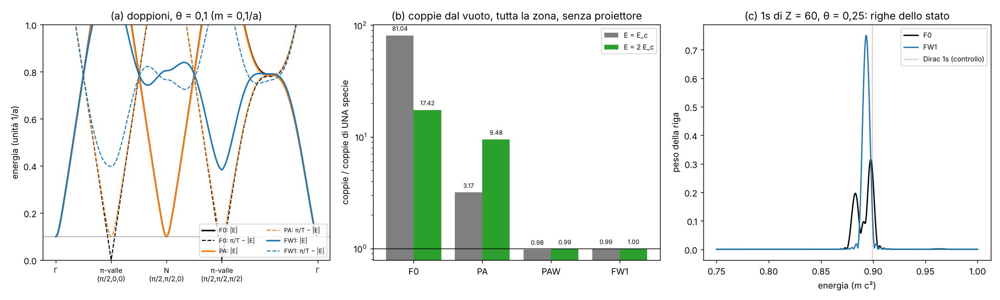

# Una regola zig-zag senza doppioni?

Studio `senzadoppi_`. Domanda: la regola a cubo (corri a c lungo un asse alla volta, poi ruota) ha 4 copie
dell'elettrone (valli) e 4 coni **senza massa** a quasi-energia π. Da lì vengono il battimento dell'1s, le coppie ×23,
il proiettore della polarizzazione del vuoto. Esiste una regola dello stesso stile, locale e unitaria, senza doppioni o
con doppioni innocui? Quale ipotesi del teorema dei doppioni bisogna rompere, e quanto costa?

**La regola congelata (`lab/zz_core.py`) non è stata toccata.** Tutto quello che segue è una **PROPOSTA** per
Valerio, con i numeri.

File: strumenti `lab/senzadoppi_core.py` (matrici di Bloch), `lab/senzadoppi_real.py` (stessa regola sulle palline,
spazio reale); pre-registrazione `lab/senzadoppi_prereg.py` → `lab/out/senzadoppi_prereg.json` (commit **a4843bb**,
prima di ogni corsa); emendamenti `lab/out/senzadoppi_emendamenti.json` (A1–A4, ognuno scritto prima della corsa che
cambia); corse `lab/senzadoppi_r1.py` … `r7.py` → `lab/out/senzadoppi_r1.json` … `r7.json`; esplorazioni dopo la
pre-registrazione `lab/senzadoppi_x1.py` → `lab/out/senzadoppi_x1.json`; figura `lab/senzadoppi_figure.py` →
`lab/out/senzadoppi_figura.png`.



*(a) Energia più bassa (linea piena: distanza da 0; tratteggio: distanza dal bordo π) lungo un giro che passa per le
valli. Congelata (nero): valle N a energia m (= 0,1) e valli π a distanza **0** dal bordo. Moneta una volta per periodo
(arancio): tutte le valli hanno massa m. FW1 (blu): niente sotto ~0,37/a tranne l'elettrone vero a Γ. (b) Coppie dal
vuoto contate su tutta la zona, senza proiettore, in unità di "una specie". (c) Righe dell'1s di un nucleo Z = 60
(θ = 0,25).*

---

## 0. In breve (per Valerio)

1. **Per il neutrino (senza massa, una sola mano): no, non esiste.** Ho dimostrato e controllato che il "teorema dei
   doppioni" di REGOLA_LOCALE vale molto più in generale: per **qualsiasi** regola fatta di pezzi che dipendono ognuno
   da **una sola direzione** (passi sugli assi, sulle diagonali bcc o fcc, rotazioni sul posto, rotazioni su un
   collegamento), con **qualsiasi** numero di componenti, il numero di avvolgimento W₃ è zero (24 regole a caso: tutte
   < 2·10⁻¹⁰; controllo positivo: 1,0000). Quindi un cono a Γ ha sempre un gemello di mano opposta. Gli "automi di Weyl
   senza doppioni" sul bcc **non** sono senza doppioni: la regola a un tick **è** l'automa di D'Ariano–Perinotti, e ha
   un gemello nel punto P = (π/2, π/2, π/2) (verificato).
2. **Per l'elettrone (con massa): sì, e il prezzo è piccolo.** La regola che propongo, **FW1**, è la regola
   congelata **più un solo pezzo**: una volta ogni due tick, attorno alla moneta di massa, le palline L in x e R in
   x ± 2 celle si scambiano un pochino di colore (il "Wilson ritorto" di REGOLA_LOCALE, h = 0,4). Risultato a θ = 0,1:
   - **niente sotto 0,37/a** tranne l'elettrone vero, sia vicino a energia 0 (le 3 valli N) sia vicino al bordo π (le 4
     valli π, che nella congelata erano **senza massa**);
   - massa a riposo **esatta**, massa cinetica **identica** alla congelata (differenza 2·10⁻⁸), luce del reticolo **più
     isotropa** (1,05 % a 24 celle/λ contro 1,54 %);
   - coppie dal vuoto contate su **tutta** la zona, **senza proiettore**: **0,994** e **0,995** volte una specie
     (E = E_c e 2 E_c). La congelata dà **81** e **17**.
3. **Perché nessuno ci era riuscito prima (REGOLA_LOCALE fase 3–4):** alle valli π il passo di un tick fa da "segno di
   chiralità", quindi ogni termine che mescola L e R (la massa, il Wilson) **cambia segno da un tick all'altro e si
   cancella** se lo metti uguale in tutti e due i tick. Ho controllato tutte le 120 classi di ordini degli assi per L e
   R: nessuna dà massa alle valli π. La cura è metterlo **una volta sola per periodo**. La fase 4 aveva provato un Wilson
   "alternato" ma con i collegamenti da una parte sola (+2e_j in un tick, −2e_j nell'altro): quello ha un pezzo lineare
   in k e rovina l'elettrone (−24 %). Con **tutti e 6** i collegamenti ±2e_j nello stesso tick il termine va come k²
   vicino a Γ e l'elettrone non se ne accorge. **L'ipotesi di ostacolo della fase 4 è smentita.**
4. **I prezzi, detti chiari:**
   - **inversione del tempo rotta** (come ogni Wilson ritorto): coppie di Kramers spaccate di 5·10⁻² con un potenziale
     a caso. Sull'1s di Z = 60 a θ = 0,25 lo split di spin resta sotto la risoluzione (8·10⁻³ m);
   - simmetria chirale rotta (come Wilson in QCD: è il modo standard per avere una specie sola);
   - onde corte con velocità di fase fino a **1,005 c** a 24 celle/λ (la velocità di gruppo resta ≤ 0,945 c);
   - raggio 2 celle, **1 manopola h** (regolatore senza fisica dentro), ~**2,8×** il tempo per periodo nel mio codice
     numpy (ottimizzabile);
   - a θ = 0,5 (il reticolo grosso del Laboratorio) l'1s col nucleo Z = 60 **non** è ancora una riga sola (due righe,
     0,884 e 0,872, entrambe nella valle vera: non sono doppioni, causa non trovata); a θ = 0,25 sì: **una riga, 97 %
     nella valle vera**, mentre la congelata dà 3 righe al 70–89 % nei gemelli.
5. **L'automa bcc "a un tick" e le altre strade:** ordine fisso degli assi (D'Ariano–Perinotti) = doppione **senza
   massa** a energia 0 (peggio della congelata); L con ordine rovesciato = tutte le valli con massa m, ma isotropia del
   **primo** ordine (5,6 % a 24 celle/λ, velocità di fase fino a 1,056 c): bocciata. Moneta una volta per periodo senza
   Wilson (PA) = valli π con massa m, ma massa cinetica 4 volte peggio (4θ²/3). Reticoli casuali (Christ–Friedberg–Lee)
   e staggered: discussi, non provati (§2).

Tabellone pre-registrato: **E1 PASS, E2 PASS (4/4), E3 PASS, E4: PAW PROPOSTA forte (8/8), B2W bocciata (5/8),
E5 PASS, E6 PAW PASS (dopo l'emendamento A4), E7 PAW FAIL**. Emendamento A3 (FW1, scritto prima delle sue corse):
**C1–C4, C6–C8 PASS, C5 FAIL alla lettera** (lo stesso FAIL della congelata, errore della mia misura, §5.3), **E5 come
previsto, E6 PASS, E7 FAIL alla lettera** (soglia mal posta: a θ = 0,25 una riga sola al 97 % nella valle vera).

---

## 1. Il problema in parole semplici

Nella regola congelata ogni pallina fa un passo lungo x, poi y, poi z (e all'indietro nei tick dispari), con lo spin che
decide avanti o indietro; poi la moneta di massa mescola L e R. Guardata ogni due tick, nello spazio dei momenti la
regola ha **più punti dove "nasce" un elettrone a bassa energia** di quanti ne voglia la natura:

- 8 **copie esatte** (8 sotto-reticoli che non si parlano): innocue, basta tenerne uno (REGOLA_LOCALE §2);
- dentro ogni copia, **4 valli a energia 0** con massa m: l'elettrone vero (Γ) più 3 gemelli (N). Un nucleo puntiforme
  sullo spigolo li mescola → l'1s si apre in 4 livelli → il battimento (BATTIMENTO_1S);
- e **4 valli a quasi-energia π senza massa**: in un campo fanno coppie senza la soppressione exp(−π m²/E) → le
  "coppie ×23" (VUOTO_POLARIZZA, REGOLA_LOCALE §12).

Il "proiettore" e "il nucleo che parte a k = 0" sono toppe: scelgono a mano la valle giusta. La domanda è se si può
cambiare la regola (restando "corri a c, poi ruota") in modo che i gemelli non ci siano o pesino ~1/a.

---

## 2. Cosa si sa (letteratura)

Ho potuto cercare in rete per una parte delle fonti; le altre sono dalla mia conoscenza e lo segno.

- **Nielsen–Ninomiya (1981)**: un hamiltoniano su reticolo, locale, invariante per traslazioni, con simmetria chirale,
  ha tanti fermioni di Weyl destri quanti sinistri. È per il **tempo continuo**.
- **Tempo discreto (Floquet).** Bessho e Sato, *PRL 127, 196404 (2021)* (arXiv 2006.04204, letto): nei sistemi
  periodici nel tempo la somma delle chiralità dei coni a quasi-energia 0 è uguale a quella a quasi-energia π ed è uguale
  al numero di avvolgimento W₃ dell'operatore di un periodo U(k) (in 3-D). Se W₃ ≠ 0 si può avere **un** cono a 0,
  pagando con **un** cono a π. Sun, Xiao, Bzdušek, Zhang, Fan, arXiv 1806.09296 ("Three-dimensional chiral lattice
  fermion in Floquet systems", PRL 2018, letto in parte) e Higashikawa, Nakagawa, Ueda (arXiv 1806.06868, "Floquet
  chiral magnetic effect", PRL 2019, rivista non verificata) costruiscono modelli con W₃ ≠ 0, ma con evoluzioni
  hamiltoniane continue (pompaggio adiabatico), **non** come prodotto finito di passi esatti; il W₃ del sistema intero
  lì è compensato dalle bande alte. **Kitagawa, Rudner et al.** (Floquet anomali, 2010–2013, dalla mia conoscenza):
  stessa idea in 2-D.
- **Automi cellulari quantistici (QCA).** D'Ariano e Perinotti, *PRA 90, 062106 (2014)*, e Bisio, D'Ariano, Tosini
  (2015): l'automa di Weyl isotropo e unico sul **bcc**, cos ω = c_x c_y c_z ∓ s_x s_y s_z. REGOLA_LOCALE aveva già
  notato che il nostro tick singolo **è** quell'automa. Bakircioglu, Arnault, Arrighi, *arXiv 2505.07900 (2025)*
  ("Fermion doubling in quantum cellular automata", letto il riassunto): **i QCA soffrono del raddoppio**, meno degli
  hamiltoniani; propongono di chiamare "sapori" i sotto-reticoli (che è quello che fa la nostra scelta di una copia).
- **Gross–Nesme–Vogts–Werner (2012)**: l'indice di un automa 1-D (lo spostamento puro ha indice ≠ 0: un fermione
  chirale solo, senza gemello). È il motivo per cui in 1-D la regola a un tick ha "1 + 1" valle (Γ e π) e nessun
  gemello a energia 0. In 3-D l'analogo per i passeggi è W₃.
- **Fermioni staggered (Kogut–Susskind 1975)**: in 4-D riducono 16 copie a 4 "gusti". Da noi la diagonalizzazione
  dello spin è già avvenuta: le 8 copie del §1 sono esattamente quella riduzione (REGOLA_LOCALE §2).
- **Minimamente doppiati (Karsten 1981, Wilczek 1987; Boriçi 2008, Creutz 2008)**: un termine alla Wilson con una
  matrice di "tempo" lascia solo **2** specie: quella vera e il **gemello nel tempo** (k₄ = π), rompendo la simmetria
  ipercubica. Le nostre valli π sono proprio i gemelli nel tempo, e il Wilson ritorto per tick di REGOLA_LOCALE è un
  parente del termine di Karsten–Wilczek: per questo lasciava le valli π.
- **Wilson (1974), twisted mass (Frezzotti–Rossi 2004)**: una specie sola, simmetria chirale rotta da un termine che
  va a zero col passo. È la strada standard e quella che seguo.
- **Reticoli casuali (Christ, Friedberg, Lee, Nucl. Phys. B 202, 89 (1982))**: niente doppioni perché non c'è una zona
  di Brillouin. Ma "corri a c lungo un asse" non ha senso su un reticolo casuale (i passi non sono tutti lunghi uguali
  e lungo direzioni fisse): bisognerebbe risolvere un sistema lineare a ogni passo (non è più un automa locale e
  unitario esatto) e l'isotropia si paga con un rumore di reticolo. **Non provato**: viola "una sola strada".

**Cosa è aperto:** non conosco (e non ho trovato) un esempio di passeggio **a raggio finito** in 3-D con W₃ ≠ 0. Il
legame col teorema di Dubail–Read (proiettori a raggio finito hanno numero di Chern zero) fa pensare che non esista, ma
non è dimostrato.

---

## 3. Il teorema, più generale (E1)

**Enunciato.** Sia U(k) l'operatore di un periodo di una regola invariante per traslazioni, prodotto di fattori ognuno
dei quali dipende da k solo attraverso **una** combinazione k·v (v intero): passo "corri a c" lungo v, rotazione su un
collegamento lungo v, rotazione sul posto (nessuna dipendenza). Allora, per **qualsiasi numero di componenti**,

W₃ = (1/24π²) ∫ tr(U⁻¹dU)³ = 0.

**Perché (come a un ventenne).** W₃ conta quante volte la mappa k → U(k) "avvolge" lo spazio delle matrici in 3
direzioni insieme. Un fattore che dipende da una sola direzione è una "corda" che si muove in una direzione sola: non può
avvolgere niente in 3-D (la forma tr(U⁻¹dU)³ di un tale fattore è identicamente zero). E W₃ di un prodotto è la somma
dei W₃ dei fattori (il pezzo misto è una derivata totale e si integra a zero sul toro). Quindi la somma è zero.

**Conseguenza.** Per la parte di Weyl (2 componenti, senza massa) W₃ è anche la somma delle chiralità dei coni a
energia 0 (e a π). Con W₃ = 0, un cono a Γ ha **per forza** un gemello di chiralità opposta a energia 0. Per il neutrino
non c'è via d'uscita in questa classe di regole.

**Verifica** (`senzadoppi_r1.json`, E1): 12 regole casuali a 2 componenti e 12 a 4 componenti (passi su assi, diagonali
bcc, diagonali di faccia, passi lunghi 2, rotazioni su collegamenti, monete casuali): **max |W₃| = 1,9·10⁻¹⁰**.
Controllo positivo (mappa non locale (sin k, M − Σ cos k) normalizzata): M = 2 → **−1,0000**, M = 4 → **0**. Tutte le
regole di questo studio (F0, B1, B2, PA, PAW, B2W, sia la parte R sia 4×4): |W₃| ≤ 5·10⁻¹¹. **E1 PASS.**

**Quale ipotesi rompere.** (i) "Fattori a una direzione": servirebbe un passo che dipende da k in modo veramente 3-D
(per esempio "lo spin decide la direzione": la componente con spin su lungo n va lungo n, per ogni n). Nel continuo è
l'evoluzione esatta di Weyl, e sul reticolo non è un polinomio in e^{ik} (contiene |k|): non è un automa a raggio finito.
(ii) "Massa zero": se c'è una massa, il teorema non vieta niente. È la strada del §5.

---

## 4. Censimento: chi ha doppioni, dove, con che massa (E2, E3)

Per ogni regola: copie esatte, nodi di Weyl della parte R per copia (θ = 0), valli dell'elettrone (θ = 0,1):
E0 = energia più bassa fuori da una palla di raggio 0,45 attorno a Γ e alle sue copie, Eπ = distanza minima dal bordo
π/T. Tutti i numeri in unità 1/a.

| regola | che cos'è | copie | nodi a 0 / a π per copia | E0 | Eπ | isotropia 24 celle/λ |
|---|---|---|---|---|---|---|
| F0 | congelata (xyz, zyx; moneta ogni tick) | 8 | 4 / 4 | **0,100** (= m) | **0** | 1,54 % |
| B1 | un tick, ordine fisso (= automa bcc di D'Ariano–Perinotti) | 4 | 2 / 2 | **0** | **0** | 5,57 % |
| B2 | un tick, L con ordine rovesciato (U_L = U_R†) | 4 | 2 / 2 | 0,100 | 0,100 | 5,57 % |
| PA | congelata ma UNA moneta 2θ per periodo | 8 | 4 / 4 | 0,100 | 0,100 | 1,54 % |

Tutte le previsioni pre-registrate entro 10⁻⁶ (**E2 PASS 4/4**, dopo l'emendamento A1 che ha corretto il cercatore di
nodi, non le soglie). Le chiralità sommano a 0 a energia 0 e a π in tutti i casi.

**B1 (l'automa bcc) è peggio della congelata.** Nel punto P la parte R è a energia 0 ma la parte L è a energia π: la
moneta di massa non le può accoppiare (non sono alla stessa energia), quindi il gemello resta **senza massa a energia 0**.
Con un nucleo, un 1s potrebbe decadere in quel gemello.

**E3: ricerca su tutti gli ordini.** I 6⁴ = 1296 periodi di due tick con ordini liberi per L e R (moneta a ogni tick)
si riducono a 120 classi (rietichettando gli assi e scambiando i tick). Risultato: **109 hanno un gemello senza massa a
energia 0**, 11 hanno E0 = m (come la congelata), **nessuna** ha E0 > m, **nessuna** dà massa alle valli π
(Eπ = 0 per tutte le 120). Il miglior ordine per l'isotropia è xyz|xyz poi xzy|xzy (1,16 %), ma ha le valli π senza
massa. **E3 PASS** (previsione confermata).

**Perché le valli π restano senza massa con una moneta a ogni tick.** A quei momenti il passo di un tick agisce come il
segno della chiralità (L → −L, R → +R, a meno di una fase comune). Un termine che mescola L e R (la massa, il Wilson)
anticommuta con quel segno: nel tick dopo si presenta col segno cambiato e i due si cancellano. Ecco perché: (a) la
congelata ha le valli π senza massa; (b) il Wilson ritorto messo in ogni tick non le tocca (REGOLA_LOCALE §12);
(c) anche un Wilson messo una volta per periodo ma **diviso a metà su due tick diversi** non le tocca (esplorazione,
Eπ = 0 per h = 0,3–1,0). Serve un termine **che agisca in un solo tick del periodo**.

---

## 5. Le cure (E4–E7)

### 5.1 PA: la moneta una volta per periodo

Moneta di angolo 2θ dopo il secondo tick invece di θ dopo ognuno. Le valli π prendono massa m (Eπ = 0,100), la massa a
riposo resta esatta. Ma la massa cinetica sbaglia di **4θ²/3** invece di θ²/3 (misura corretta, §5.3: 1,356·10⁻² contro
3,353·10⁻³ a θ = 0,1, ordine 2,00): è la "moneta che respira" di VUOTO_POLARIZZA con μ = θ, cioè la congelata con il
passo della massa raddoppiato. Per la stessa precisione serve θ dimezzato: 2× le celle per asse, **8× il costo** in 3-D.
E i gemelli hanno comunque massa m: il battimento resta (r4, θ = 0,5: righe 0,870 / 0,887 / 0,935 / 0,746, nessuna sopra
il 33 %), coppie R = 3,2 / 9,5.

### 5.2 PAW e B2W (pre-registrati)

- **PAW** = PA + Wilson ritorto (h = 0,3, collegamenti ±2e_j) attorno alla moneta: E0 0,440 / 0,432, Eπ 0,314 / 0,301
  (θ = 0,1 / 0,02), isotropia 1,27 %, velocità di gruppo massima 0,933 c, **C1–C8 tutti PASS: "proposta forte" secondo la
  regola scritta**. Ma eredita da PA la massa cinetica 4θ²/3 (passa C5 solo perché la soglia era 2·10⁻²) e a θ = 0,5
  la massa cinetica sbaglia del **56 %**: l'1s di Z = 60 sul reticolo del Laboratorio non viene (r4: righe 0,914 / 0,807
  / 0,800 con pesi 0,25 / 0,12 / 0,10; **E7 FAIL**).
- **B2W** = B2 + Wilson ritorto sugli 8 collegamenti bcc (h = 0,3): gemelli a 0,43 e a **1,19** dal bordo π (il migliore
  per i doppioni), ma isotropia del **primo ordine** (5,6 % a 24 celle/λ, velocità di fase fino a 1,056 c, di gruppo
  1,25 c) e massa cinetica anisotropa: C4, C5, C6 FAIL. Bocciata: è il prezzo di non alternare l'ordine degli assi.

### 5.3 FW1: la congelata più un solo Wilson per periodo (emendamento A3)

Trovata dopo la pre-registrazione, mentre capivo perché PA e PAW pagano sulla massa cinetica. Pre-registrata
nell'emendamento A3 **prima** delle sue corse, con h = 0,4 fissato senza averne visto i numeri (con h = 0,3 si era
visto Eπ = 0,298, sulla soglia: lo dichiaro).

**La regola.** Tick pari: passi x, y, z; poi metà Wilson, moneta θ, metà Wilson. Tick dispari: passi z, y, x; moneta θ.
Il "Wilson" = per ognuno dei 6 collegamenti v = ±2e_x, ±2e_y, ±2e_z, la parte L in x e la parte R in x + v ruotano
l'una nell'altra di h/4 attorno all'asse Y di chiralità, e poi si toglie la stessa rotazione sul posto (così a k = 0 è
esattamente l'identità). Al primo ordine in k vale −h Σ_j (1 − cos 2k_j)·Y: zero a Γ, grande ai gemelli.

| esame (A3, stesse soglie di E4) | θ = 0,1 | θ = 0,02 | congelata | esito |
|---|---|---|---|---|
| C1 gemelli a energia 0 (≥ 0,3) | **0,382** | **0,371** | 0,100 / 0,020 | PASS |
| C2 gemelli vicino a π (≥ 0,3) | **0,398** | **0,400** | 0 / 0 | PASS |
| C3 massa a riposo | 0 | 1·10⁻¹⁵ | esatta | PASS |
| C4 isotropia a 24 celle/λ (≤ 1,70 %) | **1,05 %** | | 1,54 % | PASS |
| C5 massa cinetica (≤ 2·10⁻², rapporto ≥ 15) | 3,372·10⁻³ | 2,334·10⁻⁴ (rapporto 14,45) | identica (diff. 2·10⁻⁸) | **FAIL alla lettera** |
| C6 velocità di gruppo massima (≤ c) | 0,945 c | | 0,969 c | PASS |
| C7 unitarietà, 50 periodi con potenziale | 5,9·10⁻¹⁴ | | 7·10⁻¹⁴ | PASS |
| C8 Bloch = palline | 1,3·10⁻¹⁵ | | 1,2·10⁻¹⁵ | PASS |
| a θ = 0,5 (Laboratorio) | E0 0,587, Eπ 0,347 | | 0,5 / 0 | — |

**C5.** Il rapporto 14,45 è **identico** a quello della congelata: la mia misura (differenza finita con dk = θ/50)
contiene il termine relativistico k⁴/8m³, che aggiunge +1·10⁻⁴ a ogni θ. Rifatta senza quel termine (esplorazione x1,
dichiarata): F0 3,353·10⁻³ / 8,36·10⁻⁴ / 1,336·10⁻⁴ per θ = 0,1 / 0,05 / 0,02 (esattamente θ²/3, ordine 2,00), FW1
**uguale a 4 cifre**. Il FAIL resta nel tabellone; non è un difetto di FW1.

**Scelta di h** (esplorazione x1, dopo): Eπ = 0,199 / 0,398 / 0,369 / 0,029 per h = 0,2 / 0,4 / 0,6 / 0,8; E0 = 0,41 /
0,38 / 0,24 / 0,46. h = 0,4 sta vicino al meglio per caso. Con h = 0,3: C2 FAIL per 0,002 (0,298).

**Inversione del tempo (E5).** Kramers con potenziale a caso (6³, θ = 0,37): congelata 8·10⁻¹⁵, PA 9·10⁻¹⁵ (la moneta
una volta per periodo la rispetta), **PAW 2,1·10⁻², FW1 5,2·10⁻², B2W 2,7·10⁻²**: il Wilson ritorto la rompe, come
previsto (REGOLA_LOCALE §14). **E5 PASS.** Un Wilson lungo l'asse della massa (X) la rispetterebbe meglio ma cambia la
massa cinetica del **9 %** (x1: FW1-X h = 0,4): no.

**Velocità di fase.** Per onde senza massa a 24 celle/λ va da 0,989 a **1,005 c** (congelata ≤ 0,99998 c). La velocità
di gruppo resta sotto c in tutta la zona (0,945). È un precursore piccolo, del tipo già visto con S4 (molto più piccolo:
S4 arrivava a 1,66 c).

### 5.4 Coppie dal vuoto senza proiettore (E6)

Campo uniforme lungo x (nel potenziale vettore: k_x si sposta a ogni tick), θ = 0,1. **Tutti** i modi della zona
partono nelle bande a energia negativa; dopo una spazzata di un periodo delle copie (π) si conta quanta probabilità è
finita nelle bande a energia positiva. Niente proiettore, niente scelta di valle. Diviso per il valore di Schwinger–
Landau–Zener di **una** specie (2 spin × E exp(−π m²/E), per 4 attraversamenti di Γ).

| regola | E = E_c | E = 2 E_c |
|---|---|---|
| congelata F0 | **81,0** | **17,4** |
| PA (moneta per periodo) | 3,17 | 9,48 |
| PAW | 0,980 | 0,988 |
| **FW1** | **0,994** | **0,995** |

**E6 PASS** per PAW e FW1 (|R − 1| ≤ 0,1). La congelata a E_c dà 81 (REGOLA_LOCALE §12 stimava 96 sommando valle per
valle). Controllo di una sola traversata di Γ: P = 0,0673 contro Landau–Zener 0,0672 (tutte le regole).

**Emendamento A4 (dichiarato).** Le prime due versioni di questa conta erano sbagliate di metodo: (1) partivano proprio
su una copia di Γ; (2) spazzavano 2π, cioè facevano passare ogni modo **due volte** dalla stessa valle (k e k + π sono
copie), e le due transizioni interferiscono (Stückelberg); in più a 2 E_c la rampa del campo copriva la valle. Con FW1
la seconda versione dava 0,43 / 0,39: è lì che ho trovato l'errore. La versione giusta (r6) spazza un periodo solo.
Tutti i numeri vecchi sono nel file degli emendamenti.

### 5.5 L'1s di un nucleo Z = 60 (E7)

Nucleo Z = 60 sull'angolo di 8 celle, stato di partenza = 1s di Dirac del continuo (spin su). Si guarda quante "righe"
(livelli della regola) contiene lo stato e, filtrando lo stato a ogni riga, in quale valle sta.

**A θ = 0,5 (pre-registrato, 40³, r4):**

| regola | righe ≥ 2 % (energia: peso) | max p_exc | esito E7 |
|---|---|---|---|
| F0 | 0,8990: 0,40; 0,8861: 0,19; 0,8403: 0,15; 0,9529: 0,03 | 0,9996 | (controllo: il battimento del Laboratorio) |
| PA | 0,870: 0,32; 0,887: 0,13; 0,935: 0,11; 0,746: 0,08; … | 0,9998 | — |
| PAW | 0,914: 0,25; 0,807: 0,12; 0,800: 0,10; 0,861: 0,03 | 0,9999 | **FAIL** |
| FW1 (A3) | 0,8844: 0,38; 0,8719: 0,20; 0,9516: 0,04 | 0,9998 | **FAIL** |

A θ = 0,5 nessuna regola dà una riga sola. Per FW1 ho guardato le due righe (esplorazione x2, dopo): sono **tutte e due
nella valle Γ** (peso nelle valli N ≤ 0,13 %, nelle valli π ≤ 0,6 %) e hanno lo **stesso** spin (⟨σ_z⟩ 0,54 e 0,49):
**non** sono copie di valle e **non** sono il doppietto di spin. Probabilmente il reticolo è troppo grosso vicino al
nucleo (raggio di Bohr 4,6 celle; per PAW conta anche la massa cinetica sbagliata del 56 %). Non spiegato: debito.

**A θ = 0,25 (diagnosi dichiarata in A3, 64³, 3200 periodi, r7):**

| regola | righe ≥ 2 % | contenuto di valle della riga principale | max p_exc |
|---|---|---|---|
| F0 | 0,8977: 0,32; 0,8829: 0,20; 0,8908: 0,10 | Γ 29 %, **N 69 %** (le altre: N 70 % e 89 %) | 0,9998 |
| PAW | **0,8883: 0,80** (più due lobi laterali del filtro a ±0,009, 0,02 ciascuno, stesso stato) | **Γ 96,7 %**, N 5·10⁻⁵, π 2·10⁻⁵ | 0,56 |
| **FW1** | **0,8933: 0,75** (nessun'altra riga ≥ 2 %) | **Γ 97,3 %**, N 1,4·10⁻⁵, π 3,6·10⁻⁵ | 0,74 |

(Dirac del continuo, solo controllo: 0,8991. FW1 −0,65 %, PAW −1,2 % a θ = 0,25.)

**Lettura.** Con FW1 il multipletto delle valli **sparisce**: una riga sola, al 97 % nella valle vera, contro le 3 righe
della congelata che stanno per il 70–89 % nelle valli N. Gli esami scritti però falliscono alla lettera (max p_exc 0,74 >
0,15; peso 0,75 < 0,8): **la soglia era sbagliata**, perché misura quanto lo stato del continuo somiglia all'1s del
reticolo, non se le valli si mescolano. Lo stato del continuo ha solo il 75–80 % di sovrapposizione con l'1s della
regola (anche senza nessun doppione), e il resto (stati vicini, continuo) fa oscillare la sopravvivenza. Lo split di spin
dovuto al Wilson a θ = 0,25 è sotto la risoluzione del filtro (~8·10⁻³ m): una sola riga.

---

## 6. Tabellone

| esame | che cosa | esito |
|---|---|---|
| E1 | W₃ = 0 per prodotti di fattori a una direzione (24 casuali, 2 e 4 componenti) + controllo | **PASS** (1,9·10⁻¹⁰; −1,0000 / 0) |
| E2 | censimento F0, B1, B2, PA | **PASS 4/4** (dopo A1: cercatore di nodi, non soglie) |
| E3 | 120 classi di ordini: nessuna con E0 > m, nessuna con valli π massive | **PASS** |
| E4 PAW | C1–C8 | **8/8 PASS → "proposta forte"** (ma massa cinetica 4θ²/3) |
| E4 B2W | C1–C8 | C4, C5, C6 **FAIL** (isotropia del primo ordine) |
| E5 | Kramers: F0, PA esatti; PAW, FW1, B2W rotti | **PASS** (come previsto) |
| E6 PAW | coppie, tutta la zona | prima versione PASS per caso, metodo sbagliato; **r6 (A4): PASS** 0,980 / 0,988 |
| E7 PAW, θ = 0,5 | 1s Z = 60 | **FAIL** |
| A3: E4 FW1 | C1–C8 | C1–C4, C6–C8 **PASS**; C5 **FAIL alla lettera** (misura; uguale alla congelata) |
| A3: E5 FW1 | Kramers | rotta 5,2·10⁻² (previsto) |
| A3: E6 FW1 | coppie | r5 (metodo sbagliato) 0,43 / 0,39 FAIL; **r6 (A4): PASS** 0,994 / 0,995 |
| A3: E7 FW1 | 1s Z = 60, θ = 0,5 e 0,25 | **FAIL alla lettera** a entrambi (soglia mal posta, §5.5); a θ = 0,25 una sola riga al 97 % in Γ |

Previsioni sbagliate (dichiarate): F0 in E6 prevista 90–100, misurata 81; PA prevista ~8, misurata 3,2 / 9,5; PAW in E7
prevista PASS; FW1 C6 prevista ~1 (è 0,945, meglio).

---

## 7. Validazione, scoperta, limite

- **Validazione:** il censimento della congelata (8 copie, 4 + 4 valli, E0 = m, Eπ = 0) ritrova REGOLA_LOCALE; il
  multipletto dell'1s a θ = 0,5 (0,8990 / 0,8861 / 0,8403) ritrova BATTIMENTO_1S (0,8993 / 0,8863 / 0,8404); la
  traversata singola di Γ ritrova Landau–Zener a 3·10⁻³; il nostro tick singolo è l'automa bcc di D'Ariano–Perinotti
  (come già notato) e ha il gemello P, in accordo con Bakircioglu–Arnault–Arrighi (2025).
- **Scoperta (piccola, nostra, controllata):** (1) il teorema W₃ = 0 vale per qualsiasi numero di componenti e
  qualsiasi reticolo per i prodotti di fattori a una direzione; (2) con una moneta (o un Wilson) uguale a ogni tick le
  valli π non prendono massa per nessun ordine degli assi (120/120); (3) **un solo Wilson ritorto per periodo, con
  tutti i collegamenti ±2e_j nello stesso tick, dà massa ≥ 0,37/a a tutti i gemelli lasciando l'elettrone identico**
  (FW1). È una variante del Wilson/minimamente-doppiato di letteratura applicata al tempo discreto: l'idea "termine che
  rompe la simmetria tra i due tick" è nota nei sistemi Floquet; la forma esatta e i numeri sono nostri.
- **Limite:** per il neutrino senza massa nessuna regola di questa classe toglie i gemelli (teorema). La cura
  dell'elettrone rompe la simmetria chirale e l'inversione del tempo (split di spin, sotto 8·10⁻³ m a θ = 0,25) e ha 1 manopola.

---

## 8. Debiti

- **D-SD1** h = 0,4 è un regolatore scelto a mano (un numero, nessuna fisica dentro; la massa cinetica non lo vede).
- **D-SD2** FW1 rompe l'inversione del tempo: lo split di spin dell'1s va a zero col passo ma c'è.
- **D-SD3** velocità di fase fino a 1,005 c per onde senza massa a 24 celle/λ (non i segnali: gruppo ≤ 0,945 c).
- **D-SD4** il teorema copre solo i fattori a una direzione; che non esista **nessun** automa a raggio finito con
  W₃ ≠ 0 resta una congettura.
- **D-SD5** lo stato iniziale dell'esame E7 è l'1s di Dirac del continuo (formula usata solo come stato di prova, non
  entra nella regola).
- **D-SD7** a θ = 0,5 FW1 dà due righe dell'1s nella stessa valle e con lo stesso spin: non spiegate.
- **D-SD6** C5 misurato con un errore sistematico di +1·10⁻⁴ (dichiarato, rifatto in x1).

**Parametri liberi:** FW1 **1** (h); PAW 1; PA 0. Ingressi fisici invariati: c, ħ, m (via θ), α, Z.

---

## 9. Proposta per Valerio (non applicata)

**Proposta:** adottare FW1 come regola dell'elettrone, cioè aggiungere alla regola congelata un solo pezzo: il Wilson
ritorto (h = 0,4) attorno alla moneta dei tick pari.

| | congelata | FW1 |
|---|---|---|
| gemelli a energia 0 | 3 con massa m | nessuno sotto 0,37/a |
| gemelli a π | 4 **senza massa** | nessuno sotto 0,40/a dal bordo |
| coppie in E_c, tutta la zona | 81 × | **0,99 ×** |
| proiettore del vuoto, 1s scelto a mano | servono | **non servono** (θ = 0,25: una riga, 97 % Γ; a θ = 0,5 ancora due righe) |
| massa a riposo / cinetica | esatta / θ²/3 | identiche |
| isotropia a 24 celle/λ | 1,54 % | 1,05 % |
| inversione del tempo | esatta | **rotta** |
| velocità di fase massima (24 celle/λ) | 0,99998 c | 1,005 c |
| raggio / manopole | 1 cella / 0 | 2 celle / 1 (h) |
| tempo per periodo (mio numpy, 40³) | 1 | ~2,8 (ottimizzabile) |

Da rifare se Valerio dice sì: BATTIMENTO B1–B4 senza scegliere l'1s a mano; VUOTO_POLARIZZA senza proiettore;
SOTTORETICOLO (il Wilson resta sulla stessa copia, raggio 2); `zz_free`, `zz_atom3d`. Porto in Rust: 6 rotazioni di
collegamento per periodo in `src/zigzag/walk.rs` (altro thread). Richiesta di ponte proposta (**non** creata):
`ponte/richieste/senzadoppi_fw1.json` con `{"azione": "test", "nome": "battimento_libero", "regola": "zigzag+fw1",
"h": 0.4}`.

---

## 10. Come rifare tutto

```
OMP_NUM_THREADS=2 python lab/senzadoppi_prereg.py                 # già committata (a4843bb)
OMP_NUM_THREADS=2 timeout 590 python lab/senzadoppi_r1.py         # E1-E3 (~2,5 min)
OMP_NUM_THREADS=2 timeout 590 python lab/senzadoppi_r2.py         # E4-E5 (~30 s)
OMP_NUM_THREADS=2 timeout 590 python lab/senzadoppi_r3.py         # E6 versione superata (A2)
for n in F0 PA PAW FW1; do OMP_NUM_THREADS=2 timeout 590 python lab/senzadoppi_r4.py $n; done; python lab/senzadoppi_r4.py sum
OMP_NUM_THREADS=2 timeout 590 python lab/senzadoppi_r5.py         # FW1 (A3)
OMP_NUM_THREADS=2 timeout 590 python lab/senzadoppi_r6.py         # E6 valido (A4), ~8 min
for n in FW1 F0 PAW; do until OMP_NUM_THREADS=2 timeout 590 python lab/senzadoppi_r7.py $n | grep -q DONE; do :; done; done
python lab/senzadoppi_r7.py sum
OMP_NUM_THREADS=2 timeout 590 python lab/senzadoppi_x2.py      # righe di FW1 a theta = 0,5 (dopo)
OMP_NUM_THREADS=1 python lab/senzadoppi_x1.py                     # esplorazioni dopo
python lab/senzadoppi_figure.py
```
