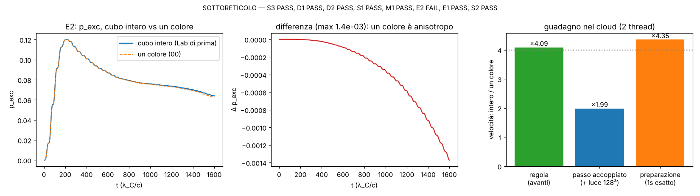

# SOTTORETICOLO: l'atomo dal vivo su un solo "colore" del cubo

Studio `sottoreticolo_`. Codice: `src/atomo/zz.rs` (opzione `colore` di `Atomo`, `Atomo::new_in`, `con_stato_in`,
`colore_lab`), `src/atomo/accoppiato.rs` (`Esperimento::nuovo(ascolto, colore)`), `src/atomo/zzscena.rs` (la scena usa
`zz::colore_lab()`), test in `src/atomo/test_sottoreticolo.rs`. Pre-registrazione: `lab/out/sottoreticolo_prereg.json`
(**commit 3636311, prima dell'esame**). Risultati: `lab/out/sottoreticolo_results.json` (commit 52f88d5).
Figura: `lab/out/sottoreticolo_figure.png` (`lab/sottoreticolo_figure.py`).

## In breve

* **L'idea** (da `NUCLEO_1S.md` §12.1): in un tick la regola sposta ogni ampiezza di una cella in x, una in y e una in z.
  Quindi (i+j) e (j+k) pari/dispari non cambiano mai: il cubo 48³ sono **4 reticoli ("colori") che non si scambiano
  niente**, nemmeno attraverso il nucleo, la luce o la massa (sono tutte cose sulla singola cella). Simularne uno solo
  costa un quarto.
* **Fatto, ed è esatto come algoritmo.** Lo stesso stato su un colore, fatto girare con la luce accoppiata per 3200 tick
  nel modo "un colore" e nel modo "cubo intero": tutte le serie coincidono a **4·10⁻¹⁵** (p_exc, p2p, dipolo, ⟨x⟩, ⟨y⟩,
  sonda, energia della luce, norma, ω₁ₛ), peso fuori dal colore **0** esatto (E1 PASS). Nel test veloce le onde sono
  identiche bit per bit, anche indietro nel tempo, per tutti e 4 i colori, e il cubo intero è la somma dei 4 colori a 9·10⁻³¹.
* **Velocità (cloud, 2 thread, macchina carica):** la regola `avanti` **18,0 → 4,40 ms per tick, ×4,09** (S1 PASS);
  la preparazione dell'1s esatto **64,9 → 14,9 s, ×4,35** (S3 PASS); il passo accoppiato con la scatola di luce 128³
  **32,0 → 16,1 ms, ×1,99** (S2 PASS: la luce non si tocca e pesa ~11 ms per tick atomo). Memoria dell'atomo
  **38 → 9,5 MB** (×4), buffer del filtro dell'1s **177 → 44 MB** (M1 PASS).
* **Ma il Laboratorio non resta uguale (E2 FAIL).** Lo stato di partenza del Lab vive su **tutti e 4 i colori**, un quarto
  ciascuno (1s radiale 0,25/0,25/0,25/0,25; 1s pulito 0,249986/0,249986/0,250014/0,250014; 2p idem). E i 4 colori **non
  si comportano allo stesso modo**: un colore da solo è **anisotropo**. Con il campo lungo z, l'elettrone di un colore si
  muove anche lungo x (5 % di ⟨z⟩) e lungo y (14 %); i 4 colori hanno segni diversi e nella somma si cancellano (cubo
  intero: 6·10⁻⁵ e 2·10⁻⁵). Effetto sul Lab accoppiato: dipolo **0,44 %**, sonda **0,017 %**, energia della luce
  **4·10⁻⁵**, p_exc **1,4·10⁻³** (assoluto, su 0,12). Soglie pre-registrate 10⁻⁶ (5·10⁻³ per p_exc): **FAIL**.
* **Decisione: default SPENTO** (`zz::SOTTORETICOLO = false`). Il Lab gira come prima sul cubo intero. Un colore si
  accende con `--reticolo colore` (o `--stati colore`, che il ponte già accetta) o `ATOMO_RETICOLO=colore`.
* **Dove un colore è esatto e si può usare sempre:** tutto ciò che è statico o di livelli. ω₁ₛ uguale a **10⁻¹⁶**
  (0,8996035891), densità ⟨r⟩ e ⟨r²⟩ uguali a **10⁻¹¹** (D1 PASS): la diagonalizzazione del filtro, gli spettri, i livelli
  vanno 4 volte più veloci senza cambiare un numero.

**Esiti** (pre-registrazione): **PASS** E1, S1, S2, S3, D1, D2, M1 (7); **FAIL** E2 (1).

## 1. Come funziona (gli indici)

Un colore è `Some([cx, cy])` = le celle con (i+j)%2 = cx e (j+k)%2 = cy: un reticolo cubico a corpo centrato (BCC) di
lato 2a, N³/4 = 27 648 celle su 110 592. Il colore del Lab è [0, 0] (i ≡ j ≡ k mod 2): vede il nucleo lungo la diagonale
(1,1,1), celle (23,23,23) e (24,24,24).

* **Indice compatto** (H = N/2): s = (i·H + j/2)·H + k/2. Per tornare a (i, j, k) serve l'**etichetta** del colore in
  quel momento: j = 2·⌊s/H⌋%H + ((i + cx) & 1), k = 2·(s%H) + ((j + cy) & 1).
* **Dentro il tick l'ampiezza cambia colore e poi torna**: dopo lo spostamento in x l'etichetta diventa (cx⊕1, cy),
  dopo y (cx⊕1, cy⊕1), dopo z (cx, cy⊕1). Dopo x, y, z (o z, y, x nei tick dispari) è di nuovo quella di partenza.
  Quindi la rotazione (massa + fase di Coulomb + campo) usa sempre le coordinate dell'etichetta di base.
* **Spostamento lungo l'asse j**: per ogni cella di arrivo s (decodificata con l'etichetta **nuova**) la sorgente è la
  cella a ±1 lungo j, codificata con la formula sopra (la codifica non ha bisogno dell'etichetta: la parità torna da sé).
* **Palline (`nascite`)**: si sceglie una cella con |ψ|² e la si allarga sulla sua cella di Wigner–Seitz del BCC
  (|δx|, |δy|, |δz| ≤ a e |δx|+|δy|+|δz| ≤ 3a/2, volume 4 celle), per rifiuto. Le palline vedono la stessa densità:
  ⟨r²⟩ delle palline meno lo smussamento (19/32 a² per il colore, a²/4 per il cubo) = ⟨r²⟩ dell'onda a **0,44 σ** e
  **0,30 σ** (D2 PASS). La nuvola di un colore è un po' più "morbida" (⟨r⟩ delle palline 3,263 contro 3,248: +0,46 %, è
  solo lo smussamento più largo, dichiarato).
* **`campiona`** (surfisti e colori delle palline): dei 4+4 angoli del cubetto solo 2 (opposti) sono del colore; si usa
  la media trilineare di quei due, rinormalizzata sui loro pesi.

## 2. Che cosa abbiamo trovato: i 4 colori sono i 4 "caratteri" di una simmetria

Esame a campo uguale (post hoc, dichiarato: `sottoreticolo_colori_stesso_campo`). Il campo registrato dalla corsa
accoppiata del cubo intero viene dato, uguale, ai 4 colori separati (ognuno con la sua parte dell'1s). Risposta di
ciascun colore, rinormalizzata (max |⟨·⟩| su 3200 tick):

| colore | ⟨x⟩ | ⟨y⟩ | ⟨z⟩ |
|---|---|---|---|
| 00 | +0,0649 | +0,173 | 1,2150 |
| 01 | −0,0649 | −0,173 | uguale a 00 (2·10⁻¹⁵) |
| 10 | −0,0649 | +0,173 | 00 − 1,4·10⁻⁴ |
| 11 | +0,0649 | −0,173 | uguale a 10 |

I segni sono esattamente le tre "firme" non banali del gruppo a 4 elementi (Z₂ × Z₂): x cambia segno con la parità
di (i+k), y con quella di (j+k), z (la piccola differenza 1,4·10⁻⁴) con quella di (i+j). **Solo la somma dei 4 è isotropa** (risposta solo lungo z).

* **00 ↔ 01 e 10 ↔ 11 sono legati da una simmetria esatta**: la rotazione di 180° attorno all'asse z (i → N−1−i,
  j → N−1−j) cambia la parità di (j+k) e non quella di (i+j); il campo lungo z non cambia, x e y cambiano segno. Lo si
  vede nei numeri: z uguale a 2·10⁻¹⁵, x e y opposti.
* **00 ↔ 10 sono legati da un riflesso in x quasi esatto**: z differisce di 1,4·10⁻⁴. La regola discreta (L e R che si
  muovono in versi opposti, ordine degli assi alternato) non è perfettamente simmetrica per riflessione.
* Perché un colore è storto: vede il nucleo lungo **una** diagonale del cubo (NUCLEO_1S §12.1), quindi il suo atomo non ha
  la simmetria cubica; i 4 colori insieme vedono le 4 diagonali e la ricostruiscono. Lo stato 1s pulito in più ha lo spin
  misto (peso "giù" 0,448 nel colore, uguale nel cubo): l'orientazione dello spin entra nella risposta trasversa.
* **Mezzi reticoli** (due colori su quattro, stesso campo): 00+01 cancella x e y (resti 1·10⁻⁶ e 8·10⁻⁶) ma sbaglia z di
  6,8·10⁻⁵; 00+10 dà z a 1,3·10⁻⁶ ma sbaglia y di 0,17; 00+11 sbaglia x di 0,065. Nessuna coppia è esatta da sola.
* Non è la preparazione: l'1s preparato su un colore e la parte di colore dell'1s del cubo coincidono
  (|⟨·|·⟩|² = 1,000000000000); con la stessa ω₂₁ la differenza resta 4,43·10⁻³ (`sottoreticolo_diagnosi_e2`).

## 3. Esame pre-registrato (numeri)

| esame | soglia | risultato | esito |
|---|---|---|---|
| E1 stesso stato, un colore vs cubo, 3200 tick accoppiati | ≤ 10⁻¹² | p_exc 3,7·10⁻¹⁵, dipolo 3,7·10⁻¹⁶, ⟨x⟩ 1,4·10⁻¹⁴, sonda 0, energia 8·10⁻¹⁵, norma 0, ω₁ₛ 0, fuori colore 0 | **PASS** |
| E2 Lab di prima (cubo) vs Lab a un colore | 10⁻⁶ (p_exc 5·10⁻³) | Δω₁ₛ 1·10⁻¹⁶, Δω₂₁ 8·10⁻⁷ rel; dipolo **4,4·10⁻³**, sonda **1,7·10⁻⁴**, energia **4,4·10⁻⁵**, p_exc 1,4·10⁻³ | **FAIL** |
| D1 densità sui siti ⟨r⟩, ⟨r²⟩ | ≤ 5·10⁻³ | 1,1·10⁻¹¹ (⟨r⟩ = 3,23874 λ_C, ⟨r²⟩ = 14,1024) | PASS |
| D2 palline (400 000) | 5 σ, ⟨r⟩ ≤ 1 % | 0,30 σ / 0,44 σ; ⟨r⟩ +0,46 % | PASS |
| S1 regola `avanti` | ≥ ×3 | 18,00 → 4,40 ms, **×4,09** | PASS |
| S2 passo accoppiato | ≥ ×1,5 | 32,0 → 16,1 ms, **×1,99** | PASS |
| S3 preparazione | ≥ ×2,5 | 64,9 → 14,9 s, **×4,35** | PASS |
| M1 memoria | ×4 | 38,0 → 9,5 MB (filtro 177 → 44 MB; luce 50 MB invariata) | PASS |

(Tempi misurati con altri 2 agenti sulla stessa macchina a 4 core: i ms assoluti ballano, i rapporti sono a blocchi alternati.)

## 4. Cosa resta (debiti e proposte)

* **Debito: un colore da solo non è il Lab.** Lo stato del Lab è la somma dei 4 colori; un colore è un elettrone vero
  della regola ma "storto" (risposta trasversa 5–14 %). Il default resta il cubo intero.
* **Proposta (non fatta): due colori + la rotazione di 180°, ×2 quasi esatto.** Si simulano 00 e 10 (uno per ogni coppia
  legata dalla rotazione esatta attorno a z) e i contributi di 01 e 11 si ottengono ruotando di 180° quelli di 00 e 10
  (x, y → −x, −y; densità ruotata). È esatto finché il campo all'atomo è lungo z; la luce accoppiata ha anche
  E_x, E_y ≈ 3·10⁻⁷ (contro 3·10⁻³), quindi l'errore atteso è ~10⁻⁶ invece di 4·10⁻³. Serve una sua pre-registrazione e
  toccare `nascite`/`campiona` per le immagini ruotate.
* **La luce è ora metà del costo** (11 ms per tick atomo su 16): la regola della luce (spin 1) ha anche una parte ferma
  (autovalore 0), quindi non si divide in colori. Il guadagno vero lì è la GPU (`gpu_regola.rs`) o una scatola più piccola.
* **Uso sicuro subito**: livelli, spettri, `uno_s_esatto`, `livelli_esatti` su un colore sono identici (10⁻¹⁶) e 4 volte
  più veloci: gli studi di livelli (NUCLEO_1S fase 2 lo fa già in Python) possono usare `Atomo::new_in(Some(c))`.

## 5. Nota per la GPU (thread grafico)

Se la regola dell'elettrone va sulla GPU con un colore (per livelli o per il futuro schema a due colori):

* buffer di N³/4 celle (×2 per il ping-pong), indice s = (i·H + j/2)·H + k/2, H = N/2;
* un'etichetta (cx, cy) per dispatch, passata come uniforme: prima del tick è il colore; dopo la dispatch in x
  `cx ^= 1`; in y `cx ^= 1; cy ^= 1`; in z `cy ^= 1`;
* nella dispatch dell'asse j, il thread s decodifica (i, j, k) con l'etichetta **nuova**
  (`j = 2*((s/H)%H) + ((i+cx)&1)`, `k = 2*(s%H) + ((j+cy)&1)`), prende le sorgenti a ±1 lungo l'asse (con il giro
  periodico) e le ricodifica con `(i*H + j/2)*H + k/2`;
* la rotazione (massa, Coulomb, campo) usa le coordinate decodificate con l'etichetta di base (ruota sempre a fine tick);
* le palline: cella scelta con |ψ|², poi uno spostamento uniforme nella cella di Wigner–Seitz del BCC
  (|δ|∞ ≤ a, |δ|₁ ≤ 3a/2).

## 6. Ponte (portatile)

Due foto in coda per misurare i ms/tick sul portatile (prima ~42 ms/tick): `ponte/richieste/2026-10-13_foto_sottoreticolo.json`
(un colore: `"stati": "colore"`) e `ponte/richieste/2026-10-13_foto_sottoreticolo_pieno.json` (cubo intero, stesso commit).
Il numero da leggere è "ms/tick" in `ponte/risultati/<id>/log.txt`. Atteso: guadagno vicino a ×2 (la luce non cambia).

## 7. Regole

Nessun ingresso nuovo, nessuna manopola: la regola è la stessa, cambia solo quali celle si calcolano. Esame scritto prima;
la diagnosi del §2 è post hoc e dichiarata come tale.
