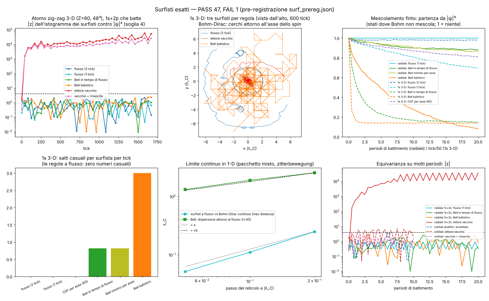
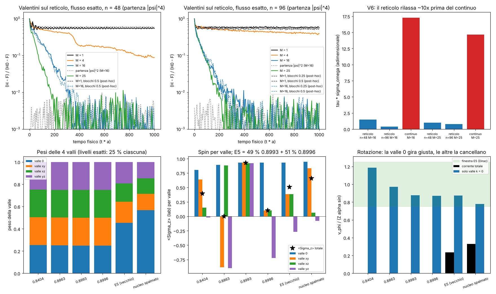
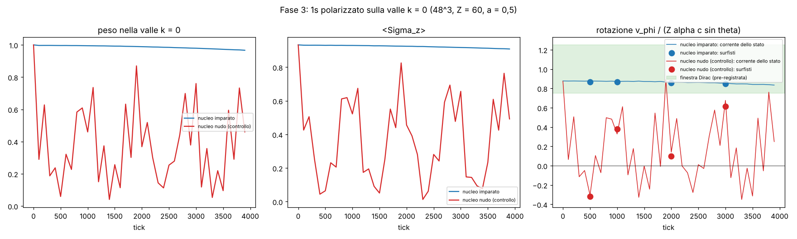
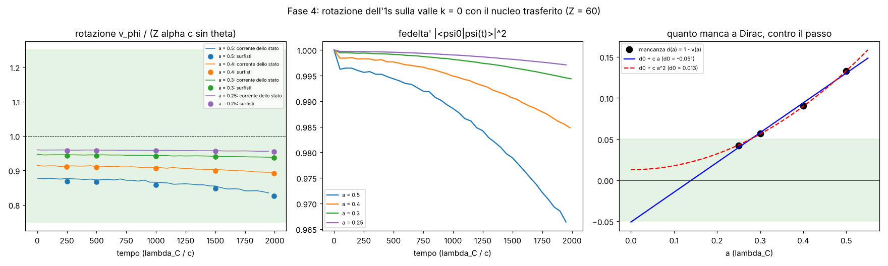

# Surfisti esatti: palline che cavalcano l'onda senza barare

Studio del 13/10/2026. Prefisso `surf_`. Pre-registrazione: `lab/surf_prereg.py` → `lab/out/surf_prereg.json`
(commit 2067d27, prima di ogni corsa di produzione). Emendamenti dichiarati: `lab/out/surf_amend.json`.
Figura: `lab/out/surf_figure.png`. Tabellone: `lab/out/surf_results.json`.

## 0. In breve

**Il debito** (CONTESTO_CLOUD §4, #7): i surfisti (le palline che mostrano "dove sta" l'elettrone) (a) avevano un
lettore impreciso (equivarianza 1,26·10⁻²), (b) non c'era una guida deterministica che conservasse |ψ|²
*esattamente* sul reticolo, (c) il salto a caso creava mescolamento finto.

**La soluzione trovata, in una frase.** La regola zig-zag sposta la probabilità solo attraverso i link, e sa
*esattamente* quanta ne passa da ogni link a ogni tick (la parte che "va avanti" meno quella che "torna indietro").
Usiamo quella corrente esatta come un fiume che scorre tra le celle, e muoviamo ogni surfista *dentro* la cella con
la soluzione analitica di quel fiume (il metodo di Pollock dei geologi che seguono le gocce d'acqua nelle falde,
in "tempo di flusso"). Risultato: **|ψ|² è conservato esattamente, con zero numeri casuali**, e la regola si può
**riavvolgere** esattamente all'indietro.

**I numeri principali** (tutti contro la pre-registrazione):

| cosa | vecchio | nuovo (flusso esatto) |
|---|---|---|
| F6 (1-D, il test che falliva): errore sul "posto in fila" | 1,26·10⁻² (riprodotto: 1,260·10⁻²) | **2,9·10⁻¹⁵** |
| idrogeno 1s (Z=1) fermo, 10⁴ tick: quanto si muove un surfista | lettore vecchio: z = 104 (deriva), Δq 6,8·10⁻² | **Δq 7·10⁻¹⁴, zero salti** |
| atomo 3-D vivo (Z=60, 48³), 1s+2p che batte, 10 periodi: \|z\| massimo | **60 327** (Rust attuale), 28 949 con le rinascite | **2,2** (soglia 4) |
| onda libera 3-D: \|z\| massimo | 24 218 | **2,5** |
| riavvolgimento 20 tick avanti + 20 indietro | non reversibile | **≤ 1,3·10⁻¹² celle** |
| mescolamento finto (partenza sbagliata in uno stato fermo, 1s 3-D) | Bell: H̄ cala all'**15 %** in 1000 tick | **98 %** (flusso a due tick): non mescola |

Esiti: **PASS 47, FAIL 1** (con l'emendamento A3 sul riferimento del TV; senza: 44 PASS, 4 FAIL — §6.2) (dettagli in §4). Il FAIL vero è uno: la velocità di rotazione del surfista
dell'1s nel reticolo 3-D grosso (0,21 invece di ~1 volte Zα c sinθ). Non è colpa della regola dei surfisti: è lo
stato 1s del reticolo a θ = 0,5 che ha lo spin mezzo "sciolto" (⟨Σz⟩ = 0,51 invece di 0,99) — §6.

**Validazione o scoperta?** Validazione e ingegneria. La matematica usata è nota (correnti di Bell 1984,
processo di Vink 1993, tracciamento di Pollock 1988, elementi di Raviart–Thomas 1977). È nuovo, per quanto so,
metterli insieme sul Dirac quantum walk: la corrente esatta per link della zig-zag + flusso RT0 in tempo di flusso
dà surfisti deterministici, esatti e reversibili. Nessuna previsione fisica nuova.

**Fase 2 (§12, PASS 6, FAIL 6).** Valentini sulla regola con il flusso esatto: con 16–25 stati i surfisti
rilassano a |ψ|² con legge esponenziale, ma il reticolo rilassa 10–40× prima del continuo, anche un solo stato si
mescola a metà, e non c'è ancora limite continuo. Lo spin 0,51 dell'1s è spiegato esattamente: il vecchio stato è
49 % + 51 % di due livelli gemelli (0,89930 / 0,89960) creati dalla mescolanza delle 4 valli; ogni livello vero ha
rotazione netta zero, la rotazione di Dirac giusta vive solo nella valle k = 0.

---

## 1. Il problema, come a un ventenne

Un surfista è una pallina che sta "sopra" l'onda dell'elettrone. Se ne lanci tante, si devono distribuire come
|ψ|² (la regola di Born), *e restarci* mentre l'onda si muove. Questa proprietà si chiama **equivarianza**.

Nel continuo (de Broglie–Bohm) basta dare ai surfisti la velocità v = j/ρ (corrente diviso densità). Sul reticolo
non è così semplice:

* il vecchio lettore (Python F6 e Rust `zz.rs::muovi_surfisti`) calcola v = ψ†αψ/ψ†ψ dallo spinore
  **interpolato** nel punto e fa un passo. Ma la zig-zag non è un'onda liscia: in ogni tick metà dell'onda salta
  avanti di una cella e metà indietro. La corrente vera vive **sui link fra due celle**, sfasata di mezza cella e
  di mezzo tick rispetto a dove il lettore la va a leggere. L'errore è di ordine a, e si accumula;
* i surfisti a salti casuali di `pre_core.py` erano esatti in media ma **rimescolavano** la folla da soli (una
  catena di Markov si mescola anche se l'onda è ferma): "mescolamento finto";
* la mappa monotona per asse (`redo_r3.py`, R3) era esatta ma, facendo x poi y poi z a ogni mezzo passo,
  faceva "ballare" i surfisti al ritmo dello zig-zag e lasciava un mescolamento lento.

## 2. L'idea: il fiume tra le celle

### 2.1 La corrente esatta della zig-zag

In un mezzo passo lungo l'asse j, ogni cella x divide il suo stato: la parte A(x) che va avanti attraversa il link
(x, x+1), la parte B(x+1) della cella vicina lo attraversa all'indietro. Il moneta (flip) agisce *dentro* la cella e
non sposta |ψ|². Quindi la **corrente netta per link**

    F_j(x) = A_j(x) − B_j(x+e_j)

è esatta, e la densità soddisfa ρ_dopo = ρ_prima − div F **a precisione macchina** (verificato: 9·10⁻¹⁶). È la
corrente di Bell (1984) per la nostra regola. Sommando i tre mezzi passi (o i sei di una coppia di tick, il periodo
vero della regola: ordine x,y,z poi z,y,x) si ha il flusso netto del tick.

### 2.2 Dentro la cella: un fiume che si può risolvere a mano

Il flusso è noto sulle sei facce della cella. Dentro, lo riempiamo nel modo più semplice compatibile: ogni
componente varia linearmente lungo il suo asse (è l'elemento di **Raviart–Thomas** di ordine più basso). La densità
della cella passa linearmente da ρ_t a ρ_{t+1}. Due fatti geometrici:

1. **dentro ogni cella** la continuità è esatta (la divergenza del campo RT0 è costante e uguale a −dρ/dt);
2. **sulle facce** il flusso normale è continuo (la faccia è condivisa).

Quindi la legge di conservazione vale ovunque, e il moto dei surfisti trasporta la misura "uniforme a pezzi" ρ_t
**esattamente** su ρ_{t+1}. Niente approssimazioni.

**Il trucco del tempo di flusso.** Con τ = ∫ ds/ρ(s) ogni coordinata si muove indipendentemente:
q_j(τ) = q_j(0)·e^{d_j τ}, dove q_j è il flusso nel punto e d_j la differenza tra le due facce. Si risolve con un
logaritmo il tempo in cui il surfista tocca una faccia, si passa alla cella vicina, e si continua fino a fine tick.
È esattamente l'algoritmo di Pollock (1988) con il "magazzino" che cambia nel tempo. Costo: qualche operazione per
surfista per tick (0,06 s per 2·10⁵ surfisti in un solo thread).

**Proprietà che vengono gratis:** deterministico (nessun numero casuale dopo la nascita da |ψ|²); in 1-D è la mappa
monotona (unica), quindi coincide con R3; **reversibile**: con −F da ρ_{t+1} a ρ_t ritorna esattamente indietro;
**nessuna manopola** (0 parametri continui).

### 2.3 Gli schemi messi a confronto

| sigla | nome | casuale? | esatto? |
|---|---|---|---|
| S0 | lettore vecchio (Rust `zz.rs`) | no | **no** |
| S0+ | lettore vecchio + 0,2 % di rinascite per tick (come `zzscena.rs`) | sì | no |
| S1 | Bell balistico (salti con i flussi lordi: tutti saltano come l'onda) | molto | sì |
| S2 | Bell minimo per mezzo passo (`pre_core` λ = 0) | sì | sì |
| S2b | Bell in tempo di flusso (salti continui con il flusso netto del tick) | sì | sì |
| S3 | mappa monotona per asse (R3) | no | sì |
| **S4** | **flusso esatto, 1 tick** | **no** | **sì** |
| **S4-2** | **flusso esatto sul periodo di 2 tick** (consigliato) | **no** | **sì** |
| S5 | orbitali analitici: corrente di Dirac sulle facce + correzione di Poisson minima, poi S4 | no | sì |

## 3. Esami pre-registrati e corse

Tutte le corse: un thread, pezzi ≤ 10 min con checkpoint. L'atomo 3-D è **proprio quello del Laboratorio Atomo**
(`src/atomo/zz.rs`: Z = 60, 48³ celle, a = 0,5 λ_C, θ = 0,5). Gli stati 1s e 2p½ sono stati ottenuti *ascoltando* la
regola (filtro di Hann, due passate da 4096 tick, solo tick pari perché il periodo della regola è di due tick):
1s a ω = 0,89945 (residuo su due tick 1,5·10⁻⁴), 2p½ a ω = 0,97553 (6,6·10⁻⁴). Battimento 1s+2p: 82,6 λ_C/c.

Statistica: istogramma dei surfisti contro |ψ|² su blocchi 2³ (3-D), z = (χ² − gradi)/√(2·gradi), 41 controlli per
corsa; un campionatore ideale dà |z| di ordine 1.

## 4. Risultati contro la pre-registrazione

| esame | cosa | soglia | risultato | esito |
|---|---|---|---|---|
| E0a | cammino con corrente = `zz_core.Walk`; ρ₁ = ρ₀ − div F | 10⁻¹⁴ / 10⁻¹³ | 0 / 9·10⁻¹⁶ | PASS |
| E0b | Liouville su un tick (ρ·J costante), stati 3-D 1s / 1s+2p / libero | mediana ≤ 10⁻⁵, 99 % ≤ 10⁻³ | 8·10⁻⁹ / 4,7·10⁻⁷ / 3,7·10⁻⁹ (99 %: 5·10⁻⁵ / 8·10⁻⁵ / 6·10⁻⁸) | PASS ×3 |
| E0c | riavvolgimento 20+20 tick (celle) | mediana ≤ 10⁻¹², 99 % ≤ 10⁻⁹ | ≤ 3,6·10⁻¹⁵ / 99 % ≤ 1,3·10⁻¹² | PASS ×3 |
| E1 | F6: 1-D libero θ = 0,1, 40 ħ/mc², 2000 surfisti, errore sul posto in fila | ≤ 10⁻¹² | **2,9·10⁻¹⁵** (vecchio: 1,260·10⁻²) | PASS |
| E2 | limite continuo 1-D (a = 0,2/0,1/0,05): distanza dai surfisti di Bohm–Dirac continui | decrescente, ordine ≥ 0,8 | 0,251 / 0,111 / 0,052 λ_C, ordine **1,10**; identità dei quantili di Bohm continuo 4,6·10⁻⁷ | PASS ×3 |
| E3 | idrogeno vero (Z = 1) 1s radiale, 10⁴ tick: surfisti fermi | Δq ≤ 10⁻⁹; salti ≤ 10⁻⁶ per tick | Δq **7·10⁻¹⁴**; Bell minimo e in tempo di flusso: **0 salti** (balistico: 1 salto per tick; vecchio: Δq 0,068, z = 104) | PASS ×3 |
| E4 | radiale Z = 60, 1s+2s, 20 battimenti (33 160 tick) | quantili ≤ 10⁻¹⁰; \|z\| ≤ 4 | 2,1·10⁻¹³; \|z\| 0,94 / 2,63 / 1,85 / 3,28 (flusso / Bell flusso / Bell / balistico); vecchio **37 282** | PASS ×5 |
| E5 | atomo 3-D 1s ascoltato, 1000 tick: equivarianza 6 schemi | \|z\| ≤ 4, TV ≤ 1,2 | \|z\| 2,2–3,0, TV 0,97–1,04; vecchio 15 933 | PASS ×12 |
| E5 | "quasi fermi": crescita della deriva radiale 100→1000 tick (flusso 2 tick) | ≤ 1,5 | **1,04** (flusso 1 tick 2,45; Bell 1,7; CDF 2,1) | PASS |
| E5 | partenza sbagliata (\|ψ\|⁴): H̄ finale/iniziale (flusso 2 tick) | ≥ 0,9 | **0,979** | PASS |
| E5 | v_r RMS / Zα (flusso 2 tick) | ≤ 0,25 | 0,057 | PASS |
| E5 | **v_φ /(Zα sinθ) (flusso 2 tick)** | 0,75–1,25 | **0,21** | **FAIL** |
| E6 | 3-D 1s+2p, 1670 tick (10 battimenti) | \|z\| ≤ 4, TV ≤ 1,2 | \|z\| 2,2 / 2,4 / 2,2; TV 1,01 / 1,01 / 1,00; vecchio **60 327**, con rinascite 28 949 | PASS ×6 |
| E7 | 3-D onda libera, 300 tick | \|z\| ≤ 4, TV ≤ 1,2 | \|z\| 2,5 / 2,2 / 2,6; TV 1,00 / 1,01 / 1,00 (emend. A3; riferimento a t = 0: 1,70) ; vecchio 24 218 | PASS ×6 |
| E8 | radiale: partenza sbagliata, H̄ finale/iniziale (flusso) | ≥ 0,999 | **1,000** | PASS |
| E9 | orbitali analitici (come `orbitali.rs`), 10 battimenti, S5 | \|z\| ≤ 4 | 3,86 (vecchio 7,3; con rinascite 2,8) | PASS |

Nota sul lettore vecchio: nella vista dall'alto (figura, pannello in alto al centro) i suoi surfisti dell'1s
**cadono verso il nucleo** e ci restano aggrovigliati: la velocità letta dallo spinore nel punto, a θ = 0,5, ha una
componente radiale finta verso il centro. Per questo z cresce a 10⁴.

## 5. Mescolamento finto (punto c del compito)

Prova: si fanno partire i surfisti **sbagliati** (da |ψ|⁴, più concentrati) in stati dove de Broglie–Bohm nel continuo
**non mescola**, e si guarda se la folla "si aggiusta da sola" (H̄ relativo; 1 = nessun mescolamento, 0 = equilibrio).

| schema | radiale 1s+2s, 20 battimenti (1-D: l'ordine è congelato) | 1s 3-D, 1000 tick (r si conserva) | salti casuali per surfista per tick (1s 3-D) | bit casuali per tick |
|---|---|---|---|---|
| flusso (1 tick) | **1,000** | 0,694 | 0 | 0 |
| **flusso (2 tick)** | — (in 1-D coincide col flusso a 1 tick) | **0,979** | **0** | **0** |
| CDF per asse (R3) | — | 0,811 | 0 | 0 |
| Bell in tempo di flusso | 0,879 | 0,148 (τ ≈ 124 tick) | 0,81 | — (tempi continui) |
| Bell minimo per asse | 0,866 | 0,148 (τ ≈ 150 tick) | 0,82 | 1,87 |
| Bell balistico | 0,079 | 0,140 (τ ≈ 24 tick) | 3,00 | 2,52 |
| de Broglie–Bohm continuo | 1 | 1 (r conservato) | 0 | 0 |

In parole:
* I **Bell** (tutte e tre le versioni) sono esatti in media ma **mescolano**: la folla sbagliata va all'equilibrio in
  poche centinaia di tick anche dove Bohm la lascerebbe sbagliata per sempre. Il mescolamento finto non dipende
  dal Bell "minimo" o "balistico": dipende dal fatto che c'è un dado.
* Il **flusso a 1 tick** in 3-D mescola un po' (H̄ al 69 %): perché il tick pari (x,y,z) e il dispari (z,y,x) fanno
  "respirare" la densità di una cella avanti e indietro; i surfisti seguono quel respiro e le due mappe non si
  annullano. È il residuo già visto in R3.
* Il **flusso a 2 tick** (il periodo vero della regola) **non mescola** (98 %): sull'1s il flusso di una coppia di
  tick è a divergenza nulla (§8, idea 2: la parte "gradiente" pesa 2,6·10⁻⁸), quindi i surfisti girano su linee
  chiuse come in Bohm. Il raggio quadratico medio dei loro spostamenti non cresce (1,04 fra 100 e 1000 tick: niente
  diffusione).
* **Tempo di correlazione** (H̄ scende a 1/e): Bell balistico ~24 tick, Bell minimo ~150, Bell in tempo di flusso
  ~124; flusso (1 e 2 tick) e CDF: mai entro i 1000 tick.

## 6. Fallimenti e sorprese (onestamente)

1. **E5 velocità di rotazione dell'1s 3-D: FAIL.** Bohm–Dirac esatto: v_φ = Zα c sinθ (identità: 2x/(1+x²) = Zα con
   x = (1−γ)/Zα). Sul reticolo del laboratorio: 0,21 (flusso), 0,09 (lettore vecchio). Diagnosi (dopo la corsa,
   dichiarata): l'1s *del reticolo* a θ = 0,5 ha ⟨Σz⟩ = 0,51 invece di ~0,99, e la sua stessa corrente dà 0,23;
   la formula di Bohm–Dirac sullo stesso spinore dà 0,36. Il reticolo grosso "scioglie" metà dello spin
   (zitterbewegung a scala di cella, i due fogli). Lo stato radiale messo sul cubo (non autostato) dava 0,82. Il
   surfista è fedele alla regola; è la regola a θ = 0,5 che non è ancora il continuo. Da rifare con a più piccolo.
   [Fase 2, §12.3: la diagnosi "spin sciolto dalla zitterbewegung" era incompleta. Lo stato è una mescola 49/51 di
   due livelli esatti creati dalla mescolanza delle 4 valli; a più piccolo non basta.]
2. **TV relativo (E5–E7): errore mio di implementazione.** Il riferimento era calcolato a t = 0, mentre la
   pre-registrazione dice "campionatore ideale della stessa densità". Per l'onda libera, che si allarga, dava 1,70
   per *tutti* gli schemi esatti allo stesso modo (segno che era il riferimento). Ricalcolato alla densità finale
   (`surf_tvnull.py`, emendamento A3): 1,00–1,01 per tutti gli schemi esatti, 4,4–5,5 per il lettore vecchio. Riporto entrambi.
3. **La corsa radiale 1s+2s** è stata uccisa dal limite di 10 minuti al primo tentativo (non aveva checkpoint);
   rifatta da zero con checkpoint, stesso seme (emendamento A2).
4. **Il lettore vecchio è molto peggio di quanto si credeva.** Con l'onda vera della zig-zag, a θ = 0,5, z arriva a
   10⁴–6·10⁴: la folla del Laboratorio Atomo non è |ψ|² (le rinascite dello 0,2 % per tick la tengono "vicino" solo
   in apparenza). Sugli orbitali analitici lisci (`orbitali.rs`) invece va quasi bene (z 7,3; 2,8 con le rinascite):
   lì l'onda è liscia e non c'è lo zig-zag.
5. **Limite continuo di ordine 1, non 2.** In 1-D la distanza fra i surfisti del reticolo e quelli di Bohm–Dirac del
   continuo scende come a¹·¹ (0,251 → 0,111 → 0,052 λ_C per a = 0,2 → 0,1 → 0,05). È la regola (spostamento poi
   moneta, non palindroma in 1-D) a essere del primo ordine nel punto dove la guardiamo, non i surfisti, che
   seguono la densità del reticolo esattamente. I surfisti di Bell si allargano attorno a quelli deterministici
   come √a (2,56 → 1,91 → 1,32 λ_C): il processo di Bell tende a Bohm quando a → 0 (Vink 1993), ma lentamente.
6. **Orbitali (S5)**: |z| massimo 3,86, sotto la soglia 4 ma vicino. Su 41 controlli correlati non è un allarme, ma
   lo segnalo.

## 7. Debiti

**Chiusi** (debito #7 di CONTESTO_CLOUD):
* "il lettore va migliorato (equivarianza 1,26·10⁻²)": **chiuso**, 2,9·10⁻¹⁵ sullo stesso test.
* "non esiste una guida deterministica che conservi |ψ|² esattamente sul reticolo": **chiuso** (S4/S4-2; in 3-D
  Liouville per tick a 10⁻⁸–5·10⁻⁷ con differenze finite, riavvolgimento a 10⁻¹²).
* "il salto casuale crea mescolamento finto": **chiuso per costruzione** (zero salti); misurato: nessun mescolamento
  nei due stati di controllo con S4-2 (1-D: H̄ esattamente 1,000 ; 3-D: 0,98).

**Aperti / nuovi:**
1. La rotazione dell'1s sul reticolo grosso (0,21 Zα c sinθ): dipende dal reticolo, non dai surfisti. Fase 2
   (§12): la causa è il raddoppio dei fermioni (4 valli), non a; serve togliere il raddoppio.
2. Scelte discrete (non manopole continue, ma scelte): flusso netto invece di lordo; periodo di 2 tick; campo RT0
   dentro la cella; ρ lineare nel tempo dentro il tick; per S5 la correzione di Poisson L2-minima. Altre scelte
   (per esempio un campo dentro la cella di ordine più alto) darebbero traiettorie un po' diverse con la stessa
   esattezza: **le traiettorie restano un'interpretazione**, come già detto in CONTESTO §6.4.
3. Vortici sugli spigoli: dove la corrente gira attorno a uno spigolo del reticolo un surfista vicino allo spigolo
   può fare molti giri in un tick (visto su stati casuali: fino a centinaia di attraversamenti). Esatto ma costoso
   in casi patologici; limite di sicurezza 10⁵ attraversamenti (mai raggiunto nelle corse vere).
4. Le patch in Rust non sono applicate (§9): servono un altro thread e il ponte.

**Parametri liberi: 0.**

## 8. Idee geometriche e visive

Ogni idea: cosa si vedrebbe, perché funziona, costo (Intel UHD, l'unica GPU rimasta: ~42 ms per passo fisico con
~33 800 palline), regole.

**1. Il fiume tra le celle è il teorema di Stokes del reticolo** (provata: è il cuore dello studio). La densità vive
nelle celle (volumi), la corrente sulle facce (superfici). "Quanto entra meno quanto esce = quanto cambia dentro" è
il teorema di Stokes discreto, ed è esatto perché il bordo di un bordo è vuoto. *A schermo:* surfisti che non si
"perdono" mai, nemmeno in 10⁴ tick. *Costo:* nullo in più (la corrente è già calcolata dalla regola). *Regole:* sì,
è la corrente della zig-zag stessa.

**2. Anelli di spin e respiro: colorare i surfisti con la decomposizione di Hodge** (provata, `surf_hodge.py`). Il
flusso di due tick si spezza in una parte "gradiente" (quella che cambia la densità: il respiro) e una parte
"rotazionale" (a divergenza zero: le correnti che girano, nell'1s la corrente di spin di Gordon). Numeri:
* 1s 3-D: la parte gradiente pesa **2,6·10⁻⁸** del totale: il moto è *tutto* rotazione (anelli chiusi);
* 1s+2p che batte: la parte gradiente pesa da 6·10⁻⁴ a **7,8·10⁻³**, e sale e scende col battimento;
* la parte rotazionale è per il 69 % azimutale attorno all'asse dello spin (85 % sui blocchi 2³: il resto sono
  piccoli giri alla scala della cella, i "due fogli").
*A schermo:* surfisti blu-ghiaccio quando girano (spin), dorati quando vengono spinti dal respiro; nell'1s si vede un
toro di anelli tutto blu; quando l'atomo assorbe luce e batte, onde dorate pulsano lungo z al ritmo del dipolo.
*Costo:* un Poisson per fotogramma su 48³ (gradiente coniugato con partenza dal fotogramma prima, ~10–20 iterazioni:
stimato 5–10 ms sulla Intel UHD) — oppure solo ogni 4 fotogrammi. *Regole:* sì: nessuna geometria aggiunta, è la
corrente della regola divisa in due parti; colore = numero calcolato, non disegnato.

**3. Surfisti agglomerati: l'esattezza vale a ogni livello di blocco** (provata, `surf_macro.py`). Sommando la
corrente delle facce fini sulle facce di un blocco 2³ si ottiene la corrente *esatta* del blocco (Stokes:
errore 3·10⁻¹⁷). Quindi i surfisti possono vivere al livello grosso con la stessa esattezza (|z| 2,6) e:
* fanno anelli **più tondi**: deriva radiale RMS 2,3 % del raggio contro 9,1 % sulle celle fini (400 tick, 1s);
* mescolano ancora meno: H̄ 0,996 contro 0,978;
* costano 8 volte meno lavoro di griglia.
*A schermo:* è il "livello di agglomerato" come impostazione grafica che Valerio voleva: da lontano surfisti su blocchi
grossi (anelli lisci), da vicino sulle celle fini (si vede il tremolio dello zig-zag). *Costo:* minore del lettore
attuale. *Regole:* sì, ed è proprio la filosofia dell'agglomeratore (blocca, controlla l'errore: qui l'errore di
equivarianza è zero a ogni livello).

**4. Il tasto "riavvolgi" diventa vero.** Flusso esatto + regola reversibile = le scie dei surfisti tornano indietro
esattamente (10⁻¹² celle in 20+20 tick). *A schermo:* premendo Indietro le palline ripercorrono le loro scie al
contrario, senza "rinascite" che le teletrasportano. *Costo:* zero. *Regole:* sì.

**5. L'orologio del tempo di flusso: vedere i vortici senza disegnare fili.** Il tempo di flusso τ = ∫ds/ρ corre veloce
dove la densità è piccola: vicino ai nodi (i vortici, i punti dove l'onda si annulla) i surfisti girano velocissimi.
*A schermo:* colorare la scia con la velocità di attraversamento delle facce: i filamenti dei vortici si accendono da
soli come anelli di palline che sfrecciano, senza nessuna linea disegnata. *Perché:* è la stessa grandezza che il
motore calcola per muovere i surfisti. *Costo:* zero. *Regole:* sì (i vortici sono quelli dell'onda).

**6. Reticolo diverso (bcc, a diagonali) per anelli più rotondi** — solo proposta. Il cubo semplice rende la
rotazione dell'1s quadrata a scala di cella (azimutale 69 %). Un reticolo cubico a corpo centrato con 4 direzioni
diagonali è più isotropo. *Ma* è una regola nuova (cambia lo spostamento): **non rispetta "una sola strada"** senza
che Valerio lo chieda; l'idea 3 (blocchi) ottiene parte dello stesso effetto restando sulla strada.

## 9. Patch proposte per altri file (solo proposta, non applicate)

### 9.1 `src/atomo/zz.rs` (atomo vivo): corrente esatta + surfisti a flusso

La funzione Rust qui sotto è stata **compilata e confrontata** con la versione numba su 20 000 surfisti in un tick
dell'atomo 48³: celle identiche e posizioni identiche bit per bit (differenza 0,0).

```rust
/// A surfer: its cell and where it is inside the cell (0..1 per axis; 0.5 = centre, as x_of()).
#[derive(Clone, Copy, Debug)]
pub struct Surfista { pub c: [usize; 3], pub xi: [f64; 3] }
impl Surfista {
    pub fn pos(&self) -> [f64; 3] { [0, 1, 2].map(|k| x_of(self.c[k]) + (self.xi[k] - 0.5) * A) }
}

/// log1p(x)/x (→ 1 at 0, +∞ at x ≤ −1)
#[inline] fn phi(x: f64) -> f64 { if x <= -1.0 { f64::INFINITY } else if x.abs() < 1e-8 { 1.0 - 0.5 * x + x * x / 3.0 } else { x.ln_1p() / x } }
/// expm1(x)/x (→ 1 at 0)
#[inline] fn ee(x: f64) -> f64 { if x.abs() < 1e-8 { 1.0 + 0.5 * x + x * x / 6.0 } else { x.exp_m1() / x } }

/// Move one surfer through one step, EXACTLY keeping |ψ|² (Pollock 1988 in flow time τ = ∫ds/ρ).
pub fn pollock(p: &mut Surfista, n: usize, rho0: &[f64], rho1: &[f64], fl: &[Vec<f64>; 3]) -> usize {
    let idx = |c: [usize; 3]| (c[0] * n + c[1]) * n + c[2];
    let mut s = 0.0f64;
    let mut cross = 0;
    for _ in 0..100_000 {
        let c = idx(p.c);
        let (r0, r1) = (rho0[c], rho1[c]);
        let d = r1 - r0;
        let rs = (r0 + s * d).max(1e-300);
        let tau_end = (1.0 - s) / rs * phi(d * (1.0 - s) / rs);
        let (mut tau, mut jb, mut side) = (tau_end, usize::MAX, 0i32);
        let mut ab = [[0.0f64; 2]; 3];
        for j in 0..3 {
            let mut m = p.c; m[j] = (m[j] + n - 1) % n;
            let (a, b) = (fl[j][idx(m)], fl[j][c]);
            ab[j] = [a, b];
            let (dj, x0) = (b - a, p.xi[j]);
            let q0 = a + dj * x0;
            if q0 > 0.0 && b > 0.0 {
                let t = (1.0 - x0) / q0 * phi(dj * (1.0 - x0) / q0);
                if t < tau { tau = t; jb = j; side = 1; }
            } else if q0 < 0.0 && a < 0.0 {
                let t = (-x0 / q0) * phi(-dj * x0 / q0);
                if t < tau { tau = t; jb = j; side = -1; }
            }
        }
        if !tau.is_finite() { tau = 0.0; }
        for j in 0..3 {
            let [a, b] = ab[j];
            let dj = b - a;
            let q0 = a + dj * p.xi[j];
            p.xi[j] = (p.xi[j] + q0 * tau * ee(dj * tau)).clamp(0.0, 1.0);
        }
        if jb == usize::MAX { break; }
        s = (s + rs * tau * ee(d * tau)).min(1.0);
        cross += 1;
        if side > 0 { p.c[jb] = (p.c[jb] + 1) % n; p.xi[jb] = 0.0; } else { p.c[jb] = (p.c[jb] + n - 1) % n; p.xi[jb] = 1.0; }
    }
    cross
}
```

Modifiche a `Atomo`:

```rust
// nuovi campi
pub flusso: [Vec<f64>; 3],   // flusso netto della coppia di tick, link (s, s+e_j)
pub rho_coppia: Vec<f64>,    // densità all'inizio della coppia (tick pari)

// in shift(j, verso), dopo aver riempito tmp (t[0]=⟨u+|L⟩, t[1]=⟨u−|L⟩, t[2]=⟨u+|R⟩, t[3]=⟨u−|R⟩):
let tmp = &self.tmp;
self.flusso[j].par_iter_mut().enumerate().for_each(|(s, f)| {
    let (t, tn) = (tmp[s], tmp[nb(s, j, 1, n)]);
    // "va avanti" in questo verso: avanti L u− e R u+; indietro L u+ e R u−
    let (piu, meno) = if verso > 0 { (t[1].norm2() + t[2].norm2(), tn[0].norm2() + tn[3].norm2()) }
                      else { (t[0].norm2() + t[3].norm2(), tn[1].norm2() + tn[2].norm2()) };
    *f += piu - meno;
});

// in avanti(): se ticks è pari, prima di tutto: rho_coppia = densità; flusso = 0.
//              dopo il secondo tick della coppia: muovi i surfisti
pub fn muovi_surfisti_esatti(&self, s: &mut [Surfista]) {
    let rho1: Vec<f64> = self.psi.par_iter().map(|p| p.iter().map(|c| c.norm2()).sum()).collect();
    s.par_iter_mut().for_each(|p| { pollock(p, N, &self.rho_coppia, &rho1, &self.flusso); });
}
// in indietro(): la stessa cosa al contrario: il flusso accumulato disfacendo i due tick è −F e la densità va da
// ρ(2m+2) a ρ(2m): i surfisti ripercorrono esattamente la loro strada.
```

In `zzscena.rs::passo`: con i surfisti accesi **togliere le 40 rinascite per tick** (non servono più e rompono la
reversibilità); tenerle solo dopo `collassa` / `imposta` (l'onda cambia di colpo e i surfisti vanno ricampionati
con `nascite`, che va adattata a restituire `Surfista {c, xi}`). Per il disegno a ogni tick (la coppia ne muove due
alla volta) si può interpolare linearmente la posizione fra due aggiornamenti, oppure usare la versione a 1 tick
(esatta anch'essa, ma con un po' di "respiro" pari/dispari, §5). Costo: 20 000 surfisti × ~0,2 attraversamenti di
faccia ogni 2 tick: trascurabile rispetto al tick (stimato < 1 ms per tick in Rust con rayon).

### 9.2 `src/atomo/orbitali.rs` (orbitali analitici): corrente proiettata (S5)

Lì non c'è la zig-zag ma ψ(t) analitico su 64³: per ogni passo, P0 = |ψ(t)|², P1 = |ψ(t+dt)|² sulle celle,
corrente di Dirac ψ†αψ a metà passo mediata sulle facce, poi la correzione minima F ← F − ∇φ con Lφ = div F −
(P0 − P1) (gradiente coniugato senza dipendenze nuove, partenza dal φ del passo prima), poi `pollock`. Provato in
Python (E9): |z| ≤ 3,86 su 10 battimenti. La correzione è piccola (RMS 2·10⁻⁶ per passo) e toglie l'errore del
lettore. Togliere le 25 rinascite per passo.

### 9.3 Richiesta di ponte proposta (NON creata)

```json
{"id": "surfisti-esatti-1", "azione": "test", "note": "dopo l'applicazione della patch 9.1: cargo test --bin atomo; aggiungere un test che fa 200 tick avanti e 200 indietro con 2000 surfisti e controlla posizione finale = iniziale entro 1e-9, e il chi2 dei surfisti contro |psi|^2 dopo 400 tick (|z| < 4)"}
{"id": "surfisti-esatti-foto", "azione": "foto", "note": "scena zig-zag 1s con surfisti accesi, 600 tick, prima e dopo la patch: anelli attorno all'asse dello spin"}
```

## 10. Dove l'intuizione di Valerio può aiutare

1. **Lo spin "sciolto" dell'1s grosso.** Sul reticolo a θ = 0,5 l'1s ha metà dello spin (⟨Σz⟩ = 0,51) e i surfisti
   girano a 1/5 della velocità di Bohm–Dirac. Domanda: preferisci vedere nel laboratorio la *verità del reticolo*
   (giro lento) o andare subito a reticoli più fini / alla regola agglomerata per vedere il giro giusto?
2. **Quale storia raccontano i surfisti?** Le traiettorie esatte non sono uniche (si può riempire la cella in altri
   modi con la stessa esattezza). Bohm sceglie "la corrente locale"; noi scegliamo "la corrente più semplice dentro
   la cella". C'è un principio fisico (minima azione? minima dissipazione? simmetria del cubo?) che secondo te
   dovrebbe sceglierne una?
3. **Il dado o il fiume?** Bell (salti) è esatto ma mescola; il flusso non mescola. Nella tua idea di "equilibrio
   quantistico come zucchero nel caffè", vuoi che il cucchiaino sia solo l'onda (flusso, nessun dado) o anche un
   piccolo rumore vero? Con il flusso esatto possiamo finalmente rifare il test di Valentini sulla regola a reticolo
   senza il mescolamento finto. (Fatto nella fase 2: §12.2; domande nuove in §12.6.)
4. **I due fogli.** La rotazione rotazionale fine (31 % non azimutale) sono piccoli giri alla scala della cella che
   spariscono sui blocchi 2³. Sono "fisica" (un pezzo dello spin a scala λ_C) o solo il raddoppio dei fermioni? Una
   tua idea su come distinguerli si potrebbe tradurre in un test.

## 11. File e come rifare

* `lab/surf_core.py` — cammini con corrente (1-D, radiale, 3-D), mover esatto (numba), Bell, CDF per asse, lettore
  vecchio, statistica. `python lab/surf_core.py` (autotest, 2 s).
* `lab/surf_dev.py` — controlli di sviluppo (dichiarati).
* `lab/surf_states.py 1s|2p` — ascolto degli stati 3-D (driver `lab/surf_drive_states.sh`, ~20 min).
* `lab/surf_prereg.py` → `lab/out/surf_prereg.json`; `lab/surf_amend.py` → `lab/out/surf_amend.json`.
* `lab/surf_run.py f6|cont|h1s|beat|a3d free|a3d 1s|a3d 1s2p|orb` (driver `lab/surf_drive_all.sh`,
  `lab/surf_drive_beat.sh`) → `lab/out/surf_<corsa>.json`.
* `lab/surf_tvnull.py` (emendamento A3), `lab/surf_hodge.py`, `lab/surf_macro.py` (idee §8).
* `lab/surf_figure.py` → `lab/out/surf_figure.png`, `lab/out/surf_results.json`.
* Gli stati `.npy` (lab/out/surf_ckpt/) non sono nel repo: si rigenerano con `surf_states.py`.



---

## 12. Fase 2: Valentini sul reticolo e il mistero dello spin dell'1s

Pre-registrazione: `lab/surf_f2_prereg.py` → `lab/out/surf_f2_prereg.json` (commit 7d6f4ef, prima delle corse).
Emendamenti dichiarati: `lab/out/surf_f2_amend.json` (B1–B5, nessuna soglia cambiata). Tabellone:
`lab/out/surf_f2_results.json`. Figura: `lab/out/surf_f2_figure.png`. **Esiti: PASS 6, FAIL 6.**



### 12.1 In breve, come a un ventenne

* **Lo zucchero nel caffè (Valentini) sul reticolo vero, senza dadi.** Mettiamo 50 000 surfisti nella posizione
  "sbagliata" (|ψ|⁴ invece di |ψ|²) e li lasciamo cavalcare il fiume esatto della zig-zag 2-D. Con tanti stati
  sovrapposti (M = 16, 25) **si mescolano fino all'equilibrio |ψ|²**, con una legge **esponenziale** pulita
  (R² 0,95–0,99). Chi parte già a |ψ|² ci resta (H̄ sempre sotto metà della soglia 3F). Questo è il risultato bello.
* **Ma il reticolo mescola "troppo" rispetto al continuo**: (a) anche **un solo stato** (M = 1) fa scendere il
  disordine al ~55 % (nel continuo di Schrödinger resterebbe fermo al 100 %); (b) misurato in "tempi di
  sfasamento" il reticolo rilassa **10–40 volte prima** del continuo; (c) raffinando il reticolo (n = 48 → 96,
  stessa scatola fisica) il tempo **non** resta uguale (58,6 → 16,5). Quindi: c'è rilassamento vero, ma la sua
  velocità sul reticolo attuale non è ancora la fisica del continuo.
* **Lo spin "sciolto" dell'1s (⟨Σz⟩ = 0,51) è spiegato, a precisione macchina.** Il vecchio stato dell'1s
  del Laboratorio **non è uno stato**: è un **mezzo e mezzo** (48,9 % + 51,1 %, ricostruito al 10⁻¹²) di due livelli
  esatti vicinissimi, ω = 0,89930 e 0,89960 (distanza 3·10⁻⁴), che il nucleo puntiforme separa mescolando le 4
  valli del raddoppio dei fermioni. Uno ha ⟨Σz⟩ = 0,93, l'altro 0,10: la media fa 0,51. **Sì, viene dalla
  mescolanza delle valli** (come diceva BATTIMENTO_1S su master), ma il meccanismo preciso è "due livelli quasi
  gemelli ascoltati insieme".
* **E la rotazione dei surfisti?** Ogni livello esatto ha **corrente di rotazione netta zero** (|v_φ| < 10⁻¹¹): i
  surfisti stanno fermi (non perché l'onda sia reale: è polarizzata, vedi §12.8; è un FAIL contro Dirac). La rotazione di Dirac c'è, ma **solo nella valle k = 0**
  (0,87–0,97 Zα c sinθ, dentro la finestra di Dirac), e le altre tre valli la cancellano esattamente. Il 0,21 di E5
  era il battimento lento fra i due livelli gemelli (periodo ~2·10⁴ tick), fotografato a metà.

### 12.2 Parte 1 — il test di Valentini con il flusso esatto

**Montaggio** (come in EQUILIBRIO_QUANTISTICO, ma sulla regola): zig-zag 2-D `pre_core.LatticeWalk`, pareti a
specchio, scatola fisica 12 λ_C; n = 48 (θ = a = 0,25, celle di grana grossa 4×4, 4000 tick) e n = 96 (θ = 0,125,
celle 8×8, 8000 tick). Stato: somma di M autostati del tick vicini a e^{−i2θ} con fasi a caso. Surfisti: S4 (flusso
netto per link del tick, Pollock), **nessun numero casuale dopo la partenza**. Disordine: H̄ a grana grossa; F =
(celle − 1)/(2N) è il pavimento del rumore. τ = tempo in cui (H̄ − F) scende a 1/e.

| esame | cosa | misura | soglia | esito |
|---|---|---|---|---|
| V1 | partenza \|ψ\|² resta all'equilibrio | max H̄ / 3F = 0,46 (tutte le 8 corse) | ≤ 1 | **PASS** |
| V2 | M = 1 non rilassa | rapporto finale 0,54 / 0,57 (\|ψ\|⁴), 0,10 / 0,45 (mezza scatola) | ≥ 0,9 | **FAIL** |
| V3 | M = 16, 25 rilassano | \|rapporto finale\| ≤ 0,006 in tutti gli 8 casi | < 0,1 | **PASS** |
| V4 | più stati, più veloce (n = 48) | τ = ∞ > 1334 > 234 ≥ 108 tick | ordine | **PASS** |
| V5 | legge esponenziale (M = 16, 25) | R² = 0,98 / 0,99 (n = 48), 0,95 / 0,97 (n = 96) | ≥ 0,9 | **PASS** |
| V6 | confronto col continuo, τ·σ_ω | reticolo 1,48 / 0,98 (n = 48), 0,40 / 0,77 (n = 96); continuo 17,3 / 14,7 | fattore 2 | **FAIL** |
| V7 | stesso τ fisico per n = 48 e 96 (M = 16) | 58,6 contro 16,5 | 30 % | **FAIL** |

**La legge.** Esponenziale, non potenza: con la potenza (H̄ − F ∝ t^−p) R² è 0,79–0,93, sempre peggio
dell'esponenziale. Il tasso cresce con M (n = 48: 0,0005 → 0,0031 → 0,0073 per tick per M = 4, 16, 25). Anche
la partenza uniforme e quella a mezza scatola rilassano per M = 16, 25 (\|rapporto finale\| ≤ 0,005).

**Perché anche M = 1 si mescola un po'?** Un autostato del reticolo nel regime in cui lavoriamo (ω₀ = 2θ, cioè
energia dell'ordine della massa: regime relativistico) **ha una corrente propria** che gira su linee chiuse (è la
corrente di spin di Dirac, quella che in 3-D fa girare l'1s). Nel continuo di Schrödinger un modo reale ha corrente
zero, e lì niente si muove. Qui i surfisti scorrono lungo le linee chiuse, e lungo ogni linea la distribuzione si
uniforma: il disordine scende fino a un plateau (~55 %) e si ferma, perché le linee non si scambiano surfisti.
Non è mescolamento finto (zero dadi, Liouville esatto): è la fisica della regola. Nella letteratura di Bohm per
Dirac (S. Colin, 2012, per quanto ricordo) il rilassamento per fermioni di Dirac era già stato studiato; qui lo vediamo sulla regola.
*Questa parte è una spiegazione, non un esame.*

**Diagnosi post-hoc dichiarata (B1): i "giri alla scala della cella" non c'entrano.** Rifatto con i surfisti
mossi sui blocchi (flusso dei blocchi esatto per Stokes, idea 3 di §8), lati 0,5 e 1,0 λ_C:

| caso | celle fini | blocchi 0,5 | blocchi 1,0 |
|---|---|---|---|
| n = 48, M = 1: rapporto finale | 0,544 | 0,589 | — |
| n = 96, M = 1: rapporto finale | 0,574 | 0,549 | 0,539 |
| n = 48, M = 16: τ fisico | 58,6 | 50,1 | — |
| n = 96, M = 16: τ fisico | 16,5 | 17,9 | 17,7 |

Praticamente identico: il mescolamento extra è fatto da correnti **grandi** (scala λ_C e oltre), non dai vortici
sugli spigoli. Quindi la mia ipotesi di prima ("i due fogli mescolano") è **sbagliata**, lo dichiaro.

**Confronto col continuo, onestamente.** σ_ω (lo spread delle frequenze degli M modi) sul reticolo è ~0,025 per
unità di tempo, e il prodotto τ·σ_ω (che nel continuo vale ~15–17) qui vale 0,4–1,5. Il reticolo non rilassa per
"sfasamento lento dei modi" come Schrödinger, ma grazie alla corrente propria di ciascun modo (vedi sopra) più lo
sfasamento. E poiché raffinare il reticolo cambia τ di un fattore 3,6, **non abbiamo ancora il limite continuo**:
servono n = 192 (e il controllo per energia non relativistica, ω₀ − m ≪ m) per dire quale sia il τ vero.

### 12.3 Parte 2 — lo spin 0,51 e le 4 valli

**Le 4 valli.** Il cammino 3-D ha 4 "copie" dell'elettrone (raddoppio dei fermioni): k = 0 e (π/2, π/2, 0) con
le permutazioni. In ognuna la fisica è la stessa, ma vista con un sistema di spin girato (trovati prima con Bloch,
esatti a 5·10⁻¹⁶): xy: V = σ_x (con scambio L↔R); xz: V = σ_x; yz: V = σ_y. Quindi, nel loro sistema, Σz delle
valli ≠ 0 è **meno** Σz del laboratorio.

| esame | cosa | misura | soglia | esito |
|---|---|---|---|---|
| S1 | Ritz ritrova il quartetto 0,8404 / 0,8863 / 0,8993 / 0,8996 | 0,84037 / 0,88627 / 0,89930 / 0,89960 (residui 10⁻¹⁴–10⁻¹⁰) | 10⁻³ | **PASS** |
| S2 | livello esatto: 25 % per valle | 0,2501 / 0,2500 / 0,2500 / 0,2499 | ± 0,05 | **PASS** |
| S3 | somma per valli = spin; ogni valle polarizzata (≥ 0,9) nel suo sistema | somma esatta (10⁻¹⁵); ma valli nel proprio sistema: livello 0,8996 → 0,93 / −0,10 / −0,10 / 0,72; E5 → 0,93 / −0,38 / −0,39 / 0,27 | 0,05 e 0,9 | **FAIL** |
| S4 | nucleo spalmato erf(r/1): una sola valle, spin pieno, giro giusto | valle 0 = 57 %, ⟨Σz⟩ = 0,66, v_φ = 0,25 | 0,9 / 0,9 / [0,75; 1,25] | **FAIL** |
| S5 | E5 rifatto sul livello esatto 0,8996 | v_φ = −9·10⁻¹² (fermi), \|z\| ≤ 1,5, deriva 6·10⁻⁹ | v_φ in [0,75; 1,25] | **FAIL** |

**Cosa dicono i numeri (la parte importante):**

1. **Il quartetto.** Il nucleo puntiforme sull'angolo della cella mescola le 4 valli: l'1s si spacca in 4 livelli,
   ognuno **esattamente** 25 % per valle (S2). Lo spin per valle cambia da livello a livello: 0,8993 ha tutte e
   quattro le valli a +0,93 nel laboratorio (⟨Σz⟩ = 0,93: questo è un 1s "pieno"); 0,8863 ha +0,89, −0,88, +0,88,
   −0,90 (totale 0,0002); 0,8996 ha 0,93 / 0,10 / 0,10 / −0,72 (totale 0,10).
2. **Il vecchio stato E5 = mezzo e mezzo** (post-hoc B3): sovrapposizione con i livelli esatti 48,9 % (0,89930) +
   51,1 % (0,89960) + 10⁻¹⁰ il resto; ricostruito fino a 1 − 10⁻¹². ⟨Σz⟩: 0,5076 sia nello stato sia nella
   ricostruzione con i soli due livelli. L'ascolto della fase 1 (ω 0,89945, proprio a metà) non poteva separarli:
   per farlo servono ≳ 2π/3·10⁻⁴ ≈ 2·10⁴ tick. **Risposta alla domanda del coordinatore: sì, lo 0,51 viene dalla
   mescolanza delle valli**, attraverso la coppia di livelli quasi gemelli che quella mescolanza crea.
3. **S3 fallisce nella parte "polarizzata nel proprio sistema"**: l'ipotesi semplice ("ogni valle è un 1s pieno,
   solo girato") è vera per il livello 0,8993 (|Σz| = 0,92–0,93 in tutte le valli) e quasi per 0,8863 (0,88–0,90),
   ma **non** per 0,8996, dove in due valli lo spin sta quasi tutto fuori dall'asse z (0,10). Il nucleo non solo
   mescola le valli: le mescola **con lo spin girato**. ~~Ipotesi: 0,8993 e 0,8996 sono le due metà di un doppietto
   di Kramers rotto~~ [Controllato in §12.8: **no**. La regola ha un'inversione del tempo esatta con T² = −1; ognuno
   dei due livelli è già un doppietto di Kramers esatto per conto suo.]
4. **La rotazione: zero netto per i livelli veri, giusta dentro la valle 0.** La corrente a due tick di ogni
   livello esatto ha v_φ netto = 0 a precisione macchina (S5: i surfisti non girano, |z| ≤ 1,5, deriva 6·10⁻⁹ celle:
   esatti e fermi). Ma se si guarda la sola componente k = 0, v_φ = 0,87–0,97 Zα c sinθ: **la rotazione di Dirac è
   lì, giusta, e le tre valli "doppie" la annullano**. ~~È la stessa cosa che succede a un'onda reale di Schrödinger
   (corrente zero): il reticolo, con 4 copie, rende l'1s "reale".~~ [Corretto in §12.8: i livelli **non** sono reali
   (T² = −1) e sono polarizzati (⟨Σz⟩ = 0,927). Quello che manca è la corrente netta della regola, ed è un FAIL
   contro Dirac.] Lo 0,21–0,23 di E5 è la rotazione del
   *battimento* fra 0,8993 e 0,8996, che cambierebbe lentamente nel tempo.
5. **S4 (il controllo col nucleo spalmato) non ha funzionato come controllo** (B4): l'ascolto è andato su 0,9094
   e lo stato ha solo il 57 % nella valle 0. Con il nucleo liscio le 4 valli hanno livelli quasi uguali e non si
   accoppiano, e l'ascolto con 2×4096 tick non sceglie una valle. Riporto il FAIL; la causa la dà il punto 2.

**Un colore o quattro? (avviso SOTTORETICOLO, master 178743d; post-hoc B5, `lab/surf_f2_colori.py` →
`lab/out/surf_f2_colori.json`).** Il thread principale ha trovato che il cubo 48³ sono 4 "colori" (sottoreticoli,
parità di i+j e j+k) che non si scambiano mai niente, e che un colore da solo risponde storto (anisotropo) al campo
della luce. Domanda: E5 misurava un colore solo? **No: E5 e S5 usano il cubo intero, cioè la somma dei 4 colori**
(`Walk3D` su tutte le 48³ celle; surfisti campionati sull'intera |ψ|²). Ho comunque fatto evolvere ogni colore da
solo (fuga verso gli altri colori dopo 2 tick: 0 esatto) e misurato la sua rotazione (v_φ come rapporto di somme,
così è definita anche dove la densità è zero in 3 celle su 4; la somma pesata ridà il totale esattamente):

| stato | ⟨Σz⟩ per colore 00 = 01 / 10 = 11 | v_φ/(Zα sinθ) per colore 00 = 01 / 10 = 11 | totale |
|---|---|---|---|
| E5 (vecchio) | 0,495 / 0,520 | 0,229 / 0,239 | 0,234 |
| livello 0,89930 | 0,927 / 0,927 | 0 / 0 | 0 |
| livello 0,89960 | 0,104 / 0,104 | 0 / 0 | 0 |

Quindi **l'anisotropia dei colori non spiega niente del FAIL di E5**: ogni colore ha già lo stesso spin "sciolto" e
la stessa rotazione lenta (differenze del 2–5 % fra le due coppie di colori, che si compensano nella somma). La
causa è tutta la mescolanza delle valli, che avviene **dentro ogni colore** (SOTTORETICOLO: livelli identici su un
colore a 10⁻¹⁶). Attenzione per il futuro: la rotazione media attorno a z è una grandezza "rotonda" e sopravvive su un
colore; dipoli e risposte trasverse (x, y) no, come dice SOTTORETICOLO. I surfisti del Laboratorio vanno quindi
sempre messi sulla somma dei 4 colori (o sullo schema a due colori + rotazione di 180° proposto lì).

**Perché non a più piccolo?** (scritto nella pre-registrazione) La mescolanza delle valli viene dal nucleo
puntiforme sull'angolo della cella e non sparisce con a (BATTIMENTO_1S); a = 0,25 (96³) costa 8× in memoria e
16× in tempo e avrebbe dato lo stesso quartetto. La strada giusta è separare le valli (sotto).

### 12.4 Debiti e parametri (fase 2)

* **Parametri liberi: 0.** Scelte dichiarate: M, partenze, grana delle celle, ω₀ = 2θ (regime relativistico),
  1200 tick e 25 frequenze per Ritz, R = 1 λ_C per il nucleo spalmato (solo diagnosi).
* **Debito nuovo (grosso): l'atomo 3-D del reticolo non ha un 1s "polarizzato".** I suoi livelli esatti sono
  mescole al 25 % di 4 valli e non girano. Il Laboratorio mostra sempre una mescolanza di due livelli (battimento
  lento). Finché non si toglie il raddoppio (o non si filtra la valle k = 0), la rotazione dell'1s non può emergere.
* **Debito nuovo: Valentini sul reticolo non ha ancora il limite continuo** (V6, V7). Serve n = 192 e un regime
  non relativistico per confrontarsi davvero con EQUILIBRIO_QUANTISTICO.
* Chiuso: "da dove viene lo 0,51" (risposta esatta, punto 2).

### 12.5 Prossimi passi proposti

1. **Proiettore di valle per la visualizzazione** (costo: 2 FFT per fotogramma): mostrare i surfisti che cavalcano
   la corrente della sola valle k = 0. Vale come "lente" (dichiarata), non come fisica nuova: la corrente della
   valle 0 non è conservata da sola esattamente — va misurato quanto devia (debito da pesare prima di usarla).
2. **Togliere il raddoppio nella regola** (thread principale): un termine di "massa di Wilson" che sposti le
   valli ≠ 0 a energia alta (coerente con BATTIMENTO_1S). Poi rifare S3–S5: è il test decisivo.
3. ~~Secondo ascolto Ritz col seme di spin giù~~ fatto in §12.8: stessi livelli, spin opposto.
4. Valentini a n = 192 con energia non relativistica (ω₀ − m piccolo), per V6/V7.

### 12.6 Domande per Valerio

1. **Un solo stato che "si mescola a metà".** Sul reticolo un singolo autostato ha una corrente che gira (lo
   spin) e i surfisti si spalmano lungo i suoi giri, ma non oltre. Nella tua immagine dello zucchero nel caffè,
   questo è un cucchiaino che gira sempre nello stesso cerchio: è un pezzo di fisica che ti piace (è Dirac vero) o
   vuoi che il test si faccia nel regime lento, dove torna Schrödinger?
2. **Le 4 copie.** L'1s del reticolo è "reale" perché le 4 copie dell'elettrone girano in versi che si annullano.
   Hai un'intuizione su una regola semplice (non un filtro messo a mano) che faccia vivere una copia sola? Tradotta
   in fisica nota è il problema del raddoppio dei fermioni (teorema di Nielsen–Ninomiya): ogni soluzione rompe
   qualcosa (simmetria chirale, località, o aggiunge una massa che dipende dal momento).

### 12.7 File della fase 2

* `lab/surf_f2_prereg.py` → `lab/out/surf_f2_prereg.json`; `lab/surf_f2_amend.py` → `lab/out/surf_f2_amend.json`.
* `lab/surf_f2_valentini.py <n> <M>` (driver `lab/surf_f2_drive.sh`) → `lab/out/surf_f2_val_<n>_<M>.json`.
* `lab/surf_f2_posthoc.py <0..5>` (driver `lab/surf_f2_drive3.sh`) → `lab/out/surf_f2_posthoc.json` (B1).
* `lab/surf_f2_valli.py ritz|smooth|analyze` (driver `lab/surf_f2_drive2.sh`) → `lab/out/surf_f2_valli.json`.
* `lab/surf_f2_overlap.py` → `lab/out/surf_f2_overlap.json` (B3).
* `lab/surf_f2_colori.py` → `lab/out/surf_f2_colori.json` (B5, un colore contro la somma dei 4).
* `lab/surf_f2_figure.py` → `lab/out/surf_f2_figure.png`, `lab/out/surf_f2_results.json`.

### 12.8 Spin, inversione del tempo e corrente dell'1s (domande di fisica dopo la fase 2; post-hoc B6)

Script `lab/surf_f2_kramers.py` (`small`, `levels`, `ritzdown`) → `lab/out/surf_f2_kramers.json`. È tutto post hoc
e dichiarato; nessuna soglia cambiata.

**Il punto di fisica.** Nella teoria di Dirac (e in quella di Pauli con il termine di spin) un 1s polarizzato porta
una corrente azimutale: è quella che dà il momento magnetico di spin. Con la guida di Bohm–Dirac i surfisti
**devono** girare. Quindi "sui livelli veri i surfisti non ruotano" (S5) è un **FAIL contro Dirac**. Si potrebbe
salvare solo se i livelli fossero combinazioni non polarizzate o reali della coppia di Kramers. Ho controllato,
e **non lo sono**.

**(1) Polarizzazione di spin completa** (⟨Σx⟩, ⟨Σy⟩, ⟨Σz⟩):

| livello | totale | valle 0 | valle xy | valle xz | valle yz | polarizzazione massima nel doppietto |
|---|---|---|---|---|---|---|
| 0,89930 | (0, 0, **0,927**) | (0, 0, 0,931) | (0, 0, 0,931) | (0, 0, 0,923) | (0, 0, 0,923) | 0,927 |
| 0,89960 | (0, 0, 0,104) | (0, 0, 0,932) | (0, 0, 0,104) | (0, 0, 0,104) | (0, 0, −0,725) | 0,414 |

Le componenti x e y sono minori di 10⁻¹². Il livello 0,89930 è un 1s **polarizzato** al 93 %, ed è polarizzato
in ogni valle. Il doppietto 0,89960, invece, non arriva oltre 0,41 in nessuna direzione, comunque si combinino i
suoi due stati: non è un normale doppietto j = ½ (anche questo va messo tra i debiti).

**Come convivono ⟨Σz⟩ = 0,927 e v_φ = 0.**
- Il flusso netto per link sui due tick è zero **punto per punto** (|F| ≤ 5·10⁻¹³), non soltanto in media.
- Il flusso di un tick solo è grande (fino a 3,6·10⁻³, contro ρ massima 4,3·10⁻³), ma il secondo tick lo
  restituisce identico col segno opposto. La parte azimutale del flusso di un tick vale −1,0·10⁻⁴ Zα sinθ (tick 1)
  e +1,0·10⁻⁴ (tick 2).
- Hodge sul flusso del tick 1: parte gradiente (che riempie e svuota) +3,8·10⁻⁵, parte rotazionale −1,4·10⁻⁴.
  Sono tutte e due ~10⁴ volte sotto il valore di Dirac (1), e il tick 2 le rovescia esattamente.
- Lo spinore però **ha** la magnetizzazione giusta. Il termine di spin di Gordon del continuo,
  ∇×(ψ̄Σψ)/2m, calcolato sullo stesso spinore, darebbe v_φ = 1,10 Zα sinθ per 0,89930 (1,08 dalla sola valle 0).
  Per 0,89960 darebbe 0,25 in totale e 1,07 dalla valle 0.
- In parole semplici: lo spin c'è, e c'è anche la sua "magnetizzazione". Ma la regola, che sposta la probabilità
  solo lungo i link, non trasporta nessuna corrente netta in uno stato stazionario. La corrente di spin che Dirac
  richiede **non viene portata dal trasporto della regola**.

**(2) Inversione del tempo: T² = −1, Kramers esatto.**
- Ho trovato l'operatore antiunitario esplicito: **Θ = (Ph·C)·(iσ_y su L e su R)·K**. Qui C è la moneta, Ph la fase
  del potenziale e K il complesso coniugato. Soddisfa Θ W₂ Θ⁻¹ = W₂⁻¹ per il passo della coppia di tick (assi x, y, z
  poi z, y, x).
- Il motivo: ogni pezzo (spostamento, moneta, fase) viene invertito dalla sola iσ_y K, e la coppia di tick è
  palindroma a meno di Ph·C, che si riassorbe in Θ.
- Verifica su un reticolo 4³ con potenziale a caso (nessuna simmetria spaziale):
  - errore 5,8·10⁻¹⁵;
  - **Θ² = −1** (parte immaginaria ≤ 1,4·10⁻¹⁵);
  - la sola iσ_y K, senza Ph·C, sbaglia di 5,4;
  - tutto lo spettro va a coppie, entro 7,5·10⁻¹⁵.
- Quindi non esistono autovettori reali obbligati a corrente zero, e la degenerazione di Kramers è **protetta**.
- Sui livelli 48³:
  - Θψ(0,89930) è un autovettore con la stessa ω (residuo 1,4·10⁻¹⁰), ortogonale a ψ (10⁻¹⁷), con spin −0,927;
  - Θψ ha sovrapposizione 1,3·10⁻¹³ con il livello 0,89960.
- **0,89930 e 0,89960 non sono una coppia di Kramers rotta: sono due doppietti di Kramers distinti**, separati dalla
  mescolanza delle valli.
- **Ritz partito da spin giù** (seme T·seme): stesse quattro ω entro 10⁻¹⁵ (0,84037 / 0,88627 / 0,89930 / 0,89960),
  stessi pesi del seme, spin opposti (−0,396 / −0,0002 / −0,927 / −0,104). Le sovrapposizioni con i livelli trovati
  partendo da spin su valgono 10⁻²⁵: sono i loro partner di Kramers.
- **Legame con REGOLA_LOCALE §13** (coppia 0,8811/0,8822 con il Wilson ritorto): lì i due livelli hanno spin opposti
  ed energie diverse, cioè un Kramers rotto. Nella regola senza Wilson, invece, Θ è esatto, per cui la rottura
  dell'inversione del tempo deve venire dal **termine di Wilson ritorto** (o da come è messo nei due tick), non
  dall'ordine degli assi in sé.
  - Il nostro split 0,89930/0,89960 (3·10⁻⁴) è un fenomeno diverso: due doppietti, ognuno con Kramers intatto.
  - Proposta, da non fare qui perché non è un mio file: applicare lo stesso controllo Θ W₂ Θ⁻¹ = W₂⁻¹ al motore di
    `locale_f4_core.py`. Se fallisce solo con h ≠ 0, la causa è confermata.

**Perché nessuno stato stazionario porta corrente netta: un risultato più forte.**
- Dalla Θ segue un'identità: il flusso del tick 2 di ψ è uguale a meno il flusso del tick 1 di Θψ. Quindi il flusso
  netto della coppia di tick è F₁(ψ) − F₁(Θψ).
- Misurato: il flusso di un tick **non distingue** ψ da Θψ (−1,0074·10⁻⁴ per entrambi, uguali entro 10⁻¹¹; vale anche
  per le combinazioni (ψ+Θψ)/√2 e (ψ+iΘψ)/√2). Quindi il netto è zero per **qualsiasi** stato del doppietto.
- Sul reticolo 4³ con potenziale a caso, **tutti** i 256 autovettori hanno flusso netto ≤ 8·10⁻¹⁵ punto per punto.
- Fa eccezione V = 0, dove le onde piane degeneri si muovono (0,067).
- Non ho una dimostrazione del perché F₁ non dipenda dallo spin dentro un doppietto. È un fatto esatto in entrambi i
  casi provati, non un teorema.

**(3) Contro che cosa era confrontato lo 0,21 di E5.**
- Formula: v_φ = r_c·Δφ/(10 a), con Δφ lo spostamento angolare tra i tick 500 e 510 (10 tick = 10 a/c, a = 0,5 λ_C,
  velocità in unità di c).
- Normalizzazione: per ogni surfista si divide per sinθ = r_c/r, si fa la media nella finestra 1 < r < 6 λ_C,
  |z| < 0,5 r, e si divide per Zα = 60/137,036 = 0,4378.
- Valore atteso: 1, finestra [0,75; 1,25]. Viene dall'identità esatta di Bohm–Dirac per l'1s col nucleo puntiforme:
  - v = ψ†αψ/ψ†ψ, quindi v_φ = c·2gf/(g² + f²)·sinθ;
  - f/g = (1 − γ)/Zα è costante, e 2x/(1 + x²) = Zα;
  - quindi v_φ = Zα c sinθ a ogni raggio, con corrente di convezione e di spin insieme.
- La scala c = 1 cella per tick è la stessa che dà ω₁ₛ = 0,8996, accanto a γ = 0,8991 di Dirac (che è in unità di
  m c²).
- Lo 0,21 di E5 vuol dire quindi 0,21·Zα c sinθ ≈ 0,09 c sinθ. È la rotazione del battimento fra due doppietti
  (§12.3), non quella di un livello.

**Conclusione, detta chiara.** Con questa regola (4 valli, flusso per link) **il reticolo non porta la corrente di
un 1s polarizzato**:
- lo spin c'è (0,927), la magnetizzazione c'è (Gordon 1,10), Kramers è esatto;
- ma il trasporto netto di probabilità di ogni stato stazionario è zero;
- quindi non c'è il momento magnetico "di corrente" né la rotazione dei surfisti.

È un **limite della strada** nella forma attuale: un FAIL contro Dirac, dichiarato. La valle k = 0 da sola gira
giusta (0,87–0,97). Che il limite sparisca togliendo il raddoppio è un'ipotesi, non un fatto: va provata con la
regola senza valli doppie (o con il Wilson, controllando insieme che Θ resti esatto).

**Debiti nuovi (aggiunti a §12.4):**
- i livelli stazionari della regola non portano corrente netta, quindi non c'è momento magnetico di corrente (FAIL
  contro Dirac);
- il doppietto 0,89960 non si polarizza oltre 0,41;
- la ragione esatta per cui F₁ non dipende dallo spin dentro un doppietto non è dimostrata.

* `lab/surf_f2_kramers.py` → `lab/out/surf_f2_kramers.json` (B6). Log dei due Ritz con spin giù:
  `lab/out/surf_f2_ritzdown*.log` (non tracciati).

---

## 13. Fase 3: sono i doppioni a uccidere la corrente? Sì

Pre-registrazione: `lab/surf_f3_prereg.py` → `lab/out/surf_f3_prereg.json` (commit 6b5ea78, prima delle corse).
Emendamento: `lab/out/surf_f3_amend.json` (C1; nessuna soglia cambiata). Codice: `lab/surf_f3.py` (`check`, `prep`, `run`),
driver `lab/surf_f3_drive.sh`, giudizio e figura `lab/surf_f3_judge.py` → `lab/out/surf_f3_results.json`,
`lab/out/surf_f3_figure.png`. **Esiti: PASS 6, FAIL 0.**



### 13.1 In breve, come a un ventenne

Prendiamo l'atomo del Laboratorio (48³, Z = 60, a = 0,5) con il **nucleo imparato** di NUCLEO_1S: due numeri,
(s0, s1) = (0,5546; 1,0035), che correggono la carica sulle 8 + 24 celle più vicine al nucleo. Con questo nucleo
le 4 copie (valli) dell'1s smettono quasi di mescolarsi: il loro split scende di 98 volte e il battimento dura
circa 60 000 tick. Prepariamo un 1s con lo spin in su, tenuto **solo nella valle dell'elettrone vero (k = 0)**, e
lo lasciamo andare per 4000 tick con 200 000 surfisti esatti.

* **Resta fermo:** fedeltà 0,965 dopo 4000 tick, il 96,6 % del peso ancora in k = 0, spin 0,93 → 0,91.
* **I surfisti girano:** **0,87 / 0,87 / 0,86 / 0,85 volte Zα c sinθ** (tick 500, 1000, 2000, 3000), dentro la
  finestra di Dirac pre-registrata [0,75; 1,25]. Restano |ψ|²: |z| ≤ 2,8.
* **Controllo con il nucleo nudo**, stessa ricetta: il peso in k = 0 crolla fino al 4 % e torna a salti (il
  battimento delle 4 valli), lo spin oscilla fra 0,01 e 0,9. I surfisti vanno a −0,32 / 0,38 / 0,10 / 0,62:
  avanti, indietro, a scatti.

**Risposta:** sì, sono i doppioni mescolati dal nucleo a uccidere la corrente. Se l'elettrone sta nella sua
valle e il nucleo non lo butta nelle altre, la regola trasporta la rotazione di Dirac, all'87 % del valore del
continuo. Il FAIL di E5 (fase 1) e quello di S5 (fase 2) erano il prezzo del nucleo puntiforme sull'angolo.

### 13.2 Ragionamento prima delle corse: il "flusso netto zero" copre questo caso?

No, e lo si poteva dire prima di correre (scritto nella pre-registrazione).
- L'identità esatta della fase 2: per **qualsiasi** stato, il flusso netto dei due tick vale F₁(ψ) − F₁(Θ W₂ ψ).
  Ricontrollata su 4³ con potenziale a caso: 5·10⁻¹⁷.
- Da qui il flusso netto è zero soltanto se F₁(ψ) = F₁(Θψ). Questo l'avevamo visto vero **dentro un solo
  doppietto di Kramers**, cioè per gli stati stazionari.
- Per una combinazione di **due doppietti diversi dello stesso colore** il flusso netto vale invece **0,31**
  (`lab/out/surf_f3_check.json`). Attenzione: i colori non si scambiano flusso, quindi i due stati vanno presi sullo
  stesso colore; due autostati su colori diversi danno zero per un motivo banale.
- Anche il vecchio stato di E5 (due doppietti, split 3·10⁻⁴) girava (0,23).
- Un 1s nella sola valle k = 0 è una combinazione dei 4 doppietti del quartetto. Con il nucleo imparato il
  quartetto è quasi degenere, quindi lo stato è quasi stazionario per 4000 tick **e** ha il diritto di portare
  corrente. Il test aveva senso: l'ho corso.

### 13.3 Come ho preparato lo stato (dichiarato)

1. Seme: l'1s di Dirac della regola radiale (κ = −1, spin su), messo sul cubo.
2. Prima passata di ascolto: 2048 tick con finestra di Hann, frequenze 0,86…0,94; si prende il picco dello spettro.
   Seconda passata: 2048 tick al picco, partendo dal risultato della prima. Il picco cade a 0,8995 con tutti e due
   i nuclei.
3. **Proiezione P0 sulla valle k = 0**: si tengono solo le celle di Fourier più vicine a k = 0 (o alle sue copie a π),
   le stesse di `valley_split` della fase 2, e si rinormalizza.

Con il nucleo imparato lo stato ascoltato era già al 98,9 % in k = 0 (spin 0,926). La proiezione toglie appena l'1 %:
ne esce lo spin 0,933. Con il nucleo nudo lo stato ascoltato era al 48,7 % in k = 0 (spin 0,52, come E5); dopo la
proiezione, spin 0,933 anche lì. Le due partenze sono quindi praticamente la stessa: cambia solo il nucleo.

### 13.4 Esami pre-registrati

| esame | cosa | misura | soglia | esito |
|---|---|---|---|---|
| F1 | lo stato preparato è un elettrone k = 0 polarizzato | peso in k = 0 1,000; ⟨Σz⟩ 0,933 | ≥ 0,99; ≥ 0,9 | **PASS** |
| F2 | (a) quasi stazionario per 4000 tick | fedeltà minima 0,965; peso minimo in k = 0 0,966 | ≥ 0,9 | **PASS** |
| F3 | (b) i surfisti girano come Bohm–Dirac | v_φ/(Zα sinθ) = 0,869 / 0,866 / 0,857 / 0,847 | [0,75; 1,25] | **PASS** (4 finestre su 5, C1) |
| F4 | i surfisti restano \|ψ\|² | max \|z\| = 2,8 | ≤ 4 | **PASS** |
| F5 | (c) il controllo col nucleo nudo si comporta diverso | peso minimo in k = 0 0,04; surfisti fuori finestra in 4 finestre su 4 | < 0,5 oppure ≥ 2 fuori | **PASS** |
| F6 | la corrente è nello stato, non la fanno i surfisti | v_φ del flusso a t = 0: 0,877 | [0,75; 1,25] | **PASS** |

**C1 (dichiarato):** la quinta finestra dei surfisti (tick 3990) non è mai stata misurata. Il ciclo si ferma a
t = 4000 prima che la finestra si chiuda (errore mio in `surf_f3.py`). F3 e F5 sono giudicati sulle 4 finestre
misurate. Come valore tardivo c'è la corrente dello stato a t = 3900: 0,834.

### 13.5 Cosa vuol dire, e cosa no

* **Validazione, non scoperta:** ritroviamo la rotazione di Bohm–Dirac nota. Il punto nuovo è il meccanismo sul
  reticolo. Gli stati stazionari esatti della regola non portano corrente netta (§12.8), ma un elettrone tenuto
  nella valle giusta sì, finché le valli non si mescolano.
* **0,87 e non 1.** Un 13 % sotto Dirac, con una lenta discesa (0,877 → 0,834 in 3900 tick, mentre la fedeltà
  passa da 1 a 0,965). La discesa è il battimento residuo delle valli (periodo ~6·10⁴ tick). Il 13 % è con ogni
  probabilità l'errore del reticolo a θ = a = 0,5 (lontano dal continuo), ma **non l'ho misurato**: sarebbe da
  rifare a = 0,3 o 0,25 con il nucleo trasferito di NUCLEO_1S §14. Debito.
* **Il nucleo imparato non toglie i doppioni:** toglie solo la loro mescolanza. Gli autostati esatti del reticolo
  restano doppietti mescolati e senza corrente; il nostro stato è un pacchetto quasi stazionario di 4 doppietti,
  che dopo ~3·10⁴ tick si sfaserebbe. Per un 1s polarizzato **stazionario per sempre** serve una regola senza
  valli doppie (o con valli pesanti). Questo resta il limite della strada, ora con la cura in mano.
* **Per il Laboratorio:** con il nucleo imparato (patch già proposta in NUCLEO_1S §13.2) e lo stato iniziale
  proiettato su k = 0, i surfisti esatti girerebbero davvero, per tempi lunghissimi rispetto a quelli di una scena.
  Costo della proiezione: 2 FFT, una volta sola alla preparazione.

### 13.6 Debiti e parametri (fase 3)

* Parametri liberi nuovi: **0**. I due numeri (s0, s1) vengono da NUCLEO_1S, già contati lì.
* Scelte dichiarate: la proiezione P0 (cella di Fourier più vicina), 2 × 2048 tick di ascolto, 4000 tick di corsa,
  la finestra della misura di E5.
* Debiti:
  - il 13 % mancante, non studiato contro a;
  - lo stato è quasi stazionario, non stazionario: gli autostati esatti non portano corrente;
  - la finestra 3990 non misurata (C1).

### 13.7 Dove l'intuizione di Valerio può aiutare (fase 3)

1. **L'elettrone che "sceglie" la sua copia.** Nella regola ci sono 4 copie, e il nucleo puntiforme le mescola.
   Il nucleo imparato le lascia stare, così l'elettrone resta in quella in cui l'hai messo. Ti basta come immagine
   ("il nucleo vero non deve far cambiare copia all'elettrone"), o vuoi una regola in cui la copia sbagliata non
   esista proprio?
2. **Che velocità aspettarsi.** Il giro dei surfisti è l'87 % di quello di Dirac sul reticolo del Laboratorio.
   Vuoi che il prossimo passo sia vedere se va a 1 restringendo la cella, o metterlo subito nel Laboratorio come
   è (si vede già girare)?

---

## 14. Fase 4: il 13 % che manca a Dirac scende con il passo

Pre-registrazione: `lab/surf_f4_prereg.py` → `lab/out/surf_f4_prereg.json` (commit 676bf07, prima delle corse).
Codice `lab/surf_f4.py` (`prep`, `run`), driver `lab/surf_f4_drive.sh`, giudizio `lab/surf_f4_judge.py` →
`lab/out/surf_f4_results.json`, figura `lab/out/surf_f4_figure.png`. Emendamento (solo un fit dopo):
`lab/out/surf_f4_amend.json` (D1). **Esiti: PASS 5, FAIL 1.**



### 14.1 In breve, come a un ventenne

Stessa prova della fase 3 (1s con lo spin su, tenuto nella valle k = 0, 200 000 surfisti esatti), ma su celle
sempre più piccole: a = 0,5, 0,4, 0,3, 0,25 λ_C, scatola fissa di 24 λ_C (fino a 96³). Il nucleo è quello
**trasferito** di NUCLEO_1S §14: i due numeri seguono una retta in a, imparata a 0,5 e 0,3; a 0,4 e 0,25 non è
mai stato allenato. Il tempo fisico è uguale per tutti: 2000 λ_C/c, cioè da 4000 a 8000 tick. Questa volta c'è
anche la finestra alla fine della corsa.

| a (λ_C) | celle | giro dei surfisti (tempi 250 / 500 / 1000 / 1500 / 1995) | quanto manca a Dirac | fedeltà alla fine |
|---|---|---|---|---|
| 0,5 | 48³ | 0,869 / 0,866 / 0,857 / 0,847 / **0,825** | 13,3 % | 0,965 |
| 0,4 | 60³ | 0,911 / 0,909 / 0,906 / 0,898 / 0,891 | 9,0 % | 0,985 |
| 0,3 | 80³ | 0,943 / 0,943 / 0,942 / 0,939 / 0,936 | 5,7 % | 0,994 |
| 0,25 | 96³ | 0,958 / 0,958 / 0,957 / 0,956 / 0,954 | **4,2 %** | 0,997 |

(Il giro è in unità di Zα c sinθ; "quanto manca" = 1 − media delle prime due finestre.)

**Risposta:** sì, la parte che manca scende con il passo, e più in fretta che in modo lineare. Con la legge
del contatto del nucleo (a^{2γ}, γ = 0,899), cioè la stessa che NUCLEO_1S usa per il legame, il limite continuo
è **0,6 %**. Ma questo fit è fatto dopo (D1). Con la retta pre-registrata il limite viene −5,1 %, cioè 0,08 punti
oltre la soglia del 5 %: **G6 FAIL**, dichiarato. Più si stringe la cella, più lo stato sta fermo e più gira
uguale dall'inizio alla fine: la discesa lenta, cioè il battimento residuo delle valli, quasi sparisce a a = 0,25
(0,958 → 0,954).

### 14.2 Esami pre-registrati

| esame | cosa | misura | soglia | esito |
|---|---|---|---|---|
| G1 | stato preparato: valle 0, spin | peso in k = 0 = 1,000 a tutti gli a; ⟨Σz⟩ 0,933 / 0,935 / 0,935 / 0,935 | ≥ 0,99; ≥ 0,9 | **PASS** |
| G2 | quasi stazionario | fedeltà minima 0,965 / 0,985 / 0,994 / 0,997 | ≥ 0,9 | **PASS** |
| G3 | i surfisti girano in tutte e 5 le finestre (anche quella finale) | da 0,825 a 0,958 (tabella sopra) | [0,75; 1,25] | **PASS** |
| G4 | i surfisti restano \|ψ\|² | max \|z\| 1,9 / 2,0 / 2,1 / 2,6 | ≤ 4 | **PASS** |
| G5 | la parte che manca scende con a | 0,133 > 0,090 > 0,057 > 0,042 | ordine | **PASS** |
| G6 | limite continuo con d = d0 + c·a | d0 = **−0,051** (R² 0,994) | \|d0\| ≤ 0,05 | **FAIL** |

**La legge** (riportata, non giudicata):
- d0 + c·a²: d0 = +0,013 (R² 0,9998);
- potenza C·a^p: p = 1,65 (R² 0,9998);
- **d0 + c·a^{2γ}** (fit fatto dopo, D1): d0 = **+0,006**, R² = 0,99998, il migliore.

La retta va peggio (R² 0,994) e porta il limite sotto zero, cioè oltre Dirac. È il segno che la legge non è
lineare: la scelta della retta nella pre-registrazione era sbagliata. Lo dico ma non lo cambio.

### 14.3 Cosa vuol dire

* **Validazione:** il giro dei surfisti tende al valore di Bohm–Dirac (Zα c sinθ) quando la cella si
  rimpicciolisce. La differenza va come a^{1,6–2}, compatibile con la legge del contatto a^{2γ}. Il 13 % della
  fase 3 era l'errore del reticolo a θ = 0,5, non un difetto della regola o dei surfisti.
* Il limite continuo stimato (0,6 % con a^{2γ}, 1,3 % con a²) sta entro l'1–1,5 % da Dirac. Visto che G6 è FAIL,
  però, il "Dirac ritrovato al 5 %" **non** è un risultato pre-registrato: è un'indicazione forte, non un esame
  passato.
* Il nucleo trasferito funziona anche per una grandezza che non aveva mai visto: la corrente, non solo il livello.
  Lo stato resta al 99,7 % nella valle k = 0 per 8000 tick a a = 0,25.
* Per il Laboratorio (a = 0,5) il giro visibile è 0,87 Zα c sinθ: giusto nel verso, l'87 % del valore.

### 14.4 Debiti e parametri (fase 4)

* Parametri nuovi: **0**. I numeri s(a) vengono da NUCLEO_1S §14.
* Scelte dichiarate:
  - stesso tempo fisico per tutti;
  - finestre di ~5 λ_C/c;
  - v(a) dalle prime due finestre;
  - scatola 24 λ_C;
  - ricetta di preparazione con passata di spettro + 2 filtri (diversa dalla fase 3 per stare nella memoria a 96³,
    scritta nella pre-registrazione).
* Debiti:
  - G6 FAIL: la legge giusta (forse a^{2γ}) va pre-registrata e controllata su un quinto reticolo (a = 0,2, 120³:
    ~1,6 GB, al limite della memoria);
  - lo stato resta quasi stazionario e non stazionario (§13.5).

### 14.5 Dove l'intuizione di Valerio può aiutare (fase 4)

1. **Quanto fine basta?** A a = 0,25 il giro è al 96 % di Dirac. Per il Laboratorio ti basta l'87 % di a = 0,5
   (veloce), o vuoi la cella fine solo vicino al nucleo (la "cipolla" di NUCLEO_1S), dove la corrente è più forte?
2. **La legge a^{2γ}.** È la stessa del legame: tutto quello che "sbaglia" vicino al nucleo scala con la potenza
   del contatto di Dirac. Ti piace come regola generale da usare nell'agglomeratore ("ogni errore vicino al
   nucleo va come a^{2γ}")? Si può mettere alla prova con un reticolo in più.
