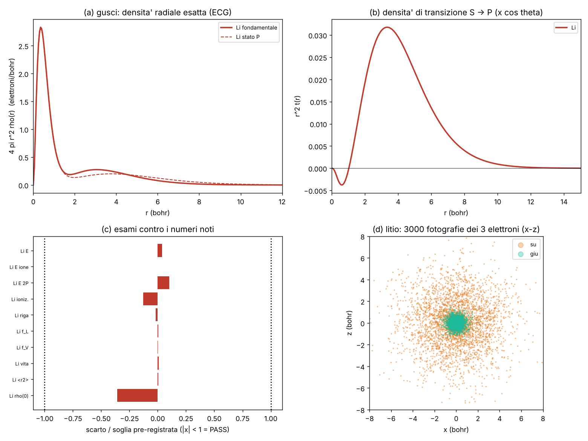

# Tavola periodica, parte 1: litio e berillio dalla regola

Studio `tav_`. Continua l'elio del thread principale (`MOLTI_ELETTRONI.md`) e H₂ di `AGGLOMERATO_DUE_ATOMI.md` §12:
stessa strada (gaussiane correlate esatte, ECG, con la **massa cinetica imparata della regola**), ora con **3 e 4
elettroni**, lo spin giusto e il **primo stato eccitato P**, perché nella tavola gli atomi devono assorbire e riemettere
fotoni.

File: macchina `lab/tav_ecg.py`; controlli di sviluppo `lab/tav_dev.py` → `lab/out/tav_dev.json`; pre-registrazione
`lab/tav_prereg.py` → `lab/out/tav_prereg.json` (**commit bfaad27, prima di ogni corsa su Li/Be**); corse a pezzi
`lab/tav_run.py` + `lab/tav_drive.sh` → `lab/out/tav_runs.json`; giudizio `lab/tav_analyze.py` →
`lab/out/tav_results.json`; esportazione per il programma `lab/tav_export.py`; figura `lab/tav_figure.py`.



---

## 0. In breve

**Stato al 14/10 notte: litio CHIUSO (11 PASS / 0 FAIL); berillio PARZIALE (corse interrotte a un checkpoint per fine
sessione).**

- **Litio** (energie a θ → 0, nucleo fermo): E = **−7,4780565 Eh** contro −7,4780603 (+0,004 mEh); Li⁺ −7,27991343
  (−0,00002 mEh); Li 2P −7,4101462 (+0,010 mEh). **Ionizzazione 5,39133 eV** contro 5,391715 misurati (−0,39 meV, cioè
  la fisica che manca: relatività/QED). **Riga rossa 2s→2p 1,847789 eV = 670,99 nm** (vuoto) contro 1,847843 eV
  (−0,05 meV). **Forza d'oscillatore 0,74700 / 0,74698** (lunghezza/velocità) contro 0,746957. **Vita del 2p 27,107 ns**
  contro 27,102 misurati. ⟨Σr²⟩ +0,005 %, densità al nucleo −0,36 % (gaussiane senza cuspide). Il litio è esportato
  per la tavola (§4).
- **Berillio, PARZIALE**: Be⁺ chiuso: −14,3247584 contro −14,3247632 (+0,005 mEh, **BE2 PASS**). Be 1S fermato a K = 700,
  dentro il primo giro di raffinamento: −14,672405 alla massa m_T → **−14,66693 a θ → 0, ~0,43 mEh sopra** −14,667356
  (soglia BE1 1,5 mEh: in linea per passare, **non ancora giudicato**). Be 2s2p ¹P fermato in crescita a K = 228 di 450
  (−14,47627 a m_T → −14,47086 a θ → 0, ancora ~2,6 mEh sopra il valore noto ~−14,47345): ionizzazione, riga a 235 nm e f
  **non ancora misurate**. Si riprende con `lab/tav_drive.sh be1S` e `lab/tav_drive.sh be1P` (checkpoint in
  `lab/out/tav_be1S.npz`, `tav_be1P.npz`, non tracciati: se mancano si riparte da capo, ~2 h).

**Validazione o scoperta?** Tutto quello che c'è qui è **validazione**: si ritrovano numeri noti (energie, ionizzazioni,
righe, forze d'oscillatore, vita dello stato eccitato) con l'operatore della regola. Non c'è una scoperta. Quello che è
nuovo è che **la catena è tracciabile**: ogni pezzo è o imparato dalla regola (la massa), o un ingresso permesso (Z, massa
del nucleo), o un debito scritto (§5).

**Parametri fisici liberi: 0.** Ingressi: Z, la massa cinetica imparata m_kin (livello T6 del thread principale,
m_T(θ_A) = 1,000373269, θ → 0: m0 = 1,0000000046), le masse dei nuclei (Li-7, Be-9) solo per la massa ridotta negli
esami contro l'esperimento.

## 1. Cosa si calcola, detto semplice

Un atomo di litio sono 3 palline-elettrone attorno a un nucleo con carica 3. La regola zig-zag, agglomerata, dice a ogni
pallina come muoversi: lontano dalla velocità della luce si comporta come una pallina di massa m_kin (questo l'ha già
imparato e controllato il thread principale). Le palline si respingono fra loro e sono attratte dal nucleo con la legge di
Coulomb. Il problema a 3 o 4 corpi si risolve "esatto" con una somma di tante gaussiane (bolle) che dipendono da **tutte
le distanze insieme**, così la correlazione (gli elettroni che si evitano) è dentro.

Due cose nuove rispetto all'elio:

1. **Lo spin conta davvero.** Due elettroni con lo stesso spin non possono stare nello stesso posto (Pauli). Si mette una
   funzione di spin (per Li: due accoppiati a zero più uno "su"; per Be: due coppie a zero) e si somma su tutti i modi di
   scambiare le palline, con un peso c_P = segno(P)·⟨χ|Pχ⟩. Per lo stato eccitato del berillio (2s2p ¹P) questo è
   obbligatorio: con la sola etichetta "su,su,giù,giù" il calcolo cadrebbe nel ³P, che sta più in basso.
2. **Stati P.** Per la riga ottica serve lo stato con un quanto di momento angolare: le bolle diventano
   (u·z)·exp(−xᵀAx), che è esattamente L = 1. Gli elementi di matrice (sovrapposizione, cinetica, Coulomb, dipolo nelle
   forme "lunghezza" e "velocità") li ho ricavati a mano (teorema di Isserlis) e controllati contro un Monte Carlo
   (`tav_dev.json`: tutti entro 2σ) e contro l'idrogeno (2p = −0,125 esatto, f(1s→2p) = 0,41620 nelle due forme).

La ricerca delle bolle (SVM, come nel thread principale) l'ho dovuta rinforzare: con i soli candidati a caso il litio
convergeva male (il pezzo antisimmetrico scarta quasi tutti i candidati). Aggiunti: figli delle bolle già buone,
lucidatura a caso e un'ottimizzazione locale Nelder–Mead del vincitore. Sono scelte della **macchina**, non della fisica
(DEBT-T2): cambiano quanto in fretta si converge, non a cosa. Le ho provate solo su ioni che non sono esami (B²⁺, C²⁺).

## 2. Litio (Z = 3): risultati contro la pre-registrazione

Corse: Li 2S K = 500 bolle, Li 2P K = 500, Li⁺ K = 250, 3 giri di raffinamento ciascuna (~1 h in tutto, un thread).
Energie a θ → 0 (massa m0), nucleo fermo. **11 esami, 11 PASS, 0 FAIL.**

| Esame | Cosa | Risultato | Riferimento | Soglia | Esito |
|---|---|---|---|---|---|
| LI1 | E(Li 1s²2s ²S) | **−7,4780565** Eh (barra 1,6·10⁻⁵) | −7,4780603 | 0,10 mEh | **PASS** (+0,004 mEh) |
| LI2 | E(Li⁺ 1s² ¹S) | −7,27991343 | −7,27991341 | 0,02 mEh | **PASS** (−0,00002 mEh) |
| LI3 | E(Li 1s²2p ²P) | −7,4101462 (barra 3,2·10⁻⁵) | −7,4101565 | 0,10 mEh | **PASS** (+0,010 mEh) |
| LI4a/b | prima ionizzazione (massa ridotta) | **5,39133 eV** | 5,391715 (esperimento) | 1 % / 3 meV | **PASS** / **PASS** (−0,39 meV) |
| LI5a/b | riga rossa 2s → 2p | **1,847789 eV = 670,99 nm** (vuoto) | 1,847843 eV, 670,97 nm (670,8 in aria) | 1 % / 3 meV | **PASS** / **PASS** (−0,05 meV) |
| LI6 | forza d'oscillatore | **f_L = 0,74700, f_V = 0,74698** | 0,746957 | 1 % (e L = V entro 1 %) | **PASS** (+0,005 %, L−V 3·10⁻⁵) |
| LI7 | vita dello stato 2p | **27,107 ns** | 27,102 ns (misura) | 2 % | **PASS** (+0,02 %) |
| LI8 | ⟨Σr²⟩ e densità al nucleo | 18,3538 a₀²; 13,793 | 18,3529; 13,8426 | 1 % | **PASS** (+0,005 %; **−0,36 %**) |
| LI9 | viriale −V/T | 1,99999996 | 2 | 10⁻⁴ | **PASS** |

Lettura onesta:
- I −0,39 meV sulla ionizzazione **non** sono errore del calcolo (che sulla differenza vale ~0,1 meV): sono la fisica che
  manca (relatività, QED, polarizzazione di massa, DEBT-3/4). Stesso discorso per l'elio del thread principale (+0,75 meV).
- La densità al nucleo è il pezzo più debole (−0,36 %): le gaussiane non hanno la cuspide di Kato. Dentro la soglia, ma
  è la prima cosa che peggiorerebbe con meno bolle.
- La riga del litio è **una sola** (centroide): la regola agglomerata non ha lo spin-orbita (DEBT-4). Le due righe D vere
  distano 0,042 meV, sotto la nostra precisione sulla riga ma sopra quella della teoria: da fare quando la regola avrà
  il suo spin-orbita.
- La vita del 2p esce da f e dall'energia calcolate (A = 2α³ΔE² f/3): 27,107 contro 27,102 ns misurati. È il tempo
  dopo cui, nel programma, il litio eccitato **riemette** il fotone rosso.
- Prova interna della densità di transizione (vedi §7): il dipolo ⟨S|Σz|P⟩ dalle bolle è 2,345183, quello integrato dalla
  densità di transizione esportata 2,345176 (3·10⁻⁶).

## 3. Berillio (Z = 4): risultati contro la pre-registrazione

**PARZIALE.** Corse pre-registrate: Be 1S K = 700 (3 giri), Be⁺ K = 500 (3 giri), Be ¹P K = 450 (2 giri, spin
singoletto × singoletto, 24 permutazioni: la più cara).

| Esame | Stato | Numero ora |
|---|---|---|
| BE2 E(Be⁺ 2S) | **PASS** | −14,3247584 contro −14,3247632 (+0,005 mEh; soglia 0,10) |
| BE1 E(Be 1S) | non giudicato (corsa a metà del 1° giro) | −14,66693 a θ → 0 (+0,43 mEh; soglia 1,5) |
| BE3 ionizzazione | non giudicato | con i numeri di ora: (−14,32476 + 14,66693)·μ = 9,3104 eV contro 9,3227 (−12 meV, −0,13 %) — **provvisorio** |
| BE4 riga ¹P (234,9 nm) | non misurato | ¹P a K = 228, non convergiuto |
| BE5 forza d'oscillatore | non misurato | — |
| BE7 viriale, X1 | non misurato | — |

Nota onesta: la ionizzazione provvisoria passerebbe la soglia larga (1 %) e quella stretta (30 meV), ma **non conta**
finché la corsa non è finita e giudicata da `tav_analyze.py be`. Il berillio **non** è ancora esportato e nella tavola
resta grigio. Sviluppo dichiarato: sugli ioni Be-like (C²⁺, non esame) la convergenza è molto più lenta che per il litio
(il 2s² si mescola con il 2p²): per questo il Be ha una soglia più larga (1,5 mEh) scritta prima.

## 4. Cosa va nel programma (esportazione)

Cartella del **litio** (stesso formato dell'elio): `manifest.json`, `litio_fondamentale.npy` e `litio_eccitato.npy`
(float32 (100 000, 3, 3): fotografie dei 3 elettroni insieme, spin [su, su, giù]), `litio_densita.npz` (densità radiali
esatte del fondamentale, dello stato P con la parte P₂(cos θ), dello ione Li⁺, densità di transizione t(r)),
`litio_livelli.json` (livelli, riga, f, vita 27,1 ns, ionizzazione, esiti degli esami → elemento cliccabile).
Controlli: integrale della densità 2,99995 elettroni; dipolo dalla densità di transizione = dipolo dalle bolle a 3·10⁻⁶.

**Attenzione (PARZIALE):** al momento della scrittura il disco condiviso `/mnt/project-files` dava errore di
lettura/scrittura (I/O error), quindi la cartella è **solo locale** in `lab/out/tav_dati_litio/` (non tracciata).
Copia: `python lab/tav_export.py copia li` → `/mnt/project-files/debiti/dati/litio/`. (Lo script attuale aggiunge anche
`litio_*_catena.npy`, catene continue per la scia, idea 5: si ottengono rilanciando `python lab/tav_export.py li`.)
Berillio: non esportato (non ancora giudicato).

## 5. Debiti

- **DEBT-1** repulsione fra elettroni come Coulomb istantaneo (niente Breit né ritardo): sul litio pesa ~10⁻⁴ Eh
  sull'energia totale, quasi niente sulla riga.
- **DEBT-2** antisimmetria e accoppiamento di spin messi a mano (postulato spin-statistica). Senza, il litio "bosonico"
  cadrebbe sotto −8 Eh (visto anche nei controlli non interagenti).
- **DEBT-3** nucleo puntiforme e fermo; la massa ridotta entra solo negli esami sperimentali; la polarizzazione di massa è
  trascurata (per Li ~0,1 meV sulla ionizzazione).
- **DEBT-4** proiezione non relativistica: niente Darwin né spin-orbita (assenti dalla regola agglomerata). Conseguenza
  visibile: **una sola riga D del litio** al centroide (la natura ne ha due a 0,042 meV di distanza).
- **DEBT-T1 (nuovo)** l'accoppiamento luce–atomo è in approssimazione di dipolo (p·A al primo ordine): il fotone della
  regola zig-zag non è ancora quello che "spinge" questi elettroni. L'energia della riga invece viene tutta dalla regola.
- **DEBT-T2 (nuovo, macchina)** generatore e ottimizzatore della base scelti a mano; nessun effetto sui valori convergiuti.

## 6. Come l'agglomeratore può imparare una regola grossa a molti elettroni da qui (per B–Ne)

Il problema: le ECG esatte costano come N! (permutazioni) e come K² (bolle); a 5–10 elettroni non si fanno. Serve un
livello più grosso, imparato e controllato su questi risultati esatti, come vuole la regola 7 del PIANO.

1. **Dati di addestramento esatti (già pronti o economici):** He, Li, Li⁺, Be, Be⁺ di questo studio e del thread
   principale, più le serie isoelettroniche Li-like e Be-like a Z = 5…10 (stesse macchine, ~10–40 min l'una). Da ognuno:
   energia, densità a un elettrone ρ(r) esatta (le formule chiuse sono in `tav_export.py`), densità di coppia per canale di
   spin (dai campioni), densità di transizione.
2. **Livello candidato A, "gusci in un campo medio imparato".** Ogni elettrone in un potenziale centrale
   V(r) = −Z/r + V_H[ρ](r) + W(r), dove W è la parte "scambio + correlazione" **imparata invertendo le densità esatte**:
   si cerca la W per cui le N orbite più basse rifanno la ρ esatta (inversione di densità, scritta da noi, niente codici
   esterni). Poi si cerca una legge W[ρ] con pochi coefficienti (per esempio funzione di ρ e di r_s locale) che vada bene
   per tutta la serie di addestramento. Controllo (il "controlla" dell'agglomeratore): si tengono fuori Be e la serie
   Be-like a Z alto e si prevedono ionizzazione e riga; budget d'errore pre-registrato (es. 1 % sull'ionizzazione).
3. **Livello candidato B, "fattore di coppia + nodi".** Quello del piano del thread principale (L7): fattore di Jastrow
   imparato dalle ECG + nodi dal livello A, poi camminatori (DMC) sulla griglia per B–Ne. Il pezzo che queste ECG
   misurano esattamente e che serve a B–Ne è **l'errore dei nodi**: a Li è piccolo (un solo determinante basta), a Be no
   (il 2s² si mescola col 2p² perché 2s e 2p sono quasi alla stessa energia). Regola da imparare: "se due gusci sono
   quasi degeneri, il nodo ha bisogno di due configurazioni". Numeri pronti per il controllo: E esatta di Be (§3) contro
   la DMC a nodo di un solo determinante.
4. **La scelta automatica** fra A e B (o un ibrido) la fa l'agglomeratore come sempre: il raggruppamento più grosso che
   sta nel budget d'errore sul controllo esatto. Oltre 4 elettroni non c'è più un controllo esatto: si dichiara.

## 7. Idee geometriche e visive

Ognuna con: cosa si vede, perché funziona, costo (Intel UHD, ~42 ms per passo fisico), regole. Il rendering è del
thread "Modello standard a palline": qui sono **proposte**.

1. **Il respiro di dipolo (provata qui, numeri sotto).** Quando l'atomo assorbe il fotone la nuvola non "diventa" lo
   stato P di colpo: oscilla avanti e indietro lungo la polarizzazione del fotone, alla frequenza della riga, con
   un'ampiezza che cresce mentre il fotone viene assorbito e poi si spegne in ~27 ns (riemissione).
   *A schermo*: le palline del litio pescate dai campioni del fondamentale, spostate con il peso
   ρ_S + 2a(t)·t(r)·cos θ·cos ωt; l'onda del fotone entra, la nuvola "respira" a lobi (su/giù), poi un fotone esce in una
   direzione a caso con intensità ∝ sin² rispetto all'asse.
   *Perché funziona*: la densità di transizione t(r) cos θ è esatta dalla funzione d'onda (formula chiusa in
   `tav_export.py`); controllo: il suo dipolo integrato (2,345176) è quello delle bolle (2,345183).
   *Costo*: una tabella radiale da 401 numeri per riga, una moltiplicazione per pallina: zero.
   *Regole*: niente fake (tutto dalla ψ), una sola strada. Debito: l'aggancio è di dipolo (DEBT-T1).
2. **La buca di Fermi che si vede.** Nei campioni del litio due elettroni con lo stesso spin si trovano a meno di 0,3 a₀
   l'uno dall'altro nel **0,002 %** delle fotografie, contro l'1,77 % se fossero indipendenti (900 volte meno). Quelli
   con spin opposti: 2,9 % contro 3,6 % (la buca di Coulomb, molto più piccola).
   *A schermo*: palline con due colori di spin; zoomando vicino si vede che due dello stesso colore non si toccano mai,
   mentre quelle di colore diverso a volte sì. È Pauli fatto vedere, senza disegnarlo.
   *Costo*: nessuno (sono i campioni esportati). *Regole*: emergente dall'antisimmetria (che però è DEBT-2).
3. **La cipolla e il perché della tavola (penetrazione).** La densità radiale del litio ha due gusci (picchi a 0,35 e
   3,05 a₀, valle a 1,75). Dentro 0,5 a₀ l'elettrone esterno 2s porta **+0,0085 elettroni** in più del nocciolo Li⁺,
   il 2p invece **−0,0014** (anzi spinge fuori il nocciolo). Il 2s "buca" il guscio interno e sente più carica del
   nucleo: per questo sta 1,85 eV sotto il 2p, ed è per questo che nella tavola il blocco s viene prima del blocco p.
   *A schermo*: lo zoom fa vedere il guscio interno come una sfera luminosa compatta e il 2s come un alone con una
   "radice" che entra nel nocciolo; passando al 2p la radice sparisce e l'alone si allunga lungo z (due lobi).
   *Costo*: le densità radiali sono già esportate. *Regole*: tutto emergente.
4. **Zoom senza "palla bianca" (risponde alla richiesta di Valerio sul passaggio da vicino a lontano).** Da lontano non
   serve una nuvola diversa: si disegnano le stesse fotografie con un bagliore la cui larghezza è la dimensione di un
   pixel in quel punto di zoom. Allontanandosi, molte fotografie cadono nello stesso pixel e la loro media è proprio
   ρ(r): la forma (due gusci, lobi del P) resta, cambia solo il dettaglio. Si può controllare con un numero: la densità
   istogrammata dalle fotografie contro la ρ esatta esportata (stesso file). Con 100 000 fotografie ⟨Σr²⟩ dai campioni è
   18,23 contro 18,35 esatto (−0,7 %: le code lontane sono sotto-campionate, vanno più fotografie o pesi).
5. **Scia dei surfisti = fotografie successive.** Per la "mini scia" chiesta da Valerio: le fotografie di Metropolis sono
   una catena (ogni elettrone fa un passo di ~0,3–0,7 a₀): disegnare per ogni elettrone le ultime 5–10 posizioni della
   catena con opacità che cala dà una scia che **non è inventata** (è il cammino del campionatore, che ha |ψ|² come
   misura). Va detto chiaro a schermo che non è una traiettoria vera (in uno stato stazionario non ce n'è una).
   Proposta per il thread grafico: esportare, oltre alle fotografie indipendenti, una catena continua.

## 8. Dove l'intuizione di Valerio può aiutare

- **La riga senza struttura fine.** La regola agglomerata non ha lo spin-orbita: il litio ha una sola riga rossa dove la
  natura ne ha due (D1, D2, 0,042 meV di differenza). Nella regola fine zig-zag lo spin-orbita c'è (struttura fine
  dell'idrogeno a posto, `ZIGZAG.md`). Domanda: secondo te il "giro" della pallina che fa lo spin deve sentire il campo
  del nucleo *mentre corre* (come nella regola fine) anche nel livello grosso? Se sì, è un termine da far imparare
  all'agglomeratore, ed è un esame bellissimo: 0,042 meV di separazione da ritrovare.
- **Il fotone che spinge.** Qui l'assorbimento è "di dipolo" (DEBT-T1). Nel tuo quadro il fotone è una pallina che corre
  a c: come pensi che la sua corrente debba agganciarsi alla nuvola dell'atomo? Se la risposta è "la corrente del fotone
  fa ruotare le palline-elettrone", possiamo scriverla come regola e misurare se ridà f = 0,747 del litio.
- **Pauli come geometria.** Due palline con lo stesso spin non stanno nello stesso posto (vedi la buca di Fermi, §7).
  Oggi è un postulato (DEBT-2). Hai un'immagine di *perché* due giri uguali si respingono (ad esempio: due vortici con
  lo stesso verso che non possono sovrapporsi)? Sarebbe la prima volta che il segno meno dei fermioni nasce da una regola.
- **Gusci e tavola.** La tavola ha la forma che ha perché il 2s sta sotto il 2p (§7, penetrazione). È un fatto di
  geometria della nuvola. Se ti viene un modo visivo per spiegarlo a schermo, lo traduciamo in una vista del programma.

## 9. Patch proposte per altri file (non toccati)

- `docs/PIANO.md` §3: aggiungere la riga "Litio e berillio esatti (ECG, regola) — fatto, `TAVOLA_LITIO_BERILLIO.md`"
  e in §5 punto 3 segnare "elio e litio esatti" come fatto (berillio: vedi §3).
- Laboratorio Atomo / modalità tavola (thread grafico): leggere `/mnt/project-files/debiti/dati/<elemento>/manifest.json`;
  un elemento è cliccabile se `<elemento>_livelli.json` → `esami` ha tutti i PASS richiesti (§4); altrimenti grigio.
- Richiesta di ponte proposta (NON creata), per vedere la nuvola del litio con i bagliori:
  `{"id": "tav_litio_foto", "azione": "foto", "scena": "elio_bagliori", "dati": "dati/litio", "note": "3 elettroni, colori per spin"}`
  (formato da adattare a `docs/PONTE.md`; la scena a bagliori dell'elio legge (n,2,3): serve generalizzarla a (n,N,3)).

## 10. Come rieseguire

```bash
export OMP_NUM_THREADS=1 OPENBLAS_NUM_THREADS=1
python lab/tav_dev.py                    # controlli di macchina (sviluppo)
python lab/tav_prereg.py                 # pre-registrazione (gia' committata)
lab/tav_drive.sh li2S liP1S li2P         # litio, a pezzi da <= 10 min con checkpoint (lab/out/tav_<job>.npz)
python lab/tav_analyze.py li             # esami -> lab/out/tav_results.json
lab/tav_drive.sh be1S beP2S be1P         # berillio
python lab/tav_analyze.py be
python lab/tav_export.py li ; python lab/tav_export.py be   # cartelle per il programma
python lab/tav_figure.py
```
Tempi sul container (un thread): Li ~1 h in tutto; Be ~2–3 h (Be ¹P con 24 permutazioni è la corsa lunga).
