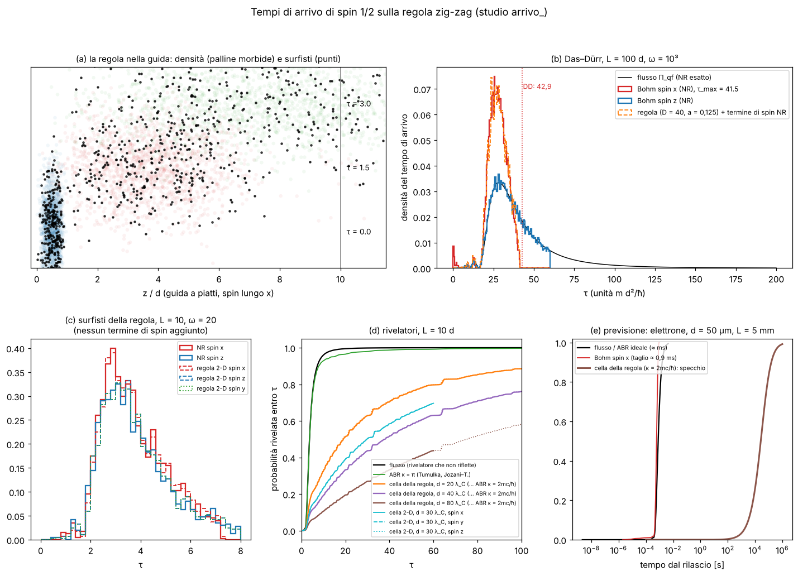

# Tempi di arrivo delle particelle di spin 1/2 sulla regola zig-zag

Studio `arrivo_` (file: `lab/arrivo_*.py`, `lab/out/arrivo_*`). Regola: quella congelata di `lab/zz_core.py`
(1+1 D `dirac1` e 2+1 D `dirac` con assi y, z): ogni pallina corre di una cella a c, poi ruota (θ = m c a/ħ).
Unità della regola ħ = c = mₑ = 1 (lunghezza λ_C = 3,86·10⁻¹³ m); unità di Das–Dürr ("DD") ħ = m = d = 1
(d = lunghezza della scatola iniziale, tempo m d²/ħ).

> Stato: **chiuso** (13/10/2026). Commit: ricerca `444dc15`, pre-registrazione `6e2b744`, corse `31882ee`,
> documento e figura: vedi `git log -- docs/TEMPI_ARRIVO.md`. Figura: `lab/out/arrivo_figura.png`
> (copia in `/mnt/project-files/problemi-aperti/arrivo_figura.png`).



## 0. In breve (per chi ha fretta)

* **Esami: 18 pre-registrati, 15 PASS, 3 FAIL** (E1, E5 di poco, E6 per il bordo numerico). **Parametri liberi: 0.**
* **Validazione — le curve di Das–Dürr escono.** Il nostro riferimento non relativistico dà il taglio netto per lo
  spin perpendicolare: τ_max = **41,52** (L = 100 d, ω = 10³) contro **42,9** scritto da DD: −3,2 % → **E1 FAIL**.
  Il nostro numero è convergente (passo /4 e /10 uguali a 10⁻³) e con ω = 500 diamo 43,1, cioè il "≈ 43" di
  Jozani–Tumulka 2026: sospettiamo che il 42,9 di DD sia gonfiato da traiettorie integrate male vicino ai nodi
  (a noi succedeva: il massimo grezzo era 43,69, prodotto da due traiettorie sbagliate). Non lo possiamo provare.
* **La regola rifà DD.** Flusso della regola → flusso esatto: distanza L1 0,0030 (d = 80 λ_C, a → 0); surfisti
  longitudinali della regola + termine di spin: τ_max entro **0,2–0,5 %**, media entro 0,4–0,8 % (L = 10 e 100).
* **Il termine di spin di Pauli nasce da solo.** In 2-D (guida a piatti) i surfisti della regola, **senza nessun
  termine di spin aggiunto**, danno il taglio di DD per lo spin x: τ_max = 7,215 contro 7,223 del calcolo NR
  (−0,1 %), media +1,2 %; per spin z e spin y niente taglio (il 10 % arriva dopo τ_max(x)). Validazione forte.
* **Il rivelatore naturale della regola = l'ABCD ideale di Tumulka = ABR con κ = 2mc/ħ.** Riflette (1−v)/(1+v)
  a 10⁻⁵–10⁻⁴; la curva di rivelazione coincide con l'ABR di Schrödinger con κ = 2mc/ħ entro 0,0024 (d = 80 λ_C) e
  la differenza cala con d. È lontanissimo dal flusso (0,86 di differenza a d = 80 λ_C).
* **Lo spin sparisce al rivelatore.** In 2-D le curve del rivelatore della regola per spin x, y, z sono **identiche a
  10⁻¹⁴** (GTZ: ogni rivelatore lineare e simmetrico è cieco allo spin). I surfisti della regola mostrano l'effetto
  di DD, i clic no.
* **Previsione (nuova, falsificabile, ma su un rivelatore ideale)**: nell'esperimento proposto (elettrone,
  d = 50 µm, L = 5 mm) il rivelatore-cella della regola assorbe 4,9·10⁻⁸ per urto: è uno specchio. Tempo mediano
  di rivelazione **2,6·10⁴ s** (7 ore), media 8,4·10⁴ s, rivelato entro 1 ms: 3,5·10⁻⁸; **nessuna dipendenza dallo
  spin**. Un rivelatore vero non è una cella: la previsione dice che **la regola da sola non sa fare un rivelatore
  realistico per particelle lente** (limite), e che con qualunque rivelatore lineare lo spin non si vede.

---

## 1. Il problema, in parole semplici

Lanci un elettrone in un tubo e metti un rivelatore a distanza L. **Quando** fa clic? La meccanica quantistica
standard non ha una risposta unica: il tempo non è un'osservabile come la posizione (teorema di Pauli: non c'è
un operatore "tempo di arrivo" autoaggiunto e covariante). Ci sono più ricette, e danno numeri diversi:

* **flusso** (corrente di probabilità nel punto del rivelatore): semplice, ma può diventare negativa
  (*backflow*) e allora non è una probabilità;
* **Bohm**: le particelle hanno traiettorie; il tempo di arrivo è quando la traiettoria tocca il rivelatore la
  prima volta;
* **bordo assorbente** (Tumulka): il rivelatore è un bordo con una condizione al contorno che lascia solo uscire;
  la probabilità del clic è il flusso uscente, sempre ≥ 0;
* **potenziali immaginari**, misure ripetute, modelli di rivelatore espliciti…

## 2. Cosa è noto (letteratura, verificata online il 13/10/2026 dove indicato)

**Das & Dürr, *Sci. Rep.* 9, 2242 (2019), arXiv:1802.07141** (letto il PDF tramite WebFetch). Elettrone in una
guida d'onda semi-infinita (asse z) con confinamento trasverso armonico ω, chiuso da un muro a z = 0, inizialmente
nello stato fondamentale di una scatola 0 < z < d: ψ₀ = √(2ω/π) sin(πz/d) e^{−ωρ²/2} χ, con spinore
χ = (cos α/2, e^{iβ} sin α/2). A t = 0 si toglie il muro a z = d. Rivelatore: il piano z = L. Moto bohmiano con la
**corrente di Pauli** (termine convettivo + termine di spin (ħ/2m) ∇×(ψ†σψ)/ψ†ψ). Lo stato si fattorizza,
ψ = φ₀(x,y) e^{−iωt} W(z,t) χ, e le equazioni del moto (loro Eq. 13, scritte da noi in cartesiane per β = 0) sono

    Ẋ = −ω Y cos α,   Ẏ = Re(W′/W)(Z,t) sin α + ω X cos α,   Ż = Im(W′/W)(Z,t) + ω Y sin α .

* spin lungo la guida (α = 0 o π): il termine di spin non tocca Z, la distribuzione dei tempi = **flusso**
  Π_qf(τ) = Im(W* W′)(L,τ), coda ∝ 4(L/π)³/τ⁴, indipendente da ω;
* spin perpendicolare (α = π/2): distribuzione "esotica" con un **tempo massimo netto** τ_max: nessuna traiettoria
  arriva dopo. Per L = 100 d e ω = 10³ (unità DD): **τ_max ≈ 42,9** (≈ 1 ms per d = 50 µm); τ_max cresce
  linearmente con L, scende con ω e tende a una costante per ω ≫ 1; per ω → 0 l'effetto sparisce.
* esperimento proposto (mai fatto): elettroni in trappole di Penning, d = 50 µm, L ≈ 5 mm, ω ≈ 4,6·10⁷ rad/s
  (= 10³ DD), tempo unità m d²/ħ ≈ 21,7 µs. Il semiclassico dà invece una coda ∝ τ⁻².

**Das, *Detlef Dürr, arrival-time distributions, and spin in Bohmian mechanics* (arXiv:2309.15815, 2023)**
(letto): riassunto; la guida a piatti paralleli sopprime gli arrivi su un intervallo di α più largo: è la
geometria "più promettente". Nota 35: alcune condizioni al bordo assorbente darebbero dipendenza dallo spin, ma
perché lo spin è messo esplicitamente nella condizione.

**Goldstein, Tumulka, Zanghì, *Sci. Rep.* (febbraio 2024, PMC10866986), arXiv:2309.11835** (letto l'arXiv; il
numero dell'articolo nella rivista non l'ho verificato). Argomento semplice e forte: le statistiche di **qualunque** esperimento
quantistico vengono da una POVM, quindi P_n(t) = ⟨n|O(t)|n⟩ con O(t) operatore 2×2 sullo spin. Allora
P_n + P_{−n} = Tr O non dipende da n; con la simmetria assiale P↑ + P↓ = 2 P→. Le distribuzioni bohmiane di DD
hanno P↑ = P↓ ≠ P→ (fortemente): **non vengono da nessuna POVM**, quindi **nessun rivelatore** le può misurare;
l'errore di qualunque misura approssimata è ≥ ‖P→ − P↑‖/2. Con la simmetria per riflessione (chirale) un
rivelatore simmetrico non vede **nessuna** dipendenza dallo spin.

**Das & Aristarhov, arXiv:2312.01802 (2023)**: commento a GTZ (letto solo l'abstract: rispondono, il contenuto
non l'ho potuto leggere).

**Tumulka, regola del bordo assorbente (ABR)**: arXiv:1601.03715 ("Distribution of the time at which an ideal
detector clicks", poi *J. Stat. Phys.*), Schrödinger con ∂ₙψ = iκψ sul rivelatore (κ > 0 numero d'onda
caratteristico del rivelatore); densità del clic = (ħκ/m)|ψ|² sul bordo. Un'onda piana e^{ikz} è riflessa con
|(k−κ)/(k+κ)|²: κ = k la assorbe tutta. **Per Dirac**: arXiv:1601.04571 (letto): condizione **ideale**
n·α ψ = ψ ("ABCD"), la particella esce a velocità c; la versione semi-ideale (n·α + θβ)ψ = √(1+θ²) ψ ha limite non
relativistico la condizione di Pauli σ·∇φ = iκ (n·σ) φ con **κ = (2mc/ħ)(√(1+θ²) − θ)** (sua Eq. 66). Per θ = 0
(la condizione ideale) κ = 2mc/ħ, che diverge per c → ∞: Tumulka scrive che l'ABCD ideale **"non ha limite non
relativistico"**.

**Jozani & Tumulka, arXiv:2603.22044 (2026)** (letto l'HTML): proprio il set-up di DD con tre modelli di rivelatore
— potenziale immaginario, ABC scalare ∂_zψ = iκψ, ABC spinoriale (quella di Pauli sopra) — con κ = π. Trovano:
segni di **riflessione parziale** al rivelatore (oscillazioni), frazione rivelata 90 % (L = 100) e 96 % (L = 10)
per l'ABC scalare, distribuzioni **senza dipendenza dallo spin** (per l'ABC spinoriale "così debole da non essere
notabile"), ma l'ABC spinoriale dipende dalla larghezza della guida (𝔼T = A + B√ω). Confermano τ_max ≈ 43 di DD
(per ω = 500). **Quindi il punto (ii) del nostro compito (bordo assorbente sullo stato di DD) è già stato fatto:
lo ripetiamo solo come validazione.**

**Cosa resta aperto.** (1) Quale distribuzione misurerebbe davvero l'esperimento proposto (dipende dal
rivelatore, nessuno l'ha fatto). (2) Se il tempo bohmiano sia "fisico" (GTZ: non misurabile). (3) Quale κ abbia un
rivelatore vero: l'ABR lascia κ libero.

## 3. Perché la nostra regola c'entra, e cosa può dire di nuovo

* **I surfisti** della regola hanno v = c ψ†αψ/ψ†ψ: è la velocità di Bohm–Dirac. Nel limite non relativistico la
  corrente di Dirac contiene da sola (decomposizione di Gordon) il termine di spin ∇×(ψ†σψ)/2m: quello che DD
  aggiungono a mano a Schrödinger. In 2-D (y, z) con lo spin lungo x la regola deve far nascere l'effetto di DD
  **senza** che nessuno scriva il termine di spin.
* **Il rivelatore naturale** della regola: una cella che toglie tutto quello che ci entra (studio `tunnel_`,
  `docs/TEMPO_TUNNEL.md` §4.6). Niente rientra da oltre il piano z = L: le componenti che corrono verso −z sono
  zero lì, cioè α_z ψ = ψ: **è esattamente l'ABCD ideale di Tumulka**, realizzata come misura ripetuta a ogni tick.
  Riflette (1−v)/(1+v) (misurato in `tunnel_`: 0,07188 contro 0,07180 per v = 0,866). Nel limite non relativistico
  equivale all'ABR di Schrödinger con **κ = 2mc/ħ** (Tumulka Eq. 66 con θ = 0): per un elettrone lento è quasi uno
  specchio (assorbe ≈ 2v/c per urto).
* **GTZ in pratica**: ogni rivelatore fatto con la regola è lineare (una POVM) e la regola è (quasi) simmetrica per
  riflessione: la previsione è che **i clic non dipendano dallo spin**, mentre i surfisti senza rivelatore sì.

Cosa ci aspettiamo che sia **validazione**: le curve di DD (flusso, τ_max), il limite NR della regola, l'ABR di
Tumulka/Jozani. Cosa può essere **nuovo**: il rivelatore della regola come ABCD ideale con κ = 2mc/ħ fissato (zero
parametri) e la sua previsione numerica per l'esperimento proposto; i surfisti della regola che danno da soli il
termine di spin di Pauli. Cosa sarà probabilmente un **limite**: la regola non sa costruire un rivelatore
"morbido" (servirebbero atomi), e il suo rivelatore ideale è irrealistico per particelle lente.

## 4. Prove esplorative prima della pre-registrazione (dichiarate)


Per scegliere griglie e soglie ho fatto prove piccole (N ≤ 2000 traiettorie) prima di scrivere la
pre-registrazione. Le dichiaro perché hanno influenzato le scelte:
* riferimento NR (`arrivo_nr.py`): τ_max(L = 100, ω = 10³) ≈ 41,4 con 2000 traiettorie (il massimo del campione
  cresce col campione); a L = 10: ω = 40 → τ_max ≈ 6,0, ω = 10³ → 4,15;
* la velocità "di un sito" della regola (|R|² − |L|²)/ρ (`zz_core.dirac_velocity`) ha un errore O(a)∇ρ: vicino al
  muro dava v sbagliata di un fattore 10. Uso la **corrente conservata del reticolo centrata sul sito** (media dei
  due flussi di legame); con questa l'errore scende a O(a²);
* il filtro spettrale 2-D centrato sul quoziente di Rayleigh sbagliava stato (l'1 % di energia negativa sposta il
  quoziente di 0,009): ora filtro largo → Rayleigh → filtro stretto (due volte);
* rivelatore della regola (1-D, D = 20, L = 10): F(20) = 0,465 / 0,503 / 0,511 per a = 0,5 / 0,25 / 0,125, contro
  l'ABR con κ = 2mc/ħ: 0,517; ABR con κ = π: 0,965 (Jozani–Tumulka: 96 %).


## 5. Cosa abbiamo fatto (metodo)

* **Riferimento NR** (`arrivo_nr.py`, `arrivo_r1_nr.py`): W(z,t) esatto (immagini + funzioni d'errore complesse),
  traiettorie di Pauli (RK4) con 20 000 (L = 100), 4000 (L = 10, ω = 10³) e 2000 (L = 10, ω = 20) campioni con seme
  fisso; **gli stessi campioni** iniziali sono dati alla regola.
* **Regola 1+1 D** (`arrivo_rule1d.py`, `arrivo_r2_rule1d.py`): la scatola d = D λ_C (D = 20, 40, 80), il suo stato
  fondamentale è l'autovettore esatto del tick nella scatola (energia = dispersione del reticolo a 10⁻¹⁵, quindi la
  lunghezza efficace è proprio D). Muro a z = 0: la pallina che va a sinistra torna indietro con segno −1. Bordo
  numerico: cono di luce esatto (D = 20) o rampa assorbente lontana. Passi a = 0,5 / 0,25 / 0,125 / 0,0625 ed
  estrapolazione di Richardson in a². Surfisti "ibridi": velocità longitudinale della regola (corrente conservata
  del reticolo) + termine di spin NR del fattore trasverso (debito D3).
* **Regola 2+1 D** (`arrivo_rule2d.py`, `arrivo_r4_rule2d.py`): guida a piatti paralleli (trappola armonica in y,
  libera in x), d = 30 λ_C, ω = 20, L = 10, a = 0,5 / 0,25 / 0,125; spinore a 4 componenti; stato iniziale dal
  filtro spettrale della regola stessa (residuo 8·10⁻⁷). **I surfisti usano solo la corrente di Dirac della regola**:
  il termine di spin non è scritto da nessuna parte. Correnti: i flussi esatti di ogni sotto-passo (y e z) su una
  coppia palindroma di tick (la formula "di un sito" sbagliava il segno della velocità trasversa: vedi §4).
* **Rivelatori** (`arrivo_abr.py`, `arrivo_r3_abr.py`): ABR di Schrödinger (Crank–Nicolson, controllo con griglia
  doppia: 10⁻⁴) con κ = π/2, π, 2π, 10π e κ = 2mc/ħ (= 2D in unità DD); formula modale per κ ≫ k (controllo con CN a
  κ = 160: 8·10⁻⁴); rivelatore-cella della regola in 1-D (D = 20, 40, 80) e 2-D (spin x, y, z).

## 6. Numeri e giudizio contro la pre-registrazione

| esame | cosa | nostro | riferimento / soglia | esito |
|---|---|---|---|---|
| E1 | τ_max NR, L = 100, ω = 10³ | 41,52 (grezzo 43,69, vedi A1) | 42,9 (DD) ± 2 % | **FAIL** (−3,2 %) |
| E2 | Bohm spin z = flusso (KS) | 0,0045 | < 0,015 | PASS |
| E3 | effetto DD: P(T_z > τ_max,x) | 0,38 | > 0,05 | PASS |
| E4 | flusso regola L = 10, L1 (a → 0) | 0,0374 / 0,0106 / **0,0030** (D = 20/40/80) | < 0,01 e decrescente | PASS |
| E5 | flusso regola L = 100, D = 40 | 0,0103 (D = 20: 0,035) | < 0,01 | **FAIL** (di poco) |
| E6 | coda τ⁻⁴, Π_regola/Π_qf su [20, 40] | D = 20: 0,9948; D = 40: −0,45 | \|r − 1\| < 0,01 | **FAIL** (D = 40) |
| E7 | surfisti ibridi L = 10, D = 40 | media +0,43 %, q50 −0,11 %, q90 −0,18 %, max −0,20 % | < 1,5 % | PASS |
| E8 | surfisti ibridi L = 100, D = 40 | media +0,83 %, τ_max −0,54 % | < 2 % | PASS |
| E9 | spin z ibrido vs NR (KS) | 0,0068 | < 0,02 | PASS |
| E10 | **2-D, solo regola**, spin x | τ_max −0,11 %, media +1,18 % | < 3 % | PASS |
| E11 | 2-D spin z e y vs NR (KS) | 0,023, 0,023 | < 0,03 | PASS |
| E12 | l'effetto nasce dalla regola | spin z dopo τ_max(x): 10,4 %; spin x in ritardo: 0 | > 3 %; 0 | PASS |
| E13 | riflessione della cella, v = 0,05/0,1/0,3 | 1,0·10⁻⁵ / 2,1·10⁻⁵ / 6,9·10⁻⁵ | < 10⁻³ | PASS |
| E14 | cella della regola = ABR κ = 2mc/ħ | 0,0151 / 0,0102 / **0,0024** | < 0,01 a D = 80, decrescente | PASS |
| E15 | cella ≠ flusso | 0,86 | > 0,1 | PASS |
| E16 | 2-D cella: spin x, y, z | max \|ΔF\| ≤ 1,3·10⁻¹⁴ | < 10⁻³ | PASS |
| E17 | 2-D cella vs 1-D cella | 0,017 / 0,013 / 0,003 (a = 0,5/0,25/0,125) | < 0,02 | PASS |
| E18 | ABR κ = π, F(20) a L = 10 | 0,965 | 0,96 (Jozani–Tumulka) ± 0,02 | PASS |

**Perché i tre FAIL.**
* **E1**: spiegato sopra. Il nostro τ_max è il limite lungo una separatrice nello spazio delle condizioni
  iniziali (Y₀ ≈ 0, Z₀ ≈ 0,42 d): bisezione fino a 10⁻⁹ dà 41,539, il campione 41,52; ω = 500 dà 43,1.
* **E5**: 0,0103 contro 0,01 con D = 40 e solo a = 0,25 / 0,125 (a = 0,0625 a L = 100 non entrava nel tempo).
  A L = 10, dove arriviamo a D = 80, l'esame analogo passa con margine (0,003). È un fallimento di risorse, non della
  regola.
* **E6**: a D = 40 la rampa assorbente (bordo numerico a 3L) riflette le componenti lentissime che dominano la
  coda τ⁻⁴ a τ > 20: il rapporto diventa negativo. Col cono di luce esatto (D = 20) la coda è giusta a 0,5 % (0,9948
  dopo l'estrapolazione; il fattore (M*)³ = (tan a/a)³ spiega da solo l'errore a ogni a). Il controllo rampa/cono
  pre-registrato era a D = 20, L1 = 4·10⁻⁴ sull'intera curva: non vedeva la coda. Limite del nostro bordo numerico.

**Emendamenti** (`lab/out/arrivo_emendamenti.json`): A1 τ_max con le 50 traiettorie più tardive rintegrate a dt/4
(trasforma E1 da PASS a FAIL); A2 il passo dei surfisti ibridi (Heun) ×0,1 perché con il passo pre-registrato la
media era sbagliata del 2,6 % (tutte le corse "x" rifatte); A3 un bug (rotazione trasversa esplosa per α = 0, corse
"z" rifatte); A4 E13 riportato anche con la velocità di gruppo del reticolo.

## 7. Cosa vuol dire (validazione, scoperta, limite)

**Validazione.**
* Le curve di Das–Dürr (flusso con coda τ⁻⁴ per spin lungo la guida, taglio netto per spin perpendicolare) escono
  dalla regola, nel limite a → 0 e d ≫ λ_C. Attenzione: la massa "non relativistica" della regola a passo finito è
  M* = tan(a)/a (+9 % a a = 0,5): i tempi crescono come M*, la coda come M*³. Senza estrapolazione si sbaglia.
* **Il termine di spin di Pauli è dentro la regola**: la corrente di Dirac dei surfisti, ridotta a basse velocità,
  contiene (ħ/2m)∇×(ψ†σψ). I surfisti 2-D della regola danno l'effetto di DD (taglio a 7,215 contro 7,223) senza che
  lo scriviamo. È fisica nota (decomposizione di Gordon), ma vederla uscire dalle palline è un buon esame.
* L'ABR di Tumulka sullo stato di DD con κ = π rifà Jozani–Tumulka 2026 (96 % a L = 10; a L = 100 abbiamo 93 % a
  τ = 100, loro 90 %).
* La cella della regola è l'ABCD ideale di Tumulka (α_z ψ = ψ) e riflette esattamente (1−v)/(1+v); nel limite NR
  equivale a κ = 2mc/ħ, cioè all'Eq. 66 di Tumulka con θ = 0. Anche questo era noto in forma analitica.

**Cosa c'è di (piccolo) nuovo.**
* Una realizzazione concreta e senza parametri dell'ABCD ideale come "misura a ogni tick" su un automa di Dirac, e
  la verifica numerica che la sua curva di rivelazione converge a quella dell'ABR di Schrödinger con κ = 2mc/ħ
  (0,0151 → 0,0102 → 0,0024 per d = 20 → 40 → 80 λ_C).
* La verifica diretta, su un modello in cui sia le traiettorie sia i rivelatori sono fatti della stessa regola, di
  ciò che GTZ dimostrano in astratto: **stessi dati, stesse palline: i surfisti dipendono dallo spin, i clic no**
  (spin x, y, z identici a 10⁻¹⁴ in 2-D, per tre passi reticolari).
* I numeri della previsione sotto.

**Previsione per l'esperimento proposto** (elettrone, d = 50 µm, L = 100 d = 5 mm, unità di tempo m d²/ħ = 21,6 µs):

| rivelatore | che cosa si misurerebbe | spin |
|---|---|---|
| flusso / ABR con κ ≈ k (assorbe senza riflettere) | media 0,93 ms (troncata a τ = 200) | nessuna dipendenza |
| Bohm senza rivelatore (DD) | taglio netto a 41,5 × 21,6 µs = 0,90 ms (DD: 0,93 ms) | **sì**, ma non misurabile (GTZ) |
| cella della regola = ABCD ideale = ABR κ = 2mc/ħ | assorbe 4,9·10⁻⁸ per urto (v ≈ 7,3 m/s, v/c = 2,4·10⁻⁸): rivelato entro 1 ms 3,5·10⁻⁸, entro 1 s 3,5·10⁻⁵; mediana 2,6·10⁴ s, media 8,4·10⁴ s, 10–90 %: 3,3·10³–1,6·10⁵ s | nessuna (E16) |

Falsificabile sì, ma su un rivelatore che nessuno costruirebbe: una superficie che "misura" la particella con
risoluzione di una cella (λ_C) a ogni tick è il limite di un assorbitore infinitamente brusco, e un assorbitore
brusco riflette le particelle lente (è il vecchio risultato di Allcock, qui con il numero esatto 2v/c). La parte
robusta della previsione è un'altra: **qualunque rivelatore costruito con la regola (lineare, simmetrico per
riflessione) non vedrà dipendenza dallo spin**. La forma della curva invece dipende dal rivelatore (κ): con
κ ≈ π somiglia al flusso, con κ = 2mc/ħ è uno specchio.

**Limiti.**
1. La regola non sa fare un rivelatore "morbido" (lungo molte lunghezze d'onda, che assorbe senza riflettere):
   servirebbero atomi e materia agglomerata. Il suo unico rivelatore senza parametri è irrealistico per v ≪ c.
2. Non simuliamo d = 50 µm (= 1,3·10⁸ λ_C): usiamo la scala di DD (il problema NR è invariante) e mostriamo la
   convergenza per d = 20 → 80 λ_C; la previsione per l'elettrone vero usa la formula modale dell'ABR con κ = 2mc/ħ,
   verificata contro la regola solo fino a d = 80 λ_C (κ/k ≈ 50, contro 8·10⁷ nell'esperimento).
3. In 3-D il cubo ha doppioni e 4 sottoreticoli: per questo abbiamo fatto la guida a piatti (2-D, 2 sottoreticoli,
   stati lisci lontano da k = π); il caso cilindrico 3-D di DD non è fatto con la regola pura (solo NR e ibrido).
4. L'ibrido (regola longitudinale + termine di spin NR) è un debito: in 1-D la regola non ha la direzione
   trasversa. Il 2-D lo toglie, ma a ω = 20 e d = 30 λ_C (correzione relativistica ħω/mc² ≈ 2 %).
5. La regola non dice quale sia il "vero" tempo di arrivo: dà il tempo dei surfisti (Bohm–Dirac) e i clic di un
   rivelatore; GTZ dicono che solo i secondi sono misurabili, e la regola è d'accordo.

## 8. Debiti (cose messe a mano)

| debito | perché |
|---|---|
| D1 la guida (potenziale armonico trasverso, fase come il Coulomb) e i muri (riflessione −1) | apparato, non nasce dalle palline |
| D2 la scatola iniziale e lo spegnimento istantaneo del muro a z = d | preparazione dello stato |
| D3 surfisti ibridi in 1-D: termine di spin NR del fattore trasverso aggiunto a mano | la regola 1-D non ha y; tolto in 2-D |
| D4 il rivelatore come cella che toglie tutto (una misura ideale) | apparato idealizzato |
| D5 rampa assorbente come bordo numerico (non fisica) | griglia finita; ha causato il FAIL di E6 |
| D6 campioni iniziali presi dalla densità NR (non da quella della regola) | confronto traiettoria per traiettoria |
| D7 ABR, κ, formula modale: strumenti di confronto, non regola | esame |

Ingressi fisici: ħ, c, mₑ (θ = mca/ħ). Parametri del set-up (d, L, ω) da DD. **Parametri liberi: 0.**

## 9. Come rifare le corse

```bash
cd lab; export OMP_NUM_THREADS=1 NUMBA_NUM_THREADS=1
python3 arrivo_prereg.py                       # pre-registrazione -> out/arrivo_prereg.json
python3 arrivo_r1_nr.py NR_A   # (e NR_B, NR_C) riferimento NR -> out/arrivo_r1_*.json (+ npz nello scratch)
python3 arrivo_r2_rule1d.py KIND L D a        # KIND = x, z, det, zramp; riprendibile (<= 9 min a chiamata)
python3 arrivo_r3_abr.py                       # ABR, riflessione E13, previsione -> out/arrivo_r3.json
python3 arrivo_r4_rule2d.py KIND SPIN a        # 2-D: KIND = free, det; SPIN = x, y, z; riprendibile
python3 arrivo_emendamenti.py; python3 arrivo_analysis.py; python3 arrivo_figure.py
```
La lista completa delle configurazioni è in `out/arrivo_prereg.json` (le chiamate usate sono nei cicli di
`run_r2.sh`/`run_r4.sh`, non nel repo: 47 corse 1-D, 17 corse 2-D, ~9 ore su un core). I file `.npz` (campioni,
checkpoint, curve) non sono nel repo: si rigenerano.
