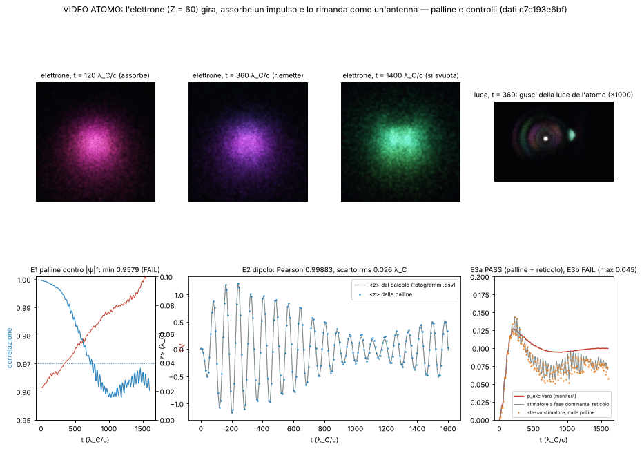

# Video atomo: l'elettrone che gira, assorbe la luce e la rimanda, al rallentatore

Studio `vl_` del 13/10/2026. Video lento della corsa accoppiata luce + atomo (ione idrogenoide Z = 60, regola zig-zag
3-D, campo di luce calcolato insieme). **Taglio attuale: esportazione nuova** (commit c473b27: 1s liscio nella valle
k = 0, nucleo imparato, accoppiamento centrato + trasverso, senza lo smorzamento finto ×2,2), impronta
`c7c193e6bf` (sha256 di manifest.json + fotogrammi.csv, manifest del 13/10/2026 17:07 UTC), dati in
`/mnt/project-files/ripresa/dati/atomo_accoppiato/`. Il vecchio taglio BOZZA (impronta `12322e1817`) non è mai
stato montato: i suoi fotogrammi sono stati rifatti su questa esportazione (storia in §8).

Codice: `lab/vl_campi.py` (campi che muovono e colorano le palline), `lab/vl_palline.py` (moto delle palline, a pezzi
con checkpoint), `lab/vl_esami.py` (esami), `lab/vl_render.py` (disegno), `lab/vl_figura.py` (figura e fermo-immagine),
`lab/vl_video.sh` (montaggio), **`lab/vl_tutto.sh` (tutto con un comando)**. Pre-registrazione `lab/out/vl_prereg.json`
(commit cf95ca6, prima di muovere qualunque pallina) + emendamenti `vl_amend1.json` (edd687b), `vl_amend2.json`,
**`vl_amend3.json` (cb03c72, prima di muovere le palline sui dati nuovi)**. Risultati: `lab/out/vl_campi.json`,
`lab/out/vl_esami.json`, `lab/out/vl_serie.json` (versioni vecchie: `*_v1.json`).

Video e fermo-immagine (verificati con `ls -la` il 13/10 alle 19:19 UTC), in `/mnt/project-files/modello-standard/`:
`video_atomo_bagliori_1080p.mp4` (51 s, 35 MB), `video_atomo_bagliori_720p.mp4` (15 MB), fermo-immagine
`video_atomo_bagliori_assorbe.png` (t = 120), `_oscilla.png` (t = 200), `_riemette.png` (t = 360),
`_si_svuota.png` (t = 1400). Versione "bagliori": ogni pallina è un bagliore additivo, niente scie.



---

## 0. In breve

* **Cosa si vede.** A sinistra, grande, *dentro l'atomo*: 120 000 palline che sono l'elettrone, messe una volta sola
  dove |ψ|² è grande e poi mosse **dalla corrente della regola** (corretta al minimo per la continuità). A destra in
  alto la luce intorno all'atomo (scatola di 416 λ_C, l'atomo è il puntino al centro, in scala vera): palline di
  energia della luce. In basso a destra il tempo, la curva p_exc (dal calcolo) e il dipolo ⟨z⟩.
* **Novità di questo taglio: l'elettrone gira.** Con l'1s partito nella valle k = 0 e il nucleo imparato, la regola
  porta una corrente vera attorno a z: le palline **girano**, a **~0,83 della velocità di Dirac** Zα c sinθ (misurato
  sulle palline: 0,86 all'inizio, 0,79 alla fine). Il passo a = 0,5 λ_C da solo dà 0,867 (Debiti, surfisti fase 4:
  0,867 / 0,910 / 0,943 / 0,958 a a = 0,5 / 0,4 / 0,3 / 0,25): è **errore del passo del reticolo**, scritto a schermo,
  **nessuna scala per chiuderlo**.
* **La storia in tre atti** (49 s di video, 24 fotogrammi al secondo):
  1. arriva l'impulso (bande colorate = direzione di E);
  2. la nuvola viene scossa: **oro in alto e blu in basso, poi il contrario**, al ritmo ω₂₁: il dipolo che oscilla
     (sovrapposizione 1s + 2p); p_exc sale fino a **0,127** (t = 208);
  3. l'impulso esce; la sovrapposizione 1s + 2p guidata dalla luce **oscilla come un'antenna** e irraggia: dal centro
     escono **gusci di luce** (amplificata ×1000 in energia, dichiarato). **Non è decadimento spontaneo** (Emissione
     fase 3, 57de9e9). p_exc scende a 0,094 (t = 800) e poi **non scende più** (0,099 a t = 1600): non è fisica, è la
     deriva dell'1s di partenza (sotto).
* **Costi dichiarati a schermo.** L'1s di partenza non è un livello esatto: senza luce la fedeltà scende a 0,965 in
  4000 tick (deriva del 3,5 %), quindi p_exc contiene anche la deriva e **dopo t ≈ 800 smette di scendere per questo**.
  La riga forte esce a **−0,45 %** da 1s→2p3/2 (soglia 0,3 %): **FAIL** del calcolo (ATOMO §3.7), scritto a schermo.
* **Esami** (pre-registrati): dipolo dalle palline = calcolo (**0,9988**), luce coerente (0,95), impulso fedele (0,98);
  **falliti**: E1 (le palline perdono fedeltà a |ψ|² piano piano: minimo 0,958 contro 0,97), E3b (previsto), E5 (il
  bilancio 1,61 esce fuori perché p_exc contiene la deriva). Dettagli in §4.
* **Validazione, non scoperta.** Dipolo a ω₂₁, emissione a ciambella, giro dell'1s vicino a Dirac sono fisica nota;
  il valore è che **escono dalle palline della regola** senza nulla disegnato.

## 1. Cosa si vede, pannello per pannello (come a un ventenne)

**Dentro l'atomo (sinistra).** Il nucleo è al centro (non disegnato). **Ogni pallina è un bagliore morbido** (luce
che si somma: dove se ne sovrappongono tante il colore va verso il bianco), come la scena dell'atomo zig-zag del
Laboratorio con i surfisti accesi. **Niente scie, niente righe**: il movimento si vede solo perché i bagliori si
spostano (fra un fotogramma di dati e l'altro le posizioni sono interpolate dal moto delle palline). **Colore = fase
dell'onda** (la fase esportata della componente dominante, la stessa che colora la scena del Laboratorio):
nell'1s è quasi la stessa ovunque (coerenza 0,96–0,998), quindi la nuvola ha quasi un solo colore che cambia piano
nel tempo. **Grandezza** dalla densità locale: dove l'elettrone è rado i bagliori sono più grandi e più tenui.
Si disegnano 24 000 palline delle 120 000 (più tutte nel bagliore largo).
*(Prima versione, scartata il 13/10 su richiesta di Valerio: scie di 6 fotogrammi e colore oro/blu = cambio di
densità rispetto all'1s.)*

* **Prima della luce** le palline girano attorno a z (l'asse dello spin): è la corrente dell'1s della regola, quella
  che nella teoria di Dirac dà il momento magnetico. Girano a ~0,83 della velocità di Dirac (§0).
* **Quando la luce scuote l'atomo**, al massimo il 12–13 % dell'elettrone passa allo stato eccitato. Le due onde
  battono: la nuvola va su e giù lungo z ogni ~42 λ_C/c (si legge bene nella curva ⟨z⟩ in basso; nel colore poco,
  perché la fase cambia poco).

**La luce (destra in alto).** Ogni pallina è un pezzetto dell'energia della luce, (E² + B²)/2, mossa con la velocità
dell'energia (mai più di c). Ogni pallina è un bagliore (niente strisce lungo E,
niente scie). Colore = direzione di E. Vista tagliata: una fetta 0 < y < 72 λ_C. Prima passa l'impulso
come una fila di bande; dopo (t ≥ 240 vicino all'atomo) dal centro nascono **gusci** che si allontanano a c: la luce
dell'antenna 1s + 2p. Ogni pallina della luce dell'atomo vale 1/1000 di una pallina dell'impulso: senza questo
fattore non si vedrebbe (l'energia rimandata è 1,6·10⁻³ di quella dell'impulso). Eventuali archi deboli in più sono un
effetto della scatola periodica (Emissione fase 3): scritto a schermo; a occhio non li ho riconosciuti.

**Il pannello in basso.** t in λ_C/c e in zeptosecondi (1 λ_C/c = 1,288·10⁻²¹ s; tutto il video sono 2 attosecondi),
il rallentamento (5·10¹⁹ volte nella parte lenta, 2·10¹⁹ nella veloce), la curva **p_exc** (dal calcolo,
fotogrammi.csv, mai scritta a mano nel codice) e il dipolo **⟨z⟩** (punti = palline, riga = calcolo), poi le scritte.

## 2. Come è fatto (numeri)

### 2.1 Elettrone

* **Nessuno smussamento.** In questa esportazione la scacchiera delle 4 valli è 10⁻⁵ all'inizio e sale a 8 % in
  ampiezza (6,5·10⁻³ in potenza) alla fine; smussare con σ = 2 celle abbasserebbe il giro da 0,83 a 0,72 di Dirac
  (misurato prima, emendamento 3). Quindi niente smussamento.
* **Semina, una volta sola**: 120 000 palline ∝ ρ·a³, posizione uniforme nella cella (seme 20261013). **Nessuna
  rinascita.**
* **Il flusso** (emendamento 3). La corrente esportata è una lettura per cella: dentro c'è una parte di
  "compressione" finta (|∇·j| ≈ 0,8–1,0 contro |∂ρ/∂t| ≈ 0,06). Si corregge col cambio più piccolo pesato dalla
  densità, J = j − ρ∇χ con ∇·(ρ∇χ) = ∇·j + ∂ρ/∂t, sulle facce delle celle, per ogni intervallo fra due fotogrammi
  (gradiente coniugato, residuo < 10⁻⁷, ≤ 181 iterazioni). La correzione vale il **55 %** della j (mediana): sopra la
  soglia del 25 % dell'emendamento 2, che era sbagliata: la parte che gira è validata da sola (Debiti, surfisti esatti
  sui collegamenti: 0,88 → 0,83), e quella che si toglie è la compressione. Al fotogramma 100 il flusso corretto è per
  il **95 %** azimutale (giro attorno a z), velocità media pesata 0,30 c, residuo di continuità 4·10⁻⁵.
* **Integratore**: punto medio sui flussi delle facce (RT0, come i surfisti), passo ≤ 0,5 λ_C/c; velocità tagliata a
  0,95 c in 14 011 valutazioni (vicino al nucleo, dove v → c); 0 palline fuori dalla scatola.

### 2.2 Luce

* Esportato solo E (64³, celle da 8 λ_C). **B si ricostruisce** con Faraday (rotore spettrale, trapezi), da
  B₀ = x̂ × E₀, togliendo il residuo fermo (media dei fotogrammi 60–200). B contro r̂ × E: **0,953** di media
  (minimo 0,842); sull'impulso 0,9988–0,9998.
* **Palline dell'impulso**: 150 000 ∝ u = (E² + B²)/2 a t = 0, mosse con v = 2E×B/(E²+B²) (Catmull-Rom nel tempo).
* **Palline della luce dell'atomo**: nascono sulla sfera R₀ = 40 λ_C da t = 240, ∝ flusso uscente (S·n̂)⁺; ognuna vale
  **1/1000** di una pallina dell'impulso (**×1000 in energia, ×31,6 in campo**, a schermo). Ne nascono 221 110; alla
  fine ne restano 19 045.

### 2.3 Video

* 1121 fotogrammi di disegno per 201 di dati: **12 per fotogramma di dati fino a t = 280**, raccordo, **4 dopo
  t = 360**; più 1,5 s fermi all'inizio e 3 s alla fine. 1920×1080 e 1280×720, H.264. CPU, ~10 s a fotogramma.

## 3. Che cosa è amplificato o smussato (tutto dichiarato a schermo)

| cosa | quanto | perché |
|---|---|---|
| densità e corrente dell'elettrone | **nessuno smussamento** | la scacchiera è piccola in questa esportazione; smussare toglierebbe giro |
| luce dell'atomo | ×1000 in energia (×31,6 in campo) | è 1,6·10⁻³ dell'impulso, sparsa su gusci grandi |
| accoppiamento luce-elettrone (dai dati) | K = 10 | vedere lo svuotamento in una corsa corta |
| colore dell'elettrone | fase dell'onda, nessuna amplificazione | come la scena del Laboratorio |
| giro dell'elettrone | **nessun ritocco**: ~0,83 di Dirac come esce | errore del passo, dichiarato |

## 4. Esami (pre-registrati in `lab/out/vl_prereg.json`, E8 in `vl_amend3.json`)

| esame | soglia | risultato | esito |
|---|---|---|---|
| E1 palline fedeli a \|ψ\|², 201 fotogrammi, senza rinascite | Pearson ≥ 0,97 sempre; TV ≤ TV(0)+0,05 | min **0,958** (fot. 129); TV 0,022 → 0,105 | **FAIL** |
| E2 dipolo ⟨z⟩ dalle palline contro il calcolo | Pearson ≥ 0,98; rms ≤ 0,10 λ_C | **0,9988**; rms 0,026 λ_C; ampiezza 1,213 contro 1,205 | **PASS** |
| E3a p_exc dalle palline = stesso stimatore sul reticolo | ≤ 0,02 | 0,013 | **PASS** |
| E3b p_exc dalle palline contro p_exc vero | ≤ 0,02 | 0,045 (media −0,023) | **FAIL (previsto)** |
| E4 B ricostruito coerente con la radiazione | media ≥ 0,90, min ≥ 0,80 | 0,953 / 0,842 | **PASS** |
| E5 luce uscita da R₀ / energia persa dall'atomo | in [0,67; 1,5] | **1,61** (3,17·10⁻³ contro 1,97·10⁻³ mc²) | **FAIL** |
| E6 palline dell'impulso fedeli a u (fot. 10, 20, 30) | Pearson ≥ 0,90 | 0,985 / 0,985 / 0,981 | **PASS** |
| E7 dichiarazioni a schermo | leggibili | ×1000, K = 10, rallentatore, "dal calcolo", impronta, giro e passo, deriva, −0,45 % | **PASS** |
| E8 velocità di giro / (Zα c sinθ) (solo riportato) | contro 0,83–0,88 (Debiti) | 0,859 / 0,827 / 0,826 / 0,833 / 0,817 / 0,789 ai fotogrammi 1 / 25 / 50 / 100 / 150 / 199 | — |

Note oneste:

* **E1 fallisce davvero.** La correlazione scende piano e con regolarità (0,9996 → 0,97 a t ≈ 720 → 0,958). Le
  palline girano veloci (0,30 c di media, fino a 0,95 c vicino al nucleo, 14 011 tagli) mentre i dati hanno un
  fotogramma ogni 8 λ_C/c: in un intervallo una pallina fa ~2,4 λ_C di giro, e il flusso è interpolato linearmente fra
  due fotogrammi; i tagli a 0,95 c rompono un po' la continuità. A occhio la nuvola resta giusta (E2 passa), ma le
  palline non sono più traccianti perfetti. Rimedio: più fotogrammi esportati o flussi per tick (debito 1).
* **E5 fallisce per la deriva.** p_exc contiene la deriva dell'1s (fino a ~0,035), che *sale*: così il calo di p_exc
  sottostima l'energia che l'atomo perde davvero, e il rapporto esce 1,61. Non è luce in più: è il denominatore.
* E3b: con la sola fase dominante esportata lo stimatore sbaglia già sul reticolo; **la curva a schermo è quella del
  calcolo**, ed è scritto.
* E4 ed E5 erano già stati misurati sull'esportazione vecchia (controlli, non previsioni).

## 5. Fallimenti e sorprese

1. **La corrente esportata non è un flusso**: il 55 % è compressione finta della lettura per cella. Si corregge, ma
   servono i **flussi sui collegamenti** nell'esportazione (debito 1).
2. **B non c'è nell'esportazione**: ricostruito con Faraday (0,95). Debito 2.
3. **Il giro c'è, a 0,83 di Dirac, non a 1.** È l'errore del passo a = 0,5 λ_C (Debiti: 0,867 dal passo; il resto,
   0,86 → 0,79 nel tempo, va con la deriva dell'1s e con la scacchiera che cresce). Nessuna scala.
4. **p_exc smette di scendere dopo t ≈ 800** (0,094 → 0,099): l'1s di partenza non è un livello esatto (fedeltà 0,965
   in 4000 tick). Scritto a schermo: "per questo dopo t ≈ 800 p_exc non scende più (non è fisica)".
5. **Riga forte a −0,45 %** da 1s→2p3/2 (soglia 0,3 %): FAIL del calcolo (ATOMO §3.7), a schermo.
6. E1 ed E5 falliti (§4).
7. I gusci sono l'antenna 1s + 2p guidata, **non decadimento spontaneo**; un 2p da solo qui non emetterebbe (manca la
   luce quantizzata).

## 6. Debiti

1. Flusso dell'elettrone: servono i **flussi sui collegamenti** (o fotogrammi più fitti) nell'esportazione; ora la
   j per cella è corretta per la continuità e le palline perdono fedeltà (E1).
2. B ricostruito con Faraday: esportare B dal Laboratorio.
3. 1s di partenza non esatto (nucleo imparato, 2 numeri da NUCLEO_1S): deriva 3,5 % in 4000 tick, sporca p_exc ed E5.
4. Giro a 0,83 di Dirac: passo del reticolo (a = 0,5 λ_C); serve un passo più fine.
5. Luce dell'atomo ×1000 e separata dall'impulso solo nel tempo (da t = 240): manca una corsa "senza atomo".
6. K = 10, campo classico, ione Z = 60, riga forte −0,45 % (debiti della corsa).
7. Le palline sono una **lettura** (traccianti di densità e energia), come i surfisti.
8. Disegno su CPU: il porto su GPU è lavoro del motore grafico.

**Parametri fisici liberi: 0.** **Manopole estetiche (non toccano gli esami): 10** — grandezza dei bagliori
(elettrone, luce), legge grandezza–densità, bagliore largo (2), guadagni di esposizione (2), palline disegnate
(24 000), camere (2 percorsi), più palette e spessore della fetta. Niente scie.

## 7. Come rifarlo

Un comando solo: `lab/vl_tutto.sh` (passi sotto, uno per uno).

```
python3 lab/vl_campi.py                  # ~6 min: campi in SCR (non in git) + lab/out/vl_campi.json
lab/vl_drive.sh elettrone; lab/vl_drive.sh luce     # palline, a pezzi da <= 8 min
python3 lab/vl_esami.py                  # esami
python3 lab/vl_render.py refs 0 50       # esposizione fissa per tutto il video
lab/vl_render_drive.sh 0 1121 1.0        # fotogrammi 1080p
lab/vl_video.sh                          # mp4
python3 lab/vl_figura.py                 # figura e fermo-immagine
```

Variabili: `VL_SIG` (smussamento in celle, default 0), `VL_FLUSSO` (`corrente` default, `continuita`, `auto`),
`VL_ETICHETTA` (scritta in alto a destra; vuota per il taglio finale).

## 8. Storia (tagli precedenti, mai montati)

* **Esportazione `12322e1817`** (1s esatto nudo, smorzamento finto ×2,2 in `accoppiato.rs`, EMISSIONE §7), taglio
  BOZZA: smussamento σ = 1 λ_C per la scacchiera (1,65 → 8,5·10⁻⁵); la j per cella dava un giro **finto** (Debiti B5:
  nessun livello puro di quel reticolo porta corrente netta), quindi emendamento 1: flusso dalla sola continuità e
  palline dell'1s ferme ("in un livello puro questo reticolo non porta corrente: le palline stanno ferme"). Esami:
  E1 0,9996 PASS, E2 0,999997 PASS, E3a 0,013 PASS, E3b 0,068 FAIL (previsto), E4 0,963 PASS, E5 0,906 PASS, E6 PASS.
  I fotogrammi sono stati cancellati da `vl_tutto.sh` quando è arrivata l'impronta nuova: nessun video BOZZA esiste.
* **Emendamento 2** (scelta automatica del flusso con soglia 25 %) superato dall'emendamento 3 (§2.1).
