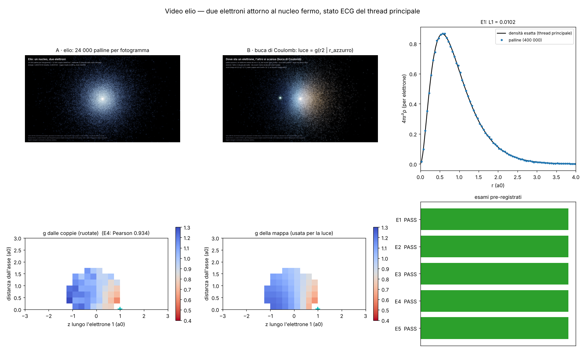

# Video dell'elio a bagliori (studio `he_v_`)

File: `lab/he_v_prereg.py` → `lab/out/he_v_prereg.json` (committata **prima** di esami e fotogrammi),
`lab/he_v_esami.py` → `lab/out/he_v_esami.json`, `lab/he_v_render.py` (disegno), `lab/he_v_figure.py` → figura
`docs/fig/he_v_figure.png`. Uscite in `/mnt/project-files/modello-standard/he_v_*`.

## Cosa si vede (detto semplice)

Un nucleo fermo (il bagliore caldo al centro) e due elettroni. Ogni pallina azzurra è **una posizione possibile di un
elettrone**, presa dallo stato fondamentale dell'elio calcolato dal thread principale. Le palline vengono **a coppie**
(elettrone 1, elettrone 2 nello stesso momento): 12 000 coppie per fotogramma, 24 000 palline.

- **Parte A (8 s)**: la nuvola intera, la camera gira piano. È densa vicino al nucleo e sfuma fuori (raggio medio 0,93 a₀).
- **Parte B (10 s)**: la **buca di Coulomb**. Mettiamo noi un elettrone (pallina azzurra brillante) a 1 a₀ dal nucleo
  e lo facciamo girare su un giro scelto. Le palline restano le stesse, ma la loro **luce è pesata con g** = quanto
  l'altro elettrone sta lì *rispetto al solito*, sapendo dove sta il primo. Arancio: più del solito (dalla parte opposta);
  blu scuro: meno (vicino all'elettrone azzurro). È la cosa che solo uno stato a **due** elettroni ha: gli elettroni si
  scansano. Vicino all'elettrone azzurro l'altro c'è circa la metà (g minimo 0,49 sulla mappa a celle).

Il tremolio **non è moto**: lo stato è stazionario, ogni fotogramma pesca coppie nuove dalle 200 000 esportate.
La **scia corta** (regola di Valerio del 13/10) è la persistenza dei bagliori degli ultimi 5 fotogrammi (0,21 s) che si
spengono: niente linee, niente segmenti.

## Da dove vengono i dati (onestà)

- Stato: **thread principale** (studio `multi_e`, commit f7d085f), gaussiane correlate esplicite (ECG, 200 funzioni)
  con l'operatore della regola a molti elettroni (massa m0 della fase 5). **Non** sono palline zig-zag sulla griglia.
  E = −2,9037213 Eh (esatta −2,9037244: 3 μEh sopra, è variazionale).
- Esportazione `/mnt/project-files/ripresa/dati/elio/` (manifest.json): 200 000 coppie da |ψ(r₁,r₂)|² (Metropolis),
  densità esatta, mappe condizionate con l'elettrone 1 fermo su +z a 0,5 e 1,0 a₀.
- Qui non si ricalcola niente della fisica: si disegna e si **controlla** che il disegno dica il vero.

## Esami (pre-registrati) — 5 PASS su 5

| esame | cosa | risultato | soglia | esito |
|---|---|---|---|---|
| E1 | palline contro densità esatta (4πr²ρ, celle 0,05 a₀) | L1 = **0,0102** | ≤ 0,03 | PASS |
| E2 | ⟨r⟩ e ⟨r₁₂⟩ dalle palline contro 0,929472 e 1,42207 a₀ | **0,92757** (−0,20 %), **1,41817** (−0,27 %) | 0,5 % | PASS |
| E3 | buca di Coulomb: P(r₁₂ < 0,5 a₀) coppie vere / rimescolate | **5,71 % / 7,57 %** = 0,754 | ≤ 0,85 | PASS |
| E4 | mappa g usata per la luce contro g ricavata dalle coppie (ruotate su +z) | Pearson **0,934**, scarto mediano **0,029** (52 celle) | ≥ 0,9; ≤ 0,05 | PASS |
| E5 | media di g sulle palline in ogni fotogramma B (deve essere 1) | 0,9976 – 1,0026 | ±0,03 | PASS |

Nota su E2: le palline danno ⟨r⟩ e ⟨r₁₂⟩ 0,2–0,3 % sotto i valori noti; il thread principale dà gli stessi numeri nel
manifest (0,92757; 1,41817). È il campionamento Metropolis del thread principale (e la scala di lunghezza 0,99962 della
massa), non il disegno. Dentro la soglia, ma lo scrivo.

**Validazione, non scoperta**: la buca di Coulomb dell'elio è nota da quasi cent'anni (Hylleraas). Qui si mostra che
le nostre palline la portano dentro senza trucchi: le coppie vere stanno vicine il 25 % meno di coppie indipendenti.

## Cosa è scelto (manopole, tutte estetiche)

Colori (azzurro per densità, arancio/blu scuro per g con scala 0,3), dimensioni e aloni dei bagliori, guadagno, camera,
12 000 coppie per fotogramma, scia di 5 fotogrammi, giro dell'elettrone di riferimento (a r = 1 a₀ perché la mappa è
per |r₁| = 1,0). **Parametri di fisica: zero.**

## Debiti

- Lo stato è un risolutore (ECG) e non la regola zig-zag che cammina (debito del thread principale, scritto lì).
- Nucleo fermo (massa infinita nel disegno; nella fisica c'è la scala 0,99962 del thread principale).
- La mappa g fuori da ±3 a₀ è presa dal bordo (valori 0,96–1,08); le palline oltre 3 a₀ sono poche.
- La mappa è per |r₁| = 1,0 a₀ esatto; il giro dell'elettrone di riferimento sta a 1,0 a₀ apposta.

## Come rieseguire

```
python3 lab/he_v_prereg.py
python3 lab/he_v_esami.py
python3 lab/he_v_render.py refs
python3 lab/he_v_render.py still 100 he_v_foto_A.png ; python3 lab/he_v_render.py still 250 he_v_foto_B.png
python3 lab/he_v_render.py batch 0 432 --scala 0.6667     # ripetere finché non scrive più "checkpoint"
ffmpeg -framerate 24 -i <SCR>/he_v_png_720/%04d.png -c:v libx264 -pix_fmt yuv420p -crf 18 he_v_video_720p.mp4
python3 lab/he_v_figure.py
```


