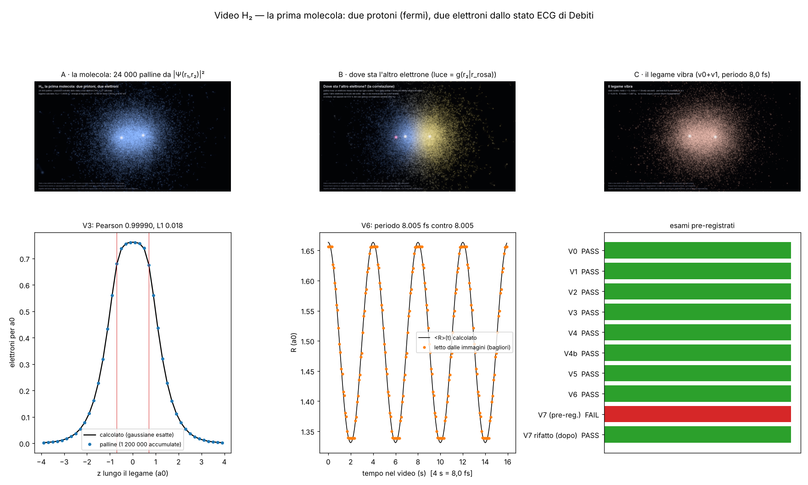

# Video H₂: la prima molecola a bagliori (studio `h2v_`)

File: `lab/h2v_prereg.py` → `lab/out/h2v_prereg.json` (**committata prima di ogni corsa**, cc6ec38),
`lab/h2v_wf.py` (ricostruzione delle funzioni d'onda), `lab/h2v_core.py` (tutto il calcolato), `lab/h2v_sim.py`
(palline e esami V1–V4b), `lab/h2v_check.py` (V0, V5–V7), `lab/h2v_render.py` (disegno), `lab/h2v_zzlook.py` (l'aspetto
dell'atomo zig-zag), `lab/h2v_figure.py` → `docs/fig/h2v_figure.png`. Esiti `lab/out/h2v_esami.json`.
Uscite in `/mnt/project-files/modello-standard/h2v_*`.

## Cosa si vede (detto semplice)

Due protoni (i due bagliori bianchi) e due elettroni. Ogni pallina è **una posizione possibile di un elettrone**, presa
dallo stato a due elettroni |Ψ(r₁, r₂)|² che Debiti ha calcolato (studio aggmol, fase 2). Le palline vengono a coppie:
12 000 coppie, 24 000 palline.

- **A (10 s) — la molecola.** Protoni fermi a 1,40 a₀. La nuvola è più densa sui protoni e fa un "ponte" in mezzo: è il
  legame. Le palline tremolano e lasciano una scia corta: è il campionatore (Metropolis) che le sposta di poco a ogni
  fotogramma, **non** sono traiettorie (lo stato fondamentale è reale: la sua corrente è zero).
- **B (12 s) — dove sta l'altro elettrone.** Mettiamo noi un elettrone (pallina rosa) su un giro scelto. Le palline sono
  le stesse, ma la loro luce è pesata con g(r₂ | r₁) = quanto l'altro elettrone sta lì *rispetto al solito*, sapendo dove
  sta il primo. Giallo: più del solito; blu: meno. Quando il rosa è dietro il protone sinistro, l'altro elettrone si sposta
  sul destro. È una cosa che **solo uno stato a due elettroni** ha: in Hartree–Fock (un orbitale per due) g = 1 ovunque.
- **C (16 s) — il legame vibra.** Stato scelto: metà v = 0 e metà v = 1 (come una molecola che ha appena preso mezzo
  quanto). I protoni stanno al valore medio R(t), che oscilla con il periodo calcolato, **8,005 fs**, mostrato in 4 s
  (rallentato 5,0·10¹⁴ volte). Gli elettroni seguono: la loro densità è la miscela delle densità calcolate agli 11 R
  della griglia, pesate con quanto il pacchetto dei protoni sta lì (Born–Oppenheimer).

## Esami (pre-registrati in `lab/out/h2v_prereg.json`)

| esame | cosa | risultato | soglia | esito |
|---|---|---|---|---|
| V0 | le basi ECG ricostruite (stessa macchina, stessi semi) contro le energie di Debiti, 11 R | max |diff| **7·10⁻¹³ Eh** (identiche) | 10⁻⁶ | PASS |
| V1 | viriale a R = 1,40: ⟨T⟩ contro −E − R dE/dR | ⟨T⟩ = 1,1750206, atteso 1,1750241 (−3,5·10⁻⁶) ; norma 1 esatta | 10⁻³ | PASS |
| V2 | ⟨1/r₁₂⟩ contro 0,5873 (citato a memoria) | **0,58736** (+0,01 %) | 1 % | PASS |
| V3 | palline contro densità calcolata (1,2 milioni, colonna nel piano xz) | Pearson **0,99990**, L1 **0,018** | 0,995; 0,05 | PASS |
| V4 | elettroni da parti opposte del piano di mezzo | calcolo **0,5749**, palline 0,5749 (HF: 0,5) | entro 0,01 e ≥ 0,52 | PASS |
| V4b | P(altro a z > 0 \| uno a z < −0,35) | calcolo **0,5928**, palline 0,5922 | 0,02 | PASS |
| V5 | lunghezza di legame letta dall'immagine (bagliori dei protoni, vista di lato) | **1,4093 a₀** (+0,67 %) | 2 % di 1,40 | PASS |
| V6 | periodo di R(t) letto dalle immagini contro h/(E₁ − E₀) | **8,00485 fs** contro 8,00485 (ampiezza di R(t) 0,165 a₀) | 1 % | PASS |
| V7 | la nuvola segue i protoni: ⟨\|z\|⟩ delle palline a R massimo e minimo contro il calcolo | prima versione **FAIL**; seconda: 0,886 contro 0,888 (R max), 0,780 contro 0,778 (R min) | 0,03 a₀ e stesso segno | **FAIL** (v1) / PASS (v2, dopo) |

### Il FAIL di V7 (dichiarato) e cosa ho cambiato dopo

Prima versione della parte C: il campionatore muoveva ogni pallina di 0,07 a₀ due volte per fotogramma. Troppo poco:
a R massimo (1,66 a₀) le palline davano ⟨|z|⟩ = 0,824 contro 0,885 calcolato, a R minimo (1,33) 0,820 contro 0,778.
Cioè **la nuvola restava indietro** e quasi non si muoveva: i protoni vibravano, gli elettroni no. Il verdetto
pre-registrato resta FAIL (in `h2v_esami.json` come `V7_v1`).
Dopo (non pre-registrato, dichiarato): parte C rifatta con 8 000 coppie, 6 mosse da 0,32 a₀ per fotogramma (provato
prima su 2 000 coppie: ritardo ~0,015 a₀), pesi della griglia sotto 1 % tolti e rinormalizzati. Inoltre la griglia in R
è stata allargata da 8 a 11 punti (1,1; 1,8; 2,0 aggiunti) quando ho visto che il pacchetto arriva a 2 a₀ (alla prima
corsa il 52 % del peso finiva accorpato su 1,7). Ora fuori da [1,05; 2,1] resta al massimo il 2,8 %, accorpato ai bordi.

Anche le parti A e B sono state rigenerate (0,03 a₀ × 3 mosse per fotogramma) quando è arrivata la regola della **scia
corta**: con mosse grandi la scia diventava una fila di puntini (vietato). Gli esami V1–V4b non dipendono da questo
(usano un campionatore separato, decorrelato).

V6 è un controllo della catena (livelli → fotogrammi → immagine), non fisica nuova: il periodo viene dai livelli di
Debiti per costruzione; l'esame dice che niente lo ha storto lungo la strada.

Conteggio: **8 PASS pre-registrati su 9** (V0–V6 PASS, V7 FAIL nella versione pre-registrata); V7 passa nella
versione rifatta dopo, dichiarata.

## Validazione o scoperta?

**Validazione.** Tutti i numeri di H₂ qui sono noti da decenni (Kołos–Wolniewicz). Cosa dimostra il video: la catena
regola → operatore → due centri → stato a due elettroni → palline **non perde niente** di ciò che si vede: densità
(V3), correlazione (V4), lunghezza di legame (V5), vibrazione (V6). Nessuna fisica nuova.

## L'aspetto (regola di Valerio del 13/10: la grafica dell'atomo zig-zag è la base)

Parametri copiati da `src/atomo/zzscena.rs`, `render_zz.rs`, `balls.wgsl`, `main.rs` (in `lab/h2v_zzlook.py`):
sprite additivo `exp(−3q²)(1−q²) + 0,3·exp(−14q²)`, grandezza `min(0,004·r_cam, 0,08)` a₀ (scena Tavola), luminosità
`0,03 + 0,30·(ρ/ρ_max)^0,35`, colore = fase con la tavolozza `tinta()`, fondo (0,008; 0,01; 0,02), campo 0,8 rad,
bloom 0,18. Lo stato fondamentale di H₂ non ha nodi: la fase è una sola ovunque e gira alla frequenza della sua energia;
qui una volta ogni 8 s (rallentata, e **non** nella stessa scala di tempo della vibrazione: dichiarato).
**Approssimati**: bloom (tre gaussiane) e tono (TonyMcMapface → x/(1+x) sulla luminanza). Scia: gli ultimi 5 fotogrammi
(0,21 s) della stessa pallina, ri-disegnati lungo il percorso (10 sotto-passi) più deboli e più piccoli; nella parte C
(mosse grandi) restano fermi dov'erano, senza unire i punti.

### Interfaccia per il programma unico

`carica(f)` → dati di un fotogramma (palline, classi, protoni, passato per la scia, meta); `disegna(d, w, h)` → immagine.
Per la modalità tavola periodica del thread principale basta che `disegna` emetta `Ball` = `([f32; 3], f32, [f32; 4])`
come `render.rs` (posizione in a₀ via `schermo`, grandezza 1 per gli elettroni e 4 per protoni e riferimento, rgba con
alpha = luminosità). Servono i file delle basi (`lab/out/h2v_basis_R*.npz`, da `h2v_wf.py`) e `h2v_core.WF.psi` per il
campionatore. Nessun file del thread principale toccato.

## Debiti

- **Born–Oppenheimer** (di Debiti): protoni fermi mentre si calcolano gli elettroni.
- Lo stato è del **risolutore ECG**, non della regola zig-zag che cammina (debito di Debiti, §12.5 di
  `AGGLOMERATO_DUE_ATOMI.md`); ereditati DEBT-1/2/4 del thread principale.
- Asse della molecola fisso (la rotazione J = 0 sarebbe una sfera).
- Moto delle palline = campionamento. Vibrazione: stato scelto (v0 + v1)/√2; protoni disegnati al valore medio R(t).
- Densità nella parte C: miscela su 11 punti di R (discretizzazione), pesi < 1 % tolti.
- V2: il riferimento 0,5873 è citato a memoria (da verificare su carta).

## Manopole

Fisica: **zero**. Estetica: tavolozza di g (scala 0,3), giro del colore (8 s), luminosità di protoni (2,5) e
riferimento (2,0), camera, numero di palline, mosse del campionatore per fotogramma, scia (5 fotogrammi, decadimento
1,4), giro del riferimento, rallentamento del tempo.

## Come rieseguire

```
python3 lab/h2v_prereg.py
python3 lab/h2v_wf.py                 # ripetere finché scrive ALL DONE (11 basi, ~2 min l'una)
python3 lab/h2v_sim.py exams
H2V_STOP=528 python3 lab/h2v_sim.py frames   # parti A e B, ripetere finché FRAMES DONE
python3 lab/h2v_sim.py framesC2       # parte C, ripetere finché C2 DONE
python3 lab/h2v_check.py
python3 lab/h2v_render.py batch 0 912 --scala 0.6667   # ripetere
ffmpeg -framerate 24 -i <SCR>/h2v_png_720/%04d.jpg -c:v libx264 -pix_fmt yuv420p -crf 18 h2v_video_720p.mp4
python3 lab/h2v_figure.py
```



## Stato alla chiusura (14/10, notte)

- Clip **parziale** 720p: 612 fotogrammi su 912 (A intera, B 0–285 e 330–446, C 620–830 = due periodi): tagli secchi tra
  i pezzi. File `h2v_video_720p_parziale.mp4` (32 MB) nella cartella di lavoro del cloud; la copia in
  `/mnt/project-files/modello-standard/` non è stata possibile (il disco condiviso dava errore di I/O) — da copiare.
- Foto finali (aspetto zig-zag) `h2v_foto_A/B/C.png`: stesso problema di copia. In `modello-standard/` c'è solo la bozza
  della prima versione (`h2v_foto_bozza.png`, aspetto vecchio) e `h2v_foto_A/B.png` dell'aspetto vecchio.
- Per finire: `python3 lab/h2v_render.py batch 0 912 --scala 0.6667` (salta i fotogrammi già fatti), poi ffmpeg.
