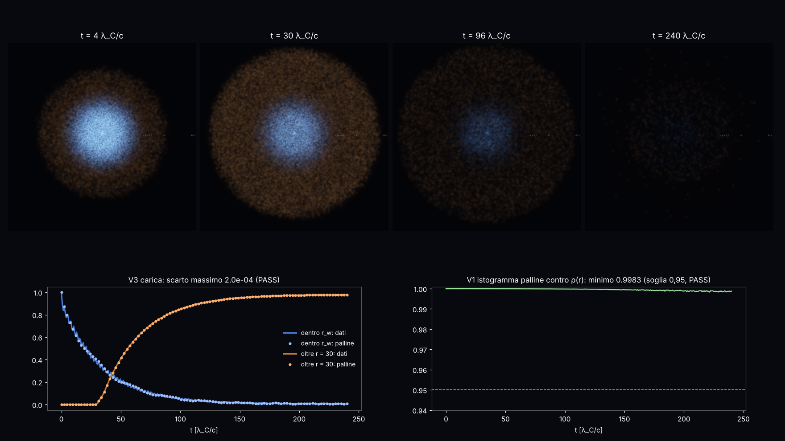

# Video supercritico: l'1s di Z = 200 si tuffa nel mare di Dirac e il vuoto emette un positrone

Studio `vz_` del 13/10/2026. Video lento a **bagliori** (stessa ricetta di `docs/VIDEO_ATOMO.md`: ogni pallina è un
bagliore morbido additivo, niente scie, niente righe) del film del tuffo esportato dallo studio ZSTAR:
`lab/out/zstar_film.json` al commit **fc8a08c** (ramo `claude/problemi-aperti-56mnej`, letto con `git show`, **non
fuso** in master), formato in `docs/ZSTAR.md` §10 di quel ramo. Fisica del film: `docs/SUPERCRITICO.md` §5.5 dello
stesso ramo.

Codice: `lab/vz_comune.py` (dati, palline, tempi), `lab/vz_esami.py` (esami), `lab/vz_render.py` (disegno),
`lab/vz_render_drive.sh` (disegno a pezzi ≤ 8 min, riprendibile), `lab/vz_video.sh` (montaggio),
`lab/vz_figura.py` (figura e fermo-immagine), **`lab/vz_tutto.sh` (tutto con un comando)**.
Pre-registrazione `lab/out/vz_prereg.json` (commit **f7ac7d2**, prima di muovere qualunque pallina); risultati
`lab/out/vz_esami.json`.

Video e fermo-immagine in `/mnt/project-files/modello-standard/`: `video_supercritico_1080p.mp4`,
`video_supercritico_720p.mp4`, fermo-immagine `video_supercritico_si_tuffa.png` (t = 4), `_guscio.png` (t = 30),
`_positrone_esce.png` (t = 96), `_vuoto_carico.png` (t = 240). Dimensioni e ora della verifica in §6.

---

## 0. In breve

* **Cosa si vede.** A sinistra una sfera fatta di **300 000 bagliori**: è il peso dello stato 1s di un nucleo con
  Z = 200 (oltre il limite 137: l'1s è già **sotto −mc²**, tuffato nel mare di Dirac). Al centro il nucleo (non
  disegnato). I bagliori **blu** sono il peso ancora attorno al nucleo, quelli **arancio** il peso che è uscito oltre
  r_w = 0,7 λ_C. Durante il video l'arancio **esce come un guscio** che corre verso il bordo a **0,90 c** e il blu
  al centro si spegne piano (come e^(−Γt), 1/Γ = 33 λ_C/c). Nella lingua della teoria delle buche: **quello che esce
  è il positrone (+e)**, quello che resta attorno al nucleo è il **vuoto carico (−e)**.
* **Esami pre-registrati**: 4 su 5 **PASS** (V1 istogramma 0,998; V3 carica entro 2·10⁻⁴; V4 velocità palline =
  dati entro 1,2 %; V5 velocità = cinematica del positrone entro 0,15 %). **1 FAIL** (V2: integrare v = j/ρ a
  passi devia dentro r < 5; colpa dell'arrotondamento a 4 cifre dell'export, §3).
* **Una correzione al documento di partenza.** SUPERCRITICO §5.5 dice "il guscio esce a ~0,8 c". Misurato bene (sulle
  palline e sui dati, fra 20 e 30 λ_C, t fra 40 e 160) è **0,896 c** (palline) e **0,907 c** (dati), proprio quello
  che dà la cinematica di un positrone libero con l'energia della risonanza: **0,898 c**. Il "0,8" era a occhio.
* **Validazione, non scoperta**: l'emissione spontanea di positroni da un nucleo supercritico è fisica nota
  (Müller–Rafelski–Greiner, anni '70). Il valore è che **si vede uscire dalle palline della regola**, con la
  velocità giusta, senza nulla disegnato.

## 1. Cosa si vede (come a un ventenne)

**La scena (sinistra, 1080 × 1080).** Ogni pallina è una quota fissa del peso dello stato (1/300 000). Ognuna è un
bagliore morbido: dove se ne sovrappongono tante la luce si somma e va verso il bianco. **Niente scie, niente righe**:
il movimento si vede solo perché i bagliori si spostano.

* **Colore**: blu = la pallina è ancora dentro r_w = 0,699 λ_C (il raggio della risonanza, dal manifest dei dati);
  arancio = è uscita. Il passaggio è morbido (una logistica larga 0,25 in ln r). **Attenzione**: i dati hanno **un
  solo segno** (probabilità). Il colore "positrone (+e)" / "vuoto carico (−e)" è **la lettura della teoria delle
  buche** scritta nel documento ZSTAR §10, **non un segno calcolato**: lo dice anche il video.
* **Più bianca = più veloce** (velocità radiale della pallina, fino al 18 % di bianco a v = c).
* **Bagliore più grande e tenue = palline più rade** (densità delle palline nel disegno).
* **Vista tagliata**: la metà della sfera rivolta alla camera non è disegnata; guardi dentro una "ciotola", così il
  centro non è coperto. La camera gira piano (80° in tutto il video).
* **Scala del raggio logaritmica** (compressa): R = ln(1 + r/0,02) / ln(1 + 40/0,02). L'interno (r < 0,7 λ_C) occupa
  quasi metà del raggio disegnato; il bordo della sfera è r = 40 λ_C = 15 000 fm, dove il calcolo ha la **spugna**
  (assorbe quello che esce: le palline lì spariscono). Etichette di testo 0,1 / r_w / 4 / 40 sulla scena.
* **Direzioni**: i dati sono **radiali** (1-D in r). Ogni pallina ha una direzione 3-D messa a caso una volta sola e
  si muove solo lungo il raggio. La sfera è perfetta **per costruzione dei dati, non calcolata**: scritto a schermo.

**La storia in quattro atti** (51 s di video, 24 fotogrammi al secondo):

1. **t < 6 λ_C/c**: lo stato parte tutto dentro r_w; nei primi 4 λ_C/c il peso dentro scende già a 0,78 (transitorio
   veloce prima della legge esponenziale) e un primo velo arancio parte verso fuori.
2. **6–70**: la risonanza si svuota piano, il guscio arancio corre verso il bordo; intorno a t ≈ 30 arriva a r = 30.
3. **70–150**: il positrone esce dalla spugna (a t = 80 è passato oltre r = 30 il 75 % del peso); al centro resta un
   blu sempre più debole.
4. **150–240**: resta lo **0,7 %** dentro r_w. In parte sono livelli legati veri (2s, 3s…: lo 0,5 % dello stato di
   partenza, SUPERCRITICO §5.5), che non decadono. L'esposizione è **fissa**: il buio finale è vero (il peso è uscito
   dalla scatola), non un effetto di montaggio.

**Il pannello (destra).** Tempo in λ_C/c e zeptosecondi (1 λ_C/c = 1,288·10⁻²¹ s: tutto il film sono 0,3
attosecondi), rallentamento (4·10²⁰ volte all'inizio, 1–2·10²⁰ dopo), il profilo radiale **adesso** (riga = dati,
punti = palline, asse y logaritmico) e la storia del peso dentro r_w e oltre r = 30 (riga = dati, punti = palline).
Poi le scritte: cosa è amplificato, il FAIL, i limiti.

## 2. Come è fatto (numeri)

* **Dati**: 301 fotogrammi (dt = 0,8 λ_C/c), 384 celle radiali fino a r = 40 λ_C (0,025 fino a 2, poi 0,125);
  ρ(r), j(r), Q(<r). Continuità prima di arrotondare: 1,4·10⁻¹³. Corsa: regola zig-zag radiale (κ = −1), Z = 200,
  nucleo a guscio di 12 fm, passo a = 0,002 λ_C, E_r = −2,327 mc², Γ = 0,0302 (fase) / 0,0284 (tempo).
* **Palline a coordinata di massa.** Ogni pallina riceve una quota m_i in (0, 1) (stratificata, seme 20261013) e la
  tiene per sempre. La sua posizione è r_i(t) = Q⁻¹(m_i, t): il raggio dentro cui sta la frazione m_i del peso. In
  1-D questo **è** l'integrale esatto di dr/dt = j/ρ: lungo la pallina dQ/dt = −j + ρv = 0. Q è lineare in r dentro
  la cella e lineare in t fra due fotogrammi (j costante sull'intervallo, come nei dati). Se m_i > Q(40, t) la
  pallina è entrata nella spugna e non si disegna. Q dei dati è già monotono (0 celle da ripulire).
* **Tempi**: n(k) = 2,5 + 9·e^(−k/30) fotogrammi di video per fotogramma di dati (11 all'inizio, 3 alla fine):
  1115 fotogrammi, più 1,5 s fermi all'inizio e 3 s alla fine. 1920 × 1080 e 1280 × 720 (scalato), H.264.
* **Disegno**: 70 000 palline fisse (un campione a caso, sempre le stesse: niente sfarfallio) come bagliori nitidi
  (8 grandezze, da 0,7 px in su), **tutte** le 300 000 nell'alone largo (σ = 14 px). Esposizione fissata una volta
  (fotogramma 60, t = 4,4) per tutto il video, compressa con esponente 0,8. CPU, ~4–6 s a fotogramma.

## 3. Esami (pre-registrati in `lab/out/vz_prereg.json`, commit f7ac7d2)

| esame | cosa misura | soglia | risultato | esito |
|---|---|---|---|---|
| V1 istogramma | sovrapposizione palline / ρ(r) su 41 cesti, 301 fotogrammi | min ≥ 0,95, mediana ≥ 0,98 | min **0,9983** (fotogramma 277), mediana **0,99975** | **PASS** |
| V2 ode | 2000 palline integrate a passi (RK4) con v = j/ρ contro la coordinata di massa | mediana ≤ 3 %, oltre 10 % ≤ 10 % | t = 40: 0,20 % / 1,4 %; **t = 80: 2,4 % / 38 %**; **t = 160: 36 % / 86 %** (87 palline) | **FAIL** |
| V3 carica | palline dentro r_w, oltre r = 30, dentro 40 contro i dati | ≤ 0,01 ovunque | 2,0·10⁻⁴ / 5·10⁻⁵ / 0 | **PASS** |
| V4 velocità | palline in 20–30 λ_C, t 40–160, contro Σj/Σρ dei dati | ≤ 3 % | **0,896 c** contro **0,907 c** (−1,2 %) | **PASS** |
| V5 cinematica | stessa velocità contro β di un positrone libero, ε = \|E_r\| − Zα/r a r = 25 | ≤ 5 % | 0,896 contro **0,898** (−0,15 %) | **PASS** |

**Perché V2 fallisce (trovato guardando i dati, dopo).** L'export arrotonda ρ, j e Q a 4 cifre. Con i numeri
arrotondati la continuità Q(t_k) − Q(t_{k−1}) + j·Δt = 0 vale solo entro **10⁻⁴ per fotogramma** (prima era 10⁻¹³).
Dentro r < 5, dopo t ≈ 40, il peso rimasto è piccolo (variazione tipica di Q 2,4·10⁻³ per fotogramma) e la corrente
cambia segno (entra ed esce): un errore di 10⁻⁴ a fotogramma, sommato su 100 fotogrammi, sposta molto le palline
integrate a passi. Diviso per zone a t = 80: fuori (5–40 λ_C) mediana **0,7 %**, dentro **11–12 %**; usando per ρ la
densità della cella presa da Q (coerente con la coordinata di massa) la mediana dentro scende a **8 %**: non basta.
**Conseguenza**: le palline del video usano Q (che è esatto per costruzione e passa V1 e V3); il controllo
indipendente "a passi" non le conferma dentro r < 5 dopo t ≈ 40. Rimedio (non fatto qui): esportare in float32.

**Velocità oltre c.** Fra due fotogrammi alcune palline fanno fino a **1,10 c** (davanti al fronte, dove ρ è
quasi zero): è il rapporto j/ρ dei dati (j media sull'intervallo contro ρ istantanea, più l'arrotondamento). Non è
fisica; il colore lo satura a c.

## 4. Che cosa è amplificato, scelto o smussato (tutto scritto a schermo)

1. **Colore elettrone/positrone**: lettura della teoria delle buche (ZSTAR §10), non un segno calcolato.
2. **Direzioni a caso**: sfera perfetta per costruzione dei dati radiali.
3. **Scala del raggio logaritmica.**
4. **Esposizione compressa** (esponente 0,8) e fissa per tutto il video; vista tagliata (metà sfera).
5. **Colore morbido** a r_w (logistica larga 0,25 in ln r); bianco con la velocità.
6. Niente smussamento dei dati, niente rinascite di palline, niente amplificazione della carica.

## 5. Debiti e manopole

**Debiti.**
1. Il colore "positrone / vuoto carico" è un'interpretazione (una particella sola, teoria delle buche); manca il
   calcolo a molti corpi e la QED (come in SUPERCRITICO).
2. Le direzioni non sono calcolate (i dati sono 1-D).
3. **V2 FAIL**: l'export a 4 cifre rompe la continuità a 10⁻⁴ per fotogramma (§3).
4. I dati vivono su un ramo non fuso (`claude/problemi-aperti-56mnej`, commit fc8a08c): `vz_comune.py` li prende con
   `git show`.
5. Lo stato di partenza contiene lo 0,5 % di livelli legati veri: il "pavimento" finale non è vuoto carico.
6. La spugna a r = 40 λ_C taglia la scena (le palline spariscono al bordo).

**Manopole.** Fisiche: **0**. Di campionamento: N = 300 000, seme. Estetiche (contate, solo aspetto): grandezza dei
bagliori (SPOT), alone (GLOW), guadagno, miscela dell'alone, profondità, raggio del mondo, distanza e apertura della
camera, percorso della camera, larghezza della logistica, bianco con la velocità, numero di bagliori nitidi, esponente
dell'esposizione, i due colori, r₀ = 0,02 della scala logaritmica, tempi n(k), vista tagliata: **17**.

## 6. File (verificati)

Verificati con `ls -la` il 13/10/2026 alle 20:26 UTC in `/mnt/project-files/modello-standard/`:

| file | byte |
|---|---|
| `video_supercritico_1080p.mp4` (51,0 s, 1920 × 1080) | 11 440 317 |
| `video_supercritico_720p.mp4` (1280 × 720) | 5 178 627 |
| `video_supercritico_si_tuffa.png` (t = 4,4) | 496 786 |
| `video_supercritico_guscio.png` (t = 30) | 730 426 |
| `video_supercritico_positrone_esce.png` (t = 96) | 586 606 |
| `video_supercritico_vuoto_carico.png` (t = 240) | 265 687 |

## 7. Come rifarlo

    VZ_ETICHETTA="" lab/vz_tutto.sh     # esami (~1 min), esposizione, 1115 fotogrammi su 2 processi (~45 min), mp4, figura
