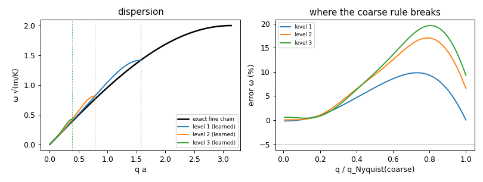
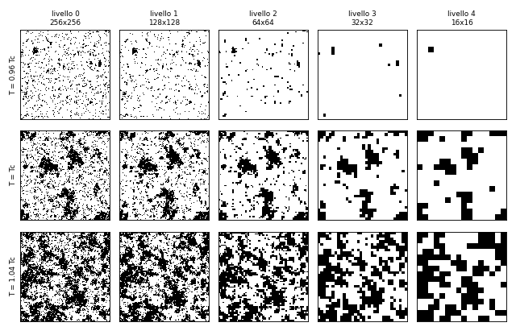
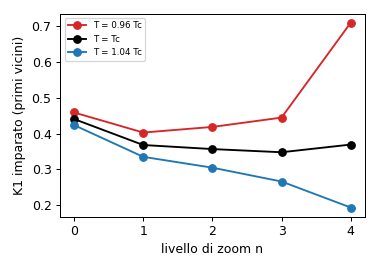
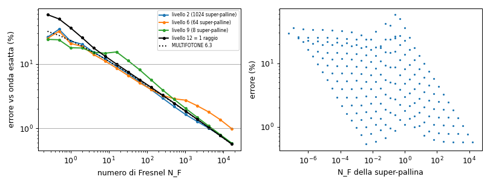

# Zoom: un solo algoritmo che si ripete come un frattale

Laboratorio: `lab/zoom_core.py` (l'algoritmo) e tre prove con risposta esatta nota:
`lab/zoom_chain.py` (catena di molle), `lab/zoom_ising.py` + `lab/zoom_ising_rg.py` (magnete di Ising
2-D al punto critico), `lab/zoom_light.py` (fasci di palline-fotone dietro una fenditura).
Python 3.14 + numpy/scipy (PyTorch non è installato su questa macchina: tutto è scritto in numpy).
Tutti i numeri qui sotto vengono da esecuzioni reali con seed fissi, 9 ottobre 2026, su una macchina a
4 core occupata anche da altri due agenti (i tempi sono quindi "sotto carico").

---

## 1. L'idea (di Valerio) in una frase

Si simula **un pezzetto** "a forza bruta" al livello fine; si **raggruppano** le palline vicine in
**super-palline**; si **impara** la regola delle super-palline con **un solo modello generico**; si
**controlla** l'errore contro il livello fine; poi si **ripete** sulle super-palline, e ancora, e ancora,
**senza cambiare una riga di codice** tra un livello e l'altro: cambiano solo i numeri imparati.

In fisica questa idea ha un nome: **gruppo di rinormalizzazione** (Wilson, Kadanoff), e la versione
"imparata dai dati" si chiama **coarse-graining appreso** (in chimica: *force matching*, *relative
entropy*). La regola d'onestà è una sola: **ogni raggruppamento butta via informazione**, quindi a ogni
livello si misura e si dichiara l'errore contro il livello fine, e c'è un controllo a campione che
risimula un pezzetto al livello fine e alza una bandierina se l'errore supera una soglia.

---

## 2. L'algoritmo (`lab/zoom_core.py`)

Cinque operazioni, identiche per ogni sistema e per ogni livello.

### 2.1 `block(stato, k)`: raggruppa

Le palline vengono raggruppate a blocchi di k per lato (k = 2 in tutte le prove: coppie in 1-D, quadrati
2×2 in 2-D). Chi sta in quale blocco si decide **una volta** dalle posizioni "di etichetta" (dove le
palline stanno a riposo), così un blocco resta lo stesso anche se le palline si muovono.

Ogni super-pallina è descritta da un **piccolo insieme fisso di numeri**, scelto in base alla
**dimensione dello spazio**, mai in base al sistema:

| descrittore | che cos'è | quanti numeri (in d dimensioni) |
|---|---|---|
| n | quante palline elementari contiene | 1 |
| q | cariche totali (massa, spin, numero di fotoni, ...) | una per tipo di carica |
| X | centro (media delle posizioni, anche con bordi periodici) | d |
| V | velocità del centro (quantità di moto / massa) | d |
| s² | momento secondo interno ⟨\|x − X\|²⟩ ("quanto è larga dentro") | 1 |
| E_int | energia cinetica interna (il "calore" del blocco) | 1 |

Una sola eccezione, anch'essa generica: se le cariche vivono nell'alfabeto {−1, +1} (spin), la carica
della super-pallina viene riportata nello stesso alfabeto con la **maggioranza** (segno della somma,
pareggio a caso). Così ogni livello ha lo **stesso tipo di stato** del livello sotto: è questo che rende
la regola ripetibile, cioè un frattale.

### 2.2 Il modello generico ("la struttura flessibile che fa prendere geometrie alle palline")

Una **espansione a grappoli locale**, lineare nei parametri:

    W = Σ_coppie q_i q_j φ(r_ij / h) + H Σ_i q_i + C3 Σ_triangoli q q q + C4 Σ_quadrati q q q q

* φ(r) è una funzione **qualsiasi** della distanza, fatta a spezzata (nodi ogni 0,25 h, fino a 6,5 h);
* i triangoli e i quadrati sono i grappoli compatti (tutte le distanze ≤ 1,5 h);
* h è la spaziatura **del livello**, quindi "6,5 h" vuol dire la stessa cosa a ogni livello.

Gli iper-parametri (6,5 h, 0,25 h, 1,5 h) sono **gli stessi per tutti i sistemi e tutti i livelli**.

### 2.3 `learn(dati del livello sotto)`: impara, in tre modi a seconda della domanda

| domanda | come si impara | che cosa diventa W |
|---|---|---|
| dinamica (come si muovono) | **force matching**: la forza su una super-pallina = somma delle forze sulle sue palline; si cerca la φ che la riproduce in media (minimi quadrati) | energia potenziale; forza = −gradiente |
| statistica d'equilibrio (che configurazioni si vedono) | **massima pseudo-verosimiglianza**: la versione locale del "relative entropy / moment matching" | logaritmo della probabilità |
| un passo di trasporto (dove finisce il fascio) | regressione del cambiamento dei descrittori in un passo (spostamento del centro, fattore di allargamento) | somma di termini di coppia |

### 2.4 `step(stato grosso)`: evolve con la regola imparata

Verlet (energia conservata) o Langevin (con temperatura) per la dinamica; heat bath (colorando il
reticolo così che palline dello stesso colore non si parlino) per la statistica; un passo di trasporto
per i fasci.

### 2.5 `check(regione)`: il controllo a campione

Si prende una regione a caso, la si **risimula al livello fine**, si confronta con la regola grossa e si
restituisce l'errore. Se supera la soglia, la regione viene **segnalata** (deve restare al livello fine:
è l'aggancio per il raffinamento adattivo, come Nanite per le mesh).

### 2.6 `repeat`

Non è codice nuovo: si chiama di nuovo `block` + `learn` sulle super-palline. Nella catena e nella luce
il livello n+1 viene imparato dai **dati prodotti dalla regola imparata al livello n**, non dal livello
fine: è la vera ripetizione, e gli errori possono accumularsi (li misuriamo).

---

## 3. Prova a: catena di molle (`lab/zoom_chain.py`)

**Sistema.** 1024 palline di massa m = 1 legate da molle K = 1, passo a = 1, ad anello, temperatura
T = 0,01. **Esatto:** suono c = a√(K/m) = 1; dispersione ω(q) = 2√(K/m)|sin(qa/2)|; un blocco di 2ⁿ
palline ha massa 2ⁿ m e, per le molle in serie, rigidità a lunga lunghezza d'onda K/2ⁿ. La **migliore
regola possibile** per i centri dei blocchi (il "potenziale di forza media" esatto) si calcola
dall'algebra gaussiana e la stampiamo accanto a quella imparata.

**Come.** Livello 0: dinamica di Langevin della catena vera (1200 configurazioni). Livello 1: blocchi
di 2, forza = somma delle forze, force matching. Livello 2: dinamica della **regola imparata** al
livello 1, poi blocchi, poi force matching. Livello 3 idem.

**Controllo del metodo al livello 0** (nessun raggruppamento): il modello generico trova
κ₁ = 1,0003 e κ₂…κ₆ ≤ 2·10⁻⁴ (esatto: 1 e 0).

### 3.1 La regola imparata

κₙ = rigidità tra super-palline a distanza n (dalla pendenza di φ).

| livello | palline per super-pallina | massa (esatta) | κ₁ imparata / esatta | κ₂ | κ₃ | K_eff = Σ n²κₙ imparata | esatta K/2ⁿ |
|---|---|---|---|---|---|---|---|
| 1 | 2 | 2,000 (2) | 0,9709 / 0,9706 | −0,1669 / −0,1665 | 0,0296 / 0,0286 | **0,4984** | 0,5 |
| 2 | 4 | 4,000 (4) | 0,6290 / 0,6281 | −0,1511 / −0,1510 | 0,0362 / 0,0363 | **0,2504** | 0,25 |
| 3 | 8 | 8,000 (8) | 0,3400 / 0,3389 | −0,0895 / −0,0884 | 0,0231 / 0,0231 | **0,1266** | 0,125 |

Due cose da notare:
* la regola grossa **non** è "una molla K/2 tra vicini": è una molla più forte (0,97) tra vicini più
  molle **negative** e positive più lontane, che decadono come (−0,17)ⁿ. Solo la loro somma pesata
  Σ n²κₙ vale K/2. Il modello l'ha trovato da solo; con un raggio di 2 vicini invece di 6 avrebbe
  sbagliato K_eff del 17% e il suono del 9% (prova preliminare con campioni esatti: K_eff = 0,80 con 1
  vicino, 0,41 con 2, 0,513 con 4, 0,5001 con 6, esatto 0,5). Il raggio 6,5 h non è un caso: è quello che serve;
* la ripetizione vera (livello 3 imparato dalla regola del livello 2) dà K_eff = 0,1266 (+1,3%);
  imparando il livello 3 direttamente dai dati fini si ottiene 0,1238 (−1,0%): l'accumulo degli errori
  è dello stesso ordine del rumore statistico.

### 3.2 Suono, dispersione, energia

| livello | suono (linearizzato) | suono misurato (onda stazionaria, NVE) | errore ω > 1% da | errore ω > 5% da | energia: max \|ΔE\| / (N T/2) |
|---|---|---|---|---|---|
| 0 (regola generica sul fine) | — | 1,00083 | — | — | — |
| 1 | 0,9984 | 0,99829 (−0,17%) | q = 0,20 q_N | q = 0,42 q_N | 9,3·10⁻⁴ |
| 2 | 1,0008 | 1,00077 (+0,08%) | 0,20 q_N | 0,35 q_N | 8,2·10⁻⁴ |
| 3 | 1,0063 | 1,00623 (+0,62%) | 0,21 q_N | 0,36 q_N | 1,1·10⁻³ |

(q_N = π/(2ⁿ a) è il Nyquist del livello: la lunghezza d'onda più corta che una catena di super-palline
può portare.)

**Dove si rompe.** Avevo previsto la rottura a q ~ π/(k a), cioè al Nyquist. **È più presto**: l'errore
supera il 5% già a ~0,35–0,42 del Nyquist e arriva al 10% (livello 1) / 17% (livello 2) / 20% (livello 3)
verso 0,75 q_N; le onde corte grosse risultano **troppo rigide**. Non è colpa dell'apprendimento: la
regola esatta "di forza media" (colonna PMF nel log) sbaglia **allo stesso modo** (5% da 0,42 / 0,36 /
0,35 q_N). È il prezzo di aver buttato via i moti interni dei blocchi: nella catena vera il centro di un
blocco a lunghezza d'onda corta è trascinato anche dai modi interni, e una regola **senza memoria** non lo
sa (in fisica: termini di memoria di Mori–Zwanzig). L'energia di quei moti interni non sparisce: è nel
descrittore E_int, che vale 0,00495 / 0,01506 / 0,03492 per super-pallina contro (2ⁿ−1)T/2 = 0,005 /
0,015 / 0,035 dell'equipartizione: è **calore**, non più movimento.

### 3.3 Controlli a campione

Varianza della lunghezza dei "legami" grossi in 6 regioni a caso di 32 super-palline, regola contro
blocchi dei dati fini, soglia 5%. Rumore dello stesso test fatto tra due metà dei dati fini: 3,4% / 4,7% /
4,6%. Livello 1: 1,0–4,9% (nessuna bandiera); livello 2: 1,9–4,2% (nessuna); livello 3: 3,8–7,2%,
**3 bandiere su 6**. Al livello 3 il controllo è al limite del suo rumore: una soglia del 5% con un rumore
del 4,6% non distingue bene; per farlo meglio servono regioni più grandi o più dati fini.

---

## 4. Prova b: magnete di Ising 2-D al punto critico (`lab/zoom_ising.py`, `lab/zoom_ising_rg.py`)

**Sistema.** Spin ±1 su un reticolo 256×256 periodico, vicini accoppiati con K = 1/T. **Esatto**
(Onsager 1944): T_c = 2/ln(1+√2) = 2,269185 (K_c = 0,440687). Al punto critico il sistema è un vero
frattale: guardato da più lontano ha lo stesso aspetto. Esponenti esatti: termico y_t = 1/ν = 1,
magnetico y_h = 15/8 = 1,875 (η = 1/4).

**Come.** Monte Carlo di Swendsen–Wang (forza bruta, l'unico codice specifico del sistema) a T_c (3000
passate), 0,96 T_c e 1,04 T_c (1000 passate). A ogni passata `block` con k = 2 (maggioranza) quattro
volte: 128², 64², 32², 16². A ogni livello `learn` statistico dello **stesso** modello generico.

**Controllo del metodo al livello 0** (64², 150 configurazioni): K₁ = 0,4455 (esatto 0,4407; due metà
dei dati: 0,4506 e 0,4405, quindi ±0,005), tutti gli altri accoppiamenti ≤ 0,003 (esatto 0).

### 4.1 Gli accoppiamenti imparati: punto fisso a T_c, fuga altrove

| T | livello | K₁ (vicini) | K_√2 (diagonale) | K₂ | C4 (quadrato) | H (campo) |
|---|---|---|---|---|---|---|
| T_c | 1 (128²) | 0,368 | 0,085 | −0,014 | −0,011 | −0,010 |
| T_c | 2 (64²) | 0,357 | 0,096 | −0,009 | −0,014 | −0,003 |
| T_c | 3 (32²) | 0,348 | 0,101 | −0,019 | −0,003 | −0,001 |
| T_c | 4 (16²) | 0,369 | 0,092 | −0,021 | −0,024 | −0,003 |
| 0,96 T_c | 1 → 4 | 0,403 → 0,419 → 0,445 → **0,710** | 0,095 → 0,117 → 0,121 → 0,353 | | | |
| 1,04 T_c | 1 → 4 | 0,335 → 0,305 → 0,266 → **0,193** | 0,079 → 0,081 → 0,069 → 0,051 | | | |

Variazione del vettore degli accoppiamenti da un livello al successivo:
T_c 0,017 / 0,018 / 0,031; sotto T_c 0,029 / 0,039 / **0,382**; sopra T_c 0,031 / 0,041 / 0,075.

* **A T_c la regola resta la stessa** (K₁ ≈ 0,35–0,37, K_√2 ≈ 0,09–0,10 a tutti i livelli): questo è il
  frattale vero. La regola del punto fisso **non** è la regola fine (K₁ = 0,44 da solo): ha anche la
  diagonale e piccoli termini a tre e quattro. Il passo da 3 a 4 (0,031) è più grande perché 16×16 è già
  piccolo (effetto di bordo finito).
* **Sotto T_c** l'accoppiamento cresce sempre più in fretta (verso il magnete ordinato, K → ∞);
  **sopra T_c** scende (verso il disordine, K → 0). Esattamente il comportamento atteso.

*Configurazioni ai livelli 0–4 (ogni riquadro è il sistema intero visto più da lontano). A T_c (riga in
mezzo) le immagini si somigliano a ogni livello; sotto T_c il bianco vince, sopra T_c il disegno
diventa rumore.*

### 4.2 Gli esponenti critici

Dalla regola linearizzata tra due livelli (metodo di Swendsen, MCRG: correlazioni degli operatori del
modello stesso, 4 pari e 2 dispari; errori statistici con jackknife a 20 blocchi):

| passo | y_t (esatto 1) | ν = 1/y_t | y_h (esatto 1,875) | η = 2(2 − y_h) (esatto 0,25) |
|---|---|---|---|---|
| 0 → 1 | 0,959 ± 0,013 | 1,043 | 1,8804 ± 0,0002 | 0,239 |
| 1 → 2 | 1,006 ± 0,017 | 0,994 | 1,8761 ± 0,0004 | 0,248 |
| 2 → 3 | 0,977 ± 0,010 | 1,023 | 1,8753 ± 0,0005 | 0,249 |
| 3 → 4 | 0,967 ± 0,016 | 1,034 | 1,8738 ± 0,0012 | 0,252 |

* **y_h** è giusto entro lo 0,06% (1 → 2) e lo 0,02% (2 → 3). Gli errori jackknife (10⁻⁴) sono **più
  piccoli** degli scarti tra un livello e l'altro (fino a 0,005): l'errore vero è sistematico (pochi
  operatori, primo passo vicino al reticolo fine, ultimo passo su 16×16). Errore onesto: ±0,005.
* **y_t**: 1,006 ± 0,017 al passo 1 → 2 (entro 1σ); 0,977 ± 0,010 e 0,967 ± 0,016 ai passi successivi
  (2,3σ e 2σ sotto). Errore onesto, compreso lo sistematico: y_t = 0,98 ± 0,03, cioè **ν = 1,02 ± 0,03**.
* **Tentativo fallito.** Ho provato anche a ricavare y_t direttamente dalla divergenza degli
  accoppiamenti imparati tra 0,96 T_c e 1,04 T_c (dovrebbe raddoppiare a ogni livello): rapporti 0,75 /
  0,65 / 1,53 invece di 1. Non funziona: ±4% non è "vicino" a T_c dopo 2–3 livelli (lunghezza di
  correlazione ~14 passi fini) e i dati sono pochi. Il metodo giusto è quello linearizzato sopra.

### 4.3 Controlli a campione

La regola imparata viene fatta girare (heat bath) partendo da 12 configurazioni fini raggruppate; se la
regola è giusta le statistiche locali non devono spostarsi. Confronto con la "regola ingenua" (usare la
regola fine K = 0,4407 tale e quale al livello grosso). Soglia 2% su ⟨s s⟩ dei vicini.

| livello | ⟨s s⟩ fine | regola imparata | regola ingenua | grappolo a 4: fine / imparata / ingenua |
|---|---|---|---|---|
| 1 (128²) | 1,3913 ± 0,0025 | 1,4109 (1,4% ± 1,0%) | 1,4253 (2,4%, **bandiera**) | 0,567 / 0,579 / 0,602 |
| 2 (64²) | 1,3906 ± 0,0044 | 1,3859 (0,3% ± 1,0%) | 1,3928 (0,2%) | 0,565 / 0,560 / 0,587 |
| 3 (32²) | 1,3990 ± 0,0081 | 1,3708 (2,0% ± 2,4%, **bandiera**) | 1,4326 (2,4%, **bandiera**) | 0,570 / 0,548 / 0,597 |

La regola imparata è sempre più vicina della regola ingenua sul grappolo a 4 (2–4% contro 5–6%), ma su
⟨s s⟩ il controllo ha un rumore dell'1–2,4%: con 12 partenze × 30–60 passate **non** basta a separare le
due regole in modo netto. Al livello 3 la bandiera della regola imparata è dentro il rumore.

---

## 5. Prova c: fasci di palline-fotone e il livello "raggi" (`lab/zoom_light.py`)

**Sistema.** Fenditura di semilarghezza a = 1, λ = 1, onda piana, schermo a distanza L; numero di
Fresnel N_F = a²/(λL) da 0,25 a 16.384. Livello fine: l'onda esatta di Fresnel (il limite continuo delle
palline-onda, che la riproducono entro lo 0,02%, MULTIFOTONE §6.2) e 4096 palline-fotone guidate. In 1-D
le palline guidate non si incrociano mai, quindi la pallina i atterra sul quantile (i + ½)/4096
dell'intensità.

**Come.** `block` raggruppa palline-fotone vicine (2, 4, ..., 4096 = tutte) e ne tiene i descrittori
generici (numero di fotoni, centro, larghezza). `learn` impara come cambiano centro e larghezza dalla
fenditura allo schermo, su **altre** fenditure (semilarghezze 1,5 / 2 / 3 / 4 a, stessa L): la fenditura
di prova non viene mai vista. Il livello n+1 è imparato dalle previsioni del livello n. Immagine grossa:
ogni super-pallina deposita i suoi fotoni uniformemente su X ± √(3 s²). **All'ultimo livello (12) c'è
una sola super-pallina con tutti i fotoni: un raggio-fascio con il conteggio dei fotoni.** Il codice
non sa niente di numeri di Fresnel: li usiamo solo dopo, per leggere i risultati.

Errore = distanza totale (metà della somma delle differenze assolute) dall'onda esatta.

| N_F | livello fine (4096) | livello 2 (1024): imparata / raggi | livello 6 (64) | **livello 12 = 1 fascio**: imparata / raggio dritto | MULTIFOTONE §6.3 (tabella) | allargamento imparato | livello più grosso entro 1% | entro 10% |
|---|---|---|---|---|---|---|---|---|
| 0,25 | 0,37% | 26,0 / 25,9% | 24,8 / 25,9% | 58,1 / 25,9% | 26,1% | ×4,44 | 0 | 0 |
| 1 | 0,37% | 22,6 / 22,4% | 20,8 / 22,4% | 36,3 / 22,4% | 22,4% | ×1,55 | 0 | 0 |
| 4 | 0,26% | 15,2 / 15,1% | 14,0 / 15,1% | 17,7 / 15,1% | 15,1% | ×1,09 | 0 | 0 |
| 16 | 0,16% | 9,2 / 9,3% | 8,6 / 9,3% | 9,9 / 9,3% | 9,3% | ×1,02 | 0 | **12** |
| 64 | 0,14% | 5,3 / 5,6% | 5,1 / 5,6% | 5,7 / 5,6% | 5,6% | ×1,005 | 0 | 12 |
| 256 | 0,20% | 2,9 / 3,2% | 3,3 / 3,2% | 3,3 / 3,2% | 3,2% | ×1,001 | 0 | 12 |
| 1024 | 0,39% | 1,6 / 1,8% | 2,7 / 1,8% | 1,8 / 1,8% | 1,83% | ×1,000 | 0 | 12 |
| 4096 | 0,38% | 1,0 / 1,0% | 1,8 / 1,0% | 1,0 / 1,0% | 1,03% | ×1,000 | 1 | 12 |
| 16.384 | 0,32% | 0,6 / 0,6% | 1,0 / 0,6% | 0,6 / 0,6% | 0,57% | ×1,000 | **12** | 12 |

**Soglie trovate** (interpolando l'errore del fascio unico): con la regola imparata il raggio va bene al
10% per **N_F > 15,7** e all'1% per **N_F > 4404**; con il raggio dritto puro 13,3 e 4363. Documentato in
MULTIFOTONE §6.3: **13 e 4400**.

Che cosa dice, senza abbellire:
* **Il livello "raggi" emerge da solo.** Quando N_F è grande, l'allargamento imparato per il fascio
  unico tende a ×1,000 e gli spostamenti a zero: l'agglomeratore, senza saperlo, ha imparato che il fascio
  "va dritto". Il fascio dritto riproduce la tabella documentata (MULTIFOTONE §6.3, stessa
  grandezza) entro 0,2 punti percentuali a ogni N_F; quello con l'allargamento imparato le sta sopra di
  meno del 3% relativo da N_F = 64 in su.
* **E fallisce quando deve.** Per N_F piccolo l'errore è grande (36–58%) e i controlli a campione lo
  segnalano (tutte le finestre oltre il 10%): lì bisogna restare alle palline-onda, come dice la regola di
  scelta di MULTIFOTONE §6.5.
* **A N_F piccolo la regola imparata è peggio del raggio dritto** (58% contro 26% a N_F = 0,25). Il fascio
  unico di prova non ha vicini, mentre le fenditure di addestramento a quel livello ne hanno; il modello
  estrapola un allargamento ×4,4 che non è giusto. È un errore di **generalizzazione**, e il controllo lo
  vede.
* **I livelli intermedi non battono il raggio.** Con 1024 o 64 super-palline l'errore è quasi uguale a
  quello del raggio (a volte un po' meglio, a volte peggio): una super-pallina descritta da centro e
  larghezza **non può** contenere le frange di Fresnel, che sono un effetto di **fase**. La fase è proprio
  l'informazione che il raggruppamento butta via. Per la luce quindi la scala è "tutto onda dove N_F è
  piccolo, raggi dove è grande", senza gradini utili in mezzo, ed è quello che i numeri mostrano.
* Il pannello di destra mostra che l'errore **non** dipende solo dal numero di Fresnel della singola
  super-pallina (i punti non si allineano): conta il numero di Fresnel dell'**apertura** (dove sono i
  bordi), non quello del pezzo.

---

## 6. Efficienza: quanto si risparmia

| sistema | osservabile | fine: costo, errore | grosso: costo, errore | guadagno |
|---|---|---|---|---|
| catena | velocità del suono (onda più lunga, 2,2 periodi) | 1024 palline × 22.534 passi = 23,1 M passi-pallina, 44,9 s, 0,08% | livello 1: 8,8 M, 20,9 s, 0,17%; livello 2: 2,6 M, 8,6 s, 0,08%; **livello 3: 0,69 M, 3,9 s, 0,62%** | ×11 in tempo, ×33 in passi-pallina, errore < 1% |
| catena | dispersione oltre 0,35 q_N | — | errore > 5% a ogni livello | **nessuno**: lì serve il fine |
| Ising a T_c | statistiche locali, esponenti | Swendsen–Wang 256²: 35 ms a passata | heat bath della regola imparata: 128² 50 ms, 64² 13 ms, 32² 8 ms a passata | **nessuno in velocità**: la regola grossa ha 130 vicini invece di 4 e un aggiornamento locale rallenta al punto critico; il guadagno vero è aver ottenuto ν e η |
| luce, N_F ≥ 16 (10%) o ≥ 4400 (1%) | figura sullo schermo | 4096 palline-fotone + l'onda | **1 fascio** | ×4096 in palline, e in 3-D l'onda non serve più (MULTIFOTONE §6.4: 10²¹ palline per i gamma) |

Costo una tantum dell'apprendimento: catena 1–2 minuti per tutti e tre i livelli; Ising ~5 minuti di
Monte Carlo fine + 5 minuti di apprendimento; luce ~8 s per numero di Fresnel.

---

## 7. Che cosa funziona e che cosa no (onestà)

**Funziona**
1. Lo **stesso codice** ha imparato tre cose di natura diversa: molle (dinamica), spin (statistica),
   fasci di luce (trasporto), con gli stessi iper-parametri.
2. Catena: massa esatta, rigidità a lunga lunghezza d'onda entro l'1,3% di K/2ⁿ, accoppiamenti entro
   ~10⁻³ dalla regola esatta, suono entro lo 0,6% dopo tre raggruppamenti ripetuti, energia conservata
   (10⁻³).
3. Ising: punto fisso a T_c (la regola si ripete uguale: il frattale), fuga verso K → ∞ / K → 0 fuori
   da T_c, y_h = 1,875 ± 0,005, ν = 1,02 ± 0,03.
4. Luce: il livello "raggi" emerge da solo; soglie 15,7 / 4404 contro 13 / 4400 documentate.

**Non funziona, o solo in parte**
1. **Onde corte.** Ogni regola grossa senza memoria sbaglia oltre ~0,4 del suo Nyquist (anche quella
   esatta). Rimedio possibile (non fatto): aggiungere ai descrittori i modi interni principali, o un
   termine di memoria.
2. **Raggio della regola.** La regola grossa della catena è a lungo raggio (decade come 0,17ⁿ); con meno
   di ~6 vicini il suono sbaglia di molti punti percentuali. In 3-D questo costa: ~1150 vicini per
   super-pallina con lo stesso raggio.
3. **Fase della luce.** Raggruppare palline-fotone butta la fase; i livelli intermedi non servono e
   la regola imparata generalizza male a N_F piccolo (58% contro 26% del raggio dritto).
4. **Ising: velocità.** Nessun guadagno di velocità al punto critico. Gli errori statistici degli
   esponenti sono più piccoli di quelli sistematici; li dichiaro entrambi.
5. **Controlli a campione rumorosi.** Con i dati usati, soglia e rumore sono vicini (catena livello 3:
   rumore 4,6% contro soglia 5%; Ising: rumore 1–2,4% contro soglia 2%). Un controllo serio deve
   stimare il proprio rumore (come facciamo) e usare abbastanza dati da stare ben sotto la soglia.
6. **Due tentativi falliti**, lasciati nel testo: la stima di ν dal flusso degli accoppiamenti
   imparati (§4.2) e, nella prima versione della prova sulla luce, la regressione del momento secondo
   s² con i minimi quadrati: le code della diffrazione (pochi fotoni lontanissimi) dominavano la media e
   la regola imparata era peggio del raggio a ogni livello (17% contro 5,6% a N_F = 64, livello 1).
   Correzione generica: imparare il **fattore** di allargamento (logaritmo), perché le grandezze
   positive cambiano per fattori. Con questa correzione: 4,7% contro 5,6%.

---

## 8. Il prossimo passo: atomi e molecole

Un altro agente sta costruendo il livello "atomi e molecole" con le nostre palline-elettrone
(`src/molecole/`, regola di diffusion Monte Carlo per pallina; documento `docs/MOLECOLE.md`, in
scrittura). L'agglomeratore si collega così, senza codice nuovo:

1. **Livello fine = palline-elettrone.** Per una posizione dei nuclei, le palline-elettrone danno
   l'energia (e, derivando, le forze sui nuclei). Gli elettroni sono velocissimi rispetto ai nuclei:
   raggrupparli **è** l'approssimazione di Born–Oppenheimer, e la regola che resta per i nuclei è un
   potenziale di forza media, esattamente come nella catena.
2. **`block`**: elettroni + nucleo → super-pallina "atomo" (carica totale, centro, s² = dimensione della
   nuvola, E_int); atomi legati → super-pallina "molecola".
3. **`learn('force')`**: force matching sulle forze calcolate dalle palline-elettrone per molte
   posizioni dei nuclei (H₂ a varie distanze, poi H₂ + H₂, acqua...). La φ imparata deve dare la
   distanza di legame e la frequenza di vibrazione di H₂ (valori misurati noti).
4. **`check`**: a campione, in configurazioni scelte a caso (anche durante una simulazione grossa), si
   rilancia il calcolo con le palline-elettrone e si confronta la forza; dove l'errore supera la soglia
   (legami che si rompono, reazioni, eccitazioni) la regione si tiene al livello elettroni.
5. **Ripetere**: molecole → gocce (liquido) → pezzi di materiale, con la statistica come per Ising:
   lì l'obiettivo sono le proprietà misurate in tabella (densità, calore specifico, indice di
   rifrazione), che diventano gli esami dei livelli sotto ("ogni proprietà in tabella è un debito",
   VISIONE_SISTEMA).

Attenzione, imparata qui: (a) la luce che interagisce con la materia ha bisogno degli **stati eccitati**,
che il raggruppamento d'equilibrio butta via: i descrittori di un atomo dovranno portare almeno la
polarizzabilità e le energie di transizione, oppure il controllo dovrà segnalare ogni fotone vicino a
una risonanza; (b) le forze tra molecole sono a lungo raggio (Coulomb, dispersione): il raggio fisso di
6,5 spaziature andrà affiancato da una coda esplicita, come la catena insegna.

---

## 9. Come rieseguire

    timeout 590 python lab/zoom_chain.py        # 211 s (sotto carico)
    timeout 590 python lab/zoom_ising.py        # 443 s (Monte Carlo, scrive lab/out/zoom_ising_mc.npz)
    timeout 590 python lab/zoom_ising_rg.py     # 370 s (apprendimento, esponenti, controlli, figure)
    timeout 590 python lab/zoom_light.py        # ~140 s

Uscite in `lab/out/`: `zoom_*.log`, `zoom_*.json`, figure `zoom_chain_dispersion.png`,
`zoom_ising_snapshots.png`, `zoom_ising_flow.png`, `zoom_light.png`. Seed fissi; i tempi dipendono dal
carico della macchina (il Monte Carlo di Ising è passato da 82 a 142 ms a passata con gli altri agenti
attivi).
